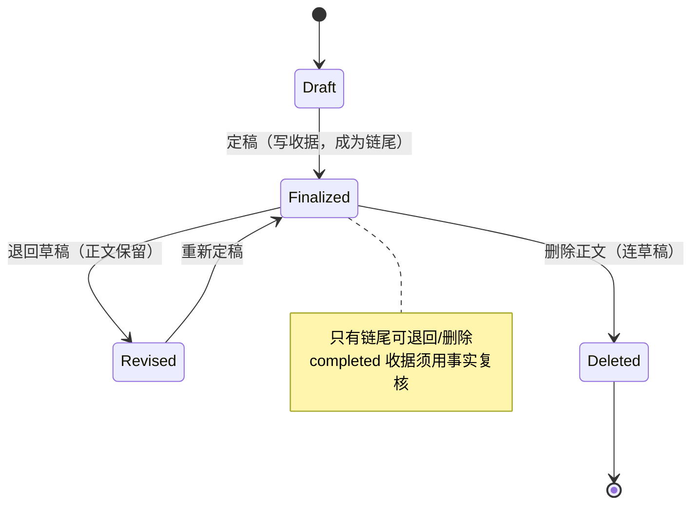

# 定稿与删除之间必须隔一个「退回草稿」

定稿不可变是事实约束，但「想改这一章」不是删除意图。此前二者共用一条路径：每章通常只有一条草稿 `v1`，它就是定稿，因此「删除定稿」在数据层同时删掉了这条草稿与它的正文（`drafts` + `contents` + `finalization_outbox` + 后处理投影），正文章节只留蓝图，正文彻底消失。2026-10-23 实机：作者删掉第 2、3 章定稿后草稿箱整条消失，只能从备份恢复；同一缺失还制造了此前的「定稿后被改正文」脏数据（没有退回通道，只能硬改已定稿正文）。

现在定稿有两个出口，且入口分离：**退回草稿**（草稿箱）撤销定稿事实、保留 `drafts` 与 `contents`，把状态置回 `revised`，同一事务内删除 `finalization_outbox`、该章 `post_process_runs`（步骤随外键级联）、`summary_snapshots`、该章 `resource_movements` 并自该章起失效连续性投影，正文实体稿与知识库文档按既有可恢复投影清理走；**删除正文**（正文章节）保留原有语义与二次危险确认，连草稿一起删。定稿事实消失时，依赖它的派生必须一并失效，不得保留成「看起来还在」的第二套真相。旧定稿（无可验证知识文档身份）不开退回通道：那条确认分支落到事实删除，与「退回绝不删正文」冲突，改为直接拒绝并给出可行替代。草稿箱对定稿行不再提供删除入口——删除只存在于「正文章节」，避免在改稿的位置误毁正文。

## 只有定稿链尾部可以动（2026-10-23 作者补充裁定）

「删定稿/退回草稿」还必须满足一个更强的前提：**目标章必须是当前定稿链的最后一章**。第 N 章定稿之后，第 N+1 章是基于它的事实写出来并定稿的（角色状态、连续性事实、账本余额、故事日序都从它推）。此时撤掉第 N 章，后续章节的正文与收据仍然挂着，但依据已被抽走——这不是报错，是**静默失去前提**：不会有人发现，直到一致性全面崩掉。所以中间章的退回与删除一律非法（`FINALIZED_CHAIN_TAIL_REQUIRED`），两条入口共用同一道守卫（`chapter-deletion-repository` 的 `requireFinalizedTarget`），拒绝时什么都不删。

要跳着退（第 5 章还定稿着却想退第 2 章），必须连带回退第 3–5 章的正文与派生——那是「指定连续回退 / 卷回滚」，与卷级结构一起设计，不在本 ADR 范围。当前只支持一种形态：从最后一章开始，一章一章往回退；退完 N，N−1 自动成为新尾部。

## 状态机

**一句话读法**：`Finalized → Revised` 是新增的出口，它保正文；`Finalized → Deleted` 才是真删。
两条出口都在**链尾守卫**之下，中间章不可达。

## Consequences

- 「删定稿连草稿一起删」仍然是删除的正确语义，但不再是改稿的唯一出路；两件事各自有入口与文案。
- 退回是可重复的：重新定稿会重建收据与后处理；退回期间该章余额/要点显示为未知而非旧值。
- 状态 `revised` 承担「已定稿过一次、现在待定稿」这一状态，不再需要额外的标志位。
- 旧定稿若确实需要改稿，先手动清理知识库文档，再使用「删除正文」，或等待该项目重建知识投影。
- 连续退几章要退几次，这是刻意的手续成本：每一次退回都在撤销一批已生效的派生事实，不该一次点击连带完成。
- 卷回滚（指定退到某一章、连带回退其后所有章节）仍是空白，已在记忆中登记为待立项。
