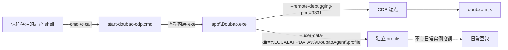

# 给豆包电脑版派活（协作通道操作手册）

> 状态：已实施（2026-11-04）· 实测版本 豆包 2.34.6 Launcher / Chromium 147.0.7727.149
> 用途：**让本机 agent 会话把活派给豆包客户端**，用它的「新工作任务」agent 模式操作本地文件。
> 关系：与 [`copilot-channel.md`](./copilot-channel.md) 并列——Copilot 是命令行进程，豆包是**桌面 UI**，只能靠 CDP 驱动。
> 缘起：2026-11-02 打通。此前只能人在豆包窗口里手打发，不是可编排通道。

## 0. 一句话读法

```bash
node scripts/doubao/bootstrap.mjs --effort 中           # 先：起实例 + 新线程 + 本地电脑 + 档位 + 项目自检
node scripts/doubao/doubao.mjs task "任务描述" --project <项目名>   # 再：派活
```

它连 `127.0.0.1:9331` 的**独立 profile 豆包实例**，走真实鼠标/键盘事件驱动 UI，读回干净正文。
`bootstrap.mjs` 只做「保证就绪」，不派活；`--check` 是纯只读诊断（§2.1）。

## 1. 为什么不能直接给日常那个豆包加参数

这是踩了两小时的坑，先记住，别再重走：

| 事实 | 后果 |
|---|---|
| `Application\Doubao.exe` 是 **Launcher 2.34.6**（1.8MB），不是主程序 | 它**吞掉**未知参数，`--remote-debugging-port` 传不到 renderer |
| `Application\app\Doubao.exe` 才是 Chromium 主体（147.0.7727.149） | CDP 参数必须给它，进度条日志可证 renderer 收到了 |
| 同一份 `User Data` 有单实例锁 | 直启内层程序 + 原 profile = 启动后自己退出（`engine.cc ### NO global context`） |
| Launcher 启动的进程会 detach | 从工具会话直启的进程会随命令结束被回收，必须在一个**保持存活的后台 shell** 里跑启动脚本（§2.1），或者干脆**由人启动**（§2.2，推荐） |

⇒ 唯一可行组合：**内层 exe + 独立 `--user-data-dir` + 一个活着的后台 shell 保住启动进程**。

> **2026-11-04 更正**：上一版这里（以及 §2 表格）写着「Explorer 代启已失效 / shell execute 被整体阻断」，**这是错的**。真相是 `explorer.exe <cmd>` 确实执行了目标，但停在 Windows 的「未知发布者 / 是否运行」确认框上；无人点它，探针文件自然不生成。作者实测：**换成只写 Hello World 的空脚本同样弹窗** ⇒ 与脚本内容无关，是脚本执行策略。原始错误结论保留在 git 历史 `368a679c`，本节已改正。



读法：那个 shell 唯一的职责是**别退出**（它一退，实例随后消失）；参数和隔离都由 cmd 脚本给。

## 2. 落点

| 项 | 值 |
|---|---|
| 启动脚本（项目内） | `scripts/doubao/start-doubao-cdp.cmd` |
| 启动脚本（用户级副本） | `%LOCALAPPDATA%\DoubaoAgent\start-doubao-cdp.cmd` |
| 独立 profile | `%LOCALAPPDATA%\DoubaoAgent\profile` |
| CDP 端口 | **9331**（避开本项目 Electron dev 的 9222、DeepSeek Harness 的 9230） |
| CLI | `scripts/doubao/doubao.mjs` |
| 一键启动/切换 | `scripts/doubao/bootstrap.mjs`（§2.1） |
| 话题（侧栏线程）切换 | `doubao.mjs threads` / `doubao.mjs thread "标题片段"`（§2.3） |
| 调试探针 | `scripts/doubao/probe.mjs`（只读，可随时跑） |

### 启动：默认由人来做（2026-11-04 起）

**推荐做法 —— 人启动一次，之后一直复用同一个窗口：**

```powershell
# 在你自己的 PowerShell / Windows Terminal 里（不是工具会话里）：
& "C:\develop\workspace\AI-writer\develop\scripts\doubao\start-doubao-cdp.cmd"
```

或者在资源管理器里双击 `scripts\doubao\start-doubao-cdp.cmd`。

- **会弹「未知发布者 / 是否运行」→ 点「运行」**（双击路径已实测；终端直接跑的弹窗行为未实测）。这一下之后窗口常驻，`9331` 一直在，**不新建线程就不重读章程**。
- 这份确认框与脚本内容无关：作者实测换成只写 `Hello World` 的空脚本同样会弹 ⇒ 是 Windows 对脚本执行的策略，不是脚本有问题，也不是 explorer 坏了。

**工具会话里不要指望自己起**：脚本执行要过确认框而无人可点；绕过确认用 `spawn` 起出来的实例挂在工具 shell 的 job 里，shell 一结束就被回收（两次断点精确落在 `sleep` 到期时刻：22:31 / 22:56）⇒ 表现为「起来了几分钟又没了」。所以 `bootstrap.mjs` **默认不自动启动**，只在实例不在线时把命令交给人（§2.2）。

```bash
# 备选：确实需要在后台 shell 里保住实例时（知道它会随 shell 短命再用）
cmd //c "C:\develop\workspace\AI-writer\develop\scripts\doubao\start-doubao-cdp.cmd"
# 之后这个 shell 不要退出（例如接着 sleep 900）；shell 一退，实例随后消失
# 或者：node scripts/doubao/bootstrap.mjs --launch   # 显式要求脚本自己 spawn
```

实测：12 秒后 `127.0.0.1:9331` LISTENING，`node scripts/doubao/doubao.mjs status` 正常返回，父 shell 存活期间实例稳定。

> 路径里**含空格**时上面那行会被 cmd 的引号规则坑掉（`cmd /c "a b.cmd"` 会把引号吞掉再按空格切，实测报「不是内部或外部命令」）。此时用 `cmd /d /s /c call "<路径>"` —— 这也是 `bootstrap.mjs` 内部采用的形式（2026-11-03 用带空格的探针 `.cmd` 实测：`call` 形式目标文件生成成功，`cmd /c "…"` 形式失败）。

### 各种启动方式的实际结论（2026-11-04 校正）

| 方式 | 状态 | 证据 / 说明 |
|---|---|---|
| **人手动执行/双击 `start-doubao-cdp.cmd`** | ✅ **推荐** | 进程挂在桌面会话下，与工具会话无关 ⇒ 窗口常驻可复用。双击会弹「未知发布者 / 是否运行」，点「运行」即可 |
| `explorer.exe <任意路径>` 代启 | ⚠️ **会执行，但停在确认框** | 上一版写成「已失效 / shell execute 被整体阻断」，**是误判**。2026-11-04 作者实测：只写 Hello World 的空脚本同样弹确认框 ⇒ `explorer` 找对了目标，只是无人点「运行」，所以探针文件没生成、`exit=1`。**结论：这条路通，但无人值守过不去** |
| `cmd /c start "" <文件>` | **结论不可信（原判据有缺陷）** | 上一版用「记事本进程数不变」判它无效 —— Windows 11 记事本**多标签共用进程**，新窗口数量不会反映到进程计数上，作者肉眼确认窗口确实开了。⇒ 这条判据作废，实际行为**未重新验证** |
| `cmd /c start "" <exe> <参数>` | **能起，但短命** | 豆包实例确实起来（`CreateProcess` 不过 shell），但进程留在工具会话的 job 里 ⇒ **保活 shell 一到点就被清**。两次断点精确落在 `sleep` 到期时刻（22:31 / 22:56），中间看到的「还在」只是清理延迟窗口 |
| `schtasks.exe` 建计划任务 | 禁止 | 在 WorkBuddy 安全策略的**程序黑名单**里，返回明确提示，不许绕路 |
| WMI `Invoke-CimMethod Win32_Process Create` | 禁止 | 被拦，提示「equivalent to Start-Process」 |
| PowerShell `Start-Process` | 禁止 | 进程随会话回收，表现为「开了几秒又没了」 |

**结论（改正版）：工具会话里拉不起长寿实例，卡点不是「explorer 坏了」，而是「未签名脚本执行要过一道道人工确认，而这里没有人」。** 所以启动这一下**交给人**（§2.2），agent 只负责连上去、切模式档位、派活。

## 2.1 一键启动（bootstrap）

`bootstrap.mjs` 把「起实例 → 建新线程 → 切本地电脑 → 切档位（**只在点名时**）→ 核对项目」压成一条命令。**它不杀进程、不重启实例**：在线就跳过启动，只保证「有」和「就绪」。

> **档位默认不动**（2026-11-04 改）：不传 `--effort` 就只核对 chip 上有值，不会替你切档。此前默认「高」，于是「只想补选项目」的 `--keep --project` 会把中档悄悄抬成高档 —— 档位是钱，没点名不许动。

```bash
node scripts/doubao/bootstrap.mjs               # 完整拉起并自检
node scripts/doubao/bootstrap.mjs --check       # 只读诊断：不启动、不点击，只打印当前状态
node scripts/doubao/bootstrap.mjs --keep        # 不新建线程，复用当前线程
node scripts/doubao/bootstrap.mjs --force       # 即使已是目标值也重跑一次切换（验证「切得动」，不只是「本来就对」）
node scripts/doubao/bootstrap.mjs --effort 中   # 切「自动 中」；--effort 高 切「自动 高」；不传则不动档位
node scripts/doubao/bootstrap.mjs --project AI-writer-wt-1   # 额外切项目（可选）
node scripts/doubao/bootstrap.mjs --launch       # 例外：要求脚本自己 spawn 实例（短命，见 §2）
```

选项：`--port 9331` · `--launch-timeout 45`（秒）。

> ⚠️ **`--help` 不是只读，它会把整套 bootstrap 跑一遍**（2026-11-05 踩到）。
> `bootstrap.mjs:63-67` 的解析只用 `argv.includes('--xxx')`，**没有任何 `--help` / `-h` 分支**，
> 未知参数被静默忽略 ⇒ 你以为在"看帮助"，实际已经 `[ok] 新建线程` 并切了模式档位。
> **查状态一律用 `--check`，别用 `--help`。**

### 2.1.0 该复用还是该新开（派活前必须先答这一句）

裸跑 `bootstrap.mjs` 每次都**建新线程**（第 2 步）。手册第 60 行的推荐做法是「人启动一次，之后**一直复用同一个窗口**」，
因为**新线程要重读章程**（同会话不重复）。所以派活前的正确顺序是：

```bash
node scripts/doubao/bootstrap.mjs --check          # 1. 只读：先用看当前线程标题与 turnCount
node scripts/doubao/bootstrap.mjs --keep --project <项目> [--effort 中]   # 2a. 复用（默认该走这条）
node scripts/doubao/bootstrap.mjs --project <项目> [--effort 中]          # 2b. 新开（少数情况）
```

**判据（一句话）**：**同一张卡、同一批活的后续追问、或只是补切项目/档位 ⇒ `--keep`**；
**换一件与当前线程上下文无关的新任务 ⇒ 才新开** —— 否则旧任务的约束和结论会污染新任务（§4 那个"两件事混一起"的实测）。

> 2026-11-05 反例：一晚上派 D20 一个任务，却因为 ① `--help` 白跑一次 ② 带 `--project` 裸跑一次，
> 建了 **2 个新线程**，其中一个完全空转。作者从界面上看到"都是新窗口"才发现。
> **`--keep` 是默认值，不是优化项** —— 不新建线程就不重读章程，这是真金白银。

**默认不自动启动。** 实例不在线时它不尝试 spawn，直接打印人工启动命令并以退出码 2 结束（§2.2）——这是 2026-11-04 按作者要求改的行为：脚本自己起只能得到短命实例，反而不如老实交给人。

**步骤顺序是有原因的（写死在脚本里）：**

| # | 步骤 | 为什么必须在这个位置 |
|---|---|---|
| 1 | 实例在线（不在线 → 打印人工启动命令，退出 2；加 `--launch` 才自己起） | 后面全是 CDP 操作，没实例什么都做不了 |
| 1.5 | 等界面就绪（等**编辑器**出现，上限 45s） | 端口通 ≠ UI 就绪：刚拉起的实例约 8–12s 才渲染出输入框，早一步找按钮会得到「找不到「新工作任务」按钮」。**等编辑器不等任务输入框**——实例可能停在「对话」模式，那时任务输入框本就不存在，等它会白等到超时 |
| 2 | 新建工作任务线程 | **它会把推理档位重置回「中」**（模式保留）⇒ 必须先建线程再切档位，顺序反了等于白切 |
| 3 | 模式 → 本地电脑 | 默认是「对话」，**对话模式没有本地文件权限**，它只会回「我无法读取你本地磁盘文件」 |
| 4 | 推理档位 → 自动 高 | 新线程默认「自动 中」，档位是**会话级**的，不跨线程继承 |
| 5 | 项目路径核对 | 打开项目菜单读出「名字 + 绝对路径」，这是「它到底在哪个目录干活」的唯一直接证据 |

每步打印一行 `[ok]/[skip]/[fail] <步骤> <证据>`，最后打印一段 JSON 自检：

```json
{ "port": 9331, "runMode": "本地电脑", "model": "自动 高",
  "project": { "label": "AI-writer-wt-1 C:\\develop\\workspace\\AI-writer\\wt-1", "hasAbsolutePath": true },
  "thread": { "turnCount": 0 }, "ready": true, "steps": [ … ] }
```

- **幂等**：实例在线就 `[skip]`，模式已是本地电脑就 `[skip]`，档位已是高就 `[skip]`。
- **退出码**：`0` 全部 ok/skip · `1` 有步骤失败（`✗ 未就绪：…` 会点出是哪一步）· `2` 实例起不来或连不上。
- `--check` 不点击，所以**项目绝对路径那一步只能是 `[skip]`**（chip 常只显示项目名，路径要开菜单才看得到）。要路径就裸跑 bootstrap 或 `--keep`。
- **项目核对会认「没选」了**（2026-11-04 修）：底栏 chip 只剩占位文本「项目」时判 `[fail] 底栏「项目」未选`。此前它直接拿菜单里的 `active` 当当前项目，于是两个都没选项目的话题也报 `✓ AI-writer-wt-1`（还带着路径）（作者截图发现）。判据抽成纯函数 `scripts/doubao/project-chip.mjs`，单测 10 条。**代价**：`active` 只留作兜底（chip 有名字但菜单里没有这条时），所以 chip 显示的项目名与真实项目不一致这种极端情况仍会漏 —— 但不会再「什么都没选也报 ok」。
- **保活是硬约束，不是建议**（2026-11-03 两次断点实证）：实例挂在启动它的 shell 上，`run_in_background` 的 `sleep` 一到点就被清 —— 22:31 / 22:56 各一次，`netstat` 从 `LISTENING` 直接变 `TIME_WAIT`，中途看到的「还在」只是清理延迟窗口。所以脚本只负责「拉起并等端口就绪」，**真正的长寿只有一个办法：在工具会话之外启动**（人手动双击 `start-doubao-cdp.cmd`，或做成开机自启），之后本脚本一律只用 `--check` 或幂等连接，不再启动。
- `--force` 只影响第 3、4 步的 `[skip]` 判定（模式与档位），不会重拉实例、不会多建线程。
- ⚠️ **「对话」模式下的档位 chip 显示的是「快速」而不是「自动 中」**（对话模式只有快速档）。所以「从中切到高」这条路径只能在**任务模式**里验；从对话模式恢复时，模式先切回本地电脑，档位 chip 才会重新出现「推理强度 → 高」。

### 2.1.1 冷启动 + 降级恢复实测（2026-11-03 22:5x，主 agent）

| 场景 | 做法 | 结果 |
|---|---|---|
| **冷启动（从零拉起）** | 实例未运行时裸跑 `bootstrap.mjs` | `[ok] 启动实例` → `[ok] 等待界面就绪 耗时约 2s` → `[ok] 新建线程` → `[ok] 运行模式 → 本地电脑` → `[ok] 推理档位 → 自动 高` → `[ok] 项目路径 AI-writer-wt-1 C:\develop\workspace\AI-writer\wt-1` |
| **降级后恢复（真验证）** | 手工降到 `runMode=对话` / `model=快速`，再跑 `bootstrap.mjs --force` | 四步全 `[ok]`：新建线程 → 本地电脑（`method=dom-click`）→ 自动 高（推理强度 → 高）→ 项目路径带绝对路径 |

**这条实测同时否定了两个"看起来能用"的假设**：①「端口通了就能派活」（页面还要 8–12s 才渲染）；②「幂等跳过等于切得动」（要 `--force` 才真验过）。

> 第一条的「裸跑就自己起」已**不再适用**：2026-11-04 起默认不自动启动，要复现这条得加 `--launch`（§2.2）。

## 2.2 连不上时的处理：弹框交给作者（2026-11-04 起）

### 2.3 多个话题同时开着：先认话题，再说话（2026-11-04 起）

豆包是**多话题 SPA**，同一个实例可以并行开着好几轮任务；而 `say` / `task` 打的都是
**当前打开的那一个**。2026-11-04 就出过：给新一轮补的「继续执行」打进了上一轮的话题，
那个 agent 于是开始找一份它从没收到过的任务书，白烧三分钟。

```text
node scripts/doubao/doubao.mjs threads                 # 侧栏话题清单 + 当前 href
node scripts/doubao/doubao.mjs thread "三个纯函数模块"   # 按标题片段切过去（真实鼠标点击，会验 href 变没变）
node scripts/doubao/doubao.mjs say "继续"              # 与上次派活的话题不一致时**直接拒绝**
```

- 记录写在 `.runtime/doubao/last-thread.json`（gitignore），由 `task` / `say` / `thread` 维护；
- 不一致时的报错会把「记录的话题」和「当前话题」都打出来，先 `thread` 切过去，或加 `--force`；
- **`--new` 除外**（那是明确要开新话题）；记录写不进去只提示、不拦（护栏不该挡住正经派活）；
- `threads` 的标题取自侧栏行文本，**同一标题可能有多条**（比如两轮「AI-writer-wt-1 任务执行」）⇒ `thread` 取第一条匹配；对不上就先 `status` 看当前 href 再决定。

**触发条件**：`bootstrap.mjs` 退出码 **2**，或输出里出现 `NEED_HUMAN_LAUNCH`。含义是「实例不在线，本会话拉不起来」——不是模型变笨、不是代码坏了。

脚本会把命令原样印出来（实测输出，2026-11-04）：

```
────────────────────────────────────────────────────────────────────────
⚠  需要人工启动（本会话拉不起来）
   原因：端口 9331 未监听

   请在【你自己的】PowerShell / Windows Terminal 里执行：

     & "C:\develop\workspace\AI-writer\develop\scripts\doubao\start-doubao-cdp.cmd"

   或 cmd：

     "C:\develop\workspace\AI-writer\develop\scripts\doubao\start-doubao-cdp.cmd"

   若弹「未知发布者 / 是否运行」→ 点「运行」，窗口留着别关。
   （双击执行必弹；从终端直接跑的弹窗行为未实测）
   起来后重跑本命令（在线就全 [skip]，不会新建线程、不重读章程）。
────────────────────────────────────────────────────────────────────────
NEED_HUMAN_LAUNCH
```

### agent 的硬约定（见 `NEED_HUMAN_LAUNCH` 就必须这么做）

1. **立刻弹一次确认框**（交互式提问），把上面的**完整路径**放进去，让作者能直接复制；选项给「已启动，继续」/「先不派活」两类即可，**不要**让作者自己去翻文档找命令。
2. **不要反复重试**：同一轮里最多试 1 次连接、1 次弹框。连续重试只会烧时间，实例不会因为重试而出现。
3. **不要自己 spawn / 不要杀豆包进程**：`--launch` 起出来的实例随工具 shell 短命（§2），杀进程会切断作者正在用的窗口或正在跑的批次。
4. **作者确认启动后**，重跑 `node scripts/doubao/bootstrap.mjs`（需要新线程）或 `--keep`（复用当前线程）。**别新建线程就没必要新建**——复用窗口 = 不重读章程 = 省 token。
5. 作者说「先不派活」就停在这里，把队列任务书落盘待用，不要挂起等待、不要改派别的通道顶替。

### 为什么不能自己扛过去

| 尝试 | 结果 |
|---|---|
| `explorer.exe <cmd>` | 会执行，但停在「未知发布者 / 是否运行」确认框，无人可点（§2 表格） |
| `spawn` / `cmd start`（绕过确认） | 实例能起来，但挂在工具 shell 的 job 里，shell 一结束就被回收 |
| `schtasks` / WMI / `Start-Process` | 安全策略黑名单或等价拦截（§2 表格） |

⇒ 这一下**只有人能点**，所以它是设计上的交接点，不是待修的 bug。

## 3. 命令速查

```bash
node scripts/doubao/bootstrap.mjs [--check|--keep]   # 一键：新线程 → 本地电脑 → 高 → 项目自检
                                                     # 实例不在线 → 打印人工启动命令，退出 2（§2.2）
node scripts/doubao/bootstrap.mjs --launch            # 例外：脚本自己 spawn 实例（短命）
node scripts/doubao/doubao.mjs status                 # 端口/页面/是否任务模式/最后一条回复
node scripts/doubao/doubao.mjs projects               # 任务模式里可选的项目
node scripts/doubao/doubao.mjs task "任务" --project "harness-learn" [--timeout 600]
node scripts/doubao/doubao.mjs new                    # 新建普通对话
node scripts/doubao/doubao.mjs ask "问题" [--new]     # 普通对话提问并等回复
node scripts/doubao/doubao.mjs read                   # 读当前对话全文
node scripts/doubao/probe.mjs 9331 --eval "<js>"      # 任意注入（排查用）
node scripts/doubao/inspect-click.mjs 9331 --testid <id>   # 点一下再看界面
node scripts/doubao/watchdog.mjs --task <cardId>      # 常驻：探测中档收工并自动 nudge（§8）
```

退出码：`0` 成功 / `1` 失败 / `2` 未连接（实例没起）。

## 4. 新工作任务 ≠ 新对话

**这是本通道最容易用错的地方。**

| | 新对话（`create_conversation_button`） | 新工作任务（`create_office_task_button`） |
|---|---|---|
| 能力 | 纯聊天 | **本地文件 + 终端 + 技能/插件** |
| 底栏 | 无 | `本地电脑` / `项目` / `按需确认` |
| 适用 | 问问题、写文案 | **真正派活**（读项目、改文件、跑命令） |

`ask`/`say` 走的是「新对话」；**派活一律用 `task`**。

任务模式的项目是「工作区」的概念，豆包只在该项目目录内操作。项目清单由 `projects` 命令给出；`task --project` 按名字前缀匹配（大小写不敏感）。

`projects` 输出的每一项形如 `AI-writer-wt-1 C:\develop\workspace\AI-writer\wt-1`——**名字后面带绝对路径**，这正是核对「它到底在哪个目录干活」的唯一直接证据；派活前先看一眼，别靠信任。

> ⚠️ `通过本地文件夹创建项目` 会弹**系统原生文件夹选择框**，CDP 控制不了。要让豆包指向某个本地目录，这一步得人工点一次；之后该项目会留在列表里，自动化直接按名字选即可。

> ⚠️ **`task` 不会新建任务线程**：`openTaskMode()` 发现已在任务模式就直接返回 `already`，消息**追加进当前线程**。实测 2026-11-03：派单落进了上一个任务的会话（标题还是「开工前必读与任务执行规范」），前后两件事的上下文混在一起。**要干净线程先跑 `bootstrap.mjs`（它负责点「新工作任务」）**，或用 `--keep` 明确表示你就是要复用当前线程。

### 4.1 派活前的任务书骨架（照抄）

**不要指望它自己会去读 `AGENTS.md`。** 2026-11-02 首轮实测：它的思考过程里一次都没打开过章程。
原因是真实存在的——它没有 Copilot 的 `--deny-tool` 那种工具层硬钉，所有约束只能靠任务书写明 + 事后验收。

四块必须写全，缺一块就退化成「靠人记得」：

**① 必读顺序（放最前面，要求复述）**

```
开工前依次读这三份，然后用 3 行复述你必须遵守的红线，复述完再动手：
1. AGENTS.md（仓库根）
2. docs/agents/documentation-charter.md 的 §4 与 §6
3. docs/agents/worktree-parallel.md 的 §7
```

**② 允许命令白名单**（正好覆盖 §5 的「允许 ✅」，把禁止项也写进去，别只写允许的）

```
- 只准单元测试：node node_modules/vitest/vitest.mjs run <路径>
- 禁止任何要起应用进程的测试（*.browser.tsx / pnpm test / pnpm dev）
- 禁止一切 git 写操作（add / commit / reset / checkout / stash / push），提交权不在你
- 禁止改全局配置（config.json / models.json），禁止动 <指定目录> 以外的路径
```

**③ 三条行为约束**

- 除了任务书明确许可的「追加用例」，不许改既有实现、不许改既有测试的断言；
- 没读到的内容只能写「本次读取的文件内未找到」，**不许写「全仓没有」**；
- 不确定的判定必须标「不确定」，不许硬判。

**④ 交付四节报告**（骨架抄 `.github/agents/doc-runner.agent.md`）

1. 改动清单（文件路径 + 每个文件做了什么）
2. 执行记录（跑了哪些命令 + 退出码）
3. 原始输出（测试条数、tsc 结果**原样粘贴**，不要总结成「全部通过」）
4. 结论与未做的事（含所有 BLOCKED / SKIPPED 的原因）

**验收闭环只有一条**：**它没复述红线 = 当没读，拒收重派。** 其余都靠人看，只有这条能机器判定。

> ⚠️ 真实敞口：豆包是「本地电脑 + 全部允许」的 UI 档位，**没有** Copilot 的 `--deny-tool 'shell(git:*)'` 等价拦截。
> 所以「不许 git 写」对它只是**软约束**，必须同时靠：任务书写死 + Master 侧 `git status` 双查 + 声称完成但 diff 无变化即退回。

### 4.2 派活前的检查（已由 bootstrap 自动完成）

这几项以前靠人手看 `status`，现在是 `bootstrap.mjs` 的职责 —— **它做一步、打一行证据**，人只需要看那几行 `[ok]/[skip]/[fail]` 和末尾的 JSON。

| 检查 | 谁做 | 证据长什么样 | 不查的后果 |
|---|---|---|---|
| **实例在线** | bootstrap 探测 CDP；不在线就退出 2 并打印 `NEED_HUMAN_LAUNCH` | 在线：`[skip] 实例在线 12ab…`；离线：横幅 + `NEED_HUMAN_LAUNCH` | 后面全是 CDP 操作。**见到标记就弹框把路径交给作者（§2.2），不要重试** |
| **会话是新的** | bootstrap 点「新工作任务」并核对 href / `turnCount` | `[ok] 新建线程 href=3845… turnCount=0` | 在旧会话里接着聊，章程 preamble 因「同会话不重复」被跳过 |
| **模式是「本地电脑」** | bootstrap 点模式 chip 后核对 chip 文本 | `[ok] 运行模式 → 本地电脑 runMode=本地电脑` | **默认是「对话」，而对话模式没有本地文件权限** —— 实测它会直接回「我无法读取你本地磁盘文件」。这是最容易被误读成「模型变笨了」的坑 |
| **档位是「高」** | bootstrap 点档位 chip 后核对 chip 文本 | `[ok] 推理档位 → 自动 高 model=自动 高` | 新线程默认「自动 中」，档位是**会话级**的，不跨线程继承 |
| **项目是对的** | bootstrap 打开项目菜单读「名字 + 绝对路径」 | `[ok] 项目路径 AI-writer-wt-1 C:\develop\workspace\AI-writer\wt-1` | 在别的目录里改文件 |

两条必须记住的因果：

1. **顺序陷阱**：`create_office_task_button`（新工作任务）**会把档位重置回「中」**，但模式保留。所以只能是「先建线程 → 再切模式 → 再切档位」，顺序反了等于白切。bootstrap 已按此顺序写死。
2. **模式 ≠ 档位**：「本地电脑」决定**有没有文件权限**，「自动 高」决定**想得多深**。两者都要，且都要在**新线程之后**设。

`status` 另外仍会带 `model`，`task` 的结果 JSON 也记下派发时的档位 —— 「那轮到底用什么档位跑的」始终有据可查，不用靠回忆。

## 5. ⛔ 跨 Agent 派活红线：只准单元测试

**派发出去的 agent 不得运行任何「应用实例级」测试，只允许跑单元测试。**

理由：应用实例级测试要抢同一份独占资源——同一个 SQLite 库、同一个 `user-data-dir`、同一个固定端口、同一个 `.vite` 缓存、同一个 Electron 单实例锁。多个 agent 并发时互相踩，症状随机且不可复现，**最容易被误读成「刚改的代码把功能弄坏了」**。

### 允许 ✅

- 单文件或少量文件的 node 环境单元测试（`vitest run <path>`）
- 纯函数、校验器、prompt 组装字符串断言
- `npx tsc --noEmit`

### 禁止 ❌

- `*.browser.tsx`（需要真实浏览器实例）
- `scripts/f0*-journey.mjs`、`*-proof.mjs`、`draft-generation-startup-acceptance.mjs` 等验收脚本（都会启动真实应用）
- 全量 `pnpm test`（争 `.vite` 缓存，且长到不可控）
- `pnpm dev`、打包、安装、升级验证
- 豆包通道自身的 `task`（会占住唯一的自动化实例）

### 判据（一句话）

**只要它要启动一个应用进程，或占用一个固定端口 / 目录 / 单实例锁，就算应用实例级。**

### 违规的典型症状

`EBUSY`、`database is locked`、`.vite` 缓存争用导致 browser 测试整片红、端口被占、实例被别的 agent 抢走、测试全绿但产出物错乱。

### 谁可以跑什么

| 角色 | 权限 |
|---|---|
| 主 agent（串行） | 全量、browser、journey、验收、豆包派活 |
| 派出去的 agent（并行） | 只读 + 单元测试 |

豆包通道本身也**只能串行**：一个实例一个窗口，同一时刻只能跑一个任务。两个 agent 同时 `task` 会串到同一个会话里。

> agent 在 **worktree** 里并行干活时，本条红线还有三条补充（禁 `pnpm test:node`、禁并发原生重建、全量测试只在主工作区）→ [`worktree-parallel.md`](./worktree-parallel.md) §7。

## 6. 安全与副作用（派活前必须知道）

1. **会消耗你的豆包额度**——每次 `task`/`ask` 都是一次真实调用。
2. **会留下对话记录**。`task` 在新工作任务里开新会话，但记录仍在你的账号下。
3. **登录态不在 profile 目录里**。实测：全新的 `--user-data-dir` 起来就是已登录状态，且能看到你的全部历史对话。⇒ 独立 profile **不提供账号隔离**，只是进程/锁隔离。所以它**能碰到你现有的对话**——这正是必须走「新工作任务 / 新建对话」的原因。
4. **默认 `按需确认` 档位**（读/改/建文件会问）。无人值守时会被卡住；要放手跑需在界面上切成 `全部允许`，风险自负。
5. 自动化实例是**未激活的窗口**，可能被其它窗口遮挡；CDP 不依赖前台焦点。

## 7. 已验证 / 未验证

**已验证（2026-11-02，均有输出为证）**

- 独立 profile 实例启动，9331 稳定在线（多次跨命令存活）
- CDP 连接 + `Runtime.evaluate` 注入
- 新对话：`cdp-mouse`（真实鼠标事件）→ 对话 id 变化、条数归零
- 发送：`Input.insertText` 写入 ProseMirror → `Enter` 提交 → 编辑器清空
- 读回：`[data-testid="message_text_content"]` 取正文，**不含**模型徽标/时间/追问建议
- 端到端两次：`turns=2`、回复「收到」/「通道正常」、6–10 秒稳定
- 进入新工作任务模式（`chat_input_input` + `chat_input_action_mode` 出现）
- 项目菜单打开并列出：`harness-learn` / `备课组工作记录` / `创建新项目` / `通过本地文件夹创建项目`
- **`task` 完整派活（2026-11-02 22:34–22:38，一次真任务）**：在 `AI-writer-wt-1` 项目里做
  `rangeLabel` 抽取重构。全程无人值守（档位 `全部允许`），用时 ~4 分钟，落点全部正确。
  逐项结果见 §7.1。

**已验证（2026-11-03，bootstrap）**

- `bootstrap.mjs --check`：只读，退出码 0，`runMode=本地电脑` / `model=自动 高` / `turnCount` 均为真值
- `bootstrap.mjs --keep`：退出码 0，四步 `[skip]`（幂等生效），项目路径读到 `AI-writer-wt-1 C:\develop\workspace\AI-writer\wt-1`
- 启动链路的**命令行形式**（`cmd /d /s /c call <含空格的 .cmd>`）用探针脚本实测可执行；`cmd /c "路径"` 形式实测因引号被吞而失败

### 7.1 首次真任务的能力基线（保留作后续派活的标尺）

任务：把 `VolumeHandoffRegistryPanel.tsx` 里的区间文案抽成 `src/shared/volume-range-label.ts`
的纯函数，写单测，把面板改成调用新函数，跑测试并报告真实输出。**任务书里保留了一处
与现有实现相矛盾的措辞**（「有 `actualLast` 就追加（已写 N）」vs 验收 ⑤「`actualLast === last`
时不得出现」），用来观察它遇到冲突时怎么办。

| 观测点 | 结果 |
|---|---|
| 定位准确性 | 报 `rangeLabel` 在第 198–212 行、3 处调用点、另一处同名实现在 `VolumeHandoffGatePanel.tsx:47` —— **行号全对** |
| 范围自律 | 另两处同名 `rangeLabel`（`VolumeHandoffGatePanel.tsx`、`volume-handoff.ts:137`）明确不碰，跨项目写入一次都没发生（`develop` 全程干净） |
| 工具链 | 自己确认 vitest 4.x / node 环境后，用指定命令跑通；贴的是真输出（`7 passed`），与 Master 复跑一致 |
| **冲突处理（最有价值的一项）** | 主动指出需求措辞与验收 ⑤ 相反，按验收执行，并给出 D19 语义上的理由（`last` = 计划边界、`actualLast` = 进度）写进 JSDoc。**没有默默二选一** |
| 自我复盘 | 第一版用 `type RangeLabelFn` + `const rangeLabel = formatVolumeRangeLabel` 保住了原符号（少改两行），随后自己判定「不够直接」并改成三处直连新函数 |
| 越界发现 | 报出面板第 779–781 行文案「末章优先用实际末章」与 D19 实际行为相反 —— **确认属实，是 Master 改 D19 时漏掉的残留文案** |

已知不足（验收时由 Master 修，不是它自己发现）：

- 删掉局部函数后，上面那段 JSDoc 变成了**孤儿注释**，直接悬在 `writeErrorLabel` 头上（已删）。
- 单测只覆盖 `even` / `declared` 两种 basis，`actual` / `headings` 没测（评审补齐项，未阻塞）。

### 7.2 第二轮：任务队列形态（2026-11-02 23:08 派发）

**为什么改派法**：首轮实测「我估 20–30 分钟的活，它 4 分钟做完」（≈1/6）。所以「派一条、等它做完、再派下一条」在小时级尺度下等于**送它空转**。改成：**一条消息塞完整有序队列**，明确「逐项连续执行，不许停下来问」，队列清空输出 `## [QUEUE] EMPTY` 即停（不许自主扩展范围）。

队列结构（T1–T5，全部落在 `src/shared`，与 Master 改的 `electron/` 零重叠）：

| # | 类型 | 内容 | 我估 | 实际 |
|---|---|---|---|---|
| T1 | 写 | 补 `actual`/`headings` 两档 + 4 档 basis × 3 进度态表格驱动 | 20m | **2m** |
| T2 | 只读 | 复述旧语义文案审计（关键词搜，限 `src/`） | 30m | **2m38s** |
| T3a | 只读 | `src/shared` 149 源文件 / 82 有测试 → 分「纯逻辑」vs「纯类型」 | 15m | 待填 |
| T3b | 只读 | 对「纯逻辑」每份写「最该测什么、不测会漏什么」 | 20m | 待填 |
| T4 | 写 | 从前 3 份补测试（只新建文件、不改实现、≤6 条、必须跑通） | 25m | 待填 |
| T5 | 只读 | dead export 清单（rg 引用计数） | 15m | 待填 |

**估时校准表**（长期资产，每轮补一行）

| 批次 | 我估 | 实际 | 倍率 |
|---|---|---|---|
| 22:34 首轮（rangeLabel 重构 + 7 测试） | 20–30 min | ~4 min | ~0.15 |
| 23:08 第二轮 T1 | 20 min | 2 min | ~0.1 |
| 23:08 第二轮 T2 | 30 min | 2.6 min | ~0.09 |

**规则**：派活估时按 `我方可用时间 × 2` 给量，队列总量再向上取一档。**实际速度不可靠到要按「10 倍速跑完」来设计**——所以队列必须能被截断（每项小颗粒、独立可验收），并备一个「清空后补发」的备用池。

**队列进度的读法**：`node scripts/doubao/doubao.mjs markers`，只看标记行，不解析自由文本。

- 每项结束要求它输出 `## [Tn] DONE|BLOCKED|SKIPPED <一句话>` + 下一行真实时间戳；
- `markers` 从「最后一条用户消息之后的页面文字」里扫，所以**既能看到标记，也能看到「已编辑文件 …」「已执行代码 …」这类执行流水**；
- 任务书里教格式的那行（`## [T1] DONE|BLOCKED|SKIPPED <一句话说明>`）**不会被算成标记**：解析在 `scripts/doubao/markers.mjs`，会丢掉「状态后接 `|` 枚举」和「note 只是占位符」的模板行（2026-11-03 修，此前会把示例行当成 `[T1] DONE`）；
- **`## [QUEUE] EMPTY` 另有一条终端判据**（2026-11-04 修，`isTerminalQueueMarker`）：它 note 为空，前一条模板判据管不住，而任务书收尾小节又恰好以这一行结尾 ⇒ 派活瞬间就报两条 EMPTY（实测把任务书写进输入框后 `markers` 立刻读出 2 条）。现在要求**两个条件同时成立**才认：①它是最后一行非空内容；②它之前至少有一条**真 DONE**（模板行已被前一条判据丢掉）。**代价（有意接受）**：助手如果只回一行 `## [QUEUE] EMPTY`、没有任何 DONE，`markers` 读不到 —— 这表示「本轮什么都没做」，不当作队列耗尽信号；判「队列到底空不空」看 `task` 的退出状态，不靠 markers。修后同一条派活命令的 `--- queue markers ---` 输出是 `[]`。
- 同一次改动还给 `extractMarkers` 加了可选 `{ afterIndex }`，但**当前没有调用点传它**：页面侧 `LATEST_OUTPUT_JS`（`doubao.mjs:436-444`）已经按「最后一条用户消息的前 30 字锚点」切过了。留着是因为锚点匹配失败时会退化成「只取最后一条助手文本」，将来若改成整段传入，用它兜。
- **markers 是检查点工具，不是轮询工具**：设 2 个点（+10 min / +30 min），只看「做到第几项 / 有没有连续 BLOCKED / diff 是否越界」。

**为什么不能只看退出码**：`waitForReply` 的稳定判据在长任务中途停顿超过 4.5 秒就会判 settled（本轮实测：T1 跑完前 CLI 就退出过一次）。**退出码 0 不等于任务完成**。

### 7.3 第三轮：让豆包自己去任务看板认领（2026-11-03 01:36）

- 派法：`task --file task.txt --project AI-writer-wt-1`，任务书**只写"调 `dsh-task-board next` 认领 external 卡，照卡里的 prompt 执行"，具体任务放在卡片里**。
- 结果：它自己走完 认领 → 写报告 → 打 `待review` → `release`，卡片 `executions: 0`（**没有自结算**），全程零人工干预。claim JSON 里有它自己的 `pid` / `host`，是它真跑了 CLI。证据表见 [`task-board-channel.md`](./task-board-channel.md) §8。
- 这个形态的用处：**派单文本可以极短**，长内容由卡片承载、它自己去拉，省掉超长任务书塞进对话。
- 两个要记住的点：① `task` 复用当前线程（§4 的警告）；② **对话不是完成信号**。本次 `waited=14s settled=true`，抓到的是「先读工作区 AGENTS.md，再认领任务卡」这句开场进度；**10 分钟后对话里仍然只有这一句，最终结论根本没写回对话**（活是在后台跑完的，看板已变）。⇒ 判成功只看产物与看板状态，永远不要看 `task` 的 reply 或对话正文。

### 未验证（要用先测）

- `通过本地文件夹创建项目` 的原生文件夹对话框
- 一次任务跨多个文件的**长链**（本次 3 个文件、30 行级改动；更大规模未测）
- 多轮追问与中途插话（`task` 只发一条就等结果）
- **从终端直接执行 `.cmd` 不弹确认框**（作者实测 2026-11-04）——弹窗只出现在 explorer / 双击这条 ShellExecute 路径上
- `--launch`（脚本自己 spawn）分支在 2026-11-04 改动后未复跑；此前行为是「能起、随 shell 短命」

**已验证（2026-11-04，人工启动交接）**

- 离线分支（`--check --port 9999`）：打印横幅 + `NEED_HUMAN_LAUNCH`，真实退出码 **2**，横幅里两条命令路径完整
- 默认不自动启动：实例在线时 `--check` 直接 `[skip] 实例在线`，不 spawn、不点击
- **弹窗根因确认（作者实测）**：把脚本换成只写 `Hello World` 的空脚本，同样弹「未知发布者 / 是否运行」⇒ 与脚本内容无关，是 Windows 对脚本执行的策略；此前「explorer 被整体阻断」的结论作废
- 反证上一版判据：Windows 11 记事本多标签共用进程，用「进程数变化」判断窗口是否打开**不可靠**（作者肉眼确认窗口确实开了）


## 8. 失效判据与恢复

| 症状 | 先查 |
|---|---|
| **界面上突然多出几个新任务窗口，任务却只有一个** | 跑了裸 `bootstrap.mjs`（含 `--help`，它没有 help 分支）⇒ 每次都建新线程。**派活前先 `--check` 看当前线程，能复用就 `--keep`**（§2.1.0） |
| 退出码 2 / 输出 `NEED_HUMAN_LAUNCH` | 实例没起，**本会话拉不起来**（脚本执行要过确认框）。按 §2.2：弹框把启动命令与路径交给作者，等确认后重跑。**别重试、别 spawn、别杀进程** |
| `explorer 代启后目标没跑` | **旧结论已推翻（2026-11-04）**：不是 explorer 坏了，是停在「未知发布者 / 是否运行」确认框上（无人点 ⇒ 探针文件不生成）。见 §2 表格 |
| `runMode` 是「对话」 | **对话模式没有本地文件权限**，它会回「我无法读取你本地磁盘文件」。跑 `bootstrap.mjs` 切「本地电脑」，或手动点 `chat_input_action_mode` → 选「本地电脑」 |
| 新建线程把档位打回「中」 | `create_office_task_button` 会重置档位（模式保留）。顺序必须是「建线程 → 切模式 → 切档位」，别先切档位 |
| 端口在但找不到聊天页 | 豆包在登录页 / 崩溃重启：看窗口 |
| `输入框聚焦失败: unknown` | 自动化窗口**从未被真实点击过**，`editor.focus()` 不移动 `document.activeElement`。现为三级：DOM focus → CDP 真鼠标点编辑器中心 → 仍失败就降级放行（`Input.insertText` 不看窗口激活）。若报 `editor-missing` 才是 ProseMirror 换了容器 |
| `task` 8 秒就「结束」，回复是「正在思考」 | 完成判据把**占位气泡**当成答案（占位文本本身是稳定的）。已在 `waitForReply` 加 `PLACEHOLDER` 过滤，只把非占位正文的稳定当完成。**但判据仍是启发式**：长任务可能在中途短暂停顿超过 4.5 秒 ⇒ 拿 `read` 复核，别只看退出码 |
| 「新建对话未被确认」 | 按钮被遮挡或 DOM 变了：`inspect-click.mjs --testid create_conversation_button` |
| 输入框写不进 | ProseMirror 换了容器：`probe.mjs --eval` 查 `.ProseMirror` |
| 回复带 UI 噪音 | `data-testid` 改名：`probe.mjs --eval` 打印当前 testid 列表 |
| `task --file` 报「无法把文本写入输入框」但框里其实有文本 | 校验假失败：ProseMirror 把 `\n` 变成段落（`\n\n`），首 20 字含换行的比对永远不成立。**已修**：比较前压掉空白，且插入前先 `Ctrl+A`+`Backspace` 清空残留（否则重试会把两份任务书拼在一起） |
| `markers` 读不到任何标记，但页面上明明有 | 两个原因叠加：① 豆包渲染 markdown，`## [T1]` 到 DOM 里成了标题，`#` 没了 → 正则的 `#` 前缀必须可省；② 任务模式的执行流水（「已编辑文件…」）**不在** `data-testid="message_text_content"` 里 → 改成读「最后一条用户消息之后的页面文字」。两处均已修 |
| `markers` 读出 `[T1] DONE` 但 note 是 `\|BLOCKED\|SKIPPED <一句话说明>` | 任务书正文里的**格式示例**被当成真标记（示例行里状态后面紧跟 `\|` 枚举）。**已修**：解析抽到 `scripts/doubao/markers.mjs`，`extractMarkers` 丢弃「状态后接竖线」与「note 只是 `<…>` 占位」的模板行 |
| 读回时 `src/shared/__tests__/x.ts` 显示成 `src/shared/tests/x.ts` | markdown 把 `__tests__` 当粗体语法吞了下划线。**这是渲染假象**：模型看的是源文本，本轮它实际落点就是正确的 `__tests__` 目录。别据此认定任务书写错了——要验证就看 `git status` 的真实路径 |
| **中档**派活后它只做一件就收工（回复「我先探查…」然后 turn 结束） | `--effort 中` 的 agent 循环撑不住多步任务：2026-11-04 实测首轮只发出 1 次工具调用就 `settled`（页面显示「已处理 2 分 29 秒」，无停止按钮 = 真的结束了）。**补一句话催它继续即可**（`doubao.mjs say "继续执行 Tn：直接改…，跑完测试再输出标记。不要只做说明。"`），催过之后能一路跑完 11 分 36 秒、3 项全交付。⇒ 中档**能用但需要 nudge**，不是「干不了活」。**自动兜底见下方 watchdog 小节**（2026-11-05 起） |
| 豆包升级后全崩 | 先记版本，再按上表逐项复测；`testid` 是**最稳的锚点**，class 全是 Tailwind 随机串，别用 |

### 主动探测「中档收工」：watchdog（2026-11-05 起）

人在**自己的终端**起（工具会话的后台进程会随会话回收，§2）：

```bash
node scripts/doubao/watchdog.mjs --task <cardId>
```

**三层与门，缺一不催**：① 轮次已结束 —— 最后一条 `receive_message` 内出现完整操作条（`message_action_regenerate`；2026-11-05 22:2x 空闲态实测为 true、`stopIds` 为空，而页面尾部仍留着上一轮的命令文本，所以「页面有输出」≠ 还在跑）+ 无生成指示器 + 连续 3 次快照 `turnCount`/末条回复不变 + 输入框为空；② 任务未完成 —— 看板卡仍 `running`/`external` 且无 `review` / `finishedAt` / 报告文件 / `[QUEUE] EMPTY`；③ 话题正确 —— 当前 href 与 `.runtime/doubao/last-thread.json` 一致（`say` 自己还会用 `assertSameThread` 再验一次）。
**刹车**：冷却 3 分钟、最多 3 次、卡一交回立即退出、连续两次催办后末条回复仍不变就停并告警。每次探测与补发都写 `.runtime/doubao/watchdog.log.jsonl`。

验证与排错：`--self-test`（判据矩阵，不碰窗口）· `--once --dry-run`（单轮探测，**只判不发**；单轮验证务必带 `--dry-run`）· `--calibrate`（打印当前 DOM 生成指示器）。**别在 shell 里解析 CLI 的多行 JSON / 中文 stdout**：终端折行会把 `ConvertFrom-Json` 弄坏（2026-11-05 连坏两次），脚本走 Node 子进程拿原始 stdout。

**已知限制（别当已验证）**：生成中的「停止按钮」testid 尚未抓到（落地时窗口已空闲，脚本不依赖它、改用操作条这个正向信号；下次真任务生成中跑一次 `--calibrate` 可校准）；**nudge 落在仍在运行的 turn 上会不会打断，未实测** —— 靠三层与门 + 冷却把误发压到最低，`say` 自身还有「输入框未清空」校验。真遇到误发就把 `--steady` / `--interval` 调大。

**治本仍是任务书**：写死「做完验收标准 → 写报告 → 打 `review`+`release` → 才允许停」能降频，但豆包没有工具层硬钉，watchdog 只作兜底。

**队列型派活的两条实测坑（2026-11-05 23:16）**：① 任务书正文里若写死 `## [T1] DONE` / `## [QUEUE] EMPTY` 这类**字面量**，`markers` 的 body-slice 会把用户消息回显一起算进去，报出幽灵 `[T1] DONE`；`markers.mjs` 的 `isTerminalQueueMarker`（末行 + 前置真 DONE）已挡住「队列已完成」误判（实测 `queueEmpty: false`），但那个 `[T1] DONE` 是假的，**别拿它当进度**，任务书里写 `[Tn]` 占位即可。② `--task` 一次只盯一张卡：多卡队列里第一张交回后 watchdog 按设计收工，要用第二张卡号**重启一次**（判完成以看板与报告为准，不以 `markers` 为准）。

**恢复顺序**：先 `probe.mjs` 看 testid 还在不在 → 再 `inspect-click.mjs` 看按钮还能不能点 → 最后才改 `SELECTORS`。

## 9. 相关文档

- 文档纪律与放置规则：[`docs/README.md`](../README.md) §3 · [`documentation-charter.md`](./documentation-charter.md)
- 并列通道：[`copilot-channel.md`](./copilot-channel.md)（独立进程，无需 CDP）
- 打通过程与实测原始记录：本机记忆 `2026-11-02.md`（不入库）

## 10. 能力画像与派活分工（2026-11-05 实测）

> 本节是给后续 Lead 的「不用每次重查」结论。样本=一次 5 小时联动里的 4 批任务（C5 地名蹭线研究、A-1.4 创作侧征兆标注、阶段 2.5 估算核对、盲评 + 指标表编辑意见）。

**实测表现**
- 速度：单卡 3–9 分钟（C5 研究 26KB + A-1.4 18KB 共 9 分钟；阶段 2.5 约 3 分钟）。
- 文本质量：研究报告结构完整、引原文逐字、能给「结构上同型」的比较（例：第 3 章与第 11 章的字面证据同级，据此否掉抬阈值）；读者视角判读能指出「定格落在物件不在人物」「该停没停」等文本层问题。
- 分析深度：阶段 2.5 主动发现「合同已从 2500 改 1500」「偏差是产出达成率不是单位尺度」「`keyEventsText()` 丢弃 `estimatedUnits`」三层，并逐层给证据。
- 已知短板：位置/篇目事实偶有错（例：把第 6 章当成非单元末章），需在任务书里给「文件:行」口径并要求复核；精确数字（LCS 等）会自己写脚本但应与 WorkBuddy 独立复算交叉核对。

**适合派给它**
- 文学判断 / 读者视角复判 / 逐章标注 / 研究综述 / 中文长文与编辑意见 / 需要「像人读一遍」的任务。
- `--effort 中` 足够；只有审核发现幻觉严重时才升「高」。
- 需要模型生成文本时，用**新的 Ask 会话**（不占当前任务窗口、不消耗额度），由 Lead 排队，一次一个。

**不适合直接给它**
- 需要精确复算且无交叉核对的核心数字（让它做，但必须再派一个独立复算）。
- **结算与复核**：`done` / `task_board_done` / `review --pass|--rework` 仍归 Lead。**但「认领 → 写报告 → 打 `review` → `release`」这一侧它是可以自己做的**（§7.3 实测通过，2026-11-05 21:37 再次实跑：卡片由 `todo` 变 `running`、claim 里有它自己的 pid）。本节早先写的「看板写操作统一 Lead 代录」指的是**多人同时往一块看板写**的场景（并发下容易互相顶掉 claim），不是禁令 —— 单卡单实例时它自己交回更省事，也不需要监工。判成功永远只看**看板状态 + 报告文件**，不看对话正文。
- 长时间连续无人值守：单实例串行，`--effort 中` 可能做一件就收工，`markers` 看到 `[Tn] DONE` 后用 `say "继续执行 Tn…"` nudge。
  **不要因为"任务长"就自己升「高」** —— 档位是钱，判据见上一行：**只有审核发现幻觉严重才升**（2026-11-05 派 D20 本体时我擅自升了「高」，
  作者当场纠正：手册写的默认就是「中」，长任务该用 nudge 而不是加档）。
  无人值守时挂 `watchdog.mjs --task <id>`（§8）按三层与门自动补这一句；**它只发 nudge**，`done` / `review --pass|--rework` 仍归 Lead。

**派活小表**：见 [WorkBuddy 通道](workbuddy-channel.md) §13（同一张表，两边同步）。
