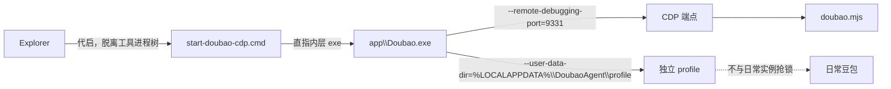

# 给豆包电脑版派活（协作通道操作手册）

> 状态：已实施（2026-11-02）· 实测版本 豆包 2.34.6 Launcher / Chromium 147.0.7727.149
> 用途：**让本机 agent 会话把活派给豆包客户端**，用它的「新工作任务」agent 模式操作本地文件。
> 关系：与 [`copilot-channel.md`](./copilot-channel.md) 并列——Copilot 是命令行进程，豆包是**桌面 UI**，只能靠 CDP 驱动。
> 缘起：2026-11-02 打通。此前只能人在豆包窗口里手打发，不是可编排通道。

## 0. 一句话读法

```bash
node scripts/doubao/doubao.mjs task "任务描述" --project <项目名>
```

它连 `127.0.0.1:9331` 的**独立 profile 豆包实例**，走真实鼠标/键盘事件驱动 UI，读回干净正文。

## 1. 为什么不能直接给日常那个豆包加参数

这是踩了两小时的坑，先记住，别再重走：

| 事实 | 后果 |
|---|---|
| `Application\Doubao.exe` 是 **Launcher 2.34.6**（1.8MB），不是主程序 | 它**吞掉**未知参数，`--remote-debugging-port` 传不到 renderer |
| `Application\app\Doubao.exe` 才是 Chromium 主体（147.0.7727.149） | CDP 参数必须给它，进度条日志可证 renderer 收到了 |
| 同一份 `User Data` 有单实例锁 | 直启内层程序 + 原 profile = 启动后自己退出（`engine.cc ### NO global context`） |
| Launcher 启动的进程会 detach | 从工具会话直启的进程会随命令结束被回收，必须经 Explorer 代启才能活 |

⇒ 唯一可行组合：**内层 exe + 独立 `--user-data-dir` + Explorer 代启**。



读法：Explorer 只负责「把进程挪出工具会话的进程树」，参数和隔离都由 cmd 脚本给。

## 2. 落点

| 项 | 值 |
|---|---|
| 启动脚本（项目内） | `scripts/doubao/start-doubao-cdp.cmd` |
| 启动脚本（用户级副本） | `%LOCALAPPDATA%\DoubaoAgent\start-doubao-cdp.cmd` |
| 独立 profile | `%LOCALAPPDATA%\DoubaoAgent\profile` |
| CDP 端口 | **9331**（避开本项目 Electron dev 的 9222、DeepSeek Harness 的 9230） |
| CLI | `scripts/doubao/doubao.mjs` |
| 调试探针 | `scripts/doubao/probe.mjs`（只读，可随时跑） |

启动：

```powershell
& explorer.exe "C:\develop\workspace\AI-writer\develop\scripts\doubao\start-doubao-cdp.cmd"
```

**不要用 `Start-Process` 直启** —— 会话结束时会被连带回收，表现为「豆包开了几秒又没了」。

## 3. 命令速查

```bash
node scripts/doubao/doubao.mjs status                 # 端口/页面/是否任务模式/最后一条回复
node scripts/doubao/doubao.mjs projects               # 任务模式里可选的项目
node scripts/doubao/doubao.mjs task "任务" --project "harness-learn" [--timeout 600]
node scripts/doubao/doubao.mjs new                    # 新建普通对话
node scripts/doubao/doubao.mjs ask "问题" [--new]     # 普通对话提问并等回复
node scripts/doubao/doubao.mjs read                   # 读当前对话全文
node scripts/doubao/probe.mjs 9331 --eval "<js>"      # 任意注入（排查用）
node scripts/doubao/inspect-click.mjs 9331 --testid <id>   # 点一下再看界面
```

退出码：`0` 成功 / `1` 失败 / `2` 未连接（实例没起）。

## 4. 新工作任务 ≠ 新对话

**这是本通道最容易用错的地方。**

| | 新对话（`create_conversation_button`） | 新工作任务（`create_office_task_button`） |
|---|---|---|
| 能力 | 纯聊天 | **本地文件 + 终端 + 技能/插件** |
| 底栏 | 无 | `本地电脑` / `项目` / `按需确认` |
| 适用 | 问问题、写文案 | **真正派活**（读项目、改文件、跑命令） |

`ask`/`say` 走的是「新对话」；**派活一律用 `task`**。

任务模式的项目是「工作区」的概念，豆包只在该项目目录内操作。项目清单由 `projects` 命令给出；`task --project` 按名字前缀匹配（大小写不敏感）。

`projects` 输出的每一项形如 `AI-writer-wt-1 C:\develop\workspace\AI-writer\wt-1`——**名字后面带绝对路径**，这正是核对「它到底在哪个目录干活」的唯一直接证据；派活前先看一眼，别靠信任。

> ⚠️ `通过本地文件夹创建项目` 会弹**系统原生文件夹选择框**，CDP 控制不了。要让豆包指向某个本地目录，这一步得人工点一次；之后该项目会留在列表里，自动化直接按名字选即可。

## 5. ⛔ 跨 Agent 派活红线：只准单元测试

**派发出去的 agent 不得运行任何「应用实例级」测试，只允许跑单元测试。**

理由：应用实例级测试要抢同一份独占资源——同一个 SQLite 库、同一个 `user-data-dir`、同一个固定端口、同一个 `.vite` 缓存、同一个 Electron 单实例锁。多个 agent 并发时互相踩，症状随机且不可复现，**最容易被误读成「刚改的代码把功能弄坏了」**。

### 允许 ✅

- 单文件或少量文件的 node 环境单元测试（`vitest run <path>`）
- 纯函数、校验器、prompt 组装字符串断言
- `npx tsc --noEmit`

### 禁止 ❌

- `*.browser.tsx`（需要真实浏览器实例）
- `scripts/f0*-journey.mjs`、`*-proof.mjs`、`draft-generation-startup-acceptance.mjs` 等验收脚本（都会启动真实应用）
- 全量 `pnpm test`（争 `.vite` 缓存，且长到不可控）
- `pnpm dev`、打包、安装、升级验证
- 豆包通道自身的 `task`（会占住唯一的自动化实例）

### 判据（一句话）

**只要它要启动一个应用进程，或占用一个固定端口 / 目录 / 单实例锁，就算应用实例级。**

### 违规的典型症状

`EBUSY`、`database is locked`、`.vite` 缓存争用导致 browser 测试整片红、端口被占、实例被别的 agent 抢走、测试全绿但产出物错乱。

### 谁可以跑什么

| 角色 | 权限 |
|---|---|
| 主 agent（串行） | 全量、browser、journey、验收、豆包派活 |
| 派出去的 agent（并行） | 只读 + 单元测试 |

豆包通道本身也**只能串行**：一个实例一个窗口，同一时刻只能跑一个任务。两个 agent 同时 `task` 会串到同一个会话里。

> agent 在 **worktree** 里并行干活时，本条红线还有三条补充（禁 `pnpm test:node`、禁并发原生重建、全量测试只在主工作区）→ [`worktree-parallel.md`](./worktree-parallel.md) §7。

## 6. 安全与副作用（派活前必须知道）

1. **会消耗你的豆包额度**——每次 `task`/`ask` 都是一次真实调用。
2. **会留下对话记录**。`task` 在新工作任务里开新会话，但记录仍在你的账号下。
3. **登录态不在 profile 目录里**。实测：全新的 `--user-data-dir` 起来就是已登录状态，且能看到你的全部历史对话。⇒ 独立 profile **不提供账号隔离**，只是进程/锁隔离。所以它**能碰到你现有的对话**——这正是必须走「新工作任务 / 新建对话」的原因。
4. **默认 `按需确认` 档位**（读/改/建文件会问）。无人值守时会被卡住；要放手跑需在界面上切成 `全部允许`，风险自负。
5. 自动化实例是**未激活的窗口**，可能被其它窗口遮挡；CDP 不依赖前台焦点。

## 7. 已验证 / 未验证

**已验证（2026-11-02，均有输出为证）**

- 独立 profile 实例启动，9331 稳定在线（多次跨命令存活）
- CDP 连接 + `Runtime.evaluate` 注入
- 新对话：`cdp-mouse`（真实鼠标事件）→ 对话 id 变化、条数归零
- 发送：`Input.insertText` 写入 ProseMirror → `Enter` 提交 → 编辑器清空
- 读回：`[data-testid="message_text_content"]` 取正文，**不含**模型徽标/时间/追问建议
- 端到端两次：`turns=2`、回复「收到」/「通道正常」、6–10 秒稳定
- 进入新工作任务模式（`chat_input_input` + `chat_input_action_mode` 出现）
- 项目菜单打开并列出：`harness-learn` / `备课组工作记录` / `创建新项目` / `通过本地文件夹创建项目`
- **`task` 完整派活（2026-11-02 22:34–22:38，一次真任务）**：在 `AI-writer-wt-1` 项目里做
  `rangeLabel` 抽取重构。全程无人值守（档位 `全部允许`），用时 ~4 分钟，落点全部正确。
  逐项结果见 §7.1。

### 7.1 首次真任务的能力基线（保留作后续派活的标尺）

任务：把 `VolumeHandoffRegistryPanel.tsx` 里的区间文案抽成 `src/shared/volume-range-label.ts`
的纯函数，写单测，把面板改成调用新函数，跑测试并报告真实输出。**任务书里保留了一处
与现有实现相矛盾的措辞**（「有 `actualLast` 就追加（已写 N）」vs 验收 ⑤「`actualLast === last`
时不得出现」），用来观察它遇到冲突时怎么办。

| 观测点 | 结果 |
|---|---|
| 定位准确性 | 报 `rangeLabel` 在第 198–212 行、3 处调用点、另一处同名实现在 `VolumeHandoffGatePanel.tsx:47` —— **行号全对** |
| 范围自律 | 另两处同名 `rangeLabel`（`VolumeHandoffGatePanel.tsx`、`volume-handoff.ts:137`）明确不碰，跨项目写入一次都没发生（`develop` 全程干净） |
| 工具链 | 自己确认 vitest 4.x / node 环境后，用指定命令跑通；贴的是真输出（`7 passed`），与 Master 复跑一致 |
| **冲突处理（最有价值的一项）** | 主动指出需求措辞与验收 ⑤ 相反，按验收执行，并给出 D19 语义上的理由（`last` = 计划边界、`actualLast` = 进度）写进 JSDoc。**没有默默二选一** |
| 自我复盘 | 第一版用 `type RangeLabelFn` + `const rangeLabel = formatVolumeRangeLabel` 保住了原符号（少改两行），随后自己判定「不够直接」并改成三处直连新函数 |
| 越界发现 | 报出面板第 779–781 行文案「末章优先用实际末章」与 D19 实际行为相反 —— **确认属实，是 Master 改 D19 时漏掉的残留文案** |

已知不足（验收时由 Master 修，不是它自己发现）：

- 删掉局部函数后，上面那段 JSDoc 变成了**孤儿注释**，直接悬在 `writeErrorLabel` 头上（已删）。
- 单测只覆盖 `even` / `declared` 两种 basis，`actual` / `headings` 没测（评审补齐项，未阻塞）。

### 未验证（要用先测）

- `通过本地文件夹创建项目` 的原生文件夹对话框
- 一次任务跨多个文件的**长链**（本次 3 个文件、30 行级改动；更大规模未测）
- 多轮追问与中途插话（`task` 只发一条就等结果）


## 8. 失效判据与恢复

| 症状 | 先查 |
|---|---|
| 连接被拒（退出码 2） | 实例没起：跑 `start-doubao-cdp.cmd` |
| 端口在但找不到聊天页 | 豆包在登录页 / 崩溃重启：看窗口 |
| `输入框聚焦失败: unknown` | 自动化窗口**从未被真实点击过**，`editor.focus()` 不移动 `document.activeElement`。现为三级：DOM focus → CDP 真鼠标点编辑器中心 → 仍失败就降级放行（`Input.insertText` 不看窗口激活）。若报 `editor-missing` 才是 ProseMirror 换了容器 |
| `task` 8 秒就「结束」，回复是「正在思考」 | 完成判据把**占位气泡**当成答案（占位文本本身是稳定的）。已在 `waitForReply` 加 `PLACEHOLDER` 过滤，只把非占位正文的稳定当完成。**但判据仍是启发式**：长任务可能在中途短暂停顿超过 4.5 秒 ⇒ 拿 `read` 复核，别只看退出码 |
| 「新建对话未被确认」 | 按钮被遮挡或 DOM 变了：`inspect-click.mjs --testid create_conversation_button` |
| 输入框写不进 | ProseMirror 换了容器：`probe.mjs --eval` 查 `.ProseMirror` |
| 回复带 UI 噪音 | `data-testid` 改名：`probe.mjs --eval` 打印当前 testid 列表 |
| 豆包升级后全崩 | 先记版本，再按上表逐项复测；`testid` 是**最稳的锚点**，class 全是 Tailwind 随机串，别用 |

**恢复顺序**：先 `probe.mjs` 看 testid 还在不在 → 再 `inspect-click.mjs` 看按钮还能不能点 → 最后才改 `SELECTORS`。

## 9. 相关文档

- 文档纪律与放置规则：[`docs/README.md`](../README.md) §3 · [`documentation-charter.md`](./documentation-charter.md)
- 并列通道：[`copilot-channel.md`](./copilot-channel.md)（独立进程，无需 CDP）
- 打通过程与实测原始记录：本机记忆 `2026-11-02.md`（不入库）
