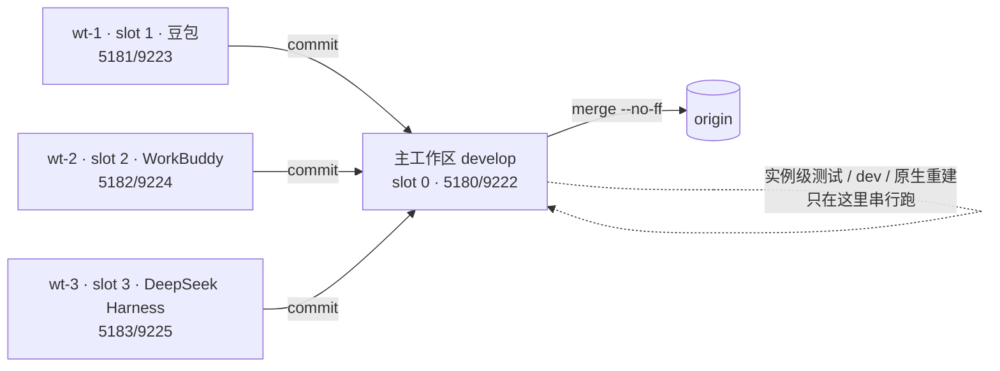

# 并行 worktree 隔离（多 agent 同工作区会互相踩）

> 状态：已实施（2026-11-02）
> 更新：2026-11-04 扩到 3 个 worktree，并改为**按外部平台固定归属**（WT1 = 豆包 · WT2 = WorkBuddy · WT3 = DeepSeek Harness，见 §3.1）。
> 用途：让**最多 3 个 agent 同时改代码**而不互相覆盖、不抢端口、不抢 Electron 单实例锁。
> 关系：与 [`copilot-channel.md`](./copilot-channel.md)、[`doubao-channel.md`](./doubao-channel.md)、[`workbuddy-channel.md`](./workbuddy-channel.md)、[`dsh-channel.md`](./dsh-channel.md) 并列——那些讲「把活派出去」，这份讲**派出之后各自在哪个目录里干活**。
> 缘起：2026-11-02 作者问「同一个工作区跑多个 Harness 级 agent 会不会资源竞争，要不要用 worktree 隔离、由 Master 合并」。答：会，而且**最危险那层不报错**。遂把槽位写死落地。

## 0. 一句话读法

```powershell
cd C:\develop\workspace\AI-writer\wt-1
node scripts/worktree-dev.mjs 1
```

目录 + 端口 + Chromium profile 三样一起分家；Master 只从主工作区合并。

**归属是固定的，不是「谁空谁用」**：平台作为外部 agent 被调用时，必须用它自己那个 worktree，不许直接写主工作区（§3.1）。

## 1. 先纠正一个前提：worktree 不需要先 push

`git worktree add` 是**从本地 `.git` 直接开一份工作树**，不经过远程。push 只在「想让别的机器 / 别的 clone 拿到」时才需要。

真正的前提是另一件事：**worktree 从 commit 开，主工作区里没提交的改动不会被带过去**。所以「先 push」不是前置条件，「先 commit」才是。

## 2. 竞争面分五层，worktree 只治前三层

| 层 | 冲突形态 | worktree 治得了？ |
|---|---|---|
| 文件写入 | 两个 agent 改同一文件，AI 直接 `Write`，**后写覆盖前者、不报错**，静默丢代码 | ✅ 各自独立 checkout |
| git index | 同时 `git add/commit` → `index.lock exists`，可能留下坏索引 | ✅ 每个 worktree 独立 index |
| 构建产物 | `dist/` · `dist-electron/` · `node_modules/.vite` 并发 → browser 测试整片假红（已实测记过） | ✅ 各自一份 |
| 独占资源 | 端口 · Electron 单实例锁 · SQLite 句柄 | ❌ 只能**约定**（见 §3 §5） |
| 原生模块 inode | `pnpm` 把 `better-sqlite3.node` **硬链接**到全局 store，两个 worktree 可能写同一份 inode | ❌ 只能**禁动作**（见 §7） |

一句话：**worktree 治「写」，不治「跑」。**



读法：agent 只在两侧的 worktree 里写代码和跑单测，合流和所有「要起进程」的动作都回主工作区。

## 3. 硬编码槽位表（唯一来源：`vite.config.ts` 的 `WORKTREE_SLOTS`）

| slot | 目录 | 分支 | 归属（见 §3.1） | renderer 端口 | CDP 端口 | Chromium profile |
|---|---|---|---|---|---|---|
| 0（不设 slot） | `AI-writer/develop` | `exp/resource-ledger` | **主控平台**（人 + Lead harness；主控本身可以是 WorkBuddy 或 DSH） | 5180 | 9222 | Electron 默认 `userData` |
| 1 | `AI-writer/wt-1` | `agent/wt-1` | **豆包**（`doubao-channel.md`，项目名 `AI-writer-wt-1`） | 5181 | 9223 | `<repo>/.runtime/worktree/slot-1/user-data` |
| 2 | `AI-writer/wt-2` | `agent/wt-2` | **WorkBuddy**（`workbuddy-channel.md`） | 5182 | 9224 | `<repo>/.runtime/worktree/slot-2/user-data` |
| 3 | `AI-writer/wt-3` | `agent/wt-3` | **DeepSeek Harness**（DSH 被当外部 agent 调用时） | 5183 | 9225 | `<repo>/.runtime/worktree/slot-3/user-data` |

- worktree 与主目录**平级**（`C:\develop\workspace\AI-writer\`），**必须同盘** —— 跨盘时 pnpm 会从硬链接退化成复制，磁盘 ×N。
- 并行上限 **3**（每个 worktree 一份 checkout + node_modules，实测约 1 GB/槽，3 GB 可接受）。加槽位只改 `WORKTREE_SLOTS` 一处（外加本表与 `worktree-dev.mjs` 的槽号白名单），别在别处再写一份端口。
- CDP 端口避开：本项目主实例 9222、DeepSeek Harness 9230、豆包自动化实例 9331。

### 3.1 槽位归属：固定给平台，不按空闲临时分配

| worktree | 归属平台 | 证据/约定 |
|---|---|---|
| `develop`（slot 0） | **主控平台** | 人在这里跟 Lead 对话、合并、跑实例级测试；主控平台换成 WorkBuddy / DSH 也不动目录 |
| `wt-1`（slot 1） | **豆包** | 豆包项目名固定为 `AI-writer-wt-1`，路径 `C:\develop\workspace\AI-writer\wt-1`（`doubao-channel.md` 派活示例） |
| `wt-2`（slot 2） | **WorkBuddy** | WorkBuddy 通道的固定工作目录，见 `workbuddy-channel.md` |
| `wt-3`（slot 3） | **DeepSeek Harness** | DSH 作为外部 agent 被别的平台调用时，固定在这里干活；派活方式见 [`dsh-channel.md`](./dsh-channel.md)（`dsh-task.mjs` 的 `cwd` 钉死本格，越界 exit 3） |

四条铁律：

1. **平台作为外部 agent 被调用时必须用自己的 worktree**，不许写 `develop`（主控的平台自己也一样，它一旦被当外部 agent 调用就落到自己那格）。
2. **归属固定，不抢**：看到别人那格空着也不要临时占用；要换归属就改这张表 + 提交。
3. **归属 ≠ 运行态**：端口探活 / CDP / `SingletonLock` 只能回答「现在有没有实例在跑」，回答不了「这格归谁」。2026-11-04 实测踩过：wt-1 当时无进程、无端口、无锁、工作树还是干净的，但它是豆包的固定格（`.runtime/doubao/d18/` 的产物就是证据）。
4. 同一 worktree 同一时间只允许一个写者；并行干活前先跑一次 §11 的探测确认**运行态**，归属再查本表。

## 4. 起法与验证

```powershell
# 在 worktree 里跑，参数是槽位号
node scripts/worktree-dev.mjs 1
```

为什么不用 `AI_NOVEL_WORKTREE_SLOT=1 pnpm dev`：

1. 本机 `pnpm` 在 sh 里是坏的（npm shim 把 node 指向不存在的路径），一切入口走 `node`；
2. `predev` 那道 Electron ABI 探针必须照跑，脚本里复用同一个 `ensureElectronNativeBinding`，不复制实现；
3. 顺手摘掉 `CODEBUDDY_SAFE_DELETE_BULK_STATE_DIR` / `CODEBUDDY_TOOL_CALL_ID` —— 留着会让 safe-delete 闸门拒绝 Vite 的依赖 re-optimize（实测 322 文件 > 50 阈值）。

验证（两条都要对）：

```powershell
Invoke-RestMethod "http://127.0.0.1:5181/json/version" -NoProxy   # 不该有响应，这是 renderer 端口
Invoke-RestMethod "http://127.0.0.1:9223/json/version" -NoProxy   # => Chrome/…，Electron 的 CDP
# slot 3 同理：5183（renderer，不该响应）· 9225（CDP，应返回 Chrome/…）
```

> 查本机端口**必须带 `-NoProxy`**：沙箱代理会劫持 `127.0.0.1` 并回 502，看起来像「端口没开」。

## 5. 三条隔离机制，少一条就会互相踢

| 机制 | 不隔离的后果 |
|---|---|
| renderer 端口（`strictPort: true`） | 静默换端口，自动化连错实例；写死后撞了直接报错，这是**想要的** |
| `--user-data-dir` | Electron 单实例锁按 userData 归属，第二个实例**启动即退出**；`main.ts:79` 已尊重该参数，且要求绝对路径（相对路径抛 `USER_DATA_PATH_MUST_BE_ABSOLUTE`） |
| CDP 端口 | 浏览器自动化无法分辨自己在操作哪个实例 |

## 6. 共享的 / 不共享的

| 资源 | 共享？ | 说明与对策 |
|---|---|---|
| `AI_NOVEL_APP_DATA_HOME` | **共享**（`~/.ai-novel-writer-dev`） | 好处是 API key / models 配一次全槽通用；代价是并发写全局配置会互相覆盖 ⇒ **全局配置只在主实例改** |
| pnpm store | **共享**（同盘硬链接） | 建装快（实测每 worktree 25s），但原生 `.node` 是一份 inode ⇒ 见 §7 |
| 豆包 / Electron 单实例 | 各自 profile | 派豆包任务用独立 profile 实例，规则见 `doubao-channel.md` §1 |
| 项目库（`.ai-novel/**`） | 不共享（在各个 worktree 或你自己的目录里） | 会话里别拿同一个项目目录开两个实例做写入 |

## 7. ⛔ 红线：派出去的 agent

**与 `doubao-channel.md` §5 同源，但 worktree 场景多三条：**

1. **只准单元测试**（`vitest run <path>`）。任何要起应用进程、占固定端口、碰 `user-data-dir`、碰 Electron 单实例锁的测试，一律算「应用实例级」，**禁止**。
2. **禁 `pnpm test:node`**。它会先跑 `prepare:native-node` 把共享 store 的 `better-sqlite3` 切回 **Node ABI**，直接打断**所有**槽位正在跑的 Electron dev。要纯 Node 环境测试，回主工作区、停掉 dev 再跑。
3. **禁并发触发原生重建**。`prepare-native-for-electron.mjs` 是「先探后建」：探通就不动，所以稳态没事；但两边**同时**探到失败会并发 `@electron/rebuild` 写同一份 inode。发现要重建时，只留一个槽位在跑。
4. **禁在 worktree 里改全局配置**（`config.json` / `models.json` / `recent-projects.json`）。
5. **全量测试只在主工作区串行跑**；worktree 里的 agent 交活前只跑 `node scripts/check-fast.mjs`（tsc + 两个文档检查，约 20–30s）。

## 8. 合并协议（Master 说了算）

1. agent 在自己分支（`agent/wt-1` / `agent/wt-2`）提交，**不碰主分支**；
2. Master 在主工作区 `git merge --no-ff agent/wt-1`，冲突只由 Master 解；
3. worktree 内**不** rebase 别人的分支、不 `push --force`；
4. 合并后先 `node scripts/check-fast.mjs`，再按需跑全量测试。
5. **合并完把 agent 分支拉回主线**：`git -C ../wt-1 reset --hard <主线 HEAD>`。不拉回的话，下一轮 worktree 从旧 commit 出发，第一次合并就会带回一堆「已经合过的差异」，看起来像冲突其实是脏基线。注意 `develop` 是**目录名**，主线分支叫 `exp/resource-ledger` —— `reset --hard develop` 会报 `ambiguous argument`，用 `$(git -C <主工作区> rev-parse HEAD)` 取 hash 更稳。

## 9. 回收

```powershell
git worktree remove ../wt-1     # 有未提交改动会被拒，先提交或 -f
git worktree remove ../wt-2
git worktree remove ../wt-3
git worktree prune
git branch -d agent/wt-1 agent/wt-2 agent/wt-3
```

`.runtime/worktree/slot-N` 是 git 不管的运行期目录，删 worktree 时手动一起清。

## 10. 已知坑

| 坑 | 真相 |
|---|---|
| 「新建 worktree 后代码不对」 | 从 commit 开的，主工作区未提交改动不会过去 |
| 「第二个实例一闪就没」 | 抢了同一份 `userData` 的单实例锁；必须 `--user-data-dir` 分家 |
| 「查不到端口」 | 沙箱代理劫持 `127.0.0.1` 回 502；加 `-NoProxy` |
| 「从工具会话起的 dev 几秒后消失」 | 命令结束会连带回收子进程树；长跑 dev 请在独立终端里起 |
| 「worktree 里 `pnpm` 报 `This: command not found`」 | 本机 sh 里的 npm shim 坏了；用 `node scripts/worktree-dev.mjs <slot>` 或 PowerShell |
| **「worktree 全灭但还是不能动」** | 归属固定（§3.1）：wt-1 归豆包、wt-2 归 WorkBuddy、wt-3 归 DSH；空着也不许抢，主控只在 `develop` |
| **「slot-N dev 起来几秒后崩，报 `EBUSY ... watch '<repo>/.runtime/worktree/slot-N/user-data/Network/Cookies'`」** | vite 的 chokidar 把仓库内 `.runtime/` 也 watch 了，而 Chromium 正锁着 Cookies。`vite.config.ts` 的 `server.watch.ignored` 已加 `'**/.runtime/**'`；新槽位若仍崩，先确认 worktree 里的 `vite.config.ts` 是**含该行**的版本（worktree 从 commit 开，老提交里没有） |
| **「worktree 里 `check-fast` 报 doc-links 断链，主工作区却是绿的」** | `.workbuddy/` 是 gitignore 的，worktree 里**不存在**。只要有一份入库文档链接到 `.workbuddy/memory/...`（现状：`docs/design/architecture/p11-plan-validity-and-fact-registry-design.md`），新 worktree 就必然断链 ⇒ 从主工作区把那几个文件 `cp` 过去（它们不会进提交），再去掉 `--no-verify` 的诱惑。**根因是「入库文档链到未入库目录」，属于文档债，不是 worktree 债** |

## 11. 占用探测：运行态能测，归属只能查表

四条强信号，任一命中 = **现在有实例在跑**：

| 信号 | 查法 | 说明 |
|---|---|---|
| renderer 端口 | 5180 / 5181 / 5182 / 5183 是否 LISTENING | `netstat -ano \| findstr :5183`；只绑 `127.0.0.1` |
| CDP 端口 | 9222 / 9223 / 9224 / 9225 | `Invoke-RestMethod "http://127.0.0.1:9225/json/version" -NoProxy` |
| Electron 单实例锁 | `<repo>/.runtime/worktree/slot-N/user-data/SingletonLock` 是否存在 | 只有实例活着才会出现 |
| 进程 | `Win32_Process` 命令行带 `--remote-debugging-port=922N`，或 cwd 指向该 worktree 的 vite | 能认出跑的是哪个槽 |

辅助信号、**不作准**：`git status`（干净只说明没有未提交改动，不代表没人用）、`.runtime/**` 的 mtime（历史活动）、`~/.dsh/sessions/--C-…--` 目录（只是「这个目录跑过 DSH」的痕迹）。

判定规则：任一强信号命中 ⇒ 运行中；全灭 ⇒ 无实例。**「无实例」不等于「可占用」** —— 归属查 §3.1，有主就不许用。2026-11-04 那次误判就出在这里：wt-1 无进程、无端口、无锁、工作树干净，探测结论「空闲」，但它归豆包（`.runtime/doubao/d18/` 的产物即证据）。

探测有竞态（两个平台同时看到「空闲」），真要「临时领取」再补 `claim.json`（`fs.open(..., 'wx')` 原子创建 + pid/TTL 回收）；当前归属固定，按表干活就不会撞。
