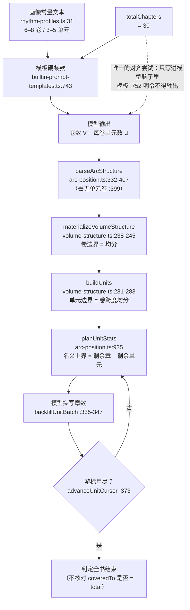

# D6 方案 · 卷数的事实源与「卷数 × 单元数 × 章数」乘法链

> 状态：已裁定（2026-11-05 · **裁定 1 = 方向 A**：卷数由代码按总章数算；**裁定 6 = 以本稿为准**，2026-10-19 那条「卷/单元章数由模型决定」的裁定被显式取代 —— 见 §8。**尚未开工**）
> 上级登记：[`../product/live-pipeline-acceptance-defects-assessment.md`](../product/live-pipeline-acceptance-defects-assessment.md) §D6（`:380-431`）
> 相邻条目：D7（单元→章偏保守，`:433-474`）、D15（单元区间重叠，`:729-753`）、D19（卷末章口径）
> 本稿**只出方案，不动代码**；涉及代码位置的行号均为 2026-11-05 实读。

---

## 0. 一句话结论

**卷数今天没有事实源——它是模型照着一段常量文本自己挑的一个数，代码既不算它、也不校验它，只在下游把它当成既成事实去分章。** 因此「6 卷 × 3 单元 = 18 个单元」与「30 章」之间不存在任何对齐机制；差额 12 章不是被某一环"吃掉"，而是**从头到尾没有任何一环被要求把它们写出来**（§2.3）。

---

## 1. 现状精确定位

### 1.0 先钉名词：这套词是谁定的

| 词 | 本项目定义 | 位置 | 行业通名 |
|---|---|---|---|
| 卷 | 「一段**世界和他都换了状态**的时期」 | `src/services/builtin-prompt-templates.ts:741` | 本次读取的文件内未找到对应定义 |
| 单元 | 「一段**对峙局面**」 | 同文件 `:742` | 同上 |
| 章 | 未在本库给出定义；只在 `totalChapters`/`wordsPerChapter` 上出现 | `docs/design/architecture/volume-quota-context-budget-design.md:38` | — |

这两行是 v7 模板里的作者口径，不是行业术语表。全库唯一一处自称「来自资料核实」的结构出处是 `src/shared/story-beats.ts:14-21`（七点结构 / 起承转合 / 八序列可以跨尺度套用），但它**没有给书目或作者**，只写了"资料核实"。所以：**「卷 / 单元 / 章」在中文网文工业里的标准定义与出处，本次读取的文件内未找到；以下一律按项目现状陈述，不引入外部标准。**

### 1.1 复核缺陷稿的说法

缺陷稿 §D6 原文写的是「卷数由**平台画像的固定区间**（6–8 卷）单方面决定」（`:415`），**并没有出现「`src/shared/arc-position.ts` 的 `majors.length` 是唯一计数点」这句话**（本次在 `docs/` 内检索 `唯一计数点` / `majors.length` 均无命中）。

按代码复核，正确的说法是：

- `majors.length` **不是决定点，是消费端的计数**；而且它**不唯一**（§1.2 有 9 处独立读它）。
- 卷数真正的"决定"发生在**模型输出**里，输入只有两样：一段常量文本（画像）＋ 一条"按区间取、不要自己算"的硬条款。
- 画像那段 6–8 卷，**不是**存在磁盘上的平台配置文件，而是代码里的字符串常量：`src/services/prompts/rhythm-profiles.ts:29-34`（fanqie，`全书 6–8 卷；每卷 3–5 个单元`）、`:18-22`（qidian，`3–5 卷 / 5–7 个单元`）。它由 `:44-54` 的 `resolveRhythmProfile` 解析，**未知值原样透传**（`:53`），所以作者写的自定义节奏文本也走同一条路。

### 1.2 消费点清单（读 / 写 / 只展示 / 纯常量）

| # | 消费点 | 位置 | 性质 |
|---|---|---|---|
| 1 | 画像常量本体（fanqie 6–8 卷、3–5 单元） | `src/services/prompts/rhythm-profiles.ts:29-34` | **纯常量**（可被作者自定义文本替换） |
| 2 | 画像写库 | `src/components/editor/NovelConfigEditor.tsx:113`（`db:project-core-update` 写 `rhythmProfile`） | **写**（存到 project_core） |
| 3 | 画像读库并注入 prompt | `src/services/workflows/commands/architecture.command.ts:2858` | **读** |
| 4 | 【节奏推荐】占位 | `src/services/builtin-prompt-templates.ts:737-738` | **写进提示词** |
| 5 | 「按画像区间取个数」硬条款 | 同文件 `:743` | 提示词 |
| 6 | 「同层兄弟个数不许完全相同」反同质化条款 | 同文件 `:744` | 提示词（**无机检**） |
| 7 | 「不要写章数…折算是系统的活」 | 同文件 `:745`、`:864` | 提示词 |
| 8 | 「卷数为 N / 每卷 N 个单元」输出格式 | 同文件 `:808-809` | 提示词（**这一行从不被解析**） |
| 9 | 「输出前自检 2：落在区间内」 | 同文件 `:847` | 提示词 |
| 10 | 卷/单元文本 → `majors[]` | `src/shared/arc-position.ts:332-407`（`:349` push，`:399` **丢弃无单元的卷**） | **写**（解析产物） |
| 11 | 是否两级结构 | 同文件 `:419-420` | 读（形态判断） |
| 12 | 卷边界等比折算 | `src/shared/arc-position.ts:471`、`:496`、`:627`、`:712`、`:746`、`:919` | 读（**6 处各自重算同一份**） |
| 13 | 卷长 / 剩余 / 名义上界 | `src/shared/arc-position.ts:905-955`（`volumeChapters` `:920`、`remaining` `:931`、`maxChapters` `:935`） | 读（折算） |
| 14 | 卷边界落库用的均分 | `src/shared/volume-structure.ts:238-245`（`Math.round((offset+1)*total/majors.length)` `:241`） | 读（折算） |
| 15 | 单元边界 | `src/shared/volume-structure.ts:281-283`（`scaledBoundaries(mid 权重, 卷跨度)`） | 读（折算） |
| 16 | 单元起点与上界 | `src/services/workflows/commands/architecture.command.ts:292-318`（`from = coveredTo+1` `:303`，`maxChapters` `:313-316`） | 读（折算） |
| 17 | 游标推进 / 全书结束判定 | 同文件 `:356-375`（**`:373` 最后一卷最后一单元 ⇒ `null`**） | 读（**终止事实源**） |
| 18 | 落库 `volumes` / `volume_units` | `electron/repositories/volume-structure-repository.ts:160-235`（id `volume:${index}` `:203`，unit id `unit:${v}:${u}` `:214`） | **写**（存量库事实） |
| 19 | 落库后的新鲜度 | 同文件 `:132-153`（`outline_hash = sha256(projection.signature)` `:149-152`） | 读（stale 判定） |
| 20 | 卷进度展示 | `src/services/workflows/synopsis-unit-launch.ts:317-336`（`unitCount` / `remainingUnits`） | **只展示** |
| 21 | 对话框卷号展示 | `src/components/dialogs/ArchitectureConfirmDialog.tsx:758-769` | **只展示** |
| 22 | 密度体检（单元总数） | `src/shared/arc-position.ts:1676-1679`（`unitCount = Σmids`，只喂 `UNIT_TOO_LONG`） | 读（只报） |
| 23 | 拍子体检（卷序号） | `src/shared/arc-position.ts:1581-1663` | 读（只报） |

**结论**：卷数在 #1 被给成文本、在 #10 被解析成数组、在 #12–#17 被反复折算、在 #18 被写成数据库行。**没有任何一处是「按总章数算出来的」，也没有任何一处校验它是否合理。**

---

## 2. 乘法链（本篇核心）

### 2.1 三者各自由谁决定

读法：实线是数据流，虚线是唯一一次让「总章数」参与卷数决策的地方——模板 `:752` 要求模型"心里算"每卷约多少章，同时 `:745/:864` 明令**不许写出来**。所以这条对齐只发生在模型脑内，代码看不到、测不到、也验不了。链尾 `J` 的判定条件是「单元用完了」，不是「章写完了」。

### 2.2 三环各自的"决定者 / 有无对齐"

| 环节 | 由谁决定 | 与总章数有无对齐机制 |
|---|---|---|
| 卷数 V | 模型，在画像区间内挑（`rhythm-profiles.ts:31` + 模板 `:743`） | **无**。`totalChapters` 只进 `:752` 的心算，且禁止落纸 |
| 每卷单元数 U | 模型，同一段画像（`3–5`） | **无**。U 与 V 是两个独立区间的两次独立采样 |
| 每单元章数 C | 上界由 `planUnitStats:935` 算；**实写由模型定** | **只有上限**（`maxChapters`），**没有下限**，实写多少都合法（D7 `:449` 已取证） |
| 全书结束 | `advanceUnitCursor:373`（最后一卷最后一单元） | **无**。没有「coveredTo 是否达到 total」的核对 |

### 2.3 实测数：18 个单元撑 30 章，缺口的 12 章落到哪

按缺陷稿登记的数（`:386`、`:453-460`）：

- 配置 30 章、1500 字/章；实际落 **6 卷 × 3 单元 = 18 个单元**（`volume_units` 18 行，`:695`）。
- 每卷计划章数 = 30 ÷ 6 = **5**（`volume-structure.ts:241` 的均分）。
- 每单元计划跨度 = 5 ÷ 3 ≈ **1.67 → 名义上界 ceil 2**（`architecture.command.ts:313-316`）。
- 四批实写 3 / 1 / 2 / 3 章（D7 `:458`），`covered_to = 9`；卷一的偏差已被记成 `planned 5 / actual 6`（D7 `:459`）。

**关键一点：计划本身是闭合的。** `scaledBoundaries` 的最后一条被强制写成 `total`（`arc-position.ts:440`），所以 30 章**确实被分摊到了 18 个单元**里，每单元 1–2 章。也就是说——**没有任何一环"吃掉"了 12 章**；吃的不是算术，是执行与终止：

1. 每个单元只拿到**一个上限 2 章**（`:935`），没有下限。"1 单元 ≈ 1 章"完全合法，D7 `:464` 已定性。
2. 18 个单元用尽后 `advanceUnitCursor` 返回 `null`（`:373`），游标被删（`syncSynopsisUnitCursor:271-274`），**系统判定"全书完成"**；此时 `covered_to = 18`，与 `total = 30` 差 12，而**全链没有一条对账**。唯一的量级体检 `UNIT_CHAPTER_SOFT_CAP = 9`（`arc-position.ts:1549`、审计在 `:1676-1680`）报的是"单元太长"，**方向相反**，因此这个缺口一次都不会被报出来。

⇒ 所以差额的归属是：**⑤ 实写环（D7 的位置）× ⑥ 终止环（本稿新增的位置）**。D7 论证了"每单元写得少"，但 D7 没有解释"写少之后为什么还能宣布写完"——那是 `:373` 这一行。**这两环叠加才产生 12 章的缺口；只补 D7 不够，因为补完 D7 仍然可能在第 18 单元处收尾。**

> 一个**不确定**的连带风险：游标被删后，探针会走"按已写章推导"（`synopsis-unit-launch.ts:293-296` → `deriveSynopsisUnitCursor`）。而该函数自己的注释说这份「章号→单元」的等分映射"一遇到实际章数偏离计划就整体错位"（`architecture.command.ts:226-235`、`arc-position.ts:453-455`）。推导出的游标可能指向一个**已经写完的单元**。这一条我没有跑代码验证，标不确定；它只需要一条单测即可定案（见 §4.4 的 D-2）。

---

## 3. 反同质化条款为什么落空

### 3.1 条款原文与实际

- 条款：`builtin-prompt-templates.ts:744` —— 「同一层的兄弟个数不许完全相同（全给 3 个 = 没算过）。差 1 个是正常的。」
- 实际：6 卷全 3 个单元（缺陷稿 `:409-411`、`:419`）。
- 解析侧：`parseArcStructure`（`arc-position.ts:332-407`）**没有任何个数校验**，只有 `:399` 的"每卷至少 1 个单元"。更彻底的是——输出格式里那行 `**卷级划分**：6 卷`（模板 `:808`）**从来没被解析过**，它只是散文；所以模型"自报 6 卷"与"实际写出 6 个 `## 卷`"是否一致，也没有人核。

⇒ 这条条款今天**不可证伪**：写了没人看，没写没人报。

### 3.2 挂在哪一层：先看既有写法

本项目已有的四条"拍子机检"**不在** `shared/story-beats.ts` 里（缺陷稿 `:419` 这句不准），而是：

| 机检 | 位置 | 性质 |
|---|---|---|
| `ARC_BEAT_UNKNOWN`（自造词表） | `arc-position.ts:1587`、`:1617` | 只报 |
| `ARC_SAME_BEAT`（相邻同拍） | `arc-position.ts:1597`(卷)、`:1629`(单元) | 只报 |
| `ARC_BEAT_REPEAT`（卷内重样） | `arc-position.ts:1638` | 只报 |
| `ARC_BEAT_OVERSPAN`（跨度盖不住） | `arc-position.ts:1654` | 只报 |

`story-beats.ts` 只是**词表与跨度数字**的唯一事实源（`:14-21`、`:69-73`），判定在 `arc-position.ts` 的 `auditBeatVariety`（`:1575`）与 `auditArcDensity`（`:1729`）；产出经 `summarizeArcDensity` 到 `architecture.command.ts:2908-2909`，**只 `callbacks.log`，不拦**。

「只报不拦」与「阻断」在本项目的既有分工是清楚的：

- **只报**：所有体检类（拍子、密度、卷区间重叠 `D15`）。D15 的实施记录把这条纪律写死了：「只报，不夹紧、不阻断」（缺陷稿 `:746-750`），理由是**存量库现在已经处于违规状态**，阻断会让"重新解析"直接不可用。
- **阻断**：只有两种——输入参数非法（`assertPlanningActionRange`，`src/shared/plot-outline-contract.ts:22`）；以及**不阻断就会静默覆盖别人的数据**（`assertPlotOutlineBatchComplete`，`architecture.command.ts:1261`；检查点损坏 `:1301`）。

⇒ 所以「同层兄弟个数不许完全相同」这条，**按既有分工只能落在"只报"**：它不影响任何数据归属，只影响观感，而存量库（6 卷全 3）本来就违规。具体落点是：在 `auditArcDensity` 的同一份 findings 里加一条码（例如 `ARC_UNIFORM_SIBLINGS`），`where` 带卷号，`zh` 写「本卷与上一卷单元数相同（都是 3）」；消费者沿用 `:2908-2909` 的 log 通道，加一条进 `volumes.warnings` 也可以，但**不要新开一条 UI 通道**（D15 已经因为混类告警踩过归因错误，见 `:751`）。

**不要把这条塞进 `parseArcStructure` 去抛错**：解析器现在是"永不抛"的设计（`:400` 返回 `null`），抛错等于把一份能用的结构判死，且作者没有修复入口。

---

## 4. 方案（三个方向 + 一个共同件）

> 三个方向都**只改"事实源"，不改折算公式**；共同件 D 是"补对账"，与前三个正交。每个方向都给"怎么证伪"。

### 方向 A：卷数 = f(总章数)，代码算，画像只给「每卷章数区间」

- **事实源**：`totalChapters`（配置）+ 一张"每卷章数区间"表。
- **改哪些文件**：
  1. `src/services/prompts/rhythm-profiles.ts:16-41` —— 画像文本去掉"全书 N–M 卷"，只留"每卷 3–5 单元 / 每卷约 X–Y 章"。
  2. `src/services/builtin-prompt-templates.ts:737-745` —— 【节奏推荐】块改为注入"卷数 = K（由系统按总章数给出）"这样的**值**，而不是区间；`:808` 的输出格式改成照抄 K。
  3. 新增纯函数（建议 `src/shared/arc-position.ts` 或 `volume-structure.ts`）：`volumeCountFor(totalChapters, perVolumeRange)`，严格闭合（代码算的东西必须算齐，见 `arc-budget-engine-design.md:120`）。
  4. `src/services/workflows/commands/architecture.command.ts:2858` 注入点带上算出的 K。
- **对存量库**：卷数一变，`rebuildVolumes` 会按 `volume:${index}` 重写（`volume-structure-repository.ts:203`），**多出来的卷被删**、被交接单引用的降级为 `retained`（`:219-231`），单元 id 全部重新编号（`:214`）。所以这个方向**必须配"只对新项目生效 / 存量库不自动重建"**，否则等于替作者重排卷。
- **对 checkpoint**：`partial_arch.json` 里的 `synopsis_unit_cursor` 是 `{volumeIndex, unitIndex}`（`synopsis-unit-launch.ts:32-36`）。卷数一改，同一个 `volumeIndex` 指向另一卷 ⇒ 游标必须一并作废（否则下一批会写进错误的卷）。
- **怎么证伪**：一条单测 —— `volumeCountFor(30)` 必须 ≠ 6（若目标是把 30 章切成 2 卷，则应 === 2），且 `materializeVolumeStructure({plan: 2 卷×3 单元, total: 30})` 的卷边界应为 `1..15 / 16..30`（`volume-structure.ts:241` 的均分）。**断言失败即方向不成立。**
- **代价（要写进裁定）**：与 2026-10-19 的作者裁定**直接冲突** —— 「卷/单元章数**由模型按材料决定**、作者只有事后否决权」（`arc-budget-engine-design.md:4`）。这方向等于把那条裁定翻过来，**不能由本稿决定**。
  - ✅ **2026-11-05 已裁定：方向 A 采纳，旧裁定被取代。** 作者理由：「原先的那个做法有一点公式主义，为了不一样而不一样」——即「由模型决定」这条本身没有独立价值，当初定它更像是为了与"代码算"划清界限，而不是因为模型真的更懂该分几卷。因此 §7 裁定 6 = 以本稿为准，`arc-budget-engine-design.md:4` 已追加取代记录。

### 方向 B：画像按篇幅分档（短篇 / 中篇 / 长篇各一套区间）

- **事实源**：仍是画像，但画像从"一套文本"变成"按档位选择的一套文本"；档位由 `totalChapters` 定。
- **改哪些文件**：
  1. `src/services/prompts/rhythm-profiles.ts:16-41` —— 每个画像 id 变成 `{short, medium, long}` 三份文本；`:44-54` 的 `resolveRhythmProfile` 增加一个档位入参。
  2. `src/services/builtin-prompt-templates.ts:737-745` 与 `:847` —— 条款措辞从"区间"改为"本档区间"，避免模型拿长篇档去写 30 章。
  3. `src/services/workflows/commands/architecture.command.ts:2858` —— 传 `totalChapters` 进去（该处已有 `config`/`totalChapters` 可用）。
  4. 档位阈值需要一个**唯一常量**（例如 30 / 150 两个边界），放 `src/shared/`，不许散落在模板与代码两处（v6 的教训写在 `rhythm-profiles.ts:8-9`：个数写在三处，改一处就漂）。
- **对存量库**：不改变已落库的卷数（只在**下一次重新解析**时按新档位折算），但档位一变 ⇒ `signature` 变 ⇒ `state = 'stale'`（`volume-structure-repository.ts:149-152`），需要作者点一次"重新解析"。`actual_*` 不碰（`volume-structure-sync.ts:101-103`）。
- **对 checkpoint**：不影响检查点，除非档位改变了卷数（那就同 A 的游标问题）。
- **怎么证伪**：一条单测 —— `resolveRhythmProfile('fanqie','zh-CN', {totalChapters: 30})` 返回的文本里卷数上界必须 < 6；同函数在 `{totalChapters: 666}` 下仍返回 6–8。**同时必须有一条反向用例**：自定义文本（`:53` 透传路径）**不得**被分档改写 —— 否则作者写的"我这本要 2 卷"会被静默吞掉。
- **代价**：分档只能治"内置画像"，治不了自定义文本；作者写自定义节奏时又回到"没有事实源"。且阈值本身是新的魔法数，需要实测校准（`arc-budget-engine-design.md:67` 明确要求"具体数值留空待实测校准，不由本稿填"）。

### 方向 C：作者显式覆盖卷数

- **事实源**：作者。新增 project_core 字段（例如 `volumeCount`，空 = 按现状）。
- **改哪些文件**：
  1. `electron/migrations/` 新一版迁移加列（不改老列）。
  2. `src/components/editor/NovelConfigEditor.tsx`（与 `rhythmProfile` 同屏，`:413` 附近）加一个"卷数"输入，空 = 交给模型。
  3. `src/services/workflows/commands/architecture.command.ts:2858` —— 有值时注入"卷数必须为 K"，与画像区间冲突时**以作者值为准**。
  4. 解析侧加"只报"校验：`majors.length !== K` 时报一条 warning（不进阻断，理由见 §3.2：存量 + 不可修复）。
- **对存量库**：字段为空 ⇒ 行为不变。作者设了值 ⇒ 同 A 的重编号风险，必须要求"改这个值会提示会重建卷结构"。
- **对 checkpoint**：同 A。
- **怎么证伪**：两条 —— ① `volumeCount = 2` 时拼装出的 prompt 必须只含"2 卷"且不含"6–8 卷"；② `majors.length = 6` 而 `volumeCount = 2` 时必须产出警告且**不抛错**（证明它真的只报不拦）。
- **代价**：把"该分几卷"这个创作判断交给作者 —— 这正是缺陷稿 `:423` 抱怨的现状的反面（现在是"作者没话语权"）。但要承认：作者多数时候也不知道，填空题会被随手跳过或乱填。

### 共同件 D：卷 ↔ 章对账（与前三个方向正交，建议无论如何先做）

- **D-1 覆盖对账**：全书最后一个单元写完时，核对 `covered_to` 与 `totalChapters`；不足时**报一条明确的账**（差多少章、差在哪个卷哪个单元），不阻断。挂点：`architecture.command.ts:3642`（`advanceUnitCursor` 拿到 `null` 的那一支）或 `:3949-3966`（逐章路径收尾）。
- **D-2 终止判定单测**：直接钉住 §2.3 的不确定项 —— 18 个单元用尽、`covered_to=18`、`total=30` 时，探针**不得**给出一个指回已写完单元的游标。
- 这一件**不改变任何事实源**，所以不与 A/B/C 冲突，也不触犯 2026-10-19 的裁定。

**取舍建议（供作者裁定，不是本稿结论）**：D 先做（成本最低、无裁定冲突）；B 与 A 二选一（A 与既有裁定冲突，B 不冲突但只覆盖内置画像）；C 作为 A/B 之上的逃生阀。

---

## 5. 与既有稿的关系

| 既有稿 | 它主张什么 | 与本稿 |
|---|---|---|
| [`arc-budget-engine-design.md`](arc-budget-engine-design.md) | 「章数不该由模型算」，本意是**把长除法搬到本地**（`:18`、`:39`） | **复用它的一半**：把"数"从模型手里拿走，正是 A/B 的同一条理由。~~但该稿 `:4` 记着 2026-10-19 作者裁定推翻了"代码算卷章数"的前提 ⇒ **A 与这条裁定冲突**，需要作者重新裁定，本稿不替它翻案~~ → **2026-11-05 已翻案**：作者裁定以本稿为准，方向 A 采纳，`:4` 已记取代 |
| [`volume-quota-context-budget-design.md`](volume-quota-context-budget-design.md) | 大纲前缀投影；一卷 1–5 万字的口径被纠正为"整本书大纲的规模"（`:42`） | **不冲突**。它管上下文预算，不管卷数事实源。但它 `:38` 的「正文预算 = totalChapters × wordsPerChapter」是本稿 `totalChapters` 的唯一来源，口径必须一致 |
| [`unit-budget-elastic-allocation-design.md`](unit-budget-elastic-allocation-design.md) §Z（本稿**未读该稿原文**，此处仅转述 D7 `:469` 的说法） | 余量池在**卷内**结算 | **部分冲突**：卷内池化只能把"本卷少写"摊给"本卷后面的单元"，**不能跨卷**（`architecture.command.ts:290` 明写"不跨卷摊剩余"）。所以它治不了 18 vs 30 这种"全书层面用光了"的缺口 ⇒ 共同件 D 是它够不到的那一格 |

---

## 6. 明确不做什么

1. **不改 `scaledBoundaries` / `buildUnits` 的折算公式**。那是 `arc-position.ts:426-429` 明确警告过的"两份实现必然漂移"区，动它要连 `arc-node.ts` 一起改，超出本条范围。
2. **不做"按弧圈章节"**（`o1-arc-event-progress-design.md:280` 已把这条划给 A3）。
3. **不改 `PLANNING_ACTION_CHAPTER_LIMIT`**（那是 D8 的事）。
4. **不重构 `volume_units` 的 id 规则**（`unit:${v}:${u}`）。改 id 等于迁移全部存量引用，属结构性变更。
5. **不引入任何外部行业标准作为验收判据**（三幕比例、每卷字数等）。本库对它们的出处只到 `story-beats.ts:14-21` 的"资料核实"，没有可引书目。
6. **不把「同层兄弟个数」做成阻断**（理由见 §3.2）。
7. **不动 D7 的折算实现**，只把 D7 记进链上位置（§2.3）。

---

## 7. 待作者裁定

| # | 问题 | 选项 | 各自代价 |
|---|---|---|---|
| 1 | 卷数的事实源归谁？ | A 代码算 / B 画像分档 / C 作者填 / 现状不改 | A：需推翻 2026-10-19 裁定（`arc-budget-engine-design.md:4`），且会重编号存量卷；B：只覆盖内置画像，新增档位魔法数待实测；C：作者多数不知道该填几；不改：缺口继续不可见 |
| 2 | 若选 A，`每卷章数` 的区间取多少？ | 由作者给 / 由实测给 | 作者给：无依据但可控；实测给：需要先有 D-1 的对账数据（现在一条都没有） |
| 3 | 存量库（6 卷 18 单元）怎么办？ | 不动，只对新项目生效 / 提示作者手动重建 / 自动重建 | 不动：作者那本书永远 6 卷；手动：多一步但可撤销；自动：删卷删单元不可逆（`volume-structure-repository.ts:230`） |
| 4 | 共同件 D-1 的"差多少章"要不要阻断收尾？ | 只报 / 阻断 | 只报：符合 §3.2 的既有分工，但作者可能永远不看 log；阻断：存量库现在就处于缺口状态，阻断会让"继续生成"不可用 |
| 5 | 「同层兄弟个数不许完全相同」的告警码放哪？ | 并入 `auditArcDensity` findings / 并入 `volumes.warnings` | 前者：与四条拍子机检同通道，但只在生成时出现；后者：落库后仍可见，但会混进 D15 已经踩过的"归因混淆"（`:751`） |
| 6 | 本稿与 `arc-budget-engine-design.md` 冲突时以谁为准？ | 以作者 2026-10-19 裁定为准（本稿 A 作废） / 以本稿为准（需显式新裁定） | 前者：A 整节删掉，只剩 B/C/D；后者：要在 `arc-budget-engine-design.md:4` 追加一条新裁定，并同步 `--status-of` |

---

## 8. 处置（2026-11-05 20:39，作者裁定）

| # | 裁定 | 落地含义 |
|---|---|---|
| **1** | **方向 A** —— 卷数 = `f(totalChapters)`，代码算；画像只给「每卷章数区间」 | 按 §4 方向 A 的四个改动点执行；`volumeCountFor` 用 §4 的证伪单测先钉住，再改注入点 |
| **6** | **以本稿为准**。`arc-budget-engine-design.md:4` 那条 2026-10-19 裁定（「卷/单元章数由模型按材料决定」）**被显式取代** | 旧裁定的原始记录**保留不删**（它记录了当时的判断），但其前方已加「被 2026-11-05 裁定取代」的标注，指向本稿 §8。避免后人读到 `:4` 又把它当成现行口径 |
| 2 / 3 / 4 / 5 | **未裁定**，仍待作者 | 其中 3（存量库怎么办）是方向 A 开工前必须答的：`rebuildVolumes` 会重写 `volume:${index}`、删多余卷、重编单元 id，而 `synopsis_unit_cursor` 是 `{volumeIndex, unitIndex}` ⇒ 卷数一变游标必须作废 |

**为什么"公式主义"这条理由成立**：2026-10-19 那次裁定只能查到结论（「由模型按材料决定」），查不到它能解决的具体故障。而 `arc-budget-engine-design.md:18` 自己就记着模型做长除法的实测翻车（自报 845、实际 880），本稿 §2.3 又实测出 18 个单元只撑 30 章里的 18 章、缺口 12 章。**同一件事上有两份反向证据、却没有一份支持旧裁定的证据** ⇒ 旧裁定不是"另一种取舍"，而是没有依据的默认值。

**开工顺序建议（不改变裁定，只排先后）**：§4 共同件 D（覆盖对账 + 终止判定单测）→ 裁定 3（存量库策略）→ 方向 A 本体。理由：D 不改事实源、不碰游标、不重编号，但它给出的对账数据正是裁定 2（每卷章数区间取多少）唯一的实证来源。

