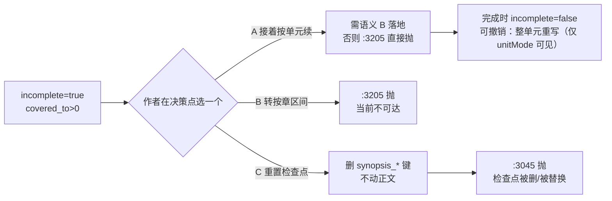
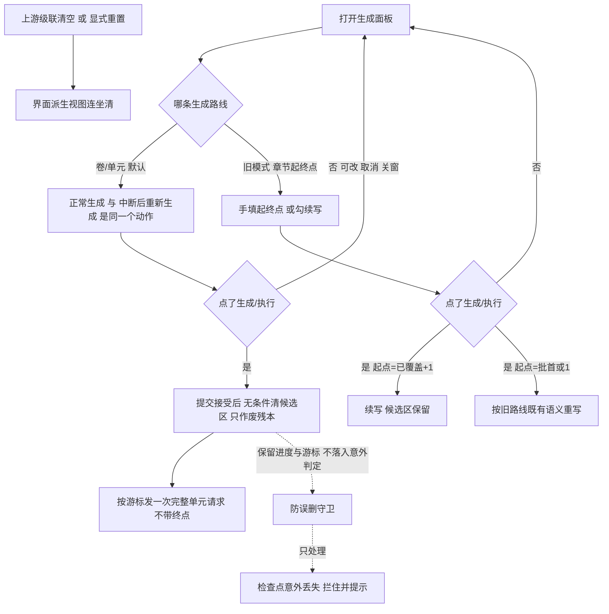
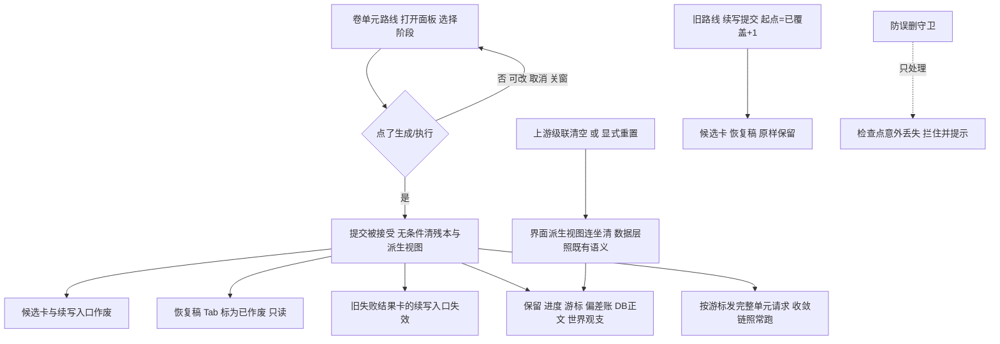

# D8 方案 · 检查点残留导致的模式降级，与同屏两个章数

> 状态：已实施（2026-11-06 · 第八轮补正后直接施工；**19:5x Agent 用 CDP 实机跑完四条，三项阻塞待作者定夺，见 §12.10.6；「已实施」不等于产品链路已通过**）—— **现值只认 §12.10**：D8 真正要修的是「候选区大纲生成残本阻塞大纲生成」，卷/单元路线每次点「生成 / 执行」无条件清候选区，旧模式保留候选区续写，清场只作废残本、不碰进度 / 游标 / 偏差账 / DB 正式大纲。18:5x 作者裁定「不用复审、直接施工、做实际验证」⇒ 不再送豆包复审、不再重划 v4，生产代码已写入主工作区并跑验证；**实机另发现清场后命令侧守卫拒跑（§12.10.6-1），以及中断产物在右侧面板没有取消入口（§12.10.6-1b）；作者 20:4x 四条订正否决了本节 19:5x 的机制说明（「删掉的是正文」不成立，删的是大纲生成物；未落稿物不该作正式产物被守护），定夺前不改生产代码**。**以下 04:5x 裁定原文为历史快照，仍有效的部分见 §8.1 / §9**：04:33 采纳 B「当前面板按选择自动划定范围」、不新增决策弹窗；04:43「选择起点 ≠ 实施意图，**清候选区只能在点生成/执行之后**」；04:47 批复「按单元后整批重来代价可接受」⇒ 卷/单元模式不提供中途续写；04:53 反馈收敛链零改动；04:56 **静默判据 = 配置开关，不是探针结果**；05:03 卷单元路线内不保留章节连选、禁止模式交替。「中途续写可能接续撕裂」为作者未验证的产品判断，不作既成事实。§11.7 / v3 任务书 / C1·C2 两条待裁**已作废**，原文逐字保留作历史。**「设计待豆包审核 / 代码未开工 / v4 任务书未重划」是当时的快照，不是现值。**
> 历史裁定中仍有效的部分：裁定 1 = A「整批重来」（**04:47 作者复述 2026-11-05 批复后重新生效为卷/单元路线的唯一出口**；04:2x「两条线都做实」的语义 B 按 04:47 重新落位 ⇒ 单元模式不做中途续写，续写线归旧模式的章区间起点，见 §12.5）· 2=A（已随 D13 T5 落地）· 3=Z（5 / 10 数值不动）· 5 逐章路径保留；裁定 4 关闭三按钮决策点，§12 改按**两条互斥的生成路线**重建。见 §8.1 / §9
> 上级登记：[`../product/live-pipeline-acceptance-defects-assessment.md`](../product/live-pipeline-acceptance-defects-assessment.md) §D8（`:477-503`）
> 相邻条目：D1（`:79-152`，批内源事实自撞）、D2（`:155-214`，批中断静默）、D7（单元→章偏保守）、D9（`:507`，调用长时间不返回）、D17（`:761-791`，中断落盘不声称范围）
> 本稿**只出方案，不动代码**；所有行号为 2026-11-05 实读。

---

## 0. 结论先行

1. **残留仍在产生（仍活）**，不是存量问题。产生它的不是"模型出错"，而是**批前预写**（`architecture.command.ts:3482-3483`）加上**一条只在 batch 模式生效的回滚**（`:3481`、`:3587-3589`）。按单元生成时这条回滚根本拿不到旧快照，所以任何一次取消、空输出或直接关窗都会在盘上留 `incomplete=true`。
2. 缺陷稿给的五个"判定入口"里，**四个已漂移或根本不相干**（§2）；真正决定降级的是 `synopsis-unit-launch.ts:285-289` 这一处探针。
3. 降级的根因不是 UI，是**中断续写的语义从来没被定义**：现在的 resume 取的是检查点里声明的批次范围（`:3116-3117`），不是"接着写"（§3）。所以**只把灰字改成三个按钮不算修好**。
4. 三个出口里，**两个今天走不通**：转按章区间会被 `:3205` 直接抛；重置检查点会在下一次生成时被 `:3045` 拦住（新发现，§5）。

---

## 1. 先判死活：`incomplete=true` 现在还产生吗

### 1.1 全部写入点（实读）

| 写点 | 位置 | 写什么 | 谁触发 |
|---|---|---|---|
| W1 批前预写 | `architecture.command.ts:3482-3483`（`mainOwned && !resumeRequested`） | `incomplete=true`、`covered_to = from-1`、**`synopsis_result` 被删**（`:4096`） | 每次非续写的生成，在模型调用**之前** |
| W2 中断落盘 | `:4098`（`persistInterruptedSynopsis`） | `incomplete=true`、`covered_to = range.from-1` | 输出被截断 / 调用失败且有进度 |
| W3 逐章路径导航 | `:3911`（`saveNavigation`，`complete` 默认 false）、调用在 `:3926`、`:3948` | `incomplete=true`、`covered_to = range.from-1`、`result` 被删（`:3921`） | 逐章大纲循环每轮 |
| 清除点 C1 | `:3728`（`partial.synopsis_incomplete = false`） | 完成落盘 | 成功收尾 |
| 清除点 C2 | `synopsis-unit-rewind.ts:362` | 整单元重写后置 false | 作者点"重写本单元" |
| 清除点 C3 | `synopsis-unit-launch.ts:233-239` | 删 `synopsis_*` 全部键 | 作者点"重置检查点" |
| 主进程侧 | `electron/` 全目录只有 `generation-controller.test.ts:672/746` 两处断言它，**没有任何清理点** | — | — |

### 1.2 逐条触发路径：哪些会留下残留

| # | 触发 | 证据 | 会留残留？ |
|---|---|---|---|
| P1 | **unit 模式**下调用失败/取消，且没有产出任何正文 | `:3481` 只有在 `mode === 'batch'` 时才拍 `previousBatchPartial` 快照；unit 模式为 `undefined` ⇒ `:3587-3589` 的回滚整块跳过；`:3573-3577` 又因 `context.cancelled` 或 `madeProgress=false` 不进续写分支 | **会。活。** |
| P2 | **unit 模式**下模型返回空 | 空输出分支只回滚 `previousBatchPartial`（`:3593-3601`），unit 模式同样没有 | **会。活。** |
| P3 | 批跑到一半进程被杀 / 关窗 | 没有任何 `catch` 会执行；主进程侧无清理点（§1.1 末行） | **会。活。** |
| P4 | 逐章路径中途取消 | `:3928` `assertNotCancelled` 抛错，`saveNavigation` 已写过 `incomplete=true`（W3），无回滚 | **会。活**（该路径的入口开关本稿未逐一确认，标**不确定**） |
| P5 | 输出被截断 / 调用失败但有进度 | `:3579` `persistAndRaiseResume` → W2 | **会。设计如此**（这是"可续写"的正常形态） |
| P6 | 正常完成 | `:3966` `saveNavigation(outline, true)`；D1 实机复验读到 `incomplete=false`（assessment `:136`） | 不会 |
| P7 | `mode === 'batch'` 下失败 | `previousBatchPartial` 有值 ⇒ `:3587-3589` 回滚到批前快照 | 不会（**唯一被覆盖的模式**） |

### 1.3 结论：**仍活**

且 P1/P2/P3/P4 留下的是**同一种最坏的形态**：`incomplete=true` + `covered_to = from-1 > 0` + **没有正文**（`:4096` 在 mainOwned 下删掉了 `synopsis_result`）。探针的"例外一"只放过 `covered_to=0` 的空标记（`synopsis-unit-launch.ts:281-282`），**`covered_to>0` 就被判为可续写**（`:286-288`）⇒ `skip('incomplete')` ⇒ 单元模式被永久关掉，直到作者手动重置。

⇒ 所以 D1/D2 修完之后，**D8 从"偶发"变成"稳定复现"**：D2 把失败变得"看得见"，但看得见的失败并不清理检查点。这正是"疤痕反过来改变下一批的语义"（缺陷稿 `:497`）。

---

## 2. 降级判定链清点（逐个复核缺陷稿行号）

| 缺陷稿写的 | 现文件实读内容 | 判定 |
|---|---|---|
| `architecture.command.ts:994-997` | 落在 `assertPlotOutlineTitleCoverage` 内，与 `incomplete` 无关；真正按 `incomplete` 改变行为的是 `renderSynopsisDbText` 的 `:1049-1056`（写"未完成"标记） | **已漂移**，正确位置 `:1049-1056` |
| `:1184-1185` | `synopsisBatchInstruction` 的数组元素：`trailing,` + 一段提示词文本 | **不相干**（提示词拼装） |
| `:1259` | `assertPlotOutlineBatchComplete` 里的 `|| mark.totalChapters !== totalChapters` | **不相干**（自报进度标记核对） |
| `:1279` | `assertCheckpointDbMirrorCurrent` 的形参 `totalChapters: number,` | **不相干** |
| `:2912` | `GeneratePlotStructureCommand.execute` 的收尾 `}`；`GeneratePlotArchitectureCommand` 从 `:2914` 起 | **不相干** |
| `ArchitectureConfirmDialog.tsx:717` | `未按单元生成：${describeSynopsisUnitProbe(unitPreview)}` | **正确** |

**真正的判定链（五处，按顺序）：**

| 环节 | 位置 | 语义 |
|---|---|---|
| ① 读 | `architecture.command.ts:3036` `interrupted = partial.synopsis_incomplete === true` | 把它读成"有未完成批次" |
| ② 挡新批 | `:3194`（`!interrupted` 才检查覆盖收缩）、`:3205-3209`（`interrupted` 时**直接抛**"请先完成该批次"） | 用同一个布尔值做两种相反的判断 |
| ③ 不变式 | `:1294-1300`（`incomplete=true` 时只要求 `coveredTo < range.to`，并额外放行 `pendingBatch`） | 允许"批未开始"与"批写了一半"共存 |
| ④ 探针降级 | `synopsis-unit-launch.ts:285-289` → `skip('incomplete')` | **唯一决定"这一批按单元还是按章"的地方** |
| ⑤ 文案 | `synopsis-unit-launch.ts:409` → `:717` 的灰字 | 只有说明，**没有回执**（不产生事件、不写状态） |

⇒ 降级不是"某个判定写错了"，而是**②和④对同一个布尔值给出了互相矛盾的用法**：②说"有未完成批次就别开新批"，④说"有未完成批次就换个模式开"。而 ④ 换的模式在新批处会被 ② 拦死（见 §5.2）。

---

## 3. 真正的根因：中断续写的语义能不能定

### 3.1 现状语义（三个实读事实）

| # | 事实 | 位置 |
|---|---|---|
| a | resume 的 `from`/`to` 取**检查点里声明的批次范围**，不是 `covered_to + 1` | `:3116-3117` |
| b | seed = **库里已确认的前缀正文**；mainOwned 模式下候选正文已被删（`:4096`），非 mainOwned 才写进 `synopsis_result` | `:3155-3161`、`:4096-4097` |
| c | 提示词里"第 1..N 章已完成"用的是 `from - 1`，不是实际覆盖数 | `:1166` |

⇒ 三条合起来的真实语义是：**把本批声明的范围整段重写一遍，用已确认前缀做种子；写了一半的候选既不参与种子，也不被保留（mainOwned 下连文本都没了，只剩一个 handle）。** 探针注释自己也这么写（`:279-280`：「有未完成批次时单元模式语义未定 …… 避免重复生成同一单元」）。

### 3.2 能定吗：能，但必须选一种语义并落到代码

**语义 A（保持"整批重来"，把谎话改成实话）**

- 规则：`from/to` 仍取 `synopsis_range`；候选文本丢弃；完成后按**原范围**记账。
- 代价：D9 那种"12 分钟才返回"的批次，半成品等于白写；且作者以为在"接着写"（缺陷稿 `:497` 的误解不会消失，只会换成"重写"）。
- 证伪单测：造一个 `covered_to=9, range={10,10}, incomplete=true` 的检查点，断言 resume 生成后 `synopsis_range` 仍为 `{10,10}`、且 `covered_to=10`（若代码里有任何"接着写"的痕迹，这条会红）。
- ✅ **2026-11-05 已裁定采纳 A。** 作者理由：「如果是以前的话，整批重来代价非常高。但现在我们是按单元的，我认为代价可接受。」——即 A 的代价随 E3 单元化而大幅下降：**重来的单位从"整本 / 整卷"缩小到一个单元（实测第 4 卷第 2 单元 = 第 18–19 章，2 章）**，而 B 要动 6 处命令侧代码 + 1 处不变式（本表）才能兑现"真接着写"。**A 剩下的成本就只有"UI 文案必须从『续写』改成『重写本批』"这一条，而这条本来就是必须做的**（§3.2 验收线：只换按钮不算修好）。

**语义 B（"接着写"，候选即前缀）—— ~~本稿推荐讨论的方向~~ · 2026-11-05 已裁掉，不采纳**

规则必须写全，缺一条都会重演：

| 步骤 | 规则 | 落点 |
|---|---|---|
| 1 取候选 | mainOwned 不删候选：要么保留 `synopsis_result`，要么从 handle 读回（`WorldBuildingEditor.tsx:225-233` 已经在读 `generation:read-visible-composition`） | 改 `:4096` |
| 2 数到第几章 | `from = plotOutlineCoveredTo(候选正文) + 1`；候选为空 ⇒ 退回 `range.from` | 改 `:3116-3117` |
| 3 区间与批上限 | `to` 保持原 `synopsis_range.to`；单元模式再 `min(unitMax, to)`；并保证 `to - from + 1 ≤ PLANNING_ACTION_CHAPTER_LIMIT`（`plot-outline-contract.ts:9`、断言在 `:22`） | `:3176`、`:3116` |
| 4 提示词说真话 | "第 1..M 章已完成"用实际 M，不用 `from-1` | 改 `:1166` |
| 5 交接项 | 候选有值 ⇒ `formatLastHookLine(候选)` 才有意义（现在 mainOwned 下必为 null） | `:3471-3473` |
| 6 完成合成 | 提交"候选 + 新增"，`writtenRange` 覆盖 `M+1..to` | `commitSynopsisWithCheckpointRollback:4023-4031` |
| 7 不变式放宽 | 允许 `coveredTo ≥ range.from`（现在的 `pendingBatch` 例外只覆盖 `= from-1`） | `:1293-1300` |

- 代价：把"候选算不算数"变成一条真规则，需要动 5 处命令侧代码 + 1 处不变式；且 `assertPlotOutlineBatchComplete`（`:1247-1267`）要求自报标记与请求 `to` 完全一致，合并提交时必须重新对齐，否则会以"批次范围错位"拒绝保存。
- 证伪单测：候选覆盖到第 10 章、`covered_to=9`、`range={10,11}` ⇒ 断言本次请求 `from=11`（不是 10），且完成后 `covered_to=11`（候选的 10 章没有被重写）。

**验收线（本稿的判定标准）**：如果交付物只是把 `:717` 的灰字换成三个按钮，而 §3.2 里 A 或 B 一条都没落到代码，**D8 不算修好**——因为按钮背后仍然是 `:3205` 的硬抛（§5.2）。

---

## 4. 同屏两个章数：唯一事实源

### 4.1 两个常量与实际消费

- `DEFAULT_PLANNING_ACTION_CHAPTERS = 5` —— `src/shared/plot-outline-contract.ts:8`
- `PLANNING_ACTION_CHAPTER_LIMIT = 10` —— 同文件 `:9`，硬闸门在 `:22`（`assertPlanningActionRange`）

**`= 10` 的消费点（本批上限 / 文案）**

| 位置 | 用途 |
|---|---|
| `plot-outline-contract.ts:22` | **硬契约**：范围超过 10 章直接抛 |
| `ArchitectureConfirmDialog.tsx:221` | 预填范围时把 `to` 夹到 `from+9` |
| `:408` | 「续写」时 `continueTo = continueStart+9` |
| `:430` | 终点步进的 `maxTo` |
| `:456` | 单元模式的兜底范围 |
| `:463-464` | 非法范围提示文案 |
| `:676`、`:696`、`:707` | 三处面向作者的文案（**":707 默认推进 10 章"就在这里**） |
| `:930` | 超过上限时变红 |
| `DirectoryConfigDialog.tsx:318`、`:480` | 蓝图对话框的范围校验与输入上限 |

**`= 5` 的消费点（默认量）**

| 位置 | 用途 |
|---|---|
| `ArchitectureConfirmDialog.tsx:225` | 打开对话框时把 `to` 设为 5（`:932` 显示的"本批 5 章"由此而来，**不是**直接读常量） |
| `architecture-workflow.ts:130` | 未传范围时的默认 `{1, min(total,5)}` |
| `architecture.command.ts:109` | `stepAuthorInputs` 里同一份默认 |
| `electron/services/main-generation-plan.ts:126` | 主进程规划意图的默认 |
| `src/shared/agent-generation.ts:8` | **Agent 工具**的默认 `chapter_count` |
| `DirectoryConfigDialog.tsx:90`、`:92`、`:204` | 蓝图对话框默认 |
| `directory.command.ts:321`、`:324` | 蓝图命令默认 |
| `scripts/quality-modernization-driver.mjs:702-703` | 验收脚本按 5 章分批（**改这个值会让验收脚本的批次数变**） |

### 4.2 同屏为什么同时出现

降级态下 `unitMode` 为 null（`ArchitectureConfirmDialog.tsx:264`）⇒ 走进 `!unitMode` 分支（`:698`、`:892`）：

- `:707` 的 B 分支（`canContinue && !continuing`）说"默认推进 10 章"；
- `:932` 说"本批 5 章"，因为 `synopsisLength` 由 `:412-416` 从输入框算得，而输入框默认来自 `:225` 的 **5**。

两个数**不是同一个量的两种写法**：一个是"上限"，一个是"当前输入值"。把它们并排放在同一屏，作者无法判断点下去写几章（缺陷稿 `:499`）。

### 4.3 统一取哪个值：这是**行为变更**，必须显式裁定

| 选项 | 会发生什么 | 代价 |
|---|---|---|
| X 取 10（上限即默认） | 默认批 5→10 章；单次输出翻倍 | 截断概率上升（D9 已登记"长时间不返回"）、单次失败面变大；`agent-generation.ts:8` 的默认也变；验收脚本批次数减半 |
| Y 取 5（默认即上限） | 硬契约 10→5 | 所有 `assertPlanningActionRange` 路径收紧；`DirectoryConfigDialog` 上限变 5；`prompt-assembly-backlog.md:1430` 把 10 记为"双端硬契约"，文档要同步 |
| Z **只统一显示，不动数值** | `:707` 改成"上限 10 章"，`:932` 只说"本批 N 章"（默认 5 写明） | 零行为变更，可立即做；但没有回答"默认到底该几章"这个产品问题 |

> **本稿不建议静默选一个。** X/Y 都会改变默认生成量（Y 还改变硬契约），按项目纪律属"行为变更"，需作者裁定（`docs/agents/documentation-charter.md:157` 要求行为变更与状态行同步）。Z 可以作为先手。

---

## 5. 决策点化：三个选项各自会发生什么

读法：三个出口里，A 依赖 §3 的语义先定死；B 今天被 `:3205` 拦死；C 会撞上 `:3045` 的"检查点丢失"守卫。**唯一真正可达的是 A，而 A 恰恰是语义未定的那一个。**

| 选项 | 点下去会发生什么 | 能否撤销 | 对检查点写入什么 |
|---|---|---|---|
| A 接着按单元续 | 走 resume 分支：`from/to` 取 `synopsis_range`（`:3116-3117`），seed 取库内前缀，整批重写（§3.1）；成功则 `incomplete=false`（`:3728`/`:3911`） | 只能"整单元重写"（`synopsis-unit-rewind.ts:341-374`，`:362` 置 false）；**但该按钮只在 `unitMode` 下渲染**（`:747`/`:892`），降级态下它不出现 | 成功：`incomplete=false`+`covered_to=to`；失败：保持 `incomplete=true`、`covered_to=from-1` |
| B 转按章区间 | 生成请求不带 `synopsisUnit`；命令侧 `interrupted=true` 且 `from>1` ⇒ **`:3205-3209` 抛"请先完成该批次"** | 不可撤销（若真跑起来会按新范围落库） | 无（抛错即停） |
| C 重置检查点 | `resetSynopsisCheckpoint` 只删 `synopsis_*` 键（`synopsis-unit-launch.ts:179-192`、`:233-239`），正文不动 | 不可撤销（进度记录消失） | 删键；下一次生成 `coveredTo=0`、`dbCoveredTo>0`、`interrupted=false` ⇒ **`:3045-3053` 抛"检查点显示一章都没写过"**，除非作者同时清空库里的大纲 |

⇒ 决策点不是"给三个按钮"，而是**先让至少一条出口真的能走完**。否则三个按钮里两个是"点了报错"，这比灰字更糟。

---

## 6. 与 D17 的耦合

D17 的既定口径是"中断落盘**不声称范围**"（assessment `:787`），实现落在 `commitSynopsisWithCheckpointRollback:4021-4031`：`outlineWrittenRange` 在 `incomplete=true` 时返回 `null` ⇒ 不传 `writtenRange` ⇒ 下游按"全改"算。

**判断：保持不变。** 理由两条：

1. 中断那一刻**确实**没有写完声明的范围，声称范围就是撒谎；D17 的"保守"是对的。
2. 真正会变的是 **resume 成功后的那一次提交**：`incomplete=false` ⇒ `writtenRange` 有值（`:4023-4031`）。若采纳 §3.2 的语义 B，这里唯一要改的是让 `writtenRange` 覆盖"候选 + 新增"的实际章集（即 `from` 取候选覆盖到的下一章），**不是**放宽中断落盘的判据。

**需要跟着改的只有一处**：语义 B 落地后，`previousPartial.synopsis_covered_to`（`:4029`）取的是**批前**已覆盖数，而候选可能已经超过了它 ⇒ 收缩判定（`outlineWrittenRange` 内部）会少标几章"被删"。这一条属 D17 的边界，需在实施时一并核。**若语义 A（整批重来）被采纳，D17 一个字都不用改。**

---

## 7. 明确不做什么

1. **不把 `incomplete=true` 改成三次态枚举**（如 `partial / abandoned / unknown`）。理由：存量检查点只有布尔值，加枚举要迁移全部历史项目，而 §1.2 的 P1–P4 用现有布尔值已经能表达清楚。
2. **不做"自动续写"**（失败后自动再发一次）。D9 已登记"12 分钟不返回"，自动重试会把一次失败放大成 N 次。
3. **不改 `PLANNING_ACTION_CHAPTER_LIMIT` / `DEFAULT_PLANNING_ACTION_CHAPTERS` 的数值**（§4.3 的 X/Y 属行为变更，需裁定；本稿只统一显示）。
4. **不动 D1 的"链式新 run"结构**（assessment `:119-122`）。
5. **不动 `assertCheckpointDbMirrorCurrent` 的其余三条不变式**（只讨论 `incomplete` 那一条，`:1298-1299`）。
6. **不在 UI 里新增第二条告警通道**（D15 `:751` 已踩过"混类告警导致错误归因"）。
7. **不替作者决定"半成品算不算数"**——这是 §3.2 的 A/B 二选一，属裁定项。

---

## 8. 裁定项（全部已裁）

> **裁定全集已闭合（2026-11-06 00:49，作者「2确定」）**：裁定 2 = A（与 D13 裁定 2 合并答，条件已随 D13 T5 落地）· **裁定 3 = Z（只统一文案 / 显示，5 与 10 两个数值不动）** · **裁定 4 随裁定 1 关闭**（A 语义下只剩一条路要修通，不做三个按钮决策点）· 裁定 5 = 逐章路径保留（§10.5）。原始问法与代价表保留在下，不再作为待裁项。

| # | 问题 | 选项 | 各自代价 |
|---|---|---|---|
| 1 | 中断续写的语义取哪一种？ | A 整批重来 / B 候选即前缀 | A：不改代码，但半成品白写，且必须把 UI 文案从"续写"改成"重写本批"；B：动 6 处（§3.2 表），换来"真接着写"，但要补合并提交的单测 |
| 2 | mainOwned 下候选正文存不存？ | 存进检查点 / 只留 handle | 存：检查点体积变大、`assertCheckpointDbMirrorCurrent` 的镜像约束要重算；只留 handle：语义 B 要靠 IPC 读回（已有一条读法 `WorldBuildingEditor.tsx:225-233`） |
| 3 | 默认章数取 5 还是 10？（**行为变更**） | X 取 10 / Y 取 5 / Z 只改显示 | X：单次输出翻倍，D9 风险上升；Y：硬契约收紧，Agent 工具与验收脚本的默认量一起变；Z：零变更但不解决产品问题 |
| 4 | 决策点做不做？ | 只做 A（改文案+语义）/ 三个按钮 | 只做 A：范围最小；三个按钮：B、C 必须先各自修到"能走完"，否则就是三个报错按钮 |
| 5 | P4（逐章路径）要不要一起修？**（历史行：已于 21:14 裁定「逐章路径保留」，裁定 5 关闭，见 §10.5）** | 一起 / 单列一条 | 一起：改动面扩到另一条生成路径；单列：unit 模式先能用，逐章路径继续留疤 |

### 8.1 作者裁定（2026-11-06 00:49）

| # | 裁定 | 附带口径 |
|---|---|---|
| 3 | **Z**（只统一文案 / 显示，5 与 10 数值不动） | X / Y 属行为变更（改默认生成量或收紧硬契约），一律不做。`:707` 写清「上限 10 章」，`:932` 只说「本批 N 章（默认 5）」；`DEFAULT_PLANNING_ACTION_CHAPTERS` / `PLANNING_ACTION_CHAPTER_LIMIT`、Agent 工具默认量、验收脚本分批数**逐字不动** |
| 4 | **随裁定 1 关闭** | 语义 A 下 B / C 两个按钮对应的路径本就不成立，不做「三个按钮」决策点；只修通 A 那一条能走完的路（§5 的 `:3205` / `:3045`）。**⚠️ 05:20 豆包抽查：本表是 2026-11-06 00:49 的历史裁定，与 §12.4「守卫逐字不动」字面冲突 ⇒ 加此标注**：04:1x 起由 §12 取代，「修通 `:3045` 拦截」**不是现行口径**，D8 不新增按钮、守卫逐字不动；原文保留作沿革，不作为执行依据 |
| 2 | **A**（与 D13 裁定 2 合并答） | 已由 D13 T5 于 2026-11-06 落地：`!mainOwned` 条件放开，落库形态不变 |
| 5 | **逐章路径保留** | 21:14 已裁，见 §10.5 |

---

## 9. 处置（2026-11-05 20:39，作者裁定 1）

**裁定 1 = 语义 A（整批重来）**，作者原话：「如果是以前的话，整批重来代价非常高。但现在我们是按单元的，我认为代价可接受。」

| 项 | 结论 |
|---|---|
| 语义 | A。`from/to` 仍取 `synopsis_range`，候选文本丢弃，完成后按原范围记账 |
| 为什么代价可接受 | E3 单元化之后，**"整批"的粒度已经是一个单元**（实测第 4 卷第 2 单元 = 第 18–19 章）。旧口径下"整批"意味着整本或整卷，那才是"代价非常高"的来源；这个前提今天不成立了 |
| 因此 B 整节作废 | §3.2 语义 B 那张 7 步表（改 5 处命令侧 + 1 处不变式）**不执行**。它是为"接着写"付的账，既然不要"接着写"，这笔账不用付 |
| **A 并不等于"不改代码"** | 原表把它写成"A：不改代码"，**这个说法要修正**：A 至少要做两件事 —— ① UI 文案从「续写」改成「重写本批」（§3.2 验收线已经要求）；② §5 那三个出口里 `:3205` 的硬抛与重置后 `:3045` 的拦截，都得改成在 A 语义下能走完的路径。**§3.2 的验收线在这里反而更严**：只把灰字换成按钮、A 的文案语义没落地，D8 不算修好。**⚠️ 2026-11-06 04:1x 作废**：作者裁「D8 回炉重造」，本行「三个出口都得改通」由 §12 意图解耦取代 —— 守卫逐字不动、重写线自带授权状态；它不再是待裁项 |
| 与 D20 的关系 | 无关。D20 是"检查点因模板变化被误判"，走的是指纹判定链；D8 是"检查点残留导致模式降级"。两者在 `architecture.command.ts` 里位置相邻（`:3045` / `:3133`），改的时候注意别互相踩 |

**裁定 2 已裁定（2026-11-05，与 D13 裁定 2 合并答）= A：让生产也留候选。** 两处原本问的是同一件事 —— D13 稿 §4.2 查出「唯一留候选的那条分支条件是 `!mainOwned`，而生产 `mainOwned` 恒真（三个调用点都不注入 `dependencies`）」，所以问题不是「要不要存」，而是「那条分支生产根本走不到」。按 A，`generate-draft.command.ts:1711` 的条件要放开；**本稿 §8 的「存进检查点 / 只留 handle」子选项作者本轮未答**，实施按最小口径：沿用现有 `db:recovery-candidate-record` 落库形态，只放开条件，不改存储结构、不动 `assertCheckpointDbMirrorCurrent` 的镜像约束。

> **2026-11-06 补**：`generate-draft.command.ts` catch 的 `!mainOwned` 条件已按裁定 2=A 放开（D13 实施卡 T5 收口，见 `d13-chapter-failure-contract-design.md` §7.1）；本稿 §8「存进检查点 / 只留 handle」子选项仍按最小口径不展开，落库形态沿用 `db:recovery-candidate-record`。

**裁定 3 / 4 已于 2026-11-06 裁定；裁定 5 已于 21:14 裁定「逐章路径保留」并关闭（§10.5）。** 裁定 2 在 A 语义下变得更简单：既然候选一律从生成范围丢弃，就只剩「要不要留着让作者看一眼」这一个产品问题，不再牵扯语义 B 的 IPC 读回路径；该条件已随 D13 T5 放开。裁定 3 取 Z ⇒ 只把 `:707`「默认推进 10 章」与 `:932`「本批 5 章」的**语义**写清（上限 vs 当前输入值），两个常量及所有默认值一律不动。裁定 4 随裁定 1 关闭 ⇒ 不造三按钮，只修通 A 语义下那一条路。

---

## 10. 文案要不要分两套：按章模式怎么办（2026-11-05 追问后补记）

作者问：**UI 文案统一改成「重写本批」，那按章写大纲的旧模式怎么办？可以直接分成两套吗？**

### 10.1 先纠一个前提：代码里**已经是两套**了，分叉点还是对的

`:3555-3568` **同一个 `throw` 内部**已经按 `unitContext` 分支：

| 分支 | 报文 |
|---|---|
| 单元（`unitContext` 非空） | 「点击「继续生成情节大纲」可**续写本单元**（【单元 N】）；如本单元仍然过大，可先回到弧光结构把它拆细后重试。」 |
| 非单元（含逐章） | 「点击「继续生成情节大纲」可**续写本批**（第 from–to 章）；如本批范围仍偏大，可先在「AI 生成架构」缩小每批章节数后重试。」 |

所以问题不是"能不能分成两套"，是**这两套已经存在、用的是正确的判据（`unitContext`），但两套都在撒谎**——把"整批重来"说成"续写"。

### 10.2 三条路，resume 语义完全一致

| 路径 | 怎么进来 | resume 取什么 | 实际做了什么 |
|---|---|---|---|
| 逐章（P4） | `:2960`：`recovery.plotOutline` 非空即分叉进 `executeChapterOutline` | `initial.range`（`:3907` 算指纹用的就是它） | 整段重写该范围 |
| 章区间（旧模式） | `synopsisRange` 入参 | `partial.synopsis_range`（`:3110-3117`） | 整段重写该范围 |
| 单元批（E3） | `synopsisUnit` 入参，与 `synopsisRange` 互斥（`:2926-2930` 注释自述"缺省 = 旧的章号区间模式"） | 同上 | 整段重写该单元 |

**决定性证据**：`PlotOutlineProgress`（`src/shared/plot-outline-contract.ts:71-76`）只有 `protocol / range / content / targetUnits / cursor` —— **没有"批内写到第几章"这个字段**。所以"从断续点接着写"在这套数据结构里**无处表达**，三条路都只能整批重来。

### 10.3 三处说法都假，而且第三处是全局单套

| # | 位置 | 原文 | 为什么假 |
|---|---|---|---|
| 1 | `:3556` log | 「已完成部分（约 N 字）已保存，可点击…从断点续写」 | mainOwned 下落盘时 `delete partial.synopsis_result`（`:4096` 逐章 / `:3921` 另一支），半成品正文不留存；留下的只有"未完成标记 + 已确认前缀" |
| 2 | `:3559-3563` 两套报文 | 「可续写本单元 / 本批」 | 从 `range.from` 整批重写，不从断续点接着写 |
| 3 | `AIOutputPanel.tsx:1079` 按钮 + `:1104` 说明 | 「继续生成情节大纲（**断点续写**）」+「已完成的部分已保存为不完整大纲，**不会被覆盖**；本次将让 AI **接着上次的末尾继续写**」 | 同 2；且这句**不分模式**，所以对三种路径**全错**，是最该改的一句 |

### 10.4 结论：不需要为"按章写"再分一套

- **逐章路径天然落在"本批"那一支**（它没有 `unitContext`），「重新生成第 from–to 章的大纲」对它是准确描述，不需要第三套文案。
- 真正需要分开的只有 **单元 / 非单元** 这一层，而它已经存在。要做的是把两套里的「续写」换成**如实描述**，不是再造一套。**⚠️ 05:38 补**：卷/单元路线**不新增任何「重写本单元」按钮**（那颗既有按钮属另一件事），只改文案与残本清场；旧模式按起点如实说。
- 单元那一支还必须**明说「单元内不接着写」**。**⚠️ 05:20 豆包抽查订正原稿两处硬错**：① 原写「理由不是实现难，是你以前的批语：单元内续写会造成剧情断痕」—— 那是作者 04:47 自标**「没有实际验证」的产品判断**，不是既成事实，也不据此改提示词 / 生成策略；② 原写「这条已经写死在 E3 稿里」，E3 原文说的是**「会复杂化，且大概率冲击反馈收敛机制」**（工程取舍），**没有「剧情断痕」这一条**。依据：[`e3-unit-batch-implementation-plan.md`](e3-unit-batch-implementation-plan.md) `:313`、[`2026-10-20-e3-unit-batch-handoff.md`](../../handoffs/2026-10-20-e3-unit-batch-handoff.md) `:21` / `:152`。**所以 §3.2 语义 B 作废与「单元内续写不做」是同一个方向，但理由不同，别混成一件事。**
- 全局那句（第 3 处）改成模式中立：按钮「重新生成本批大纲」，说明「这一批没写完。重新生成会重写第 X–Y 章的大纲，已确认的前缀不受影响。」——"X–Y"由 `synopsis_range` 填，模式无关。

### 10.5 裁定 5：**逐章路径保留**（2026-11-05 21:14，作者裁定）

作者理由：「在小说配置里，如果选择的不是卷单元模式的话，那根本不会出现按单元这个选项，只能按照章节 From To 来写。」

**代码核对后，实际门槛比"配置里选一下"还多一层**（`synopsis-unit-launch.ts:265`、`describeSynopsisUnitProbe` 的 reason 表）：

| 门槛 | reason | 结果 |
|---|---|---|
| 设置开关「按单元生成情节大纲」关掉（设置 → 编辑器） | `flag-off` | 退回按章区间 |
| 骨架里没有 `### 单元` 划界 | `no-cursor` | 退回按章区间 |
| 检查点有未完成批次 | `incomplete` | 退回按章区间 |
| 检查点不是合法 JSON / 不是 UTF-8 | `checkpoint-broken` | 退回按章区间（拒绝进单元模式，否则会从第 1 章覆盖重写） |
| 库里已有大纲但检查点说一章没写过 | `checkpoint-lost` | 同上 |
| 单元定位算不出来 | `compute-null` | 退回按章区间 |
| 探针自身报错 | `probe-error` | 退回按章区间 |

⇒ **逐章路径不是"备用方案"，它是这七种情况的唯一出口。** 所以 §10.4 第 1 条那句「逐章天然落在本批那一支」要长期成立，删掉它等于让上述七种情况无路可走。

**对 §10.4 的影响**：文案只需两套（单元 / 非单元），逐章不需要第三套——这一点不变。裁定 5 关闭，不再作为待裁项。

---

## 11. 开工前查证与方案修订（2026-11-06 03:0x）

> **本节取代**看板卡 `4b9eae6e` 的旧版任务书；旧版原文保留在 `C:/develop/tmp/d8-review-input-2026-11-06.md` 作历史记录。本节是作者 03:05「先明确要解决什么问题 / 是否真实存在 / 行业有无先例 / 枚举与清单有无定义，而不是自己造需求」这一问的回答，按 `industry-alignment-and-stage-goals.md` §5 四问逐条落笔。

### 11.1 触发

02:52 子 Agent 独立审核（`C:/develop/tmp/d8-plan-review-2026-11-06.md`）报「阻塞开工」：方案引用的 8 个 `文件:行号` 有 6 处漂移，验收 3 以旧行号为判据不可判定；另列 Y1（是否允许动 `:3340-3348` 守卫）/ Y2（验收 1 枚举范围、验收 2 对象清单）为「需作者裁定」。Lead 按手册 §5.2「意见要证据」独立抽查 8 处，全部属实。

### 11.2 四问之一：验收 1 要解决的是什么问题，真实吗，行业叫什么

**真问题**：**用户可见文案与实际行为不一致**。代码实证 —— `architecture.command.ts:3853-3860`（log 与两套错误报文）、`AIOutputPanel.tsx:1123/1124/1129`（按钮与说明）、`:462`（落库提示）、`:3502`（错误提示）都写着「从断点续写 / 可续写本单元 / 不会被覆盖 / 接着上次的末尾继续写」，而作者裁定 1 = 语义 A「整批重来」：候选文本丢弃、`from/to` 仍取 `synopsis_range`、完成后按原范围记账。按钮点了是**重写本批**，文案却说**接着写**。这是实读代码可证的真问题，不是推测。

**行业名 + 出处**（不是自造）：
- **Nielsen 十大可用性启发式 #1 Visibility of System Status**（系统应始终让用户知道正在发生什么）、**#9 Help Users Recognize, Diagnose, and Recover from Errors**、**#4 Consistency and Standards**（不同界面的词与动作不能意思不一致）。出处：Nielsen Norman Group《10 Usability Heuristics》(1994/2020 修订)、《Error-Message Guidelines》「Concisely and precisely describe the issue」「Offer constructive advice」、`nngroup.com/articles/error-message-guidelines/`；中文对照 `ux-guidelines.com/nielsens-heuristics.html`。
- AI 时代补充：NN/g 启发式在生成式产品里的延伸是「**停止与重新生成**（stop / regenerate）」，「模型的第一个回答是草稿，永远不是死胡同」——即 UI 必须如实区分「继续」与「重来」。
- **失败形态归类**：属 **UX 状态 / 错误文案与系统行为不一致**（heuristic violation），不是 continuity、不是 craft、不是算术问题。按 §5 四问第 3 问，对得上既有分类 ⇒ 不是自造问题。

**成熟产品 / 论文做过什么，我们与它的差异**：长文本生成中断恢复，行业主流是 **checkpoint + offset + hash 的「断点续传」**（例：马良写作「中断自动续跑」`maliangwriter.com/blog/multi-agent-long-running-tasks`；独立开发者社区访谈「流式生成必须像视频播放一样支持断点续传」`solo.xin/topic/5746`，并明确指出「大多数 AI 生成请求不是幂等的，**重新生成不是恢复而是替换**」）。⇒ **「整批重来」不是行业通例**，是作者基于 E3 单元化的项目特定裁定：整批粒度已缩到一个单元（第 4 卷第 2 单元 = 18–19 章，2 章），代价可接受（§9）。差异属**需求差异**（单元化后重来代价骤降），合规；但正因为与行业主流相反，**文案更必须说真话**，不能留「续写」字样让作者按行业惯例预期。

### 11.3 四问之二：枚举范围 / 对象清单有没有具体定义

**验收 1 的「枚举范围」：没有行业定义，也不该造。** 行业有「启发式评估」（逐条 heuristic 找问题）与「需求可验证性」，但**没有**「把全库所有 UI 文案列成一份清单再逐条打勾」这种交付验收对象；清单本身是我们发明的验收物。按 §5 禁止事项「自造术语当标准用 / 把我觉得应该写成设计原则」，**Y2 前半撤回**：不新增枚举清单。验收 1 改为**按语义判据核对** —— 「凡描述本批生成中断后点按钮会发生什么的用户可见文案，不得再声称会接着写」，并在任务书里给出**明确排除项**（世界观断点续写 `architecture-workflow.ts:247/249`、恢复稿 `WorldBuildingEditor.tsx:848/897`、另一功能的「作者版不会被覆盖」`VolumeHandoffRegistryPanel.tsx:776`），防止执行者把别的功能一起改坏。判据可判定、可复现，且不需要作者另裁范围。

**验收 2 的「对象清单」：事实源早就存在，不需要另造。** 实读 `src/shared/plot-outline-contract.ts:8`（`DEFAULT_PLANNING_ACTION_CHAPTERS = 5`）与 `:9`（`PLANNING_ACTION_CHAPTER_LIMIT = 10`）是**两个定义处**；全库约 25 处（`ArchitectureConfirmDialog` / `DirectoryConfigDialog` / `WorldBuildingEditor` / `architecture-workflow.ts` / `architecture.command.ts` / `directory.command.ts` …）都是**引用处**，不是独立事实源 —— 定义不动，引用处一律不变。裁定 3 = Z 已点名四类对象：两常量定义处、Agent 工具默认量、验收脚本分批数，「逐字不动」。子 Agent 要求「列全所有默认值」把定义处与引用处混同，属造需求 ⇒ **Y2 后半撤回**。验收 2 改为「贴 `git diff` 证明定义处逐字未动」，`git diff` 本身就是对象清单，不必先造一份。

> 一句话：**要解决的问题是真的，行业有标准名；被要求补的两份「清单」是假的，撤回。** 这正是 §5 第 2 问「谁消费产出」—— 清单的唯一消费者是验收者自己，不进产品、不进模型，属于 W6 那种「只有一块展示面板」的死法。

### 11.4 行号重定位（当前 HEAD `2d413afe` 实读；**行号不是契约**）

| 旧引用 | 当前位置 | Lead 抽查 |
|---|---|---|
| `architecture.command.ts:3556` | `:3853-3855` log | 旧行现为空行 ✓ |
| `:3559-3563` | `:3856-3860` 两套报文 | 旧行现为 D20 `interruptionRange` 注释与常量（`:3562`、`:3570 fingerprintParts`）✓ |
| `:3205` | `:3500-3504` `if (interrupted) throw` | 旧行是 `return content` ✓ |
| `:3045` | **不在本卡范围** | 旧行是「资源登记提案未能保存」log；真实守卫在 `:3340-3348` ✓ |
| `AIOutputPanel.tsx:1079` | `:1106-1125` 按钮 | 旧行是 `open-novel-config` 按钮的 `type="button"` ✓ |
| `:1104` | `:1126-1131` 说明 | 旧行是 JSX 条件 ✓ |
| `ArchitectureConfirmDialog.tsx:707` / `:932` | 命中（`:707` / `:932-935`） | ✓ |

主因：2026-11-06 D13 T5 与 D6 两卡改过 `architecture.command.ts`。**修订动作不止换行号**：任务书新增一句硬约束「行号只是定位辅助，一律以符号名 / 文案内容为准；代码若再变，按内容重新定位，不许照行号动手」——否则下次改动又会漂移。

### 11.5 与裁定 4 冲突的一条（Lead 抽查时补出）

旧任务书「要做 2」要求「重置后 `:3045` 拦截也要改成 A 语义下能走完」。但设计稿 §5 的 C 路径 =「重置检查点」，**裁定 4 已把三按钮（含 C）关闭**；A 语义按 §9「`from/to` 仍取 `synopsis_range`、候选丢弃」根本不删检查点 ⇒ `:3340-3348` 的 checkpoint-lost 守卫**不在本卡路径上**，且它是「防静默覆盖」的安全网。子 Agent 的 Y1 问「是否允许动该守卫」，按已裁定 4 的必然推论答案是**不许动、该改点应删除**，不需要新裁定。⇒ **Y1 关闭**，任务书删掉这半条并写明理由。

### 11.6 结论

- **Y2 按四问撤回（不造清单）**，此结论在 03:20 豆包审查后仍成立。
- **Y1 未消解**：豆包查出本稿 §9:256 是**作者裁定的落地文字**、且守卫有两条现存入口，改裁定的权力不在 Lead 与执行者 ⇒ 转为**开工前待裁 C1**，见 §11.7。**本节的「Y1 关闭」作废。**
- **Z1 / Z2 转 backlog**：本稿 §5 / §10 自身的历史行号亦已过时（`:3555-3568`、`:3205`、`:3045`、`:1079/:1104`），缺陷总表 §D8:504 自认「四处已漂移」。这些是**文档行号债**，不作为执行依据；本轮不刷新，交接稿注明「执行以看板卡任务书 + §11.4 为准」。
- **方案已修订**：看板卡 `4b9eae6e` 任务书先后替换为 v2（`C:/develop/tmp/d8-card-prompt-v2-2026-11-06.md`）与 **v3**（`C:/develop/tmp/d8-card-prompt-v3-2026-11-06.md`，现行版），改点重定位、验收 1 / 2 改判据。**代码仍未开工**，状态仍「已裁定 · 代码未开工」。

---

## 11.7 豆包只读审查与 v3 更正（2026-11-06 03:20）

> **本节取代** §11.2 的行业归类与「主流」措辞、§11.3 的「全库约 25 处都是引用处」、§11.5 全节、§11.6 的「Y1 关闭」。上述原文保留不删，只作历史记录。

### 派法与抽查

按 `docs/agents/doubao-channel.md` §2.1.0：当前线程是 D6 的 Ask 实测对话（无关主题）⇒ **新开**独立线程，本地电脑 / 自动 中 / `AI-writer-wt-1`。**一次 `task` 派活 + 一次 nudge**（8 分钟后仍停在开场白，属已知的「中档收工」），严格串行、无并发、无 watchdog、无轮询轰炸。报告 `wt-1/.dsh-task-board/reports/d8-plan-review-2026-11-06.md`（**173 行**，v3 稿与交接稿原记 127，04:1x 按文件订正）。Lead 按手册「清单型只读必抽查」独立核了 9 处，**5 条阻塞全部属实**。

### 抽查证据（逐条）

- `architecture-workflow.ts:247` 是「继续生成情节大纲（断点续写）」，`:249` 才是世界观 ⇒ v2 排除表把 `:247` 划成世界观，错。
- `WorldBuildingEditor.tsx:844` 按 `isSynopsisCandidate` 分流，`:848`「断点续写」两种都显示；`:877` 限定 `f.key === 'synopsis'`，`:887` title「点击后 AI 从断点继续生成当前批次」、`:897`「断点续写大纲」⇒ 都是本功能，v2 整体排除，错。
- `architecture.command.ts:3396` 是 `if (resumeRequested)`，`:3465` 是 else；`:3500` 的 throw 在 **else 分支**，拦的是「未完成时另起新批」，`plot-outline-batch.command.test.ts:1034-1052` 钉住（检查点 21–40 未完成 / 请求 41–60 / 断言抛错且模型未被调用）⇒ v2「要做 2」按字面改，要么空操作、要么取消不变式并把请求改写成向后跳跃。
- `synopsis-unit-launch.ts:413`「中断续写语义未定」经 `ArchitectureConfirmDialog.tsx:717` 显示 ⇒ 裁定 1 后是假话，v2 漏。
- 守卫两条现存入口：`ArchitectureConfirmDialog.tsx:729-739/:808`（重置按钮）→ `synopsis-unit-launch.ts:219/238-243`；`arch-step-checkpoint.ts:51/63-67`（清空上游），且 `:724-726` 注释自认「会以 `checkpoint-lost` 形态挡路」⇒ §11.5「没有别的入口」不成立。
- browser 断言：`WorldBuildingEditor.recovery.browser.tsx:76-77` 断言「断点续写」、`workflow-language-seam.browser.tsx:87` 用英文 DB fixture ⇒ 与「只准单测 / 禁 browser」边界冲突。
- `blueprint-batch-policy.ts:96`、`batch-chapter-workflow.ts:35/:60` 有别的功能的字面 5 / 1–10 ⇒ §11.3「全库约 25 处都是引用处」过宽。

### 按证据更正（v3，7 条）

1. **排除表**：真排除只剩 `architecture-workflow.ts:249` 与 `VolumeHandoffRegistryPanel.tsx:776`；`:247`、`WorldBuildingEditor:848/887/897` 改为「按模式分支改，只动 synopsis 那一支」。
2. **要做 2**：不再笼统「改成能走完」，改为「先取证确认 A 按钮路径（`resumeRequested`）本来就能走完；不许取消 `:3500` 不变式、不许把 41–60 改写成重写 21–40；若确需改，最小口径 = 仅当请求范围 == 检查点 `synopsis_range` 时按重写处理」，并列出 `plot-outline-batch.command.test.ts:1034-1052` 为同步对象。
3. **§11.5 结论撤回**：`:3340-3349` 守卫**保留**，但「按裁定 4 必然不许动」论证不成立 —— 本稿 §9:256 明写「`:3205` 的硬抛与重置后 `:3045` 的拦截都得改通」，裁定 4 只关闭三按钮决策点，**未撤销该半句**；且守卫有两条现存入口。⇒ 转为**开工前待裁 C1**：作者需明确撤回 §9:256 的 `:3045` 半句，或给一条不破坏防静默覆盖的最小安全路径。「重置 / 级联清空后仍被拦」登记为已知死胡同。
4. **行业归类精修**：主归类改为 **ISO 9241-110:2020 §5.2 self-descriptiveness / §5.3 conformity with user expectations + NN/g #4 Consistency and Standards**；NN/g #9 只用于错误报文；**删 #1**（#1 原文是 timely feedback，用来解释按钮标签撒谎属拉伸）。「行业主流是 checkpoint 断点续传」降级为「**有先例、产品间不统一**」：马良写作是厂商博客且原文同时给「继续或重来」，`solo.xin` 是方案文而非行业调查，两者都撑不起「主流」。「整批重来是项目特定选择、与裁定 1 不冲突」半句不变。
5. **§11.3 措辞**：「全库约 25 处都是引用处」改为「这两个常量的消费点」；登记 `blueprint-batch-policy.ts:96` / `batch-chapter-workflow.ts:35/:60` 的字面数值属别的功能、不在本卡。验收 2 补「diff 中无任何章节数值变更」。
6. **双语与漏项**：所有中文行补英文对偶；纳入 `synopsis-unit-launch.ts:413` / `:717`、toast `AIOutputPanel.tsx:607` / `WorldBuildingEditor.tsx:473` / `:1137`、`architecture.command.ts:469` 英文 DB 标记的断言同源。browser 断言由执行者只改字符串、Lead 复核补跑（是否放宽边界 ⇒ **待裁 C2**）。
7. **验收 1** 删掉「三条 resume 路径都按整批重来」这个无对应动作的行为断言，只留文案判据；逐章可达由验收 3 覆盖。**基线 commit** 由 `2d413afe` 更正为 `8f1e194d`。

### 结论

- v3 任务书（`C:/develop/tmp/d8-card-prompt-v3-2026-11-06.md`）已落看板卡 `4b9eae6e`，状态仍 `todo`。
- **Y2 撤回不变**：不造枚举清单 / 对象清单。豆包说「撤回把真问题一起撤掉了」，指的是 **v2 排除表误判**，已按证据改回「按模式分支」，**不是恢复清单**。
- **两条待裁（C1 / C2）** 属改作者裁定文字与 worktree 红线，Lead 与执行者均无权代裁 ⇒ 写进交接稿，不在本窗口裁、不开工。
- 按 `task-board-channel.md` §5.2「复核要收敛，只跑一轮」，**v3 不再复审**，直接交接（原文误记为手册 §5.4，04:1x 订正）。

> ## ⚠️ 本节与 §9:256 的处置已于 2026-11-06 04:1x **作废**（作者裁定「D8 直接回炉重造」）
> 两条待裁 C1 / C2 被判为**耦合制造的伪问题**：C1 本属「续写 / 重写两条流程线并存」，C2 本属「候选恢复按钮按 type 解耦」。v3 任务书整份作废，看板卡 `4b9eae6e` 不得按它派发。**原文逐字保留作历史**，新的执行依据是本稿 §12 + 交接稿 §九 / §十。

---

## 12. 回炉重造：按生成路线分流 + 残本无条件清场（2026-11-06 作者裁定 · 第八轮补正后施工）

> 状态：**已实施（2026-11-06 18:5x，第八轮补正后直接施工 · 单测 2203/2203 / browser 54/54 / check-fast 全绿；**19:5x Agent 已用 CDP 实机跑完 §12.10.4 四条**，发现三项阻塞待作者定夺，见 §12.10.6（**20:4x 作者四条订正：删的是大纲生成物不是正文、未落稿物不作正式产物守护、中断产物缺取消入口，机制残缺而非守卫太严**）；提交 `c37a268f`）** —— 最终口径见 §12.1.1 / §12.2 / §12.7 / **§12.10（第八轮补正，覆盖前面各条的旧键集与旧措辞）**：**D8 真正要修的是「候选区的大纲生成残本阻塞大纲生成」；卷/单元路线每次点「生成 / 执行」都无条件清空候选区，上游级联清空时候选区连坐清；旧路线（章节起终点）保留候选区续写语义、不套这条规则；不新增也不删除任何「重写」按钮；清场只作废残本、不碰进度 / 游标 / 偏差账与 DB 正式大纲**。按生成路线分流、配置二选一走到底、禁止模式交替、反馈收敛链零改动等 04:47–05:03 的裁定继续有效。
> **18:4x 豆包复审（`wt-1/.dsh-task-board/reports/d8-reevaluation-review-2026-11-06.md`，491 行）已回并逐条抽查收口**：总判断「§12 不能作为 v4 唯一执行依据」成立；问题定义方向对、机制层没拆开（详见 §12.10）。**作者 18:5x 裁定：「这轮补正以后不用复审了，直接施工，做实际验证」** ⇒ **不再送复审、不再重划 v4 任务书**，由 Lead 直接落地生产代码并跑验证；卡 `4b9eae6e` 的占位 prompt 作废不派发。**当日收口**：十三条取证已在 §12.10.2 逐条落定、§12.10.3 接线全部落地、§12.10.4 三层验证里前两层全绿；该卡改为**留痕卡**（仍 `todo`、不带 `external`、不得派发）。**19:4x 作者指出「实机验证 Agent 自己也可以做，之前都是 Agent 直接操控 APP」** ⇒ 第三层不再留给作者，由 Lead 用既有 CDP 通道真点 APP 走完四条；结果见 §12.10.4 实机表与 §12.10.6。
> 05:20 豆包审核（431 行）已抽查收口：8 条阻塞 7 条属实、1 条夸大；其中「产品里已有一颗『重写这一个单元？』按钮」直接推翻了 05:20 提请的「留哪颗按钮」裁定 ⇒ 该裁定与「静默重置按钮」裁定在 05:38 **一并撤销为伪需求**，见 §12.1.1。
> 作者原话（04:1x）：「3 直接回炉重造，本来就是属于 D8 的问题没有解决干净，走进了死胡同，既没解决原先的问题，又引发了新的问题。」
> 04:2x：「是的，两条线肯定都是需要的。另外……如果选择从头生成路线，那么候选区的内容要及时清掉。这个现象我之前就发现了，一直还没有提上来，刚好趁着这一次解决一下。」⇒ §12.7。
> 04:33：「续写其实承载了两个语义……解决方案应该是以后选区是否存在截断生成内容作为触发事件来区分……到底是弹窗提示进入另一条业务流，还是就在当前面板上根据选择自动划定生成范围」⇒ 04:43 裁 **B（面板内按起点自动划定范围）**；**B 的「起点」只适用于旧模式，单元模式不设起点**（§12.2 / §12.4）。
> 04:43：「用户选择了起点，并不代表意图的实施。要真实点了生成/执行等按钮以后才代表意图的执行，清掉候选区要在这之后。」⇒ §12.2.5 / §12.7。
> 04:47：「大概意思是，我们一单元的章数比较少，即使全部(单元)重写，成本是可接受的。现在的这三种意图，最需要的是旧模式（章节起终点）的生成……没有的话，在卷单元模式下，可以直接扔掉候选区……中途续写可能会有剧情上的接续撕裂（没有实际验证。）」⇒ §12.2 / §12.5。
> 04:53：「我们的卷单元生成模式是带有反馈收敛机制的。如果按照你新提出的方案，在单元模式下，划定起点和单元终点，有可能会冲击该已有机制。」⇒ **升格为 §12.4 硬边界**；依据 [`2026-10-20-e3-unit-batch-handoff.md`](../../handoffs/2026-10-20-e3-unit-batch-handoff.md) §1「单元内续写明确不做」· [`e3-unit-batch-implementation-plan.md`](e3-unit-batch-implementation-plan.md) `:313` · [`d6-volume-count-source-design.md`](d6-volume-count-source-design.md) §9.2/§9.3。
> 04:56：「本来章节范围自由选取的方式，就跟我们的动态管理机制是互斥的。所以如果在小说配置页面选择了卷单元模式，这一条线直接静默掉，不要让它暴露出来迷惑人。」⇒ **§12.4 静默判据 + §12.2.4 静默清单**；开关实位 `SettingsModal.tsx:1534-1542`（设置 → 编辑器 →「按单元生成情节大纲」，默认开）。
> 05:03（作者即时纠正口误）：「哦，说错了，**不需要保留章节连选模式**。」上一条原话「在卷单元模式下，我认为不需要保留单元路线，因为……暴露出来一会单元模式，一会章节连选模式，反馈机制可能失效，导致无法实现收敛闭环」⇒ **卷单元路线内不保留章节连选模式**；不只是「看不见」，连「中断降级回章区间」这个 D8 现场也要去掉。两条路线是**配置二选一、一次选定走到底**，不是同一流程里按情况互相切换；**不是把旧模式从产品里删掉**（04:47 仍点名最需要它）。⇒ §12.4「禁止模式交替」硬边界。
> **05:38 作者裁定（第七轮，推翻 05:20 两条提请裁定）**：①「第一个方案，又是一个伪需求。首先，目前的问题点是，**候选区的大纲生成残本会阻塞大纲生成功能**。但是在前面已经判过了，**卷单元模式下不受此限制。每次点击生成/执行都应该无条件清空候选区**。而在需要候选区续写的章节选择模式下，又不存在这一单元重来一遍的按钮。」②「整体都被级联清空了，还留着候选区的内容干什么？很简单的推论，**候选区的内容是基于旧的上游内容设定生成的**。现在上游已经改了，连现行的大纲内容都要受到波及，更别说候选区的东西。**这一切都是在单单元生成情况下成立**。」③ 派生调查：「在单元连选的情况下，是不是生成一个单元，就立马落稿？如果是这样的话，那就没有问题。否则的话，那需要处理一下候选区已生成单元的内容，要及时落稿。**只有最后残缺单元的需要丢弃**。」⇒ 调查结论见 §12.9：**是，链式新 run 每批立即落稿**，不需新增落稿动作。
> 依据：[`documentation-charter.md`](../../agents/documentation-charter.md) §11（提请裁定材料口径）· §11.3 事故复盘 · [`2026-11-06-d8-preimplementation-handoff.md`](../../handoffs/2026-11-06-d8-preimplementation-handoff.md) §九（三件事优先级）/ §十（豆包审核抽查）。

### 12.1 为什么是回炉，不是打补丁

按 §11 的产品口径把问题重讲一遍：

| 段 | 内容 |
|---|---|
| ① 实际操作流程 | 作者按单元连写情节大纲，某一批中途断了（输出截断 / 取消 / 关窗）；再打开生成对话框，模式悄悄从「按单元」降成「按章区间」，理由藏在一段小字里；按钮仍写「断点续写 / 不会被覆盖 / 接着上次的末尾继续写」。 |
| ② 卡点 | 作者期望点下去是接着写，实际是丢弃半成品、按本批范围整段重来（裁定 1 = 语义 A）。**界面说的和做的不是一回事**，且他没有任何一颗按钮能表达「这批我不要了，从头重来」。 |
| ③ 想怎么改 | 「接着写」和「重来」是长篇创作里两个都合法、经常先后发生的意图；产品里**本来就有两条互斥的生成路线**（按单元 / 章节起终点），应该让两条线各归其位，而不是在同一个入口里造第二套状态。 |
| ④ 现行方案改下去的结果 | v1→v3 把问题定义成「一个未完成状态只能有一种解释，必须选一种语义落到代码」，裁 A 后把 B 整节作废、裁定 4 又把三个出口收成一条 ⇒ 原先的谎话没修掉，反而新增死胡同：作者点「重置情节大纲检查点（从全书起点重来）」或改了上游设定后再生成，被防误删守卫拦住，系统要他恢复刚丢弃的检查点、或清空数据库里已生成的大纲（§11.7 / `architecture.command.ts:3344`）。**这正是作者说的「既没解决原先的问题，又引发了新的问题」。** |

**病根（两次同类错误，04:47 才看清）**：都是「一个入口承载多个意图」。第一次是**一颗「断点续写」按钮**同时承载续写与重写，重写没有自己的状态，只能借「删检查点」冒充；而删检查点恰好抹掉了系统区分「作者授权重写」与「检查点意外丢失」的证据，防误删保护必然误伤合法重来。第二次是 04:33–04:44 的 B 方案把**「生成情节大纲」当成一个入口**，硬让三种意图共用一个范围起点 —— 实际产品里 `synopsisUnit` 与 `synopsisRange` **互斥**（`generation-owner-contract.ts:79` 注释「缺省/`null` 表示旧的章号区间模式」），设置里关掉「按单元生成情节大纲」就走旧路线。按 charter §11.4 第 2 条，见「非此即彼」先查是不是把多个意图压成单选；这里连「单选」都不该有，是两条路线。
**04:47 的收敛**：作者复述 2026-11-05 批复（一单元只 2 章左右，整单元重写成本可接受），并指出最需要的是**旧模式（章节起终点）**；单元整体生成的情节连续性更好，中途续写可能有接续撕裂（**作者自标「没有实际验证」**）。⇒ 不再为「单元内中途续写」造状态，按路线分流即可。该判断只作为**取舍理由**记录，不作既成事实、不据此改提示词或生成策略（§5 四问：不猜根因、不自造需求）。

#### 12.1.1 ★ 05:38 最终问题定义：残本阻塞生成（推翻 05:20 两条提请裁定）

按 charter §11 四段模板写。**这是问题定义回炉，不是对同一份方案的第三轮挑刺**（§11.4 第 5 条）。

| 段 | 内容 |
|---|---|
| ① 实际操作流程 | 作者按单元写某一批，中途断了；候选区留下这份半成品（**残本**）。之后他想继续写大纲、点「生成 / 执行」，系统不干活：探针看到「有未完成批次」就跳过单元模式、界面退回章区间，或直接抛「请先完成该批次」。**⚠️ 第八轮补正：作者口中的「残本」是三样东西，不是一样** —— 屏幕上看得见的候选、系统里「这批没写完」的旗标、以及下一批续写要用的记账；拆开见 §12.10。 |
| ② 卡点 | 卡点不在「作者想续写还是想重写」，也不在按钮叫什么 —— **是上一批留下的残本把下一次生成堵住了**。作者每一步点的都是产品给的按钮，串起来却是一条死路。 |
| ③ 想怎么改 | 卷/单元路线里残本本来就不参与生成（04:47 已判：一单元只 2 章、整单元重来代价可接受），那就**每次点「生成 / 执行」都无条件把候选区清掉**；上游改了、整体被级联清空的场合，残本基于旧上游设定，更要连坐清掉。旧路线（章节起终点）需要候选区续写，不套这条规则。 |
| ④ 现行方案改下去的结果 | 05:20 我提请的两条裁定都把「清残本」包装成了别的问题：「留哪一颗重写按钮」会凭空多造一颗按钮、与产品里既有那颗同名按钮形成两套后果；「静默重置检查点按钮」把一个数据清理动作做成了产品分叉。照任一方案做，残本还堵在那里 ⇒ 又一次「既没解决原先的问题，又引发了新的问题」。 |

**两条提请裁定一并撤销**：①「整单元重来，留哪一颗按钮」②「『重置检查点』要不要从卷单元路线静默掉」⇒ **都不是裁定项，D8 不新增按钮、不删除按钮、不改既有按钮**。产品里已有那颗会删本单元正文的「重写这一个单元？」（`ArchitectureConfirmDialog.tsx:299-346`）属**另一件事**（作者主动作废已写完的单元），不在本轮范围；候选区那颗「断点续写」按 §12.2.4 常态静默即可。

**★ 清场绝不能复用现有重置动作**（05:38 实读取证，最能决定成败的一条）：`SYNOPSIS_CHECKPOINT_KEYS`（`synopsis-unit-launch.ts:179-196`）含 `synopsis_unit_cursor` / `synopsis_volume_deviations` / `synopsis_covered_to`，`resetSynopsisCheckpoint` 与级联清空会一次删掉 14 个键。若把「每次提交无条件清」接到这个动作上，会**删掉进度、游标与偏差账**，正好撞 04:53 的反馈收敛硬边界，还会造出 `coveredTo = 0 && dbCoveredTo > 0` 触发防误删守卫。⇒ 本轮清场是**一个只作废残本的新动作**。

**★★ 第八轮订正（18:4x 复审 + Lead 实读，取代第七轮那份四键清单）**：第七轮把 `synopsis_result` / `synopsis_range` 列进「无条件清」是**错的** —— 完成态这两个键是「上一批正文 / 上一批范围」的**记账**，不是残本；卷单元路线下一批续批会硬查 `synopsis_range` 做指纹复算（`architecture.command.ts:3498/:3516/:3532`、`:3944`、D17 `:4335-4343`），清掉就把「残本堵住」换成「续批堵住」，照样掐断收敛链。⇒ **精确键集在此定死，不再留作取证项**：只有 `synopsis_incomplete === true` 时才作废 `synopsis_incomplete`、`synopsis_generation_handle`、以及该状态下的 `synopsis_result`（残本正文）；`synopsis_range` / `synopsis_covered_to` / `synopsis_unit_cursor` / `synopsis_volume_deviations` / 指纹链 / `synopsis_step_guidance` / DB 正式大纲 **一律保留**。完成态 ⇒ 检查点层**空操作**（不写文件），只有界面派生视图每次清。三层事实与执行接线见 §12.10。

### 12.2 两条互斥的生成路线（04:47 定稿口径）

> 按 charter §11 用产品语言写，代码与符号名只作证据。本节取代 04:2x「两条线各给一颗独立按钮」与 04:44「单元内起点」两版写法。

#### 12.2.1 产品里本来就有两条路线

| | **卷/单元模式**（默认） | **旧模式 · 章节起终点**（设置里关掉「按单元生成」） |
|---|---|---|
| 作者怎么点 | 按单元连写；一次生成 = 一个完整单元，**请求期只有 `from / unitIndex / maxChapters`、没有 `to`**；**作者不填章号** | 手填章节起终点；勾「续写」则起点 = 已覆盖章 + 1 |
| **终点从哪来** | 模型按剧情写完 → 系统从正文数出实际章数 → 回填 `to` → 累加卷内已写 → 记卷偏差 → 算下一个单元（**反馈收敛闭环**） | 作者手填，请求即带 `to` |
| 中断后 | **现状**：探针遇未完成直接退回按章区间 ⇒ `unitMode = null` ⇒ 旧模式控件整套露出（**D8 漏口，也是一次模式交替**）。**本轮改**：**取消这次降级**，整条卷单元路线不切到章节连选，只显示单元路线自己的「本单元将整单元重来、半成品不保留」（§12.2.4 / §12.4） | 本来就是章区间，无降级；**仅在配置关掉单元开关、整条路线走章区间时可见** |
| 本轮定位 | **残本不参与生成**：每次提交无条件清候选区、按游标发完整单元请求，**请求形态与收敛链一律不动**；配置开着时**该路线内不保留章节连选模式**（05:03） | **只在关掉配置开关时出现**；作者 04:47 点名「最需要」，**本轮不改它的语义**；**不是从产品里删掉** |

证据（只作定位）：`generation-owner-contract.ts:79-80`（`synopsisUnit` 与 `synopsisRange` 互斥，注释「缺省/`null` 表示旧的章号区间模式」）· `synopsis-unit-launch.ts:106/114-127`（`synopsisUnitMode` 默认开启）· `ArchitectureConfirmDialog.tsx:403-431`（旧模式起点、续写勾选、手填步进）与 `:263-264`（单元模式下章号区间与「续写」都不参与生成）· `ipc-channels.ts:227`。

#### 12.2.2 三种意图归位

| 意图 | 落在哪条路线 | 怎么表达 | 提交后 |
|---|---|---|---|
| ① 正常沿单元续批（写下一个单元） | 卷/单元 | 游标推进，**不需要作者表达** | **无条件清候选区**（界面层每次清；检查点完成态无残本可清 ⇒ 不写文件），正常记账 |
| ② 这一批不要了 / 中断后重新生成 | 卷/单元 | **就是正常的「生成 / 执行」按钮**：残本不带入，按游标重新发一次完整单元请求（请求不带 `to`、游标不动、收敛链照常跑、不切到章节连选） | **无条件清候选区**（§12.7；旗标与残本正文按 §12.1.1 的精确键集作废） |
| ③ 续写（从已确认章往下写） | **只在旧模式** | 起点 = 已覆盖章 + 1 | **不清场**，候选区继续参与续写 |
| ④ 重写（从批首 / 第 1 章） | **只在旧模式** | 起点落在批首 / 第 1 章 | 按旧路线既有语义处理，**不套无条件清场**（已知边界：`:3500` 在有未完成批次时硬抛，本卡不修，§12.10） |
| ⑤ ~~候选区中断续写（保住半成品从断处接着写）~~ | **卷/单元不提供** | 04:47 裁定 | — |

⇒ **★ 卷/单元路线里 ① 和 ② 是同一个动作**：残本从不参与生成，每次提交都清掉，差别只在「有没有残本可清」。**「空操作」只对界面层与完成态检查点成立**（第八轮订正）。这正是「不留哪颗按钮」的产品理由 —— 没有第二颗按钮可留，也不需要「本次提交是不是重写」的判定。两条流程线仍分居两条互斥路线，但**卷单元路线内不存在需要作者二选一的意图**；旧路线保留 ③ / ④ 两种起点语义（04:47「本轮不改其语义」）。

**D8 最初那句谎话怎么消**：单元路线不再承诺「断点续写 / 不会被覆盖 / 接着上次的末尾继续写」；候选区那颗入口常态静默，按钮如实说明「每次生成都是完整单元、残本不保留」。旧路线按钮按起点如实说。没有承诺，就没有谎话。

#### 12.2.3 回答 04:44 追问：单元模式下如何表达「单元内中途续写」

**答案：不表达，因为这个意图在卷/单元模式下不该存在。**

04:44 的问题本身成立：一个自由整数起点说不清「补完第 2 单元」还是「开始第 3 单元」—— 第 19 章既可能是本单元末章，也可能是下一单元首章，两种走法拿到的剧情材料与游标推进完全不同；而一中断，现状还会把「按单元」整个退场，界面只剩两个裸章号，连单元身份都不在。硬做「单元内起点」要背四件工程债：把单元身份带回降级后的面板、锁定单元上界、让「起点 = 断点」通过 `approveUnitContext`（`architecture.command.ts:3381-3384`）的一致性校验而不绕过它、统一断点事实源（中断时 `covered_to` 被刻意压回批首前，见 `:1194-1196`；「写到第几章」只能从半成品正文数章标题 `plotOutlineCoveredTo`，另有恢复上下文 `completeChapters` 一份）。
**更根本的是「锁定单元上界」这条本身不成立**：单元上界是按卷内已写章数与 ±10% 容差动态算的**名义值**（`architecture.command.ts:313-336`），不是可锁死的边界；一旦给请求塞进人为 `to`，`backfillUnitBatch` → `advanceUnitCursor` → `synopsis_volume_deviations` 这条反馈收敛闭环就失去「实际章数」这个输入。这正是 2026-10-20 E3 立项时判「**单元内续写不做**」的理由（§12.4 硬边界）。

04:47 给了更根本的判断：**一单元章数少（实测 2 章）、整单元重写成本可接受，且一次成形的情节连续性优于中途拼接** ⇒ 不为这个意图造状态。**「中途续写可能接续撕裂」是作者标注「没有实际验证」的产品判断，只作取舍理由，不作已证事实，不据此改提示词或生成策略。**

**代价明说**：采纳后产品里**不再有「把半截候选保住、从断处往下写」的能力**；旧模式的「续写」是从已确认章 +1 写新章，不是拼接半成品。这是本次收敛唯一的实质损失。

#### 12.2.4 触发事件降级为「只管显示」

「本次选区是否存在截断生成内容」（04:33）**只决定面板显示什么**（旧模式还决定范围预填成什么；**单元模式不预填范围、不给任何起点/终点输入**），不制造第二条业务流，也不替作者选定意图：

- 有截断内容 ⇒ 显示「本单元有未完成批次，将整单元重来、半成品不保留」；**单元模式只显示这段提示**，不新增任何范围控件、不改请求形态、不动收敛链（§12.4）；旧模式照常用起点表达（§12.2.2）。
- 无截断内容 ⇒ 各走各的正常流程。
- **红线**：有半成品 ≠ 作者想接着写。05:38 后触发事件**只管显示**、不参与清场判定，更不能替他选定业务流（那就是 D8 最初那句谎话的镜像）；卷单元路线面板只能如实显示「本单元将整单元重来、残本不保留」。旧模式的「预填 + 可改 + 改了会替换什么当场可见」仍有效。
- **不新增决策弹窗**（裁定 4 仍有效）。A 方案「弹窗提示进入另一条业务流」不采纳：弹窗与面板两套输入并存会互相矛盾，久了变成无脑点确定；二选一又装不下「全书重来」。

**★★ 不保留 / 静默清单（04:56 + 05:03 作者裁定；18:4x 第八轮补漏）**：配置页选了卷单元模式 ⇒ **这条卷单元路线里不保留章节连选模式**，判据是**配置开关 `synopsisUnitMode`**，不是「本次探针是否成功进单元模式」。04:56 说「别露出来」，05:03 进一步说「不需要保留……一会儿单元模式，一会儿章节连选模式，反馈机制可能失效，导致无法实现收敛闭环」⇒ **不只是隐藏控件，连「中断降级回章区间」这条路径也取消**。静默 / 移除对象（**隐藏，不删 JSX；不新增 / 删除 / 改名按钮**）：

1. 生成面板的章号区间输入（起 / 止）与「续写」勾选；
2. 「未按单元生成：中断续写语义未定」这类降级小字；
3. 指向旧模式的引导文案（「要按章生成请到设置关掉…」，`:780`）—— 它本身就在提示另一条线存在；改成只描述本模式的一句话，不提另一条线（§12.10 定为「每次生成都是完整单元，未完成的半成品不保留」）；
4. 候选区 / 旧结果卡上「断点续写 / 接着写」这类指向中途续写的入口；
5. **恢复稿 Tab 的章节连选入口**（18:4x 豆包发现）：`ArchFileViewer.tsx:827-839` 的 `runContinuePlanning` 会发 `createArchitectureWorkflow({ selectedSteps: ['synopsis'], synopsisRange: continuation.remainingRange, ... })`，按钮在 `:1030`「继续生成缺少的章节」。配置开着单元模式时须静默。**⚠️ 订正 Lead 18:4x 的抽查口误**：`ChapterCardEditor.tsx:202` 有一颗同名按钮，但走的是 `generate_blueprint`（蓝图恢复），**不是情节大纲的章区间入口，不在本清单、本轮不碰**；
6. **降级路径本身**：探针 `incomplete` 不再使卷单元路线退回章区间（现状 `synopsis-unit-launch.ts:289-292` 的 `skip('incomplete')` + 提示文案「本次走按章区间」）。中断时由卷单元路线**整单元重来**，不是「接续 / resume」，收敛闭环不中断；**05:38 补**：残本在提交时已被无条件清掉，`incomplete` 这条 skip 前提本身不再成立于正常提交路径（其余 skip 原因仍须有各自的界面说明）。
7. **探针的全部 skip 原因**（05:20 豆包抽查：本节原先只覆盖 `incomplete` 一种）：`SynopsisUnitSkipReason` 8 个（`flag-off` / `invalid-total` / `incomplete` / `no-cursor` / `compute-null` / `checkpoint-broken` / `checkpoint-lost` / `probe-error`）。配置开着却算不出单元时，界面**不得退回章区间控件**，只能给「这次为什么没能进单元模式」的人话说明。
8. **主入口的扁平提示**（05:20 豆包抽查）：`ArchFileViewer.tsx:709-722` 的 `reportSynopsisUnitProbe` 会打一句「本次按章区间生成」类的 toast；配置开着时不再宣告另一条线。**另一个生产入口 `WorldBuildingEditor.tsx:422` 的 `import.meta.env.DEV` 门已取证**：打包后 `synopsisUnit` 恒 `null`，与 `ArchFileViewer.tsx:708` 注释「T11 起不再有 DEV 锁」直接冲突 ⇒ **本轮直接对齐，不再留作取证项**（§12.10）。
9. **判据单一事实源**：弹窗显示、提交请求、清场触发三处一律读同一个「卷单元路线是否启用」的值，不再各自探一次探针（§12.10 的 `useSynopsisRouteStore`）。配置中途切换时显示与提交必须仍一致。

**保留**：卷单元路线**正常的「生成 / 执行」按钮**与如实文案 —— 它本身就是一次完整单元请求（残本无条件不带入）；**不新增「重写本单元」按钮**（05:38 撤销）；既有的「重写这一个单元？」与「重置情节大纲检查点」按钮不删、不改名、不合并。关掉开关后旧模式整套输入才出现，且行为逐字不变（§12.6 第 2 条）。

**为什么必须换判据**：现状 `ArchitectureConfirmDialog.tsx:672/:698/:713` 用 `!unitMode` 渲染旧模式控件；探针遇未完成时 `skip('incomplete')` 使 `unitMode = null` ⇒ **配置仍开着卷单元模式，界面却把旧线整套露出来** —— 这正是 D8「模式悄悄降级、理由藏在段落小字」的现场。以配置开关为准后，中断只走单元路线自己的提示，不再借另一条线的控件。

> **静默 ≠ 清场**：静默是**配置级、常态**的可见性（另一条线根本不出现）；清场是**提交级、一次性**地作废本批界面派生视图（§12.7）。两者不是同一件事，不许互相替代。

#### 12.2.5 ★ 意图的实施边界（04:43 定，05:38 收窄）

**选择起点 ≠ 实施意图。** 改起点、改回去、取消、关窗，都还在「想」的阶段，可反悔；只有**真正点了「生成 / 执行」按钮**才算实施。

⇒ 显示与预填可以随选择变；**清候选区、作废恢复稿、失效旧续写入口这些不可逆动作，一律挂在提交执行之后**（§12.7），不挂在范围变化上。卷单元路线里没有范围起点，这条表现为「面板怎么显示都不清，点生成才清」。

**★ 清场规则（05:38 取代 04:43 的「提交属重写才清」）**：卷/单元路线**每次点「生成 / 执行」都无条件清候选区**，不再判定「本次提交是不是重写」—— 这条路线里不存在需要保留残本的业务流（§12.2.2）。第二个触发点是**上游级联清空 / 显式重置**：残本基于旧上游设定，整体都作废了，界面派生视图连坐清（05:38 第 2 条）。**旧路线不套这条规则**：它的候选区续写是作者要用的能力，起点怎么选都不触发无条件清场。

**★★ 第八轮拆表（取代第七轮「两个触发点共用同一套清场动作」）**：两个触发在**界面层**共用同一个「派生视图失效」动作，在**数据层是两件不同的事**，不许合并、不许互相替代（豆包复审 Q3 阻塞项）：

| 触发 | 数据层动作 | 界面层动作 | 删什么 / 不删什么 |
|---|---|---|---|
| 卷/单元路线每次点「生成 / 执行」 | **新动作** `discardSynopsisCandidate`：仅 `synopsis_incomplete === true` 时删旗标 / handle / 残本正文；完成态**不写文件** | 发 `SYNOPSIS_CANDIDATE_DISCARDED` ⇒ 候选卡、恢复稿 Tab、旧失败结果卡的续写入口一并失效 | 不删 `synopsis_range` / `covered_to` / 游标 / 偏差账 / 指纹链 / DB 正文 |
| 上游级联清空 / 显式重置 | **既有** `clearArchStepCheckpoint` / `resetSynopsisCheckpoint`（14 键整表删），**本轮逐字不改** | 订阅同一个事件 ⇒ 派生视图**连坐清**；这是**读侧失效**，不是写侧第二次删除 | 数据层照旧；UI 不重复删 |

⇒ 「级联清空连坐清」= **数据层照既有语义、界面层跟着失效**；执行者不许把它实现成「再调一次新清场动作」，也不许把新清场接到整键删除上（§12.1.1 / §12.4）。

读法：卷单元路线只有一个动作，提交即清残本、再按游标发完整单元请求；旧路线按起点分流，候选区不误伤；级联清空时界面连坐清。清场不删进度与游标，因此不会自己造出「检查点丢失」的假象。

### 12.3 候选恢复按钮按 type 拆开

- **产品事实**：情节大纲候选与世界观候选是两种对象，作者点它们时的期待不同；现在共用一颗「断点续写」按钮，还被借去显示「编辑恢复稿」。
- **解耦性质**：数据层与行为层**已经**按 `isSynopsisCandidate` 分流（候选判定、候选正文、展开 / 忙状态、两个恢复句柄），只差 UI 层那一颗按钮和一套禁用条件 ⇒ 拆按钮是**把既有 type 补到界面**，不是新设计，更不是「因为共用所以只能改字符串」的边界。
- 拆完：世界观支的按钮与文案逐字不动；情节大纲支按 §12.2 分流 —— **卷/单元模式不提供「断点续写 / 接着写」入口（§12.2.4 常态静默），也不新增任何「重写本单元」按钮**（05:38 撤销）；旧模式保留「续写 / 重写」两套如实文案。
- **04:33 B 方案的第三条限定**：情节大纲候选卡上的「断点续写」不再自带「绕过面板范围」的开关；它降级为「打开面板并预填」的快捷入口（旧模式）或不复存在（单元模式）。否则改文案只是给旧谎话换个词。
- **测试同步**（结构改动自带，不是要不要破例；05:20 豆包抽查：原稿只列 2 处，实际至少 4 处）：① `WorldBuildingEditor.recovery.browser.tsx` 的 `button()` 按文本找按钮，要从「两种候选共用一次查找」改成按 type 各自断言；② `workflow-language-seam.browser.tsx` 那条 negative 断言（「不该出现旧词按钮」）必须跟着换词，否则会变成永远通过的假阴性；③ `planning-launch-entrypoints.browser.tsx:131`（单元模式下弹窗不显示章号区间）；④ `workflow-launch-dialogs.browser.tsx:285/670`（连写入口与弹窗文案）。英文对偶行同改。四处由 **Lead 在主工作区串行补跑** —— 并行红线（只准单测）不放宽，理由见 [`worktree-parallel.md`](../../agents/worktree-parallel.md) §7 与 `notes/agent-token-discipline.md`。

### 12.4 不变的东西（防止回炉把安全网一起拆了）

> **★★ 单元模式的反馈收敛链（2026-11-06 04:53 作者点名，最高优先硬边界）**：单元模式下**不得引入任何作者可填的起点 / 终点，请求继续不带 `to`**；`backfillUnitBatch` → `advanceUnitCursor` → `writtenInVolume` → `synopsis_volume_deviations` → 下一单元游标这条链**逐字不动**；卷单元路线**每次提交 = 用同一游标重新发一次完整单元请求**（不是改写 `from/to`，也不需要一颗专门的「重写」按钮，05:38）；触发事件在该模式只显示提示、不预填范围。依据：E3 立项判「**单元内续写不做**（会复杂化并大概率冲击反馈收敛）」（[`2026-10-20-e3-unit-batch-handoff.md`](../../handoffs/2026-10-20-e3-unit-batch-handoff.md) §1 / [`e3-unit-batch-implementation-plan.md`](e3-unit-batch-implementation-plan.md) `:313`）、D6「总章数由**反馈收敛机制**保障」（[`d6-volume-count-source-design.md`](d6-volume-count-source-design.md) §9.2/§9.3）。**给请求塞进人为 `to` 会掐断闭环** —— 实际章数、卷偏差、下一单元游标全部失去输入。
> **不许以「锁定单元上界」实现重写**：上界是按卷内已写章数与 ±10% 容差动态算的名义值（`architecture.command.ts:313-336`），不是可锁死的边界。
> **★★ 清场也不许碰这条链（05:38 实读取证后升格）**：§12.7 只作废**残本**与界面派生视图，检查点里的 `synopsis_covered_to` / `synopsis_unit_cursor` / `synopsis_volume_deviations` 与 DB 正式大纲正文**一律保留**。`SYNOPSIS_CHECKPOINT_KEYS`（`synopsis-unit-launch.ts:179-196`）含游标与偏差账，`resetSynopsisCheckpoint` 与级联清空会一次删 14 个键 ⇒ **无条件清场绝不许复用这两个动作**，否则既掐断收敛闭环，又造出 `coveredTo = 0 && dbCoveredTo > 0` 触发防误删守卫。
> **★★ 不保留 / 静默判据（04:56 + 05:03）**：配置 `synopsisUnitMode` 开着 ⇒ **卷单元路线内不保留章节连选模式**，判据是**配置开关**、不是 `unitMode` 探针结果；清单见 §12.2.4。关掉开关 ⇒ 旧模式作为**另一条完整路线**出现且行为不变（04:47 点名最需要，**不是从产品里删掉**）。**不许用「降级到按章区间」绕过这条判据**；既有 `!unitMode` 渲染条件、`skip('incomplete')` 降级路径与 browser 断言如何同步，列 §12.8 取证项。
> **★★ 禁止模式交替（05:03，最高优先）**：两条路线是**配置二选一、一次选定走到底**，不是同一流程里按情况互相切换。理由（作者）：「暴露出来一会单元模式，一会章节连选模式，反馈机制可能失效，导致无法实现收敛闭环」。机制侧依据：收敛闭环靠**连续的单元批序列**累加 `writtenInVolume`、记卷偏差、推游标；中途插进一段章区间批，序列就断，偏差账与下一单元游标失去连续输入。而配置开关切换现在只是 `SettingsModal.tsx:1391-1408` 的一句 `config:set`，**不重置检查点、不对齐游标** ⇒ 来回切不会自动把账接上（具体后果列 §12.8 取证项，不先断言）。⇒ 卷单元模式下**中断也不降级、不切模式**，由收敛闭环自己继续。

- **★ D8 不新增 / 不删除 / 不改任何「重写」按钮**（05:38 撤销伪裁定）：既有「重写这一个单元？」（`ArchitectureConfirmDialog.tsx:299-346`，会删本单元正文并回退游标）属**另一件事**，本轮不碰、不改名、不合并；卷单元路线表达「这批不要了」就是正常点「生成 / 执行」。
- **★ 不把「本次提交属不属于重写」当清场判据**（05:38）：卷单元路线无条件清、旧路线不清，判据只有**走哪条路线**，不新造「重写授权状态」这种概念。
- 防误删守卫 `coveredTo === 0 && dbCoveredTo > 0 && !interrupted`（`architecture.command.ts:3340-3349`）**逐字不动**，且必须仍拦得住真正的「检查点意外丢失」；**本轮不宣称消除「重置检查点后仍被拦」**（那是检查点整键删除造成的另一种状态，守卫保留 ⇒ 如实登记为已知边界，不塞进 D8 范围、也不写成「已修」）。
- **★ 级联清空现状**（05:38 第 2 条只要求界面连坐清）：`clearArchStepCheckpoint` 现在也会删游标与偏差账（作者改上游本就要重来），本轮**不改它的既有语义**；只补「数据层清了、界面派生视图没跟着清」这一处。若取证发现两者冲突，停下报作者，不自行折中。
- 非 resume 分支的 `:3500` throw（拦「未完成批次时另起新批」）不变式不放宽；`plot-outline-batch.command.test.ts:1034-1052` 保持。
- 裁定 3 = Z：`plot-outline-contract.ts:8/:9` 两个常量与所有默认值逐字不动；裁定 5「逐章路径保留」不变。
- **旧模式（章节起终点）的语义本轮不改**（作者 04:47 点名「最需要」）：起点 / 终点手填、续写勾选、范围步进、按起点生成的行为全部保持；本轮只改**文案如实**与**提交执行后的清场**，不把单元模式的语义强加给它。
- **不新增决策弹窗**（裁定 4 仍有效）；不把「中途续写会接续撕裂」当已证事实，不据此改提示词 / 生成策略。
- 不碰 D17 `changedChapters`、D20 指纹链、D13 失败契约；不新增超时 / 心跳 / 终态兜底；不改卷数 / 单元数判据。
- **行号不是契约**：v1 / v2 两次漂移的教训，一律按符号名 / 文案内容定位。
- 并行红线：派出去的 agent 只准单元测试，禁 `pnpm test:node` / `pnpm dev` / browser / journey、禁 git 写。

### 12.5 裁定沿革：04:2x「两条线都做实」在 04:47 的重新落位

> **当前有效裁定（2026-11-06 04:47 定，05:38 收窄）**：见 §12.2 / §12.1.1 —— **按生成路线分流 + 残本无条件清场**。卷/单元模式不提供中途续写，**每次提交执行之后无条件清候选区**、按游标发完整单元请求；上游级联清空时候选区连坐清；旧模式（章节起终点）是作者点名「最需要」的一等公民，本轮不改语义、不套无条件清场。
> **★ 实质变化（明写在此，不悄悄改）**：04:2x 裁定的「续写线按 §3.2 语义 B 真正从断点往下写、前半批保留」**在卷/单元模式下不再做**；产品里不再有「保住半截候选、从断处接着写」这个能力。两条线仍在，但**分居两条互斥路线、不在同一批候选上并存** —— 这是给 04:2x 找到正确落点，不是把它作废。按 charter §11 四段模板写；**这不是把多个意图压成单选**。

#### 12.5.1 04:2x 分叉的原始依据（原文保留作历史）

| 段 | 内容 |
|---|---|
| ① 实际操作流程 | 作者按单元连写，第 2 个单元写到一半断了（输出截断 / 取消 / 关窗）；再打开候选卡，点「接着写本批」。 |
| ② 卡点 | 他期望前一半的半成品保留、从断的地方往下写。现行语义 A 会把这一批整段重来，前一半白写；若按钮叫「接着写」却整批重来，就是 D8 最初那句谎话换了个词。 |
| ③ 想怎么改 | 两条线都做实：续写线真接着写（§3.2 语义 B 的 7 步规则），重写线保留整批重来（A）。 |
| ④ 逐选项后果 | **只做重写线 + 把按钮改名「重写本批」**：作者仍然没有任何办法保住半成品，「续写」这条创作流程在产品里消失；D8 从「撒谎」变成「说实话但没能力」。**两条线都做实**：两个意图都能走通，代价是 §3.2 语义 B 的 6 处命令侧 + 1 处不变式 + 合并提交对齐，改动面远大于 v3，需补证伪单测。**两条线并存但续写仍整批重来（文案写「本批将重来」）**：本质是第一种换说法，不推荐。 |

**当时的建议**：两条线都做实（选项 2）。裁定 1 当初取 A 的理由是「按单元后整批重来代价可接受」，那是**只有一个入口时**的取舍；拆开后 A 保留给重写线，B 是新增能力、不是替代，不推翻裁定 1。

#### 12.5.2 04:47 为什么改落点

| 因 | 内容 |
|---|---|
| 已有批复被复述 | §9:250「如果是以前的话，整批重来代价非常高。但现在我们是按单元的，我认为代价可接受」；§9:255 实测一单元 = 第 18–19 章，2 章。04:2x 的分叉是在「两条线共用一个入口」的假设下问的，**该假设不成立**（§12.2.1 两条路线互斥）。 |
| 新增产品判断 | 单元整体生成的情节连续性更好；中途续写可能有剧情接续撕裂 —— **作者自标「没有实际验证」**，故只作取舍理由，不作已证事实、不据此改提示词或生成策略。 |
| 代价 | 失去「保住半成品从断处写」；换来不为四件工程债（单元身份带回、锁定单元上界、游标校验对齐、断点事实源统一）与一个未验证的创作风险买单。裁定 1 重新生效为单元路线的唯一出口。 |

⇒ **§3.2 语义 B 的 6 处命令侧 + 1 处不变式 + 合并提交对齐与证伪单测，本轮不做**；「续写线进 backlog」这条退路也不再适用（续写线在旧模式里本来就有，不需要新做）。

#### 12.5.3 裁定后的下一步（05:38 更新）

① 本节与 §12 头部标「已裁定」→ ② **设计交豆包审核**（作者 04:43 指定；05:20 首轮已回、05:38 问题定义回炉后交复审）→ ③ 审核回来按硬规则 3 同步卡 / 缺陷总表 / 交接稿状态 → ④ 重划 v4 任务书，**把「旧模式语义不动 / 清场不复用重置动作 / 不新增按钮」写成硬边界** → ⑤ 实施顺序：按钮分 type → 卷单元路线无条件清场（只作废残本）+ 触发事件只管显示 → 双语文案 → 测试同步（≥4 处界面测试）→ ⑥ 复核单测 + `check-fast` + Lead 串行补跑 browser。

#### 12.5.4 05:38 撤销的两条伪裁定（原文保留作事故记录）

05:20 豆包审核回来后，我按报告提了两条产品分叉请作者裁：①「整单元重来，留哪一颗按钮」（沿用既有会删正文的按钮 vs 新造不删正文的按钮）；②「『重置检查点（从全书起点重来）』要不要从卷单元路线静默掉」。作者判 **① 是伪需求**，并用一句更简单的推论覆盖 ②：

- 「目前的问题点是，**候选区的大纲生成残本会阻塞大纲生成功能**……**卷单元模式下不受此限制。每次点击生成/执行都应该无条件清空候选区**。而在需要候选区续写的章节选择模式下，又不存在这一单元重来一遍的按钮。」
- 「整体都被级联清空了，还留着候选区的内容干什么？……候选区的内容是基于旧的上游内容设定生成的……**这一切都是在单单元生成情况下成立**。」

⇒ 两条都撤销：**D8 不新增 / 不删除 / 不改任何按钮；不判定「本次提交是不是重写」；卷单元路线无条件清残本；级联清空时界面连坐清**。这是本轮第三次「把多个意图压进一个入口」式的误判（前两次见 §12.1），按章程 §11 记入事故链：**审核只核了「文档与代码对不对得上」，仍没人核「问题定义对不对」**；这次是作者用产品流程一句话把它拉回来的。派生分支「单元连选」见 §12.9。

### 12.6 验收判据（用作者能走完的操作流写）

1. **两条路线各走一遍**：卷/单元模式下一批中断 → 不新增任何按钮，直接点正常的「生成 / 执行」→ 残本被清、按游标整单元重来（**这一遍顺带核：请求不带 `to`、生成后按实际章数回填、卷偏差与下一单元游标与正常生成一致**）；关掉单元开关进旧模式 → 起点 = 已覆盖+1 点生成 = 从下一章写新章；起点改成第 1 章点生成 = 按声明范围重写。
2. **旧模式不被改坏（回归判据，只在关掉配置开关时验）**：章节起终点手填、续写勾选、范围步进的行为与本轮之前一致；单元模式的语义没有被强加给它；配置开着时它按 §12.2.4 静默，不出现。
3. **选择阶段可反悔**：旧模式改起点、改回去、取消、关窗，候选区与恢复稿**原样保留**；卷单元路线里面板怎么显示都不清，**只有点生成才清**（§12.2.5）。
4. **★ 残本不再阻塞生成（05:38 主判据）**：中断一批后不重置、不清库、不手改文件，直接点「生成 / 执行」⇒ 生成正常启动、面板不退回章区间、不抛「请先完成该批次」；**上游级联清空 / 显式重置后，候选卡、恢复稿入口、旧结果卡的续写按钮一并作废**，不再留着基于旧上游的残本。守卫逐字不动 ⇒ 本条**不宣称**消除「重置检查点后仍被拦」那种检查点整键删除形态（§12.4 已知边界）。
5. **文案如实**：所有描述「点这个按钮会发生什么」的用户可见文案（中英双语）与各自实际后果一致；单元路线不再出现「断点续写 / 不会被覆盖 / 接着上次的末尾继续写」；模式降级的原因不再藏在段落小字里。
6. **分 type 生效**：世界观候选的按钮与文案逐字不动；两处界面测试按 type 各自断言，那条 negative 断言仍然真的在检查。
7. **安全网还在**：真正的「检查点意外丢失」仍会被守卫拦住 —— 要有测试钉住，不能因为解耦把保护拆了。
8. **★ 卷单元路线无条件清场、旧路线不误伤（05:38）**：卷/单元路线**每次**点「生成 / 执行」后，候选卡、恢复稿入口、旧结果卡上的续写按钮作废；不判定「是不是重写」、不新增按钮。旧模式起点 = 已覆盖+1 的续写提交**不清场**。两类触发（提交 / 级联清空）共用同一套动作，且都不删 `synopsis_covered_to` / `synopsis_unit_cursor` / `synopsis_volume_deviations` / DB 正文（§12.7）。
9. **★ 收敛链零改动（04:53 硬边界）**：单元模式界面上没有任何新增的起点 / 终点输入；贴 `git diff` 证明 `backfillUnitBatch` / `advanceUnitCursor` / `synopsis_volume_deviations` / 单元游标相关代码逐字未动；跑一条多单元连写回归，偏差账与游标推进与改动前一致。
10. **★ 不保留生效（04:56 + 05:03）**：配置开着卷单元模式，分别跑「正常一批 / 中断一批 / 改上游设定后再生成」，界面都**不出现**章号区间输入、续写勾选、「未按单元生成」小字与候选区「断点续写」入口；**请求形态始终是单元批（不带 `to`）、从不退回章区间**；关掉开关后旧模式整条路线出现且行为与改动前一致。
11. **★ 无模式交替**：从第一批连写到中断再到后续批，全程只有一种模式；贴证据证明没有「单元批 → 章区间批 → 单元批」的交替，卷偏差账与单元游标在这串批次上连续累加。
12. **★ 单元连选中断（05:38 派生分支，§12.9）**：连写 3 个单元、第 3 个中途断 ⇒ 前 2 个单元的大纲正文**已在库里**、游标与偏差账连续；再点生成时清场**只丢弃第 3 个残缺单元的残本**，不删前 2 个单元的正文、不回退游标。贴证据证明 DB 正文与 `git diff` 中收敛链相关代码逐字未动。
13. **★ 两个生产入口一致（05:20 豆包抽查）**：从主入口与「架构总览面板」第二入口分别发起一次单元批，配置开着时**都**走单元模式（不带 `to`）；打包态不出现「界面说单元、请求按章」的假生效。

### 12.7 候选区清场：提交执行之后，就不该再看见上一批

> **口径：已裁定（2026-11-06 18:5x 第八轮补正）** —— 04:43「清场挂在提交执行之后」继续有效；**04:43 的「清场判定 = 本次提交属于重写」已被 05:38 撤销**。现行规则：**卷/单元路线每次点「生成 / 执行」都无条件清候选区**（残本从不参与这条路线）；**上游级联清空 / 显式重置时候选区连坐清**（残本基于旧上游设定）；**旧路线保留候选区续写、不套这条规则**。**界面层**两个触发共用一套失效动作、**数据层**各按既有语义（§12.2.5 拆表），**不新增 / 不删除任何按钮，不判定「是不是重写」**。
> 配置开着时候选区那颗「断点续写」入口按 §12.2.4 **常态静默**；静默 ≠ 清场，别混。**清场 = 只作废残本与界面派生视图，绝不复用 `resetSynopsisCheckpoint` / 级联清空的整键删除**（会删游标与偏差账，§12.1.1 / §12.4）。**单元连选的派生分支见 §12.9**。
> 按 charter §11 用产品语言写，代码与符号名只作证据。**18:4x 复审已回并抽查收口，作者裁定不再复审、直接施工做实际验证**（§12.10）。

#### 12.7.1 作者实际会撞上的事（四段）

| 段 | 内容 |
|---|---|
| ① 实际操作流程 | 按单元写，第 2 个单元断在半截，候选区挂着「未完成候选」与「查看候选 / 复制 / 断点续写 / 编辑恢复稿」；作者回来**直接点「生成 / 执行」**，或改了上游设定（世界观 / 弧光）触发级联清空后再点生成。 |
| ② 卡点 | **残本把下一次生成堵住了**：探针见「有未完成批次」就跳过单元模式、界面退回章区间，或直接抛「请先完成该批次」。同时候选卡、恢复稿 Tab、旧结果卡的续写按钮还挂着基于旧设定的旧稿 —— 同屏两份真相，作者不知道哪份算数。 |
| ③ 想怎么改 | 卷/单元路线**每次提交无条件清候选区**；上游级联清空时**界面派生视图连坐清**。清的时机是提交被接受之后（选择阶段一律可反悔）；只作废**残本**与本批派生视图，不碰进度 / 游标 / 偏差账 / DB 正式大纲；**不新增、不删除按钮，不判定「是不是重写」**；旧路线保留候选区续写。 |
| ④ 现行方案改下去的后果 | 把清场接到 `resetSynopsisCheckpoint` ⇒ 一次删掉 14 个键（含游标与偏差账），**掐断反馈收敛闭环**，还造出 `coveredTo=0 && dbCoveredTo>0` 触发守卫；只清界面不清残本 ⇒ 生成仍被堵，D8 等于没修；一刀切清 DB 正文 ⇒ 把单元连选里**已落稿的单元**一起丢（§12.9），比现在更严重；按「提交是不是重写」判定 ⇒ 又得造一套授权状态，等于第三次把多个意图压进一个入口。 |

**失败形态归属**：这不是 D8 最初那句「文案撒谎」，是**动作做完了、界面没跟着做完**。与 §11.7 同属「用户可见状态与实际状态不一致」（ISO 9241-110:2020 §5.2 self-descriptiveness / §5.3 conformity with user expectations + NN/g #4 Consistency and Standards），**不新造行业名**，也不把它算作 continuity / craft。

#### 12.7.2 现状事实（代码只作证据，一律按符号名定位）

- **数据层确实清了，但清得太多**：`resetSynopsisCheckpoint` 删 `SYNOPSIS_CHECKPOINT_KEYS`（含 `synopsis_result`、`synopsis_incomplete`、`synopsis_generation_handle`）；级联清空 `clearArchStepCheckpoint` 复用同一份键。文件层没有残留。**⚠️ 05:38 实读**：这份键表共 14 项，还含 `synopsis_covered_to` / `synopsis_unit_cursor` / `synopsis_volume_deviations` ⇒ 它是**「重置 / 级联清空」动作，不是本轮的清场动作，绝不复用**（§12.1.1）；本轮只作废残本相关键。
- **界面层有三处承载旧候选，都不由重置动作通知**：
  1. `WorldBuildingEditor` 的 `synopsisCandidate` / `planningRecovery` / `showSynopsisCandidate` 是组件 state，只在项目切换、`latestArchitectureTerminalRunId` 变化、`ARCH_FILE_UPDATED` / `WORKFLOW_COMPLETE` 事件时经 `loadStatus` 重读；`ArchitectureConfirmDialog.handleResetCheckpoint` 只重探 `unitPreview` + toast，**不发这两个事件** ⇒ 候选卡留在屏幕上。
  2. `editor-store.openPlanningRecoveryDraft` 打开的 `planning-recovery:<runId>` Tab 初始 `dirty: draft.length > 0`，`closeTab` 无确认；重置动作完全不知道它存在 ⇒ 旧稿仍可编辑，保存退出有写回风险。
  3. `AIOutputPanel` 的历史结果卡：`resumeSynopsisAvailable` 只判 `PLOT_OUTLINE_RESUME_ERROR_CODE`，与检查点是否已被重置无关 ⇒ 「继续生成情节大纲（断点续写）」按钮仍在，点了会启动一个指向已丢弃批次的续写。
- **不写死的一处**：`ProjectTree` 级联清空后接 `onCleared()`，是否已间接刷新候选区，**实施前取证再定**，不凭推测把它算成已修或已坏。

**病根与 §12 同源**：残本的生命周期原先根本没定义 —— 中断时留下，之后既没有「用完了就丢」的动作，也没把「界面派生视图」和「检查点里的进度」分开，于是数据层清了、界面还留着旧状态。05:38 定稿后归属明确：**卷单元路线每次提交 + 上游级联清空**，两处都只作废残本与本批派生视图；旧路线续写不碰。

#### 12.7.3 设计不变式

| | 不变式 |
|---|---|
| CQ1 | **清场时机 = 提交执行之后**（04:43）：卷单元路线点了「生成 / 执行」才清；选择阶段（改起点、取消、关窗、面板显示变化）一律可反悔。**上游级联清空 / 显式重置是第二个触发点**，它本就是不可逆动作，界面派生视图同刻连坐清（05:38 第 2 条）。 |
| CQ2 | 范围 = 本路线 / 本批次的残本、候选卡、恢复稿、续写入口；世界观候选支、其他项目、无关 run 的历史、**DB 正式大纲正文**一律不动（与 §12.3 分 type 同源）。 |
| CQ3 | **旧路线续写提交不清候选**：起点 = 已覆盖+1 属续写，候选与恢复稿原样保留；不许用「一次全清」实现。 |
| CQ4 | **不静默丢作者手改过的内容**：dirty 恢复稿 Tab 显式处理，见 §12.7.4。 |
| CQ5 | **新清场动作本身**与防误删守卫无关：`:3340-3349` 逐字不动；它不删进度，故不造出 `coveredTo=0 && dbCoveredTo>0`。**但级联清空仍会整表删 14 键、可能造出那个拦截状态** ⇒ 如实登记为已知边界、本卡不修（§12.10），别把「清场无关」读成「守卫已修」。 |
| CQ6 | **★ 卷单元路线无条件清**（05:38，取代「提交属重写才清」）：不判定「本次提交是不是重写」，判据只有「走哪条路线」；**界面层**两个触发共用一套失效动作、**数据层**各按既有语义（§12.2.5 拆表），**不造两套数据层清场、不造授权状态、不新增按钮**。 |
| CQ7 | **★ 不碰反馈收敛链**（04:53 硬边界）：检查点里的 `synopsis_covered_to` / `synopsis_unit_cursor` / `writtenInVolume` / `synopsis_volume_deviations` 不在清场范围内；单元模式的请求形态与回填逻辑逐字不动。 |
| CQ8 | **★ 清场动作绝不复用 `resetSynopsisCheckpoint` / `clearArchStepCheckpoint` 的整键删除**（05:38 实读）；**精确键集第八轮定死**：仅当 `synopsis_incomplete === true` 时删 `synopsis_incomplete` / `synopsis_generation_handle` / 该状态的 `synopsis_result`；**`synopsis_range` 保留**（下一批续批指纹复算 `:3516/:3532/:3944` 与 D17 `:4335` 都要用），完成态一律不写检查点。其余进度 / 游标 / 偏差账 / 指纹链 / `synopsis_step_guidance` / DB 正文保留。 |
| CQ9 | **★ 单元连选只丢最后一个残缺单元**（05:38 / §12.9）：前 N-1 个已落稿单元不在清场范围内；清场不得回退游标或删 DB 正文。 |

读法：卷单元路线**每次提交都清**、上游级联清空时界面连坐清；旧路线续写不清。清场与生成在**同一次提交事务**内完成（提交被接受之后、生成启动之前，属 §12.8 取证项），既不早到选择阶段也不晚到生成成功之后；只作废残本，进度 / 游标 / 偏差账 / DB 正文保留 ⇒ 既不掐断收敛闭环，也不自己造出「检查点丢失」的假象。

#### 12.7.4 唯一产品分叉：作者手改过的恢复稿怎么处理

> 按 charter §11 四段模板写；**这是范围澄清，不是把两条线重新压成单选**。

| 段 | 内容 |
|---|---|
| ① 实际操作流程 | 作者在「大纲恢复稿」Tab 里改了几段、还没保存，随后回到卷单元路线**直接点「生成 / 执行」**（05:38：这一步无条件清候选区）；旧模式续写提交不触发清场，恢复稿保持原样。 |
| ② 卡点 | 直接关 Tab = 把他手改的内容无声丢掉；不关 = 界面继续留着一份能写回的旧稿。 |
| ③ 想怎么改 | 既不静默丢字，也不让它继续冒充有效候选。 |
| ④ 逐选项后果 | **直接关**：丢稿，比现状更糟。**保留可编辑**：两份真相同屏，误保存会写回旧批次。**标为「已作废 · 只读」**：内容仍在、可读可复制，但不能再保存回写、不能再触发续写；代价是给恢复稿 Tab 增加一种只读态。 |

**建议选第三种**（已作废 · 只读）。若实施发现只读态成本过高，退路是「关闭前弹一次确认并允许取消」，但那会让清场不再是一个即时的原子动作；**两种口径都要写进 v4 任务书，不由执行者自选**。无论哪种，处理都发生在**提交执行之后** —— 选择起点阶段恢复稿 Tab 一律不动（CQ1）。

#### 12.7.5 验收判据（作者能走完的操作流）

1. 中断一批 → 候选卡可见 → **只改起点 / 只改面板显示但还没点生成** ⇒ 候选卡与恢复稿**仍在**；取消或关窗后再打开，也仍在（选择可反悔）。
2. **卷单元路线点「生成 / 执行」（无条件、不判定是不是重写）** ⇒ 不关对话框、不切项目，候选卡与「断点续写 / 编辑恢复稿」按钮作废；世界观候选不受影响。**上游改设定触发级联清空** ⇒ 三处界面派生视图同刻作废，不再留基于旧上游的残本。
3. 清场后，AI 输出面板旧失败结果卡上的「继续生成情节大纲（断点续写）」不再可点（或明确标注作废，且点了不会启动续写）。
4. 已打开且手改过的恢复稿 Tab：内容仍在、可读可复制，但不能再保存回写、不能再触发续写，界面写明原因。
5. 清场后重新生成成功，新结果正常显示；真正的「检查点意外丢失」仍被守卫拦住（§12.6 第 7 条）。
6. **旧模式续写提交走一遍**：起点 = 已覆盖+1 点生成，候选与恢复稿不被清场误伤。
7. **★ 单元模式跑一遍**：请求不带 `to`、生成后按实际章数回填、卷偏差账与下一单元游标与正常生成一致（§12.6 第 9 条）；`git diff` 证明清场没碰 `synopsis_covered_to` / 游标 / 偏差账 / DB 正文。
8. **★ 单元连选中断（§12.9）**：连写 3 个单元、第 3 个断了 ⇒ 前 2 个单元正文仍在库里、游标连续；清场只丢第 3 个残本，不删已落稿正文、不回退游标。

#### 12.7.6 不变边界

**不删数据库大纲正文（含单元连选里已落稿的单元）**、不动世界观产物、不放宽防误删守卫、**不动 `synopsis_covered_to` / `synopsis_unit_cursor` / `writtenInVolume` / `synopsis_volume_deviations` 与单元请求形态（04:53 硬边界）**、**不复用 `resetSynopsisCheckpoint` / `clearArchStepCheckpoint` 的整键删除**、不碰 D20 指纹链 / D17 / D13 失败契约、不新增超时 / 心跳 / 终态兜底、**不新增 / 删除 / 改名任何按钮**；清场只作废「本批残本 + 界面上属于上一批的派生视图」。行号不是契约，一律按符号名 / 文案内容定位。并行红线不放宽。

---

### 12.8 实施前取证项（不许在设计稿里先断言结论）

> **第八条补正（18:5x）：十三条已在施工前实读取证完毕，结论逐条写在 §12.10**，不再作为「待取证」挂着 ⇒ 作者裁定不再复审、直接施工。其中 **#3 / #5 / #8 属「设计可直接定死」，已从取证项移入 §12.10 的产品决定**；**#1 / #2 / #9 / #10 / #11 / #12 / #13** 是实读取证后定死接线；#4 / #6 / #7 归已知边界与测试同步。原稿写「以下六条」却列 9 行的计数错已于第七轮订正为十三条。（下面原表保留作沿革，**执行只认 §12.10**。）

| # | 待取证 | 为什么不能先断言 |
|---|---|---|
| 1 | **★ 每次提交如何保持「请求不带 `to`、游标不动」** | 现有 `resumeRequested` 分支直接 `from/to = partial.synopsis_range`（`:3396-3411`），那是旧路径；卷单元路线每次提交都应走完整单元请求路径。两条路径的接线方式必须实读后定，否则会顺手把 `to` 塞进单元请求 ⇒ **掐断反馈收敛闭环**（§12.4）。 |
| 2 | 清场与提交的**原子性** | 04:43 定了「提交执行之后」，05:38 又加了「级联清空连坐清」这个触发点。清场应在提交被接受之后、生成启动之前完成，才不会留下「生成已开始、旧候选还挂在屏幕上」的中间态；但能不能挂进同一次提交事务，要看生成启动的接线点，先取证再写进任务书。 |
| 3 | 触发事件以哪份事实源为准（**只管显示**） | 「作者看得见的半成品」（候选卡 / `synopsis_result`）vs 检查点 `synopsis_incomplete` 标记；应以**作者看得见的**为准，否则又出现「界面说有、系统说没有」。05:38 后触发事件**不再参与清场判定**，只决定面板说什么。 |
| 4 | 旧模式起点改到批首 / 第 1 章能否走通 | 非 resume 分支 `:3500` throw 拦「未完成批次时另起新批」，由 `plot-outline-batch.command.test.ts:1034-1052` 钉住；不许取消该不变式，需确认重写提交走的是哪条分支。 |
| 5 | 断点事实源（**本轮已不做单元内续写，仅供文案与取证**） | 中断时 `covered_to` 被压回批首前，「写到第几章」有候选正文 `plotOutlineCoveredTo` 与恢复上下文 `completeChapters` 两份；取证前界面**不许断言「从第 X 章接着写」**。 |
| 6 | `ProjectTree` 级联清空的 `onCleared()` 是否已间接刷新候选区 | §12.7.2 已标「不写死」；不凭推测把它算成已修或已坏。 |
| 7 | **★ 中断降级 UI 分支与既有 browser 断言怎么同步** | `ArchitectureConfirmDialog.tsx:672/:698/:713` 的 `!unitMode` 渲染条件、`:717` 降级小字、`:780` 引导文案，以及 `planning-launch-entrypoints.browser.tsx:131` 既有断言（「单元模式下弹窗不再显示章号区间」）。04:56 要求判据换成配置开关，**哪些条件要改、哪些测试要补**，实读后定。 |
| 8 | 去掉 `:780` 引导文案后，是否仍需要一句「不指向另一条线」的说明 | 作者要的是「别暴露出来迷惑人」；若删掉后用户不知道为何没有范围输入，可给一句只描述本模式的说明，但**不得再提示「还有另一条线」**。取证后定，不由执行者自选。 |
| 9 | **★ 取消 `skip('incomplete')` 降级后，探针与命令侧怎么接线**；配置开关中途切换时检查点 `synopsis_unit_cursor` / `writtenInVolume` / `synopsis_volume_deviations` 是否连续 | 05:03 要求卷单元路线不切模式、收敛闭环不断。现状探针 `synopsis-unit-launch.ts:289-292` 遇未完成直接 skip、命令侧 `resumeRequested` 分支取 `synopsis_range`；取消降级后这些分支如何归位、要不要在配置层防中途回切，都需实读取证，**不许在设计稿里先断言改法**（切换开关现在只是 `SettingsModal.tsx:1391-1408` 的 `config:set`，不重置检查点）。 |
| 10 | **★ 两个生产入口的 DEV 门不一致**（05:20 豆包抽查） | `WorldBuildingEditor.tsx:422` 探针带 `import.meta.env.DEV`，打包后恒走章区间；`ArchFileViewer.tsx:709` 注释明写「T11 起不再有 DEV 锁」；`EditorArea.tsx:747` 生产确实在用前者。同一配置下两个入口行为不同，若不对齐，卷单元模式在打包版是**假生效** ⇒ 验收第 13 条会直接红。 |
| 11 | **★「无条件清场」的精确残本键集与执行层**（05:38 新） | `SYNOPSIS_CHECKPOINT_KEYS` 是 14 键整表，含 `synopsis_covered_to` / `synopsis_unit_cursor` / `synopsis_volume_deviations`，**不许整表删**。要实读确定：哪些键属于「残本」（`synopsis_result` / `synopsis_incomplete` / `synopsis_range` / `synopsis_generation_handle` 等）、`synopsis_range` 清掉后命令侧还有没有引用、清场挂在发射侧还是命令侧、三处界面派生视图由哪个事件刷新。**不许复用 `resetSynopsisCheckpoint` / `clearArchStepCheckpoint`**。 |
| 12 | **★ 级联清空后的 `coveredTo` / `dbCoveredTo` 与守卫**（05:38 新） | 05:38 只要求「界面派生视图连坐清」，**没有授权改守卫**。但级联清空现在会删 14 个键（含进度），可能造出 `coveredTo = 0 && dbCoveredTo > 0` 的拦截状态。取证后如实登记为已知边界，**不塞进 D8 范围、不写成「已修」**；若与本轮清场冲突，停下报作者。 |
| 13 | **★ 单元连选中断时的落稿事实**（05:38 / §12.9） | 连写 N 个单元、最后一个中断时：前 N-1 个单元的正文是否确在 DB、`synopsis_incomplete` 是否只标最后一个、游标停在哪、三处界面派生视图是否按 run 累积。决定清场要不要按 run 粒度区分「已落稿单元 / 最后残缺单元」，**不许凭设计稿断言「都没问题」就免测**。 |

**取证后的硬约束**：以上任何一条都**不得**导致给单元模式新增作者可填的起点 / 终点、改动 `backfillUnitBatch` / `advanceUnitCursor` / 偏差账，引入「单元批 ↔ 章区间批」的**模式交替**，复用 `resetSynopsisCheckpoint` 的整键删除，或新增 / 删除 / 改名任何按钮；也**不得**把旧模式从产品里删掉（04:47 作者点名最需要它，只是不在卷单元路线里出现）。若某条结论与此冲突，停下来报作者，不自行折中。

---

### 12.9 派生分支：单元连选（E3 T12 连续单元）

> 作者 05:38 追问：「在单元连选的情况下，是不是生成一个单元，就立马落稿？如果是这样的话，那就没有问题。否则的话，那需要处理一下候选区已生成单元的内容，要及时落稿。只有最后残缺单元的需要丢弃。」
> **调查结论：是「写一个就落稿一个」⇒ 不需要新增落稿动作，只需在验收里钉住「别误删已落稿单元」。**

#### 12.9.1 现状（实读取证，代码只作证据）

| 查什么 | 结论 | 依据 |
|---|---|---|
| 单元连选存在吗 | **存在**，叫「连续单元 / 链式新 run」（E3 T12）：架构确认弹窗里选「连写 N 个单元」，**只连到本卷末** | `ArchitectureConfirmDialog.tsx:821` · `synopsis-unit-chain.ts` · `stores/synopsis-unit-chain-store.ts` · [`e3-unit-batch-chain-design.md`](e3-unit-batch-chain-design.md) §1 |
| 是不是一个 run 里循环写 N 个单元 | **不是**。**每批 = 一个独立 run**，每批写完重读检查点、重探、重放作者参数、等上一批退出活跃列表，才发下一批 | `App.tsx:372-425`（`WORKFLOW_COMPLETE` → `waitForRunReleased` → `probeSynopsisUnitLaunchForProject` → `launchCreativeWorkflow`）· `synopsis-unit-chain.ts:9-13` |
| **一个单元写完就落稿吗** | **是**。完成路径先写检查点（`synopsis_incomplete=false`、`synopsis_covered_to=to`、`synopsis_result`=本批正文、游标推进、卷偏差记账），再 `commitSynopsisWithCheckpointRollback` **镜像到 DB 正式大纲** | `architecture.command.ts:4027-4102` · `e3-unit-batch-chain-design.md:3/28-29`「每批本来就是原子的，写完就落检查点、推进游标」 |
| 中途断掉会丢已完成的单元吗 | **不会**。中断只写**当前这一批**的半成品（`persistInterruptedSynopsis`：`synopsis_result` = 半成品、`incomplete=true`、`covered_to` 压回批首前；`mainOwned` 时「formal synopsis remains unchanged」）；链式设计稿 §5 逐行写明所有停止形态「已完成的单元：保留」 | `architecture.command.ts:4396-4463` · `e3-unit-batch-chain-design.md:62-73` |

#### 12.9.2 由此派生的产品分支

- **连选正常跑完**：每批落稿、游标与偏差账连续累加；下一次作者点生成时「无条件清候选区」在**检查点层是空操作**（完成态 `incomplete=false` ⇒ 新动作不写文件），界面派生视图每次清；**不产生任何数据副作用**（第八轮订正：第七轮把「空操作」写成无条件事实，完成态的 `synopsis_result` / `synopsis_range` 明明还在，照字面清就会误伤）。
- **连选在第 N 个单元中断**：前 N-1 个单元的正文**已经在 DB 正式大纲里**，候选区里只会剩**最后那个残缺单元的残本**。⇒ 05:38 说的「要及时落稿」这条动作**现有机制已经做了**；无条件清场只丢最后那个残本，符合「只有最后残缺单元的需要丢弃」。清掉残本后，游标仍指向第 N 个单元，下一次生成就是**整单元重来**，收敛闭环不断。
- **★ 风险边界（写给执行者）**：清场**绝不能**按「把候选区里看到的全部单元内容都作废」来实现 —— 那会把前 N-1 个已落稿单元的界面结果卡 / 甚至 DB 正文一起当成「候选」丢掉。判据是**这一批有没有落稿**（检查点 `synopsis_incomplete` + 该 run 是否 `WORKFLOW_COMPLETE`），不是「界面上堆了几张卡」。

#### 12.9.3 验收与不变项

1. 连写 3 个单元、第 3 个中断 ⇒ 前 2 个单元正文在库、游标与偏差账连续；清场后 DB 正文与改动前逐字一致（贴 `git diff` 与 DB 查询证据）。
2. 清场后下一次生成从第 3 个单元起点发完整单元请求（不带 `to`），按实际章数回填、卷偏差与游标与正常连写一致。
3. 连写正常跑完（无中断）⇒ 清场为空操作，不产生新状态、不额外发 run。
4. 不变：`backfillUnitBatch` / `advanceUnitCursor` / `synopsis_volume_deviations` / 链式调度（`App.tsx:372-425`）逐字不动；**本轮不改 E3 T12 的任何语义**（连写上限、只到本卷末、重启不续链、停止原因文案）。

---

## 12.10 第八轮补正：取证结论、实施接线与验收分层（18:5x，施工唯一依据）

> 依据：豆包 491 行复审报告 + Lead 逐条实读抽查。**本节覆盖 §12 前面所有与之冲突的旧键集 / 旧措辞**（尤其 §12.1.1 第七轮四键清单、§12.2.5「共用一套动作」、CQ8、§12.9.2「空操作」）。作者裁定：**补正后不再复审，直接施工、做实际验证**。

### 12.10.1 三层事实（问题定义的机制层，定死）

| 层 | 是什么 | 在哪 | 清场怎么处理 |
|---|---|---|---|
| ① **界面候选**（作者看得见的残本） | 候选卡 / 恢复稿 Tab / 旧失败结果卡的续写入口 | `mainOwned` 时来自主进程 `generation:read-context`（`WorldBuildingEditor.tsx:217`），检查点里**没有** `synopsis_result`（`architecture.command.ts:4411`）；非 `mainOwned` 才是检查点 `synopsis_result` | **每次提交都清**（界面派生视图失效），与检查点是否为空无关 |
| ② **闸门旗标** | `synopsis_incomplete === true` ⇒ `skip('incomplete')`（`synopsis-unit-launch.ts:289-292`）让弹窗 `unitMode=null`；命令侧 `:3331` `interrupted` ⇒ `:3500` 硬抛 | `.ai-novel/partial_arch.json` | **仅在该旗标为 true 时作废**（连同 `synopsis_generation_handle` 与该状态的残本正文）；完成态不动 |
| ③ **下一批记账** | `synopsis_range` / `synopsis_covered_to` / `synopsis_unit_cursor` / `synopsis_volume_deviations` / 指纹链 / `synopsis_step_guidance` | 同上 | **一律保留**。卷单元路线下一批续批硬查 `synopsis_range`（`:3516/:3532/:3944`、D17 `:4335-4343`）；清掉 = 把「残本堵住」换成「续批堵住」 |

**清 UI ≠ 清旗标，清旗标 ≠ 清 UI。** 完成态检查点层是空操作（不写文件）；中断态才删 3 键。**完成态 `synopsis_result` / `synopsis_range` 不是残本，是上一批的账。**

### 12.10.2 十三条取证结论（不许执行者临场自选）

| # | 结论 | 实施落点 |
|---|---|---|
| 1 请求不带 `to` / 游标不动 | 卷单元提交走 `unitOption` 分支（`:3466-3471`，仍只算 `boundTo`）；`resumeRequested` 分支（`:3396-3411`）只由「断点续写」入口触发，本轮把该入口在卷单元路线静默 ⇒ 不会串线 | 不改命令侧；请求形态逐字不动 |
| 2 清场与提交原子性 | 挂点 = 两个入口的「提交被接受之后、`launchCreativeWorkflow` 之前」；弹窗的两道闸门（progressGate / invalidationGate）都在这之前通过 ⇒ 选择阶段可反悔 | `applySynopsisRouteSubmit()` 在 `launchCreativeWorkflow` 前同步执行；失败即报错不起 run |
| 3 触发事件事实源 | **设计已决**：以「完成态 / 中断态」二分，不再用「界面有没有残稿」判清场；界面每次清、闸门按旗标清 | 纯函数 `synopsisCandidateDiscardPlan(raw)` |
| 4 旧模式起点改批首 | `interrupted` 且 `from>1` 时 `:3500` 硬抛；**本轮不改旧模式语义** ⇒ 如实登记为已知边界，不写成「旧模式重写可用」 | 不修，另立 backlog |
| 5 断点事实源 | **设计已决**：卷单元路线不做单元内续写，界面不许断言「从第 X 章接着写」 | 文案只说「整单元重来」 |
| 6 `ProjectTree.onCleared()` | 现状不刷新候选区 ⇒ 必须补界面层连坐清 | 在 `project-clear-service.ts` 的 `clearAllArchProgress` 之后发 `SYNOPSIS_CANDIDATE_DISCARDED` |
| 7 browser 断言同步 | `synopsis-unit-launch.test.ts` 4 处 `reason === 'incomplete'` 断言需改为「仍进单元模式」；`planning-launch-entrypoints` / `workflow-launch-dialogs` / `WorldBuildingEditor.recovery` / `workflow-language-seam` 同步 | 见 §12.10.4 |
| 8 引导文案 | **设计已决**：`:780` 改成不指向另一条线的一句「每次生成都是完整单元，未完成的半成品不保留」 | `ArchitectureConfirmDialog.tsx` |
| 9 取消 skip 后接线 | 删 `skip('incomplete')` 分支（配置开着时不再降级）；`incomplete` 仅用于清场判定。命令侧 `:3500` 因清场已删旗标 ⇒ 不会触发 | `synopsis-unit-launch.ts`；不改命令侧 |
| 10 两个生产入口 DEV 门 | **取证属实**：`WorldBuildingEditor.tsx:422` 打包后恒走章区间，与 `ArchFileViewer.tsx:708` 注释冲突 ⇒ 本轮去掉 DEV 门，两入口共用同一探针与清场 | 直接改，不再挂取证 |
| 11 精确键集与执行层 | 见 §12.10.1 ③；**绝不复用** `resetSynopsisCheckpoint` / `clearArchStepCheckpoint` | 新模块 `synopsis-candidate-discard.ts` |
| 12 级联清空后的守卫 | 级联清空整表删 14 键 ⇒ 仍可能造出 `coveredTo=0 && dbCoveredTo>0` ⇒ **已知边界、本卡不修**；界面连坐清不等于守卫已修 | 文档如实登记 |
| 13 单元连选落稿 | E3 T12 链式新 run、每批完成即镜像 DB（§12.9.1）⇒ 不新增落稿动作；`AIOutputPanel.tsx:319-320` 按内容收集结果卡、多个失败 run 会一起进来 ⇒ 清场按「本批 / 本 run」失效，不许一刀切删所有卡 | 事件带 `projectSession` + run 归属；单测钉住前 N-1 已落稿单元不动 |

### 12.10.3 实施接线（新增 / 改动的生产文件）

| 文件 | 改动 |
|---|---|
| `src/services/workflows/synopsis-candidate-discard.ts`（新） | 纯函数 `synopsisCandidateDiscardPlan` + `discardSynopsisCandidate(projectSession)` + `applySynopsisRouteSubmit(projectSession)`（清场后 emit 事件） |
| `src/stores/synopsis-route-store.ts`（新） | 「卷单元路线是否启用」的**单一事实源**；弹窗显示 / 两个入口提交 / 清场触发都读它；`SettingsModal.applySynopsisUnitMode` 同步写入 ⇒ 配置中途切换显示与提交仍一致 |
| `src/shared/event-bus.ts` | 新增 `SYNOPSIS_CANDIDATE_DISCARDED`（`projectPath` + `projectSession`） |
| `src/services/workflows/synopsis-unit-launch.ts` | 取消 `skip('incomplete')`；`incomplete` 保留在 `SynopsisUnitSkipReason` 词表供历史说明，不再由探针返回 |
| `src/components/dialogs/ArchitectureConfirmDialog.tsx` | 旧模式控件判据 `!unitMode` → `!unitRouteEnabled`；去降级小字 / 引导文案；如实提示「整单元重来」；按钮不增不删 |
| `src/components/editor/ArchFileViewer.tsx` | 提交前 `applySynopsisRouteSubmit`；toast 不宣告另一条线；恢复稿 Tab「继续生成缺少的章节」在单元路线静默；dirty 恢复稿标「已作废 · 只读」 |
| `src/components/editor/WorldBuildingEditor.tsx` | 去掉 DEV 门；提交前清场；订阅事件清候选 state |
| `src/components/editor/ChapterCardEditor.tsx` | **不改**（同名按钮属蓝图恢复，订正 Lead 18:4x 误判） |
| `src/components/panels/AIOutputPanel.tsx` | 订阅事件 ⇒ 旧失败结果卡「继续生成情节大纲（断点续写）」失效、标注作废 |
| `src/stores/editor-store.ts` | `EditorTab.planningInvalidated?` + **`markPlanningRecoveryDraftsInvalidated(projectKey)`**（实现名；本节初稿误写 `invalidatePlanningRecoveryDrafts`，此处订正） |
| `src/services/project-clear-service.ts` | 级联清空后 emit 同一个事件（数据层照旧，界面连坐清） |
| `src/components/settings/SettingsModal.tsx` | 切换开关时写 `useSynopsisRouteStore` |

**逐字不动**：`backfillUnitBatch` / `advanceUnitCursor` / `synopsis_volume_deviations` / `architecture.command.ts` 命令侧 / `SYNOPSIS_CHECKPOINT_KEYS` / `resetSynopsisCheckpoint` / `clearArchStepCheckpoint` / 防误删守卫 `:3340-3349` / E3 T12 链式调度 / DB 正式大纲。

**测试接线（本轮新增 / 订正；改的是夹具与断言，不改实现去迁就测试）**：

| 文件 | 改动 |
|---|---|
| `src/services/workflows/__tests__/synopsis-candidate-discard.test.ts`（新） | 钉死「完成态不写文件」「中断态只删 3 键」「`synopsis_range` / `covered_to` / 游标 / 偏差账 / 指纹链保留」「提交失败不发事件」「级联清空零文件写入」 |
| `src/services/workflows/__tests__/synopsis-unit-launch.test.ts` | 删掉旧 `skip('incomplete')` 断言，改为「有未完成批次仍给单元」；第二份检查点因旧游标越界只断言 `reason !== 'incomplete'` |
| `src/components/editor/__tests__/planning-launch-entrypoints.browser.tsx` | 新增 D8 主流程端到端用例：残本不降级 → 提交只删 3 键 → 记账保留 → `SYNOPSIS_CANDIDATE_DISCARDED` 发一次 → 请求仍是 `synopsisUnit` 且 `synopsisRange: null` |
| `src/components/dialogs/__tests__/workflow-launch-dialogs.browser.tsx` / `workflow-language-seam.browser.tsx` | 夹具显式 `synopsisUnitMode: false`，声明这些用例走旧模式（产品默认开启卷单元路线后章号输入被合理静默） |
| `src/services/workflows/__tests__/synopsis-unit-rewind.test.ts` | 键数 12 → **14**（`SYNOPSIS_CHECKPOINT_KEYS` 现值），补 `synopsis_unit_cursor` / `synopsis_volume_deviations` 断言 |

### 12.10.4 验收分层（owner 写死，不靠口头约定）

| 证据类型 | 判据 | 谁跑 |
|---|---|---|
| **单测可自证** | 完成态不写文件、`incomplete` 态只删 3 键且 `synopsis_range` / `covered_to` / 游标 / 偏差账 / 指纹链全保留；探针遇 `incomplete` 仍返回 unit；`synopsisUnitMode=false` 时旧路线不触发清场；单元连选前 N-1 不动 | 执行者（本轮 = Lead），`vitest run` 定向 |
| **Lead 主工作区串行 browser** | `§12.3` 四处断言 + 候选卡 / 恢复稿 / 旧结果卡可见性；配置开关切换后显示与提交一致；两个入口；toast / 文案；恢复稿只读态 | **Lead**，写进复核清单硬项（并行红线不放宽） |
| **Agent 实机（CDP 真点 APP）** | 中断后直接点生成；旧模式起点改回；恢复稿手改后提交；配置切换后的可发现性 | **Lead**（作者 19:4x 明确：这类验证 Agent 自己做，不甩给作者） |

§12.6 / §12.7.5 / §12.9.3 的重复判据按上表合并去重，**同一件事只在一处判**：`§12.6 #13` 依赖 `#10`（DEV 门）先修；「UI 清空」与「检查点键不动」是两条独立判据，不许互相证明。

**验证实绩（2026-11-06 当日收口，Lead 主工作区串行）**

| 层 | 命令 / 范围 | 结果 |
|---|---|---|
| TypeScript | `node node_modules/typescript/bin/tsc --noEmit --pretty false` | exit 0 |
| D8 定向单测 | `synopsis-candidate-discard.test.ts` + `synopsis-unit-launch.test.ts` | **36 / 36** |
| 相关大子集单测 | `node scripts/run-tests-electron.mjs src/services/workflows src/stores src/services/__tests__ --reporter=dot --silent` | **2203 / 2203** |
| 四处 browser | `planning-launch-entrypoints` / `workflow-launch-dialogs` / `workflow-language-seam` / `WorldBuildingEditor.recovery` | **54 / 54**（含新增 D8 主流程用例） |
| 提交前闸门 | `node scripts/check-fast.mjs` | typecheck ✓ · doc links 1182 条 / 0 断链 · doc placement 386 份 / 0 违规 |

两条如实登记：① 大子集**必须**走 `scripts/run-tests-electron.mjs`（裸 Node ABI 127 与 Electron ABI 145 的 `better-sqlite3` 不兼容），并按环境红线摘掉两个 safe-delete 变量，否则 failed 数虚高、栈落在 cleanup 不是断言；② 三处旧模式 browser 夹具显式补 `synopsisUnitMode: false`，**改的是夹具、不是实现**。

**Agent 实机验证实绩（2026-11-06 19:5x · CDP 9222 真点 APP，非夹具、非推断）**

| §12.10.4 判据 | 真实操作路径 | 结果 |
|---|---|---|
| ① 中断后直接点生成 | 把真实完成态检查点的 `synopsis_incomplete` 翻成 `true` 造残本 → 点「AI 生成架构」→ 勾「情节大纲」→ 点「确认生成」→ 失效清单闸门勾「我明白这会波及 2 章已定稿正文」→ 点「继续」 | **部分通过 · 有阻塞**：弹窗仍显示「**单元模式：第4卷第2单元第1章（全书第18章）**」，章号起止输入不存在；检查点 **17 → 14 键**，只删 `synopsis_incomplete` / `synopsis_generation_handle` / `synopsis_result`，`synopsis_range` / `covered_to` / 游标 / 偏差账 / 指纹链 / `step_guidance` / `db_hash` / `protocol` 逐字保留；任务面板出现「情节大纲 1/1 正在工作」⇒ run 真启动。**但 9 秒后失败**：`19:56:16 [失败] 情节大纲检查点缺少正文，无法安全续写。请从第 1 章重新生成。` ⇒ 见 §12.10.6-1 |
| ② 旧模式起点改回 | 设置 →「编辑器」→ 真点关「按单元生成情节大纲」→ 开架构弹窗 | **通过**：`config.synopsisUnitMode=false` 落盘；弹窗出现「未按单元生成…」+ 起始章 1 / 结束章 5 两个输入；把起点改成 **20** 生效（受控值回读为 20） |
| ③ 恢复稿手改后提交 | 打开恢复稿 Tab → 在 APP 内发 `SYNOPSIS_CANDIDATE_DISCARDED`（真实 `projectSession`）→ 读 Tab 状态 | **部分覆盖**：已打开恢复稿 Tab 的 `planningInvalidated` **false → true**，连坐失效接线生效。「已作废 · 只读」标签与保存拒绝**实机未覆盖**（当前只造出蓝图恢复稿，属 §12.10.5 不碰范围；这两条由 browser 用例覆盖） |
| ④ 配置切换后的可发现性 | 配置开 → 开弹窗（单元模式）→ **弹窗开着时**把配置切回关 → 读弹窗 | **部分通过 · 有阻塞**：开时弹窗只有 1 个数字输入（每章目标字数）、显示单元模式；切换后**两套文案并存**（「单元模式：…」+「未按单元生成…」+「重置情节大纲检查点」），章号输入却没出现 ⇒ 见 §12.10.6-2 |

**通道与数据保护**（可复现）：`AI_NOVEL_UI_DEBUG_PORT=9222` 起 dev（先摘两个 safe-delete 变量）→ `playwright-core.connectOverCDP('http://127.0.0.1:9222')` → `window.aiNovelAPI.invoke` 任意 channel；驱动脚本在 `.tmp-ui/d8-live-*.mjs`（git 忽略）。现场是真实项目《师父派我来除魔…》的完成态检查点（`incomplete=false` / `covered_to=17` / `range={16,17}` / 游标 `{volumeIndex:4,unitIndex:2,writtenInVolume:2}` / 偏差账两条）。**先把 `partial_arch.json` 与 `project.db` 备份到 `.tmp-ui/d8-backup/`**，验证后检查点逐字等于备份（17 键）、DB 大小与时间未变、`config.synopsisUnitMode` 回 `true`。日志显示守卫在发模型请求之前拒绝，未产生模型调用。

三个坑如实记：① 视口 1440×900，`y>900` 的坐标点不到 ⇒ 闸门「继续」必须 DOM `element.click()`（第一次用坐标只关了弹窗、没提交）；② 失效清单闸门要先勾「我明白…」再点「继续」，否则不算提交；③ 动态 `import()` 拿 EventBus 时，订阅者组件必须挂载（切回「故事架构」页后事件才生效）。

### 12.10.5 已知边界（如实登记，不写成「已修」）

1. **「重置检查点后仍被拦」是另一条未解路径**：守卫逐字不动，D8 不修；缺陷总表标题与交接稿不得让读者以为本卡修了它。
2. **旧模式「保留」≠「完好」**：`:3500` 在有未完成批次时硬抛，旧模式重写未证明可走通；本轮不碰。
3. **检查点先写、DB 后 commit 的进程崩溃窗口**（`:4029-4032` → `:4098`）不是清场能解决的，另做原子性设计。
4. 级联清空整表删 14 键与守卫的冲突（§12.8 #12）不修。
5. **两处抽查更正**：① Lead 18:4x 把 `ChapterCardEditor.tsx:202` 当成第二处章区间入口，**实为蓝图恢复，本轮不碰**；② 豆包 Q4「判据三个事实源、设计没定」属夸大（§12.2.4 早已定配置开关为判据，是实现未跟上），其「`unitOption` 分支未给 `mode` 赋值」的不确定项经查 `:3550 mode='batch'` 有赋值，不是缺陷。

### 12.10.6 实机发现：两项阻塞 + 两项观察（2026-11-06 19:5x，待作者定夺）

> 按章程 §11 用产品语言讲：**作者点了什么 → 卡在哪一步、违背什么操作预期 → 想怎么改 → 现行方案改下去会造成什么结果**。代码 / 行号只作证据，不作叙述主线。

#### 6-1 清场之后仍被拦：守卫把「未落稿的大纲生成物」当成正式产物在守护（阻塞）

> **术语订正（20:4x 作者裁定）**：检查点里那份 `synopsis_result` 一律称 **大纲生成物**（候选，未落稿）；DB 里的 `synopsis` 才是 **正式大纲 / DB 正文**。19:5x 版本节把它写成「检查点正文」，据此推出的机制说明是错的 —— 「删掉的是正文」这一定性不成立。
>
> **四条判断（作者 20:4x，本节按其重写）**：① 删掉的东西不是正文，是大纲生成物；② 没有落稿的东西不该作为正式产物被守护；③ 右边面板里的中断产物没有取消入口；④ 若有正常流程的取消就该走正常取消，没有就说明机制本身残缺。

**作者实际怎么点**：卷/单元模式写一批情节大纲 → 中途断了、候选区留着半成品 → 再点「AI 生成架构」→ 勾「情节大纲」→ 点「确认生成」→ 在失效清单闸门勾「我明白这会波及 2 章已定稿正文」→ 点「继续」。

**卡在哪一步 / 违背什么预期**：界面这一层全对了——不再退回章号输入、残本被清掉、任务面板显示「情节大纲 1/1 正在工作」。但 9 秒后工作流失败，日志写「**情节大纲检查点缺少正文，无法安全续写。请从第 1 章重新生成。**」作者的预期是「这一批重来、接着往下写」，实际拿到的却是「要从第 1 章重新生成全书大纲」——比修之前更糟：原来只是被残本堵住，现在被要求推倒重来。

**机制层面到底发生了什么**（只作定位，不作叙述主线）：清场按 §12.10.1 作废了中断态那份**大纲生成物**；命令侧「连续续批」分支的 `assertCheckpointDbMirrorCurrent`（`architecture.command.ts:1612-1620`、调用点 `:3545`）除了比对指纹，还额外要求这份**生成物**非空、且把它逐章渲染后与 DB 正式大纲逐字相等，用来自证「作者没手改过大纲」。旗标被作废后命令侧改走续批分支，于是撞上这道额外要求。

**为什么这是错的（按作者四条）**：这道要求的语义是「拿一份**没落稿的候选**，去担保一份**已落稿的正式产物**没被改过」。候选本来就可能残缺、可能改写、可能被丢弃，把它当凭证等于给未落稿物发正式身份 —— 一旦候选被合法作废（清场、取消、放弃），守卫就失去依据，并把作者逼向「从第 1 章重来」。同一份防手改能力检查点里**本来就有**：`persistInterruptedSynopsis`（`:4396-4429`）在 `mainOwned` 时写的 `synopsis_db_hash` 就是**DB 正式大纲**的指纹（`:4427`），它不依赖任何候选。

日志：`19:56:07 [开始]` → `19:56:11 生成情节大纲...` → `19:56:16 [失败]`（模型请求未发出）。报错文案「**情节大纲检查点缺少正文**」同样把候选叫成正文，需一并改口径。

**不是造现场造出来的** —— 实读 `persistInterruptedSynopsis`（`:4396-4429`）：`mainOwned` 时 `:4411` **主动把这份大纲生成物从检查点里删掉**（生成物留在主进程侧供右侧面板显示，不落检查点），同时写 `synopsis_incomplete=true` / `synopsis_covered_to = range.from - 1` / `synopsis_range = 本批` / `synopsis_db_hash = hash(DB 正式大纲)`。也就是说**真实中断态下检查点里本来就没有这份生成物**，且 `coveredTo === range.from - 1` 正是守卫自己认的「本批尚未开始」形态（`pendingBatch`，`:1588`）——「本批还没产出任何东西」是正常状态，不是损坏。清场作废旗标后，守卫前两关都过，唯独「必须有生成物」这一关必抛。**⇒ 只要发生过中断，卷/单元路线下一次生成 100% 撞这一关。**

**想怎么改 / 产品后果**（按作者 20:4x 四条重做；19:5x 的 A–E 选项表**整表作废**，原判断基准错了）：

两件事，缺一不可。甲=给中断产物一个正常出口（作者 ③④），乙=守卫不再给未落稿产物正式身份（作者 ②）。

| # | 改什么 | 作者会看到什么 | 代价 / 风险 |
|---|---|---|---|
| **甲（必做）** | 右侧面板的中断产物要有「放弃 / 取消这份生成」出口，走**既有**取消语义（与运行中的「中止生成」同一族，落到 `cancelled`），点完：作废检查点旗标与生成物、界面三处派生视图连坐失效 | 断了之后可以「我不要了」；点完候选区、恢复稿、旧结果卡一起失效，检查点回到「本批尚未开始」的干净形态 | **面板要新增一颗按钮 ⇒ 与 D8 原约束「不新增 / 不删除任何按钮」冲突，须作者解禁**。且「作者主动取消」与「下次点生成时自动清场」必须共用同一个动作（`synopsis-candidate-discard.ts`），不许写第二套 |
| **乙（必做）** | 守卫不再拿未落稿生成物当凭证；「本批尚未开始」形态只校验检查点里已有的 `synopsis_db_hash` 与 DB 正式大纲一致 | 中断后点生成能续批、不必推倒重来；手改过正式大纲仍被拦 | 只改命令侧一处条件（**不碰反馈收敛链**）；需补一条真实中断态的实机回归；报错文案「缺少正文」改口径为「本批尚未产出大纲」 |

**不采取的做法**（逐条说明为什么）：

| 做法 | 为什么不做 |
|---|---|
| 清场不删生成物，让守卫照旧比对 | **伪方案**：真实中断态下检查点里本来就没有这份生成物（`:4411` 主动删），守卫照样拒；19:5x 的「A」就是这条 |
| 从 DB 正式大纲重建一份生成物镜像塞回检查点 | **与作者第 ② 条正相反**：等于给未落稿候选伪造一份正式身份，只为哄守卫过关；19:5x 的「B」作废 |
| 卷/单元路线整体跳过 DB 镜像校验 | 削弱「手改正式大纲后自动续批会覆盖手改」的保护；19:5x 的「C」 |
| 清场连 `synopsis_range` / `covered_to` 一起回退走 fresh | 丢进度、游标与偏差账，**违反作者 04:53「反馈收敛链零改动」裁定**；19:5x 的「D」 |

**现行方案改下去的结果**：不修 ⇒ 卷/单元模式下只要发生过一次中断，之后每次点「生成 / 执行」都会启动一个必失败的 run，并把作者引向「从第 1 章重新生成」；作者对这份中断产物**既不能继续（被守卫拦）也不能放弃（没有入口）**，只能靠「再点一次生成」把它顺带清掉 —— §12.1.1 要修的「残本阻塞生成」只是换了另一种堵法，D8 的产品目标没兑现。

#### 6-1b 中断产物没有「取消」入口，机制本身残缺（阻塞；作者 ③④）

**作者想做什么**：写一批情节大纲中途断了 → 右侧面板留着这次生成的结果 → 作者想「这次不要了」。

**卡在哪一步**：面板上只有「**继续生成情节大纲（断点续写）**」一颗主动作，没有放弃 / 取消。运行中的生成有「中止生成」，一旦断了就没有任何出口。

**实机核对**（2026-11-06 20:3x，只读源码 + 实机面板）：`AIOutputPanel.tsx` 的「中止生成」只在 `isActive && canCancel` 时挂载（`:765-787`）；被截断的情节大纲卡片只有断点续写这一颗主动作（`:1119-1149`），加上本轮 D8 新增的「候选已作废，不能断点续写」禁用态。**同一面板的「恢复稿候选」反而有「放弃」**（`:542` → `discardRecoveryCandidate`，写 `discarded`）⇒ 「放弃」这个模式在面板里早有先例，唯独情节大纲的中断生成物没有。

**为什么算机制残缺**：取消只覆盖「正在跑」，跑完 / 中断之后成为死角 —— 产物只能「继续」，或者「被下一次生成顺带清掉」。作者 ④：有正常流程的取消就该走正常取消，没有就说明机制本身残缺。这也解释了 6-1 那道守卫为什么会「必须守护它」：系统里从来没有一条「作者主动声明这份生成不要了」的路径，未落稿产物只能一直挂着，守卫只好拿它当凭证。

**想怎么改**：见 6-1 表的「**甲**」。产品上就一句话 —— **中断产物要跟正在跑的生成一样有「取消 / 放弃」，取消之后的状态算「本批尚未开始」，不算「残本堵住」。**

**不修的后果**：作者每遇到一次中断，唯一出路是「再点一次生成」把它顺带冲掉 —— 这既不是他的意图，也没法向用户解释「放弃」为什么藏在生成按钮后面。

#### 6-2 弹窗开着时切配置，两套模式说明并存（阻塞）

**作者实际怎么点**：打开「AI 生成架构」弹窗（显示单元模式）→ 顺手去设置里把「按单元生成情节大纲」关掉 → 回到弹窗准备点确认。

**卡在哪一步 / 违背什么预期**：弹窗同时显示「**单元模式：第4卷第2单元第1章（全书第18章）**」「**未按单元生成：按单元生成已在设置里关掉**」「**重置情节大纲检查点**」，章号起终点输入却没出现。作者无法判断这一下点下去会按哪条路线跑——正是作者 05:03 说的「一会单元模式、一会章节连选模式」的观感。

**证据**（只作定位）：`ArchitectureConfirmDialog.tsx:753` 的单元说明块按探针结果 `unitMode`（打开弹窗时算出的 `unitPreview`），旧模式块按 `!unitRouteEnabled`；配置切换后 `unitPreview` 不会重算。提交侧没问题（`handleConfirm` 会 `syncSynopsisRoute()` 重读配置），错的是**显示侧没跟同一个事实源走**。

**想怎么改 / 产品后果**：① 配置变化时重算 `unitPreview`，并让单元说明块也按 `unitRouteEnabled` 判据 ⇒ 弹窗即时切到旧模式、章号输入出现，提交仍按配置走，代价是弹窗多一次探针调用；② 弹窗打开期间冻结配置（设置开关置灰或提示先关弹窗）⇒ 不会出现混杂，但作者多一步操作，且要解释为什么设置忽然不可用。**不修** ⇒ 界面给两种互相矛盾的预期，容易被判成模式交替。

#### 6-3 卷/单元模式下仍露出「续批（第 18 章起）」（观察，需一并定夺）

架构总览页（`WorldBuildingEditor.tsx:923-945`）在卷/单元模式开启时仍显示这颗按钮，点它会预填 `synopsisRange` 并打开弹窗。作者 05:03 的裁定是「配置选了卷单元模式，章节范围自由选取这条线**直接静默掉**，不要暴露出来迷惑人」；§12.2.4 静默清单也列了「指向旧模式的引导文案」。本次实机没点它（未造成失败），但它是清单漏项，是否收进本卡一并收口请作者定。

#### 6-4 蓝图恢复稿的「继续生成缺少的章节」（观察，**确认不属本卡**）

实机里露出的「保存恢复蓝图 / 继续生成缺少的章节」来自 `ChapterCardEditor.tsx:201-202`，走 `generate_blueprint` 的蓝图恢复，不是 `createArchitectureWorkflow({ synopsisRange })` 的情节大纲章区间入口 —— §12.10.5 第 5 条已记过这条误判，本轮实机再次确认。若作者认为卷/单元模式下连这颗同名按钮也不该露出，需要另开口径（它属于蓝图线，不是 D8 的情节大纲路线）。

#### 6-5 本卡当前状态

生产代码已写入、前两层验证全绿、Agent 实机四条已跑完并留下证据；**「已实施」只表示代码已写入，不表示产品链路已通过**。三项阻塞（6-1 守卫拿未落稿生成物当凭证 / 6-1b 中断产物没有取消入口 / 6-2 弹窗两套说明）按章程「设计方案先讨论、再落地」**先不改动生产代码**，等作者按产品后果定夺后再动。**其中 6-1 的「甲」需要在面板新增一颗「取消 / 放弃中断生成」按钮，与 D8 原约束「不新增也不删除任何按钮」直接冲突 ⇒ 必须作者明确解禁后才能开工**；「乙」（守卫不再要未落稿生成物作凭证）单独做也能让中断后能续批，但没甲就无法回答「我不要了怎么办」。实机现场已复原（检查点逐字等于备份、DB 未变、配置回开、恢复稿 Tab 已关）。

