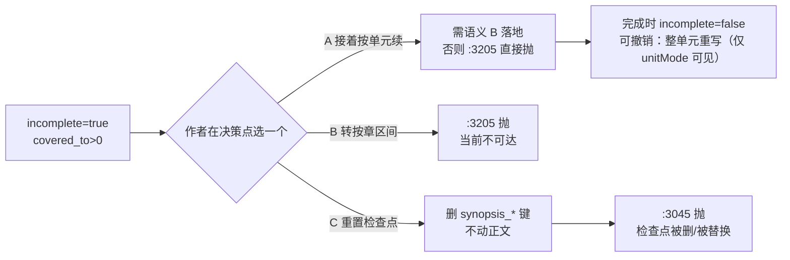

# D8 方案 · 检查点残留导致的模式降级，与同屏两个章数

> 状态：已裁定（2026-11-05 · **裁定 1 = 语义 A「整批重来」**，作者理由：现在按单元生成，重来的代价可接受 —— 见 §9。**尚未开工**）
> 上级登记：[`../product/live-pipeline-acceptance-defects-assessment.md`](../product/live-pipeline-acceptance-defects-assessment.md) §D8（`:477-503`）
> 相邻条目：D1（`:79-152`，批内源事实自撞）、D2（`:155-214`，批中断静默）、D7（单元→章偏保守）、D9（`:507`，调用长时间不返回）、D17（`:761-791`，中断落盘不声称范围）
> 本稿**只出方案，不动代码**；所有行号为 2026-11-05 实读。

---

## 0. 结论先行

1. **残留仍在产生（仍活）**，不是存量问题。产生它的不是"模型出错"，而是**批前预写**（`architecture.command.ts:3482-3483`）加上**一条只在 batch 模式生效的回滚**（`:3481`、`:3587-3589`）。按单元生成时这条回滚根本拿不到旧快照，所以任何一次取消、空输出或直接关窗都会在盘上留 `incomplete=true`。
2. 缺陷稿给的五个"判定入口"里，**四个已漂移或根本不相干**（§2）；真正决定降级的是 `synopsis-unit-launch.ts:285-289` 这一处探针。
3. 降级的根因不是 UI，是**中断续写的语义从来没被定义**：现在的 resume 取的是检查点里声明的批次范围（`:3116-3117`），不是"接着写"（§3）。所以**只把灰字改成三个按钮不算修好**。
4. 三个出口里，**两个今天走不通**：转按章区间会被 `:3205` 直接抛；重置检查点会在下一次生成时被 `:3045` 拦住（新发现，§5）。

---

## 1. 先判死活：`incomplete=true` 现在还产生吗

### 1.1 全部写入点（实读）

| 写点 | 位置 | 写什么 | 谁触发 |
|---|---|---|---|
| W1 批前预写 | `architecture.command.ts:3482-3483`（`mainOwned && !resumeRequested`） | `incomplete=true`、`covered_to = from-1`、**`synopsis_result` 被删**（`:4096`） | 每次非续写的生成，在模型调用**之前** |
| W2 中断落盘 | `:4098`（`persistInterruptedSynopsis`） | `incomplete=true`、`covered_to = range.from-1` | 输出被截断 / 调用失败且有进度 |
| W3 逐章路径导航 | `:3911`（`saveNavigation`，`complete` 默认 false）、调用在 `:3926`、`:3948` | `incomplete=true`、`covered_to = range.from-1`、`result` 被删（`:3921`） | 逐章大纲循环每轮 |
| 清除点 C1 | `:3728`（`partial.synopsis_incomplete = false`） | 完成落盘 | 成功收尾 |
| 清除点 C2 | `synopsis-unit-rewind.ts:362` | 整单元重写后置 false | 作者点"重写本单元" |
| 清除点 C3 | `synopsis-unit-launch.ts:233-239` | 删 `synopsis_*` 全部键 | 作者点"重置检查点" |
| 主进程侧 | `electron/` 全目录只有 `generation-controller.test.ts:672/746` 两处断言它，**没有任何清理点** | — | — |

### 1.2 逐条触发路径：哪些会留下残留

| # | 触发 | 证据 | 会留残留？ |
|---|---|---|---|
| P1 | **unit 模式**下调用失败/取消，且没有产出任何正文 | `:3481` 只有在 `mode === 'batch'` 时才拍 `previousBatchPartial` 快照；unit 模式为 `undefined` ⇒ `:3587-3589` 的回滚整块跳过；`:3573-3577` 又因 `context.cancelled` 或 `madeProgress=false` 不进续写分支 | **会。活。** |
| P2 | **unit 模式**下模型返回空 | 空输出分支只回滚 `previousBatchPartial`（`:3593-3601`），unit 模式同样没有 | **会。活。** |
| P3 | 批跑到一半进程被杀 / 关窗 | 没有任何 `catch` 会执行；主进程侧无清理点（§1.1 末行） | **会。活。** |
| P4 | 逐章路径中途取消 | `:3928` `assertNotCancelled` 抛错，`saveNavigation` 已写过 `incomplete=true`（W3），无回滚 | **会。活**（该路径的入口开关本稿未逐一确认，标**不确定**） |
| P5 | 输出被截断 / 调用失败但有进度 | `:3579` `persistAndRaiseResume` → W2 | **会。设计如此**（这是"可续写"的正常形态） |
| P6 | 正常完成 | `:3966` `saveNavigation(outline, true)`；D1 实机复验读到 `incomplete=false`（assessment `:136`） | 不会 |
| P7 | `mode === 'batch'` 下失败 | `previousBatchPartial` 有值 ⇒ `:3587-3589` 回滚到批前快照 | 不会（**唯一被覆盖的模式**） |

### 1.3 结论：**仍活**

且 P1/P2/P3/P4 留下的是**同一种最坏的形态**：`incomplete=true` + `covered_to = from-1 > 0` + **没有正文**（`:4096` 在 mainOwned 下删掉了 `synopsis_result`）。探针的"例外一"只放过 `covered_to=0` 的空标记（`synopsis-unit-launch.ts:281-282`），**`covered_to>0` 就被判为可续写**（`:286-288`）⇒ `skip('incomplete')` ⇒ 单元模式被永久关掉，直到作者手动重置。

⇒ 所以 D1/D2 修完之后，**D8 从"偶发"变成"稳定复现"**：D2 把失败变得"看得见"，但看得见的失败并不清理检查点。这正是"疤痕反过来改变下一批的语义"（缺陷稿 `:497`）。

---

## 2. 降级判定链清点（逐个复核缺陷稿行号）

| 缺陷稿写的 | 现文件实读内容 | 判定 |
|---|---|---|
| `architecture.command.ts:994-997` | 落在 `assertPlotOutlineTitleCoverage` 内，与 `incomplete` 无关；真正按 `incomplete` 改变行为的是 `renderSynopsisDbText` 的 `:1049-1056`（写"未完成"标记） | **已漂移**，正确位置 `:1049-1056` |
| `:1184-1185` | `synopsisBatchInstruction` 的数组元素：`trailing,` + 一段提示词文本 | **不相干**（提示词拼装） |
| `:1259` | `assertPlotOutlineBatchComplete` 里的 `|| mark.totalChapters !== totalChapters` | **不相干**（自报进度标记核对） |
| `:1279` | `assertCheckpointDbMirrorCurrent` 的形参 `totalChapters: number,` | **不相干** |
| `:2912` | `GeneratePlotStructureCommand.execute` 的收尾 `}`；`GeneratePlotArchitectureCommand` 从 `:2914` 起 | **不相干** |
| `ArchitectureConfirmDialog.tsx:717` | `未按单元生成：${describeSynopsisUnitProbe(unitPreview)}` | **正确** |

**真正的判定链（五处，按顺序）：**

| 环节 | 位置 | 语义 |
|---|---|---|
| ① 读 | `architecture.command.ts:3036` `interrupted = partial.synopsis_incomplete === true` | 把它读成"有未完成批次" |
| ② 挡新批 | `:3194`（`!interrupted` 才检查覆盖收缩）、`:3205-3209`（`interrupted` 时**直接抛**"请先完成该批次"） | 用同一个布尔值做两种相反的判断 |
| ③ 不变式 | `:1294-1300`（`incomplete=true` 时只要求 `coveredTo < range.to`，并额外放行 `pendingBatch`） | 允许"批未开始"与"批写了一半"共存 |
| ④ 探针降级 | `synopsis-unit-launch.ts:285-289` → `skip('incomplete')` | **唯一决定"这一批按单元还是按章"的地方** |
| ⑤ 文案 | `synopsis-unit-launch.ts:409` → `:717` 的灰字 | 只有说明，**没有回执**（不产生事件、不写状态） |

⇒ 降级不是"某个判定写错了"，而是**②和④对同一个布尔值给出了互相矛盾的用法**：②说"有未完成批次就别开新批"，④说"有未完成批次就换个模式开"。而 ④ 换的模式在新批处会被 ② 拦死（见 §5.2）。

---

## 3. 真正的根因：中断续写的语义能不能定

### 3.1 现状语义（三个实读事实）

| # | 事实 | 位置 |
|---|---|---|
| a | resume 的 `from`/`to` 取**检查点里声明的批次范围**，不是 `covered_to + 1` | `:3116-3117` |
| b | seed = **库里已确认的前缀正文**；mainOwned 模式下候选正文已被删（`:4096`），非 mainOwned 才写进 `synopsis_result` | `:3155-3161`、`:4096-4097` |
| c | 提示词里"第 1..N 章已完成"用的是 `from - 1`，不是实际覆盖数 | `:1166` |

⇒ 三条合起来的真实语义是：**把本批声明的范围整段重写一遍，用已确认前缀做种子；写了一半的候选既不参与种子，也不被保留（mainOwned 下连文本都没了，只剩一个 handle）。** 探针注释自己也这么写（`:279-280`：「有未完成批次时单元模式语义未定 …… 避免重复生成同一单元」）。

### 3.2 能定吗：能，但必须选一种语义并落到代码

**语义 A（保持"整批重来"，把谎话改成实话）**

- 规则：`from/to` 仍取 `synopsis_range`；候选文本丢弃；完成后按**原范围**记账。
- 代价：D9 那种"12 分钟才返回"的批次，半成品等于白写；且作者以为在"接着写"（缺陷稿 `:497` 的误解不会消失，只会换成"重写"）。
- 证伪单测：造一个 `covered_to=9, range={10,10}, incomplete=true` 的检查点，断言 resume 生成后 `synopsis_range` 仍为 `{10,10}`、且 `covered_to=10`（若代码里有任何"接着写"的痕迹，这条会红）。
- ✅ **2026-11-05 已裁定采纳 A。** 作者理由：「如果是以前的话，整批重来代价非常高。但现在我们是按单元的，我认为代价可接受。」——即 A 的代价随 E3 单元化而大幅下降：**重来的单位从"整本 / 整卷"缩小到一个单元（实测第 4 卷第 2 单元 = 第 18–19 章，2 章）**，而 B 要动 6 处命令侧代码 + 1 处不变式（本表）才能兑现"真接着写"。**A 剩下的成本就只有"UI 文案必须从『续写』改成『重写本批』"这一条，而这条本来就是必须做的**（§3.2 验收线：只换按钮不算修好）。

**语义 B（"接着写"，候选即前缀）—— ~~本稿推荐讨论的方向~~ · 2026-11-05 已裁掉，不采纳**

规则必须写全，缺一条都会重演：

| 步骤 | 规则 | 落点 |
|---|---|---|
| 1 取候选 | mainOwned 不删候选：要么保留 `synopsis_result`，要么从 handle 读回（`WorldBuildingEditor.tsx:225-233` 已经在读 `generation:read-visible-composition`） | 改 `:4096` |
| 2 数到第几章 | `from = plotOutlineCoveredTo(候选正文) + 1`；候选为空 ⇒ 退回 `range.from` | 改 `:3116-3117` |
| 3 区间与批上限 | `to` 保持原 `synopsis_range.to`；单元模式再 `min(unitMax, to)`；并保证 `to - from + 1 ≤ PLANNING_ACTION_CHAPTER_LIMIT`（`plot-outline-contract.ts:9`、断言在 `:22`） | `:3176`、`:3116` |
| 4 提示词说真话 | "第 1..M 章已完成"用实际 M，不用 `from-1` | 改 `:1166` |
| 5 交接项 | 候选有值 ⇒ `formatLastHookLine(候选)` 才有意义（现在 mainOwned 下必为 null） | `:3471-3473` |
| 6 完成合成 | 提交"候选 + 新增"，`writtenRange` 覆盖 `M+1..to` | `commitSynopsisWithCheckpointRollback:4023-4031` |
| 7 不变式放宽 | 允许 `coveredTo ≥ range.from`（现在的 `pendingBatch` 例外只覆盖 `= from-1`） | `:1293-1300` |

- 代价：把"候选算不算数"变成一条真规则，需要动 5 处命令侧代码 + 1 处不变式；且 `assertPlotOutlineBatchComplete`（`:1247-1267`）要求自报标记与请求 `to` 完全一致，合并提交时必须重新对齐，否则会以"批次范围错位"拒绝保存。
- 证伪单测：候选覆盖到第 10 章、`covered_to=9`、`range={10,11}` ⇒ 断言本次请求 `from=11`（不是 10），且完成后 `covered_to=11`（候选的 10 章没有被重写）。

**验收线（本稿的判定标准）**：如果交付物只是把 `:717` 的灰字换成三个按钮，而 §3.2 里 A 或 B 一条都没落到代码，**D8 不算修好**——因为按钮背后仍然是 `:3205` 的硬抛（§5.2）。

---

## 4. 同屏两个章数：唯一事实源

### 4.1 两个常量与实际消费

- `DEFAULT_PLANNING_ACTION_CHAPTERS = 5` —— `src/shared/plot-outline-contract.ts:8`
- `PLANNING_ACTION_CHAPTER_LIMIT = 10` —— 同文件 `:9`，硬闸门在 `:22`（`assertPlanningActionRange`）

**`= 10` 的消费点（本批上限 / 文案）**

| 位置 | 用途 |
|---|---|
| `plot-outline-contract.ts:22` | **硬契约**：范围超过 10 章直接抛 |
| `ArchitectureConfirmDialog.tsx:221` | 预填范围时把 `to` 夹到 `from+9` |
| `:408` | 「续写」时 `continueTo = continueStart+9` |
| `:430` | 终点步进的 `maxTo` |
| `:456` | 单元模式的兜底范围 |
| `:463-464` | 非法范围提示文案 |
| `:676`、`:696`、`:707` | 三处面向作者的文案（**":707 默认推进 10 章"就在这里**） |
| `:930` | 超过上限时变红 |
| `DirectoryConfigDialog.tsx:318`、`:480` | 蓝图对话框的范围校验与输入上限 |

**`= 5` 的消费点（默认量）**

| 位置 | 用途 |
|---|---|
| `ArchitectureConfirmDialog.tsx:225` | 打开对话框时把 `to` 设为 5（`:932` 显示的"本批 5 章"由此而来，**不是**直接读常量） |
| `architecture-workflow.ts:130` | 未传范围时的默认 `{1, min(total,5)}` |
| `architecture.command.ts:109` | `stepAuthorInputs` 里同一份默认 |
| `electron/services/main-generation-plan.ts:126` | 主进程规划意图的默认 |
| `src/shared/agent-generation.ts:8` | **Agent 工具**的默认 `chapter_count` |
| `DirectoryConfigDialog.tsx:90`、`:92`、`:204` | 蓝图对话框默认 |
| `directory.command.ts:321`、`:324` | 蓝图命令默认 |
| `scripts/quality-modernization-driver.mjs:702-703` | 验收脚本按 5 章分批（**改这个值会让验收脚本的批次数变**） |

### 4.2 同屏为什么同时出现

降级态下 `unitMode` 为 null（`ArchitectureConfirmDialog.tsx:264`）⇒ 走进 `!unitMode` 分支（`:698`、`:892`）：

- `:707` 的 B 分支（`canContinue && !continuing`）说"默认推进 10 章"；
- `:932` 说"本批 5 章"，因为 `synopsisLength` 由 `:412-416` 从输入框算得，而输入框默认来自 `:225` 的 **5**。

两个数**不是同一个量的两种写法**：一个是"上限"，一个是"当前输入值"。把它们并排放在同一屏，作者无法判断点下去写几章（缺陷稿 `:499`）。

### 4.3 统一取哪个值：这是**行为变更**，必须显式裁定

| 选项 | 会发生什么 | 代价 |
|---|---|---|
| X 取 10（上限即默认） | 默认批 5→10 章；单次输出翻倍 | 截断概率上升（D9 已登记"长时间不返回"）、单次失败面变大；`agent-generation.ts:8` 的默认也变；验收脚本批次数减半 |
| Y 取 5（默认即上限） | 硬契约 10→5 | 所有 `assertPlanningActionRange` 路径收紧；`DirectoryConfigDialog` 上限变 5；`prompt-assembly-backlog.md:1430` 把 10 记为"双端硬契约"，文档要同步 |
| Z **只统一显示，不动数值** | `:707` 改成"上限 10 章"，`:932` 只说"本批 N 章"（默认 5 写明） | 零行为变更，可立即做；但没有回答"默认到底该几章"这个产品问题 |

> **本稿不建议静默选一个。** X/Y 都会改变默认生成量（Y 还改变硬契约），按项目纪律属"行为变更"，需作者裁定（`docs/agents/documentation-charter.md:157` 要求行为变更与状态行同步）。Z 可以作为先手。

---

## 5. 决策点化：三个选项各自会发生什么

读法：三个出口里，A 依赖 §3 的语义先定死；B 今天被 `:3205` 拦死；C 会撞上 `:3045` 的"检查点丢失"守卫。**唯一真正可达的是 A，而 A 恰恰是语义未定的那一个。**

| 选项 | 点下去会发生什么 | 能否撤销 | 对检查点写入什么 |
|---|---|---|---|
| A 接着按单元续 | 走 resume 分支：`from/to` 取 `synopsis_range`（`:3116-3117`），seed 取库内前缀，整批重写（§3.1）；成功则 `incomplete=false`（`:3728`/`:3911`） | 只能"整单元重写"（`synopsis-unit-rewind.ts:341-374`，`:362` 置 false）；**但该按钮只在 `unitMode` 下渲染**（`:747`/`:892`），降级态下它不出现 | 成功：`incomplete=false`+`covered_to=to`；失败：保持 `incomplete=true`、`covered_to=from-1` |
| B 转按章区间 | 生成请求不带 `synopsisUnit`；命令侧 `interrupted=true` 且 `from>1` ⇒ **`:3205-3209` 抛"请先完成该批次"** | 不可撤销（若真跑起来会按新范围落库） | 无（抛错即停） |
| C 重置检查点 | `resetSynopsisCheckpoint` 只删 `synopsis_*` 键（`synopsis-unit-launch.ts:179-192`、`:233-239`），正文不动 | 不可撤销（进度记录消失） | 删键；下一次生成 `coveredTo=0`、`dbCoveredTo>0`、`interrupted=false` ⇒ **`:3045-3053` 抛"检查点显示一章都没写过"**，除非作者同时清空库里的大纲 |

⇒ 决策点不是"给三个按钮"，而是**先让至少一条出口真的能走完**。否则三个按钮里两个是"点了报错"，这比灰字更糟。

---

## 6. 与 D17 的耦合

D17 的既定口径是"中断落盘**不声称范围**"（assessment `:787`），实现落在 `commitSynopsisWithCheckpointRollback:4021-4031`：`outlineWrittenRange` 在 `incomplete=true` 时返回 `null` ⇒ 不传 `writtenRange` ⇒ 下游按"全改"算。

**判断：保持不变。** 理由两条：

1. 中断那一刻**确实**没有写完声明的范围，声称范围就是撒谎；D17 的"保守"是对的。
2. 真正会变的是 **resume 成功后的那一次提交**：`incomplete=false` ⇒ `writtenRange` 有值（`:4023-4031`）。若采纳 §3.2 的语义 B，这里唯一要改的是让 `writtenRange` 覆盖"候选 + 新增"的实际章集（即 `from` 取候选覆盖到的下一章），**不是**放宽中断落盘的判据。

**需要跟着改的只有一处**：语义 B 落地后，`previousPartial.synopsis_covered_to`（`:4029`）取的是**批前**已覆盖数，而候选可能已经超过了它 ⇒ 收缩判定（`outlineWrittenRange` 内部）会少标几章"被删"。这一条属 D17 的边界，需在实施时一并核。**若语义 A（整批重来）被采纳，D17 一个字都不用改。**

---

## 7. 明确不做什么

1. **不把 `incomplete=true` 改成三次态枚举**（如 `partial / abandoned / unknown`）。理由：存量检查点只有布尔值，加枚举要迁移全部历史项目，而 §1.2 的 P1–P4 用现有布尔值已经能表达清楚。
2. **不做"自动续写"**（失败后自动再发一次）。D9 已登记"12 分钟不返回"，自动重试会把一次失败放大成 N 次。
3. **不改 `PLANNING_ACTION_CHAPTER_LIMIT` / `DEFAULT_PLANNING_ACTION_CHAPTERS` 的数值**（§4.3 的 X/Y 属行为变更，需裁定；本稿只统一显示）。
4. **不动 D1 的"链式新 run"结构**（assessment `:119-122`）。
5. **不动 `assertCheckpointDbMirrorCurrent` 的其余三条不变式**（只讨论 `incomplete` 那一条，`:1298-1299`）。
6. **不在 UI 里新增第二条告警通道**（D15 `:751` 已踩过"混类告警导致错误归因"）。
7. **不替作者决定"半成品算不算数"**——这是 §3.2 的 A/B 二选一，属裁定项。

---

## 8. 待作者裁定

| # | 问题 | 选项 | 各自代价 |
|---|---|---|---|
| 1 | 中断续写的语义取哪一种？ | A 整批重来 / B 候选即前缀 | A：不改代码，但半成品白写，且必须把 UI 文案从"续写"改成"重写本批"；B：动 6 处（§3.2 表），换来"真接着写"，但要补合并提交的单测 |
| 2 | mainOwned 下候选正文存不存？ | 存进检查点 / 只留 handle | 存：检查点体积变大、`assertCheckpointDbMirrorCurrent` 的镜像约束要重算；只留 handle：语义 B 要靠 IPC 读回（已有一条读法 `WorldBuildingEditor.tsx:225-233`） |
| 3 | 默认章数取 5 还是 10？（**行为变更**） | X 取 10 / Y 取 5 / Z 只改显示 | X：单次输出翻倍，D9 风险上升；Y：硬契约收紧，Agent 工具与验收脚本的默认量一起变；Z：零变更但不解决产品问题 |
| 4 | 决策点做不做？ | 只做 A（改文案+语义）/ 三个按钮 | 只做 A：范围最小；三个按钮：B、C 必须先各自修到"能走完"，否则就是三个报错按钮 |
| 5 | P4（逐章路径）要不要一起修？ | 一起 / 单列一条 | 一起：改动面扩到另一条生成路径；单列：unit 模式先能用，逐章路径继续留疤 |

---

## 9. 处置（2026-11-05 20:39，作者裁定 1）

**裁定 1 = 语义 A（整批重来）**，作者原话：「如果是以前的话，整批重来代价非常高。但现在我们是按单元的，我认为代价可接受。」

| 项 | 结论 |
|---|---|
| 语义 | A。`from/to` 仍取 `synopsis_range`，候选文本丢弃，完成后按原范围记账 |
| 为什么代价可接受 | E3 单元化之后，**"整批"的粒度已经是一个单元**（实测第 4 卷第 2 单元 = 第 18–19 章）。旧口径下"整批"意味着整本或整卷，那才是"代价非常高"的来源；这个前提今天不成立了 |
| 因此 B 整节作废 | §3.2 语义 B 那张 7 步表（改 5 处命令侧 + 1 处不变式）**不执行**。它是为"接着写"付的账，既然不要"接着写"，这笔账不用付 |
| **A 并不等于"不改代码"** | 原表把它写成"A：不改代码"，**这个说法要修正**：A 至少要做两件事 —— ① UI 文案从「续写」改成「重写本批」（§3.2 验收线已经要求）；② §5 那三个出口里 `:3205` 的硬抛与重置后 `:3045` 的拦截，都得改成在 A 语义下能走完的路径。**§3.2 的验收线在这里反而更严**：只把灰字换成按钮、A 的文案语义没落地，D8 不算修好 |
| 与 D20 的关系 | 无关。D20 是"检查点因模板变化被误判"，走的是指纹判定链；D8 是"检查点残留导致模式降级"。两者在 `architecture.command.ts` 里位置相邻（`:3045` / `:3133`），改的时候注意别互相踩 |

**裁定 2 / 3 / 4 / 5 未裁定。** 其中 2（mainOwned 下候选存不存）在 A 语义下**变得更简单**：既然候选一律丢弃，就只剩"要不要留着让作者看一眼"这一个产品问题，不再牵扯语义 B 的 IPC 读回路径。裁定 4（决策点做不做）在 A 语义下也收窄了——原来说"三个按钮里 B、C 得先各自修到能走完"，现在只剩 A 一条路要修通。
