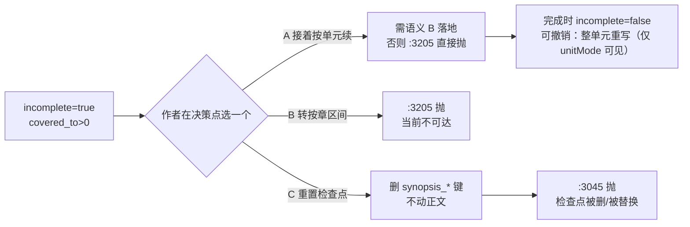

# D8 方案 · 检查点残留导致的模式降级，与同屏两个章数

> 状态：已裁定（2026-11-05 · **裁定 1 = 语义 A「整批重来」**；2026-11-06 补齐 **裁定 2=A / 3=Z / 4 随裁定 1 关闭 / 5 逐章路径保留**，见 §8.1）。**代码未开工**；裁定 2 的条件放开已随 D13 T5 落地
> 上级登记：[`../product/live-pipeline-acceptance-defects-assessment.md`](../product/live-pipeline-acceptance-defects-assessment.md) §D8（`:477-503`）
> 相邻条目：D1（`:79-152`，批内源事实自撞）、D2（`:155-214`，批中断静默）、D7（单元→章偏保守）、D9（`:507`，调用长时间不返回）、D17（`:761-791`，中断落盘不声称范围）
> 本稿**只出方案，不动代码**；所有行号为 2026-11-05 实读。

---

## 0. 结论先行

1. **残留仍在产生（仍活）**，不是存量问题。产生它的不是"模型出错"，而是**批前预写**（`architecture.command.ts:3482-3483`）加上**一条只在 batch 模式生效的回滚**（`:3481`、`:3587-3589`）。按单元生成时这条回滚根本拿不到旧快照，所以任何一次取消、空输出或直接关窗都会在盘上留 `incomplete=true`。
2. 缺陷稿给的五个"判定入口"里，**四个已漂移或根本不相干**（§2）；真正决定降级的是 `synopsis-unit-launch.ts:285-289` 这一处探针。
3. 降级的根因不是 UI，是**中断续写的语义从来没被定义**：现在的 resume 取的是检查点里声明的批次范围（`:3116-3117`），不是"接着写"（§3）。所以**只把灰字改成三个按钮不算修好**。
4. 三个出口里，**两个今天走不通**：转按章区间会被 `:3205` 直接抛；重置检查点会在下一次生成时被 `:3045` 拦住（新发现，§5）。

---

## 1. 先判死活：`incomplete=true` 现在还产生吗

### 1.1 全部写入点（实读）

| 写点 | 位置 | 写什么 | 谁触发 |
|---|---|---|---|
| W1 批前预写 | `architecture.command.ts:3482-3483`（`mainOwned && !resumeRequested`） | `incomplete=true`、`covered_to = from-1`、**`synopsis_result` 被删**（`:4096`） | 每次非续写的生成，在模型调用**之前** |
| W2 中断落盘 | `:4098`（`persistInterruptedSynopsis`） | `incomplete=true`、`covered_to = range.from-1` | 输出被截断 / 调用失败且有进度 |
| W3 逐章路径导航 | `:3911`（`saveNavigation`，`complete` 默认 false）、调用在 `:3926`、`:3948` | `incomplete=true`、`covered_to = range.from-1`、`result` 被删（`:3921`） | 逐章大纲循环每轮 |
| 清除点 C1 | `:3728`（`partial.synopsis_incomplete = false`） | 完成落盘 | 成功收尾 |
| 清除点 C2 | `synopsis-unit-rewind.ts:362` | 整单元重写后置 false | 作者点"重写本单元" |
| 清除点 C3 | `synopsis-unit-launch.ts:233-239` | 删 `synopsis_*` 全部键 | 作者点"重置检查点" |
| 主进程侧 | `electron/` 全目录只有 `generation-controller.test.ts:672/746` 两处断言它，**没有任何清理点** | — | — |

### 1.2 逐条触发路径：哪些会留下残留

| # | 触发 | 证据 | 会留残留？ |
|---|---|---|---|
| P1 | **unit 模式**下调用失败/取消，且没有产出任何正文 | `:3481` 只有在 `mode === 'batch'` 时才拍 `previousBatchPartial` 快照；unit 模式为 `undefined` ⇒ `:3587-3589` 的回滚整块跳过；`:3573-3577` 又因 `context.cancelled` 或 `madeProgress=false` 不进续写分支 | **会。活。** |
| P2 | **unit 模式**下模型返回空 | 空输出分支只回滚 `previousBatchPartial`（`:3593-3601`），unit 模式同样没有 | **会。活。** |
| P3 | 批跑到一半进程被杀 / 关窗 | 没有任何 `catch` 会执行；主进程侧无清理点（§1.1 末行） | **会。活。** |
| P4 | 逐章路径中途取消 | `:3928` `assertNotCancelled` 抛错，`saveNavigation` 已写过 `incomplete=true`（W3），无回滚 | **会。活**（该路径的入口开关本稿未逐一确认，标**不确定**） |
| P5 | 输出被截断 / 调用失败但有进度 | `:3579` `persistAndRaiseResume` → W2 | **会。设计如此**（这是"可续写"的正常形态） |
| P6 | 正常完成 | `:3966` `saveNavigation(outline, true)`；D1 实机复验读到 `incomplete=false`（assessment `:136`） | 不会 |
| P7 | `mode === 'batch'` 下失败 | `previousBatchPartial` 有值 ⇒ `:3587-3589` 回滚到批前快照 | 不会（**唯一被覆盖的模式**） |

### 1.3 结论：**仍活**

且 P1/P2/P3/P4 留下的是**同一种最坏的形态**：`incomplete=true` + `covered_to = from-1 > 0` + **没有正文**（`:4096` 在 mainOwned 下删掉了 `synopsis_result`）。探针的"例外一"只放过 `covered_to=0` 的空标记（`synopsis-unit-launch.ts:281-282`），**`covered_to>0` 就被判为可续写**（`:286-288`）⇒ `skip('incomplete')` ⇒ 单元模式被永久关掉，直到作者手动重置。

⇒ 所以 D1/D2 修完之后，**D8 从"偶发"变成"稳定复现"**：D2 把失败变得"看得见"，但看得见的失败并不清理检查点。这正是"疤痕反过来改变下一批的语义"（缺陷稿 `:497`）。

---

## 2. 降级判定链清点（逐个复核缺陷稿行号）

| 缺陷稿写的 | 现文件实读内容 | 判定 |
|---|---|---|
| `architecture.command.ts:994-997` | 落在 `assertPlotOutlineTitleCoverage` 内，与 `incomplete` 无关；真正按 `incomplete` 改变行为的是 `renderSynopsisDbText` 的 `:1049-1056`（写"未完成"标记） | **已漂移**，正确位置 `:1049-1056` |
| `:1184-1185` | `synopsisBatchInstruction` 的数组元素：`trailing,` + 一段提示词文本 | **不相干**（提示词拼装） |
| `:1259` | `assertPlotOutlineBatchComplete` 里的 `|| mark.totalChapters !== totalChapters` | **不相干**（自报进度标记核对） |
| `:1279` | `assertCheckpointDbMirrorCurrent` 的形参 `totalChapters: number,` | **不相干** |
| `:2912` | `GeneratePlotStructureCommand.execute` 的收尾 `}`；`GeneratePlotArchitectureCommand` 从 `:2914` 起 | **不相干** |
| `ArchitectureConfirmDialog.tsx:717` | `未按单元生成：${describeSynopsisUnitProbe(unitPreview)}` | **正确** |

**真正的判定链（五处，按顺序）：**

| 环节 | 位置 | 语义 |
|---|---|---|
| ① 读 | `architecture.command.ts:3036` `interrupted = partial.synopsis_incomplete === true` | 把它读成"有未完成批次" |
| ② 挡新批 | `:3194`（`!interrupted` 才检查覆盖收缩）、`:3205-3209`（`interrupted` 时**直接抛**"请先完成该批次"） | 用同一个布尔值做两种相反的判断 |
| ③ 不变式 | `:1294-1300`（`incomplete=true` 时只要求 `coveredTo < range.to`，并额外放行 `pendingBatch`） | 允许"批未开始"与"批写了一半"共存 |
| ④ 探针降级 | `synopsis-unit-launch.ts:285-289` → `skip('incomplete')` | **唯一决定"这一批按单元还是按章"的地方** |
| ⑤ 文案 | `synopsis-unit-launch.ts:409` → `:717` 的灰字 | 只有说明，**没有回执**（不产生事件、不写状态） |

⇒ 降级不是"某个判定写错了"，而是**②和④对同一个布尔值给出了互相矛盾的用法**：②说"有未完成批次就别开新批"，④说"有未完成批次就换个模式开"。而 ④ 换的模式在新批处会被 ② 拦死（见 §5.2）。

---

## 3. 真正的根因：中断续写的语义能不能定

### 3.1 现状语义（三个实读事实）

| # | 事实 | 位置 |
|---|---|---|
| a | resume 的 `from`/`to` 取**检查点里声明的批次范围**，不是 `covered_to + 1` | `:3116-3117` |
| b | seed = **库里已确认的前缀正文**；mainOwned 模式下候选正文已被删（`:4096`），非 mainOwned 才写进 `synopsis_result` | `:3155-3161`、`:4096-4097` |
| c | 提示词里"第 1..N 章已完成"用的是 `from - 1`，不是实际覆盖数 | `:1166` |

⇒ 三条合起来的真实语义是：**把本批声明的范围整段重写一遍，用已确认前缀做种子；写了一半的候选既不参与种子，也不被保留（mainOwned 下连文本都没了，只剩一个 handle）。** 探针注释自己也这么写（`:279-280`：「有未完成批次时单元模式语义未定 …… 避免重复生成同一单元」）。

### 3.2 能定吗：能，但必须选一种语义并落到代码

**语义 A（保持"整批重来"，把谎话改成实话）**

- 规则：`from/to` 仍取 `synopsis_range`；候选文本丢弃；完成后按**原范围**记账。
- 代价：D9 那种"12 分钟才返回"的批次，半成品等于白写；且作者以为在"接着写"（缺陷稿 `:497` 的误解不会消失，只会换成"重写"）。
- 证伪单测：造一个 `covered_to=9, range={10,10}, incomplete=true` 的检查点，断言 resume 生成后 `synopsis_range` 仍为 `{10,10}`、且 `covered_to=10`（若代码里有任何"接着写"的痕迹，这条会红）。
- ✅ **2026-11-05 已裁定采纳 A。** 作者理由：「如果是以前的话，整批重来代价非常高。但现在我们是按单元的，我认为代价可接受。」——即 A 的代价随 E3 单元化而大幅下降：**重来的单位从"整本 / 整卷"缩小到一个单元（实测第 4 卷第 2 单元 = 第 18–19 章，2 章）**，而 B 要动 6 处命令侧代码 + 1 处不变式（本表）才能兑现"真接着写"。**A 剩下的成本就只有"UI 文案必须从『续写』改成『重写本批』"这一条，而这条本来就是必须做的**（§3.2 验收线：只换按钮不算修好）。

**语义 B（"接着写"，候选即前缀）—— ~~本稿推荐讨论的方向~~ · 2026-11-05 已裁掉，不采纳**

规则必须写全，缺一条都会重演：

| 步骤 | 规则 | 落点 |
|---|---|---|
| 1 取候选 | mainOwned 不删候选：要么保留 `synopsis_result`，要么从 handle 读回（`WorldBuildingEditor.tsx:225-233` 已经在读 `generation:read-visible-composition`） | 改 `:4096` |
| 2 数到第几章 | `from = plotOutlineCoveredTo(候选正文) + 1`；候选为空 ⇒ 退回 `range.from` | 改 `:3116-3117` |
| 3 区间与批上限 | `to` 保持原 `synopsis_range.to`；单元模式再 `min(unitMax, to)`；并保证 `to - from + 1 ≤ PLANNING_ACTION_CHAPTER_LIMIT`（`plot-outline-contract.ts:9`、断言在 `:22`） | `:3176`、`:3116` |
| 4 提示词说真话 | "第 1..M 章已完成"用实际 M，不用 `from-1` | 改 `:1166` |
| 5 交接项 | 候选有值 ⇒ `formatLastHookLine(候选)` 才有意义（现在 mainOwned 下必为 null） | `:3471-3473` |
| 6 完成合成 | 提交"候选 + 新增"，`writtenRange` 覆盖 `M+1..to` | `commitSynopsisWithCheckpointRollback:4023-4031` |
| 7 不变式放宽 | 允许 `coveredTo ≥ range.from`（现在的 `pendingBatch` 例外只覆盖 `= from-1`） | `:1293-1300` |

- 代价：把"候选算不算数"变成一条真规则，需要动 5 处命令侧代码 + 1 处不变式；且 `assertPlotOutlineBatchComplete`（`:1247-1267`）要求自报标记与请求 `to` 完全一致，合并提交时必须重新对齐，否则会以"批次范围错位"拒绝保存。
- 证伪单测：候选覆盖到第 10 章、`covered_to=9`、`range={10,11}` ⇒ 断言本次请求 `from=11`（不是 10），且完成后 `covered_to=11`（候选的 10 章没有被重写）。

**验收线（本稿的判定标准）**：如果交付物只是把 `:717` 的灰字换成三个按钮，而 §3.2 里 A 或 B 一条都没落到代码，**D8 不算修好**——因为按钮背后仍然是 `:3205` 的硬抛（§5.2）。

---

## 4. 同屏两个章数：唯一事实源

### 4.1 两个常量与实际消费

- `DEFAULT_PLANNING_ACTION_CHAPTERS = 5` —— `src/shared/plot-outline-contract.ts:8`
- `PLANNING_ACTION_CHAPTER_LIMIT = 10` —— 同文件 `:9`，硬闸门在 `:22`（`assertPlanningActionRange`）

**`= 10` 的消费点（本批上限 / 文案）**

| 位置 | 用途 |
|---|---|
| `plot-outline-contract.ts:22` | **硬契约**：范围超过 10 章直接抛 |
| `ArchitectureConfirmDialog.tsx:221` | 预填范围时把 `to` 夹到 `from+9` |
| `:408` | 「续写」时 `continueTo = continueStart+9` |
| `:430` | 终点步进的 `maxTo` |
| `:456` | 单元模式的兜底范围 |
| `:463-464` | 非法范围提示文案 |
| `:676`、`:696`、`:707` | 三处面向作者的文案（**":707 默认推进 10 章"就在这里**） |
| `:930` | 超过上限时变红 |
| `DirectoryConfigDialog.tsx:318`、`:480` | 蓝图对话框的范围校验与输入上限 |

**`= 5` 的消费点（默认量）**

| 位置 | 用途 |
|---|---|
| `ArchitectureConfirmDialog.tsx:225` | 打开对话框时把 `to` 设为 5（`:932` 显示的"本批 5 章"由此而来，**不是**直接读常量） |
| `architecture-workflow.ts:130` | 未传范围时的默认 `{1, min(total,5)}` |
| `architecture.command.ts:109` | `stepAuthorInputs` 里同一份默认 |
| `electron/services/main-generation-plan.ts:126` | 主进程规划意图的默认 |
| `src/shared/agent-generation.ts:8` | **Agent 工具**的默认 `chapter_count` |
| `DirectoryConfigDialog.tsx:90`、`:92`、`:204` | 蓝图对话框默认 |
| `directory.command.ts:321`、`:324` | 蓝图命令默认 |
| `scripts/quality-modernization-driver.mjs:702-703` | 验收脚本按 5 章分批（**改这个值会让验收脚本的批次数变**） |

### 4.2 同屏为什么同时出现

降级态下 `unitMode` 为 null（`ArchitectureConfirmDialog.tsx:264`）⇒ 走进 `!unitMode` 分支（`:698`、`:892`）：

- `:707` 的 B 分支（`canContinue && !continuing`）说"默认推进 10 章"；
- `:932` 说"本批 5 章"，因为 `synopsisLength` 由 `:412-416` 从输入框算得，而输入框默认来自 `:225` 的 **5**。

两个数**不是同一个量的两种写法**：一个是"上限"，一个是"当前输入值"。把它们并排放在同一屏，作者无法判断点下去写几章（缺陷稿 `:499`）。

### 4.3 统一取哪个值：这是**行为变更**，必须显式裁定

| 选项 | 会发生什么 | 代价 |
|---|---|---|
| X 取 10（上限即默认） | 默认批 5→10 章；单次输出翻倍 | 截断概率上升（D9 已登记"长时间不返回"）、单次失败面变大；`agent-generation.ts:8` 的默认也变；验收脚本批次数减半 |
| Y 取 5（默认即上限） | 硬契约 10→5 | 所有 `assertPlanningActionRange` 路径收紧；`DirectoryConfigDialog` 上限变 5；`prompt-assembly-backlog.md:1430` 把 10 记为"双端硬契约"，文档要同步 |
| Z **只统一显示，不动数值** | `:707` 改成"上限 10 章"，`:932` 只说"本批 N 章"（默认 5 写明） | 零行为变更，可立即做；但没有回答"默认到底该几章"这个产品问题 |

> **本稿不建议静默选一个。** X/Y 都会改变默认生成量（Y 还改变硬契约），按项目纪律属"行为变更"，需作者裁定（`docs/agents/documentation-charter.md:157` 要求行为变更与状态行同步）。Z 可以作为先手。

---

## 5. 决策点化：三个选项各自会发生什么

读法：三个出口里，A 依赖 §3 的语义先定死；B 今天被 `:3205` 拦死；C 会撞上 `:3045` 的"检查点丢失"守卫。**唯一真正可达的是 A，而 A 恰恰是语义未定的那一个。**

| 选项 | 点下去会发生什么 | 能否撤销 | 对检查点写入什么 |
|---|---|---|---|
| A 接着按单元续 | 走 resume 分支：`from/to` 取 `synopsis_range`（`:3116-3117`），seed 取库内前缀，整批重写（§3.1）；成功则 `incomplete=false`（`:3728`/`:3911`） | 只能"整单元重写"（`synopsis-unit-rewind.ts:341-374`，`:362` 置 false）；**但该按钮只在 `unitMode` 下渲染**（`:747`/`:892`），降级态下它不出现 | 成功：`incomplete=false`+`covered_to=to`；失败：保持 `incomplete=true`、`covered_to=from-1` |
| B 转按章区间 | 生成请求不带 `synopsisUnit`；命令侧 `interrupted=true` 且 `from>1` ⇒ **`:3205-3209` 抛"请先完成该批次"** | 不可撤销（若真跑起来会按新范围落库） | 无（抛错即停） |
| C 重置检查点 | `resetSynopsisCheckpoint` 只删 `synopsis_*` 键（`synopsis-unit-launch.ts:179-192`、`:233-239`），正文不动 | 不可撤销（进度记录消失） | 删键；下一次生成 `coveredTo=0`、`dbCoveredTo>0`、`interrupted=false` ⇒ **`:3045-3053` 抛"检查点显示一章都没写过"**，除非作者同时清空库里的大纲 |

⇒ 决策点不是"给三个按钮"，而是**先让至少一条出口真的能走完**。否则三个按钮里两个是"点了报错"，这比灰字更糟。

---

## 6. 与 D17 的耦合

D17 的既定口径是"中断落盘**不声称范围**"（assessment `:787`），实现落在 `commitSynopsisWithCheckpointRollback:4021-4031`：`outlineWrittenRange` 在 `incomplete=true` 时返回 `null` ⇒ 不传 `writtenRange` ⇒ 下游按"全改"算。

**判断：保持不变。** 理由两条：

1. 中断那一刻**确实**没有写完声明的范围，声称范围就是撒谎；D17 的"保守"是对的。
2. 真正会变的是 **resume 成功后的那一次提交**：`incomplete=false` ⇒ `writtenRange` 有值（`:4023-4031`）。若采纳 §3.2 的语义 B，这里唯一要改的是让 `writtenRange` 覆盖"候选 + 新增"的实际章集（即 `from` 取候选覆盖到的下一章），**不是**放宽中断落盘的判据。

**需要跟着改的只有一处**：语义 B 落地后，`previousPartial.synopsis_covered_to`（`:4029`）取的是**批前**已覆盖数，而候选可能已经超过了它 ⇒ 收缩判定（`outlineWrittenRange` 内部）会少标几章"被删"。这一条属 D17 的边界，需在实施时一并核。**若语义 A（整批重来）被采纳，D17 一个字都不用改。**

---

## 7. 明确不做什么

1. **不把 `incomplete=true` 改成三次态枚举**（如 `partial / abandoned / unknown`）。理由：存量检查点只有布尔值，加枚举要迁移全部历史项目，而 §1.2 的 P1–P4 用现有布尔值已经能表达清楚。
2. **不做"自动续写"**（失败后自动再发一次）。D9 已登记"12 分钟不返回"，自动重试会把一次失败放大成 N 次。
3. **不改 `PLANNING_ACTION_CHAPTER_LIMIT` / `DEFAULT_PLANNING_ACTION_CHAPTERS` 的数值**（§4.3 的 X/Y 属行为变更，需裁定；本稿只统一显示）。
4. **不动 D1 的"链式新 run"结构**（assessment `:119-122`）。
5. **不动 `assertCheckpointDbMirrorCurrent` 的其余三条不变式**（只讨论 `incomplete` 那一条，`:1298-1299`）。
6. **不在 UI 里新增第二条告警通道**（D15 `:751` 已踩过"混类告警导致错误归因"）。
7. **不替作者决定"半成品算不算数"**——这是 §3.2 的 A/B 二选一，属裁定项。

---

## 8. 裁定项（全部已裁）

> **裁定全集已闭合（2026-11-06 00:49，作者「2确定」）**：裁定 2 = A（与 D13 裁定 2 合并答，条件已随 D13 T5 落地）· **裁定 3 = Z（只统一文案 / 显示，5 与 10 两个数值不动）** · **裁定 4 随裁定 1 关闭**（A 语义下只剩一条路要修通，不做三个按钮决策点）· 裁定 5 = 逐章路径保留（§10.5）。原始问法与代价表保留在下，不再作为待裁项。

| # | 问题 | 选项 | 各自代价 |
|---|---|---|---|
| 1 | 中断续写的语义取哪一种？ | A 整批重来 / B 候选即前缀 | A：不改代码，但半成品白写，且必须把 UI 文案从"续写"改成"重写本批"；B：动 6 处（§3.2 表），换来"真接着写"，但要补合并提交的单测 |
| 2 | mainOwned 下候选正文存不存？ | 存进检查点 / 只留 handle | 存：检查点体积变大、`assertCheckpointDbMirrorCurrent` 的镜像约束要重算；只留 handle：语义 B 要靠 IPC 读回（已有一条读法 `WorldBuildingEditor.tsx:225-233`） |
| 3 | 默认章数取 5 还是 10？（**行为变更**） | X 取 10 / Y 取 5 / Z 只改显示 | X：单次输出翻倍，D9 风险上升；Y：硬契约收紧，Agent 工具与验收脚本的默认量一起变；Z：零变更但不解决产品问题 |
| 4 | 决策点做不做？ | 只做 A（改文案+语义）/ 三个按钮 | 只做 A：范围最小；三个按钮：B、C 必须先各自修到"能走完"，否则就是三个报错按钮 |
| 5 | P4（逐章路径）要不要一起修？**（历史行：已于 21:14 裁定「逐章路径保留」，裁定 5 关闭，见 §10.5）** | 一起 / 单列一条 | 一起：改动面扩到另一条生成路径；单列：unit 模式先能用，逐章路径继续留疤 |

### 8.1 作者裁定（2026-11-06 00:49）

| # | 裁定 | 附带口径 |
|---|---|---|
| 3 | **Z**（只统一文案 / 显示，5 与 10 数值不动） | X / Y 属行为变更（改默认生成量或收紧硬契约），一律不做。`:707` 写清「上限 10 章」，`:932` 只说「本批 N 章（默认 5）」；`DEFAULT_PLANNING_ACTION_CHAPTERS` / `PLANNING_ACTION_CHAPTER_LIMIT`、Agent 工具默认量、验收脚本分批数**逐字不动** |
| 4 | **随裁定 1 关闭** | 语义 A 下 B / C 两个按钮对应的路径本就不成立，不做「三个按钮」决策点；只修通 A 那一条能走完的路（§5 的 `:3205` / `:3045`） |
| 2 | **A**（与 D13 裁定 2 合并答） | 已由 D13 T5 于 2026-11-06 落地：`!mainOwned` 条件放开，落库形态不变 |
| 5 | **逐章路径保留** | 21:14 已裁，见 §10.5 |

---

## 9. 处置（2026-11-05 20:39，作者裁定 1）

**裁定 1 = 语义 A（整批重来）**，作者原话：「如果是以前的话，整批重来代价非常高。但现在我们是按单元的，我认为代价可接受。」

| 项 | 结论 |
|---|---|
| 语义 | A。`from/to` 仍取 `synopsis_range`，候选文本丢弃，完成后按原范围记账 |
| 为什么代价可接受 | E3 单元化之后，**"整批"的粒度已经是一个单元**（实测第 4 卷第 2 单元 = 第 18–19 章）。旧口径下"整批"意味着整本或整卷，那才是"代价非常高"的来源；这个前提今天不成立了 |
| 因此 B 整节作废 | §3.2 语义 B 那张 7 步表（改 5 处命令侧 + 1 处不变式）**不执行**。它是为"接着写"付的账，既然不要"接着写"，这笔账不用付 |
| **A 并不等于"不改代码"** | 原表把它写成"A：不改代码"，**这个说法要修正**：A 至少要做两件事 —— ① UI 文案从「续写」改成「重写本批」（§3.2 验收线已经要求）；② §5 那三个出口里 `:3205` 的硬抛与重置后 `:3045` 的拦截，都得改成在 A 语义下能走完的路径。**§3.2 的验收线在这里反而更严**：只把灰字换成按钮、A 的文案语义没落地，D8 不算修好 |
| 与 D20 的关系 | 无关。D20 是"检查点因模板变化被误判"，走的是指纹判定链；D8 是"检查点残留导致模式降级"。两者在 `architecture.command.ts` 里位置相邻（`:3045` / `:3133`），改的时候注意别互相踩 |

**裁定 2 已裁定（2026-11-05，与 D13 裁定 2 合并答）= A：让生产也留候选。** 两处原本问的是同一件事 —— D13 稿 §4.2 查出「唯一留候选的那条分支条件是 `!mainOwned`，而生产 `mainOwned` 恒真（三个调用点都不注入 `dependencies`）」，所以问题不是「要不要存」，而是「那条分支生产根本走不到」。按 A，`generate-draft.command.ts:1711` 的条件要放开；**本稿 §8 的「存进检查点 / 只留 handle」子选项作者本轮未答**，实施按最小口径：沿用现有 `db:recovery-candidate-record` 落库形态，只放开条件，不改存储结构、不动 `assertCheckpointDbMirrorCurrent` 的镜像约束。

> **2026-11-06 补**：`generate-draft.command.ts` catch 的 `!mainOwned` 条件已按裁定 2=A 放开（D13 实施卡 T5 收口，见 `d13-chapter-failure-contract-design.md` §7.1）；本稿 §8「存进检查点 / 只留 handle」子选项仍按最小口径不展开，落库形态沿用 `db:recovery-candidate-record`。

**裁定 3 / 4 已于 2026-11-06 裁定；裁定 5 已于 21:14 裁定「逐章路径保留」并关闭（§10.5）。** 裁定 2 在 A 语义下变得更简单：既然候选一律从生成范围丢弃，就只剩「要不要留着让作者看一眼」这一个产品问题，不再牵扯语义 B 的 IPC 读回路径；该条件已随 D13 T5 放开。裁定 3 取 Z ⇒ 只把 `:707`「默认推进 10 章」与 `:932`「本批 5 章」的**语义**写清（上限 vs 当前输入值），两个常量及所有默认值一律不动。裁定 4 随裁定 1 关闭 ⇒ 不造三按钮，只修通 A 语义下那一条路。

---

## 10. 文案要不要分两套：按章模式怎么办（2026-11-05 追问后补记）

作者问：**UI 文案统一改成「重写本批」，那按章写大纲的旧模式怎么办？可以直接分成两套吗？**

### 10.1 先纠一个前提：代码里**已经是两套**了，分叉点还是对的

`:3555-3568` **同一个 `throw` 内部**已经按 `unitContext` 分支：

| 分支 | 报文 |
|---|---|
| 单元（`unitContext` 非空） | 「点击「继续生成情节大纲」可**续写本单元**（【单元 N】）；如本单元仍然过大，可先回到弧光结构把它拆细后重试。」 |
| 非单元（含逐章） | 「点击「继续生成情节大纲」可**续写本批**（第 from–to 章）；如本批范围仍偏大，可先在「AI 生成架构」缩小每批章节数后重试。」 |

所以问题不是"能不能分成两套"，是**这两套已经存在、用的是正确的判据（`unitContext`），但两套都在撒谎**——把"整批重来"说成"续写"。

### 10.2 三条路，resume 语义完全一致

| 路径 | 怎么进来 | resume 取什么 | 实际做了什么 |
|---|---|---|---|
| 逐章（P4） | `:2960`：`recovery.plotOutline` 非空即分叉进 `executeChapterOutline` | `initial.range`（`:3907` 算指纹用的就是它） | 整段重写该范围 |
| 章区间（旧模式） | `synopsisRange` 入参 | `partial.synopsis_range`（`:3110-3117`） | 整段重写该范围 |
| 单元批（E3） | `synopsisUnit` 入参，与 `synopsisRange` 互斥（`:2926-2930` 注释自述"缺省 = 旧的章号区间模式"） | 同上 | 整段重写该单元 |

**决定性证据**：`PlotOutlineProgress`（`src/shared/plot-outline-contract.ts:71-76`）只有 `protocol / range / content / targetUnits / cursor` —— **没有"批内写到第几章"这个字段**。所以"从断续点接着写"在这套数据结构里**无处表达**，三条路都只能整批重来。

### 10.3 三处说法都假，而且第三处是全局单套

| # | 位置 | 原文 | 为什么假 |
|---|---|---|---|
| 1 | `:3556` log | 「已完成部分（约 N 字）已保存，可点击…从断点续写」 | mainOwned 下落盘时 `delete partial.synopsis_result`（`:4096` 逐章 / `:3921` 另一支），半成品正文不留存；留下的只有"未完成标记 + 已确认前缀" |
| 2 | `:3559-3563` 两套报文 | 「可续写本单元 / 本批」 | 从 `range.from` 整批重写，不从断续点接着写 |
| 3 | `AIOutputPanel.tsx:1079` 按钮 + `:1104` 说明 | 「继续生成情节大纲（**断点续写**）」+「已完成的部分已保存为不完整大纲，**不会被覆盖**；本次将让 AI **接着上次的末尾继续写**」 | 同 2；且这句**不分模式**，所以对三种路径**全错**，是最该改的一句 |

### 10.4 结论：不需要为"按章写"再分一套

- **逐章路径天然落在"本批"那一支**（它没有 `unitContext`），「重新生成第 from–to 章的大纲」对它是准确描述，不需要第三套文案。
- 真正需要分开的只有 **单元 / 非单元** 这一层，而它已经存在。**要做的是把两套里的"续写"换成"重写本批 / 重写本单元"，不是再造一套。**
- 单元那一支还必须**明说"单元内不接着写"**，理由不是实现难，是**你以前的批语**：单元内续写会造成剧情断痕。这条已经写死在 E3 稿里 —— `e3-unit-batch-implementation-plan.md:313`「单元内续写也可行（目标明确），但会复杂化，且大概率冲击反馈收敛机制 ⇒ **不做**」；`2026-10-20-e3-unit-batch-handoff.md:21`「**单元内续写**…明确不做」、`:152`「单元内续写不做」。**所以 §3.2 语义 B 作废与这条既有结论是同一个方向，不是新决定。**
- 全局那句（第 3 处）改成模式中立：按钮「重新生成本批大纲」，说明「这一批没写完。重新生成会重写第 X–Y 章的大纲，已确认的前缀不受影响。」——"X–Y"由 `synopsis_range` 填，模式无关。

### 10.5 裁定 5：**逐章路径保留**（2026-11-05 21:14，作者裁定）

作者理由：「在小说配置里，如果选择的不是卷单元模式的话，那根本不会出现按单元这个选项，只能按照章节 From To 来写。」

**代码核对后，实际门槛比"配置里选一下"还多一层**（`synopsis-unit-launch.ts:265`、`describeSynopsisUnitProbe` 的 reason 表）：

| 门槛 | reason | 结果 |
|---|---|---|
| 设置开关「按单元生成情节大纲」关掉（设置 → 编辑器） | `flag-off` | 退回按章区间 |
| 骨架里没有 `### 单元` 划界 | `no-cursor` | 退回按章区间 |
| 检查点有未完成批次 | `incomplete` | 退回按章区间 |
| 检查点不是合法 JSON / 不是 UTF-8 | `checkpoint-broken` | 退回按章区间（拒绝进单元模式，否则会从第 1 章覆盖重写） |
| 库里已有大纲但检查点说一章没写过 | `checkpoint-lost` | 同上 |
| 单元定位算不出来 | `compute-null` | 退回按章区间 |
| 探针自身报错 | `probe-error` | 退回按章区间 |

⇒ **逐章路径不是"备用方案"，它是这七种情况的唯一出口。** 所以 §10.4 第 1 条那句「逐章天然落在本批那一支」要长期成立，删掉它等于让上述七种情况无路可走。

**对 §10.4 的影响**：文案只需两套（单元 / 非单元），逐章不需要第三套——这一点不变。裁定 5 关闭，不再作为待裁项。

---

## 11. 开工前查证与方案修订（2026-11-06 03:0x）

> **本节取代**看板卡 `4b9eae6e` 的旧版任务书；旧版原文保留在 `C:/develop/tmp/d8-review-input-2026-11-06.md` 作历史记录。本节是作者 03:05「先明确要解决什么问题 / 是否真实存在 / 行业有无先例 / 枚举与清单有无定义，而不是自己造需求」这一问的回答，按 `industry-alignment-and-stage-goals.md` §5 四问逐条落笔。

### 11.1 触发

02:52 子 Agent 独立审核（`C:/develop/tmp/d8-plan-review-2026-11-06.md`）报「阻塞开工」：方案引用的 8 个 `文件:行号` 有 6 处漂移，验收 3 以旧行号为判据不可判定；另列 Y1（是否允许动 `:3340-3348` 守卫）/ Y2（验收 1 枚举范围、验收 2 对象清单）为「需作者裁定」。Lead 按手册 §5.2「意见要证据」独立抽查 8 处，全部属实。

### 11.2 四问之一：验收 1 要解决的是什么问题，真实吗，行业叫什么

**真问题**：**用户可见文案与实际行为不一致**。代码实证 —— `architecture.command.ts:3853-3860`（log 与两套错误报文）、`AIOutputPanel.tsx:1123/1124/1129`（按钮与说明）、`:462`（落库提示）、`:3502`（错误提示）都写着「从断点续写 / 可续写本单元 / 不会被覆盖 / 接着上次的末尾继续写」，而作者裁定 1 = 语义 A「整批重来」：候选文本丢弃、`from/to` 仍取 `synopsis_range`、完成后按原范围记账。按钮点了是**重写本批**，文案却说**接着写**。这是实读代码可证的真问题，不是推测。

**行业名 + 出处**（不是自造）：
- **Nielsen 十大可用性启发式 #1 Visibility of System Status**（系统应始终让用户知道正在发生什么）、**#9 Help Users Recognize, Diagnose, and Recover from Errors**、**#4 Consistency and Standards**（不同界面的词与动作不能意思不一致）。出处：Nielsen Norman Group《10 Usability Heuristics》(1994/2020 修订)、《Error-Message Guidelines》「Concisely and precisely describe the issue」「Offer constructive advice」、`nngroup.com/articles/error-message-guidelines/`；中文对照 `ux-guidelines.com/nielsens-heuristics.html`。
- AI 时代补充：NN/g 启发式在生成式产品里的延伸是「**停止与重新生成**（stop / regenerate）」，「模型的第一个回答是草稿，永远不是死胡同」——即 UI 必须如实区分「继续」与「重来」。
- **失败形态归类**：属 **UX 状态 / 错误文案与系统行为不一致**（heuristic violation），不是 continuity、不是 craft、不是算术问题。按 §5 四问第 3 问，对得上既有分类 ⇒ 不是自造问题。

**成熟产品 / 论文做过什么，我们与它的差异**：长文本生成中断恢复，行业主流是 **checkpoint + offset + hash 的「断点续传」**（例：马良写作「中断自动续跑」`maliangwriter.com/blog/multi-agent-long-running-tasks`；独立开发者社区访谈「流式生成必须像视频播放一样支持断点续传」`solo.xin/topic/5746`，并明确指出「大多数 AI 生成请求不是幂等的，**重新生成不是恢复而是替换**」）。⇒ **「整批重来」不是行业通例**，是作者基于 E3 单元化的项目特定裁定：整批粒度已缩到一个单元（第 4 卷第 2 单元 = 18–19 章，2 章），代价可接受（§9）。差异属**需求差异**（单元化后重来代价骤降），合规；但正因为与行业主流相反，**文案更必须说真话**，不能留「续写」字样让作者按行业惯例预期。

### 11.3 四问之二：枚举范围 / 对象清单有没有具体定义

**验收 1 的「枚举范围」：没有行业定义，也不该造。** 行业有「启发式评估」（逐条 heuristic 找问题）与「需求可验证性」，但**没有**「把全库所有 UI 文案列成一份清单再逐条打勾」这种交付验收对象；清单本身是我们发明的验收物。按 §5 禁止事项「自造术语当标准用 / 把我觉得应该写成设计原则」，**Y2 前半撤回**：不新增枚举清单。验收 1 改为**按语义判据核对** —— 「凡描述本批生成中断后点按钮会发生什么的用户可见文案，不得再声称会接着写」，并在任务书里给出**明确排除项**（世界观断点续写 `architecture-workflow.ts:247/249`、恢复稿 `WorldBuildingEditor.tsx:848/897`、另一功能的「作者版不会被覆盖」`VolumeHandoffRegistryPanel.tsx:776`），防止执行者把别的功能一起改坏。判据可判定、可复现，且不需要作者另裁范围。

**验收 2 的「对象清单」：事实源早就存在，不需要另造。** 实读 `src/shared/plot-outline-contract.ts:8`（`DEFAULT_PLANNING_ACTION_CHAPTERS = 5`）与 `:9`（`PLANNING_ACTION_CHAPTER_LIMIT = 10`）是**两个定义处**；全库约 25 处（`ArchitectureConfirmDialog` / `DirectoryConfigDialog` / `WorldBuildingEditor` / `architecture-workflow.ts` / `architecture.command.ts` / `directory.command.ts` …）都是**引用处**，不是独立事实源 —— 定义不动，引用处一律不变。裁定 3 = Z 已点名四类对象：两常量定义处、Agent 工具默认量、验收脚本分批数，「逐字不动」。子 Agent 要求「列全所有默认值」把定义处与引用处混同，属造需求 ⇒ **Y2 后半撤回**。验收 2 改为「贴 `git diff` 证明定义处逐字未动」，`git diff` 本身就是对象清单，不必先造一份。

> 一句话：**要解决的问题是真的，行业有标准名；被要求补的两份「清单」是假的，撤回。** 这正是 §5 第 2 问「谁消费产出」—— 清单的唯一消费者是验收者自己，不进产品、不进模型，属于 W6 那种「只有一块展示面板」的死法。

### 11.4 行号重定位（当前 HEAD `2d413afe` 实读；**行号不是契约**）

| 旧引用 | 当前位置 | Lead 抽查 |
|---|---|---|
| `architecture.command.ts:3556` | `:3853-3855` log | 旧行现为空行 ✓ |
| `:3559-3563` | `:3856-3860` 两套报文 | 旧行现为 D20 `interruptionRange` 注释与常量（`:3562`、`:3570 fingerprintParts`）✓ |
| `:3205` | `:3500-3504` `if (interrupted) throw` | 旧行是 `return content` ✓ |
| `:3045` | **不在本卡范围** | 旧行是「资源登记提案未能保存」log；真实守卫在 `:3340-3348` ✓ |
| `AIOutputPanel.tsx:1079` | `:1106-1125` 按钮 | 旧行是 `open-novel-config` 按钮的 `type="button"` ✓ |
| `:1104` | `:1126-1131` 说明 | 旧行是 JSX 条件 ✓ |
| `ArchitectureConfirmDialog.tsx:707` / `:932` | 命中（`:707` / `:932-935`） | ✓ |

主因：2026-11-06 D13 T5 与 D6 两卡改过 `architecture.command.ts`。**修订动作不止换行号**：任务书新增一句硬约束「行号只是定位辅助，一律以符号名 / 文案内容为准；代码若再变，按内容重新定位，不许照行号动手」——否则下次改动又会漂移。

### 11.5 与裁定 4 冲突的一条（Lead 抽查时补出）

旧任务书「要做 2」要求「重置后 `:3045` 拦截也要改成 A 语义下能走完」。但设计稿 §5 的 C 路径 =「重置检查点」，**裁定 4 已把三按钮（含 C）关闭**；A 语义按 §9「`from/to` 仍取 `synopsis_range`、候选丢弃」根本不删检查点 ⇒ `:3340-3348` 的 checkpoint-lost 守卫**不在本卡路径上**，且它是「防静默覆盖」的安全网。子 Agent 的 Y1 问「是否允许动该守卫」，按已裁定 4 的必然推论答案是**不许动、该改点应删除**，不需要新裁定。⇒ **Y1 关闭**，任务书删掉这半条并写明理由。

### 11.6 结论

- **需作者裁定的两条全部消解**：Y1 按裁定 4 直接收窄；Y2 按四问撤回（不造清单）。**没有新增待裁项。**
- **Z1 / Z2 转 backlog**：本稿 §5 / §10 自身的历史行号亦已过时（`:3555-3568`、`:3205`、`:3045`、`:1079/:1104`），缺陷总表 §D8:504 自认「四处已漂移」。这些是**文档行号债**，不作为执行依据；本轮不刷新，交接稿注明「执行以看板卡任务书 + §11.4 为准」。
- **方案已修订**：看板卡 `4b9eae6e` 任务书整体替换为 v2（`C:/develop/tmp/d8-card-prompt-v2-2026-11-06.md`），改点重定位、删冲突条、验收 1 / 2 改判据。**代码仍未开工**，状态仍「已裁定 · 代码未开工」。

