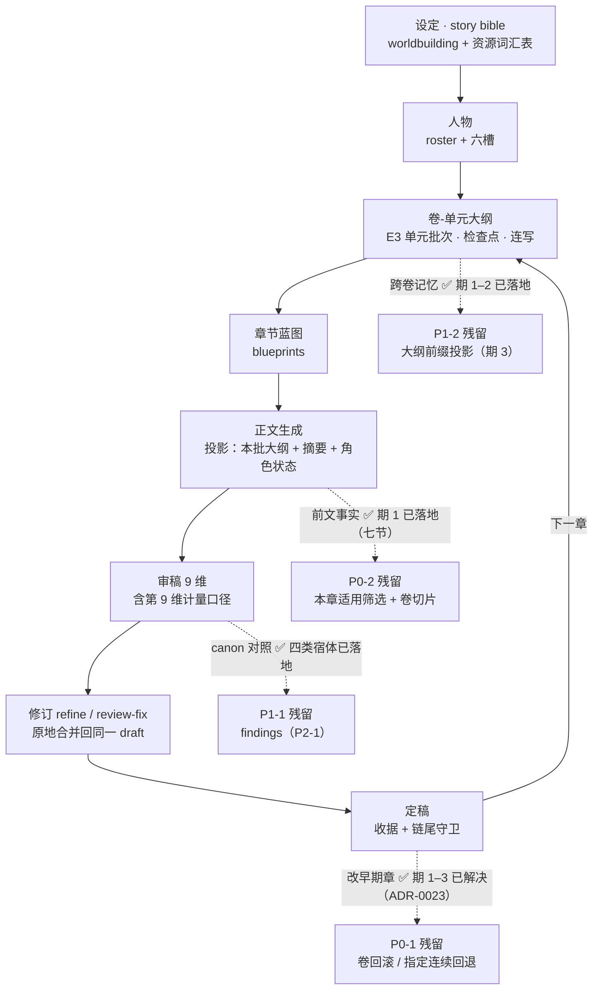

# 长篇创作就绪度评审（2026-10-23）

> **问题**：以**当前已实现的功能**为准，还有哪些缺陷在阻止完成一部长篇？  
> **方法**：按行业标准的长篇生产流程（设定 → 人物 → 大纲 → 蓝图 → 正文 → 审稿 → 修订 → 定稿）  
> 逐环节核对代码证据，再按「写不到 300 章」的实际卡点排序。术语与来源见  
> `industry-alignment-and-stage-goals.md` §2。  
> **结论（2026-10-24 更新）**：单卷（20–30 章）能跑通。原「三处硬伤 + 一处结构性缺陷」中，**改稿连锁已解决**（ADR-0023 期 1–3）、**写前查阅期 1 已落地**（七节注入）、**卷级上下文期 1/1b 已落地**（M18+M19）、**四类宿体全部落地**（M14–M17）、**findings 期 1 已落地**（四类语义档进审稿链，`design/review/p2-1-continuity-findings-design.md`）。剩余卡点见 §0 表：**跨卷失真**（卷末快照自动生成，P1-2 期 2）+ **findings 的确定性档与跨章累积**（属 P2-1 后续期，需先推翻 v2 契约）。**本文效力与防漂移规则不变**；各结论的推翻记录见对应条目下的「2026-10-24」标注。

---

## 防目标漂移的规则（作者 2026-10-23 定）

1. **评审报告即事实依据**。施工目标从它派生，不从"我觉得应该"派生。
2. 要推翻任何一条结论，必须提供**新的行业标准**或**新的代码证据**，并在报告对应条目下写「何时、被什么推翻」。
3. 不得因为"做起来麻烦"或"想换个做法"而改目标。**目标漂移比做不完更贵**。
4. 加任何新机制前，先答四问（行业叫什么 / 谁消费 / 失败形态属哪类 / 已有产品做过什么）。
5. 收口一期时，**所有写着状态的位置**都要同步（顶部状态行、分期表、台账、交接稿）。

## 0. 结论先行

| 判断            | 依据                                                                                |
| ------------- | --------------------------------------------------------------------------------- |
| **能写完一卷**     | 大纲→蓝图→正文→审稿→修订→定稿全链路都有实现，E3 还支持连写与断点续写                                            |
| **跨卷会失真**     | ① 卷级上下文：**宿体已落地**（P1-2 期 1，M18 `volume_handoffs` + 登记页 + 正文链注入「上一卷交接」；**期 1b / M19 把区间外置到 `volumes`、登记页改为选卷**；**期 2 已落地：卷末章定稿时自动生成初稿**，零迁移）② 写前查阅（W7）期 1 已落地（上一卷交接 / 前文事实 / 关键物品 / 制度 / 知情 / 能力 / 本书规则七节进必需材料块，续写轮同样可见），剩下的只是「本章适用」筛选与卷切片   |
| **300 章仍不可行** | ③ 改稿连锁**已解决**（ADR-0023，期 1–3）；四类宿体**全部落地**（物品 M14 / 制度 M15 / 知情 M16 / 能力 M17）；findings **期 1 已落地**（四类语义档）。剩余依据变成两条：① **跨卷失真**（卷末快照未做）② **findings 只有语义档**——按章判定、随报告生灭，尚无跨章累积与零模型的确定性档（要动 v2 契约，属 P2-1 后续期） |
| **结构性缺陷**     | 角色六槽仍是自由文本；~~物品 / 能力 / 制度 / 信息流都没有宿体~~ → **四类全部落地**：物品 M14 / 制度 M15 / 知情 M16 / 能力 M17（2026-10-24） |

**三处硬伤按严重度**（2026-10-23 初判）：改稿连锁 ＞ 写前查阅（W7） ＞ 卷级上下文压缩 —— 按此顺序施工，三条均已在期 1 层面落地，残留见 §0 / §5。  
**一处结构性缺陷（已消解大半）**：连续性六类里，时间/空间/物品/制度/知情/能力都有结构了（M14–M17）；**剩下的自由文本是角色六槽本身**（`cs_*` 仍是作者原话，没有转移规则校验，属 12.15 的另两项）。

---

## 1. 长篇生产链路（现行实现 + 卡点）

> 图用 Mermaid（`flowchart` / `stateDiagram`），GitHub、VS Code、Typora 均可直接渲染；  
> 每张图配一句文字摘要，纯文本阅读器下也能看懂。

**一句话读法**：主干（A→H→C 循环）已经通，能写完一卷；四条虚线是**曾经的缺口**，期 1–3 已各自落地，剩下的是各自动尾：X1 卷回滚、X2 筛选与切片、X3 自动生成、X4 findings（P2-1）。

## 1.1 逐环节定级（按行业流程）

| 环节        | 行业名                                | 现有实现与证据                                                                                                       | 评级             |
| --------- | ---------------------------------- | ------------------------------------------------------------------------------------------------------------- | -------------- |
| 设定        | story bible · world rules          | `worldbuilding` 长文 + `resources`（已收窄为资源词汇表）+ 生成期数值规则层 A-1~A-4                                                 | ✅ 够用           |
| 人物        | character bible                    | 角色名单 + 六槽 `cs_*`（**自由文本**）                                                                                    | ⚠️ 勉强          |
| 大纲        | outline / beat sheet               | 卷-单元结构 + 情节大纲 + E3 单元批次（检查点 + 游标 + 断点续写 + 连写/停止连写）                                                            | ✅ 够用           |
| 蓝图        | chapter blueprint                  | `blueprints` 表 + 大纲三段切分投影（`projectSynopsisForBlueprint`）                                                      | ✅ 够用           |
| 正文        | draft                              | 正文链 + 作者材料块 + 角色状态注入（`characterStateFacts`）                                                                   | ✅ 够用           |
| 审稿        | manuscript validation              | 9 维（**第 9 维就是计量口径**，模板 `builtin-prompt-templates.ts:1377`）                                                    | ✅ 够用           |
| 修订        | revision                           | `refine` / `review-fix`，合并回同一 draft（原地写回）                                                                     | ✅ 够用           |
| 定稿        | finalize                           | 定稿收据 + 退回草稿 + **退回已放开到任意章**（删除仍限链尾）+ 失效显式化（ADR-0023 期 1–3：M13 变更日志 + 「⚠ 前提已变」+ 逐章三选一）；卷回滚 / 指定连续回退未实现                                                                                    | ⚠️ 能用（缺卷级回滚）   |
| 伏笔        | plot promises / unresolved threads | `NarrativeThreadStatus` 五态（planned/planted/progressing/**resolved**/abandoned）+ `dormantChapters` + `overdue` | ✅ 够用           |
| 时间连续性     | chronology                         | 故事日序整数（W2）+ A-1 量纲检查                                                                                          | ✅ 够用           |
| 人物连续性     | character consistency              | 六槽自由文本 + 定稿期写回                                                                                                | ⚠️ 勉强          |
| **物品连续性** | possession continuity              | ✅ **宿体已落地**（P1-1 期 1，M14 `key_items` + 登记页 + 写前查阅注入）；✅ **findings 期 1 已落地**（审稿「连续性核对基准」，判「换手无转交过程」） | ✅ 够用 |
| **能力连续性** | forgotten abilities                | ✅ **宿体已落地**（P1-1 期 4，M17 `power_abilities` + 登记页 + 写前查阅「能力」节：三类限制 hard limit/weakness/cost + 三态 active/ahead/undated；`evidence_scope` 三档出处）；✅ **findings 期 1 已落地**（判「阶段未到即用 / 违反硬限制 / 无视代价」）；不判次数与冷却 | ✅ 够用 |
| **制度连续性** | world rules / periodic obligations | ✅ **宿体已落地**（P1-1 期 2，M15 `institution_cadences` + 登记页 + 写前查阅「制度」节：四态 due/not_due/overdue/unknown）；✅ **findings 期 1 已落地**（判「漏发 / 同轮连发」，`unknown` 一律不判） | ✅ 够用 |
| **信息流**   | who knows what                     | ✅ **宿体已落地**（P1-1 期 3，M16 `knowledge_states` + 登记页 + 写前查阅「知情」节：人粒度 `character_id`、只做正向知情、引用失效三态 valid/stale/unverifiable）；✅ **findings 期 1 已落地**（判「未卜先知 / 集体失忆」） | ✅ 够用 |
| **写前查阅**  | consult the bible                  | ✅ **期 1 已落地**（`prewrite-consultation.ts` 组装七节：上一卷交接 / 前文事实（陈述 + 章号 + 逐字引文）/ 关键物品 / 制度 / 知情 / 能力 / 本书规则，全走必需材料块 ⇒ 续写/压缩轮同样可见）；全量世界观仍只进首轮，缺「本章适用」筛选与卷切片            | ⚠️ 能用，待筛选与切片 |
| **卷级上下文** | previous-volume snapshot           | ✅ **宿体已落地**（P1-2 期 1，M18 `volume_handoffs` + 登记页 + 写前查阅首节「上一卷交接」；**期 1b / M19 增加 `volumes` + `volume_units` 两张结构表，区间由卷结构派生**：正文链每次请求都带 `last_chapter < 本章` 的那一份，续写轮同样可见）。本期只做**数据 + 注入**，自动生成待期 2；仍缺「卷被重写后交接单失效」的判定（属 P2-1） | ⚠️ 能用，待自动化 |
| **改稿连锁**  | revision cascade / rollback        | ✅ **已落地**（ADR-0023，P0-1 期 1–3）：退回不限链尾 + M13 变更日志 + 「⚠ 前提已变」徽标 + 前章 stale 时拒绝写下一章 + 逐章三选一处置；卷回滚 / 指定连续回退未实现    | ✅ 已解决          |
| 跨部交接      | series bible handoff               | 无（W8 未开工）                                                                                                     | ❌ 后期再说         |

> **一处需要自我纠正**：本文初稿曾把"伏笔没有回收状态"列为缺陷 —— 查证后是错的。  
> `NarrativeThreadStatus` 有 `resolved`，还有 `dormantChapters` / `overdue`。  
> 那张 `narrative_thread_plans` 表只是"计划"，状态由事件推导。已同步修正 W8 稿 §2。

---

## 2. 三处硬伤

### 2.1 改稿连锁（最严重）

**症状**：写到第 300 章发现第 20 章的设定错了。当前实现只允许"从最后一章开始一章一章往回退"（ADR-0021 的定稿链尾部守卫）。退到第 20 章意味着先退 280 章。

**为什么它是长篇的生死线**：长篇创作**必然**回头改早期章节——读者反馈、伏笔调整、设定补完。一个"改不了前面"的写作工具，只能写短篇。这不是"锦上添花"，是"能不能用"的分界。

**已落地（ADR-0023，期 1–3）**：不再是"连带回退"，而是**把失效显式化**：

1. 退回任意章都允许（删除仍限链尾），退回必然调 `invalidateContinuityProjectionFrom`；
2. M13 记下"变的是哪一章"（`continuity_change_log`），判定改为  
   `max(快照代, 最新确认代) >= 该章之前的最新变更代` —— 所以**改后文不会打回前文**，  
   逐章修复时已确认的章不会被反复重置；
3. 受影响章显示「⚠ 前提已变」，前一章 stale 时生成下一章被拒；
4. 逐章三选一处置：重新定稿 / 修复后处理 / 确认无需改动（**记理由**，绑定世代，下次再退回自动失效）。

**期 4（波及扫描）暂缓，理由**：~~四类宿体里能力还没有~~ → **2026-10-24 四类全部落地**（M14–M17），这条理由**已消失**；现在的阻塞只剩「按章检索正文的通道不存在」。  
现在硬做，产出会是「命中清单」（检索词出现了 ≠ 两处陈述不能同时为真）而不是「冲突清单」，  
等于造一个噪声源 —— 与 W6 的教训同型。**建议与 P1-1（四类宿体）合并做**，届时确定性档才有可比对的 canon。

### 2.2 写前查阅（W7）—— **范围已收窄**（2026-10-23 复核修正）

> **修正记录**：本文初稿写「没有未回收伏笔的注入通道」，**不准确**。复核 `generate-draft.command.ts`  
> （`assembleChapterMaterials` 调用处 + `readActiveNarrativeThreads`）发现：**活跃伏笔早就注入了，而且带出处** —  
> 每条形如 `- {标题} [{status}]（目标第 a–b 章；作者意图：…；来源第 N 章：{逐字引文}）`，  
> 还带条数与字符预算（`ACTIVE_THREAD_CONTEXT_MAX_ITEMS` / `_MAX_CHARS`），第 1 章不注入。  
> 照初稿去做 W7 会重复建一套注入管道 —— 这正是"目标以报告为据"最危险的地方，所以按约定用代码证据改掉。

> **修正记录二（2026-10-23 晚，P0-2 立项前复核）**：上面那句「`worldbuilding` 不进正文，只有 A-1~A-4 在读它」  
> **也被代码推翻**。证据：`generate-draft.command.ts:2076-2102` 的 `readArchitecture()` 里 `append(core?.worldbuilding)`，  
> 经 `:881` `.withArchitecture(architecture)` 注入 —— 首章落在 `builtin-prompt-templates.ts:1106` 的【全书设定池】，  
> 后续章落在 `:1216-1217` systemSuffix 的【不可偏离的作者事实】（第 3 维另由 `architecture-projection.ts` 压成一行远期声明）。  
> **世界规则确实在正文请求里**。唯一的"不进"是**续写/压缩轮**：`draftAuthorMaterialBlock`（`:545`）不带任何模板变量。  
> ⇒ W7 在世界规则这一块的真实缺口是两条：**① 续写轮无设定；② 全量硬塞、无「本章适用」筛选与出处**。  
> 若不改这条，P0-2 会去修一个不存在的洞，并可能重复注入一份世界观。
>
> **（2026-10-24 补）**：期 1 落地后①收窄为「续写轮无**全量**设定」—— 筛选后的【本书规则】节已随 `prewrite-consultation.ts` 七节进必需材料块，续写/压缩轮拿得到；②仍成立（无「本章适用」筛选、无卷切片）。行号按当前代码同步（原引用 1991-2014 / 851 / 518-599 已漂移）。

**症状（二次收窄后）**：模型写第 200 章时，**手里有**角色状态、活跃伏笔（带出处）、日序、已定稿来源、知识库参考，  
以及**全量世界观原文**（首轮）；**缺的是** ① 续写轮没有世界观 ② 前文事实只有"摘句原文"，没有"陈述 + 章号 + 引文"这层索引  
③ 世界规则没有"本章适用"的筛选与出处；~~另有**关键物品**（无宿体）与**信息流**（谁知道什么，无宿体）~~ → **四类宿体全部接进同一份材料块**（物品 期1 / 制度 期2 / 知情 期3 / 能力 期4，2026-10-23 → 10-24）。

**修法**：**复用伏笔那条现成范式**，只在必需材料块里补两节 ——「前文事实」（`finalized_continuity_facts` 的  
statement + 来源章 + 逐字引文）与「本书规则」（世界观原文摘录，出处只标维度、**不伪造章号**），各带条数与字符上限；  
不注入任何派生数值（W6 的教训，ADR-0022）。**不新建注入管道、不改模板变量契约**。
（2026-10-23 更新：物品宿体已落地并把第三小节接进同一份材料块。**信息流不再等 C1** —— 作者 2026-10-23 裁定先按人粒度（`character_id`）+ 正向知情落地，见 `plans/p1-1-three-cells-plan.md` §1.2；身份分面留到真有「一人多身份」需求时再立项。）

**为什么曾是硬伤**：缺的几块恰好是跨卷最容易崩的（世界规则决定手段边界，物品与信息流决定"能不能这么做"）。  
但工作量比初稿估的小：范式已有，宿体与 P1-1 是同一件事。

> **（2026-10-24）**：四类宿体全部落地、七节注入完成 ⇒ 本节降级为「残留」：**①「本章适用」筛选**（今天是全量登记 + 知情节按出场角色排序）**② 卷切片**（属 P1-2 期 2）。

### 2.3 卷级上下文压缩

**症状**：写到第 4 卷时，第 1–3 卷的正文早已退出上下文，只剩大纲文本（几百字）与最近几十章摘要。人物动机、已经用掉的底牌、已解决的冲突，全靠在模型脑内"应该是这样"。

**证据**：`volume-quota-context-budget-design.md` §129–130 明确要求"本卷全文 + 上一卷快照 + 最近 K 章"，其中**卷末快照（≤1,500 字）是唯一新增的模型调用**；但代码里搜不到任何卷快照实现。已实现的是大纲侧的三段切分（`projectSynopsisForBlueprint`），那是**按章号切大纲**，不是卷级摘要。

**修法**：卷末生成一份结构化快照（事件 / 物品 / 债 / 未决项），作为下一卷的上下文首段；生命周期终止于下一卷。

---

## 3. 宿体现状：六类里五类已有结构，剩下的是角色六槽本身

按 ConStory-Bench 的分类（`industry-alignment-and-stage-goals.md` §3.3），当前状态：

| 类别             | 宿体                 | 能查吗         |
| -------------- | ------------------ | ----------- |
| 时间             | 日序整数 + 章节号         | ✅ 能算术       |
| 空间             | 第 4 维机读行           | ⚠️ 有数据、无消费方 |
| 人物（记忆/知识）      | `cs_*` 自由文本        | ❌ 只能靠读      |
| **信息流（谁知道什么）** | ✅ **宿体已落地**（P1-1 期 3，M16 `knowledge_states` + 登记页 + 写前查阅注入；主语 `character_id`，只做正向知情，不做 C1 身份分面） | ✅ 能查（登记过的事实）、未登记不判 |
| 物品（在谁手里）       | ✅ **宿体已落地**（P1-1 期 1，M14 `key_items` + 登记页 + 写前查阅「物品」节：归属按时点理解，没写出转交不得换手） | ✅ 能查（登记过的归属）、未登记不判 |
| 能力（触发次数/代价）    | ✅ **宿体已落地**（P1-1 期 4，M17 `power_abilities` + 登记页 + 写前查阅「能力」节：硬限制/弱点/代价三类限制 + 三态 active/ahead/undated；**不做次数/冷却**，只登本书级规则、不含 `character_id`） | ✅ 能查（登记过的规则）、未登记不判 |
| 制度（月例/轮次）      | ✅ **宿体已落地**（P1-1 期 2，M15 `institution_cadences` + 登记页 + 写前查阅「制度」节：四态 due/not_due/overdue/unknown） | ✅ 能查（登记过的周期）、未登记不判 |

**这不是"要不要做账本"的问题**（那是 W6 的教训），而&#x662F;**"要让模型在写之前知道，就必须先有地方存"**。存的形式应该是 **story bible 的分区**（事实，不是账）。

**信息流单独强调**：ConStory-Bench 把它归到"人物塑造"下，并称其为"最难靠重读发现"的一类 —— 因为错误不在句子里，而在场景**假定**的东西里（角色用了没人告诉他的信息）。长篇里这类错误最伤读者信任。

---

## 4. 已验证"不是卡点"的部分（别再重复投入）

- **批量与中断**：E3 单元批次有检查点、显式游标、断点续写、连写与"停止连写（当前批写完再停）"。
- **上下文投影**：大纲按批切分已实现在共享层，输入不随章数增长。
- **审稿**：9 维审稿含计量口径，且明确了"缺周期不判 error"的边界。
- **伏笔**：五态 + 休眠章数 + 逾期标记。
- **定稿不可变**：收据 + 退回草稿（退回已放开到任意章，删除仍限链尾）。
- **导入导出**：项目打包 / 迁移有实现（`.vela-pack`、portable 策略）。

---

## 5. 重排后的优先级（送进唯一台账）

| 序        | 项                                | 为什么在这个位置                                    | 依赖                   |
| -------- | -------------------------------- | ------------------------------------------- | -------------------- |
| **P0-1** | ✅ **改稿连锁**（指定连续回退 / 卷回滚未做）               | 决定"能不能改"，长篇生死线；且它与 W7 无依赖，可先做               | 无（复用 ADR-0021 的退回语义） |
| **P0-2** | ✅ 期 1 已落地 · **W7 写前查阅**（筛选与卷切片待做）      | 决定"写得对不对"；注入的事实来源依赖 §3 的宿体，可先做"已有三类的注入"     | 需要 §3 的部分宿体（可分阶段）    |
| **P1-1** | ✅ **连续性的四项宿体**（物品 M14 / 制度 M15 / 信息流 M16 / 能力 M17 **全部落地**，2026-10-24） | W7 的原料；也是审稿 findings 的对照 canon              | 无（信息流已改人粒度，**不再依赖 C1**） |
| **P1-2** | **卷级上下文快照**                      | 跨卷不失真的前提                                    | ✅ **期 1/1b/2/2b 已落地（2026-10-24）**：M18 + M19 卷结构 + 登记页（选卷）+ 正文链注入 + **卷末章定稿自动生成初稿** + **开写闸门**（缺单/未确认初稿时强提示）；剩期 3（大纲前缀投影） |
| **P2-1** | 🚧 **期 1 已落地（2026-10-24）**：S×5 的 findings（四类语义档：物品/制度/知情/能力） | 让错误"被查出来"，不再靠作者盯；本期随报告生灭、零 schema 变更 | P1-1 ✅ |
| **P2-2** | W8 跨部交接                          | 第二部才用得上                                     | W7 + 卷快照             |
| **P3**   | 多图往返 / 拓扑                        | 仍不做（`w8-nested-world-handoff-design.md` §1） | —                    |

> **本报告的效力（2026-10-23 作者定）**：后续施工**以本文为事实依据**确定目标。  
> 要推翻任何一条结论，必须给出**新的行业标准或新的代码证据**，并在本文对应条目下注明"何时、被什么推翻"；  
> 不得因为"做起来麻烦"或"想换个做法"而改目标。目标漂移比做不完更贵（W6 就是先做了"查错"，而"能用"和"写对"还空着）。

**排序原则**（写进台账，避免以后又漂）：**先"能用"（改稿）、再"写对"（查阅 + 宿体）、再"查错"（findings）、最后"跨部"**。  
W6 的教训是反过来的：先做了"查错"（账本），而"能用"和"写对"都还空着。

---

## 6. 工期计划（按批次，不排日历）

> 用"期"作单位（一个 W 期 = 一次可验收的落地），因为本项目的历史节奏是按期推进的。  
> 每批都有独立验收，**不要求前一批完美才开始下一批**，但**P0-1 必须先于一切**。

| 批次         | 内容                                                    | 期数估算  | 验收（可执行）                                       |
| ---------- | ----------------------------------------------------- | ----- | --------------------------------------------- |
| **A · 可改** | 改稿连锁：指定退到第 N 章 → 连带回退其后 → 批量重新定稿                      | 2 期   | 在 3 章样本上退到第 1 章，第 2–3 章变草稿且正文不丢；批量重新定稿后收据全部有效 |
| **B · 写对** | ① W7 最小集（角色状态 + 未回收伏笔 + 世界规则，带出处）② 四项宿体（物品/能力/制度/信息流） | 3–4 期 | 生成第 N 章时上下文含"本章适用事实"且每条带章号引文；物品归属能答"刀在谁手里"    |
| **C · 跨卷** | 卷末快照 + 注入                                             | 1–2 期 | 写到第 3 卷时，第 1 卷的关键事件仍在上下文首段                    |
| **D · 查错** | S×5 六类 findings（✅ 期 1 已落地：物品/制度/知情/能力四类语义档；确定性档与跨章累积待做）                      | 3 期   | 注入一处人造矛盾能被查出，干净章节零误报                          |
| **E · 跨部** | W8 切片包 + 导入（先补宿体再做导出）                                 | 2 期   | 新项目第 1 章引用交接事实不冲突                             |

**总估**：11–13 期。**批次 A 是唯一"不做就不能写长篇"的一批**；B 决定质量上限。

---

## 7. 风险与边界

| 风险                     | 处理                                                                                   |
| ---------------------- | ------------------------------------------------------------------------------------ |
| 改稿连锁的回退清单过长（一次退 280 章） | 必须配"批量重新定稿"，否则等于放大手工；先做单章回退 + 逐章重定稿，再考虑批量                                            |
| W7 注入把上下文撑爆            | 只注入"本章会用到的"，且有条目上限；全量 bible 永远不进上下文                                                  |
| 宿体又变成第二套账（重犯 W6）       | 宿体只存**事实**（谁在哪、刀在谁手里、谁知道什么），不存算术结果；判据见 `industry-alignment-and-stage-goals.md` §5 四问 |
| findings 变成永远处理不完的待办   | 每条 findings 必须可 resolve / dismiss（判据 CX 的行业对应做法）                                     |
| 跨部交接过早做                | 排在 E；第二部之前不需要                                                                        |
