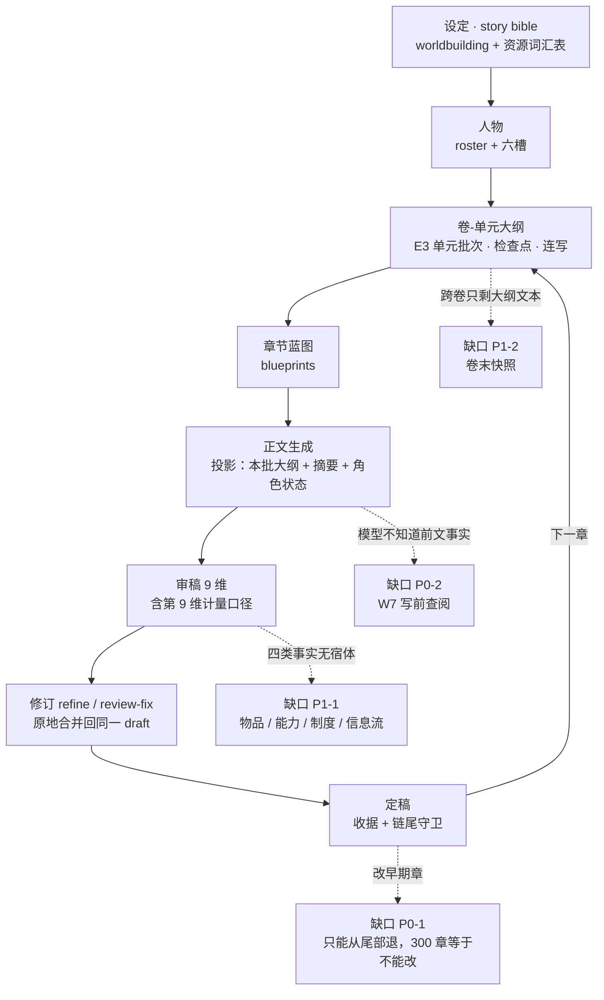

# 长篇创作就绪度评审（2026-10-23）

> **问题**：以**当前已实现的功能**为准，还有哪些缺陷在阻止完成一部长篇？
> **方法**：按行业标准的长篇生产流程（设定 → 人物 → 大纲 → 蓝图 → 正文 → 审稿 → 修订 → 定稿）
> 逐环节核对代码证据，再按「写不到 300 章」的实际卡点排序。术语与来源见
> `industry-alignment-and-stage-goals.md` §2。
> **结论**：单卷（20–30 章）能跑通；**跨卷开始失真，300 章不可行**。卡点有三处硬伤、一处结构性缺陷。

---

## 0. 结论先行

| 判断 | 依据 |
|---|---|
| **能写完一卷** | 大纲→蓝图→正文→审稿→修订→定稿全链路都有实现，E3 还支持连写与断点续写 |
| **跨卷会失真** | ① 没有卷级上下文压缩（"上一卷快照"只在设计稿里，代码无实现）② 写前查阅（W7）缺，模型不知道前面发生了什么 |
| **300 章仍不可行** | ③ 改稿连锁**已解决**（ADR-0023，期 1–3）；剩余依据是 ① 跨卷失真（W7 + 卷快照未做）与 ② 四类事实无宿体，长程一致性没有对照 canon |
| **结构性缺陷** | 角色六槽是自由文本；物品 / 能力 / 制度 / 信息流（谁知道什么）都没有宿体，连续性只能靠"记得" |

**三处硬伤按严重度**：改稿连锁 ＞ 写前查阅（W7） ＞ 卷级上下文压缩。
**一处结构性缺陷**：连续性六类里，只有时间（日序整数）与空间（第 4 维机读行）有结构，其余四类靠自由文本。

---

## 1. 长篇生产链路（现行实现 + 卡点）

> 图用 Mermaid（`flowchart` / `stateDiagram`），GitHub、VS Code、Typora 均可直接渲染；
> 每张图配一句文字摘要，纯文本阅读器下也能看懂。

**一句话读法**：主干（A→H→C 循环）已经通，能写完一卷；四条虚线是缺口，其中 **X1（改稿）** 决定"能不能写长篇"，
X2/X3 决定"跨卷会不会失真"，X4 是 X2 与 findings 的原料。

## 1.1 逐环节定级（按行业流程）

| 环节 | 行业名 | 现有实现与证据 | 评级 |
|---|---|---|---|
| 设定 | story bible · world rules | `worldbuilding` 长文 + `resources`（已收窄为资源词汇表）+ 生成期数值规则层 A-1~A-4 | ✅ 够用 |
| 人物 | character bible | 角色名单 + 六槽 `cs_*`（**自由文本**） | ⚠️ 勉强 |
| 大纲 | outline / beat sheet | 卷-单元结构 + 情节大纲 + E3 单元批次（检查点 + 游标 + 断点续写 + 连写/停止连写） | ✅ 够用 |
| 蓝图 | chapter blueprint | `blueprints` 表 + 大纲三段切分投影（`projectSynopsisForBlueprint`） | ✅ 够用 |
| 正文 | draft | 正文链 + 作者材料块 + 角色状态注入（`characterStateFacts`） | ✅ 够用 |
| 审稿 | manuscript validation | 9 维（**第 9 维就是计量口径**，模板 `builtin-prompt-templates.ts:1377`） | ✅ 够用 |
| 修订 | revision | `refine` / `review-fix`，合并回同一 draft（原地写回） | ✅ 够用 |
| 定稿 | finalize | 定稿收据 + 退回草稿 + **只能动定稿链尾部** | ⚠️ 勉强（缺级联回退） |
| 伏笔 | plot promises / unresolved threads | `NarrativeThreadStatus` 五态（planned/planted/progressing/**resolved**/abandoned）+ `dormantChapters` + `overdue` | ✅ 够用 |
| 时间连续性 | chronology | 故事日序整数（W2）+ A-1 量纲检查 | ✅ 够用 |
| 人物连续性 | character consistency | 六槽自由文本 + 定稿期写回 | ⚠️ 勉强 |
| **物品连续性** | possession continuity | 无（在 `cs_key_items` 一句话里） | ❌ 缺 |
| **能力连续性** | forgotten abilities | 无 | ❌ 缺 |
| **制度连续性** | world rules / social norms | 无（费率只是展示文本） | ❌ 缺 |
| **信息流** | who knows what | 无（知情边界没有任何结构） | ❌ 缺 |
| **写前查阅** | consult the bible | 无（W7 未开工） | ❌ **硬伤** |
| **卷级上下文** | previous-volume snapshot | 无（设计稿要求 1,500 字卷末快照，代码零命中） | ❌ **硬伤** |
| **改稿连锁** | revision cascade / rollback | 无（只能从尾部连续退，跳章回退属"卷回滚"，未实现） | ❌ **硬伤** |
| 跨部交接 | series bible handoff | 无（W8 未开工） | ❌ 后期再说 |

> **一处需要自我纠正**：本文初稿曾把"伏笔没有回收状态"列为缺陷 —— 查证后是错的。
> `NarrativeThreadStatus` 有 `resolved`，还有 `dormantChapters` / `overdue`。
> 那张 `narrative_thread_plans` 表只是"计划"，状态由事件推导。已同步修正 W8 稿 §2。

---

## 2. 三处硬伤

### 2.1 改稿连锁（最严重）

**症状**：写到第 300 章发现第 20 章的设定错了。当前实现只允许"从最后一章开始一章一章往回退"（ADR-0021 的定稿链尾部守卫）。退到第 20 章意味着先退 280 章。

**为什么它是长篇的生死线**：长篇创作**必然**回头改早期章节——读者反馈、伏笔调整、设定补完。一个"改不了前面"的写作工具，只能写短篇。这不是"锦上添花"，是"能不能用"的分界。

**已落地（ADR-0023，期 1–3）**：不再是"连带回退"，而是**把失效显式化**：

1. 退回任意章都允许（删除仍限链尾），退回必然调 `invalidateContinuityProjectionFrom`；
2. M13 记下"变的是哪一章"（`continuity_change_log`），判定改为
   `max(快照代, 最新确认代) >= 该章之前的最新变更代` —— 所以**改后文不会打回前文**，
   逐章修复时已确认的章不会被反复重置；
3. 受影响章显示「⚠ 前提已变」，前一章 stale 时生成下一章被拒；
4. 逐章三选一处置：重新定稿 / 修复后处理 / 确认无需改动（**记理由**，绑定世代，下次再退回自动失效）。

**期 4（波及扫描）暂缓，理由**：确定性档需要在后续正文里比对事实，而**物品 / 能力 / 制度 / 信息流四类宿体都还没有**（§3），
按章检索正文的通道也不存在。现在硬做，产出会是"命中清单"（这个名字又出现了）而不是"冲突清单"（这里自相矛盾），
等于造一个噪声源 —— 与 W6 的教训同型。**建议与 P1-1（四类宿体）合并做**，届时确定性档才有可比对的 canon。

### 2.2 写前查阅（W7）

**症状**：模型写第 200 章时，手里没有"读者已经知道什么"。它只能从本批大纲 + 最近摘要里推，推不出来就编。

**证据**：`characterStateFacts` 只注入角色状态；没有"未回收伏笔 / 世界规则 / 关键物品 / 谁知道什么"的注入通道。W6 曾想做"注入余额"，已下线（ADR-0022）——它连方向都错了。

**修法**：按 `industry-alignment-and-stage-goals.md` §3.1 —— 注入**能在前文找到出处的事实**，每条带章号与逐字引文；不注入任何派生数值。

**为什么排第二**：它决定"写得对不对"，但即使没有它，作者仍能写（只是要自己盯）。而 2.1 决定"能不能改"，直接影响能不能用。

### 2.3 卷级上下文压缩

**症状**：写到第 4 卷时，第 1–3 卷的正文早已退出上下文，只剩大纲文本（几百字）与最近几十章摘要。人物动机、已经用掉的底牌、已解决的冲突，全靠在模型脑内"应该是这样"。

**证据**：`volume-quota-context-budget-design.md` §129–130 明确要求"本卷全文 + 上一卷快照 + 最近 K 章"，其中**卷末快照（≤1,500 字）是唯一新增的模型调用**；但代码里搜不到任何卷快照实现。已实现的是大纲侧的三段切分（`projectSynopsisForBlueprint`），那是**按章号切大纲**，不是卷级摘要。

**修法**：卷末生成一份结构化快照（事件 / 物品 / 债 / 未决项），作为下一卷的上下文首段；生命周期终止于下一卷。

---

## 3. 结构性缺陷：连续性六类里有四类没有宿体

按 ConStory-Bench 的分类（`industry-alignment-and-stage-goals.md` §3.3），当前状态：

| 类别 | 宿体 | 能查吗 |
|---|---|---|
| 时间 | 日序整数 + 章节号 | ✅ 能算术 |
| 空间 | 第 4 维机读行 | ⚠️ 有数据、无消费方 |
| 人物（记忆/知识） | `cs_*` 自由文本 | ❌ 只能靠读 |
| **信息流（谁知道什么）** | 无 | ❌ 完全缺 |
| 物品（在谁手里） | `cs_key_items` 一句话 | ❌ |
| 能力（触发次数/代价） | 无 | ❌ |
| 制度（月例/轮次） | 无 | ❌ |

**这不是"要不要做账本"的问题**（那是 W6 的教训），而是**"要让模型在写之前知道，就必须先有地方存"**。存的形式应该是 **story bible 的分区**（事实，不是账）。

**信息流单独强调**：ConStory-Bench 把它归到"人物塑造"下，并称其为"最难靠重读发现"的一类 —— 因为错误不在句子里，而在场景**假定**的东西里（角色用了没人告诉他的信息）。长篇里这类错误最伤读者信任。

---

## 4. 已验证"不是卡点"的部分（别再重复投入）

- **批量与中断**：E3 单元批次有检查点、显式游标、断点续写、连写与"停止连写（当前批写完再停）"。
- **上下文投影**：大纲按批切分已实现在共享层，输入不随章数增长。
- **审稿**：9 维审稿含计量口径，且明确了"缺周期不判 error"的边界。
- **伏笔**：五态 + 休眠章数 + 逾期标记。
- **定稿不可变**：收据 + 退回草稿 + 尾部守卫。
- **导入导出**：项目打包 / 迁移有实现（`.vela-pack`、portable 策略）。

---

## 5. 重排后的优先级（送进唯一台账）

| 序 | 项 | 为什么在这个位置 | 依赖 |
|---|---|---|---|
| **P0-1** | **改稿连锁（指定连续回退）** | 决定"能不能改"，长篇生死线；且它与 W7 无依赖，可先做 | 无（复用 ADR-0021 的退回语义） |
| **P0-2** | **W7 写前查阅** | 决定"写得对不对"；注入的事实来源依赖 §3 的宿体，可先做"已有三类的注入" | 需要 §3 的部分宿体（可分阶段） |
| **P1-1** | **连续性的四项宿体**（物品 / 能力 / 制度 / 信息流） | W7 的原料；也是审稿 findings 的对照 canon | 无 |
| **P1-2** | **卷级上下文快照** | 跨卷不失真的前提 | 大纲投影已有，独立 |
| **P2-1** | S×5 的 findings（按六类逐一） | 让错误"被查出来"，不再靠作者盯 | P1-1 |
| **P2-2** | W8 跨部交接 | 第二部才用得上 | W7 + 卷快照 |
| **P3** | 多图往返 / 拓扑 | 仍不做（`w8-nested-world-handoff-design.md` §1） | — |

> **本报告的效力（2026-10-23 作者定）**：后续施工**以本文为事实依据**确定目标。
> 要推翻任何一条结论，必须给出**新的行业标准或新的代码证据**，并在本文对应条目下注明"何时、被什么推翻"；
> 不得因为"做起来麻烦"或"想换个做法"而改目标。目标漂移比做不完更贵（W6 就是先做了"查错"，而"能用"和"写对"还空着）。

**排序原则**（写进台账，避免以后又漂）：**先"能用"（改稿）、再"写对"（查阅 + 宿体）、再"查错"（findings）、最后"跨部"**。
W6 的教训是反过来的：先做了"查错"（账本），而"能用"和"写对"都还空着。

---

## 6. 工期计划（按批次，不排日历）

> 用"期"作单位（一个 W 期 = 一次可验收的落地），因为本项目的历史节奏是按期推进的。
> 每批都有独立验收，**不要求前一批完美才开始下一批**，但**P0-1 必须先于一切**。

| 批次 | 内容 | 期数估算 | 验收（可执行） |
|---|---|---|---|
| **A · 可改** | 改稿连锁：指定退到第 N 章 → 连带回退其后 → 批量重新定稿 | 2 期 | 在 3 章样本上退到第 1 章，第 2–3 章变草稿且正文不丢；批量重新定稿后收据全部有效 |
| **B · 写对** | ① W7 最小集（角色状态 + 未回收伏笔 + 世界规则，带出处）② 四项宿体（物品/能力/制度/信息流） | 3–4 期 | 生成第 N 章时上下文含"本章适用事实"且每条带章号引文；物品归属能答"刀在谁手里" |
| **C · 跨卷** | 卷末快照 + 注入 | 1–2 期 | 写到第 3 卷时，第 1 卷的关键事件仍在上下文首段 |
| **D · 查错** | S×5 六类 findings（先做"人物/物品/信息流"三类） | 3 期 | 注入一处人造矛盾能被查出，干净章节零误报 |
| **E · 跨部** | W8 切片包 + 导入（先补宿体再做导出） | 2 期 | 新项目第 1 章引用交接事实不冲突 |

**总估**：11–13 期。**批次 A 是唯一"不做就不能写长篇"的一批**；B 决定质量上限。

---

## 7. 风险与边界

| 风险 | 处理 |
|---|---|
| 改稿连锁的回退清单过长（一次退 280 章） | 必须配"批量重新定稿"，否则等于放大手工；先做单章回退 + 逐章重定稿，再考虑批量 |
| W7 注入把上下文撑爆 | 只注入"本章会用到的"，且有条目上限；全量 bible 永远不进上下文 |
| 宿体又变成第二套账（重犯 W6） | 宿体只存**事实**（谁在哪、刀在谁手里、谁知道什么），不存算术结果；判据见 `industry-alignment-and-stage-goals.md` §5 四问 |
| findings 变成永远处理不完的待办 | 每条 findings 必须可 resolve / dismiss（判据 CX 的行业对应做法） |
| 跨部交接过早做 | 排在 E；第二部之前不需要 |
