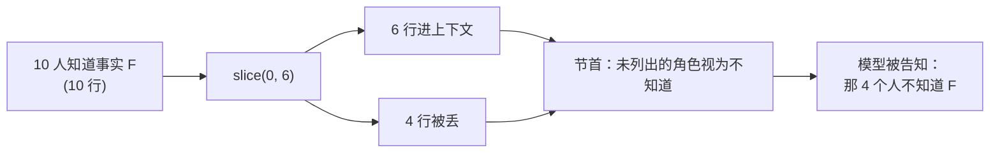

# P1-1 增补 · 知情的粒度（scope + awareness）

> **状态**：📝 待裁定（2026-10-26）—— 未写一行代码。
> **触发**：作者问「当一群人知情的时候，知情等级机制能约束这种程度的信息么？」
> **答案**：不能。而且不是「不够细」，是**会主动说出反话**（见 §1 墙 3）。
> **行业名**：know-what 关系的**量化域**（quantification domain）与**认知模态**（epistemic modality）。
> 前者管「这条事实对哪些主体成立」，后者管「成立到什么程度」。现在的 M16 两样都没有。

---

## 0. 四问

| 问 | 答 |
|---|---|
| 行业里叫什么 | ① 量化域 = 知识/权限条目的**主体选择器**。最贴近的成熟形状是数据库权限模型：`GRANT … TO PUBLIC`（全集）+ `REVOKE … FROM 某人`（例外）—— **M16 现在只有逐个用户 GRANT，没有 PUBLIC，也没有 REVOKE**。② 认知模态 = epistemic logic 的 `knows` / `believes` 二分（Hintikka），叙事侧再细分成「亲眼/被告知/听说/怀疑」 |
| 谁消费产出 | 同上（写前查阅 / 登记页 / 审稿 findings）。但**消费后果变了**：群体知情写不进去 ⇒ 写前查阅会把「全宗都知道」教成「只有柳长老知道」 |
| 失败形态 | 仍是「未卜先知 / 集体失忆」，但多了第三种：**我们自己的预算裁剪制造出来的集体失忆** —— 模型没错，是我们把已知的事实从上下文里删掉了，还附了一句「未列出的视为不知道」 |
| 已有产品做过什么 | 叙事设计工具（ink / Articy 一类事实数据库）表达群体普遍用**变量 + 查询**（`faction.Qingyun.knows(X)`）而不是逐实体枚举。我们不做查询语言（那要执行引擎），只做**静态选择器**：`全体 / 有限定语的全体 / 例外名单` |

---

## 1. 已确证的三件事（都有行号，不靠记忆）

| # | 事实 | 出处 |
|---|---|---|
| 墙 1 | `character_id TEXT NOT NULL REFERENCES characters(character_id)` —— **群体不是实体**。全库 60+ 张表里没有任何 faction/group | `m16-knowledge-states.ts:41` |
| 墙 2 | 字段只有 `character_id / fact_chapter / fact_evidence(_hash) / fact_key / learned_chapter / evidence / source` —— **没有「知道程度」这一列** | `knowledge-state.ts:64-87` |
| 墙 3 | `KNOWLEDGE_MAX_ITEMS = 6`，渲染时 `usable.slice(0, 6)` —— **按行切**，而节首是封闭默认 | `knowledge-state.ts:132`、`:269` |

墙 3 的完整链路：



> **读法**：被预算裁掉的那 4 个人，不是「没显示」，是被**明确告知为不知道**。这是静默翻转，不是省略。

同一份文件里其实已经有正确范式：`renderPrewriteFactsSection` 的节标题写着「**不保证穷尽**」，并声明「与定稿原文冲突时以定稿原文为准」（`prewrite-consultation.ts:122-126`）。事实节用开放世界，知情节用封闭世界 —— 而后者把封闭世界的边界画在了**预算**上，这是 bug。

---

## 2. 为什么必须保留封闭默认（不能简单照抄事实节）

知情节存在的唯一理由是**约束力**：告诉模型「这个人不知道」，它才不会写未卜先知。所以「未列出 = 不知道」不能删。

但封闭默认必须**逐事实**成立，不能逐节成立：

> **一条事实，只有在它的主体集合完整进入上下文时，才允许对它施加封闭默认。**
> 凡是被预算裁掉、被合并省略的事实，那条事实整体降级为「不判」。

这一句是本设计稿的骨架。由此推出两条实现规则：

1. **裁剪单位是事实（`fact_key`），不是行** —— 一条事实的所有主体原子进出；
2. **有省略时必须说出来** —— 节首追加「本次另有 N 条已登记事实未列出，那 N 条不适用下述规则」。

第 2 条是判据 DN 的直接应用：不能把「没排进来」说成「没人知道」。

---

## 3. 期 0（先做，与 §4 无依赖）：修静默翻转

> 这一项是 bug 级，不涉及表结构，可独立提交、独立验证。

| 改动 | 位置 |
|---|---|
| 按 `fact_key` 分组后整组进出 | `knowledge-state.ts:renderKnowledgeSection` |
| 节首说明改成三句：完整列出的事实才适用封闭默认 / 未列出的已登记事实不适用 / 未登记的事实一概不判 | 同文件 `ZH_LEAD` / `EN_LEAD` |
| `counts` 之外另出 `omittedFacts`，让日志能报「省略 N 条事实」 | `review-continuity-bible.ts`、`prewrite-consultation.ts` |

期 0 的验收标准只有一条：**构造 10 人 × 1 事实 + 6 条上限，输出里必须出现「省略 4 人」的显式说明，且不得出现「那 4 人视为不知道」的可读含义。**

---

## 4. 期 1：全集 + 差集（作者已选 A）

### 4.1 语义

一条知情行从「谁 + 事实」变成「**主体选择器** + 事实」：

| 形态 | 写法 | 渲染（中文） |
|---|---|---|
| 单人（现状） | `subject_kind='character'` | `- 柳长老：知道（…）` |
| 全域全体 | `subject_kind='scope'`, `scope_label=''` | `- 全体角色：知道（…）；明确不知道：阿七` |
| 限定全体 | `subject_kind='scope'`, `scope_label='青云宗弟子'` | `- 青云宗弟子：知道（…）；明确不知道：阿七、外门弟子` |

**`scope_label` 是自由文本，作者承诺语义，机器不校验。** 它直接渲染进提示词，模型读得懂「青云宗弟子」是什么。这是刻意选择：做势力表（方案 B）才能校验，代价是维护成员关系并牵动历史章节，本期不做（§6）。

**`except_names` 不只是差集，它是 M16 现在完全缺失的「明确不知道」。** 原设计明说「只做正向知情，不记谁不知道」（`knowledge-state.ts:42-47`）。而「全宗都知道，只有阿七蒙在鼓里」是网文最常见的悬念装置之一 —— 这个表达式在本期第一次出现。

### 4.2 表结构（M22，v22 → v23）

SQLite 不能 `ALTER COLUMN`，`character_id NOT NULL` → 可空必须**重建表**（照 M02 的 `characters_m02` 模式：建新表 → 拷数据 → drop → rename → 重建索引）。

```sql
CREATE TABLE knowledge_states (
  knowledge_id TEXT PRIMARY KEY,
  subject_kind TEXT NOT NULL DEFAULT 'character' CHECK(subject_kind IN ('character','scope')),
  character_id TEXT REFERENCES characters(character_id),  -- scope 行为 NULL
  scope_label TEXT NOT NULL DEFAULT '',                   -- 空串 = 全体；用空串不用 NULL
  except_names TEXT NOT NULL DEFAULT '[]',                -- 仅 scope 行有值
  fact_chapter INTEGER NOT NULL CHECK(fact_chapter > 0),
  fact_evidence TEXT NOT NULL,
  fact_evidence_hash TEXT NOT NULL,
  fact_key TEXT NOT NULL,
  learned_chapter INTEGER NOT NULL CHECK(learned_chapter >= fact_chapter),
  evidence TEXT,
  source TEXT NOT NULL,
  created_at TEXT,
  updated_at TEXT,
  CHECK (
    (subject_kind = 'character' AND character_id IS NOT NULL AND scope_label = '' AND except_names = '[]')
    OR (subject_kind = 'scope' AND character_id IS NULL)
  )
);
-- 唯一性拆成两条 partial index：NULL 在 SQLite 唯一索引里不参与去重，所以不能靠 UNIQUE()
CREATE UNIQUE INDEX uq_knowledge_character ON knowledge_states(character_id, fact_key)
  WHERE subject_kind = 'character';
CREATE UNIQUE INDEX uq_knowledge_scope ON knowledge_states(scope_label, fact_key)
  WHERE subject_kind = 'scope';
```

三点说明：

- `scope_label` 用**空串**而不是 NULL —— SQLite 的唯一索引对 NULL 不去重，用 NULL 会让「全体」行凭空重复；
- `except_names` 存 JSON 数组，沿 M21 秘密宿体与 M14 的既有做法；写入侧严格、读取侧容错；
- 外键对 NULL 值不校验，所以 `LEFT JOIN characters` 的既有查询（`knowledge-state-repository.ts:143-145`）**不用改**，`characterName` 自然是空串。

### 4.3 迁移幂等

靠 `PRAGMA table_info(knowledge_states)` 探测是否已有 `subject_kind` 列：有 ⇒ 跳过；没有 ⇒ 重建。**不做 down**（与既有 22 个 lane 一致）。

### 4.4 渲染

单行入口（`renderKnowledgeLine`）加 scope 分支，仍只有三个数字来源（事实章 / 得知章 / 引文），不推算：

```
- 青云宗弟子：知道（事实出处：第3章「…」；自第5章得知）；明确不知道：阿七、外门弟子
- Everyone in Qingyun Sect: knows (fact: Chapter 3 "…"; learned in Chapter 5); explicitly does NOT know: A-Qi
```

`except_names` 与「知道」**同行**是刻意的：一行 = 一条完整断言，预算裁剪天然以行为单位，不会把「知道」和「不知道」切开。

---

## 5. 期 2：程度（作者要「两者都要」，这一项必须做，但枚举值待你裁定）

> 期 1 解决**规模**，不解决**程度**。把「只是怀疑」写成「知道」，对写作的约束力是反的。

### 5.1 一个先要划清的界：knowledge vs belief

| | 存什么 | 真假 | M16 现在能存吗 |
|---|---|---|---|
| **知识**（knowledge） | 绑定稿逐字引文（`fact_evidence` 是原文切片） | 必然为真 | ✅ |
| **信念**（belief） | 角色以为的事，**可能为假**（「他以为城主是他爹」） | 可能假 | ❌ 而且**不该**：M16 的引文机制保证它必然真，塞进来就撞判据 DE（一个真相两份存法） |

⇒ 「误解 / 以为」不属于 M16，是另一类宿体。本稿不设计它，只在这里划界，避免以后硬塞。

### 5.2 待裁定的枚举（我不替你定）

候选来自写作惯例而非我的想象，每个都标出它约束什么：

| 值 | 含义 | 对生成的实际约束 |
|---|---|---|
| `witnessed` | 亲眼看见 | 可以主动行动、可以指认 |
| `told` | 被明确告知 | 可以说出细节，但可能转述失真 |
| `heard` | 听说 / 传言 | 语气必须不确定，细节可能是错的 |
| `suspects` | 怀疑 / 推断 | 可以试探，**不能直接点破** |
| `unaware` | 明确不知道 | 与 `except_names` 语义重叠，需决定是否合并 |

两个必须先定的问题：

1. **`unaware` 与 `except_names` 要不要合并？** 合并 ⇒ 少一个概念，但 `except_names` 就成了「一行里的特例」，而 `unaware` 是独立一条，两者预算与排序行为不同；
2. **升格要不要留痕？** 第 5 章「听说」→ 第 9 章「亲眼」，是两条记录还是一条记录 + `learned_chapter` 更新？**改历史会影响已定稿章节的审稿判定**，我倾向追加新行 + 旧行标 `superseded`，但那要加列。

### 5.3 判据影响

`review-continuity-bible.ts:313` 现在写死一句话：

> Never report "why does he not know" — the registry only records positive knowledge and a lower bound.

**期 1 之后这句话就不成立了**（有了 `except_names`）。期 2 之后更不成立（有了 `suspects` / `unaware`）。这条规则必须随期改，不能忘 —— 忘了就是守卫自己说反话。

---

## 6. 期 3：势力层（方案 B，明确不做，只留位）

不做，但设计上**不与期 1 冲突**：`scope_label` 现在存自由文本，将来若建 `factions` 表，只需把「自由文本」换成「`faction_id` 外键」或加一列做映射，`subject_kind='scope'` 的语义不变。

不做的理由：维护成员关系 + 成员变动牵动历史章节判定，收益（能校验"青云宗弟子"）低于成本。而 `scope_label` 已经能让模型读懂。

---

## 7. 判据核对

| 判据 | 本期怎么守 |
|---|---|
| **DN**（没抽到 ≠ 没有） | §3 省略必须显式说明；§4 `except_names` 未被填时渲染成「未填写」，绝不反推「没人不知道」 |
| **DE**（不造第二个真相） | 拒绝把「误解」塞进 M16（§5.1）；`scope_label` 不复制角色名到别处 |
| **DP**（第 3 维防剧透） | `learnedChapter > 本章` 整行不注入 —— scope 行同样适用，过滤点不变 |
| **DM**（两条链同一写法） | 正文链与审稿链共用 `renderKnowledgeSection`，期 0/期 1 都只改这一处 |
| **AO**（全局覆盖静默遮蔽） | 本期不改 prompt 模板，只改注入文本，不触 AO |

---

## 8. 对既有测试的冲击（预估，不是实测）

| 文件 | 预期 |
|---|---|
| `knowledge-state.test.ts` | 新增：按事实分组裁剪、省略声明、scope 渲染、`except_names` 空值不反推 |
| `knowledge-state-repository.test.ts` | 新增：scope 行插入 / 唯一约束 / CHECK 拒绝 character 行带 `except_names` |
| `m16-installed-lane.test.ts` | 可能受影响：若该 lane 测试断言表结构，M22 重建后需同步（**待核实**） |
| `review-continuity-bible.test.ts` | `counts.knowledge` 语义可能变（行数 vs 事实数），需重新定义 |
| `prewrite-consultation.test.ts` | 节首说明文案变更；`omittedFacts` 新断言 |
| `portable-project-format.test.ts` | M22 若进便携格式，计数要从 64 表 / 614 字段再算 |

---

## 9. 不做的事

- ❌ 不做查询语言 / 表达式引擎（`faction.X.knows(Y)` 那种），静态选择器足够；
- ❌ 不做势力成员表（§6）；
- ❌ 不把「信念 / 误解」塞进 M16（§5.1）；
- ❌ 不为了容纳群体而放宽 `KNOWLEDGE_MAX_ITEMS` —— 全集的收益正是**不占条数**，靠枚举解决规模是错的方向；
- ❌ 不改 `factKey` 算法（键变 = 所有既有登记全部失效）。

---

## 10. 落点索引（实施时按此顺序）

| 期 | 落点 |
|---|---|
| 期 0 | `src/shared/knowledge-state.ts`（`renderKnowledgeSection` / `ZH_LEAD` / `EN_LEAD`）· `review-continuity-bible.ts`（`counts`）· `prewrite-consultation.ts`（拼接与说明） |
| 期 1 | 新 `electron/migrations/m22-knowledge-scope.ts`（重建表 + 两条 partial index）· `registry.ts` / `desktop-registry.ts` / `project-storage.ts` 三处版本号 · `knowledge-state-repository.ts`（upsert 分支、`hasSchema` 探测）· `KnowledgeRegistryPanel.tsx`（主体选择器 UI）· `ipc-channels.ts`（若 `KnowledgeStateInput` 形状变，需同步）· 便携格式 |
| 期 2 | 待 §5.2 两个问题定案后再排期 |
