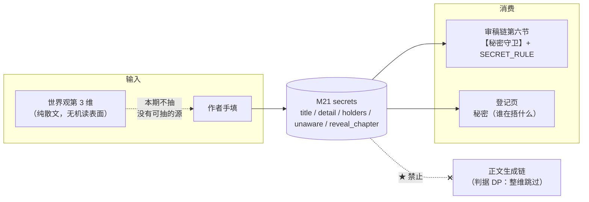

# P20-2 秘密宿体（secrets）设计

> 状态：**已落地**（2026-10-26）。作者裁定 **A 新表 + 只做审稿守卫**；
> 当日追加裁定 **揭穿后的两级豁免**（§5.1，零迁移，复用 `consistency_exemptions`）。
> 排期与验收口径：[`plans/prompt-assembly-backlog.md`](../../plans/prompt-assembly-backlog.md) §P20-2。
> 立项依据：[`p1-1-worldbuilding-extraction-assessment.md`](./p1-1-worldbuilding-extraction-assessment.md) §7 第 3 条。

---

## 0. 一句话

`secrets` 记「**谁在捂什么、谁还不知道、计划第几章穿**」，唯一消费者是**审稿链** ——
它让审稿员能判「正文有没有在揭穿章之前把真相写出来」。真相本体（`detail`）**永不进正文提示词**。



**读法**：这条链是单向的 —— 秘密只从作者流向审稿，永远不流向写手；虚线与叉号是这张图存在的理由。

---

## 1. 为什么不并入 M16（裁定 A 的四条实证）

M16 `knowledge_states` 的四道硬约束，每一条都与「秘密」的语义相反：

| M16 的约束（`m16-knowledge-states.ts:38-55`） | 秘密的语义 | 并入的后果 |
|---|---|---|
| `fact_chapter INTEGER NOT NULL CHECK(fact_chapter > 0)` | 揭穿前**没有章号** | 必须放宽 CHECK，「封闭默认」被拆 |
| `fact_evidence` + `fact_evidence_hash` 均 NOT NULL | 第 3 维是散文，**无定稿引文可挂** | 列永远填不满，hash 只能编 |
| `UNIQUE(character_id, fact_key)` | 一个秘密 N 个知情者 | 分裂成 N 行（判据 DE 同型） |
| `REFERENCES characters(character_id)` NOT NULL | 隐瞒者可能是**势力**（宗门 / 商会） | 第 2 维的势力根本放不下 |

更根本的区别是**问题不同**：

- M16 问「他在第几章知道的」—— 主语是人，键是「章号 + 逐字引文」；
- 秘密问「谁还不知道、第几章会穿」—— 主语是秘密，键是秘密名。

「隐瞒者」与「知情者」不是同一个集合：隐瞒者知道但不会说，被骗者不知道。
塞进一个 `character_id` 列之后，这两者再也分不开 —— 而这恰恰是秘密表唯一存在的理由。

---

## 2. 为什么本期不做抽取

世界观第 3 维的模板原文（`builtin-prompt-templates.ts:614-618`）只有两个自由问句 + 两条禁令
（不许写规则、只写谜面），**零表格、零列定义、零机读行**。对比：

| 维度 | 模板要求的形状 | 能不能抽 |
|---|---|---|
| 第 1 维 | ★ 强制 markdown 四列表（等级名 / 相邻差距 / 卡点 / 升级代价） | 能（P20-1a 已落地） |
| 第 3 维 | 两个自由问句 + 「只写悬念」 | **不能** |
| 第 4 维 | 机读约束行 `空间名｜hours=｜entry=` | 能（已落地） |
| 第 5 维 | `起点：<纪年与日期>，<时段名>` | 能（已落地） |

要做抽取，第一步得给第 3 维加机读行 —— 那是改 prompt，且**撞判据 AO**（作者有
`world_building` 全局覆盖版，改内置模板会被静默遮蔽）。所以本期登记全手工，抽取另立一项。

排期表里 P20-2 标的「动 prompt ❌」正是这个意思：它只做宿体，不做抽取器。

---

## 3. 消费点：为什么只进审稿链

验收口径原本写「写前查阅只注入本章可能被触碰的秘密」。**实际实现是：一节都不注入正文。**
理由不是偷懒：

1. 第 3 维在正文链里是**整维跳过**的（`worldbuilding-rules.ts:193-194`，判据 DP 防剧透）；
2. `detail` 比第 3 维原文更直白 —— 注入正文等于把谜底交给写手模型；
3. 实测风险：中文模型对「不许写出 X」这类负向指令常反向激活，越说「别揭穿柳长老」越容易写出来。

所以守卫挂在**审稿链第六节**：`review-continuity-canon.ts` 多读一类 → `review-continuity-bible.ts`
渲染【秘密守卫（未揭穿的真相）】+ `SECRET_RULE`。

这一条有测试钉住：`src/shared/__tests__/secret.test.ts` 断言
`generate-draft.command.ts` **不许** import 本模块、不许引用两个渲染函数名。

### 期界四态（`secretChapterState`）

| 状态 | 条件 | 是否进审稿清单 |
|---|---|---|
| `undecided` | `revealChapter` 为 `null` | ✅ 每一章都进（保守方向） |
| `pending` | `revealChapter > 本章` | ✅ 进，且是主要用途 |
| `revealed-now` | `revealChapter === 本章` | ✅ 进，但行尾标注「本章就是计划揭穿章」 |
| `already-revealed` | `revealChapter < 本章` | ❌ 不进（否则守卫节变成噪音，作者会开始忽略它） |

`revealed-now` 那一行不能省：不标注的话审稿员会把「该揭穿」判成「提前揭穿」，
而这是这一类最容易被误判的形态。

---

## 4. 表结构（M21，v21 → v22）

```sql
CREATE TABLE secrets (
  secret_id TEXT PRIMARY KEY,
  title TEXT NOT NULL,                          -- 秘密名（一句话），UNIQUE
  detail TEXT NOT NULL,                         -- 真相本体，只在登记页与审稿链可见
  holder_names TEXT NOT NULL DEFAULT '[]',      -- 隐瞒者（JSON 数组，存名字不存 id）
  unaware_names TEXT NOT NULL DEFAULT '[]',     -- 尚不知情者
  reveal_chapter INTEGER,                       -- NULL = 作者还没决定（不是「永不揭穿」）
  evidence TEXT,                                -- 出处：第 3 维原文逐字引文
  source TEXT NOT NULL,                         -- 'author' | 'derived'（后者本期不用）
  created_at TEXT,
  updated_at TEXT,
  UNIQUE(title),
  CHECK(reveal_chapter IS NULL OR reveal_chapter > 0)
);
CREATE INDEX idx_secrets_reveal ON secrets(reveal_chapter);
```

四个刻意的决定：

1. **没有 `status` 列** —— 「已揭穿 / 未揭穿」由 `reveal_chapter` 与被审章号推导。
   存冗余状态就有两个真相：改了揭穿章忘了改状态，审稿员会按旧状态判。
2. **`reveal_chapter` 可空且 NULL 有语义** —— 不能改 `NOT NULL`：那会把「还没想好」
   这个真实状态逼成假数字。
3. **名字数组存 JSON TEXT，不建关联表** —— 隐瞒者可能是势力（不是 `characters` 行），
   且写世界观时角色卡常还没建。代价是改名后脱钩；将来做跨实体一致性检查时加 `holder_ids` 列，不动现有列。
4. **`UNIQUE(title)` 但拦不住语义重复** —— 「试药残篇」与「柳长老拿弟子试药」数据库分不出。
   不要假装约束能解决它，那是作者自己要看的。

---

## 5. 与验收口径的三处偏离（都有意）

| 验收口径原文 | 实际实现 | 为什么 |
|---|---|---|
| 写前查阅只注入本章可能被触碰的秘密 | **一节都不注入正文** | `detail` 是真相，注入即剧透（见 §3） |
| 揭穿章之后降级为普通事实 | 已揭穿**不渲染**，不做降级 | 降级要先在 M16 里建一条对应事实 ⇒ 双真相，判据 DE 同型。**这条偏离的出口在 §5.1** |
| （隐含可以抽） | 登记全手工 | 第 3 维无机读表面（见 §2） |

### 5.1 揭穿之后怎么办：两级豁免（2026-10-26 作者裁定，已落地）

作者原话：「揭穿章需要另一条知情事实我同意，所以在审稿后对于知情该项应该至少给予『临时豁免 + 知情页信息更新』以及『永久豁免（真相人尽皆知，正常剧情走向）』。」

**为什么必须有出口**：守卫只会报「本章写出了真相」。但这句话底下有三种完全不同的情形，系统以前只承认第一种：

| 情形 | 正确处置 |
|---|---|
| 真写错了 | 改稿（不需要任何新机制） |
| 作者就是要在本章提前揭穿 | **临时豁免**（只免这一章）+ 补知情 |
| 真相已人尽皆知 | **永久豁免**（守卫从此不管这条） |

没有后两种，作者只能每章看着同一条问题重复出现 —— 最后学会无视整个守卫节。**一个总在报警的守卫等于没有守卫。**

**两条轴不能混**：

| 轴 | 判据 | 数据 |
|---|---|---|
| 期界 | `reveal_chapter` 与本章的关系 | 秘密自己的列 |
| 豁免 | 作者显式决定「这次别管」 | `consistency_exemptions` 的行 |

**为什么不写进 `secrets` 表**：`consistency_exemptions` 的三列（稳定键 + 理由 + **可撤销**）正好是豁免需要的全部，而且已被两个闸门用着（`volume-handoff:` / `outline-progress:`）。本模块沿用同一约定，第三种键前缀：

| 档 | 键 | 作用域 |
|---|---|---|
| 临时 | `secret-exempt:<secretId>#ch<N>` | 只免第 N 章 |
| 永久 | `secret-exempt:<secretId>` | 从此不管这条 |

`secretId` 本身形如 `secret:<uuid>`（已含冒号），所以分隔符用 `#ch` 而非冒号。解析严格：前缀不合、`#ch` 后不是正整数一律返回 `null`，**绝不「看起来像就认」**（认错一条就把 A 的豁免挂到 B 上，判据 DE 同族）。

**知情页信息更新为什么只能提醒、不能代写**（这是本次唯一被技术事实挡回来的部分）：

- M16 的引用键 `factKey = sha256(章号 + 归一化逐字引文)`，`refState` 只认**落在该章 current 连续性投影里**的键；
- 投影里的 `evidence` 是定稿正文的**唯一精确切片**（`finalized-continuity.ts` 用 `content.slice(start,end) === evidence.text` 校验）；
- 审稿发生在**定稿之前** ⇒ 此刻写进去的行当场 `unverifiable`，定稿后大概率 `stale`（永不注入）。

所以做成：豁免照记，同时在两处摆出「**欠一条知情登记：<名单> 自第 N 章起知道**」，登记留到定稿后由作者在知情页选事实完成。**宁可明说欠着，也不写一条看起来已生效、实际永远不注入的行**（判据 DN）。

**落点**：

| 层 | 落点 |
|---|---|
| 共享层 | `src/shared/secret.ts`：`secretExemptionKey` / `secretChapterExemptionKey` / `parseSecretExemptionKey` / `secretExemptionScope`（`none` / `chapter` / `permanent`）/ `activeExemptionKeys` / `secretPendingKnowledge` |
| 守卫过滤 | `renderSecretReviewSection` 第 5 参收未撤销键；`buildReviewContinuityBibleBlock` 从 `canon.secretExemptions` 读出并算出 `counts.secretsExempted`（**单独报**：`secrets: 0` 有「没有」和「全被豁免」两种含义） |
| 读侧 | `review-continuity-canon.ts` 多读一条 `db:consistency-exemption-list`，新增失败类 `secretExemptions`（读不到就多报，方向安全） |
| 处置入口 | **审稿报告**：`SecretGuardDisposition.tsx`（本章号已知，两个按钮就地给）；**秘密页**：`SecretRegistryPanel` 显示豁免状态 + 撤销 + 欠知情名单 |
| IPC | **零新增** —— 复用 `db:consistency-exemption-list` / `-save` / `-revoke` |
| 迁移 | **零** —— 复用 `consistency_exemptions` |
| 测试 | `secret.test.ts`（13 → 23）· `review-continuity-bible.test.ts`（29 → 34）· `SecretGuardDisposition.browser.tsx`（9，新）· `SecretRegistryPanel.browser.tsx`（8 → 14） |

**三条实现纪律**（都有测试钉着）：

1. **期界先于豁免** —— 已揭穿的秘密不出现在处置块里，否则作者会以为豁免能把「已揭穿」捞回来；
2. **撤销立即写库**，不走秘密页的「保存」批量流程 —— 混进去会让作者点保存前一直看不到撤销生效；
3. **fail-open** —— 处置块读不到数据就整块不出现，绝不因为一块附注把整份审稿报告搞挂。

---

## 6. 不做的事

- ❌ 不从世界观第 3 维抽取（要改 prompt，撞判据 AO，另立一项）。
- ❌ 不给正文链提供守卫通道（`ipc-channels.ts` 里刻意只有三条 CRUD 通道，没有 `db:secrets-guard`）。
- ❌ 不自动回填「实际揭穿章」（那要把定稿正文当输入做判定，属 P20-3 的范围）。
- ❌ 不把秘密抄进 M16 当普通事实（双真相）。
- ❌ **不在审稿阶段代写知情行**（定稿前没有定稿逐字引文 ⇒ 写进去必 `stale`；只提示「欠一条」，见 §5.1）。
- ❌ 不校验隐瞒者是不是真实角色（势力、群体、无名者都合法）。

---

## 7. 落点索引

| 层 | 文件 |
|---|---|
| 迁移 | `electron/migrations/m21-secrets.ts`；注册在 `registry.ts`（`LATEST_SCHEMA_VERSION=22`）与 `desktop-registry.ts` |
| 共享层 | `src/shared/secret.ts` |
| 仓储 | `electron/repositories/secret-repository.ts` |
| IPC | `src/shared/ipc-channels.ts` §7i（`db:secrets-list` / `-upsert` / `-delete`）；handler 在 `db-controller.ts` |
| 登记页 | `src/components/editor/SecretRegistryPanel.tsx` + `SecretRegistryEditor.tsx`；树项在 `ProjectTree.tsx` |
| 审稿链 | `review-continuity-canon.ts`（读）、`review-continuity-bible.ts`（渲染 + `SECRET_RULE`）、`review-chapter.command.ts`（日志计数） |
| 便携 | `portable-project-field-policy.json`（`secrets` 10 列全 `D` + `m21Tables`）、`portable-project-format.ts` |
| 豁免 | `consistency_exemptions`（零迁移）；处置块 `SecretGuardDisposition.tsx`；守卫过滤在 `secret.ts` + `review-continuity-bible.ts` |
| 测试 | `electron/migrations/__tests__/m21-installed-lane.test.ts`（6）· `electron/repositories/__tests__/secret-repository.test.ts`（9）· `src/shared/__tests__/secret.test.ts`（23，含「正文链不许读」的源码扫描）· `review-continuity-bible.test.ts`（+10）· `SecretRegistryPanel.browser.tsx`（14）· `SecretGuardDisposition.browser.tsx`（9） |
