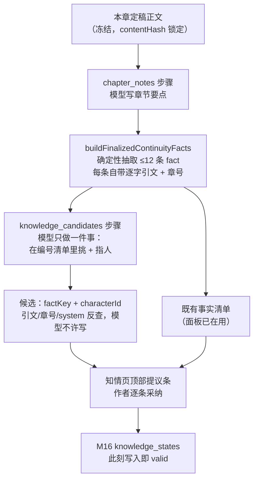

# P20-3 · 章末知情候选（模型只能挑，不能写）

> 状态：**✅ 已落地（2026-10-26）**。作者已裁定范围：**只做知情一格**（物品 / 制度锚不做）。  
> 上游：`docs/plans/prompt-assembly-backlog.md` P20-3 原定义（已被本稿大幅收窄）。  
> 实施记录见 §10（**两处与原稿不同的地方**：删了 `factKey` 字段、前置检查挪到 `begin`）。


---

## 1. 这不是「三个类别一起抽」，是补一个已有动作的最后一格

原定义说「在同一处挂三个新的候选类别（物品 / 知情 / 制度锚），全部走候选→采纳面」。查完代码后本稿把它砍成一格，有三条各自独立的理由：

| 格   | 为什么不抽                                                                     | 依据                                                                    |
| --- | ------------------------------------------------------------------------- | --------------------------------------------------------------------- |
| 物品  | 行业共识是 `key_items` 只收**承重物品**，一章里绝大多数物件是「他拿起了刀」这类一次性道具，逐章自动产候选会把真正重要的那几件淹掉 | 行业评估稿 §2（Novelium「only load-bearing facts」/ aibookcraft「不必清点厨房里每个杯子」） |
| 制度锚 | `institution_cadences` 的「锚」不是文本片段，是作者对「多久一次 / 什么条件下触发」的判断，抽不出来            | `p1-1-worldbuilding-extraction-assessment.md`「制度只能抽一半」                |
| 知情  | **唯一必须等定稿的一格**（`factKey` 要求定稿逐字引文），而且已有真实欠账                               | 见 §2                                                                  |

## 2. 现状：这一格已经做了 80%，缺的正好是最后一环

「选事实」这一半**已经完成并接线**：

| 已存在    | 位置                                                                                                       |
| ------ | -------------------------------------------------------------------------------------------------------- |
| 候选事实列表 | `db:knowledge-fact-candidates`                                                                           |
| 数据源    | `listFactCandidates()`：全书**已定稿且投影 `current`** 的各章 fact，新章在前，每条带 `factKey` / `factEvidence` / `statement` |
| 消费方    | `KnowledgeRegistryPanel` —— 下拉选一条 fact，再选角色、填「从第几章起知道」，保存落 M16                                           |

**缺的是「谁知道了」。** 模型读完定稿是知道「这一章阿七在门外偷听到了」的，但没有任何一处问过它。作者现在的动作是：打开知情页 → 在那份**全书平铺**的列表里翻找（300 章 × ≤12 条 ≈ 最多 3600 条）→ 自己回忆本章谁在场 → 填。

两个后果：

1. **翻找成本随章数线性上升** —— 到第 100 章，候选列表已有上千条，和「没做」差别不大；
2. **P20-2 刚留下的欠账没人补** —— 秘密页现在写着「欠一条知情登记：柳长老、众弟子 自第 30 章起知道」，作者要补这条，走的正是上面那套手工流程。

> **为什么必须定稿后才能做**（这条决定了一切）：M16 的引用键是 `kf:sha256(章号 + 归一化逐字引文)`，`refState` 只认**该章 current 连续性投影里**的键，而投影的 `evidence` 是定稿正文的唯一精确切片。**审稿阶段写进去必然 `unverifiable` → 定稿后大概率 `stale`（永不注入）**；定稿后写进去**当场就是 `valid`**。同一个动作，时机差一步，结果一个生效一个隐身。

## 3. 核心裁定：模型的权限降到「挑选」，不是「生成」

这是本稿与 P20-1b（LLM 补 `weakness`）的根本区别，也是本稿唯一真正的设计决定。



**读法**：模型出现在 D 这一格，输入是 C 已经产好的编号清单，输出只有两个字段（第几条、谁）；引文与 `factKey` 在 F 由系统反查填上，模型碰不到。

三条硬约束：

1. **模型不产出任何事实文本**。它只返回 `{ factIndex, characterId }`。引文、章号、`factKey` 全部由系统按 `factIndex` 反查已落库的 fact 得到。
   - 收益一：**「模型复述当事实」这个风险从结构上消失**，不靠 prompt 里写「不许编」；
   - 收益二：**引文定位（原定义的三个老问题之一）自动正确** —— 引文不是模型给的，是从 `finalized_continuity_facts` 里取的，天然满足 `content.slice(start,end) === evidence.text`。
2. **`characterId` 必须来自冻结名单**。`context.identity.characters` 是定稿时冻结的角色卡，模型只能从这里取 id；不在名单里的一律丢弃（不许按名字新建）。
3. **`factIndex` 必须落在范围内且与角色真实相关**。越界即丢该条；同一 `(factKey, characterId)` 去重。任何一条校验不过就只丢这一条，不整批失败。

**边界（判据 DN 写法）**：模型只能看到**本章**的 ≤12 条 fact。若某角色得知的是**前文**某章的事实，本步骤**不提议**——这不是遗漏，是能力边界，提示词里明写「前文事实请到知情页手工登记」，界面上也不假装覆盖。

## 4. 落点

| 层          | 落点                                                                                                                                                                                                                  | 说明                                                |
| ---------- | ------------------------------------------------------------------------------------------------------------------------------------------------------------------------------------------------------------------- | ------------------------------------------------- |
| 迁移 **M22** | `summary_snapshots` 加 `knowledge_candidates TEXT NOT NULL DEFAULT '[]'`                                                                                                                                             | `ALTER TABLE ADD COLUMN`，**不重建表**（无约束变更）。v22→v23  |
| 类型         | `FinalizationGenerationSlot.stepKey` 加 `'knowledge_candidates'`                                                                                                                                                     | 字面量联合                                             |
| **六处二元判断** | `finalizationSlotKey` 白名单 · `readFinalizationGenerationContext` 的 operation · `finalizationGenerationTask` 的分支 · `main-generation-owner.ts:364/515` 白名单 · `:1116` 三元 · `finalized-character-generation-proof.ts:23` | ⚠️ 见 §7                                           |
| Prompt     | 新 purpose `finalized-knowledge-candidates`，输出 `structured-data`                                                                                                                                                     | 走 `generationOutputForPurpose`（判据 CU）             |
| 共享层        | `src/shared/knowledge-candidate.ts`：类型 + `parseKnowledgeCandidates()`（纯函数，含全部校验）                                                                                                                                    | 可单测，不碰 DB                                         |
| 仓储         | `SummaryRepository.saveKnowledgeCandidates()` / `readKnowledgeCandidates()`                                                                                                                                         | 只按 `draft_id` 写同一行，**不动 `projection_generation`** |
| IPC        | `db:knowledge-candidates-list`（读候选，带 `refState` 式的失效标记）                                                                                                                                                             | 只读，**没有**「自动写 M16」的通道                             |
| 界面         | 知情页顶部「第 N 章提议（K 条 · 未采纳）」——逐条「采纳」把 4 个字段预填进表单，作者点保存才落库                                                                                                                                                              | 复用 `KnowledgeRegistryPanel` 既有表单                  |

**候选形状**：

```ts
interface KnowledgeCandidate {
  factKey: string          // 系统反查填入，模型碰不到
  factChapter: number      // 同上
  factEvidence: string     // 同上（逐字引文）
  statement: string        // 只用于面板显示，永不入库
  characterId: string      // 来自冻结名单
  characterName: string    // 快照名，显示用
  learnedChapter: number   // ≡ 本章章号（本章新得知）
  sourceFinalizationId: string
}
```

## 5. 原定义的「三个老问题」：全部复用，不新建

| 老问题  | 现成解法                                                                                                                                     | 证据                                                                           |
| ---- | ---------------------------------------------------------------------------------------------------------------------------------------- | ---------------------------------------------------------------------------- |
| 幂等   | `finalizationSlotKey(slot)` 含 `draftId + finalizationId + chapterNumber + contentHash + stepKey`；重跑命中 `find()` 复用同一 run，重试覆盖**同一列**而不是追加 | `finalization-generation-source.ts:12-17`、`finalization-generation.ts:21-33` |
| 中断可续 | `generation_runs` 持久化 + `readEffect()` 收据 + `retryable()`；关窗重开从 run 恢复                                                                   | `finalization-generation.ts:34-40`、`:63-82`                                  |
| 引文定位 | **不需要做** —— 引文由系统反查（见 §3 约束 1）                                                                                                           | 本稿的设计产物                                                                      |

**所以这一项的真实成本不在「机制」，在「加一个步骤要改的通路」+「候选的失效判定」。**

## 6. 失效判定：靠 `factKey` 自证，不加列

改稿连锁的形态：某章重跑 `chapter_notes` → `continuity_facts` 被覆盖 → 旧候选指向的 fact 已经不在了。

**不引入 `factsHash` 列**：`factKey = sha256(章号 + 归一化引文)` 本身就是 facts 内容的指纹。facts 一变，`factKey` 就变，旧候选**反查不到**。

读取侧按 `factKey` 在当前投影里反查：

| 反查结果                | 标记         | 界面                       |
| ------------------- | ---------- | ------------------------ |
| 命中且投影 `current`     | `valid`    | 可采纳                      |
| 找不到（facts 已变）       | `stale`    | 显示「所依据的定稿事实已变更，已失效」，不可采纳 |
| 投影 `conflict` / 无投影 | `orphaned` | 同上，另给「重新生成」入口            |

**这也是 probeless 的**：不需要新表、不需要新列、不需要定时清理。

## 7. ⚠️ 唯一需要特别小心的实施风险

`stepKey` 目前被写成二元判断，散落在 **6 处**：

1. `src/shared/finalization-generation.ts:9` 类型联合
2. `electron/services/finalization-generation-source.ts:12-17` 白名单
3. 同文件 `:44` operation 三元
4. 同文件 `:57` purpose / output 二元
5. `electron/services/main-generation-owner.ts:364`、`:515` 准入白名单
6. 同文件 `:1116` operation 三元；以及 `finalized-character-generation-proof.ts:23`、`finalized-character-generation.ts:49` 的 `'finalized-character-state'` 硬比

漏改任何一处的表现不是编译错误，而是**运行时** `GENERATION_FINALIZATION_ADMISSION_REQUIRED` / `GENERATION_FINALIZATION_CONTEXT_INVALID`——步骤静默不执行。

⇒ 实施时**先把这些二元判断收敛成一个 `stepKey → { operation, purpose, output }` 的映射函数**，再挂新步骤。这是一次小重构，但它把「六份真相」变成「一份」，符合项目既有纪律（章标题解析只有一份）。

## 8. 不做的事

- ❌ 不做物品候选（理由见 §1）。
- ❌ 不做制度锚候选（抽不出）。
- ❌ 不从**前文**事实提议（§3 边界）。
- ❌ 不做「一键全部采纳」（候选是提议，逐条看才叫采纳；批量采纳等于让模型直接写库）。
- ❌ 不让正文链 / 审稿链读 `knowledge_candidates`（要加源码扫描测试钉住）。
- ❌ 不自动删失效候选（改稿后作者可能想看到「这条曾提议过」）。

## 9. 验收

1. 定稿一章（`chapter_notes` 已完成）→ 跑候选 → 知情页出现「第 N 章提议」；
2. **未采纳的候选不出现在写前查阅的知情节**里（`renderKnowledgeSection` 只读 `knowledge_states`，加测试钉住）；
3. 同一章重跑 → 候选不重复堆积（同列覆盖，条数不变）；
4. 改稿重定稿 → 旧候选标 `stale` 而不是消失，也不可采纳；
5. 采纳一条 → 打开知情页可见，且 `refState === 'valid'`（**这是与审稿阶段登记的关键差别**）；
6. 无 `chapter_notes` 的章 → 候选为空，并明说「本章没有可用的定稿事实」（判据 DN，不产占位）；
7. 模型返回越界 `factIndex` / 名单外 `characterId` → 逐条丢弃，不整批失败、不静默成功（`dropped` 计数可见）；
8. `npx tsc --noEmit` + 纯函数单测 + 面板浏览器测试。

## 10. 实施记录（2026-10-26）

### 10.1 落地清单

| 层   | 文件                                                                                              | 内容                                                                                                       |
| --- | ----------------------------------------------------------------------------------------------- | -------------------------------------------------------------------------------------------------------- |
| 迁移  | `electron/migrations/m22-knowledge-candidates.ts`                                               | `M22`，`ALTER TABLE summary_snapshots ADD COLUMN knowledge_candidates TEXT NOT NULL DEFAULT '[]'`，v22→v23 |
| 步骤表 | `src/shared/finalization-generation.ts`                                                         | `FINALIZATION_STEP_SPECS` 三行（原六处二元判断收敛成这一张表）                                                             |
| 纯函数 | `src/shared/knowledge-candidate.ts`                                                             | 编号清单渲染 / 解析 / 反查 / 失效标记 / 上限                                                                             |
| 提示词 | `builtin-prompt-templates.ts` + `prompt-language.ts`                                            | 新 key `propose_knowledge_candidates`，中英各一份，变量 `facts_list` / `characters_json`                           |
| 提示词台账 | `docs/design/prompt/prompt-three-layer-inventory.md` | §3.2 加第 30 行（`EDITABLE_PROMPT_KEYS` 23→24 项）。**新模板必须登记**，否则 `prompt-inventory-coverage.test.ts` 会红 |
| 链   | `finalization-generation-source.ts` / `finalization-generation.ts` / `main-generation-owner.ts` | 上下文捕获 `continuityFacts`、commit 分支、begin 前置检查                                                             |
| 编排  | `finalize-chapter.command.ts`                                                                   | 步骤 2c，`critical: false`，日志报候选数与丢弃数                                                                       |
| 存储  | `summary-repository.ts`                                                                         | `saveKnowledgeCandidates` / `readKnowledgeCandidates` / `listKnowledgeCandidateViews`                    |
| 通道  | `db:knowledge-candidates-list`                                                                  | 只读；`!db` 降级空列表                                                                                           |
| 界面  | `KnowledgeRegistryPanel.tsx`                                                                    | 提议条，按得知章分组；失效项禁用并写明原因；采纳 = 填草稿                                                                           |

### 10.2 与原稿不同的两处（实施期调整）

**① 删掉了 `KnowledgeCandidate.factKey` 字段，改用「事实身份」。**

原稿让每条候选自带 `factKey`。实施时发现 `knowledgeFactKey()` 是 `async`（走 `crypto.subtle`），  
而 `commit` 在 `db.transaction(...).immediate()` 里 —— **`await` 进不去同步事务**。

改为 `knowledgeCandidateFactIdentity(chapterNumber, evidence)` = `` `${章号}\u001f${归一化引文}` ``。  
它与 `factKey` **同定义域**（`factKey` 就是对这个二元组做 sha256），所以反查等价，但同步。  
副产物是少一条脱节路径：不必再担心「键对了、引文已经被改过」。

**② 前置检查放在 `begin`，不在 `commit`。**

原稿把「没有可用事实」当成提交期错误。实施时发现那样会**白花一次模型调用**，而且失败留在最后一步，  
作者只看到「后处理失败」却不知道是前置没跑。

现在 `beginFinalizationGeneration` 里就抛 `GENERATION_FINALIZATION_PREREQUISITE_MISSING`；  
commit 里保留同语义的 `GENERATION_FINALIZATION_FACT_SOURCE_MISSING` 作为第二道闸（防御 run 复用）。  
两条都**不落空候选**：落空会让作者以为「本章确实没人新得知」，真相是这一步没有材料可判（判据 DN）。

### 10.3 守门测试（新增 5 个文件 / 43 例）

| 文件                                                                           | 例数 | 钉住什么                                                           |
| ---------------------------------------------------------------------------- | -- | -------------------------------------------------------------- |
| `src/shared/__tests__/knowledge-candidate.test.ts`                           | 20 | 编号一致性、只解析两个字段、坏 JSON 不抛、逐条记账、上限、失效三态                           |
| `src/shared/__tests__/knowledge-candidate-isolation.test.ts`                 | 4  | **全库只有 14 个白名单文件能提到候选**；正文链 / 审稿链逐个文件点名不得命中                    |
| `electron/migrations/__tests__/m22-installed-lane.test.ts`                   | 5  | 旧行读到 `'[]'` 而非 NULL / 空串；重跑幂等；verify 失败回滚                      |
| `electron/repositories/__tests__/knowledge-candidate-store.test.ts`          | 8  | 覆盖不合并、无快照行拒绝、不动 `projection_generation`、`stale` 可见不消失、坏列降级     |
| `electron/services/__tests__/finalization-generation.test.ts`（新增 3 例）        | 3  | 模型只给编号 → 引文/章号由系统反查；越界逐条丢弃不整批失败；无 `chapter_notes` 在 `begin` 就拒 |
| `src/components/editor/__tests__/KnowledgeRegistryPanel.browser.tsx`（新增 5 例） | 14 | 按章分组、采纳不写库、已登记不再出现、失效不可采纳、读提议失败不挡整页                            |

> 隔离测试的反向断言同样重要：白名单里写进去的文件**必须真的还在提它**。  
> 否则白名单会慢慢退化成「历史文件清单」，下次有人往里加正文链文件也不会被发现。
