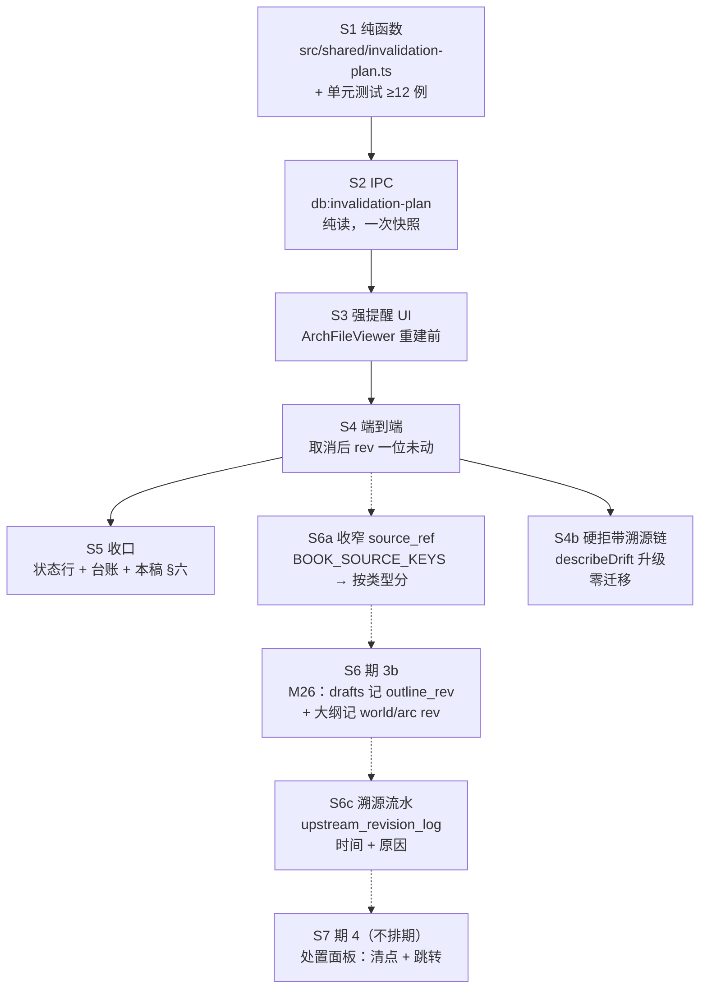

# 上游失效 · 期 3 实施设计与作业图

> 状态：待裁定 · 2026-10-31 · 期 3a 已切片、可无人值守施工；期 3b / 期 4 只登记不排期
> **S6 的裁定已定（2026-10-31）**：定稿章只记 `outline` 一域（主稿 §十·2 ①）；并把 `BOOK_SOURCE_KEYS` 三域全记收窄成按类型分（S6a）。**S1–S5 不受影响，照原样施工。**
> 上级稿：[`upstream-version-and-derived-invalidation-design.md`](upstream-version-and-derived-invalidation-design.md) §八（强提醒）· §九 步 4/5
> 接口草案：[`upstream-invalidation-phase2-source-ref-and-read-gates.md`](upstream-invalidation-phase2-source-ref-and-read-gates.md) §十三
> 作业手册（给无人值守的执行方）：[`docs/handoffs/2026-10-31-phase3-unattended-handoff.md`](../../handoffs/2026-10-31-phase3-unattended-handoff.md)

---

## 一、开工前必须先知道的两个事实

**这两个事实决定切片形状。不看就动手，一定会做出一个"清单看着全、其实少两组"的空壳。**

### 1.1 `source_ref` 只落在三张表

`M25`（`electron/migrations/m25-derived-source-ref.ts:36-38`）只加了三列：

```
volume_handoffs.source_ref
blueprints.source_ref
project_core.plot_tree_source_ref
```

### 1.2 主稿 §8.2 要求四组，其中两组**没有判定原料**

| §8.2 要求的组 | 有没有原料 | 期 3a 怎么处理 |
|---|---|---|
| 章节蓝图 | ✅ `blueprints.source_ref` | 算得出 |
| 卷末交接单 | ✅ `volume_handoffs.source_ref` | 算得出 |
| 剧情树 | ✅ `project_core.plot_tree_source_ref` | 算得出（§8.2 原表没列它，但 §七 裁定它有 rev，一并报） |
| **已定稿章节** | ❌ **没有**：`drafts`/manuscripts 没有 `source_ref` | **不能算**。只能记进 `unseen`，并在文案里说明「本期不判」 |
| **伏笔计划** | ❌ 主稿 §八 明写 `narrative_thread_plans` **不进版本表**（它是作者输入，本身就是上游） | 同上，不做 |

⇒ **期 3a 只报三组 + `unseen`**。给两组没原料的硬造一个判据，就是伪造判据（判据 CL 的教训）。

---

## 二、期 3a 的数据形状（钉死，不许自由发挥）

```ts
// 放 src/shared/invalidation-plan.ts —— 纯函数，零 IO，零 DB
export type InvalidationGroupKind = 'blueprint' | 'handoff' | 'plot-tree'
export type InvalidationTier = 'silent' | 'once' | 'strong'

export interface InvalidationItem {
  /** 给作者看的标签：蓝图 = 「第 12 章」；交接单 = 「第 1 卷第 20 章交接单」；剧情树 = 「剧情树」 */
  label: string
  /** 该项覆盖的章号；剧情树给 null（全书） */
  chapters: readonly number[] | null
  /** 落后在哪几个域；文案用 describeDrift 渲染，不要自己拼字符串 */
  behind: readonly DerivedDrift[]
}

export interface InvalidationGroup {
  kind: InvalidationGroupKind
  count: number
  items: readonly InvalidationItem[]
}

export interface InvalidationPlan {
  groups: readonly InvalidationGroup[]          // 空的组不要出现在数组里
  /** legacy：没有 source_ref 可比。**不进 groups**（主稿 §十·1 第 2 条） */
  unseen: { count: number; kinds: readonly string[] }
  tier: InvalidationTier
  /** 不受影响的章范围，一句话；算不出来就给 null，不要猜 */
  unaffected: { from: number; to: number } | null
}
```

**四条硬约束**（每一条都对应一个会静默出错的形态）：

1. **`legacy` 与 `stale` 不许合并。** `stale` = 有 `source_ref` 且落后；`legacy` = 没有 `source_ref`，**不知道**。两者混成一个计数，作者就分不清"要处置 3 项"和"有 3 项我不知道"。
2. **`legacy` 只进 `unseen`，不进 `groups`。** 主稿 §十·1 第 2 条：`legacy` 项不会被作废（读方照常放行），混进分组会让清单虚高。
3. **`unseen.count` 如实报，不许折成 0。** 主稿 §9.2：显示「0 项影响」而其实一堆看不见的派生，是 blast radius 最危险的低估。`count === 0` 时也要给字段，不要省。
4. **空的组不要占位。** `groups` 里只放 `count > 0` 的；UI 不要渲染「章节蓝图（0）」。

### 2.1 tier 的唯一判定表（不许加权、不许打分）

| 条件 | tier | 依据 |
|---|---|---|
| `groups` 全空 **且** `unseen.count === 0` | `silent` | §8.3：无事可报还弹窗，等于训练作者盲点确定 |
| 有组命中，但**不含**交接单 | `once` | 蓝图/剧情树重算即可，后果可撤销 |
| **含交接单**（`kind === 'handoff'` 且 `count > 0`） | `strong` | §8.3：交接单会被**拒绝读取**，下一卷开不了工 = 不可逆档 |

> **本期没有「已定稿章节」组，所以 `strong` 只能由交接单触发。** 将来补上定稿组时，判定要改成「含定稿章 或 含交接单」——**这条注释要跟着改，别只改代码**。

---

## 三、作业图



**一句话读法**：S1–S5 是一条直线，每片都有独立验收命令，**任一片没绿就不许开下一片**；`S4b` 是挂在主线上的补丁（零迁移，可随时插入）；虚线四片本期只登记、不施工。

| 片 | 内容 | 验收命令（必须逐字跑） | 预计改动量 |
|---|---|---|---|
| **S1** | `computeInvalidationPlan` 纯函数 + 单测 | `pnpm test src/shared/__tests__/invalidation-plan.test.ts` | 新文件 2 个，约 300 行 |
| **S2** | IPC handler，纯读 | `pnpm test electron/controllers/__tests__/db-controller-invalidation-plan.test.ts` | 改 2 处（`db-controller.ts` + `src/shared/ipc-channels.ts`） |
| **S3** | 三档密度的确认框 | `pnpm test src/components/editor/__tests__/` | 改 1 个组件 + 1 个新测试 |
| **S4** | 端到端：plan → 取消 → rev 不变 | `pnpm test electron/controllers/__tests__/` | 加 1 个集成测试 |
| **S5** | 收口 | `node scripts/check-fast.mjs` | 只改文档 |
| ~~S4b~~ | **零迁移，可随时插入**：`describeDrift` 升级成带证据链（主稿 §十·3 第 2 层）。输出格式钉死：`情节大纲 第3版→第5版（第4版改过第12–14章；第5版改过第31章）`；取不到的版本写「该版改动章未知」，**不猜不留空**。只改 `src/shared/upstream-revisions.ts` 一个函数 + 其调用点文案；**不动签名**（`behind` 形状不变） | `pnpm test src/shared/__tests__/upstream-revisions.test.ts` | 约 40 行 + 8 例 |
| ~~S6a~~ | **不排期**：把 `BOOK_SOURCE_KEYS`（三域全记）收窄成按派生类型分（主稿 §十·2 ①）。改动＝`derived-source-ref.ts:44` 一处 + 三个写入点传各自的键集。**测试代价很小**（`upstream-source-ref-writes.test.ts` 里 `worldbuilding:book` 零出现，断言走的是解析后的 ref） | `pnpm test electron/repositories/__tests__/upstream-source-ref-writes.test.ts` | 约 30 行 |
| ~~S6~~ | **不排期**：M26 给 `drafts` 加 `outline_rev`；`project_core` 记 world/arc rev（补中间环）；plan 加「已定稿章节」组 | 未定 | 中 |
| ~~S6c~~ | **不排期**：`upstream_revision_log`（append-only）记每版的时间 + 原因 + 章集。**它是"回滚要有据可查"的硬需求**：卷回滚一旦实现，回滚产生的 bump 与作者手改的 bump 在库里长得一模一样，事后无法区分（与 ADR-0026 同一条纪律）。`reason` 取值待作者确认：`author-edit` / `regenerate` / `rollback` / `import-restore` / `clear`，**未知记 `unknown` 不许省略** | 未定 | 中 |
| ~~S7~~ | **不排期**：处置面板（清点 + 跳转，不亲自重算） | 未定 | 中 |

---

## 四、施工卡（每片照抄，不要自由发挥）

### S1 · 纯函数

**落点**：`src/shared/invalidation-plan.ts`（新）+ `src/shared/__tests__/invalidation-plan.test.ts`（新）

**函数签名**（照抄，不要改名）：

```ts
export function computeInvalidationPlan(input: {
  overrides: ReadonlyArray<{ domain: UpstreamDomain; scope?: string; rev: number }>
  revisions: UpstreamRevisionSnapshot
  changes: ReadonlyMap<UpstreamRefKey, ParsedChangedChapters>
  blueprints: ReadonlyArray<{ chapterNumber: number; sourceRef: DerivedSourceRef | null }>
  handoffs: ReadonlyArray<{ label: string; chapters: readonly number[]; sourceRef: DerivedSourceRef | null }>
  plotTreeSourceRef: DerivedSourceRef | null
}): InvalidationPlan
```

**实现只有三步**（不要引入新概念）：

1. `snapshotWithOverride` 已经在**仓储层**（`upstream-revision-repository.ts:264`），但那是 electron 侧。**纯函数不许 import electron** ⇒ 在 shared 里写一个等价的三行实现（遍历 `revisions` 建 Map，overrides 里**键已存在才覆盖**，同 `:272-276` 的语义），并加注释指向仓储层那份。**两份实现必须语义一致**，测试里钉住「键不存在时覆盖被忽略」。
2. 逐项调用 `derivedStatusForChapters(sourceRef, 假想快照, changes, chapters)`：
   - 蓝图 `chapters = [chapterNumber]`
   - 交接单 `chapters = 传入的 chapters`（**调用方算**，见下条）
   - 剧情树 `chapters = null`
3. 按 `state` 分拣：`{state:'stale'}` 进 `groups`（带 `behind`）；`{state:'legacy'}` 只累加 `unseen.count`；`{state:'valid'}` 丢弃。

**交接单的 `chapters` 必须由调用方用 `volumeHandoffChapters()` 算**（`electron/services/derived-validity.ts:80`），不要在这里重写一遍——那条规则有四个例外档（`basis !== 'actual'` 一律返回 `[]` = 覆盖全部章），重写必错。

**验收**：单测至少覆盖 12 条，**至少包含这 6 条**（这 6 条各钉一个会静默出错的形态）：

| # | 用例 | 期望 |
|---|---|---|
| 1 | 假想 rev 大于所有 `source_ref` ⇒ 全部 stale | 三组都命中 |
| 2 | 假想 rev 等于当前 rev ⇒ 无事 | `tier='silent'`，`groups` 空 |
| 3 | `sourceRef` 为 `null` 的蓝图 | 进 `unseen.count`，**不进 groups** |
| 4 | `overrides` 给了表里不存在的域 | **被忽略**，不产生"全军覆没"假警报 |
| 5 | 交接单 `chapters` 为空数组（非 actual 档） | 按覆盖全书算 ⇒ 判 stale（保守方向） |
| 6 | 只有蓝图命中、没有交接单 | `tier='once'`；再加一份交接单 ⇒ `tier='strong'` |

**禁止**：`import` 任何 `electron/**`；读 DB；调用 `Date.now()`；把文案拼进返回值（文案归 UI，这里只给 `behind`）。

---

### S2 · IPC（纯读）

**落点**：`electron/controllers/db-controller.ts`（在 `db:plot-tree-read` 附近，约 `:1009` 之后）+ `src/shared/ipc-channels.ts`

**签名**：`ipcMain.handle('db:invalidation-plan', async (_event, request, expectedProjectPath: string) => …)`

`request = { domain: UpstreamDomain; scope?: string; rev: number }`。

**实现必须遵守**（照抄主稿 §8.1 与 §5.6）：

1. **一次 `readDerivedReadContext(db)`**，不要在循环里再取；蓝图/交接单的 `source_ref` 各取一次 Map。
2. **绝不写库、绝不 bump、绝不开事务**。这个 handler 里出现 `bump` / `UPDATE` / `INSERT` 就是错的。
3. `expectedProjectPath` 必须走 `assertRequiredExpectedProjectPath`（照抄隔壁 handler）。
4. 库没开 / 表不存在 ⇒ 返回 `{ success: false, missing: true }`，**不要**抛错、**不要**返回空 plan（空 plan 会被读成"影响 0 项"）。

**验收**：真库集成测试至少 4 条：正常算得出 / 库没开 → `missing` / 表缺 → `missing` / **调用前后 `upstream_revisions` 的 `rev` 与 `updated_at` 一字节不变**（这条是 §8.1 的红线）。

**禁止**：在这个 handler 里做任何写入；把 `computeInvalidationPlan` 的逻辑抄一遍（必须 import shared 那份）。

---

### S3 · 强提醒 UI

**落点**：`src/components/editor/ArchFileViewer.tsx`（`ArchFileViewer.tsx:812` 的 `createArchitectureWorkflow` 之前 —— 就是 `continuePlanning` 那个函数附近）

**三档行为**（严格按 `tier`，不许自己加条件）：

| tier | UI |
|---|---|
| `silent` | 不弹窗，直接执行；结束后一条 toast |
| `once` | 单击确认即可 |
| `strong` | 必须勾选「我明白这会波及 N 章已定稿内容」才能点继续；未勾选时继续按钮 disabled |

**文案口径**（写死在组件里，别用变量拼）：

- 组标题：`章节蓝图（N）` / `卷末交接单（N）` / `剧情树（N）`
- `unseen.count > 0` 时**单独一行**：`另有 N 项无法判断（旧数据没有来源记录），本次不做处置`
- `unaffected` 非空时单独一行：`第 X–Y 章及其派生不受影响`
- **影响范围一行**（主稿 §十·2 ④，必写）：
  - 世界观变更 ⇒ `世界观变更影响全书设定`
  - 卷回滚 ⇒ 逐层列出「该卷 → 下游单元 → 各章大纲与蓝图 → 正文」
  - 局部修改 ⇒ `影响范围难以精确判定，推荐下游全部重新生成` + **不替作者决定**
  - 能定位到章 ⇒ 直接给章号区间

**验收**：三档各一条组件测试，钉住「`strong` 档未勾选时主按钮 disabled」与「`unseen` 那行必须出现」。

**禁止**：`tier` 由 UI 自己重算（必须用后端给的）；把清单做成"影响较大"这类模糊文案（§八 blast radius 明写要给可数清单）。

---

### S4 · 端到端：取消后 rev 一位未动

**落点**：`electron/controllers/__tests__/`（新建或并入现有重建入口测试）

**这一片是整期最重要的验收**：作者点「重建大纲」→ 弹清单 → 点取消 → `upstream_revisions` 里所有行 `rev` 与 `updated_at` **逐字节不变**。

**验收**：一条集成测试，先 `Snapshot` 全表 JSON，走一遍 plan + 取消，再 Snapshot，`toEqual`。

---

### S5 · 收口

1. 本稿状态行改 `已实施`、补 §六 落地记录；
2. 台账 `P2-3` 行把「期 3 未开工」改成已落地的片号；
3. `node scripts/check-fast.mjs` 必须绿；`node scripts/check-doc-placement.mjs --update-baseline` 若基线缩小则收窄。

---

## 五、本稿不做

- **不给「已定稿章节」组硬造判据**（无原料）。**前置已定（2026-10-31）**：S6a 收窄 `source_ref` → S6 加 M26 记 `outline_rev` + 补大纲的 world/arc rev。只是不排期。
- **不做伏笔计划组**。主稿 §八 已裁定它不进版本表（作者输入即上游）。
- **不做处置面板**（S7，主稿 §九 步 5「最后做」）。
- **不做回滚原语**（主稿 §8.5）。卷回滚属 P0-1 残留，其"波及范围"口径已写进主稿 §十·2 ④，实现时照此。
- **不在 plan 阶段 bump rev**（§8.1，红线）。
- **不把大纲层做成硬拦**（主稿 §十·2 ③）。本项目定位是「规划层浅参与」，控制力度归作者；这条**不改变**期 2 已落地的 A 类硬拒（正文链遇 stale 蓝图拒绝写作）—— 越靠近正文越硬是既定口径。
- **硬拒文案的溯源链不并进 S1–S5**（主稿 §十·3）。现文案只给域名（「情节大纲已经改过了」），第 1+2 层（版本区间 + 每版章集）做成 S4b，可独立先做；第 3 层（时间 + 原因）要 S6c 的流水表。**别合成一片**，否则文案升级会被一条迁移堵住。

## 六、落地记录

（施工完再填；没填 = 没做。）
