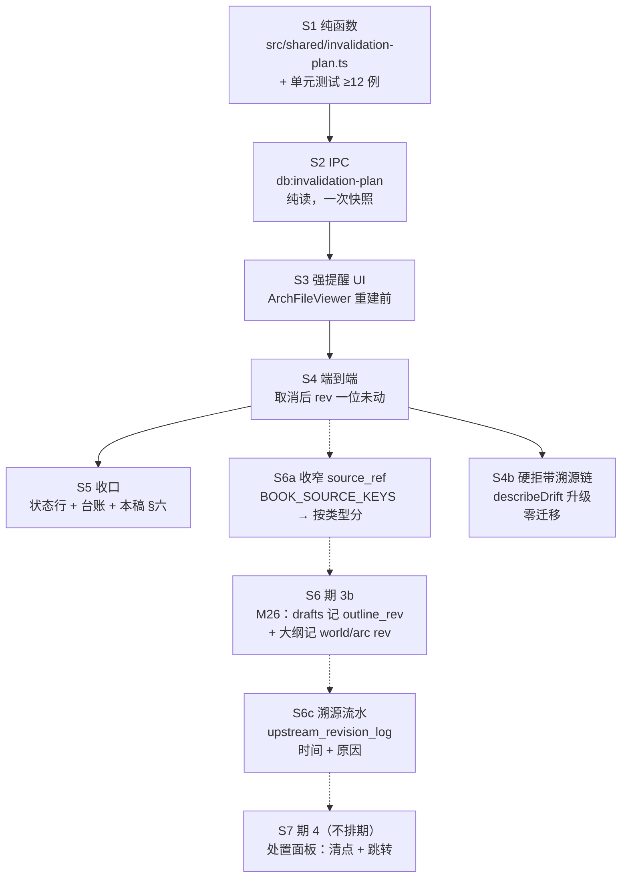

# 上游失效 · 期 3 实施设计与作业图

> 状态：已实施 · 2026-10-31 · 期 3a（S1–S5）+ S4b（硬拒带溯源链）+ 主入口接线（方案 B）+ 期 3b（S6a 收窄 + 中间环）+ S6c 期 1（溯源流水）+ S6c 期 2（文案带时间/原因 + 章集迁流水）+ S6（M28 定稿章组 + 回滚逐层列出）；S7 未排期
> **施工期补的两个口径**：① request `rev <= 0` =「假想再改一版」（借 0 表达，不新增签名/通道）——**已由作者裁定保留**；② 影响范围的四种情形在 S6 之前只判得出三种。见 §六。
> **S6 的裁定已定（2026-10-31）**：定稿章只记 `outline` 一域（主稿 §十·2 ①）；并把 `BOOK_SOURCE_KEYS` 三域全记收窄成按类型分（S6a）。**S1–S5 不受影响，照原样施工。**
> **S6 的第二个裁定（2026-10-31）**：`db:invalidation-plan` 的请求加**可选** `reason?: UpstreamRevisionReason`（方案 A）——只有「回滚 ⇒ 逐层列出」那一档需要它，不传即旧行为。
> 上级稿：[`upstream-version-and-derived-invalidation-design.md`](upstream-version-and-derived-invalidation-design.md) §八（强提醒）· §九 步 4/5
> 接口草案：[`upstream-invalidation-phase2-source-ref-and-read-gates.md`](upstream-invalidation-phase2-source-ref-and-read-gates.md) §十三
> 作业手册（给无人值守的执行方）：[`docs/handoffs/2026-10-31-phase3-unattended-handoff.md`](../../handoffs/2026-10-31-phase3-unattended-handoff.md)

---

## 一、开工前必须先知道的两个事实

**这两个事实决定切片形状。不看就动手，一定会做出一个"清单看着全、其实少两组"的空壳。**

### 1.1 `source_ref` 只落在三张表

`M25`（`electron/migrations/m25-derived-source-ref.ts:36-38`）只加了三列：

```
volume_handoffs.source_ref
blueprints.source_ref
project_core.plot_tree_source_ref
```

### 1.2 主稿 §8.2 要求四组，其中两组**没有判定原料**

| §8.2 要求的组 | 有没有原料 | 期 3a 怎么处理 |
|---|---|---|
| 章节蓝图 | ✅ `blueprints.source_ref` | 算得出 |
| 卷末交接单 | ✅ `volume_handoffs.source_ref` | 算得出 |
| 剧情树 | ✅ `project_core.plot_tree_source_ref` | 算得出（§8.2 原表没列它，但 §七 裁定它有 rev，一并报） |
| ~~已定稿章节~~ | ✅ **S6 已补**：M28 给 `drafts` 加 `outline_rev`（定稿那一刻的大纲版本，`-1` = 没记过） | 算得出（`finalized` 组，恒 `strong`） |
| **伏笔计划** | ❌ 主稿 §八 明写 `narrative_thread_plans` **不进版本表**（它是作者输入，本身就是上游） | 同上，不做 |

⇒ **期 3a 只报三组 + `unseen`**。给两组没原料的硬造一个判据，就是伪造判据（判据 CL 的教训）。

---

## 二、期 3a 的数据形状（钉死，不许自由发挥）

```ts
// 放 src/shared/invalidation-plan.ts —— 纯函数，零 IO，零 DB
export type InvalidationGroupKind = 'blueprint' | 'handoff' | 'plot-tree'
export type InvalidationTier = 'silent' | 'once' | 'strong'

export interface InvalidationItem {
  /** 给作者看的标签：蓝图 = 「第 12 章」；交接单 = 「第 1 卷第 20 章交接单」；剧情树 = 「剧情树」 */
  label: string
  /** 该项覆盖的章号；剧情树给 null（全书） */
  chapters: readonly number[] | null
  /** 落后在哪几个域；文案用 describeDrift 渲染，不要自己拼字符串 */
  behind: readonly DerivedDrift[]
}

export interface InvalidationGroup {
  kind: InvalidationGroupKind
  count: number
  items: readonly InvalidationItem[]
}

export interface InvalidationPlan {
  groups: readonly InvalidationGroup[]          // 空的组不要出现在数组里
  /** legacy：没有 source_ref 可比。**不进 groups**（主稿 §十·1 第 2 条） */
  unseen: { count: number; kinds: readonly string[] }
  tier: InvalidationTier
  /** 不受影响的章范围，一句话；算不出来就给 null，不要猜 */
  unaffected: { from: number; to: number } | null
}
```

**四条硬约束**（每一条都对应一个会静默出错的形态）：

1. **`legacy` 与 `stale` 不许合并。** `stale` = 有 `source_ref` 且落后；`legacy` = 没有 `source_ref`，**不知道**。两者混成一个计数，作者就分不清"要处置 3 项"和"有 3 项我不知道"。
2. **`legacy` 只进 `unseen`，不进 `groups`。** 主稿 §十·1 第 2 条：`legacy` 项不会被作废（读方照常放行），混进分组会让清单虚高。
3. **`unseen.count` 如实报，不许折成 0。** 主稿 §9.2：显示「0 项影响」而其实一堆看不见的派生，是 blast radius 最危险的低估。`count === 0` 时也要给字段，不要省。
4. **空的组不要占位。** `groups` 里只放 `count > 0` 的；UI 不要渲染「章节蓝图（0）」。

### 2.1 tier 的唯一判定表（不许加权、不许打分）

| 条件 | tier | 依据 |
|---|---|---|
| `groups` 全空 **且** `unseen.count === 0` | `silent` | §8.3：无事可报还弹窗，等于训练作者盲点确定 |
| 有组命中，但**不含**交接单 | `once` | 蓝图/剧情树重算即可，后果可撤销 |
| **含交接单**（`kind === 'handoff'` 且 `count > 0`） | `strong` | §8.3：交接单会被**拒绝读取**，下一卷开不了工 = 不可逆档 |

> **本期没有「已定稿章节」组，所以 `strong` 只能由交接单触发。** 将来补上定稿组时，判定要改成「含定稿章 或 含交接单」——**这条注释要跟着改，别只改代码**。

---

## 三、作业图



**一句话读法**：S1–S5 是一条直线，每片都有独立验收命令，**任一片没绿就不许开下一片**；`S4b` 是挂在主线上的补丁（零迁移，可随时插入）；虚线四片本期只登记、不施工。

| 片 | 内容 | 验收命令（必须逐字跑） | 预计改动量 |
|---|---|---|---|
| **S1** | `computeInvalidationPlan` 纯函数 + 单测 | `pnpm test src/shared/__tests__/invalidation-plan.test.ts` | 新文件 2 个，约 300 行 |
| **S2** | IPC handler，纯读 | `pnpm test electron/controllers/__tests__/db-controller-invalidation-plan.test.ts` | 改 2 处（`db-controller.ts` + `src/shared/ipc-channels.ts`） |
| **S3** | 三档密度的确认框 | `pnpm test src/components/editor/__tests__/` | 改 1 个组件 + 1 个新测试 |
| **S4** | 端到端：plan → 取消 → rev 不变 | `pnpm test electron/controllers/__tests__/` | 加 1 个集成测试 |
| **S5** | 收口 | `node scripts/check-fast.mjs` | 只改文档 |
| ~~S4b~~ | **零迁移，可随时插入**：`describeDrift` 升级成带证据链（主稿 §十·3 第 2 层）。输出格式钉死：`情节大纲 第3版→第5版（第4版改过第12–14章；第5版改过第31章）`；取不到的版本写「该版改动章未知」，**不猜不留空**。只改 `src/shared/upstream-revisions.ts` 一个函数 + 其调用点文案；**不动签名**（`behind` 形状不变） | `pnpm test src/shared/__tests__/upstream-revisions.test.ts` | 约 40 行 + 8 例 |
| ~~S6a~~ | **已落地（期 3b，2026-10-31）**：把 `BOOK_SOURCE_KEYS`（三域全记）收窄成按派生类型分（主稿 §十·2 ①）。落地形态＝`SOURCE_KEYS_BY_KIND` + `currentSourceRefValue(db, kind, outlineRev?)`，四个写入点各自表态（蓝图两处 + 交接单 `chapter-plan`；剧情树 `architecture`） | `pnpm test electron/repositories/__tests__/upstream-source-ref-writes.test.ts` | 已落地 |
| ~~S6~~ | **已落地（2026-10-31，M28，schema 28 → 29）**：`drafts.outline_rev`（定稿那一刻的大纲版本，`-1` = 显式「没记过」，**不回填**）+ plan 第五组 `finalized`（恒 `strong`）+ 请求可选 `reason` 让「回滚 ⇒ 逐层列出」那一档判得出来。详见本文「S6 落地记录」 | `pnpm test electron/migrations electron/repositories electron/controllers src/shared` | 已落地 |
| ~~S6c~~ | **期 1 + 期 2 均已落地（2026-10-31，M27，schema 27 → 28）**：`upstream_revision_log`（只追加）记每版的时间 + 原因 + 章集 + `covers_all`。**它是"回滚要有据可查"的硬需求**：卷回滚一旦实现，回滚产生的 bump 与作者手改的 bump 在库里长得一模一样，事后无法区分（与 ADR-0026 同一条纪律）。`reason` 取值表已由作者拍板（2026-10-31「按建议来，未知就记作 unknown」）：`author-edit` / `regenerate` / `rollback` / `import-restore` / `clear` / `unknown`。**期 2 已补**：时间/原因渲染进硬拒文案（`describeDrift` 第 3 层）；章集从 `upstream_revisions` 彻底挪进流水，解除 `MAX_CHANGED_CHAPTER_REVS = 20`（该常量只剩「v27 老库」这一条兼容路径） | `pnpm test electron/repositories src/shared` | 已落地 |
| ~~S7~~ | **不排期**：处置面板（清点 + 跳转，不亲自重算） | 未定 | 中 |

---

## 四、施工卡（每片照抄，不要自由发挥）

### S1 · 纯函数

**落点**：`src/shared/invalidation-plan.ts`（新）+ `src/shared/__tests__/invalidation-plan.test.ts`（新）

**函数签名**（照抄，不要改名）：

```ts
export function computeInvalidationPlan(input: {
  overrides: ReadonlyArray<{ domain: UpstreamDomain; scope?: string; rev: number }>
  revisions: UpstreamRevisionSnapshot
  changes: ReadonlyMap<UpstreamRefKey, ParsedChangedChapters>
  blueprints: ReadonlyArray<{ chapterNumber: number; sourceRef: DerivedSourceRef | null }>
  handoffs: ReadonlyArray<{ label: string; chapters: readonly number[]; sourceRef: DerivedSourceRef | null }>
  plotTreeSourceRef: DerivedSourceRef | null
}): InvalidationPlan
```

**实现只有三步**（不要引入新概念）：

1. `snapshotWithOverride` 已经在**仓储层**（`upstream-revision-repository.ts:264`），但那是 electron 侧。**纯函数不许 import electron** ⇒ 在 shared 里写一个等价的三行实现（遍历 `revisions` 建 Map，overrides 里**键已存在才覆盖**，同 `:272-276` 的语义），并加注释指向仓储层那份。**两份实现必须语义一致**，测试里钉住「键不存在时覆盖被忽略」。
2. 逐项调用 `derivedStatusForChapters(sourceRef, 假想快照, changes, chapters)`：
   - 蓝图 `chapters = [chapterNumber]`
   - 交接单 `chapters = 传入的 chapters`（**调用方算**，见下条）
   - 剧情树 `chapters = null`
3. 按 `state` 分拣：`{state:'stale'}` 进 `groups`（带 `behind`）；`{state:'legacy'}` 只累加 `unseen.count`；`{state:'valid'}` 丢弃。

**交接单的 `chapters` 必须由调用方用 `volumeHandoffChapters()` 算**（`electron/services/derived-validity.ts:80`），不要在这里重写一遍——那条规则有四个例外档（`basis !== 'actual'` 一律返回 `[]` = 覆盖全部章），重写必错。

**验收**：单测至少覆盖 12 条，**至少包含这 6 条**（这 6 条各钉一个会静默出错的形态）：

| # | 用例 | 期望 |
|---|---|---|
| 1 | 假想 rev 大于所有 `source_ref` ⇒ 全部 stale | 三组都命中 |
| 2 | 假想 rev 等于当前 rev ⇒ 无事 | `tier='silent'`，`groups` 空 |
| 3 | `sourceRef` 为 `null` 的蓝图 | 进 `unseen.count`，**不进 groups** |
| 4 | `overrides` 给了表里不存在的域 | **被忽略**，不产生"全军覆没"假警报 |
| 5 | 交接单 `chapters` 为空数组（非 actual 档） | 按覆盖全书算 ⇒ 判 stale（保守方向） |
| 6 | 只有蓝图命中、没有交接单 | `tier='once'`；再加一份交接单 ⇒ `tier='strong'` |

**禁止**：`import` 任何 `electron/**`；读 DB；调用 `Date.now()`；把文案拼进返回值（文案归 UI，这里只给 `behind`）。

---

### S2 · IPC（纯读）

**落点**：`electron/controllers/db-controller.ts`（在 `db:plot-tree-read` 附近，约 `:1009` 之后）+ `src/shared/ipc-channels.ts`

**签名**：`ipcMain.handle('db:invalidation-plan', async (_event, request, expectedProjectPath: string) => …)`

`request = { domain: UpstreamDomain; scope?: string; rev: number }`。

**实现必须遵守**（照抄主稿 §8.1 与 §5.6）：

1. **一次 `readDerivedReadContext(db)`**，不要在循环里再取；蓝图/交接单的 `source_ref` 各取一次 Map。
2. **绝不写库、绝不 bump、绝不开事务**。这个 handler 里出现 `bump` / `UPDATE` / `INSERT` 就是错的。
3. `expectedProjectPath` 必须走 `assertRequiredExpectedProjectPath`（照抄隔壁 handler）。
4. 库没开 / 表不存在 ⇒ 返回 `{ success: false, missing: true }`，**不要**抛错、**不要**返回空 plan（空 plan 会被读成"影响 0 项"）。

**验收**：真库集成测试至少 4 条：正常算得出 / 库没开 → `missing` / 表缺 → `missing` / **调用前后 `upstream_revisions` 的 `rev` 与 `updated_at` 一字节不变**（这条是 §8.1 的红线）。

**禁止**：在这个 handler 里做任何写入；把 `computeInvalidationPlan` 的逻辑抄一遍（必须 import shared 那份）。

---

### S3 · 强提醒 UI

**落点**：`src/components/editor/ArchFileViewer.tsx`（`ArchFileViewer.tsx:812` 的 `createArchitectureWorkflow` 之前 —— 就是 `continuePlanning` 那个函数附近）

**三档行为**（严格按 `tier`，不许自己加条件）：

| tier | UI |
|---|---|
| `silent` | 不弹窗，直接执行；结束后一条 toast |
| `once` | 单击确认即可 |
| `strong` | 必须勾选「我明白这会波及 N 章已定稿内容」才能点继续；未勾选时继续按钮 disabled |

**文案口径**（写死在组件里，别用变量拼）：

- 组标题：`章节蓝图（N）` / `卷末交接单（N）` / `剧情树（N）`
- `unseen.count > 0` 时**单独一行**：`另有 N 项无法判断（旧数据没有来源记录），本次不做处置`
- `unaffected` 非空时单独一行：`第 X–Y 章及其派生不受影响`
- **影响范围一行**（主稿 §十·2 ④，必写）：
  - 世界观变更 ⇒ `世界观变更影响全书设定`
  - 卷回滚 ⇒ **前置**一句级联顺序「大纲 → 章节蓝图 → 卷末交接单 → 已定稿正文」，后半句照旧按下面三档走
    （回滚 ≠ 全书：章号收得出来就要说，别退化成「难以精确判定」）
  - 局部修改 ⇒ `影响范围难以精确判定，推荐下游全部重新生成` + **不替作者决定**
  - 能定位到章 ⇒ 直接给章号区间

**验收**：三档各一条组件测试，钉住「`strong` 档未勾选时主按钮 disabled」与「`unseen` 那行必须出现」。

**禁止**：`tier` 由 UI 自己重算（必须用后端给的）；把清单做成"影响较大"这类模糊文案（§八 blast radius 明写要给可数清单）。

---

### S4 · 端到端：取消后 rev 一位未动

**落点**：`electron/controllers/__tests__/`（新建或并入现有重建入口测试）

**这一片是整期最重要的验收**：作者点「重建大纲」→ 弹清单 → 点取消 → `upstream_revisions` 里所有行 `rev` 与 `updated_at` **逐字节不变**。

**验收**：一条集成测试，先 `Snapshot` 全表 JSON，走一遍 plan + 取消，再 Snapshot，`toEqual`。

---

### S5 · 收口

1. 本稿状态行改 `已实施`、补 §六 落地记录；
2. 台账 `P2-3` 行把「期 3 未开工」改成已落地的片号；
3. `node scripts/check-fast.mjs` 必须绿；`node scripts/check-doc-placement.mjs --update-baseline` 若基线缩小则收窄。

---

## 五、本稿不做

- **~~不给「已定稿章节」组硬造判据~~（S6 已补）**：M28 给 `drafts` 加 `outline_rev`，`finalized` 组落地。落地记录见 §十三。
  ~~原前置~~：S6a 收窄 `source_ref` 已落地（期 3b）；**迁移编号最终是 M28**（M26 被中期环用掉、M27 被 S6c 期 1 用掉）。
- **不做伏笔计划组**。主稿 §八 已裁定它不进版本表（作者输入即上游）。
- **不做处置面板**（S7，主稿 §九 步 5「最后做」）。
- **不做回滚原语**（主稿 §8.5）。卷回滚属 P0-1 残留，其"波及范围"口径已写进主稿 §十·2 ④，实现时照此。
- **不在 plan 阶段 bump rev**（§8.1，红线）。
- **不把大纲层做成硬拦**（主稿 §十·2 ③）。本项目定位是「规划层浅参与」，控制力度归作者；这条**不改变**期 2 已落地的 A 类硬拒（正文链遇 stale 蓝图拒绝写作）—— 越靠近正文越硬是既定口径。
- **硬拒文案的溯源链不并进 S1–S5**（主稿 §十·3）。现文案只给域名（「情节大纲已经改过了」），第 1+2 层（版本区间 + 每版章集）做成 S4b，可独立先做；第 3 层（时间 + 原因）要 S6c 的流水表。**别合成一片**，否则文案升级会被一条迁移堵住。

## 六、落地记录

**2026-10-31 无人值守施工完毕**（分支 `exp/resource-ledger`，五片各一次提交）。

| 片 | 提交 | 落点 | 验收 |
|---|---|---|---|
| S1 | `c2a3d5c3` | `src/shared/invalidation-plan.ts`（新）+ 单测 | 20 passed |
| S2 | `f4012419` | `db-controller.ts` 的 `db:invalidation-plan` · `ipc-channels.ts` · 仓储层加 `hasTable` | 6 passed + 相邻 21 passed |
| S3 | `f5dcf75f` | `src/components/dialogs/InvalidationPlanGatePanel.tsx`（新）+ `ArchFileViewer.tsx` 接线 | browser 7 passed；`src/components` 41 套件 204 例全绿 |
| S4 | `32cb8c70` | `db-controller-invalidation-plan-cancel.test.ts`（新） | 3 passed |
| S5 | 本次 | 本文档状态行 + §六 + 台账 P2-3 + 交接手册 | `node scripts/check-fast.mjs` 全绿 |

**S1–S5 全程 `check:fast` 绿**（pre-commit 已自动跑）。

### 施工期补的口径（**review 结论：①保留 ②待 S6c**）

1. **`request.rev <= 0` =「假想这个域再改一版」**（handler 里折算成 current+1）—— **保留**。
   *缘起*：UI 手边没有当前版本号 —— 没有任何 IPC 读 `upstream_revisions`，而 UI 要问的
   恰恰是「再改一版会怎样」。施工图把 `request` 钉成 `{domain, scope?, rev: number}`，
   所以只能在取值上借 `0`（不是合法版本号）这一格表达，**不新增字段、不新增通道**。
   *review 判定（2026-10-31）*：这是**技术取值约定**、不涉及产品语义，属 review 可裁定范围，
   **保留**。理由：改成 `rev?: number` 要走一遍 IPC 签名 + 测试 + 施工图，收益只是去掉一个
   已写进类型注释的约定；而它唯一的风险（`behind.need` 会被写成 0）已在 handler 里被
   `current+1` 挡掉 —— 单测钉了「rev 传 0 时 behind.need 等于当前版 + 1」。
2. **影响范围四种情形在 S6 之前只判得出三种**（`buildInvalidationScopeNote`）。
   世界观 / 弧光 ⇒ 影响全书；能收敛到章 ⇒ 给章号；其余 ⇒ 「难以精确判定，推荐全部重新生成」。
   *缺的那一档*：「卷回滚 ⇒ 逐层列出」要知道**这次的动作是回滚**，而 plan 请求里只有域名、
   没有 `reason`。
   **S6 已解（2026-10-31 作者裁定方案 A）**：请求加**可选** `reason?: UpstreamRevisionReason`，
   回显进 `plan.reason`；`rollback` 时前置级联顺序那句话，其余三档一个字不变。
   不传 ⇒ `unknown` ⇒ 与旧行为完全一致（所以这不算「新增签名通道」：没有新的必填参数、
   没有新 channel，`HYPOTHETICAL_NEXT_REV` 那条约定的理由同样成立）。

### 主入口接线（方案 B，2026-10-31 作者裁定）

**背景**（review 2026-10-31 发现）：施工图把闸门挂在 `ArchFileViewer.tsx` 的 `continuePlanning`，
那是**「继续规划」**这条副路径；作者真正点的是 `ArchitectureConfirmDialog` 的「确认生成」
（`onConfirm = ArchFileViewer.handleConfirm`，`:688` / `:1332`）。⇒ 期 3 想解决的场景（点重建先看清单）
当时只覆盖了副路径。两条补法里作者选 **B：接在 `ArchitectureConfirmDialog` 内部**（层级自然，
面板就在弹窗里，不必在 dialog 之上再叠一层）。

三个必须写下来的口径：

1. **问哪一域**：`STEP_DOMAIN` 把勾选的步骤映到域（`worldbuilding` / `plotStructure→arc` /
   `synopsis→outline`）；`premise` / `characters` 不在 `upstream_revisions` 里，不问。
   一次勾多个域时**只问最上游那一个**：世界观的波及面本来就是全书，而本期三处写入点共用
   `BOOK_SOURCE_KEYS`（`derived-source-ref.ts:44`），分域各问只会得到三份同样的单子。
   **S6a 收窄后这条必须改成分域各问、清单取并集**，否则会漏报「只记了 `outline` 的行」——
   代码注释与本节要一起改，否则下一班会以为现在这样是设计意图。
2. **两个闸门的先后 = 状态路口 → 代价**：`progressGate`（大纲领先正文）在先，`invalidationGate` 在后。
   理由：闸门 1 的出口**可能根本不生成**（去补正文），先摆清单那张单子就白弹一次、下次进来还要再弹；
   反过来不浪费 —— 选「仍按计划继续」之后紧接着看到的正是这次要付的代价。
3. **豁免只对一次发射有效**：两个 `bypass*Gate` ref 在**两道闸门都通过之后、发射之前**才清。
   发射万一失败，下一次点确认要把问卷重新走一遍 ——「确认一次永久放行」是把闸门变成装饰的老路
   （主稿 §十·2）。勾选一变、弹窗重开也一并清（旧的清单属于旧的勾选组合）。

**读侧只一份**：`src/services/invalidation-plan-gate.ts` 的 `readInvalidationPlan()`
（**失败一律返回 `null` = 放行**）。原先内联在 `ArchFileViewer` 里的那份已改成调用它 ——
两边各写一遍看不错，但**失败口径**一旦分叉，作者就会遇到「这条路口能写、那条写不了」。

| 改动 | 落点 |
|---|---|
| `readInvalidationPlan()`（唯一读侧，失败即放行） | `src/services/invalidation-plan-gate.ts`（新） |
| 闸门 2 + 面板 + 域解析 + 「只放行一次」 | `src/components/dialogs/ArchitectureConfirmDialog.tsx` |
| 「继续规划」改用同一份读侧 | `src/components/editor/ArchFileViewer.tsx` |

**测试**：`src/components/dialogs/__tests__/workflow-launch-dialogs.browser.tsx` 新增 5 例 ——
清单先出且确认键禁用 / `silent` 不打扰 / 拿不到清单放行 / 前提·角色不问清单 / 两个闸门的先后。
（同文件 34 例全绿；`ArchFileViewer` 与恢复稿相关 65 例全绿。）

### 期 3b 落地记录：S6a 收窄 + 中间环（2026-10-31）

**为什么两件事必须同批**（这是本期的唯一关键判断，别拆开做）：

- **只收窄不补环** ⇒ 世界观改动在整条链路上彻底静默：蓝图只记 `outline` 之后，
  「世界改了 ⇒ 大纲旧了 ⇒ 蓝图旧了」中间那一环不存在，改设定连大纲都不会变旧。
- **只补环不收窄** ⇒ 改一个设定全部章节写不了：蓝图仍三域全记，世界 bump 一次，
  所有蓝图行立即 stale，正文层硬拒（A 类）全开。

**S6a：`BOOK_SOURCE_KEYS` 按派生类型分**（`electron/repositories/derived-source-ref.ts`）

| 派生类型 | 用在哪 | 记哪几域 |
|---|---|---|
| `chapter-plan` | 蓝图（两处写入点）、卷交接单 | 只记 `outline` |
| `architecture` | 剧情树 | 三域（world / arc / outline，原 `BOOK_SOURCE_KEYS`） |

- 入参从「三域全记」改成 `currentSourceRefValue(db, kind, outlineRev?)`；四个调用点各自表态。
- **不能只留一张表**：剧情树的语义确实是「全书」，而蓝图/交接单的上游是情节大纲。
  两张表各写一遍会出现第三份口径，所以做成 `SOURCE_KEYS_BY_KIND`。

**中间环：`project_core.synopsis_source_ref`（M26，schema v26 → v27）**

- 大纲**自身**也记 world / arc 版本（`SYNOPSIS_SOURCE_KEYS`），补上「世界改了 ⇒ 大纲旧了」这一环。
- 写入位置严格跟 bump 一致：`ProjectCoreRepository.update()` 在 bump **之后**写；
  `commitSynopsis()` 在 CAS 成功后**同事务**写。空大纲写 `''`。
- `''` 与「没这一列」是两回事：`hasSynopsis`（有没有大纲）与 `synopsisSourceRef === null`
  （知不知道它是哪版）**必须分开问** —— 「没有大纲」不进候选、不报 `unseen`；
  「有大纲但不知道版本」才按 `legacy` 计入 `unseen`。
- **清除创作字段时同事务置空**（`project-clear-repository.ts`，与删 `upstream_revisions`、
  清 `plot_tree_source_ref` 处相邻）：`synopsis` 已清空、版本账已删，留着这串 JSON 会让
  **清除后重新生成**的大纲被记成「写于 rev5」而新账本从 rev0 起算 ⇒ 一份刚生成的大纲判 stale。
- `synopsisSourceRefValue()` 里**缺键一律显式记 `0`，不许跳过**：`buildSourceRef` 会跳过空值，
  跳过等于把该域永久排除在判定之外（实测症状：弧光首次 bump 完全无声）。

**分域各问取并集**（S6a 的必然结果）：`computeInvalidationPlan` 的入参加
`synopsisSourceRef` + `hasSynopsis`（**必填**，逼调用方表态，不给默认值）；`outline` 组排在
`GROUP_ORDER` 首位。`ArchitectureConfirmDialog` 的 `resolveInvalidationDomains()` 从「只问最上游一域」
改成「每个域各问一次，`mergeInvalidationPlans` 取并集」。

**`mergeInvalidationPlans` 三条算法口径**（写错了就是静默少报/多报）：

1. `unseen` **按 kind 取各份的最大值后求和**，不许逐份相加 —— 同一批剧情树在三份单子里都算
   「看不清」，逐份相加会把一个说不清的派生算成三个。
2. `tier` 取最高档（`silent < notice < strong`）。
3. `unaffected` **任一份说不清就不报** —— 说得出空隙的那份不能替说不出的那份作保。

**M26 踩到的一个隐形坑（写下来给下一版加列的人）**

`project_core` 被当成一条「作者设定」来源（`project-core:main`），投影方式是**整行减黑名单**
（`SELECT *` + 过滤 `created_at/updated_at/character_states/plot_tree_snapshot`）。于是**每加一列都自动进了来源指纹**：

- `generation-source-binding.ts` 用它算 `stable(core)` 摘要；
- `main-generation-owner.ts` 的 `plotOutlineTargetCurrent` 拿当前行与建单时的 `origin.core` 深比。

`synopsis_source_ref` 会在**世界/弧光 bump 时变，而作者对 `project_core` 一个字都没改** ⇒
作者存稿之后这一列从 `''`（M26 迁移给旧行的默认值）变成真 JSON，深比失败 ⇒
`main-generation-owner.test.ts` 三例红（`author-saved` 变 `source-changed`、
报 `GENERATION_PLANNING_CONTINUATION_SOURCE_CHANGED` 而不是 `RANGE_CHANGED`）。
**「作者存稿」这条恢复路径整条断了**，且只在存稿之后才显形。

修法：两处共用一份 `PROJECT_CORE_NON_CONTENT_COLUMNS`（`generation-source-binding.ts` 导出），
把 `synopsis_source_ref` 列进黑名单。**判据：会不会在作者没改这张表时变 —— 会就加进去。**
（`plot_tree_source_ref` 仍留在指纹里：它只在剧情树本身重生成时变，那时确实该判来源变更。）

**测试**：`invalidation-plan.test.ts`（中间环 5 例 + 合并 4 例，合计 39 例）·
`m26-installed-lane.test.ts`（4 例：列在 / `notnull=1` / 默认 `''` / 幂等）·
`upstream-source-ref-writes.test.ts`（16 例，含中间环 4 例写侧）·
`db-controller-invalidation-plan.test.ts`（10 例）· `electron/repositories` 48 套件 605 例 ·
`workflow-launch-dialogs.browser` 34 例。便携格式与归档的字段计数同步 625 → 626
（donor 夹具 626 → 627），`portable-project-format` 29 例 + `project-archive-service` 34 例全绿。

### S6c 期 1 落地记录：溯源流水 `upstream_revision_log`（M27，2026-10-31）

**作者裁定（2026-10-31）**：`reason` 按建议取值表走，**未知记 `unknown`**。

**为什么必须两张表**（不是把流水塞进 `upstream_revisions`）：

- `upstream_revisions` 是**当前态**（一域一行，`UPDATE` 覆盖 `updated_at`）——「旧没旧」只看它；
- `upstream_revision_log` 是**流水**（只追加，一版一行）——「哪一版、何时、为何、改了哪些章」看它。

**期 2 之后章集也记流水**（见下节）：当前态列冻结成历史尾巴，读取侧两段合并、流水优先。
当前态表仍然只负责版本号 —— 那一个值不该有第二份。

| 决策 | 取值 | 理由 |
|---|---|---|
| `reason` 缺省 | `unknown`（**不是空串**） | 空串会被读成「没有这一栏」，于是每个读取方各写一层兜底；显式 `unknown` 让"还没接线"变成 `WHERE reason='unknown'` 可数的待办 |
| 写入侧要不要强制传 | **不强制** | 「机制」先上线（每版都有时间），「接线」逐点补。强制传 ⇒ 任何一处漏接就让 bump 抛错，而旁路账本不该有弄失败业务写入的权力 |
| `covers_all` | 独立列 | `replace`（整本重生成/整段替换）说的是「**全部**章都变了」；用空数组兼职会被读成「一章没改」，两个相反意思不能共用一个值 |
| 章集格式 | **普通数组**（`[12,13]`） | 流水一行只描述一版，不需要 `upstream_revisions.changed_chapters` 那套按 rev 分组的两代格式 |
| `UNIQUE(domain, scope, rev)` | **不加** | 导入更早的便携包让 rev 回退后再涨会撞号；加了唯一约束就是让**业务写入事务**失败。允许重复，读侧按 `id DESC` 取最近一条 |
| append-only 触发器 | **不做** | 清除创作字段必须能整表删（版本账随被描述的世界一起归零）。只追加是仓储层纪律，不是 DB 约束 |
| 表缺失（v27 老库） | 跳过写流水、**版本照常 bump** | 反了就是「没记流水」被误报成「没记版本」⇒ 调用方把 `source_ref` 留空 ⇒ 整库退回 `legacy` |
| `ensure()` 的 rev 0 | **不写流水** | `0` 是「从没改过」，不是一个版本；记进去会让「历史第一版」变成一条「改了但没改什么」的记录 |

**落点**：`electron/migrations/m27-upstream-revision-log.ts`（新）· `upstream-revision-repository.ts`（`bump` 顺带追加 + `history`/`latestLog`/`hasLog`）·
`src/shared/upstream-revisions.ts`（`UPSTREAM_REVISION_REASONS` / `normalizeRevisionReason` / `parseRevisionLogChapters`）·
`project-clear-repository.ts`（清除时一起删）· 便携策略 `m27Tables`（整表 `D`，`at` 也保留原值 —— 它是事件时间，改写成导入时刻等于伪造证据）。

**测试**：`m27-installed-lane`（4 例：表与索引在 / 不动既有版本账 / `reason` 默认真落库 / verify 失败整步回滚）·
`upstream-source-ref-writes` 的「溯源流水」5 例（逐版一行 / 显式原因与 `covers_all` / 老库不阻断 / 清除归零 / rev 撞号）。
便携与归档的计数同步 65/626 → **66/634**（donor 66/635）。

**期 2 已落地（2026-10-31）** → 见下节。

### S6c 期 2 落地记录：文案带时间/原因 + 章集彻底迁进流水（2026-10-31）

作者原话「回滚和变动要有据可查……可以帮助作者想起来自己改了什么」是这一期的判据：
期 1 只让数据落盘，作者仍然只看得到「第 3 版→第 5 版（改过第 12–14 章）」。

**① 硬拒文案的第 3 层**

`DriftChange` 加 `at` / `reason` / `coversAll`，`describeDrift` 每版从
`第4版改过第12–14章` 升级成 `第4版 10-31 22:05 作者手改，改过第12–14章`。

| 决策 | 取值 | 理由 |
|---|---|---|
| 时间渲染 | `MM-DD HH:MM`，**转本地时区** | 库里存 UTC 是为了与 `updated_at` 同口径；直接摆给作者，他会拿手表去对，然后认定记录是错的 |
| `unknown` 的原因 | **文案不渲染** | 数据库留着它是为了让「还没接线」可数（`WHERE reason='unknown'`）；界面上写「原因未知」对作者没有信息量 —— 他要的是「帮我想起改了什么」 |
| 缺时间/原因 | 省掉那一段，**不写「未知」** | 老库上大半版本没有这两段，逐条写「时间未知」会把真正重要的章集淹掉 |
| 章集取不到 | 仍然写「改动章未知」 | 省略会被读成「那一版没改东西」，与「查不到」方向相反 |
| `coversAll` | 写「改动了全部章节」 | 与「改动章未知」共用一个空章集，但方向相反（整本重写 vs 不知道改了哪些），文案必须分开 |

**② 章集从 `upstream_revisions` 迁进流水**

- **写侧**：流水表存在 ⇒ `bump` 不再写 `changed_chapters` 列。该列冻结成「流水建立之前的历史尾巴」
  —— 它带着两代格式与 20 版上限，让它继续长就是让那个「为省空间设的补丁」继续决定判定精度。
  老库（v27）仍走旧路径，上限照旧生效。
- **读侧**：`changeLog()` / `read()` 把两段合起来（`mergeRevisionLogIntoChangedChapters`），**流水优先**
  —— 当前态列被 `replace` 清空过、被上限合并过，是加工过的二手数据。缺任一段，
  `changedChaptersBetween` 都会判「收窄不了」⇒ 整域按全改算，按章收窄整段失效。
- `coversAll` 在合并时落成**空章集**：判定的既有约定就是「空 = 覆盖全部章」，不许另造哨兵值。
- `replace` 从此清不掉历史（流水只追加，那一版改过什么已经发生）。判定不受影响：
  区间 `(have, need]` 只取 replace 那一版，空章集 ⇒ 按全改算。

**③ 原因接线（只接得出确定答案的地方）**

| 写入点 | 原因 | 判据 |
|---|---|---|
| `ProjectCoreRepository.update`（设置面板保存） | `author-edit` | 编辑器保存 |
| `commitSynopsis` | `generationRunHandle ? regenerate : author-edit` | 有 handle = 生成落盘；恢复存稿与编辑器保存都是作者动作 |
| `BlueprintRepository.upsert(bumpOutline)` / `upsertMany` | `author-edit` | 单章卡保存 / 保存全部 |
| `commitRange` | `authorRecovery ? author-edit : generationRunHandle ? regenerate : unknown` | 三种来路共用一根管道；导入路径两个字段都没有 ⇒ `unknown`，不为记原因去改请求契约 |
| `blueprint-character-rewrite` | `author-edit` | 作者改名级联到蓝图 |

**落点**：`src/shared/upstream-revisions.ts`（`ChangedChapterMeta` / `mergeRevisionLogIntoChangedChapters` /
`describeRevisionChange` / `formatRevisionAt`）· `upstream-revision-repository.ts`（写侧分流、读侧合并、
`readRev` 改直查以免多一次流水扫描）· 上述五个写入点。

**测试**：`upstream-revisions` 新增 8 例（期 2 文案 3 例：时间渲染 / `unknown` 不渲染 / `coversAll` 分开；
合并 5 例：两段互补 / 流水优先 / `coversAll` 落空集 / `legacy` 保留 / 撞号）·
`upstream-source-ref-writes` 新增 4 例（列不再增长但 `read()` 仍拿得到 / 旧尾巴仍参与判定 /
v27 老库回旧路径且上限生效 / 作者侧写入点都带上了原因）。

### 两个已知边界（下一班接手先看这里）

- **剧情树恒为候选**：`plotTreeSourceRef` 为 `null` 时按 `legacy` 计入 `unseen`。
  于是**「这本书压根没有剧情树」和「剧情树没记过来源」目前共用同一个返回值**，会多出一条
  「无法判断」。方向是**多报**（主稿 §十·1 偏保守），可接受；但 UI 把 `unseen.kinds`
  显示出来之前，作者只看到一个来历不明的数字。
- **`unaffected` 的算法是本期自定的**（施工图没钉）：只报**受影响区间内部**的最长空隙，
  两端不报 —— 因为 `computeInvalidationPlan` 的入参里没有「全书最后一章」，说不清两端有多少章。

### S4b 落地记录（2026-10-31 review 时补做）

主稿 §十·3 的第 1+2 层（版本区间 + 每版章集）已在 review 那一轮做完，**零迁移**。

| 改动 | 落点 |
|---|---|
| `DerivedDrift` 增加可选 `changed?: DriftChange[]`；`DriftChange = { rev, chapters: number[] \| null }` | `src/shared/upstream-revisions.ts` |
| 判定时把逐版证据挂上（`driftChangesInRange`），供渲染层/工作流直接用 | 同上 `derivedStatusForChapters` 四处 push |
| `describeDrift` 输出升级：`情节大纲 第3版→第5版（第4版改过第12–14章；第5版改过第31章）` | 同上 |

**三条口径不能改坏**：
1. `changed === undefined` 与 `changed: []` 是两回事 —— 前者「取不到」，后者在别处表示「说不出 ⇒ 按全改算」。
2. 取不到那一版写「第N版改动章未知」，**不许省略这半句**（省略会被读成"那版没改东西"）。
3. `have > need` 标「（版本回退）」：备份恢复 / 导入更早便携包与「作者又改了一版」必须能分开。

**证据为什么挂在 drift 上而不是给 `describeDrift` 加参数**：A 类硬拒发生在渲染层与工作流，
它们手里只有 IPC 传回来的 `validity`，拿不到 `changes`。要让拒绝理由带章号，判定时就得一起带出来。

**测试**：`upstream-revisions.test.ts` 新增 4 例（排序带版本、区间压缩、未知章、版本回退）+
2 例链路（`derivedStatusForChapters` → `describeDrift`）；`invalidation-plan.test.ts` 的 ⑬ 号断言同步
（`behind` 里多了 `changed`，但仍是**结构化数据**不是文案）。

**第 3 层**（每版**时间**与**触发原因**）：S6c 期 1（M27）落数据，期 2 把
`at` / `reason` / `coversAll` 挂进 `DriftChange` 并渲染成
`第4版 10-31 22:05 作者手改，改过第12–14章`。**仍缺**：`reason` 在两条多来路管道上
（`commitRange` 的导入分支）留 `unknown` —— 要判准得让调用方携带来源，那会动请求契约，
作者此前裁定「不增签名」，需重新裁。

### 为什么 S4 比的是原始行串

S4 用**全表原始行串逐字节比**（不顺手用仓储层的 `list()`），是因为 `updated_at` 走 SQLite 的
`datetime('now')`，在同一秒内透过解析结果看不出差别。拦住"plan 偷偷写了库"这件事，全靠这一层。

### S6 落地记录：定稿章组 + 回滚逐层列出（M28，schema 28 → 29，2026-10-31）

**作者两处裁定**：① 定稿章只记 `outline` 一域（主稿 §十·2 ①）；② 请求加**可选**
`reason?: UpstreamRevisionReason`（方案 A），不传即旧行为。

#### ① M28：`drafts.outline_rev`

这一列说的是「**这一章定稿那一刻**，大纲是第几版」，由 `FinalizationRepository.commit`
在**同一个事务里**读 `UpstreamRevisionRepository.readRev('outline')` 写下。

四条写死在迁移注释里的取舍：

- **只记大纲，不记 `source_ref` 三域**。正文的直接上游是大纲；世界/弧光变了会先让大纲旧
  （M26 的中环），再由大纲带动正文。记三域会让作者改一个设定就看到**所有已定稿章**一起变红，
  而它们一个字都不用改 —— 这正是 S6a 收窄要避免的事，不能在正文层重犯。
- **默认 `-1`，不是 `0` 也不是 `NULL`**。`0` 已被 `HYPOTHETICAL_NEXT_REV` 占去表示「假想再改一版」，
  一处双义会让「还没记」读成「按下一版算」；`NULL` 则要撤掉 `NOT NULL`，将来每个读取方都得
  自己兜一层 `?? -1`，漏兜的那一处会把 `NULL` 当版本号参与比较。`-1` 是显式的「没有记录」。
- **不回填**。迁移时补一个「当前大纲版本」等于声称「这些章节是按当前大纲定稿的」——
  事实是它们各自定稿于某个已经找不回来的版本。补值会让**真正该复查的章节判 `valid`**
  （假阴性，方向错）；留 `-1` 只是如实说「不知道」。与 M27 那条「`at` 保留事件时间、
  改写成导入时刻等于伪造证据」是同一条纪律。
- **读了就在同一事务里写**。跨事务读会开一个窗口：正文已按旧大纲写完，读到的却是新版本号，
  于是这一章**永远**判 `valid`。这是仅有的一次能记准的机会。

#### ② plan 第五组 `finalized`

- `GROUP_ORDER` 追加在最后：`outline → blueprint → handoff → plot-tree → finalized`。
  正文是这条链的末端消费者，排前面会让作者以为「先要重写正文」，而正确动作永远是从最上游开始判。
- `tierFor` 改成「含定稿章 **或** 含交接单 ⇒ `strong`」。判据不是「影响面大」而是
  「后果不可撤销」：定稿行可能已经发布（`finalization_outbox.publication_status`），
  改上游会让「发出去的那一版」与库里的依据对不上。
- 定稿章**参与** `unaffected` 的章集计算。不参与会让作者照着一份旧空隙跳过该复查的章 ——
  这比不报更糟。
- `outlineRev < 1` ⇒ `sourceRef = null` ⇒ `legacy` ⇒ 进 `unseen`（`kinds` 含 `finalized`），
  不进 `groups`。**不猜**：既不说「没事」，也不说「旧了」。
- 用 `buildSourceRef` 构造 ref 而不是手写对象：版本表里还没有这个键时，前者给空 ref（`legacy`），
  手写 `{ 'outline:book': 0 }` 会给「依赖第 0 版 ⇒ 永远 stale」。两种错法方向相反。

#### ③ 请求可选 `reason` + 回滚那一档

`db:invalidation-plan` 的请求加 `reason?: UpstreamRevisionReason`，`normalizeRevisionReason`
收敛后回显进 `plan.reason`（`computeInvalidationPlan` 入参 `reason?`，缺省 `unknown`）。

**它不参与任何判定** —— 分组、`tier`、`unseen`、`unaffected` 一个都不看它。单测专门钉了这条：
同一次假想改版，`reason` 换成 `rollback` 之后所有判定字段必须逐字相同。

`buildInvalidationScopeNote` 在 `reason === 'rollback'` 时**前置**一句级联顺序
（`大纲 → 章节蓝图 → 卷末交接单 → 已定稿正文`），后半句照旧走原来三档。
**回滚不等于「全书」**：章号收得出来就照旧附上，不要因为「这是回滚」就退化成
「影响范围难以精确判定」——那会让一份精确的清单被一句模糊话盖掉。

调用方现状：`ArchitectureConfirmDialog` 与 `ArchFileViewer` 都传 `'regenerate'`。
`'rollback'` 要等卷回滚原语（P0-1 残留）真有写入方，通道先通着，免得那天再改一遍签名。

#### ④ 顺手修掉一处**说了假话**的文案

面板勾选那句原来写 `我明白这会波及 N 章已定稿内容`，而那个 N 其实取自**所有**受影响组。
交接单触发 `strong`、一张已定稿章都没有时，「已定稿内容」是假的。S6 之后有了 `finalized` 组，
改成按真实依据分三档：有定稿章 ⇒「N 章已定稿正文」；判不出范围 ⇒「全书派生内容」；
其余 ⇒「N 章派生内容」。

#### 测试

`m28-installed-lane`（4：升版+既有行不动 / 默认 `-1` 且新插入也吃默认 / 幂等 / verify 回滚）
· `invalidation-plan` 新增 10 例（定稿组 6 + `reason` 回显 3 + 合并 1）
· `db-controller-invalidation-plan` 新增 5 例（含「假想下一版没有章集 ⇒ 按全改算」这条保守方向的）
· `finalization-repository` 新增 4 例（记准 / 无版本账记 `-1` / 每章取最高版 / 老库缺列照样返回）
· `InvalidationPlanGatePanel.browser` 新增 4 例（勾选文案分档 / 无定稿组不许说「已定稿」/
  `rollback` 前置级联顺序 / 非 `rollback` 一个字不多）。
