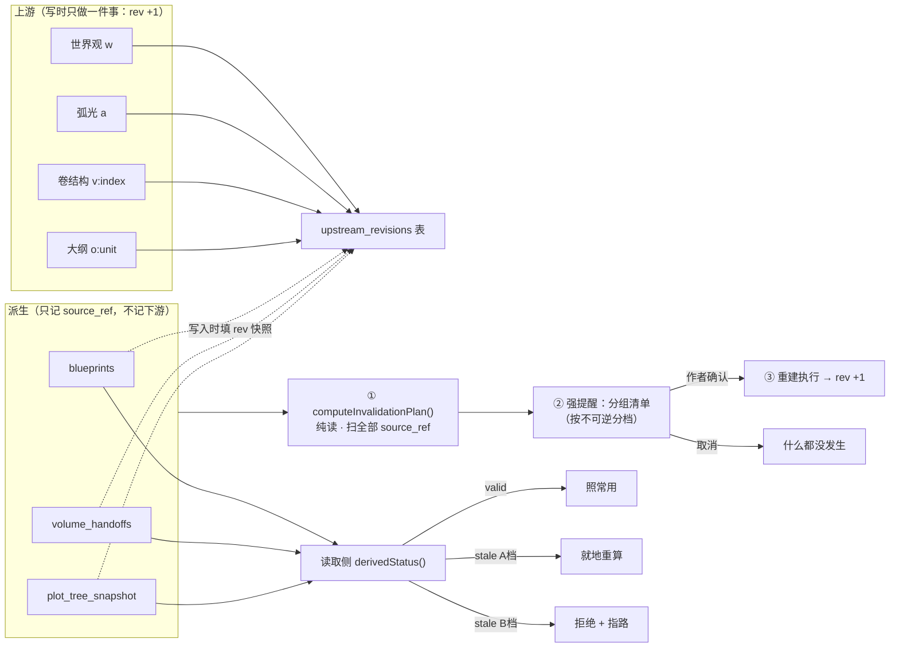

# 上游重建与下游失效：版本、来源、处置

> 状态：已落地 · 2026-11-01 · 期 1（M24，2026-10-30）+ 期 2（M25，`fae95890` 写入侧 / `e704a697` 读取侧）+ 期 3a（plan + 强提醒，2026-10-31 五片施工完成）+ 期 3b（S6a 收窄 + 中间环 M26）+ S6c 期 1/2（M27 溯源流水）+ S6（M28 定稿章组）+ **S7（派生清点页，2026-11-01）**；schema 29。**两项明确推迟**：`outline:<unitId>` 单元级作用域（前置 = E3 落盘）、角色卡域 `characters.personality`。存量派生口径见 §十·1
> 日期：2026-10-30
> 上级稿：[`docs/handoffs/2026-10-30-invalidation-and-deletion-baseline.md`](../../handoffs/2026-10-30-invalidation-and-deletion-baseline.md) §三（盘点）· §五（三个待裁定）
> 触发：作者要求「先看行业一般怎么设计级联失效」。本稿是方案，不是实施计划。

---

## 一、这份稿只回答三个问题

1. **上游版本怎么表示**（世界观 / 弧光 / 卷结构 / 情节大纲）
2. **派生怎么登记来源**（14 类下游派生体）
3. **每种处置由谁执行**（重算 / 标失效阻断 / 归档）

前提不变：**上游重建不触碰任何下游表**（交接稿 §三的核心事实），本稿不是要改这个事实，而是要回答"那下游凭什么知道自己旧了"。

---

## 二、行业里这套东西叫什么、怎么做

先定名。这套问题在五个互不相干的领域各有一套成熟做法，**它们收敛到同一个结论**：

| 领域 | 名字与出处 | 做法 | 我们能取的 |
|---|---|---|---|
| 数据库 | **物化视图维护**（view maintenance / incremental view maintenance）。Gupta & Mumick 的经典分类法按四个维度切：信息、修改类型、查询语言、实例（[*Maintenance of Materialized Views*, 1995](https://homepages.inf.ed.ac.uk/wenfei/qsx/reading/gupta95maintenance.pdf)） | 基础表更新 ⇒ 视图变脏。两种维护：重算，或只算增量（启发式"惯性"：只算变化的那部分） | 「重算 vs 增量」的取舍判据；「视图定义变化」也是修改类型之一（我们的大纲重生成属于这一类） |
| 构建系统 | **change pruning / early cutoff**（Bazel Skyframe）。[官方 Skyframe 文档](https://bazel.googlesource.com/bazel/+/master/docs/versions/8.3.1/reference/skyframe.mdx) | 输入变了 ⇒ 先把下游标记为脏；重算该节点后若**产出与上次相同**，下游"复活"、不再重算 | 「上游重算了 ≠ 下游必须重算」。用产出判断，不用输入判断 |
| 增量计算框架 | **red-green algorithm + revision + backdating**（Salsa，rust-analyzer 的引擎）。[Salsa 文档](https://salsa-rs.github.io/salsa/reference/algorithm.html) · [Durable Incrementality](https://rust-analyzer.github.io/blog/2023/07/24/durable-incrementality.html) | 改输入只做两件 O(1) 的事：改值、全局 revision +1。**验证推迟到有人来读**（pull）；重算结果相同则回填旧版本号（backdating） | 「写时不传播、读时验证」；「只比版本号，不遍历图」 |
| 数据管道 | **state:modified+ / manifest diff**（dbt slim CI）。[dbt 状态对比](https://www.paradime.io/guides/dbt-ci-cd-automation-tools) | 拿「当前 manifest」与「上次产线的 manifest」逐节点比，算出**变更集 + 全部下游**，只重建这一片 | 「用两份快照对比算变更集」这个具体形态；以及它公开的四种翻车方式（见 §三） |
| 调度 / 控制器 | **level-triggered reconciliation**（Kubernetes）。[对照说明](http://www.golinuxcloud.com/desired-state-vs-actual-state-kubernetes) | 不用「事件」驱动，而是每次都看「当前实际状态 vs 期望状态」，差就补。事件只当**提示去对账**，从不当真相 | 「事件会丢、会乱序、会被漏掉；靠事件驱动的失效系统迟早永久错误」 |

另有两条可直接借用的现成形态：

- **只存"我基于哪一版"，读时算 lag**：QuestDB 的物化视图存 `refresh_base_table_txn`，落后量 = `base_table_txn - refresh_base_table_txn`，是**算出来的**，不是一个 stale 标志位（[QuestDB 文档](https://questdb.com/docs/concepts/materialized-views/)）。
- **按影响域分版（分区对齐）**：Apache Doris / BigQuery 的增量物化视图把基础表分区映射到视图分区，"某个分区的数据只影响对应分区"，其余分区不动（[Doris 增量物化视图](https://doris.apache.org/docs/dev/key-features/incremental-materialized-view/) · [BigQuery 分区对齐](https://cloud.google.com/bigquery/docs/materialized-views-use?hl=zh-TW)）。
- **来源关系的正式标准**：W3C **PROV-O**，`prov:Entity` / `prov:Activity` / `prov:Agent` 三类，`prov:wasDerivedFrom`（只指向来源）、`prov:Invalidation`（失效也是正式事件）（[PROV-O](https://www.w3.org/TR/prov-o)）。

---

## 三、三条不能照搬的地方（先说清楚，否则会白做）

### 3.1 我们的"重建"不是可复现构建，early cutoff 基本无效

Bazel 能剪枝，是因为"改个注释 ⇒ `.o` 文件字节不变"（它把这叫 hermetic，是可复现构建的前提）。**我们的大纲是模型生成的，重跑一次措辞必变**，「重算后产出相同」几乎永不命中。

⇒ 所以 early cutoff **只对确定性派生有效**（卷界划分、投影重算），对模型产出**不要指望**。对后者能省的只有"只重跑受影响的批次"（见 §四），不是"重跑了但内容没变所以不脏"。

### 3.2 不要做"反向索引"（谁依赖我）

直觉上会想去维护"改动影响哪些下游"的图，改完通知它们。这条路的问题是：派生体种类会继续增加（14 张表已经不少），**每加一个新派生体就得记得登记一次**，漏一次就是今天的 16 处静默消费。

PROV-O 的关系是**单向指向来源**（`wasDerivedFrom`），不是反向索引；QuestDB 也只存"我基于哪一版"。

⇒ 只记上游，不记下游。判定发生在读取侧。

**一处必须辨析的例外（2026-10-30 作者提出「级联回滚要有强提醒」后补）**：回滚之前要回答"会波及哪些内容"，看起来像要用反向索引，其实不用。区别在**持久化边 vs 读时扫描**：

| | 反向索引（不做） | 回滚前的影响面计算（要做，见 §八） |
|---|---|---|
| 形态 | 建一张"谁依赖我"的表，写上游时维护 | 不建表。把派生侧的 `source_ref` 全量读出来，跟"假想的未来 rev"比一遍 |
| 成本 | 每个派生体要**记得登记**，漏一次就是静默消费 | O(派生行数)，几百行，一次回滚才跑一次 |
| 失效方式 | 漏登记 ⇒ 永久漏判，且无人发现 | 扫得慢一点，但不会漏 |

这也是 K8s level-triggered 的本义：**每次全量对账，不订阅事件**。所以"影响面预演"不违背本条，它只是把"读一个派生"换成"读所有派生"，仍然是拉式。

### 3.3 不要把"标脏"当处置

Kubernetes 的 drift 检测**只报告不自动改**，前提是下一次 reconcile 一定会读到它。我们的病不在这里：卷 `stale` 只写日志、照旧被使用（交接稿 §3.3）。**标了没人看 = 没标**。

⇒ 「标失效」必须和「读取侧拒绝」成对出现，否则这一档等于没做。

---

## 四、答案一：上游版本按影响域分版

**不是一个全局版本号，而是四条版本线，每条带作用域。**

| 上游 | 作用域 | 载体 | 何时 +1 |
|---|---|---|---|
| 世界观 `worldbuilding` | 全书 | `project_core.worldbuilding`（宽表列，非独立表） | `ProjectCoreRepository.update()` 传入该字段 / `commitSynopsis` |
| 弧光 `plot_structure_plan` | 全书（决定卷界） | `project_core.plot_structure_plan`（M07 列） | 同上 |
| 情节大纲 `synopsis` | **章区间（单元批次）** | `project_core.synopsis` + `blueprints` 表 | 该批次重生成 / 单元回退 / 恢复稿保存 / **单章卡手改** |
| 角色卡 | 角色 | `characters.personality` | 卡编辑 / 提案采纳 |
| ~~卷结构~~ | — | `volumes.planned_*` | **不是上游**：M19 明写它是「由重建任务从 `plot_structure_plan` + `synopsis` 算出来的物化副本，**不是权威**」 ⇒ 确定性派生，A 档现算，不进本表 |
| ~~定稿事实~~ | ~~章~~ | **不进本表** | **已有** `continuity_projection_meta.generation`，见 §七 |

**上游只有三域，不是四域**（2026-10-30 核代码后更正初稿）。这三域全部落在 `project_core` 这张宽表上（弧光是 M07 加的列），所以**"写入点 +1"不能按仓储数算**：一次 `update()` 可能同时改世界观和弧光。判定必须按**实际传入的字段名**分派（`worldbuilding` → `world`、`plot_structure_plan` → `arc`）。

级联的形状因此是三层深：

```
世界观 / 弧光 / 情节大纲        ← 真上游（作者 + 模型），进 upstream_revisions
        ↓  确定性重算（A 档，现算）
卷结构 planned_*                ← 第一层派生，不记来源、不进版本表
        ↓  含模型产出（B 档，必须拦）
卷末交接单 / 章节蓝图 / 章纲要点  ← 第二层派生，记 source_ref
```

这也是"喇叭"与"浅喇叭"的准确含义：**上游域有三层可摊，正文域只有一层**（正文 → 摘要/连续性事实/角色状态/资源账本/后处理投影）。

**为什么大纲要按批次分版，而不是整版**：它本来就是一个单元一个单元生成的（E3 逐单元，检查点 + 游标三元组）。这与 Doris 的**分区对齐**是同构的 —— 改第 3 批不该让第 1 批的蓝图变脏。整版 hash 会让一次小改把全书派生全判脏，作者会立刻学会无视提示（现在卷 `stale` 已经这样了）。

**为什么用版本号而不是 hash**：hash 要求可复现（§3.1）。版本号能表达"这一批确实重跑过"，而且**允许人工声明"重跑了但没实质变化"**（等价于 Salsa 的 backdating，由作者代言）。hash 只作为辅助：批次文本的 digest 相同 ⇒ 一定没变（可安全跳过）；不同 ⇒ 不知道。

### 4.1 批级 rev + 批内改动章集合（2026-10-30 裁定）

上游**重新生成**只有批级入口，但**手改**能停在单章。手改通道有三处（`ChapterCardEditor` 的 `saveChapterBlueprint` / `saveAllBlueprints`、agent 工具的 `db:blueprint-upsert`；`db:blueprint-update-notes` 只改备注，不算情节变更）：

```sql
upstream_revisions(domain TEXT, scope TEXT, rev INTEGER, digest TEXT,
                   changed_chapters TEXT,      -- JSON 数组，仅 plot/volume 用
                   updated_at TEXT, PRIMARY KEY(domain, scope))
```

判下游时多问一句：`批 rev 变了 && 我依赖的章 ∈ changed_chapters` 才判失效。

**为什么不细化成 `outline:<unitId>:<chapterRange>`**：那样 rev 的键会随改动而变，"同一批的两个版本"变成两行互不相干的记录，反而算不出"这批整体变过没有"。批仍是稳定的身份，章集合是这批的**内容描述**，两者分层不冲突。E3 的游标格式不动。

**为什么这条不加反向索引**：`changed_chapters` 在批这一行上，判下游时读的是**自己依赖的那一行**，不遍历图。

**存储形态**：一张表，不是六个列。

```sql
upstream_revisions(domain TEXT, scope TEXT, rev INTEGER, digest TEXT, updated_at TEXT,
                   PRIMARY KEY(domain, scope))
```

`rev` 单调递增，`scope` 形如 `'book'` / `'volume:2'` / `'unit:u07'` / `'chapter:31'`。这张表是**唯一的版本来源**，所有上游写入点在同一事务里 +1。

---

## 五、答案二：派生只记"我基于哪一版"

给每张派生表加一列 `source_ref`（JSON）：`{"arc":3,"outline:u07":5,"world":2}`，语义是**生成这一行时的上游版本快照**。

判定是一个**纯函数**，读取侧调用，不写库、不推事件：

```
derivedStatus(source_ref, 当前 upstream_revisions):
  source_ref 为空                        → legacy   （上游版本概念出现之前生成的）
  每个域的 rev 都相等                     → valid
  有域 rev < 当前值                       → stale，并把落后的域列出来
```

这与 ADR-0023 已经在用的 `chapterStaleness()`（`src/shared/chapter-staleness.ts:72`）是同一个判据，只是把"章节 vs 世代"推广成"任意派生 vs 一组上游版本"。**不新增第二套判定语义。**

落地时每张派生表只做两件事：写入时把当时的 rev 填进去；读取时调一次上面的函数。按交接稿 §3.2 的 15 行盘点，**真正要动的只有 4 张**：

- **加 `source_ref`**：`volume_handoffs`、`blueprints`、`narrative_thread_plans`
- **已有列、只改读取侧**：`plot_tree_snapshot`（`sourceRevision` 已在，现在只在 UI 比）

其余不动，各有理由：`world-state-read` 是现算视图、弧光没有表、`volumes`/`volume_units` 是 A 档（读时重算卷界，不需要记来源）、`characters_arch` 已有 `projection_hash`/`fact_hash` 三比对、`knowledge_states` 已有 `valid/stale/unverifiable` 三态、`summary_snapshots` 已有 `sourceStatus`。

---

## 六、答案三：处置三档，执行者在读方

| 档 | 派生类型 | 处置 | 执行者 | 行业对应 |
|---|---|---|---|---|
| **A 可自愈** | 纯函数、**不经模型**：卷界划分、`characters_arch` 投影、world-state 视图 | 读到旧的就地重算（幂等，重算结果确定） | **读方**，无需作者 | Doris `REFRESH AUTO`；Salsa 懒验证 |
| **B 必须拦** | 含模型产出或作者输入：交接单、蓝图、章纲要点、审稿 | 标 `stale` + **读取方拒绝并指路**（不是 UI 黄条） | **读方拒绝**，处置由作者在面板做 | dbt 只重建受影响子树；K8s drift 只报不修 |
| **C 只归档** | 历史资产：旧版本草稿、旧审稿 | 打 `retired`，机器不消费，人可看 | **读方过滤** | PROV `Invalidation` |

三档的判据一句话：**能不能确定重算得出同一个东西**。能 ⇒ A；含有"模型说的 / 作者定的" ⇒ B；只对人负责 ⇒ C。

**B 档的具体形态**（这是本稿最贵的一条）：`outline-prefix-context` 读交接单时，先比 `source_ref`；落后就返回"不可用"并要求作者处置，而不是像现在这样异常一律 `return null` 静默当"没有上一卷"。静默降级比报错危险 —— 它让错误看起来像"这卷本来就没有前置"。

---

## 七、与现有世代机制的关系：分开，不统一（2026-10-30 作者裁定）

现有 `continuity_projection_meta.generation` + `stale_from_chapter` + `chapter_staleness_acknowledgements` 是一套完整的「版本 + 判定 + 人工确认」实现，只覆盖章节域。

初稿曾提议"把它泛化进 `upstream_revisions`，读侧只认一个函数"。**作者否掉了，理由是影响面**：

| 项 | 数量 |
|---|---|
| `projection_generation` 引用 | **68 处**（11 个非测试文件） |
| 配套 | `continuity_change_log`（M13）、`chapter_staleness_acknowledgements`（M12）、`continuity_projection_meta` |
| 正在链上的新东西 | 删除/退回收据（M23，2026-10-30 刚落地） |

但更根本的理由是**结构性的，不是保守**：

| | 上游域 | 正文域 |
|---|---|---|
| 扩散形态 | **深喇叭**：世界观 → 卷纲 → 单元大纲 → 正文，多级逐层变宽 | **浅喇叭**：正文 → 摘要/连续性事实/角色状态/资源账本/后处理投影，**只有一层** |
| 入口 | 单元批次（重新生成）＋ 单章卡（手改） | 某一章（可连续多章） |
| 判定原料 | 多域版本，**无序**（`{world:3, arc:1}` 谁先谁后无意义） | 世代号 **有序、单调**，且 `requiredGeneration` 靠扫描变更日志前缀算出 |
| 语义 | 改一个入口，向下摊开 | 只影响该章之后，**不反向** |

两者的传播拓扑都是**自上而下**（正文域不是"射线"，只是深度只有一层），但**判定原料一个是无序集合、一个是有序前缀最大**。硬塞进一个函数，要么把有序压成集合（丢掉"只影响之后"），要么把集合碾成一条线（丢掉"哪一域变了"）—— 怎么压都丢信息。

⇒ **路 A 已裁：新表只管上游四域，`continuity_projection_meta` 原样不动。**

**代价明写**：系统里两套失效机制并存，将来部交接要在两处都查。**缓解**（不是消除）：让两套共用同一个**输出类型**，读取侧的拒绝逻辑、徽标、"哪些上游变了"的文案只写一次。

```
DerivedValidity =
  | { state: 'valid' }
  | { state: 'stale', behind: Array<{ domain, have, need }> }   ← 上游域
  | { state: 'legacy' }                                        ← 存量无来源
  | { state: 'not-applicable', reason }                        ← 未定稿/无快照

chapterStaleness() 的返回值 → 一个适配函数 → DerivedValidity
```

**统一的是出口，不是入口。** 这也正是 K8s 的做法：所有资源共用一个 reconcile 契约（watch → 算 diff → 补），但 Deployment 控制器和 Node 控制器是两套代码。`chapterStaleness()` 内部一字不改，68 处引用不动。

---

## 八、级联回滚必须强提醒：先算 plan，再执行

> 作者 2026-10-30 明确要求：**「正文域之上的结构进行回滚时，一定要有强提醒，告诉用户这是级联回滚、将会波及哪些内容」**。

这条需求把"回滚"从**一个动作**变成**两个阶段**，行业里这是成熟形态：

| 先例 | 做法 | 我们取的 |
|---|---|---|
| **Terraform `plan` / `apply`**（[官方核心工作流](https://developer.hashicorp.com/terraform/intro/core-workflow)） | `plan` **不改任何远端资源**，只比对配置与现状，列出 `+ 创建 / ~ 修改 / - 销毁 / -/+ 重建`，然后由人确认；`apply` 才执行 | 「算出波及面 → 给人看 → 确认后才动」这个两阶段形态 |
| **saved plan 的 stale 检测**（[Spacelift 说明](https://spacelift.io/blog/terraform-dry-run)） | plan 存成文件，apply 时若状态已变，**报 plan stale，要求重新 plan** —— 保证"审的就是跑的" | plan 与 apply 之间状态变了必须重算，不许拿着旧清单执行 |
| **blast radius analysis**（[定义](https://www.nofire.ai/glossary/blast-radius-analysis)） | 变更前算出"若失败会波及哪些服务、各占多少"，形成**有边界的陈述**而不是一个分数；超出策略边界就拒绝或升级给人 | 提醒要给**可数的清单**（哪些章、哪些交接单），不给一个笼统的"影响较大" |
| 同上，**校准警告** | **低估计是危险的**（放过该拦的），**高估计只是贵的**——但长期高估的系统，边界会被一路放宽到失效 | 提醒密度必须分档（见 8.3），否则退化成今天那条没人看的卷 `stale` 黄条 |

### 8.1 plan 是纯读，不写任何东西

```
作者点「重建大纲」
   ↓
① computeInvalidationPlan(domain, scope, 假想的 rev+1)
     只 SELECT：扫派生侧的 source_ref，跟假想 rev 比
     不写库、不加锁、不动 rev、不删任何行
   ↓
② 弹确认框：按类型分组的清单 + 计数 + 可展开
   ↓
③ 作者确认（强档必须显式操作）→ 执行重建 → rev 真的 +1
```

关键：**①阶段绝不能顺手把 rev 加一**。一旦 plan 有副作用，作者点开看一眼再取消，就已经把世界标脏了——那这个提醒立刻变成"看一眼就毁一半"的陷阱。

### 8.2 提醒里必须写清楚的四类内容

不是"影响 N 项"，而是按派生类型分组，每组给可展开的明细：

| 组 | 内容 | 为什么必须单独列 |
|---|---|---|
| **已定稿章节** | 第 12–31 章（20 章）的派生快照将判 `stale` | 这是作者最在意的实际损失：正文在，但"系统不再知道它对不对" |
| **卷末交接单** | 第 1 卷第 20 章交接单（1 份） | 它会被**拒绝读取**，下一卷开不了工（B 档） |
| **章节蓝图** | 第 32–41 章蓝图（10 条） | 后续写作的输入，不重算就会照旧前提继续写 |
| **伏笔计划** | 3 条计划中的伏笔 | 回收点可能落在被改动的批次里 |

另外必须单独一行写清**不受影响的部分**（例如"第 1–11 章及其派生不受影响"）。只报坏消息会让作者误以为整本书要重做，而 blast radius 那条警告说过——**高估的代价是边界被放宽到失效**。

### 8.3 密度分档（防止提醒本身失效）

| 条件 | 形态 | 理由 |
|---|---|---|
| 波及 0 项 | **不打扰**，直接执行并在完成后给一条 toast | 无事可报还弹窗，等于训练作者盲点"确定" |
| 有余量、且不含已定稿章/交接单 | 一次确认（单击即可） | 后果可撤销：重算一遍就回来了 |
| **含已定稿章 / 卷末交接单 / 部交接** | **强档**：需勾选确认才能继续（有定稿章时文案报「N 章已定稿正文」，否则报「N 章派生内容」—— S6 起才有真实依据） | 不可撤销的那一档，必须留下"我知道我在做什么"的动作 |

强档的判断不看数量，看**是否含不可逆**：改写 1 章定稿也是强档，重算 50 章未写大纲不是。

### 8.4 这条需求反过来裁定了「不给带警告继续」

§九.3 原本是开放问题（B 档拒绝时要不要允许"带警告继续"）。有了 plan 阶段，答案变成**不给**：

作者的知情权在**执行前**兑现（看得见清单、能取消），而不是在执行后靠一条黄条后悔。一旦执行后还留"继续"，B 档就退化成今天的黄条 —— 而黄条已经被证明没人看。

### 8.5 与"不做回滚原语"的关系

本稿仍**不做回滚原语**（恢复旧版本内容再重算）。但 plan 与回滚原语解耦：plan 对「重建」和「回滚」**都适用**，因为两者都是"上游要变，先看会波及什么"。

所以：**这条需求可以挂在现有重建入口上先落地，不必等回滚原语。**

---

## 九、落地顺序（最小可用切片）

看 Mermaid 图先有整体：



**一句话读法**：箭头全是"指向来源 / 指向判定函数"，**没有一条是"上游通知下游"**；左侧 `③` 是唯一写 rev 的地方，`①` 只读不写。

| 步 | 内容 | 验收 | 为什么排这个顺序 |
|---|---|---|---|
| 1 | 建 `upstream_revisions`，上游写入点 +1；**不改任何消费者** | 改一次世界观，表里 `worldbuilding:book.rev` +1；其余不动 | 先让"版本"存在，可观测、零风险，不碰任何读路径 |
| 2 | `volume_handoffs` 加 `source_ref`，3 处读取点改判 | 重建大纲后，旧交接单被拒用并提示处置入口 | 它已经咬过人（交接稿 §四），且是部交接前置 |
| 3 | `blueprints` + `plot_tree_snapshot` 同样处理 | 大纲重建后，旧蓝图拒绝参与写作 | 这两张是"污染下一环"的主力 |
| 4 | `computeInvalidationPlan()` + 强提醒 UI（§八） | 点重建时先弹清单；取消后 `rev` 一位未动 | **必须等 2、3 落地**：没有 `source_ref` 时 plan 只能算出 0 项，而"显示 0 项但其实有影响"正是 blast radius 最危险的低估 |
| 5 | 处置面板（列出所有 `stale` 派生 + 一键重算/确认） | 作者能一眼看到并处置 | **最后做**：前四步有数据了，面板才有内容；反过来会做出一个空壳 |

> **步 5 的范围已收窄（2026-11-01 作者裁定）**：只做**清点 + 跳转**，「一键重算」不做 ——
> 四类派生的重算是四条不同的 workflow、代价差一个量级（重写正文会覆盖已定稿内容），
> 并进一个按钮等于替作者按最贵的那一项。**已落地 2026-11-01**（左栏「同步」页 +
> `db:derived-inventory`），施工卡与落地记录见
> [`upstream-invalidation-phase3-plan-and-ui.md`](upstream-invalidation-phase3-plan-and-ui.md) §四 S7 / §六。

第 1 步单独就能上线，且不改变任何现有行为 —— 这是本稿唯一"零风险"的一步。

### 9.1 期 1 实施记录（2026-10-30，已完成）

**实际落地范围（比原计划的"四个写入点"更窄，也更准 —— 核代码后上游只有三域且全落在 `project_core` 宽表上）**：

| 项 | 内容 |
|---|---|
| 迁移 | `M24`（v24 → v25）：建 `upstream_revisions(domain, scope, rev, digest, changed_chapters, updated_at)`，主键 `(domain, scope)` |
| 纯函数 | `src/shared/upstream-revisions.ts`：`buildSourceRef` / `derivedStatus` / `mergeChangedChapters` / `refCoversChapter` / `describeDrift` |
| 仓储 | `electron/repositories/upstream-revision-repository.ts`：`bump` / `ensure` / `read` / `list` / `snapshot` / `snapshotWithOverride` |
| 写入点 ① | `ProjectCoreRepository.update()`：按**实际传入字段**分派 —— `worldbuilding`/`premise` → `world`，`plotStructurePlan` → `arc`，`synopsis` → `outline`；其余字段（`writingStyle`/`worldSetting`/`goldenFinger`/`coreOutline`）**不 bump** |
| 写入点 ② | `ProjectCoreRepository.commitSynopsis()`：CAS 成功才 bump `outline`，`changed_chapters` 取 `authorRecovery.committedRange` |
| 便携策略 | `upstream_revisions` 整表登记为 `D`（**不能是 `X`**：rev 清零会让导入项目满屏"上游变了"）。表数/字段数 64/616 → **65/622** |
| 验证 | `tsc` 0；`migrations` + `repositories` 750 例（失败集与基线逐条一致）；`controllers` 390 例；`src/services src/shared` **3795/7/3**（基线 3775 + 新增 20） |

**四个设计决定在实施中被修正或补强，都写进代码注释**：

1. **`bump` 遇表不存在时静默跳过，不抛错** —— 这条账本是**旁路**，不该成为业务写入的失败点。老库（升到 v25 之前）此时也没有 `source_ref`，读取侧一律判 `legacy`，不会伪装成 `valid`。这条是跑既有测试时撞出来的：`project-clear-repositories` 的 mock 库没有这张表，`update()` 直接抛 `no such table`。
2. **同一次 `update` 可能同时改多个域**，所以按字段分派而不是按"调了一次接口"。
3. **`commitSynopsis` 的 CAS 失败不 bump** —— 版本只描述真的发生了的写入。顺带把 `return result.changes === 1` 拆成显式分支。
4. **`snapshotWithOverride` 只在键已存在时覆盖** —— plan 阶段不能凭空造域，否则所有派生都不匹配，报出"全军覆没"的假警报。

**期 1 没做的（转入期 2）**：`outline:<unitId>` 单元级作用域（需接 E3 逐单元生成落盘点）、角色卡域（`characters.personality` 编辑/提案采纳）、以及全部读取侧判定 —— 按设计，期 1 只让版本存在，一个消费者都不改。

**期 2 的实施设计另起一稿**：[`upstream-invalidation-phase2-source-ref-and-read-gates.md`](upstream-invalidation-phase2-source-ref-and-read-gates.md)（**v2，三路交叉审阅后重写**）。核代码后发现**六个**前置缺口（`refCoversChapter` 零调用、写侧 merge 会让格式迁移变成自毁、空章集两种相反语义、`snapshot()` 不吃 `database`、清除全部不清版本表、`bump` 的 0 分不清「表没有」与「第 0 版」），并修正本稿三处：`outline` 期 2 维持 `book` 作用域（拿不到 unitId）、`narrative_thread_plans` 不进版本表（它是作者输入，本身就是上游）、剧情树加**列**而非 JSON 字段（`graph-generation` 拿整串当 baseline hash）。

**期 2 实施记录**（验收 / 假回归清单 / 两处实施偏差）在子稿 **§十二·1**（2026-10-30）。实施中两处与本稿不同，均已写进子稿并在此登记：① `db:blueprint-get(-all)` **没有**改成 `{ entries }` 包一层，只往每行挂 `validity`（包一层要动 15 个调用点，其中 12 个只取章号/标题）；② §5.3 B 类里的 `workflow-guards.ts:193/275` **裁定不做**（那两处只判 `blueprints.length`，问的是"有没有"不是"新不新"）。

### 9.2 plan 必须如实报"看不见的部分"

第 4 步刚上线时，只有第 2、3 步填过 `source_ref` 的那几张表可判，其余派生是 `legacy`。这时 plan 的清单**不能把 `legacy` 当成"不受影响"**（那是最坏的低估）。

规则：**单独列一行 `无法判断：N 项（这些派生没有来源记录，可能受影响）`**，并且这一行和"受影响"一样参与分档判定 —— 有 `legacy` 项时不得走"一次确认"档。

---

## 十、裁定结果与剩余待裁

| # | 问题 | 结论 | 依据 |
|---|---|---|---|
| 1 | §七 路 A 还是路 B | ✅ **路 A：分开**。新表只管上游四域，章节世代原样不动 | 2026-10-30 作者裁定 + §七 的结构论证（判定原料一个无序、一个有序前缀最大） |
| 2 | `rev` 粒度到"单元"够不够 | ✅ **批级 rev + `changed_chapters`**。不细化成 `outline:<unit>:<range>` | 2026-10-30 作者指出"只改一章的入口是退正文，不是改大纲"，B 情形在上游域无入口；手改单章的窄通道用批内章集合覆盖 |
| 3 | B 档拒绝时给不给"带警告继续" | ✅ **不给**。知情权在 plan 阶段兑现 | 由 §八 强提醒需求反推（§8.4） |
| 4 | 存量派生怎么办（`source_ref` 为空） | ✅ **`legacy` 只提示一次、不阻断**；下次自然重算时补上来源 | **2026-10-31 作者裁定**（同意原建议）。落地口径见 §十·1 |

第 4 条之所以不能简单"当 stale 处理"：所有旧项目一开就满屏待处置，等于开局就训练作者无视它 —— 与 §8.3 同一个病。

### 十·1 第 4 条的落地口径（2026-10-31，期 3 必须照此实现）

「只提示一次、不阻断」不是一个感觉，四条硬口径：

1. **`legacy` 与 `stale` 是两个状态，不许合并。** `legacy` = 派生行来自旧版本、**没有 `source_ref` 可比**；`stale` = 有 `source_ref` 且落后。前者是「我不知道」，后者是「我知道它旧了」。期 2 的判定里已经这么分了，期 3 的 plan 不许把两者折成一个计数。
2. **`legacy` 不进 `groups`，只进 `unseen`。** §八 的分组清单是「这些会被作废，你确认吗」，而 `legacy` 项**不会**被作废（读方照常放行）—— 把它混进分组会让清单虚高，作者学会无视。
3. **`unseen` 如实报数，不折成 0。** §9.2 已经写过这条：显示「0 项影响」而其实有一堆无法判断的派生，是 blast radius 最危险的低估。文案口径固定为「另有 N 项无法判断（旧数据没有来源记录），本次不做处置」。
4. **提示一次就不再提，但账不能丢。** 「提过一次」的标记按**项目 + 域**记（不按会话），存在 `upstream_revisions` 之外的轻量位置；`legacy` 项在被读到、且作者完成一次任意处置动作后，自然重算会补上 `source_ref`，此时它转成 `valid` 或 `stale`，`unseen` 随之减小 —— **不需要专门的反向迁移**。

> **为什么不干脆给存量做一次性回填**：`source_ref` 要记的是「这行派生基于哪一版上游」。旧项目里那条因果链**已经没记录**了，回填只能填一个**猜的 rev**（比如当前 rev），那样它立刻显示 `valid` —— 这是把「不知道」伪造成「知道」，比留空危险得多。

### 十·2 跨域级联口径（2026-10-31 作者裁定，**推翻期 2 的"三域全记"**）

作者原话：「各域之间并不跨级级联」。据此三条：

#### ① 派生只记**直接上游**，不记更上层

| 派生 | 记哪些域 | 说明 |
|---|---|---|
| 章节蓝图 | `outline` | 章纲层 |
| 卷末交接单 | `outline` | 卷纲/章纲层 |
| **已定稿章节**（S6 已落地，M28 `drafts.outline_rev`） | `outline` | 章纲层 —— **这条也是 S6 的裁定**；正文不直接记 world/arc，靠中环经大纲传下来 |
| 剧情树 | `worldbuilding` + `arc` + `outline` | 它就是三域汇总产物，是架构层最下游，记三域是对的 |

**收窄已完成（S6a，期 3b）**：`derived-source-ref.ts` 用 `SOURCE_KEYS_BY_KIND` 取代单一 `BOOK_SOURCE_KEYS` —— `chapter-plan`（蓝图两处 + 交接单）只记 `outline`，`architecture`（剧情树）三域。

#### ② 中间环必须补齐：大纲也要记 `worldbuilding` / `arc` 的 rev

不补则「世界改了 → 提醒大纲」这条边**没有判定原料** —— 今天改世界观，没有任何地方会提示大纲该更新（`project_core` 只加了 `plot_tree_source_ref`）。

⇒ `project_core.synopsis` 需要记它基于的 world / arc rev。这意味着**大纲既是上游也是派生**：对蓝图是上游，对世界/弧光是派生。期 3b 一并做。

#### ③ 大纲层的提醒**不硬拦**（控制力度归作者）

作者原话：「如果本项目当做 AI 深度参与的辅助工作平台，那倒是没什么问题；但如果只是作为规划层浅参与工作平台，那么这个控制力度要交给用户的。」

⇒ 大纲判 `stale` 时：**提示 + 给影响范围，不阻断**。作者可以继续写正文。

#### ④ 提醒必须写明**影响范围**（三档口径，期 3 的文案照此实现）

| 上游动作 | 波及范围 | 文案口径 |
|---|---|---|
| 世界观变更 | **全书** | 「世界观变更影响全书设定」 |
| 某一卷回滚 | 该卷下游**所有单元** + 单元下所有章节的**大纲与蓝图** + **正文** | 逐层列出（注：卷回滚属 P0-1 残留，**尚未实现**；口径先定，实现时照此） |
| 仅局部修改 | **影响难判定** | 「推荐下游全部重新生成」+ **选择权交作者**，不替他决定 |
| 能人工定位到具体章 | 收窄到章 | 走 `changed_chapters` 按章收窄（期 2 已具备） |

**"仅局部修改"那一档是本条的要点**：它是唯一一个**系统说不准**的场景。此时给"推荐全量重算"而不是"精确清单"，因为精确清单在这里必然是猜的 —— 但**不强制**，选择权给作者。

### 十·3 硬拒必须给溯源链（2026-10-31 作者裁定）

作者原话：「正文可以说是直接交付物，硬拒可以的，但需要给出理由。也就是说回滚和变动要有据可查，哪怕是级联推算也要能找到是哪一级出现了改动，可以帮助作者想起来自己改了什么。」

⇒ **A 类硬拒保留，但拒绝理由必须能回答「哪一级变了、改成什么、什么时候」**，不能只说"某域改过了"。

#### 现状：理由几乎为零

`DerivedDrift`（`src/shared/upstream-revisions.ts:112`）只有 `{ key, have, need }`；`describeDrift`（`:179`）**连 `have→need` 都不输出**，只给域名。所以今天作者看到的硬拒原文是：

```
第12章的章节卡基于的情节大纲已经改过了，请先核对这张卡再重跑后处理
```

没有版本、没有章号、没有时间 —— 作者无法据此回想起改了什么。

#### 三层信息，前两层现在就能给，第三层要补一张表

| 层 | 内容 | 现在有没有 |
|---|---|---|
| **1 哪一级** | 域 + scope（`outline` / `arc` / `worldbuilding`） | ✅ `behind.key` |
| **2 改成什么** | 版本区间 `have → need`；区间内**每版改了哪些章** | ✅ 版本在 `behind`；章集在 `upstream_revision_log`（S6c 期 2 起；老库的回退路径仍读 `upstream_revisions.changed_chapters`，那一边有 20 版上限） |
| **3 什么时候 / 为什么** | 每版的时间戳；触发原因（作者手改 / 重新生成 / 回滚 / 导入覆盖） | ✅ M27 的 `upstream_revision_log` 每版一行（时间 + 原因 + 章集 + `covers_all`），`bump` 同事务追加；S6c 期 2 起 `describeDrift` 读它渲染成 `第4版 10-31 22:05 作者手改，改过第12–14章` |

#### 第 2 层的输出格式（钉死，别自由发挥）

```
情节大纲 第3版→第5版（第4版改过第12–14章；第5版改过第31章）
```

- 章集连续 ≥3 章时压成区间，否则逐章列（如「第31、33章」）
- 取不到的版本（老库里被 20 版上限挤掉，见 `MAX_CHANGED_CHAPTER_REVS`）⇒ 写「该版改动章未知」，**不要猜、不要留空**
- 多个域同时落后：按 `世界 → 弧光 → 大纲` 排序，用「；」分隔（`describeDrift` 已有排序逻辑，别重写）

#### 第 3 层要做一张 append-only 流水表（S6c · 期 1 已落地 M27，2026-10-31）

`upstream_revision_log(domain, scope, rev, at, reason, changed_chapters, covers_all)`，`bump` 时**同事务**追加一行。它同时解决三件事：

1. 历史 rev 的**时间**（现在只有当前行的 `updated_at`）； ✅ 期 1
2. 变动的**原因** —— 这是"回滚要有据可查"的硬需求：卷回滚（P0-1 残留）一旦实现，回滚产生的 `bump` 与作者手改的 `bump` 在库里**长得一模一样**，事后无法区分。这与 ADR-0026「撤销类收据必须记撤销的是哪个决定」是同一条纪律； ✅ 期 1
3. 章集从 JSON 挪进流水行 —— 不再受 20 版上限约束（那是个为了省空间的补丁，有审计价值的数据不该设上限）。 ✅ **期 2**：写入侧流水表存在时不再写 `changed_chapters` 列（该列冻结成历史尾巴），读取侧两段合并、流水优先。

**`reason` 的取值表（作者已拍板 2026-10-31）**：`author-edit` / `regenerate` / `rollback` / `import-restore` / `clear` / `unknown`。**未知一律记 `unknown`，不许省略** —— 空白和"不知道"必须是两种东西。写入侧**不强制传**（缺省落 `unknown`）：强制传会让任何一处漏接把业务写入弄失败，而旁路账本不该有这个权力。

落地形态与六条实现决策（`covers_all` 独立成列 / 不加唯一约束 / 不做触发器 / 老库跳过写流水 …）→ 期 3 施工图 §六「S6c 期 1 落地记录」。

#### 一处必须说清的边界

**级联推算不等于能追到"最初那一改"。** 按 §十·2 ① 的收窄口径，蓝图只记 `outline`，所以它被拒时 `behind` 只会显示「情节大纲 3→5」——作者改的是**世界观**这件事，不会出现在这条理由里。

要追到那一层，必须靠 S6 补的中间环（大纲自己记 world/arc rev）。**两处信息合起来才完整**：

- 蓝图被拒 ⇒ 「情节大纲 3→5」
- 大纲自己 stale ⇒ 「世界观 4→5（2026-10-30 14:20）」← 需要 S6c 的时间戳

⇒ **S4b（第 1+2 层文案）可以独立先做，S6c 补第 3 层。** 不要把它们合成一片 —— 否则文案升级会被一条迁移阻塞。

### 十·4 蓝图处于层级中间：删蓝图**不是**上游变更（2026-11-01 作者裁定）

作者原话：「删蓝图的话，不算上游的变更，它只算是正文链的一个副产物，但略高于正文，低于大纲，也就是说，相对于正文来说，确实算是上游。」

**层级是三层，不是两层**：


一句话读法：箭头左边是右边的前提；**蓝图对正文是上游，对大纲只是派生** —— 所以它可以"是上游"，但不是一个**上游域**。

**三条推论（改之前先看这条，否则会当漏项补上）**：

| 推论 | 结论 |
|---|---|
| `BlueprintRepository.delete` / `clearAll` 不 bump | **是对的，别补**。删一张卡不等于大纲改了一版；补 bump 会让全库下游按"大纲变了"重判，而 `synopsis` 一个字没动 |
| `UpstreamDomain` 保持三域 | 不加 `blueprints`。蓝图的变更只通过 `outline` 的 `changed_chapters` 表达 |
| 想让"清空蓝图"波及下游时 | 动作是**重新生成大纲**（那会 bump），不是在删卡处补账 |

**与 `commitRange` 收缩分支的区别**（那处 bump 是对的，别被上表带偏）：收缩区间时**大纲本身被重写**，区间外的卡是被新大纲取代的，所以记一次 `mode: 'replace'`。判断标准是「`synopsis` 变没变」，不是「卡少没少」。

**将来若要做「删卡后提示该章草稿失去依据」**，那是正文链内部的事（`chapter` 域 / `continuity_projection_meta` 那一套），不要塞进上游版本账 —— 两套机制判的是不同的问题（§七）。

---

## 十一、本稿明确不做

- 不做"回滚原语"（交接稿 §五.3 第三问）。它需要本稿的版本链做前提，顺序在本稿之后。**但 §八 的 plan 不等它** —— plan 挂在现有重建入口上就能先落地。
- 不做卷回滚、部交接（W8）。
- 不改"上游重建不触碰下游表"这个事实。本稿加的是**版本与来源字段**，不是级联删除。
- 不给 15 项派生一次性加列。只动 §五 列出的 4 张。
- **不做持久化的反向索引**（§3.2）。§八 的影响面计算是读时全量扫描，不是反向表。
