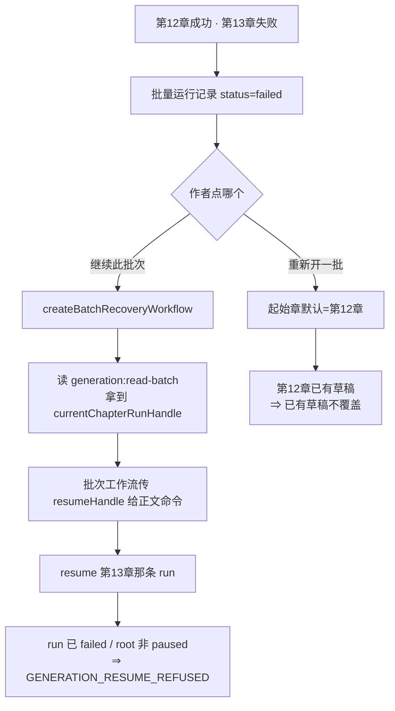

> 状态：已实施（2026-11-09 · 甲方案落地；乙方案、丙方案与 §8 其余项仍未定）
> 上级稿：缺陷来源 [`live-pipeline-acceptance-defects-assessment.md`](../product/live-pipeline-acceptance-defects-assessment.md)（D2 批次静默的同族问题）· [`2026-11-07-batch-acceptance-plan.md`](../product/2026-11-07-batch-acceptance-plan.md) §7.1.2（A1 实机读数）
> 关系：与 [`d2-run-lease-abort-design.md`](./d2-run-lease-abort-design.md) 相邻但不重叠 —— D2 管「主进程判死后状态怎么落」，本稿管「落完之后作者还能不能接着干」。

# 批量创作中断后无法续跑（设计稿）

## 0 一句话

**批量写到一半失败，界面给了「继续此批次」，但那个按钮指向一条已经关闭的路；重新开一批又从第一章重来、撞上「已有草稿不覆盖」。两条路都走不通，作者只能手工一章一章来。**

## 1 ④ 现行方案改下去会造成什么结果（先讲后果，再讲机制）

A1 实机验收在这一条上卡死，直接后果有三层：

1. **验收做不完**：批量「1/3」就是当前上限 —— 只要有一章失败，剩下的章节再也批不出来。这不是模型好坏的问题，是流程没有出口。
2. **作者的活变成手工**：想接着写，只能逐章点「生成」，每章都要重新选范围、重新确认。批量本来省的是这个动作，失败之后一次都没省到。
3. **失败被读成「我的操作错了」**：界面既没说「这一批到这里就结束了」，也没说「你可以从第 13 章重新开一批」。作者看到的是一个报错码，第一反应是「我点错了」，而不是「系统缺一条路」。

## 2 ① 实际操作流程（作者视角，四步）

以 A1 实机那次为例（`2026-11-07` 22:1x–23:37，副本项目）：

1. 在生成面板选「草稿待审」模式，起始第 12 章、连写 3 章，点执行。
2. **第 12 章成功**（1,583 字入库），进度条走到 1/3。
3. **第 13 章失败**，被重演守卫挡下（`DRAFT_PREVIOUS_ENDING_REPLAY`）。
4. 作者回头处理：
   - 点运行记录上的 **「继续此批次」** → 弹 `GENERATION_RESUME_REFUSED`；
   - 改用生成面板 **重新开一批**，起始章仍是 **第 12 章** → 撞「第 12 章已有草稿，批量创作不会覆盖既有内容」。

## 3 ② 卡点：哪一步不符合操作预期

| 作者以为 | 实际 |
|---|---|
| 「继续此批次」＝接着第 13 章往下写 | 它去**续第 13 章那条已经失败的运行**，被主进程按设计拒绝 |
| 失败只影响失败的那一章，其余照旧 | 整批在这里终止，且**界面不宣布终止** |
| 重开一批时起始章会自动跳过已有草稿的章 | 起始章需要作者自己填，默认还停在上次的第 12 章 |

**一句话**：卡点不是「缺一个按钮」，是**「这一批写到哪儿了」这件事只活在运行记录里，界面没有把它变成下一条路的起点**。

## 4 机制取证（代码只作证据，不作叙述主线）

读法：两条路各自走进一个**按设计就该拒绝**的分支 —— 所以这不是「守卫太严」，是**入口选错了对象**。

| 环节 | 位置 | 事实 |
|---|---|---|
| 批量恢复工作流的起点用的是**批次原始起始章** | `draft-recovery-workflow.ts:82-91`（`startChapterNumber: progress.range.startChapter`） | 已完成的章靠「跳过」容错（`batch-chapter-workflow.ts:198`），本身能跑 |
| 真正会炸的是把**上一章那条失败的 run** 当续跑对象 | `batch-chapter-workflow.ts:272`（`resumeHandle: progress.currentChapterRunHandle`） | 恢复时它仍指向第 13 章那条已 terminated 的 run |
| `resume` 的拒绝条件 | `generation-run-repository.ts:789-791` | `run.status==='aborted'` → `GENERATION_RUN_ABORTED`；`root.status !== 'paused'`（含已 sealed / 有 `dispatch-marked` attempt）→ `GENERATION_RESUME_REFUSED` |
| 「继续此批次」只判来源没变更 | `AIOutputPanel.tsx:445-455`（`disabled={busy \|\| !batch.sourceCurrent}`） | 不判「这一批是否已终止」，所以按钮在失败后仍是可点的 |
| 复用已有草稿的判定 | `batch-chapter-workflow.ts:247-253` | `existingDraft` 存在且不是本次 `saved` ⇒ 抛「已有草稿」 |

> **这是定位结论，不是已实机复核的定论**：以上读码能解释 A1 那两次报错，但本轮没有重跑复现。裁定后第一步应是**用探针复现一次**（起批量 → 第 2 章人为失败 → 看 `read-batch` 返回的 `currentChapterRunHandle` 与那条 run 的 `status`），把这一栏坐实再动代码。

## 5 ③ 想怎么改（产品意图，不是实现手段）

**要保住两条流程线，而不是把它们压成一个选择：**

- **线 A「接着写」**：这一批还没结束，失败只是其中一章 —— 作者应该能**从失败的那一章重新发起**，前面已完成的章原样保留，不需要重选范围。
- **线 B「换个起点」**：作者判断这一批已经废了，想从任意一章重新开始 —— 界面必须**自动把起点推到第一张没有草稿的章**，而不是让他撞墙之后再自己算。

两条线**不冲突**，它们只是两个不同的起点。把它们压成「继续 / 重开」二选一，就是章程 §11.4 说的那种伪冲突。

## 6 三条候选修法（按代价从小到大）

| # | 做法 | 作者的体验 | 代价 / 风险 |
|---|---|---|---|
| **甲** | 只补文案 + 补默认值：「继续此批次」在批次已终止时**禁用**并写清「这一批已停止，从第 13 章重新开一批」；生成面板的起始章**默认取下一张没有草稿的章** | 两条路都还在，只是不再指错方向；作者少算一次 | 最小改动，不碰运行记录与 resume 语义。**缺点**：仍然是「重开一批」而不是「接着这一批」，批次编号会变 |
| **乙** | 让「继续此批次」在**批次已终止**时改走「新开一批，起点 = `nextChapterNumber`」，不传 `resumeHandle` | 体验最顺：点一下就从第 13 章接着写，已完成章保留 | 要改恢复工作流的分支（终止 vs 暂停）；要确认新批次与旧批次的关系怎么对外表述（两批？还是同一批续期？），会动 `generation_batches` 的语义 |
| **丙** | 把「进度」从运行记录提到批次实体上，批次可以跨多次运行活着（暂停 / 终止 / 续跑成为状态机） | 最彻底，语义最干净 | 动数据模型与状态机，属结构改动，至少一期；且与 D2 的租约语义要重新对齐 |

**建议：本轮走甲，把乙列为下一期。** 理由：

1. 甲能立刻解开 A1 —— 验收要的是「能接着写」，不是「批次编号不变」。
2. 乙的真实难点不是代码，是**产品表述**：新开的批次与旧批次是什么关系？这个得作者定，不能我替他定。
3. 丙不该现在动：`aborted` 刚在 D2 里定成终态（作者 2026-11-04 裁甲），此时再改批次生命周期，会把两条语义搅在一起。

## 7 若采纳甲，下一步动哪几处

1. `src/components/panels/AIOutputPanel.tsx`：批次卡片增加「已终止」判定，按钮禁用 + 一句出路文案（中英双写）。
2. `src/services/workflows/draft-recovery-workflow.ts`：`createBatchRecoveryWorkflow` 对已终止批次给明确错误码（不是 `GENERATION_RESUME_REFUSED` 原样抛），让界面能区分「你自己按错了」与「这一批结束了」。
3. 生成面板起始章默认值：取「第一张没有草稿的章」，不再是上次的值。
4. 单测三处：终止批次按继续 → 新错误码；起始章默认值；已完成的章仍被跳过。

## 8 待裁定

| # | 问题 | 影响 |
|---|---|---|
| 1 | 走甲还是乙？（我建议甲） | 决定本轮动 3 处 UI/文案，还是动恢复工作流分支 |
| 2 | 若将来走乙：新开的批次与旧批次对外算**一批**还是**两批**？ | 决定要不要动 `generation_batches` 语义 |
| 3 | 第 13 章这种「模型弱点导致的失败」，重开一批时要不要**自动跳过它**？ | 会变成「静默跳章」，我不建议默认做，需作者定 |

## 9 未验证 / 不做

- **未实机复现**（见 §4 末的定位结论）：`currentChapterRunHandle` 在失败后到底还指不指向那条 run，需一次探针确认。
- **不做**：不加重试按钮（重跑同一章会再撞同一守卫，等于让作者空转）、不改重演守卫的判据（D12 已结案，判定为模型弱点）、不动 `aborted` 的终态语义。

## 10 甲方案落地回填（2026-11-09）

作者 2026-11-09 裁**甲**，WorkBuddy 在 `wt-2` 实现、DSH 中控验收后合入主线。交付报告：[实验记录](../../experiments/batch-resume-plan-a-delivery-20261109.md)。

| 稿 §7 计划 | 实际落地 |
|---|---|
| 1. 批次卡片「已终止」判定 + 按钮禁用 + 出路文案 | ✅ `src/services/batch-interrupt-resume.ts:48` `evaluateBatchRecoveryGate`（终态 = `failed`/`cancelled`/`aborted`，`paused` 仍可续）+ `AIOutputPanel.tsx:449-467` 中英双写出路文案。**不新增 IPC 字段**：`generation:list-batches` 的 `rootHandle.runId` 与 `generation:list` 的 `view.handle.runId` 同源，同一 effect 里已有两个返回值 |
| 2. `draft-recovery-workflow.ts` 给可区分的新错误码 | ⏸ **未做**（有意）：按钮已禁用，主路径不再走到 `GENERATION_RESUME_REFUSED`；再加错误码要多读一次 run 状态，等于两份判定真相。留给「绕过 UI 的调用方」出现时再补 |
| 3. 起始章默认取「第一张没有草稿的章」 | ✅ `firstChapterWithoutDraft`（`batch-interrupt-resume.ts:18`，按占用集合连续顺延、遇空章即停，不用 `max+1`）+ `readBatchStartChapter`（`:70`）；`BatchChapterCreationDialog.tsx:133`（显示）与 `:179`（真正启动的 `frozenStart`）共用，避免「显示第 13 章、实际从第 12 章开跑」 |
| 4. 单测三处 | ✅ `src/services/__tests__/batch-interrupt-resume.test.ts` 12 例（首章顺延 5 例 + 终止判定 7 例）；`pnpm test` 在 develop 实测 `12 passed` |
| `pnpm check:fast` | ✅ typecheck 通过（合并后 main 分支实测） |

**甲方案已知缺点（界面已说明）**：重开一批会生成**新的批次编号**，文案中英双写写明。**§8 三项待裁定仍然有效**（尤其第 3 项「要不要自动跳过必然失败的章」——本批有意不做，避免静默跳章）。**未实机复现**（红线禁 `pnpm dev`），机制结论来自读码 + 主进程返回结构，与 §9 一致。
