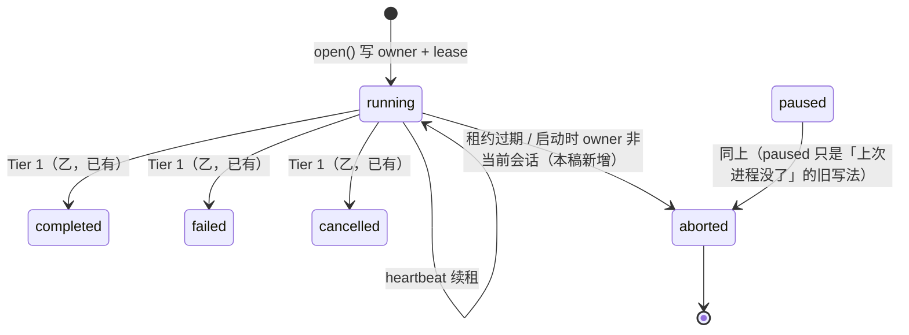

# D2 方案甲 · 给生成批次加执行租约，让「异常退出」有可落库的终态

> 状态：已裁定（2026-11-04 · 作者选甲）· 范围：迁移 + 仓储 + fence + 8 条单测；心跳与 A4 交互未开工
> 上级稿：[`live-pipeline-acceptance-defects-assessment.md`](../product/live-pipeline-acceptance-defects-assessment.md) §D2（`:155`）
> 前置稿：同稿「处置：方案乙（已实施，2026-11-02）」（`:221`）—— **本稿只补乙没覆盖的那一半，不重做乙**
> 作者裁定：2026-11-04 选「甲」（给 `generation_runs` 加租约，对齐 `import_runs` 已有机制）

---

## 0. 一句话结论

方案乙已经把「正常收尾」的终态收敛到渲染层一处（Tier 1），**但异常退出（崩溃 / 关窗 / 渲染层静默中断）仍然没有终态** —— 这类 run 会一直是 `running`，直到下次启动被 `recoverInterrupted()` 抹成 `paused`。本稿给 `generation_runs` 加 `execution_owner` / `execution_epoch` / `lease_expires_at` 三列（与 `import_runs` 同名同义），把「主人已死」判成明确的 `aborted` 终态。

**这不是在乙之外另开一个写入点，而是乙管不到的那条路径。** 乙的写入点要求「工作流还在跑」才能执行；进程崩了就没有工作流了。

---

## 1. 先划清：乙做到了什么、没做到什么

> 这一节只做引用与归类，不重述乙的设计理由（原文在上位稿 `:221-265`）。

| 场景 | 乙（已实施）的表现 | 是否需要甲 |
|---|---|---|
| 工作流正常完成 | Tier 1 写 `completed` | 不需要 |
| 步骤失败 / 取消 | Tier 1 写 `failed` / `cancelled` | 不需要 |
| 会话失效 | Tier 1 写 `failed` | 不需要 |
| **进程崩溃 / 关窗 / 渲染层静默中断** | run 停在 `running`；重启后被 `recoverInterrupted()` 写成 `paused` | **需要** |
| **应用没重启、只是工作流断了**（渲染层热重载、bug 中断） | 无任何变化，永久 `running` | **需要** |

乙的源码注释已经把这个缺口写明了（`generation-run-repository.ts:738-739`）：

> 「只把「还活着」的 run 打回 paused。`recoverInterrupted()` 每次启动都会调它，少了这个条件就会把 seal 刚写好的 completed / failed 抹回 paused」

即：**乙是让 `pause()` 别抹掉终态；甲是让「没终态的」能有一个终态。**

### 1.1 一个必须先接受的语义事实：`paused` 不等于「中止」

上位稿的原话（`:210`）：「状态机缺少一个『已中止』的状态：目前只有 running / paused / cancelled / sealed，`paused` 由启动恢复写入、语义是「进程没了」，不承载「这一批因为 X 失败」」。

甲要做的事，本质是**把「进程没了」这个已有语义落成一个独立终态**，而不是继续借用 `paused`。

---

## 2. 目标契约

### 2.1 三列的定义（与 `import_runs` 逐字对齐）

| 列 | 类型 | 语义 | 与 `import_runs` 的一致性 |
|---|---|---|---|
| `execution_owner` | `TEXT NOT NULL DEFAULT ''` | 认领这条 run 的执行者身份（进程会话 ID） | 同名同义（`baseline-schema.ts:645`） |
| `execution_epoch` | `INTEGER NOT NULL DEFAULT 0` | 认领次数。每次换主人 +1，用于识别「同一条 run 被不同会话接管过」 | 同名同义（`:646`） |
| `lease_expires_at` | `INTEGER NOT NULL DEFAULT 0` | 租约到期时刻（ms）。`0` = 无人持有 | 同名同义（`:647`） |

### 2.2 状态转移（只增加一条箭头）



一句话读法：**只多了一条「主人已死 ⇒ aborted」的箭头，其余四条都是乙已经落地的。**

### 2.3 `aborted` 需要新增为合法取值

`GenerationSealOutcome`（`src/shared/generation-owner-contract.ts:379`）今天是：

```ts
export type GenerationSealOutcome = 'completed' | 'failed' | 'cancelled'
```

需要加上 `'aborted'`。**影响面**（必须逐个改）：

| 落点 | 要做什么 |
|---|---|
| `generation-owner-contract.ts:379` | 加 `'aborted'` |
| `generation-run-repository.ts` 里 `DurableGenerationRun.status` 的字面量联合 | 加 `'aborted'` |
| 所有对 `status` 做 `switch` / `includes` 的位置 | 逐个确认 `aborted` 落入正确分支（见 §5 验收） |

> **为什么不用 `failed` 代替**：`failed` 今天被 Tier 1 用来表示「工作流跑到了失败分支」，需要区分「跑过但失败」与「根本没跑完就死了」。混用会让「这批到底有没有产出」在库里再次失去答案 —— 那正是 D2 要消除的东西。行业侧同构做法：Temporal 的 `TimedOut`、Airflow 的独立 `aborted` 标记、K8s Job 的 `BackoffLimitExceeded`，都是把「超时/失联」与「业务失败」分开记。

---

## 3. 实施方案

### 3.1 迁移：**M30**（不能复用 M29）

上位稿 `:262` 明确预留了编号：

> 「下一期若要做，需新增 `terminal_code` 列（**M29**），别直接写 `blocked_code`」

⇒ M29 已归 `terminal_code`。本稿用 **M30（29 → 30）**，`LATEST_SCHEMA_VERSION` 同步 29 → 30。

迁移形态**照抄 `import_runs` 的幂等补列**（`baseline-schema.ts:636-648`），因为老项目的 `generation_runs` 建表语句里没有这三列：

```ts
const generationRunColumns = new Set(
  (db.prepare('PRAGMA table_info(generation_runs)').all() as Array<{ name: string }>).map(c => c.name),
)
const addGenerationRunColumn = (name: string, definition: string) => {
  if (generationRunColumns.has(name)) return
  db.exec(`ALTER TABLE generation_runs ADD COLUMN ${name} ${definition}`)
  generationRunColumns.add(name)
}
addGenerationRunColumn('execution_owner', "TEXT NOT NULL DEFAULT ''")
addGenerationRunColumn('execution_epoch', 'INTEGER NOT NULL DEFAULT 0')
addGenerationRunColumn('lease_expires_at', 'INTEGER NOT NULL DEFAULT 0')
```

### 3.2 代码落点（五处）

| # | 文件 | 改什么 | 为什么在这里 |
|---|---|---|---|
| 1 | `electron/migrations/m30-generation-run-lease.ts`（新建） | 上述补列 + `verify` 断言三列存在 | 迁移只做 DDL |
| 2 | `generation-run-repository.ts` `open()`（`:284`） | 插入 run 时写 `execution_owner = 当前会话`、`execution_epoch = 1`、`lease_expires_at = now + TTL` | run 的诞生点 |
| 3 | 同上，新增 `renewLease(runId, owner)` | `UPDATE ... SET lease_expires_at=? WHERE run_id=? AND execution_owner=?`；影响行数 0 表示租约已被别人接管，返回 `false` | 续租的唯一写入点 |
| 4 | 同上，`recoverInterrupted()`（`:761`） | 在 `pause(id)` **之前**加一道 fence：`status IN ('running','paused')` 且（`execution_owner <> :currentOwner` 或 `lease_expires_at <= :now`）⇒ `status = 'aborted'` | 乙已经在这里把 running 抹成 paused，是本该判死的位置 |
| 5 | 渲染层 `workflow-store.ts` | `activeRuns` 非空时起一个 60s 心跳，调 `generation:heartbeat`；清空时停 | 见 §3.3 |

### 3.3 心跳为什么必须由**渲染层**发（本稿最容易做错的一处）

主进程 `main-generation-owner.ts`（1481 行）**今天没有任何定时器**（`grep setInterval\|setTimeout` 为空）。直觉上「执行在主进程，心跳也该在主进程」，但那会治不了主症状：

| 谁来发心跳 | 渲染层崩了 / 关窗 | 主进程崩了 | 结论 |
|---|---|---|---|
| 主进程 | **它还在跳** ⇒ 租约永不过期 ⇒ 判不出死 | 心跳自然停 ⇒ 能判 | **治不了最高频场景** |
| 渲染层 | 心跳停 ⇒ 租约过期 ⇒ 判 `aborted` | 渲染层也没了 ⇒ 心跳停 ⇒ 能判 | **两个场景都能判** |

理由：**真正驱动工作流的是渲染层** —— `workflow-store.ts` 是状态机，乙的 Tier 1 收口也放在那里（「唯一能同时看到 completed 与 failed 的地方」）。主进程只是执行器，它不知道「这一批还有没有意义」。所以「主人」= 渲染层的 workflow 会话。

> **与作者口径的一处对齐**：作者选甲时说的是「前端心跳续租」，与本节的结论一致。本节只是补上「为什么不能放主进程」的论证。

### 3.4 取值

| 参数 | 取值 | 依据 |
|---|---|---|
| 心跳间隔 | **60s** | 一次模型调用 3–4 分钟（D9 有 12 分钟未返回的个例），心跳频率要远高于此，但不能太密以免刷 IPC |
| 租约 TTL | **180s** | = 3 × 心跳间隔。容忍两次心跳丢失仍不误判 |

> **这两个数是工程默认值，不是行业标准值** —— 未在任何出处查到小说生成场景的租约配比。可调，但必须满足 `TTL ≥ 3 × 心跳间隔`。

### 3.5 一个必须说清的限制

租约只能判「**应用整体**死了」，判不了「**应用活着但某个 run 卡住**」（例如模型调用挂住 12 分钟 —— D9 那个个例）。后者要的是「单次调用超时」，属于另一条缺陷，本稿不覆盖。

---

## 4. 两处黑名单：核过了，**都不会被这次改动踩到**

按项目红线，加列前必须过两处黑名单。逐条核对结论：

| 黑名单 | 它管哪些表 | `generation_runs` 加列会不会踩 | 依据 |
|---|---|---|---|
| `PROJECT_CORE_NON_CONTENT_COLUMNS`（`electron/services/generation-source-binding.ts:58`） | **只作用于 `project_core`** —— 源码是 `SELECT * FROM project_core WHERE id='main'` 后 `without(raw, …)`（`:383-384`） | **不会**。`generation_runs` 不参与来源指纹，本改动不在 `project_core` 上加列 | 逐字读过调用点 |
| `VERSION_BOOKKEEPING_COLUMNS`（`electron/services/sqlite-project-migration.ts:137`） | 只登记四张表：`blueprints` / `volume_handoffs` / `project_core` / `drafts` | **不会**。`generation_runs` 不在这张表里，且它不在 `postLegacyTables`（M02/M03/M05）中 ⇒ 它的列不进入 `preIdentity` 的版本簿记 | `isPostIdentityColumn()`（`:145-148`）只查这张映射表 |

**但这不是"不用验"的理由。** `m01-project-upgrade` 的 `fixture()` 走**真实老库升级路径**（`initializeLegacyBaselineSchema` + `migrateSchema(..., 1|4|5)`），加列会改变 `domain()`（`:159-167`）算出的列集合。**已实测基线：该文件 13 条全绿**（命令与读数见 §7）。改完必须复跑同一个命令，绿才算过。

---

## 5. 验收标准

| # | 判据 | 怎么验 |
|---|---|---|
| 1 | 迁移幂等：老库（v1/v4/v5）升级后有这三列且 `DEFAULT` 正确 | `m01-project-upgrade.test.ts` 全绿（13 条基线） |
| 2 | `open()` 写入的 `lease_expires_at > now`，`execution_owner` 非空 | 新增 repository 单测 |
| 3 | 心跳续租后 `lease_expires_at` 变大；非本人 owner 续租返回 `false` 且不改库 | 新增单测 |
| 4 | fence：`running` + 过期租约 ⇒ `aborted`；`running` + 有效租约 ⇒ **不动** | 新增单测（两条都要） |
| 5 | fence 不误杀刚写好的 `completed` / `failed` / `cancelled` | 新增单测（乙的回归用例 `pause()` 那条要一起跑） |
| 6 | `aborted` 出现在所有读 `status` 的地方，未知值仍走 `GENERATION_RUN_STATUS_INVALID` | `tsc --noEmit` + 全库搜 `status ===` 逐个核 |
| 7 | 全局闸门 | `node scripts/check-fast.mjs` |

---

## 6. 历史脏数据

上位稿记的是 **36 条 `running` 无终态**（`:39`，2026-11-01 读数）。乙落地（11-02）后这些可能已被改成 `paused`，**需要用当前库重新实测，不能沿用旧数**。

处置建议（按当前实测结果二选一）：

- 若已全为 `paused`：**一次性迁移里不碰**，交给新增的 fence 在下次启动时判 `aborted`（`paused` + 无 owner ⇒ 过期租约 ⇒ 判死）。这样历史数据的处理逻辑与运行时是同一条代码路径，不会出现「迁移脚本和业务规则各说一套」。
- 若仍有 `running`：同上，fence 会覆盖；**不写一次性 UPDATE**。

> 理由：一次性 UPDATE 无法区分「真的是历史脏数据」与「刚崩不久的活批次」，而 fence 有 owner/租约判据。

---

## 7. 实测记录

**基线（改动前，2026-11-04）**：

```
$ env -u CODEBUDDY_SAFE_DELETE_BULK_STATE_DIR -u CODEBUDDY_TOOL_CALL_ID \
    node scripts/run-tests-electron.mjs electron/services/__tests__/m01-project-upgrade.test.ts
 ✓ ... 13 passed (13)   Duration 24.70s
```

> ⚠️ **必须带 `env -u`**：不带时同一条命令报 `9 failed | 4 passed`，失败栈全部落在 `fs.rmSync` 的 cleanup（safe-delete 阈值），不是断言。**判基线前先看栈落在哪。**

改动后读数待本节追加。

---

## 8. 待作者裁定（3 项，其中 1 项阻塞开工）

| # | 分叉 | 选项 | 本稿倾向 |
|---|---|---|---|
| **A1（阻塞）** | `aborted` 是新取值，还是复用 `failed` + `code` | ① 新增 `'aborted'`（要改 `GenerationSealOutcome` 与所有分支）② 复用 `'failed'`，原因放 `blocked_code` | **①**。②会重蹈 D2 的病：`blocked_code` 是门禁字段，写进去等于掐断续写与恢复（上位稿 `:262` 已警告过同一件事） |
| A2 | 心跳载体 | ① 渲染层 `workflow-store`（本稿 §3.3）② 主进程 owner ③ 不加心跳、只靠启动时 fence | **①**。③能治「崩溃后重启」，治不了「应用活着但工作流断了」，而那是最常见的一种 |
| A3 | 历史数据 | ① 交给 fence，不写一次性 UPDATE ② 迁移里一次 UPDATE 到位 | **①**，理由见 §6 |

三项里只有 **A1** 会改变代码骨架，A2/A3 不点头也能先按倾向做。

---

## 9. 实施记录（2026-11-04）

### 9.1 已落地

| 项 | 落点 | 状态 |
|---|---|---|
| M29 迁移（三列，幂等补列） | `electron/migrations/m29-generation-run-lease.ts` | 已实现 |
| 注册（`registry` / `desktop-registry` / `MigrationId` / 两个版本号 → 30） | `electron/migrations/registry.ts`、`desktop-registry.ts`、`src/shared/project-storage.ts` | 已实现 |
| `open()` 写 owner / epoch / 租约 | `generation-run-repository.ts` | 已实现。**顺带修掉一处隐患**：原 `INSERT INTO generation_runs VALUES(?,?,?,?,?,?)` 靠位置对齐，加列后会在运行时才炸 |
| `renewLease(runId)` | 同上 | 已实现，尚未接 IPC |
| 启动 fence（`recoverInterrupted` 内，pause 之前） | 同上 | 已实现 |
| `aborted` 进入 `RUN_STATUS` 值域 | 同上 | 已实现 |

**实测**（每条都带 `env -u CODEBUDDY_SAFE_DELETE_BULK_STATE_DIR -u CODEBUDDY_TOOL_CALL_ID`）：

| 命令 | 读数 |
|---|---|
| `m01-project-upgrade.test.ts` | **13 passed**（改动前后一致 ⇒ 加列未破坏老库升级，§4 的黑名单结论被验证） |
| `generation-run-seal.test.ts` | **12 passed**（方案乙的回归锁全绿） |
| `generation-run-lease.test.ts`（新增 8 条） | **8 passed** |
| `tsc --noEmit` | 0 error |

新增 8 条的覆盖面：open 认领 / 续租推进 / 他人续租返回 false 且不改库 / 过期判 aborted / 有效租约走 paused / 老数据 owner 空判死 / 不误杀三种既有终态 / seal 不翻转 aborted。

> fixture 的一处必要改动：`generation-run-seal.test.ts` 原来直接用冻结的 `M01_GENERATION_SQL` 建表，没走 M29 ⇒ fence 语句引用不到新列。已改为「M01 建表 + `applyM29GenerationRunLease`」，即**真实老库的升级路径**。不要为了让它过而改 M01（那是冻结的历史迁移）。

### 9.2 实施中发现的分叉：**`aborted` 今天还不是终态**

**探针实测**（临时用例，跑完已删）：

```
AFTER_FENCE=aborted    RESUME_ERROR=null    AFTER_RESUME=running
```

即：fence 把 run 判成 `aborted` 之后，调 `resume()` **不报错，静默把它改回 `running`**。原因在 `resume()`（`generation-run-repository.ts` 的既有实现）只检查 `budget.root.status !== 'paused'`，**从不看 `run.status`**；而 fence 只改 run、不改 root，所以 root 仍是 `paused`，resume 照常放行。

这不影响「启动时判死」这个主症状（fence 确实写了 aborted），但让 `aborted` 的语义变成「一个随时会被推翻的标记」，而不是终态 —— 与 §2.3 的设计意图不符。

**两个方向，需要作者定（A4）**：

| 选项 | 做法 | 后果 |
|---|---|---|
| **A4-①** | `resume()` 显式拒绝 `aborted`（`fail('GENERATION_RESUME_REFUSED')`） | `aborted` 成为真终态。但作者点「继续」会看到报错 ⇒ **必须有 UI 引导**（提示"这批已中止，请重新开始"并给出入口），否则等于把静默失败换成硬失败 |
| A4-② | 保持现状（aborted 可被 resume 复活） | 不动 UI，但 `aborted` 退化成「paused 的一个别名」，D2 要消除的「库里没有答案」会部分回流 |

本稿倾向 **A4-①**，但它是**产品行为变更**，不与代码改动绑在一起 —— 代码可以先按①写死 `resume` 拒绝，UI 引导单独排。

### 9.3 明确未做（不当作已完成）

- **心跳 IPC 与渲染层定时器**（§3.2 第 3 项的调用方、第 5 项）：`renewLease()` 已可用，但渲染层还没有人调它。**当前后果**：租约在 `open()` 之后不再续，任何跑超过 180s 的 run 在下次启动时都会被判 `aborted` —— 判据里「owner 不是本进程」那条仍然正确，但「租约过期」这条实际等价于「跑得久」。
  ⇒ **在接上心跳之前，`gap` 是真实的**：这不影响本稿已验收的任何测试（它们显式推进时钟），但实机会有个「长批次被误判」的窗口。
- **UI 展示 `aborted`**：库里有了新状态，界面上还没有对应文案。

### 9.4 一个被这次实施照出来的语义含混（A5，不影响功能，但影响「库里说得准不准」）

fence 的 WHERE 包含 `paused`，因为 D2 记录的历史脏数据正是 `paused` 形状（进程没了 → 启动时被 `recoverInterrupted` 写成 paused）。但 `paused` 现在同时承载两种完全不同的情形：

| 来源 | 作者的本意 | fence 判 aborted 对不对 |
|---|---|---|
| 启动恢复写入（上个进程崩了） | 这批没人在跑 | **对** |
| 作者点「暂停」后关应用 | 我待会儿还要继续 | **不对**，但 `resume()` 能复活，功能不坏 |

**功能上不会坏**（§9.2 已证 resume 能复活），坏的是「库里这个状态说明不了是哪一种」。真正的解法是给 `paused` 加一个来源标记（如 `paused_reason`），那是另一列、另一个迁移，**本稿不夹带**。

⇒ 当前实现的净效果：**「启动时把没人拥有的 run 从 `running` 里清出去」这件事成了；「作者主动暂停」与「进程崩了」在库里仍然分不开。** 后者比 D2 原症状轻得多（至少不再有永远 running 的幽灵行），但仍不是终点。
