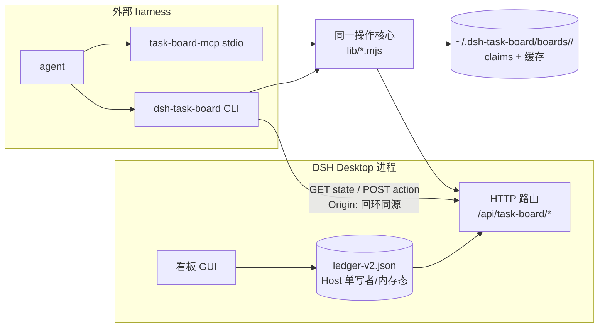
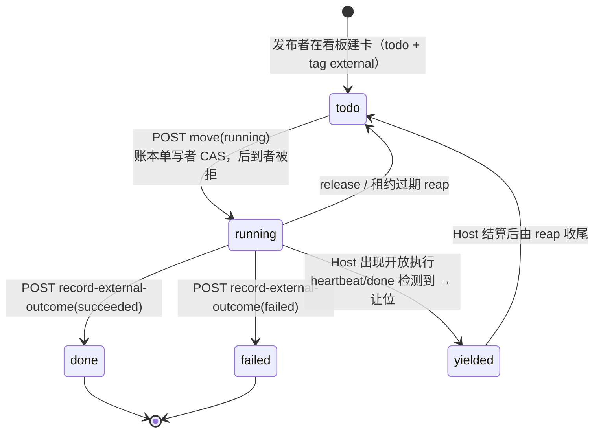

# 跨 Harness 看板接入设计：外部 agent 的「拉取—认领—回写」通道

> 状态：已实施（2026-11-03）
> 关系：本文是跨 harness 协作通道的总设计；落地后配套操作手册放 `docs/agents/task-board-channel.md`，与 [`copilot-channel.md`](../../agents/copilot-channel.md)、[`doubao-channel.md`](../../agents/doubao-channel.md) 并列。
> 范围：**同机**（本机回环）的外部 agent 通过现有 DSH 任务看板拉取任务；**不改 DSH、不改看板插件、不做主动派发**。本文只定方案与契约，不改产品代码。

## 0. 一句话读法

DSH 看板继续当唯一任务账本；外部 agent 用 `dsh-task-board` CLI（或它的 MCP 壳）执行 `next → 干活 → tag/release（交 review）或 done`；看板的单写者账本保证「移列」本身是原子认领，本地租约文件负责「谁在做、做到什么时候、重试用哪个 requestId」；看板本身只收到三种合法 action：`move`（认领/释放列）、`update`（改标签，交 review）、`record-external-outcome`（结算回写）。

## 1. 背景与问题

### 1.1 现状

任务看板不是 DSH 核心，而是 desktop profile 里的第三方双面 cordis 插件：

| 事实 | 落点 |
|---|---|
| 插件与版本 | `~/.dsh/profiles/desktop/node_modules/@linxin666/dsh-client-ui-task-board` v0.4.14（Apache-2.0，`src/` 随包发布） |
| Host 半 | 跑在 Electron 主进程内（desktop host），与 Web GUI 同进程 |
| 账本 | `~/.dsh/task-board/ledger-v2.json`（schemaVersion 7），**全量常驻内存 + 单写者文件锁**；`load()` 只在构造时执行，无 `fs.watch`、无 mtime 重读 |
| 提交方式 | `commit()`：revision+1 → 临时文件 → fsync → rename；外部直写 JSON 会被下一次 commit 覆盖，且 `recentRequests` 幂等缓存一并损坏 |
| 对外 HTTP | `GET /api/task-board/state`、`GET /api/task-board/events`（SSE）、`POST /api/task-board/action`，另有 parse/verification/attachments 路由 |
| 守卫 | 回环 socket + 回环 Host + 浏览器同源标记（`sec-fetch-site: same-origin` 或任意 `Origin` 头或 `dsh-auth-*` cookie）；插件注释自称 **"tripwire, NOT an authority check"** |
| 认证 | 外层 DSH 认证只覆盖 `/` 与 `/api/<connection-channel>`；看板路由不要求 launch token 或 cookie |
| 端口 | Desktop host 启动 Host 时硬编码 `--port 0`（OS 随机分配），URL 只存在于主进程内存；会话内 shell 有 `DSH_WEB_URL` 环境变量 |
| 看板身份 | `/state` 的 `scheduler.ledgerId` 是账本级稳定 id（实测 `0bdbb2fa-…`），可用于识别「是不是同一块看板」 |

实测（2026-11-03，Desktop 运行时 0.2.1-rc.2 / 看板 0.4.14）：

```text
GET  /api/task-board/state                       → 403 {"ok":false,"error":"forbidden"}
GET  /api/task-board/state  + Origin: 同源        → 200 全量快照（revision 77）
GET  /api/task-board/state  + Origin: evil.example → 403
POST /api/task-board/action + Origin（空 envelope） → 400 invalid-action（已过闸，仅请求体不合法）
GET  /api/task-board/events + Origin             → 200 text/event-stream + 首帧
```

结论：**外部进程今天就能读写看板**，缺的不是通道，而是一层「外部 agent 会用的操作契约 + 认领语义」。

### 1.2 现有缺口

看板 action 是给 GUI 与 DSH 会话设计的，直接拿来给外部 agent 用有四个问题：

1. **没有认领记录**。`move` 只是列变更；账本的单写者串行让 `todo → running` 天然成为一次 CAS（后到者因 `from === to` 被拒），但没有任何地方记录「谁认的、租到什么时候、失败重试用哪个 requestId」。
2. **没有外部执行的过程态**。`record-external-outcome` 只在结束时落一条 `external` 执行记录并派生终态列；执行中只能靠 `move` 到 running 表示「有人在做」。
3. **DSH 仍可接管**。`run`/`rerun` 只看是否有开放执行，不看列；人/DSH 对一张已被外部认领的卡再跑一次，会开出第二条 Host 执行（外部侧只能检测到并让位）。
4. **没有适配层**。不同 harness 的接入方式不同（shell / MCP 配置格式各异），逐个写集成不可维护。

## 2. 目标 / 非目标 / 反目标

**目标**

- G1 外部 agent 能发现可认领任务（发布式，不主动派发）。
- G2 同一张卡不会被两个外部 CLI 同时执行（看板单写者 CAS）；DSH Host 若接管，外部执行能检测到并让位。
- G3 外部 agent 完成后，看板卡片进入正确终态，并留下可审计的 `external` 执行记录（谁、结果、摘要）。
- G4 接入方式尽量通用：一个 CLI 覆盖所有带 shell 的 harness；一个 MCP stdio 壳覆盖 MCP 原生 harness；两者共用同一套操作契约。
- G5 故障可恢复：agent 崩溃/超时后任务能回收，不会永久卡在 running；端口变化后 CLI 能重新找到看板，且不会写到另一块看板。
- G6 为将来「DSH 当调度中心」留同一个契约，不需要改外部 agent 的用法。

**非目标**

- N1 不做主动派发（看板不 push、不启动外部 harness 进程）。
- N2 不改 DSH 与看板插件；不依赖看板插件内部服务 `ctx.taskBoard`。
- N3 不做跨机/远程接入（回环 HTTP 仍是本机能力）。
- N4 不做看板 `run`/`rerun`（那是 Host 启动 DSH 会话的路径，外部 agent 自己干活）。
- N5 不新增任务评论/进度上报；执行中只用卡片列为 running 表达，结束时一条 summary（+ 可选报告文件路径）。
- N6 不改 GUI，不新增账本字段。
- N7 不阻止 DSH 在外部认领期间接管卡片（只能检测并让位；彻底互斥要改插件或上 B 方案）。

**反目标（出现即算失败）**

- A1 直接读写 `ledger-v2.json`（必然覆盖/损坏）。
- A2 自己维护一份「任务真相」以替代看板（双源）。
- A3 要求每个 harness 写定制集成代码（必须 CLI/MCP 二选一即可接入）。
- A4 认领静默竞争（两个外部 CLI 跑同一张卡且都认为归自己）。
- A5 把 `Origin` 当安全边界（它只是同机信任的 tripwire）。
- A6 伪造 `dsh-auth-*` cookie 或读 `~/.dsh/.credentials.yaml` 的签名密钥来绕过认证。
- A7 连到一块不同的看板（端口复用/第二个 DSH home）并写下去，而无 ledgerId 校验。

## 3. 约束

- C1 Host 是唯一写者；所有变更只能走 `POST /api/task-board/action`，读取走 `GET /state`（SSE 可选）。
- C2 看板是第三方插件，任何语义扩展都要落在客户端侧，不能假设插件配合。
- C3 `Origin` 守卫是 tripwire：本机任何进程都能伪造。方案的安全等级是**同机信任**，不是权限边界。
- C4 同机多进程并发是常态（多个 harness、多个 CLI 实例），认领必须依赖账本的单写者串行，而不是本地锁。
- C5 外部 harness 的 shell 环境不保证有 `DSH_*` 环境变量；URL 必须可显式配置、可发现、可缓存。
- C6 Desktop 模式每次启动 Host 都用 `--port 0`（随机端口），URL 只在主进程内存；`dsh web` CLI 模式才支持 `--port` 固定。因此**不能假设端口稳定**。
- C7 发布者与执行者可能对同一张卡同时操作（人手动移列、DSH 会话运行），外部状态必须能检测并让位。
- C8 零依赖、纯 Node ESM（本机 Node 24；目标 Node ≥ 20），Windows/macOS/Linux 同机可用。
- C9 卡片字段是看板插件的 wire 协议（schemaVersion 7）；本文只消费公开字段，不假设私有结构。

## 4. 方案对比与选择

| 方案 | 做法 | 代价 | 结论 |
|---|---|---|---|
| **A. 纯客户端（选中）** | `dsh-task-board` CLI + MCP 壳；走现有 HTTP action；`move` 认领，本地租约记录归属/过期/重试 | 依赖 tripwire 门口；无法阻止 Host 接管；无进度/评论 | ✅ 当前需求全覆盖，零插件改动，1–2 天可跑 |
| B. 体内桥插件 | 在 DSH host 里跑 bridge plugin，消费 `ctx.taskBoard`（插件注释明确支持「remote bridge」），自开 loopback HTTP/MCP，claim 单进程原子 | 要改 desktop profile、代码进 host 进程、绑 `taskBoard` API v1 与插件 0.4.x；开关关闭即失效 | 后置：唯一不可替代价值是未来调度、真认证、与 Host 真互斥 |
| C. 上游改插件 | 给看板加 `claim/heartbeat` action + agent token | 受第三方节奏；现在并不缺数据模型 | 暂不采用 |

**选择 A，理由**：当前需求是「同机、发布式、拉取、回写」，A 全部满足；B 的最大价值（调度中心、真认证、互斥）可以等需求出现再做，且 A 定义的契约就是 B 的实现契约，不会白做。C 在 A 跑通后若有上游价值再单独提案。

## 5. 设计

### 5.1 分层与数据流



读法：**所有写都落到看板的 action 路由，本地目录只放「谁在认领、租到何时、用哪个 requestId」**；CLI 和 MCP 是同一核心的两个壳，不存在第二套读写路径。

### 5.2 看板定位与身份校验

因为端口每次启动都可能变，CLI 必须先「找到看板」并证明「是同一块看板」：

解析顺序（`resolveBoard()`）：

1. `--url`（显式指定，最高优先）。
2. `DSH_BOARD_URL` 环境变量。
3. `DSH_WEB_URL` 环境变量（DSH 会话内 shell 自带；从 DSH 启动的外部 harness 会继承）。
4. 缓存 `~/.dsh-task-board/config.json` 的 `{url, ledgerId}`：先 `GET /state` 验证可达且 `scheduler.ledgerId` 一致，不一致则丢弃。
5. **自动发现**：枚举本机回环监听端口（优先 DSH 进程名下的端口），逐个探测 `GET /api/task-board/state`（带该端口的 `Origin`），接受返回 `schemaVersion === 7` 快照的那个；若命中多个，要求 `--url` 指定，不猜。
6. 全部失败 → 退出码 4，提示「DSH 未运行 / 找不到看板 / 需要 --url」。

身份校验：本次连接拿到 `ledgerId` 后，与缓存和各 claim 文件里的 `boardLedgerId` 比对；不一致 → 退出码 4（**绝不写到另一块看板**）。成功后把 `{url, ledgerId, schemaVersion, savedAt}` 写回缓存（0600）。

`dsh-task-board doctor` 打印：解析到的 URL、`ledgerId`、`schemaVersion`、`revision`、`timeZone`、当前 agent、claims 目录、租约默认值；任一关键项失败退出 4。

### 5.3 认领与租约状态机



读法：**认领的原子性来自看板本身**（单写者账本上 `todo → running` 只有一次能成功），本地租约文件不承担 CAS，只承担归属、过期与幂等重试。

认领文件（`~/.dsh-task-board/boards/<ledgerId>/claims/<taskId>.json`，0600，tmp+rename 原子写）：

```json
{
  "schemaVersion": 1,
  "taskId": "…",
  "agentId": "copilot:doc-runner",
  "boardLedgerId": "0bdbb2fa-…",
  "boardUrl": "http://127.0.0.1:62185",
  "claimedAt": 1793635000000,
  "startedAt": 1793635000000,
  "leaseUntil": 1793638600000,
  "pid": 12345,
  "host": "DESKTOP-XXX",
  "moveRequestId": "…",
  "outcomeRequestId": "…"
}
```

- `startedAt` 是外部侧真实开工时间：看板的 `record-external-outcome` 会把 `startedAt = endedAt = now`（报告时间），真实开工只在本文件里。
- `outcomeRequestId`：`done/fail` 首次生成后写回；重试复用，配合看板 `recentRequests` 幂等。
- 崩溃窗口：`move` 已成功但 claim 文件没写成 → 卡片 running、无 claim；`reap` 用 `task.updatedAt`（move 写入）加租约宽限判定后移回 todo。claim 文件存在但卡片已不 running → 删 claim，不碰卡。

### 5.4 CLI 契约（`dsh-task-board`）

通用约定：

- 入口：`node scripts/task-board/dsh-task-board.mjs <command>`；同时提供 `dsh-task-board.cmd` / `dsh-task-board` shim（安装方式见 §9）。
- 身份：`--agent` > `DSH_BOARD_AGENT`；**所有写命令必须显式有身份**，缺失即报错（不做隐式默认）。
- 输出：默认人读；`--json` 输出单行 JSON 到 stdout（机器消费），日志一律 stderr；`NO_COLOR` 生效。
- `requestId`：`crypto.randomUUID()`；`done/fail` 重试复用 claim 里的 id。
- URL/身份解析：见 §5.2；所有命令先过身份校验。

| 命令 | 作用 | 关键参数 | 退出码 |
|---|---|---|---|
| `doctor` | 自检 URL/看板/ledgerId/agent/claims 目录 | `--discover` `--json` | 0/4 |
| `list` | 列卡（默认 todo、未归档、未隐藏） | `--column` `--tag` `--query` `--json` | 0/4 |
| `get <taskId>` | 单卡全文（含 prompt/executions） | `--json` | 0/4 |
| `next` | **认领**下一张可认领卡并返回 | `--tag external` `--lease 60m` `--no-auto-reap` `--json` | 0 成功 / 2 无可认领 / 3 冲突 / 4 看板不可用 |
| `claim <taskId>` | 认领指定卡 | `--lease` | 0/3/4 |
| `heartbeat <taskId>` | 续租 + 校验卡片仍 running、无 Host 执行 | `--lease` | 0/3/4 |
| `done <taskId>` | 回写成功终态并释放 | `--summary` `--report` `--json` | 0/3/4 |
| `fail <taskId>` | 回写失败终态并释放 | `--summary` `--report` | 0/3/4 |
| `release <taskId>` | 放弃认领，卡片回 todo | `--reason` | 0/3/4 |
| `tag <taskId>` | 增删标签，可一并 release 回 todo（交 review） | `--add` `--remove` `--release` `--json` | 0/3/4/5 |
| `mine` | 列本 agent 的租约及卡片状态 | `--json` | 0/4 |
| `reap` | 回收过期租约/失配认领/无 claim 的 running 卡 | `--dry-run` | 0/4/5 |
| `watch`（可选 v1.1） | 基于 SSE 打印变更 | `--once` | 0/4 |

`next` 算法（顺序固定）：

1. `GET /state`，取得 `revision` 与 `ledgerId` 并校验。
2. 机会式 `reap`（`--no-auto-reap` 关闭）。
3. 过滤候选：`status === 'todo'`、`archivedAt == null`、`hidden !== true`、`tags` 含 `--tag`（按 `tags[i].name` 比较）、`schedule?.enabled !== true`（调度卡归 Host）、`prompt` 非空。
4. 按 `createdAt` 升序（先发布的先做）。
5. 逐个尝试 `POST move(running)`；被拒（别人先认领/状态已变）则继续下一个。
6. move 成功 → 写 claim 文件（失败则尽力 move 回 todo 并报错）。
7. 输出该卡完整 JSON（含 prompt、workspaceId、tags）；若标签带 `promptPrefix`，一并输出为 `tagHints`（外部 agent 可采纳，看板只在 Host 执行时注入它）。

`reap` 规则（幂等，按 claim 文件 + `running` 卡逐个判定）：

| 情形 | 动作 |
|---|---|
| 卡片已不是 running（人已移列/已完成） | 删 claim，不碰卡 |
| 卡片 running、最后一次执行 `endedAt` 缺失（Host 正在跑） | 删 claim，让位给 Host |
| 卡片 running、无开放执行、`leaseUntil` 未过期 | 保留 |
| 卡片 running、无开放执行、租约过期 | `POST move(todo)` → 删除 claim |
| claim 文件损坏/空 | 视为过期，按上一条处理 |
| 卡片 running、无 claim 文件、`updatedAt` 早于租约宽限 | `POST move(todo)`（崩溃窗口回收） |

### 5.5 MCP 工具面（`task-board-mcp`）

stdio、零依赖、newline-delimited JSON-RPC；stdout 只允许协议帧，日志走 stderr。环境变量与 CLI 相同，直接调用同一核心（不 spawn CLI）。

| 工具 | 语义 | 必填参数 |
|---|---|---|
| `task_board_list` | 列卡，返回精简数组 | — |
| `task_board_get` | 单卡全文 | `taskId` |
| `task_board_next` | 认领下一张；无任务返回 `{claimed:false}` | — |
| `task_board_claim` | 认领指定卡 | `taskId` |
| `task_board_heartbeat` | 续租 | `taskId` |
| `task_board_done` | 回写成功 | `taskId`、`summary` |
| `task_board_fail` | 回写失败 | `taskId`、`summary` |
| `task_board_release` | 放弃 | `taskId`、`reason` |
| `task_board_tag` | 增删标签，可一并 release（交 review） | `taskId`、`add[]`、`remove[]`、`release` |
| `task_board_mine` | 我的租约 | — |
| `task_board_reap` | 回收过期租约 | `dryRun` |
| `task_board_doctor` | 自检 | — |

工具描述里必须写清「先 `task_board_next` 认领，完成必须 `task_board_done`/`task_board_fail`，长任务要 `task_board_heartbeat`，Host 接管时退出并让位」。

### 5.6 任务发布与回写约定

发布者（人，在 GUI；或 DSH 会话，用 `task_board_create`）负责把任务变成「可认领」：

- 卡片放 **todo** 列，打标签 **`external`**（CLI 默认过滤这个标签；可 `--tag` 覆盖）。标签在 wire 上是 `{name, promptPrefix?}` 对象，CLI 按 `name` 过滤；`promptPrefix` 会打印给外部 agent 作为附加提示。
- prompt 必须自包含（外部 agent 没有 DSH 会话上下文）：目标、工作目录、允许/禁止的操作、验收标准。
- 需要外部 agent 自己跑的活，不要给卡片挂 `schedule`（调度卡由 Host 消费，CLI 默认跳过；且带 schedule 的卡即使外部成功回写也会落回 todo，而不是 done）。
- 允许 subtasks：tag 打在需要被认领的那张卡上；父卡不自动认领。

回写约定：

- `done`/`fail` 要求**本 agent 持有本地 claim**，且卡片仍为 `running`；Host 已结算（开放执行消失、列已变）或人已把卡移走时拒绝回写（exit 3），不覆盖 Host 结论；崩溃丢失 claim 的卡由 `reap` 回收后重新认领。
- `done` 必填 `--summary`（≤1000 字，超长看板会静默截断，CLI 直接报错）。summary 建议写成一行结论；完整交付报告（四段：改动清单 / 执行记录 / 原始输出 / 未做的事）由 agent 写入工作区文件，并在 `--report <path>` 传入；CLI 把 `报告：<path>` 追加进 summary（总长仍 ≤1000）。
- 注意：看板把 summary 存进执行记录的 `error` 字段并按错误样式渲染（插件实现），所以成功记录的 summary 也会显示成一行「错误样式」文字；summary 用中性措辞，别让人误判失败。
- 报告文件路径约定：放在该卡工作目录内、文件名含 `taskId`（例如 `<workspace>/.dsh-task-board/reports/<taskId>.md`）；发布者按此约定取件。

**交 review（作者 2026-11-03 定）**：执行者干完**不得自己 `done`**（那会把卡直接推进 Done，跳过人的复核）。正确做法是写报告 + 一条命令交 review：

```bash
dsh-task-board tag <taskId> --add review --remove external --release
```

`tag` 走看板 `update` action 的 `tags` 整组替换（元素是 `{name, promptPrefix?}`，上限 8），`--release` 再把卡从 running 还回 todo 并清本地 claim。必须同时去掉 `external`，否则下一个 agent 会再次认领它。

复核者用 `review` 一条命令定去留（2026-11-03 02:5x 起）：`review <taskId> --pass --note "…"` 会清标签 + 以自己身份 `claim` + `done`（落 `external` 执行记录，`initiatedBy` 是复核者）；`review <taskId> --rework --note "…"` 把卡变 `[external, rework]` 送回池子，判词随 `next` 的 hints 打给下一个 worker。纯人工在 GUI 移 Done 不产生 summary，报告文件是唯一凭证。禁止的是执行者自结算，不是复核者留结论。

**职责分离（2026-11-03 03:3x 补）**：交回时 `tag --add review` 会把 `handedBy` 与 `finishedAt` 一起写进 `timeline/<taskId>.json`；`review` 比对当前 `--agent`，**同名 exit 3**。所以干活的和复核的必须是两个身份（`workbuddy:worker` / `workbuddy:reviewer`）。前提要认：`--agent` 是自报字符串、无法认证，这条只拦"顺手自己过一下"，拦不住冒名 —— 真正的防线是派活时不给 `review`/`done` 权限 + timeline 双名字可审计。无 `handedBy` 的老卡放行，不猜。

### 5.7 失败与恢复

| 场景 | CLI 行为 | 退出码 |
|---|---|---|
| DSH 未启动 / 找不到看板 | 明确提示「看板不可达，检查 DSH 是否运行或给 --url」 | 4 |
| 403（tripwire 收紧或 Origin 不匹配） | 提示「看板访问被拒；可能 DSH 升级收紧了同源守卫，见降级 §7」 | 4 |
| 404 / 插件未启用 | 提示看板未挂载 | 4 |
| ledgerId 与缓存/claim 不一致 | 提示「连到了另一块看板，已拒绝写入」 | 4 |
| `next` 无符合条件的卡 | 正常空结果（不报错） | 2 |
| move 被抢 / 卡片状态已变 | 提示冲突并继续或让位 | 3 |
| `heartbeat`/`done`/`fail` 发现开放执行（Host 接管） | 让位：删 claim、不写外部结果 | 3 |
| 卡片已被 Host/人结算（无开放执行、列已变） | 拒绝回写并删 claim，不覆盖已结算的结论 | 3 |
| 本地 claim 缺失（崩溃后） | 拒绝 `done`/`release`；等 `reap` 回收卡片后重新 `claim` | 3 |
| `reap` 未给身份 | 用法错误；不执行任何回收、不动 claim | 5 |
| `record-external-outcome` 被拒（卡片已归档等） | 提示原因，claim 留给 reap | 3 |
| 网络超时后重试 `done`/`fail` | 复用 claim 里的 `outcomeRequestId`；若看板已落外部记录则按成功返回（`recovered: true`） | 0 |
| CLI 崩溃 | 租约自然过期，`reap`/下次 `next` 回收 | — |

## 6. 安全边界

- 本方案的信任等级 = **同机信任**：任何本机进程都能伪造 `Origin` 调看板。CLI 只防「误操作/并发」，不防恶意进程。
- 不读取、不伪造 `dsh-auth-*` cookie，不碰 `~/.dsh/.credentials.yaml`；不走 `/connect` 的 operator 路径。
- 自动发现只探测**本机回环**监听端口，只发 `GET /api/task-board/state`，短超时、无副作用；优先只探测 DSH 进程名下的端口。
- 租约文件与看板 prompt 同属本机可读数据，不放密钥；`~/.dsh-task-board` 权限 0700、文件 0600。
- agent 身份是**客户端自述**（看板的 `initiator`/`initiatedBy` 同样如此），审计用途，不是权限；长度上限 200，超长按用法错误拒绝（board 的信封有更短上限）。
- **同机所有 agent 必须共享默认状态目录** `~/.dsh-task-board`（不要在单个 harness 里覆盖 `DSH_BOARD_STATE_DIR`）：租约互不可见时，`reap` 的 orphan 宽限只剩回收方自己的 lease（默认 60 分钟），可能误收一张仍在 heartbeat 的卡。这是已知限制，不是可配置的安全边界。
- 残余竞态：`done` 的「卡片仍 running」检查与 `record-external-outcome` 写入之间仍有毫秒级窗口；Host 若恰在此间结算，外部结果可能覆盖 Host 结论。`reap` 在执行回收前会重读租约/卡片，但同样不是真原子。彻底互斥要 B 方案。
- 跨机是另一期：需要在看板插件层做认证或走 B 方案，不在本文范围。

## 7. 降级与将来演进

- **tripwire 收紧**（上游把 `Origin` 检查升级为真认证）：CLI 的传输层接口 `BoardTransport` 可整体替换为 B（体内桥插件，loopback + 真 token）；操作契约不变，外部 agent 用法不变。`dsh-task-board` 的错误信息里固定提示这条迁移路径。
- **DSH 当调度中心**：调度器用同一契约 `next/claim/heartbeat/done`；未来可把「派发」实现为 B 或 host 内置 runner，但外部 worker 仍按拉取式接入。
- **跨机**：优先 B（自带认证的桥），其次在反代 + `trustForwardedProxy` 上另立安全评审。
- **上游 C**：若看板插件愿意加 `claim/heartbeat` action + agent token，可把本地租约文件降级为兼容层或直接删除。

## 8. 测试与验收

**自动化（`node --test`，零依赖）**

- 用 `node:http` 起假看板：实现 `/state`、`/action`（含 Origin 守卫、action 校验、幂等缓存、单写者串行、revision），记录请求。
- 单元：候选过滤（tags 对象、hidden/archived/schedule）、租约过期计算、reap 判定表、URL 解析与缓存、ledgerId 校验、action envelope 构造、退出码映射。
- 并发：spawn N 个 `next` 子进程对一个假看板抢同一张卡，断言恰好一个成功、其余退出 2（或 3）。
- 幂等：`done` 超时重试复用 `outcomeRequestId`，假看板断言只产生一条执行记录。
- 发现：伪造 `netstat`/`ss` 输出，断言只探测回环端口、缓存写对、多候选时报错。
- MCP：起 `task-board-mcp` 子进程，走 `initialize → tools/list → tools/call` 冒烟。
- 文档：`node scripts/check-fast.mjs` 通过（状态行、索引登记、链接）。

**实机验收（人工，逐条打勾）**

- V1 `dsh-task-board doctor` 在桌面版运行时报出 revision / schema 7 / ledgerId / 解析到的端口。
- V2 人在 GUI 建一张 tag `external` 的卡；两个 agent 同时 `next`，只有一个拿到；GUI 上卡变 running。
- V3 拿到卡的 agent 跑完 `done --summary --report`；GUI 上卡进 done，执行历史出现 `external` 记录与 initiator；发布者能按 summary 里的路径读到报告。
- V4 认领后 kill 进程，等租约过期，`reap` 把卡移回 todo 并清理 claim。
- V5 认领后人手动把卡移到 done → `heartbeat` 报冲突，`reap` 只删 claim 不碰卡。
- V6 认领后 DSH 运行同一张卡 → `heartbeat` 退出 3 并让位，`done` 不再写外部结果。
- V7 重启 DSH（端口变化）→ `doctor`/`next` 重新找到看板。
- V8 指向另一块看板（第二个 DSH home 的 `dsh web`）→ ledgerId 不一致，退出 4，无写入。
- V9 关掉 DSH → `doctor` 以退出码 4 给出可读原因。
- V10 用 Copilot CLI / Qwen Code 各配一次 MCP，完成一次真实小任务（改文件 + 验证），结果回写看板。

## 9. 实施切分与影响文件

建议六步，每步可独立验收：

1. `lib/transport.mjs` + `lib/actions.mjs`：HTTP/Origin/错误映射/幂等 requestId；假看板测试。
2. `lib/identity.mjs`：URL 解析、自动发现、缓存、ledgerId 校验。
3. `lib/claims.mjs` + `lib/select.mjs`：租约记录、过期判定、候选过滤、reap；并发测试。
4. `lib/ops.mjs` + `dsh-task-board.mjs`：`next/claim/heartbeat/done/fail/release/reap/doctor/list/get/mine`。
5. `mcp.mjs`：stdio 协议 + 12 个工具；冒烟测试。
6. 文档与接入：本稿转「已实施」+ 配套 `docs/agents/task-board-channel.md`（各 harness 的 MCP/CLI 接入片段、任务书骨架、验收清单）。

影响文件（实施阶段才动）：

- 新增 `scripts/task-board/`（`dsh-task-board.mjs`、`mcp.mjs`、`lib/*.mjs`、`test/*.test.mjs`、`dsh-task-board.cmd`）
- 新增 `docs/agents/task-board-channel.md`
- 更新本稿状态行与 `docs/README.md` §4.7
- 不涉及 `src/`、`electron/`、`src/shared/`

工作量：约 2–3 天（含测试与一次真实跨 harness 验收）。

## 10. 留给 builder 的决定

以下不阻塞方案，builder 可自行定：

- 默认标签名 `external` 是否改为 `claimable`（本文默认 `external`）。
- `next` 是否默认机会式 reap（本文默认是，`--no-auto-reap` 关闭）。
- 默认租约 60 分钟、heartbeat 建议间隔 10 分钟是否合适。
- 自动发现的实现细节（进程名匹配、端口枚举命令、探测超时）；多候选时按本文报错不猜。
- v1 是否包含 `watch`（本文标为可选）。
- shim 安装方式：仓库内 `dsh-task-board.cmd` + 文档写绝对路径，还是 `pnpm link` 到用户 PATH。
- 测试是否纳入 `pnpm test` 默认集合，还是仅 `node --test scripts/task-board/test`。

## 11. 修订记录

- 2026-11-03 初稿 + builder check；据评审修正：`move` 即 CAS（租约不承担 CAS）、tags 为对象、`hidden`/`archived` 过滤、`promptPrefix` 输出、`record-external-outcome` 的 startedAt/endedAt 语义、summary 存在 `error` 字段的显示怪癖、端口每次启动变化与 ledgerId 身份校验、Host 接管时让位。
- 2026-11-03 作者裁定：CLI / MCP 服务名统一为 `dsh-task-board`，源码目录 `scripts/task-board/`，本地状态目录 `~/.dsh-task-board/`；报告 = summary + 工作区文件；看板定位 = 自动发现 + ledgerId 校验。进入实施。
- 2026-11-03 作者追加 review 规则：**执行者不得自己 `done`**，干完只写报告 + 交 review（当时叫 `tag 待review --release`，现为 `tag --add review`）；由人/调度者复核后再进 Done（详见 §5.6）。为此新增 `tag` 子命令与 `task_board_tag` MCP 工具。
- 2026-11-03 02:5x 简报增补（对应 `docs/agents/task-board-channel.md` §4.5 / §7）：标签统一为全英文 `external|review|rework|I1-3|trace`；新增 `review --pass|--rework --note` 与 `task_board_review`（第 15 个工具）；**容器卡不可认领**落成硬闸（有未完成子卡 ⇒ `next`/`claim` 都拒）；子卡深度按部署现状（两层）不改插件配置。
- 2026-11-03 03:3x 补职责分离（§5.6）：交回落 `handedBy`，`review` 拒同身份复核；同时删掉「结论由我定」的表述 —— 共享文档里的"我"会被任何读者代入，对弱模型等于免责许可（详见手册 §5.2 / §5.3）。

## 12. 实施记录（2026-11-03）

**已交付**（`scripts/task-board/`，零依赖 ESM）：

| 文件 | 职责 |
|---|---|
| `lib/transport.mjs` + `lib/errors.mjs` | HTTP/Origin、超时、状态码 → `BoardError` 映射、退出码 |
| `lib/identity.mjs` | URL 解析、回环端口自动发现、缓存、`ledgerId` 校验 |
| `lib/claims.mjs` + `lib/select.mjs` | 租约文件（0600，tmp+rename）、候选筛选、reap 判定（纯函数） |
| `lib/ops.mjs` | `next/claim/heartbeat/done/fail/release/tag/mine/reap/doctor`，CLI 与 MCP 共用 |
| `dsh-task-board.mjs` | CLI（12 个命令、`--json`、退出码 0/2/3/4/5），附 `.cmd` / POSIX shim |
| `mcp.mjs` | stdio JSON-RPC，12 个 `task_board_*` 工具 |
| `test/` | 假看板 + 72 条测试（transport/identity/claims/ops/cli/mcp） |
| `docs/agents/task-board-channel.md` | 接入手册（各 harness 配置片段、发布约定、worker 循环、故障让位） |

**验证**：

- `node --test scripts/task-board/test/*.test.mjs` → 72 pass / 0 fail（含并发认领、Host 接管让位、丢失响应重试、MCP 端口变更恢复、ledgerId 串板、tag/release、MCP stdout 纯度）。
- 实机只读冒烟：`dsh-task-board doctor --json` 自动发现 `http://127.0.0.1:62185`、`ledgerId=0bdbb2fa-…`、`schemaVersion=7`、`revision=77`；`list --json` 正常返回。
- 独立评审（Copilot CLI 1.0.105，read-only）后修正：`done`/`fail` 必须持有本地 claim 且卡片仍 running（Host 结算后拒绝覆盖）；解析到的 `ledgerId` 在首次操作即校验（防止解析后 URL 漂移）；`release` 无 claim 拒绝；HTTPS 明确拒绝；MCP 不再响应无 id 的 notification；`reap` 执行前重读租约/卡片。
- 第二轮独立评审（subagent，read-only，同一快照）后修正：MCP 在 `unreachable`/`not-mounted`/`board-mismatch` 时丢弃已缓存的 transport 并重解析（长驻 MCP 不再被 DSH 重启打死，写操作只提示重跑不自动重放）；`done`/`fail` 丢失响应的重试按「看板已落本 agent 外部记录」返回成功而不是冲突；`reap` 入口先要求身份（不再半途 exit 5）；`claim` 补上与 `next` 相同的落卡回滚；agent 身份 200 字符上限按用法错误拒绝；schemaVersion 改为 `>= 7` 并在旧 schema 时给出可读错误；补了 claim/CLI reap+mine+get/丢失响应/schema 版本等测试。
- 作者 2026-11-03 追加 review 规则后实现 `tag` 子命令（CLI `tag --add/--remove/--release`，MCP `task_board_tag`）：走 `update` 的 `tags` 整组替换（保留 `promptPrefix`、上限 8、空数组用 `null` 清空），`--release` 一并把卡还回 todo 并清 claim；补了单元/CLI/MCP 测试。执行者交 review 用它，复核者可用自己身份 `claim + done` 留 summary。
- 未做：真实跨 harness 端到端（Copilot / Qwen 的 MCP 实跑）；`watch` 按设计为可选未实现；代码提交待作者确认。

**与设计稿的差异**：MCP 工具名用 `task_board_*`（与产品名一致），CLI 名字与目录按 2026-11-03 裁定改动；`done`/`fail` 在评审后收紧为「必须持有本地 claim + 卡片仍 running」；HTTPS 在 v1 明确拒绝（只支持回环 HTTP）；按作者 2026-11-03 review 规则新增 `tag` 子命令与 `task_board_tag` 工具（交 review 不再需要人工 GUI 打标签）；其余按 §5 实现。

## 附录 A：实测与代码依据（2026-11-03）

- 平台：DSH Desktop 运行时 0.2.1-rc.2，`dsh --version` 为 0.1.1-rc.2（npm CLI），看板插件 0.4.14，Web GUI `http://127.0.0.1:62185`。
- 账本：`~/.dsh/task-board/ledger-v2.json`，`schemaVersion: 7`，`revision: 77`；`scheduler.ledgerId = 0bdbb2fa-af3a-4544-b25b-78f299d2b217`；锁文件 `ledger-v2.lock` 记录运行中的 pid。
- 端口：`app.asar` 内 `@deepseek-ai/dsh-desktop-host/lib/index.js` 的 `main()` 以 `args: ["--no-open","--host","127.0.0.1","--port","0"]` 启动 Host；`dsh-web-app` 注册 `DSH_WEB_URL` shell 变量并在 `printUrl` 时打印带 token 的 URL。
- 探针：见 §1.1 代码块；`Origin` 与 Host 必须同源（`new URL(Origin).host === Host`），回环地址通过。
- 代码依据：`host-routes.ts:227-247`（守卫）、`loopback.ts:72-92`（回环判定）、`protocol.ts`（action 枚举与 envelope，`EXTERNAL_SUMMARY_MAX_LENGTH = 1000`）、`host-ledger.ts:467/522/524/1852-1877`（内存态 + 单写者 + commit）、`host-ledger.ts:1152-1163`（move 拒同列/归档/开放执行）、`host-ledger.ts:1181-1191`（外部结果写入 `error` 字段）、`core/tasks.ts:729-731`、`core/tasks.ts:907-911`（带 schedule 的外部成功落回 todo）。

## 附录 B：看板 action 清单（本方案只用 `move`、`update`（tags）与 `record-external-outcome`）

`import, create, update, delete, move, archive, restore, settle, reset-verification, record-external-outcome, set-schedule, run, rerun, rework, confirm-permission, set-parent, rename-tag, delete-tag, extension-action`

`record-external-outcome` 语义（插件 README）：写一条真实执行记录（`external: true`，无 session），终态列由该记录派生；拒绝条件：卡片有开放执行（Host 仍在跑）或已归档。`initiatedBy` 必填且 ≤200 字符，`summary` ≤1000 字符。
