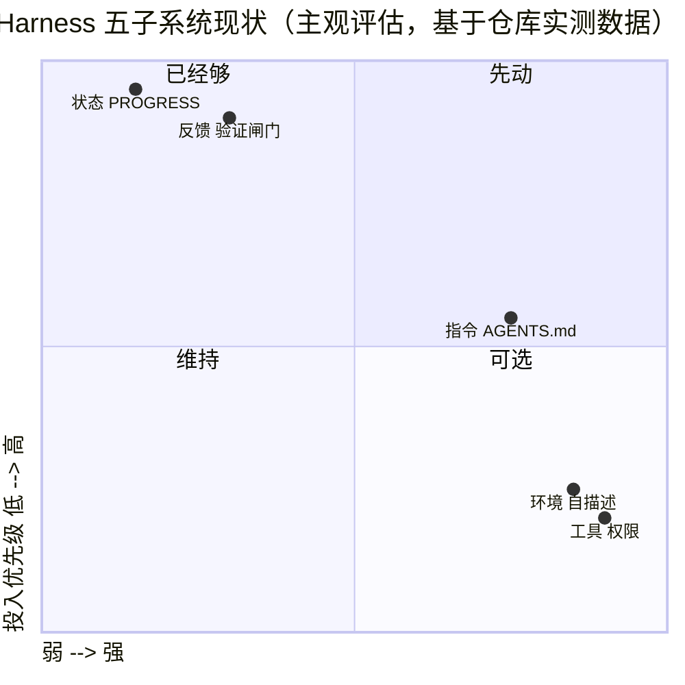
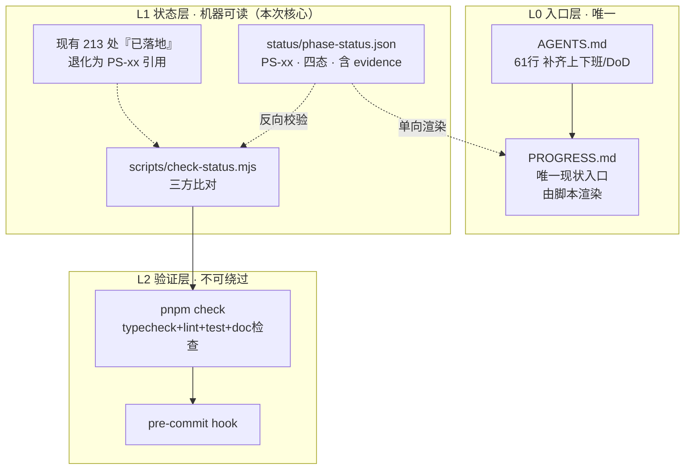

# Harness 重整方案：从「文档堆积」到「状态可裁决」

> 状态：已实施 · 2026-10-31 · **仅 A 档的一半**（受控词表 + `C1b` 校验 + pre-commit 快档闸门）；B / C 档见 §七.1
> 依据：Learn Harness Engineering 讲义 L02/L03/L04/L05/L08/L09/L12 + `skills/harness-creator` 五子系统模型
> 范围：v1 只出方案。**§七 是本轮复测 + 作者裁定 + 落地记录**——数字以 §七 为准，§一～§六 保留原样以便对照。
> 面向的问题：文档已出现管理失控迹象——同一事实在多处说法不一，且无任何环节能自动发现

---

## 一、为什么现在必须管：一个可复现的漂移实例

不是「感觉乱了」，是有一处能被 `git show` 当场复盘的失守。

**事实：`e704a697`（HEAD）宣称「P2-2 期 2 完成」，改了 20+ 个代码文件。同一件事现在有 4 种说法：**

| 载体 | 原文 | 结论 |
|---|---|---|
| commit message `e704a697` | 「读取侧判定与三道闸（**P2-2 期 2 完成**）」 | 完成 |
| 主稿 `upstream-version-and-derived-invalidation-design.md:3` | 「期 1 已落地……**期 2 未开工**」 | 未开工 |
| 子稿 `upstream-invalidation-phase2-source-ref-and-read-gates.md:3` | 「**设计稿 v2，只写文档未改代码**」 | 未开工 |
| 工作记忆 `MEMORY.md` | 「上游失效期 2 **已收口**」 | 已完成 |

`AGENTS.md` **硬规则第 3 条**明确写着「收口一期要改『所有』写着该期状态的位置」。规则存在，仍然失守。

**这个实例说明了本方案的全部立论**：规则写在 AGENTS.md 里，是**可以被忽略的文档**；它不是**不可绕过的闸门**。讲义 L08 的原话是：「文档是给人看的，原语是给系统用的。文档可以被忽略，原语不能被绕过。」

所以本方案的主线不是「再补一份更全的管理文档」，而是：**把「状态」从 Markdown 里抽出来，变成机器可读、脚本可校验的数据**，现有文档里的状态表述退化为指向它的引用。

---

## 二、诊断：五子系统打分

> 读法：讲义定义的五个子系统，本仓库强弱极不均衡——**环境与工具已经很强，状态与反馈是两条短腿**，而短腿恰好解释了上面那处漂移为什么没被拦住。



| 子系统 | 现状 | 实测证据 | 判 |
|---|---|---|---|
| **指令** | `AGENTS.md` 61 行 + 8 条硬规则 + 路由表 | 61 行，符合 50–200 行建议 | ✅ 强，但**缺上下班流程与 Definition of Done**（讲义 L05/L12 的最低件） |
| **工具** | 全工具可用，无阉割 | 434 个 electron 脚本可跑 | ✅ 强 |
| **环境** | `package.json` + `predev` 自动探测 Electron ABI | 新人起环境基本无障碍 | ✅ 强（本仓库最好的一面） |
| **状态** | **9 个「当前状态」候选入口并存**，无一是权威 | `docs/README.md` · `plans/00-OVERVIEW.md` · `plans/NOVEL-QUALITY-CURRENT.md` · `plans/prompt-assembly-backlog.md`(1913 行) · `novel-quality-program-2026-09-13/CURRENT.md` · `research/.../current-spec-index.md` · 3 份 `00-START-HERE.md` · 27 份 `handoffs/*.md` | ❌ **主病灶** |
| **反馈** | 有 `typecheck`/`test`/`lint`，但**无统一 `check` 入口**；4 个文档校验脚本不在 `scripts` 别名里，靠人记得跑 | `check-doc-links.mjs` / `check-doc-placement.mjs` / `check-i18n-coverage.mjs` / `audit-prompt-overrides.mjs` 均需手写 `node scripts/...` | ❌ **第二病灶** |

### 状态层的量化病灶

| 指标 | 实测 | 说明 |
|---|---|---|
| 「已落地」字样出现总次数 | **213 次 / 56 个文件** | 每一处都是一处潜在漂移点，全部手维护 |
| 「当前状态」候选入口 | **9 个** | 新会话无法判断该读哪个 |
| `START-HERE` / `MASTER-PLAN` | 3 + 3 份（含 2 个冻结子树） | 冻结子树仍在主索引可见范围内 |
| `handoffs/` 累积 | 27 份（10-19 ~ 10-30） | **只增不回收**，且类型混杂（progress / plan / results / log / baseline） |
| 唯一台账 | `prompt-assembly-backlog.md` **1913 行** | 巨型状态文件，信噪比低 |
| 二级索引 | `docs/README.md` 354 行 / 59.8 KB | 超出「入口 ≤200 行」建议近一倍 |
| 机器可读状态文件 | **0 个** | 无任何 `feature_list.json` / `PROGRESS.json` |

### 两个被忽略的结构性问题

**① `.workbuddy/memory/` 完全不入库**（`.gitignore:42`），可是它承载了全部红线。

```
.workbuddy\memory\MEMORY.md              12 KB   ← 每次会话强制注入
.workbuddy\memory\notes\prompt-engineering.md  236 KB  ← 按需读的单文件
.workbuddy\memory\                   合计 ~1.4 MB
```

讲义 L03 的原话是「不在仓库里的信息，对 agent 来说等于不存在」。这里形成了一个**双事实源**，且更膨胀、更常读的那一半不在版本控制里：换机 clone 后全部丢失，也无法 diff、无法 review、无法回滚。它还自己发展出「滚动迁出」机制（已滚 28 轮）来逃避体积上限——这是典型的**定期清理缺位后长出的补丁**。

**② 根目录 13 个孤儿临时文件**，其中 1 个已被 git 追踪：

```
.tmp-agent-probe-full.log  .tmp-probe-g-9b.log  .tmp-probe-g-wblocal.log
.tmp-probe-wblocal.log     .tmp-probe.json      .tmp-run-tests.mjs
.tmp-wb-local.json         .tmp-wb-tools.json
step3.log  step56.log  step56b.log  step6.log  verify.log
```

讲义 L12 的观察完全击中这里：「下一个会话看到一堆杂物，根本分不清哪些是有意的、哪些是垃圾。」

---

## 三、目标结构：三层，主线是「减」不是「加」

> 读法：入口层只有一个门，状态层从 Markdown 迁到 JSON 并由脚本单向渲染，验证层把散落的校验命令收成一个 `pnpm check` 并挂到 pre-commit——文档不再自己持有状态，只持有指向。



### L1 的核心数据模型（待评审拍板）

每个「期 / 批次 / 子项」在 JSON 里是一条五元组，直接对应讲义 L08 的要求：

```json
{
  "id": "PS-P2-2-PHASE2",
  "subject": "上游失效期 2 · 来源登记与读取侧拒绝",
  "verification": "pnpm test electron/services/__tests__/derived-validity.test.ts && node scripts/check-status.mjs --id PS-P2-2-PHASE2",
  "state": "passing",
  "evidence": {
    "commit": "e704a697",
    "docs": [
      "docs/design/architecture/upstream-version-and-derived-invalidation-design.md",
      "docs/design/architecture/upstream-invalidation-phase2-source-ref-and-read-gates.md"
    ],
    "testOutput": "3812 passed / 7 failed（既有红）"
  }
}
```

三条不可商榷的性质（讲义 L08 原文约束）：

1. **状态只许四态**：`not_started` / `active` / `blocked` / `passing`。
2. **升级只能靠命令跑成功**，`active → passing` 不可逆；agent 手改 JSON 应被 `check-status.mjs` 判红。
3. **单一权威**：文档里写「已落地」但未登记 JSON，或 JSON 已 `passing` 而文档仍写「未开工」——两者都判红。上面那处漂移会自动变成 CI 红，而不是靠人记得改。

### 明确不做的事（减法清单）

这一点比做什么更重要，也请评审时重点拦我：

- **不新建任何台账**。讲义反复警告「加条规则是短期止痛药、长期毒药」，本项目已有多份清单的前提下再加一份只会稀释。本方案新增的物理文件只有 3 个：`PROGRESS.md`、状态 JSON、校验脚本。
- **不动冻结子树** `plans/novel-quality-*`、`research/novel-quality-modernization/`。只把它们从主索引「摘出去」（移到单独的归档索引行），不移动、不重写。
- **不给每份设计稿强制加机器头**。改造方式是「登记进 JSON 即可」，存量文档保持原样直到自然被读到。
- **不做多图/多 agent 编排**。讲义 L13/L14 属于后话，当前五子系统的短腿还没补上，谈循环与图工程是空中楼阁。

---

## 四、分期：三档，请评审决定停在哪一档

> 读法：A 档止血（只动验证与入口，不碰现有文档），B 档才是真正解决漂移（迁移散点），C 档是清理历史包袱。**A 档单独做已经有收益；B 档不建议跳过；C 档可以无限延后。**

### A 档 · 最小止血（约 0.5 天）

| # | 动作 | 产出 |
|---|---|---|
| A1 | `package.json` 补 `check` 脚本，串起 `typecheck + lint + test + 4 个 doc 校验` | 单一入口 `pnpm check` |
| A2 | 新增 `scripts/check-status.mjs`：扫 JSON 与文档状态行三方比对 | 漂移变红而非沉默 |
| A3 | `AGENTS.md` 补「上班 / 下班」两段流程 + Definition of Done + 会话退出五条清单 | 补齐讲义 L05/L12 最低件 |
| A4 | 新建 `status/phase-status.json`，只登记**当前活跃**的 5–8 个条目（不追历史） | 状态有了权威源 |

**验收**：上面那处 P2-2 漂移被 `check-status.mjs` 判红 → 修正 → 转绿。这一步能当场演示给评审看。

### B 档 · 状态归一（约 1–2 天，建议在 A 之后做）

| # | 动作 | 产出 |
|---|---|---|
| B1 | 213 处「已落地」散点迁移为 `PS-xx` 引用（按文件批量改） | 文档不再持有状态 |
| B2 | 新增 `scripts/render-progress.mjs`：由 JSON 单向渲染 `PROGRESS.md` | 现状唯一生成路径 |
| B3 | 27 份 handoff 归档：保留 30 天内，其余移 `docs/handoffs/archive/YYYY-MM/` | 目录回到 ~5 份 |
| B4 | `docs/README.md` 从 354 行压到 ≤150 行，纯索引；冻结子树移入独立归档行 | 二级索引回归入口定位 |
| B5 | 9 个「当前状态」候选收敛为 1（`PROGRESS.md`），其余首行加「非权威，见 PROGRESS.md」重定向 | 消除多入口歧义 |
| B6 | 1913 行台账按主题拆分或改为从 JSON 派生 | 巨型状态文件解体 |

**验收**：讲义 L03 的「全新会话五问」（这是什么系统 / 怎么组织 / 怎么运行 / 怎么验证 / 现在进度如何）由一个新会话只读仓库回答，五问全部答得出且答得一致。

### C 档 · 历史清理（约 1–3 天，可无限延后）

| # | 动作 | 产出 |
|---|---|---|
| C1 | `.workbuddy/memory/` 的**红线类**（不变的环境/工程事实）迁入入库位置 `docs/constraints/`，memory 只留临时日志 | 消除双事实源 |
| C2 | 记忆 `notes/prompt-engineering.md`（236 KB）按主题二次拆分 | 单文件回到 ≤50 KB |
| C3 | 根目录 13 个孤儿临时文件清理 + `.gitignore` 补 `.tmp-*` `*.log`（含已入库那个） | 会话收尾卫生 |

---

## 五、待裁决（这几个问题定了我才好往下细化）

1. **停在哪一档？** A / A+B / A+B+C。我的建议是 **A+B**：A 单独做完解决了「漂移无人发现」，但 213 处散点还在，下次仍会长出来；C 档不急。
2. **状态 JSON 放在哪？** 候选：仓库根 `status/`、`docs/status/`、`docs/plans/`。考虑到 Mermaid/脚本引用频率，我倾向根目录 `status/`（和 `.ai-novel` 平级、最短路径），但这会新增一个顶层目录。
3. **状态粒度到哪一层？** 「每个 W 期 / P 期」还是「每个 commit 一个条」？前者人可读性好，后者自动性强。**我倾向前者**——粒度应校准到「一次会话能完成」的范围（讲义 L08 规则 5）。
4. **是否接受 pre-commit hook 强制跑 `pnpm check`？** 这是从「规则」变成「闸门」的关键一步，但会让每次提交变慢（当前全量测试规模下可能需数十秒~数分钟）。折中方案是 hook 只跑快的（typecheck + doc 检查 + check-status），全量测试留给作者手动。
5. **213 处散点迁移是否允许半自动？** 我可以写一次性脚本做批量替换（脏活），也可以逐份人工核对（慢但准）。考虑到 `已落地` 213 次里有相当一部分是历史归档内容，**建议脚本只跑活跃文档、冻结子树跳过**。

---

## 六、风险与我看不到的地方

- **可能高估收益**：讲义给的「20% → 100%」是四个阶段的累积效果，且原文明说「没有单独测量仓库文档的贡献」。本方案的收益**无法事前量化**，只有做完 A 档用那处漂移实例做验证才有第一条真实数据。
- **最大的失败模式是「加了第三套制度」**：历史上这里已经有过 `charter` → `ADR-0024` → `AGENTS.md` 三层规则传递，每加一层都要同步三处。如果状态 JSON 也变成「第三处要同步的地方」，那本方案就是失败——所以 L1 的单向渲染必须严格：文档可以引用 JSON，**JSON 绝不引用文档**。
- **我不知道的部分**：我没读过 `docs/plans/prompt-assembly-backlog.md` 1913 行的全文，B6 的拆分方案是在不了解其内容结构的前提下提的；冻结子树我只知道被脚本按字面路径引用，不清楚引用点分布在几个脚本里。这两处若进入实施，需要先做一次通读取证。

---

## 附：本次审计的实际读数来源

全部来自只读命令，可复现：

```
AGENTS.md 61 行 / docs/README.md 354 行 59.8 KB / backlog 1913 行
docs 总 352 md · 5.3 MB        handoffs 27 份（2026-10-19 ~ 10-30）
「已落地」213 次散布 56 文件     「当前状态」候选 9 个
.gitignore:42 → .workbuddy/     根目录孤儿临时文件 13 个（1 个入库）
git show --stat e704a697 → 主稿不在改动清单内
```

---

## 七、复测、裁定与落地（2026-10-31 深夜）

### 7.1 作者三条裁定

| # | 待裁 | 裁定 | 落地含义 |
|---|---|---|---|
| 1 | 先只定词表，还是同时建 JSON | **先做一半**：词表 + 校验，**不建 JSON** | 用两周真实读数决定要不要上 B 档登记表 |
| 2 | `pnpm check` 分档 / pre-commit 跑快档 | **接受** | 「一做全量就两个小时不用干活」是硬约束 |
| 3 | 改 charter，还是另立一层 | **改 charter（升级）** | 「多套并行只会造成更大的混乱，导致 Agent 选择性执行」 |

### 7.2 复测：原稿有 6 处事实偏差，其中 2 处会改变结论

| 原稿 | 实测 | 影响 |
|---|---|---|
| 「已落地」213 次 / 56 文件 | **220 次 / 57 文件** | 量级无碍 |
| 待裁 Q5：其中「相当一部分是历史归档」 | **归档里只有 1 处**；`docs/design/**` 37 个文件、`handoffs` 9 个 | ⚠️ **结论反了** ⇒ B1（批量迁移）建议直接砍掉：那不是清理历史，是改 46 份活设计稿正文 |
| MASTER-PLAN 3 份 | **2 份** | 无碍 |
| 4 个 doc 脚本都不在 `scripts` 别名里 | `check:i18n` / `check:prompt-overrides` **早在别名里**；只有 doc-links / doc-placement 没进 | 无碍（A1 仍成立） |
| 根目录 13 个孤儿文件 | 13 个文件 **+ 10 个 `.tmp-agent-probe*` 目录** | 清理范围漏了目录 |
| `.workbuddy/memory` ≈1.4 MB | **2.1 MB** | C1 的优先级被低估 |
| docs 352 md / 5.3 MB | 353 份 / md 合计 5.1 MB（`du` 30M 含 vendor tar 与图） | 无碍 |

另外两处「原稿没看到的」：
- **A3 是重复劳动**：`documentation-charter.md` §6 已有 Definition of Done、§7 已有开工/收尾流程。缺的不是文档。
- **`check-doc-placement.mjs` 已有基线机制**（存量进基线、只对新增报警、`--strict` 给 CI）。A2 不需要新脚本，只需要把「有没有状态行」升级成「取值合不合规」。

### 7.3 落地记录（A 档一半）

| 落点 | 改了什么 |
|---|---|
| `scripts/check-doc-placement.mjs` | 新增 **C1b**：状态行取值必须在章程 §5.2 受控词表内、必须带日期、不得同时出现多个受控词。新增 `--status-of "<文本>"`：把写着该状态的位置**列全**（治硬规则 3 的漏改）。 |
| `docs/agents/doc-placement-baseline.json` | 基线 `33 → 79`（新暴露 C1b 存量 46 条）。**只此一次上抬**，理由写进章程 §9 第 4 条。 |
| `scripts/check-fast.mjs`（新） | 快档唯一实现：`tsc --noEmit` + 两个文档检查。**全程不经 pnpm**——见下方 7.4。 |
| `package.json` | `check:fast` / `check:full` / `check:docs` / `hooks:install` / `prepare` |
| `scripts/install-git-hooks.mjs`（新） | 装 `pre-commit` → 快档；`pnpm install` 时自动装；不覆盖别人的 hook |
| `docs/agents/documentation-charter.md` | §5.2 词表改为「脚本强制」+ 明确写下**它治不了什么**；§6 DoD 换成命令；§9 加 C1b 行、分档命令、基线例外说明；`charter-version` → `2026-10-31` |
| `AGENTS.md` | 硬规则 2 补词表、硬规则 3 补 `--status-of`、硬规则 4 改成 `pnpm check:fast`；`charter-version` 同步；仍守 **60 行上限** |

**验收（实测）**：
- `node scripts/check-fast.mjs` → 三个步骤全绿，**23.6 s**；
- 放一份状态行写「草案 v9」的新稿再 `git commit` → **被 pre-commit 拦住，报的正是 C1b**；删掉后放行；
- 基线 `--strict` 新增 0。

### 7.4 实施中撞到的一个真问题：闸门差点变成假的

第一版 hook 写的是 `pnpm check:fast`。实测提交时它确实拦住，但理由是：

```
npm/node_modules/node/bin/node: line 1: This: command not found
```

**本机的 `pnpm` 在 sh 环境里是坏的**（npm 全局 shim 的内容被 sh 当脚本读），而 git hook 正是 sh 执行的。
也就是说：这条闸门会**因为环境坏了、而不是因为代码坏了**，把每一次提交都挡住 —— 三天内必然被
`--no-verify` 绕过，退化成「写在文档里的规则」，正是本方案要消灭的东西。

⇒ 改成 **hook → node → `scripts/check-fast.mjs`**，全程不经过 pnpm；子进程一律用 `process.execPath`。
这条经验值得单独记：**闸门的第一要求不是"能拦住"，是"拦对理由"**。

### 7.5 这一层做不到什么（别高估）

`C1b` 只能防「词表失控」，**防不了「说法与事实不符」**。本轮的反例本身就长这样：

| 载体 | 原文 | C1b 判 |
|---|---|---|
| 主稿头部 | 「期 2 未开工」 | ✅ 合规（`已落地` 出现在同一行） |
| 子稿头部 | 「只写文档未改代码」 | ✅ 合规（同一行有 `已落地`） |
| 提交 `e704a697` | 「P2-2 期 2 完成」 | — |

三处都**有**状态行、词都在表里，脚本一个字都不会报。要把这种漂移判红，必须引入「登记表 + 证据锚」，
也就是被本轮推迟的 B 档。**这一层现在只买到两样东西**：新稿不再自创状态写法；收口时不会再漏位置。

