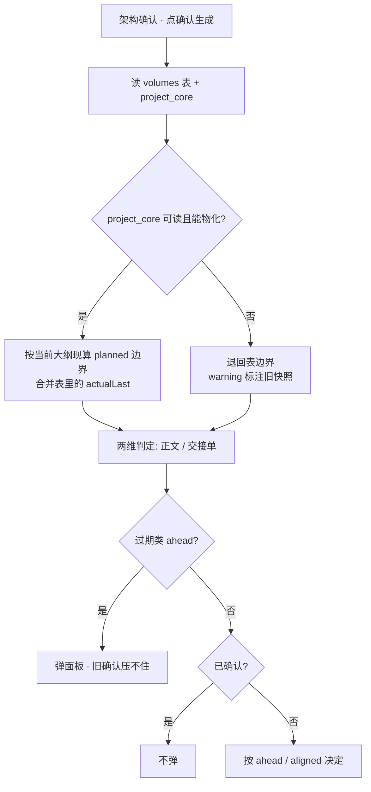

# D21 修法 C · 实施设计（待作者点头，2026-11-09 22:1x）

> 状态：待裁定（2026-11-09 · 本轮只出设计，**未改一行生产代码、未改既有单测断言**）。
> 依据：[`d21-gate-shortcircuit-evidence-20261109.md`](./d21-gate-shortcircuit-evidence-20261109.md) §⑦（修法 C 方向）· [`d21-gate-ui-guide-20261109.md`](./d21-gate-ui-guide-20261109.md) §五/§六/§七（文案与遗留问题）· [`2026-11-09-dsh-first-run-and-batch-resume-handoff.md`](../../handoffs/2026-11-09-dsh-first-run-and-batch-resume-handoff.md) §12.3.3 与 §十四。
> 作者裁定（2026-11-09 22:0x）：「④ D21 修法 C：单测肯定是要改的，就算是 TDD 驱动开发，测试也是要跟着实际需求点走的。」⇒ **方向已定（走 C）、改断言已批准**；本稿补的是归档材料里缺的实施设计。

---

## 〇、一句话

C 与其他修法的分水岭不是「删不删短路」，而是**闸门判据用哪份卷边界**：用旧快照就是修法 A（作者已否），按当前大纲现算才是 C。归档取证稿只写了方向，没给可粘贴的 diff，所以本稿把「现算怎么接、降级怎么退、区间怎么共用、断言怎么改」一次定清。

---

## 一、按章程 §11 的四段材料

**① 实际操作流程**：你在「架构确认」勾了情节大纲、点「确认生成（n/5）」。改过大纲但没重建卷结构时，卷结构表变 `stale`（正常状态）。你期望闸门提醒「上一卷正文还没写完 / 卷末交接单过期」，好决定是去补还是「我知道，继续」。

**② 卡点**：`src/services/outline-progress-gate.ts:92-95` 一见 `stale` / `unparsed` 就 `return { gate: null }`，第二维判据整段落不到；`ArchitectureConfirmDialog.tsx:509-512` 拿到 `null` 只 `console.warn` 后**静默放行**，界面零提示。更隐蔽的是 `src/shared/outline-progress-gate.ts:136` 把 `acknowledged` 判在 `handoff-stale`（`:143`）之前 ⇒ **确认一次永久压住过期提醒**。

**③ 想怎么改（产品意图）**：闸门任何时候都按**当前大纲**给结论，不依赖一张会过期的缓存表；提示要说清「表比大纲旧、计划区间已现算、实际末章仍取自表」；两个出口按「过期优先于已确认」重排。仍然是**提醒不是阻断**，「我知道，继续」必须保留且可撤销。

**④ 各选项后果**：

| 选项 | 你会遇到什么 | 失去什么 |
|---|---|---|
| **修法 A**（只删短路，仍用表边界） | `stale` 时会弹，但用的是**旧快照**的卷边界 ⇒ 可能报「上一卷没写完」而实际早写完了，**界面撒谎** | 作者 02:47 已明确否掉 |
| **修法 B**（只对 stale 放宽 + toast） | 要求先重建卷结构；`stale` 可能长期存在，每次卷首都弹 ⇒ 狼来了 | 与「卷在大纲上游」冲突 |
| **修法 C**（现算边界 + 旁路 state） | 判据与缓存新鲜度脱钩，`stale` 时照判且边界可信 | 多读一次 `project-core`；取区间逻辑要下沉到 `src/shared/` 共用 |
| **什么都不做** | 继续静默放行 | D3 不能转 ✅，D21 一直悬着 |

**去哪确认**：取证稿 §①（短路与静默放行的逐行证据）、§⑦（C 的方向原话）、UI 指南 §四（作者视角逐步操作）与 §六（修法前后差异清单）。界面侧走「架构确认 → 勾情节大纲 → 确认生成」，卷结构过期时看有没有弹面板（现状没有）。**`pnpm dev` 红线未解除，本轮未实机复验。**

---

## 二、为什么本轮没有直接改代码

1. **归档稿只有方向，没有实施 diff**。取证稿 §③/§④ 标注「可直接粘贴」的两段 diff 属于 **A / B**；§⑦ 的 C 只有一句「旁路 `state`，用 `materializeVolumeStructure` 按 `project_core` 现算卷边界；`volumes` 表只提供 actual_last / 进度；取区间逻辑下沉到 `src/shared/` 两处共用」，并明写「修法 C（候选，待裁定）」。
2. **我上一轮的「若采纳，下一步」清单漏了 C 的核心**。交接稿 §12.3.3 写的是「改断言 → services 旁路 state + shared 顺序对调 → 两个 tsx 四槽位文案」，**没有现算、没有多读 `project-core`、没有区间下沉**。照那份清单落地，得到的其实是 A 的语义，却贴着 C 的标签。
3. **只删短路 = A**，正是作者否掉的「用过期边界撒谎」；**先改断言而生产逻辑不同批改**，会留下一个红着的测试提交，与作者「测试跟着实际需求走」的原意相反。

⇒ 按 T0「结构性变更先讨论确认再动代码」，本稿把实施决策摆出来等你点头，之后**生产代码 + 断言同一次提交**。

---

## 三、实施设计（五个决策点，每项给建议）

### 3.1 数据来源与读取

`db:project-core-get`（`src/shared/ipc-channels.ts:973`，返回 `ProjectCoreData`）提供 `plotStructurePlan` / `synopsis` / `totalChapters`，正是 `materializeVolumeStructure`（`src/shared/volume-structure.ts:197`）的三个入参。

**建议**：并入 `readOutlineProgressGate` 现有的 `Promise.all`，**单独 `.catch(() => null)`**（与第四路 `db:volume-handoffs-list` 同款）。理由：多读一次失败不该把本来能报的 `prose-unfinalized` 一起吞掉——`src/services/outline-progress-gate.ts:83-87` 已有这条回归教训。

### 3.2 现算与合并（最关键）

`materializeVolumeStructure` 返回 `VolumePlanProjection`，其 `VolumePlannedNode[]` 只有 `plannedFirst / plannedLast / plannedSource`，**没有** `actualLast`（进度只能来自表）。

**建议**：按 `volumeIndex` 对齐，用现算的 planned 三字段覆盖表行的对应字段，`volumeId / actualLast / actualSource / outlineHash / source` 原样保留，再交给现有 `volumeRangeEndingAt`。卷数不等、卷号对不上、或现算返回 `null` ⇒ **退回表边界并写 `warning`「本批用的是旧快照的卷边界」**，绝不退回 `gate: null`（那等于把 D21 的静默放行又请回来）。实际进度来源仍是表，与 UI 指南 §六一致。

### 3.3 「取区间逻辑下沉到 shared 两处共用」

`volume-structure.ts:366-371` 注释明令「**不在这里重算区间** —— 一旦有两份区间算法，面板显示的卷末章与触发条件就会不一致」。现算若另写一份取区间，正好踩这条。

**建议**：在 `src/shared/volume-structure.ts` 新增一个纯函数（把 3.2 的合并 + 取区间合成一步，例如 `liveVolumeRanges(rows, projection)`），由 `outline-progress-gate.ts` 与 `finalize-chapter.command.ts:225` 共用；`volumeEffectiveRanges` 保持单一实现。新增纯函数配 `src/shared/__tests__/volume-structure.test.ts` 用例。

### 3.4 确认顺序（过期优先）

**建议**：把 `src/shared/outline-progress-gate.ts:136` 的 `acknowledged` 分支移到 `handoff` 三档之后；`prose-unfinalized` 与 `handoff-*` 先出，确认只压住**非过期**类提醒。与 UI 指南 §六「确认 vs 过期」和 §四 C.5「旧确认压不住过期提醒」一致。纯函数、零接线，回归面窄。

### 3.5 单测（作者已批准「测试跟着需求走」）

| 位置 | 现状 | 改后 |
|---|---|---|
| `src/services/__tests__/outline-progress-gate.test.ts:154-165` | 用例名「判不出就不拦」，断言 `gate === null` | 改为「卷表 stale ⇒ 照判」，断言 `ahead / handoff-stale`；保留 `warning` 含 `stale` |
| 同文件 `:167-177` | 「过期 + 已确认 ⇒ 仍然放行」 | 按 3.4 改为「旧确认压不住过期提醒」⇒ `ahead / handoff-stale` |
| 新增 | — | `unparsed ⇒ null`（无卷行可判）；现算命中 ⇒ 用新边界；`project-core` 读失败 ⇒ 退回表边界 + warning |
| `src/shared/__tests__/outline-progress-gate.test.ts` | 未覆盖顺序 | 补「过期优先于已确认」正/反两例 |

`workflow-launch-dialogs.browser.tsx` 是否断言过「闸门不弹」取证稿 §④ 标「不确定」，落地时先搜再定，**不猜**。

### 3.6 UI 文案与两处未定项

四槽位文案直接取 UI 指南 §五（中英双份，含 `title / body / dismissLabel / defaultReason`）。UI 指南 §七 留了 6 条遗留问题，其中两处作者未定，按该稿建议值落：

- **主次按钮不对调**（§七.1）：主按钮仍是「我知道，仍按当前大纲继续」，因为面板注释明写「只能提醒，不能阻断」；对调会让「先重建」变成事实上的推荐路径，与「先铺多卷大纲再写正文」冲突。
- **「表旧」做附注、不扩展 `OutlineProgressGateReason`**（§七.3/§七.4）：只在真正判为 `ahead` 时附一句说明，不新增第五档，避免 `stale` 长期存在时每次卷首都弹。帮助链接（§七.2）**不做**——面板没有现成链接机制，为这一档新造导航不值当。
- 正文里「当前大纲」按 §七.5 点名是 `project_core` 的 `plot_structure_plan` + `synopsis` + `totalChapters`，避免作者误以为是「情节大纲」那一份。
- D3 能否转 ✅ 按 §七.6 **另裁**，本稿不动状态行。

---

## 四、若采纳，下一步动哪几处

1. `src/shared/volume-structure.ts` 新增合并/取区间纯函数 + `src/shared/__tests__/volume-structure.test.ts` 用例；
2. `src/services/outline-progress-gate.ts` 加第五路读、旁路 `state`、按现算边界判定、`warning` 降级口径；
3. `src/shared/outline-progress-gate.ts` 确认顺序对调；
4. `ArchitectureConfirmDialog.tsx` 与 `OutlineProgressGatePanel.tsx` 四槽位文案（按 §3.6 建议值）；
5. §3.5 表列全部断言**与 1–4 同一次提交**；
6. 跑 `pnpm test src/services/__tests__/outline-progress-gate.test.ts src/shared/__tests__/outline-progress-gate.test.ts src/shared/__tests__/volume-structure.test.ts` + `pnpm check:fast`；实机复验待 `pnpm dev` 红线解除后另开一轮；
7. 回填 backlog `:144`（D21 行）与缺陷稿 D21 条目，D3 状态另裁。

---

## 五、判据流（Mermaid）

**一句读法**：能不能现算决定「边界准不准」，过期优先决定「旧确认还压不压得住」，两条都过才算修法 C；只做到第一半而用旧边界，是作者否掉的 A。

---

## 六、本轮状态

- **已做**：只写本稿；记录作者「走 C + 单测要改」的裁定；核实归档稿缺实施 diff、上一轮落地清单漏现算核心。
- **未做**：未改生产代码、未改任何既有断言、未跑实机（`pnpm dev` 红线未解除）、未动 D3 状态行、未修改取证稿与 UI 指南原文。
- **待裁**：本稿五个决策点（尤其 3.2 降级策略与 3.3 下沉形态）+ 两处 UI 建议值；点头后按 §四 一次性落地。
