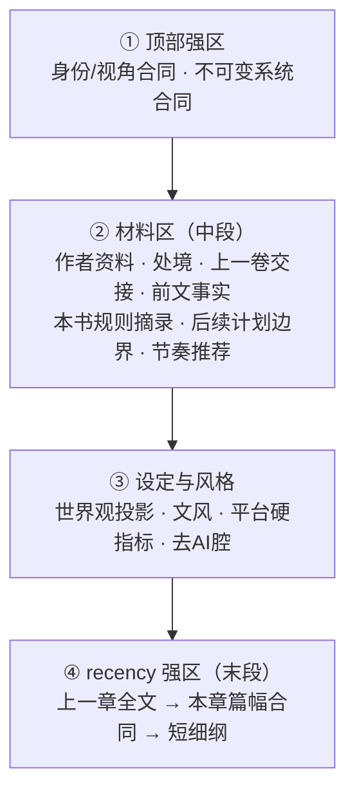

# 正文 prompt 的块序、去重与注入形态（小设计稿）

> 状态：**待裁定（2026-11-08）· v2，已吸收豆包评审（§8，20 条结论，其中 4 条撤销本稿原读数）** · 未动代码
> 上游：[`prompt-payload-scoping-design.md`](prompt-payload-scoping-design.md) §5 材料矩阵 · [`previous-chapter-context-assessment.md`](previous-chapter-context-assessment.md) §8/§9
> 实测样本：`20261107-232604-581-正文-ch13-812b7bf6.json`（第 13 章正文请求，副本项目 `.batch-a/proj`）
> 作者已裁定（本会话）：**正文继续保留上一章全文**（理由：不拿全文会出现场景站位/道具错位，而这类细节错位不可接受）。本文不复议这一条。
>
> **v2 订正摘要**：v1 用「任意 `【…】` 即块边界」分块，把块内小标题当成了独立块，导致 A2/A3/A4 三项读数错（世界观「三份」实为两份；输出格式「62 字符 / 46 of 52」实为 356 字符 / 93.1%）。v2 改用**行首标题法**重测，并按结果**撤销 B4**。

---

## 0 一句话

正文请求**内容对、位置错**：上一章全文（2,077 字符）落在 `user` 段 **42.8% 起、约 54% 结束**——按 U 形位置效应，这是利用率最低的中段。**这一条是全稿唯一仍成立的"摆错位置"。** 另两项（世界观同源两份、蓝图 JSON 形态）经复核**降级**：前者不是三份而是两份且用途不同，后者 token 成本仅 2.6%。

---

## 1 现状取证（v2 重测）

### 1.1 请求骨架

| 项 | 读数 |
|---|---|
| 消息数 | 2（`system` 2,003 / `user` 18,947 字符） |
| `user` 段**行首标题**数 | **36**（v1 的「52 块」是切块伪影，含行内 `【】` 与 bullet 中的加粗标题） |
| 拼装点 | `generate-draft.command.ts:1148-1150`：`[chapterMaterials.text, promptBuilder.build(), reconciliationBlock, authorItemsFallback, chapterLengthContract]` |
| 短细纲追加 | `generate-draft.command.ts:1396`（三元分支，**仅在有短细纲时**才在末位；无短细纲走 `:1397-1399`，末位是 `keyEventCharTargetsText`） |

### 1.2 位置实测（行首标题法，百分比以 18,947 为分母）

| 起点 | 字符区间 | 标题 |
|---|---|---|
| 0 | 0 – 15.9% | 【作者资料…】3,016 |
| 23.5% | — | 【上一卷交接】1,322 |
| 30.5% | — | 【前文事实】716 |
| **37.4%** | **37.4 – 41.1%** | **【本书规则（世界观原文摘录，不保证穷尽）】700** |
| **42.8%** | **42.8 – 约 54%** | **【未定稿候选 · 第12章 · draft 25 · v1】2,077** ← 上一章全文 |
| 63.1% | — | 【文风要求】921 |
| **75.3%** | **75.3 – 92.2%** | **`# 世界观`**（投影后 3,190：1,033 / 736 / 725 / 634） |
| **93.1%** | **93.1 – 94.9%** | **【输出格式】356** |
| 97.0% | — | 【本章篇幅合同】167 |
| 97.9% | 97.9 – 100% | 【生成短细纲】383 |

### 1.3 三个异常读数：一留、两降

| # | v2 读数 | 判定 |
|---|---|---|
| **A1** | 上一章全文起点 **42.8%**，块尾约 **54%** | ✅ **成立**。U 形曲线的最低利用区。作者保留全文的动机是"防细节错位"，但放中段恰恰削弱这份材料被准确使用的概率 |
| **A2** | 世界观同源内容 **2 份**：`【本书规则】700`（37.4%，由 `worldbuilding-rules.ts` 从第 1 维抽 ≤3 条）+ `# 世界观` 投影 3,190（75.3%–92.2%）= **3,890 = 20.5%** | ⚠️ **降级**：v1 的「三份 / 337 / 281 / 3,807」是切块伪影。实际是两份，**且用途不同**（前者是写前查阅的规则摘录，后者是设定投影）⇒ **不能直接判为重复，更不能删**（见 B3） |
| **A3** | 【输出格式】**356 字符 @ 93.1%**，其后仅 942 字符（去AI腔 392 / 篇幅合同 167 / 短细纲 383） | ❌ **撤销**：v1 的「62 字符 / 46 of 52 / 两不靠」不成立。格式约束已在 93%，其后都是本轮任务块，**符合"末位留给本轮任务"** ⇒ **B4 撤项** |
| **A4** | 蓝图 JSON **498 字符 = 2.6%**；纯结构开销 **108**（缩进 22 + 引号 24 + 括号/逗号 14 + 英文键 48） | ⚠️ **降级**：token 层面可忽略。真实问题只剩**形态**：`keyEvents` 里的 3 个 `\n` 把 4 条并列事件压成一行（见 B5） |

### 1.4 代码锚点（v2 逐条复核过，v1 有 3 处偏 1–3 行）

| 事实 | 锚点 |
|---|---|
| 上一章全文作为必需材料整章注入 | `chapter-materials.ts:631-632`（`isRequired ? [source.content]`；v1 写的 622-624 是 `recordDecisionOmission` 入参） |
| 续写 / 压缩也吃同一份材料包 | `generate-draft.command.ts:1498`（continuation）/ `:1524`（condense）都传 `chapterMaterials.text` |
| 另两处 JSON 渲染 | `generate-draft.command.ts:609-620`（续写/压缩的【本章蓝图】）、`:1162`（短细纲的 `chapterInfo`） |
| 蓝图 JSON 投影（丢弃 `userGuidance`/`suspenseHook`） | `generate-draft.command.ts:342`、`:935` |
| 事件纯文本渲染（丢 `estimatedUnits`） | `blueprint-key-events.ts:193` |
| 场次字数分配唯一判据 | `blueprint-key-events.ts:216`（函数起于 :216，v1 无误） |
| 无短细纲时的降级篇幅表 | `blueprint-key-events.ts:254`（函数起点；:261 是体内一行） |
| 短细纲前驱尾部 300 字 | `draft-short-outline.ts:59` |
| 模板块序与输出格式 | `builtin-prompt-templates.ts:1267`（`next_chapter_draft`）、`:1338-1343` |
| 必需变量兜底 | `builtin-prompt-templates.ts:1289`（`requiredContextVariables` 含 `architecture`）；`render-prompt.ts:17-28`（仅当 `content`/`taskGuidance`/`systemSuffix` 三处都不含 `{{architecture}}` 才在**文末**追加整段） |

---

## 2 依据（每条标明"直接读过"还是"转引"）

### 2.1 位置效应是 U 形【直接读过原文摘要】

**Liu et al., 2023**（arXiv:2307.03172，TACL 2024）原句：

> performance is often highest when relevant information occurs **at the beginning or end** of the input context, and significantly degrades when models must access information **in the middle** of long contexts … performance substantially decreases as the input context grows longer, **even for explicitly long-context models**

⚠️ **外推声明**：该实验是**多文档 QA / 键值检索**里的"相关文档位置"，不是"单轮续写里散文段落的位置"。把它用到本场景是**类比外推**，本项目对该效应量**未做实测**（§6）。因此 B1 的验收只能看"块位置是否如设计"，不能声称"质量必然提升"。

### 2.2 每层注入应是需求驱动的投影【原则引用，不搬数字】

Anthropic《Effective context engineering for AI agents》："find the **smallest set of high-signal tokens**…"；同文 context rot（token 越多召回越差）。
⚠️ 该文讲 agent 多轮上下文，不是小说单章生成。**只借原则，不借配比。**

### 2.3 分层注入形态【全部转引自上游 assessment §3.2，本机未核原文】

| 系统 | 做法 | 核对状态 |
|---|---|---|
| Re³（EMNLP 2022） | 由粗到细：Outlines → Recent Story Summary → **末尾逐字重放紧邻段** | 转引自 `previous-chapter-context-assessment.md:188`；该稿把"紧邻段"类比到 RAG 的 `chunk_overlap`（:179） |
| NovelDreamer（LLaMA 3.1 8B） | 「raw text of previous chapters can overwhelm the LLM」；跨幕给「the last few lines of text from the preceding act」 | 转引（:189），**本机无原文** |
| dsh-novel-craft | 「no chapter text except **the previous chapter's ending (≤900 characters)**…whole pack defaults to a **9,000-character budget**」 | 转引（:190），**本机无原文** |

**v1 在这里说错了一句**：「行业按结构单元切、不按固定字数」。**dsh 就是固定 ≤900 字符**，Re³ 的紧邻段也常被实现成固定窗口。准确说法应是：**两种切法都存在，量级都在 900 字符上下；本项目 300 字属于固定切法，作者给出的理由是"覆盖最后一个场景和钩子"（本会话口述），文档里没有这条原话**。

### 2.4 输入侧格式【一条可核、一条不可核】

- 可核：arXiv:2411.10541（Microsoft/MIT）——同一任务仅换模板（纯文本/Markdown/JSON/YAML），GPT-3.5-turbo 准确率波动达 **40%**，小模型比大模型敏感。
- **不可核（v2 删除）**：v1 引的「2026 Improving Agents 基准：YAML 胜出、JSON 垫底；Markdown 比 JSON 少 34–38% token」**无题名、无链接、来自二手博客**，不作为依据留存。
- 边界：*Let Me Speak Freely?*（arXiv:2408.02442，EMNLP 2024）证的是**输出侧**格式约束加"推理税"，**不能搬到输入侧**。

---

## 3 改动（原五项 → 现三项 + 一项降级）

### B1 · 上一章全文移到 recency 区（唯一保留的"位置"改动）

| 项 | 内容 |
|---|---|
| 现状 | `chapterMaterials.text` 内的最后一块材料，起点 **42.8%** |
| 依据 | §2.1（外推）+ 作者保留全文的裁定 |
| 改法 | 材料包**出两版**：① 初始正文版——把上一章全文块提出，作为独立项插到 `chapterLengthContract` 之前；② **续写 / 压缩版——保留原样**（`:1498` / `:1524` 直接用 `chapterMaterials.text`，不跟着改就会整段丢材料）。材料包内该位置留空，预算计算不变 |
| 最小改动点 | `generate-draft.command.ts:1149-1150` 拼接数组；`chapter-materials.ts` 增加"取出 / 置空"开关；`:1498` / `:1524` 走保留版 |
| 验收 | 该块起点 **≥86%**、块尾 **≈97%**（落在【本章篇幅合同】之前）；**不能用 v1 的"≥88%"**（按总长不变算，插到篇幅合同前得 86.1%–97.0%） |
| 风险（v2 补全） | ① **不是"零内容改动"**：移走 2,077 字符后，其后 30 余块整体前移，`# 世界观` 从 75.3% 掉到约 64.4% ⇒ 任何质量变化都不能只归因"上一章位置"；② 与短细纲相邻后，**上一章散文紧贴本章计划**，而现有守卫 `hasSubstantialPreviousChapterReuse`（`:361-377`）只按 `previousEnding` 的 80 字符连续覆盖判重演，**抓不到"改写式续写"**，D12 的复述若换形态出现不会被拦；③ `materialDecision.promptHash` 与 `chapter-info` 指纹都变 ⇒ 有活跃 run 时必须拒绝上线。 |
| ~~v1 风险①~~ | **删除**：v1 写"覆盖缺口统计口径会变"不成立——`optionalMaterialCeiling`（`chapter-materials.ts:737`）只约束可选材料，上一章是 `required: true`（`:631`），置空不改 `omissions` |

### B2 · 尾部切片按结构边界（**翻案项，须作者重裁**）

| 项 | 内容 |
|---|---|
| 现状 | `draft-short-outline.ts:59` 固定 `300`；该常量处注释写明「**作者 2026-11-04 裁定：300 字**」，上游 `previous-chapter-context-assessment.md:377` 记原话「尾部 1000 字还是太多了，300 字差不多就够了，只是用来当做续写参考」 |
| ⚠️ 性质 | **这不是"改渲染"，是推翻一条已有裁定**。v1 未标翻案，且把"覆盖最后一个场景和钩子"写成"作者原话"——**该说法出自本会话作者口述，文档中不存在**，v2 已改正标注 |
| 改法（若翻案） | 先按段落切，从末尾向前累计到覆盖"末场 + 钩子"，设**结构下限**（至少末段）与**上限保护**（≤上一章字数 X%）；300 退化为兜底 |
| 风险 | 章节长度 2,000–6,000 字差异大，比例阈值需实测定（§6）；短文段切分易过短 |
| 建议 | **本项不进第一批**。理由：它推翻既有裁定，而 B1 的收益不依赖它 |

### B3 · 世界观两份：先定性，暂不删（v1 的"去重"降级）

| 项 | 内容 |
|---|---|
| 现状 | ① `【本书规则】` 700 字符（37.4%）= `worldbuilding-rules.ts` 从世界观第 1 维**抽 ≤3 条**（`prewrite-consultation.ts:27`）；② `# 世界观` 投影 3,190（75.3%–92.2%）= `architecture-projection.ts` 处理后的版本（trace `projections` 记 `architecture 3512→3263`，且**丢弃了 `### 3.【隐喻与深层危机】`**） |
| 判定 | **不是重复**：前者是"写前查阅的规则条款"，后者是"设定投影"。删任一份都会丢一类信息 |
| 可做的小改 | 若两者确有重叠条款，在【本书规则】处标注「以下摘自【世界观】第 1 维，全文见后」——**只加指针，不删内容** |
| 若要真删 | 必须先回答：模板里的 `{{architecture}}` 是否仍保留？**保留则材料包两份都可删（只留模板那份）；删模板变量则会触发 `render-prompt.ts:17-28` 的必需变量兜底，在文末再补一份整段**——改了等于没改，还多一份 |
| 建议 | **本项不进第一批**：收益不明，风险最高（会打破"不删任何材料内容"的承诺） |

### B5 · 蓝图注入形态：JSON → 中文小节（最低优先，仍保留）

| 项 | 内容 |
|---|---|
| 现状 | 三处都渲染 JSON：`generate-draft.command.ts:935`（正文 `{{chapter_info}}`）、`:609-620`（续写/压缩）、`:1162`（短细纲）；正文侧 498 字符 = 2.6%，`keyEvents` 内 **3 个 `\n` 把 4 条事件压成一行** |
| 改法 | **存储与契约不动**，只改注入渲染：新增 `blueprintSectionsForDraft()` 输出中文小节（本章任务 / 本章事件 1..N，每条独立成行，含 `allocateEventChars` 算出的每场字数 / 出场人物） |
| 验收（v2 修正） | 「trace 中无 `"keyEvents"` 字面」**单改 :935 必然失败**——三处都要改，验收写"正文 / 续写 / 压缩三条 call 的 trace 均无 `\"keyEvents\"`" |
| 风险 | 自定义模板用 `{{chapter_info}}` 的作者会看到形态变化；恢复指纹含 `chapter-info` ⇒ 在跑的 run 失效；须守住"同一轮内作者字段各只出现一次" |
| 建议 | **最后做**，且不进第一批 |

### ~~B4 · 输出格式位置~~（**撤销**）

v1 依据的三项读数（62 字符、46 of 52、"两不靠"）全部是切块伪影。实测 **356 字符 @ 93.1%**，其后仅 942 字符且都是本轮任务块（去AI腔 / 篇幅合同 / 短细纲）⇒ **现状已符合"末位留给本轮任务"**，无需改动。若将来仍想在末位重申格式，须另立小项并单独验证。

---

## 4 目标块序（v2 修订）



一句话读法：**只改一处——把上一章全文从 ③ 之前挪到 ④ 的最前。**

| 位置 | 现在 | 目标 |
|---|---|---|
| 42.8% | 上一章全文 2,077 | → ④（≥86%） |
| 93.1% | 输出格式 356 | 不动 |
| 97.9% | 短细纲 383 | **保持末位**（唯一末位，不再有第二个） |
| 37.4% / 75.3% | 世界观两份 | 不动（只可能加指针） |

**末位唯一化**：v1 的三处表述互斥（目标图写"上一章 → 短细纲 → 输出格式重申"、正文写"末位让给短细纲"、表里写"短细纲保持末位"）。v2 定为：**短细纲唯一末位**，B4 撤销后不再冲突。

---

## 5 裁定项（B 与 D 合并，只列需要作者拍板的）

| # | 问题 | 选项 | 本稿倾向 |
|---|---|---|---|
| **C1** | 上一章全文是否移到末段（B1） | 甲 移 / 乙 不动 / 丙 移到最前（primacy 区） | **甲**。这是全稿唯一"改位置不改内容"的动作 |
| **C2** | 300 字是否翻案（B2） | 甲 翻案改结构切分 / 乙 维持 300 不动 | **乙（本批不动）**。翻案需重裁，且 B1 不依赖它 |
| **C3** | 世界观两份怎么处理（B3） | 甲 只加指针不删 / 乙 删材料包两份只留模板 / 丙 不动 | **甲**。删内容会打破"不动材料"承诺 |
| **C4** | 蓝图注入形态（B5） | 甲 中文小节 / 乙 保持 JSON | **乙（本批不动）**，仅 2.6% |
| **C5** | 第一批范围 | 甲 只做 B1 / 乙 B1+B3 / 丙 全部 | **甲**：唯一可独立验证、可独立回滚的一项 |

---

## 6 未取证（v2 保留 + 新增）

- **未取证**：B1 上线后 D12 复述率是否变化。位置变了、材料没变，**复述可能原样存在**（D12 的 4/4 复现是模型层问题，不是位置问题）——这是 B1 上线后第一件要测的事，不能把"位置"当成 D12 的解药。
- **未取证**：19K 字符单轮生成上的位置效应量（U 形结论来自多文档 QA，见 §2.1）。
- **未取证**：2,000 / 6,000 字章下"末场 + 钩子"的字符分布（B2 若翻案要用）。
- **未取证**：`# 世界观` 投影与 `【本书规则】` 的条款重叠率（决定 B3 是否只需加指针）。
- **本稿不做**：不改代码、不改模板、不改库；所有读数来自只读 trace 与只读读码。

---

## 7 影响面（若只做 B1）

| 面 | 影响 |
|---|---|
| 续写 / 压缩 | **必须同步出保留版材料包**，否则这两条链路整段丢上一章（`:1498` / `:1524`） |
| 恢复 / 续跑 | `promptHash`、`chapter-info` 指纹变 ⇒ 有活跃 run 时拒绝上线 |
| 测试基线 | `generate-draft.command.test.ts` 的拼装断言；`chapter-materials.test.ts` 的 omissions 计数（预期**不变**） |
| 作者可见 | 不可见（材料内容与总量一字未改） |
| 质量 | **不可承诺**：位置是已知变量，但不是唯一变量；需同章同模型 4 次对照测（D12 的既有口径） |

---

## 8 豆包评审采纳记录（2026-11-08）

评审模型：豆包（自动/高，项目 `AI-writer-wt-1`），任务描述限定"只读、只评五件事、每条带行号"。

| 序号 | 它的结论 | 处置 |
|---|---|---|
| 1 | B4 四项读数无一成立（输出格式 355 字符 @93.1%，其后 3 块） | ✅ **采纳，B4 撤销**（本稿实测 356 / 93.1%，差 1 为块尾换行） |
| 2 | B3 三份读数复现不出；15–43% 只有 699 字符【本书规则】；`# 世界观` 75.3–92.2%，五项合计 3,190；"全量"其实是投影版 | ✅ **采纳**：改两份、撤 337/281、标明投影丢弃了第 3 维 |
| 3 | B1 漏最大副作用：continuation(:1498)/condense(:1524) 也用 `chapterMaterials.text` | ✅ **采纳**：改法改"材料包两版" |
| 4 | B3 若动 `{{architecture}}` 会被必需变量兜底补回 | ✅ **部分采纳**：写成条件性风险（只在删模板变量时成立） |
| 5 | B5 只改 :935 不够，另有 :609-620、:1162 | ✅ **采纳**：三处并列，验收同步改 |
| 6 | B2 是推翻 11-04′裁定，稿子没标翻案；"最后一个场景和钩子"文档里查不到 | ✅ **采纳**：标翻案、注明口述来源 |
| 7 | B1 的"≥88%"算不到，应为 86.1%–97.0% | ✅ **采纳**：验收改 86%/97% |
| 8 | `chapter-materials.ts:622-624` 指错，应在 :631-632 | ✅ **采纳** |
| 9 | 三处行号偏 1–3 行；A4 结构开销应为 108 而非 112；JSON 498 而非 499 | ✅ **采纳** |
| 10 | "上一章全文是材料包最后一块"不成立，后面还有【可选材料覆盖缺口】 | ✅ **采纳** |
| 11 | "短细纲恒在最末"只在有短细纲时成立（:1396 三元 / :1397-1399） | ✅ **采纳** |
| 12 | §2.3「行业按结构单元切、不按固定字数」被自己引的来源反驳（dsh 就是 ≤900 字符） | ✅ **采纳，已改写** |
| 13 | Lost in the Middle 是"多文档 QA 位置"，外推到单轮续写需标注 | ✅ **采纳，已加外推声明** |
| 14 | 「2026 Improving Agents 基准」无题名链接，不可核 | ✅ **采纳，删除** |
| 15 | Re³/NovelDreamer/dsh 三条均为转引上游，不该写成"逐字摘句" | ✅ **采纳，已标"转引"** |
| 16 | "零内容改动"是伪命题（整体前移） | ✅ **采纳，已改写** |
| 17 | 风险①与改法打架（required 不受 optional ceiling 约束） | ✅ **采纳，已删该风险** |
| 18 | 新位置会让上一章散文紧贴本章计划，而守卫抓不到改写式续写 | ✅ **采纳，写成风险②** |
| 19 | B1 与 B4 抢末位，稿内三处互斥 | ✅ **采纳**：撤销 B4，末位唯一化 |
| 20 | D1–D5 与 B1–B5 重复列了两遍；D5 的"2.6%"与"损耗在形态"自相矛盾 | ✅ **采纳**：合并为 C1–C5；B5 不再用 token 占比当理由 |
| 21 | 337 / 281 的来源存疑 | ✅ **已确认是切块伪影**（块内小标题被当块边界），数字作废 |
| 22 | 「52 块 / 46 of 52」这组分块读数可信度 | ✅ **已重测**：行首标题 36 个（豆包 39 段，差异在我把 `###` 计为标题；不影响位置结论） |
| 23–24 | dsh 9,000 字预算、NovelDreamer 引文需原文链接或标转引 | ✅ **已标转引**；原文链接本机无，留 §6 |

---

## 9 落地记录（2026-11-08，B1 only）

### 9.1 实施

| 面 | 落点 |
|---|---|
| 材料包出两版 | `src/services/workflows/chapter-materials.ts`：`ChapterMaterialBundle` 新增 `predecessorBlock` 与 `textWithoutPredecessor`；该块按 **ref（`sourceId` + `contentHash`）** 定位，不按标题字符串猜。`text` 逐字节不变（续写 / 压缩仍用它） |
| 初始正文拼装 | `src/services/workflows/commands/generate-draft.command.ts` 的 `composeInitialPrompt`：`textWithoutPredecessor` 打头，`predecessorBlock` 插在 `chapterLengthContract` 之前 |
| 续写 / 压缩 | **未改**，仍传 `chapterMaterials.text`（这正是评审第 3 条抓出来的坑） |
| 测试 | `chapter-materials.test.ts` 新增 3 条（finalized / candidate 两条参数化 + 无上一章一条）；`generate-draft.command.test.ts` 新增 1 条块序断言，并把一条既有断言的比较方向**整体反转**（历史块从「作者任务之前」变到「之后」；三条先后关系仍逐条断言，不是放宽） |
| 校验 | `check:fast` 全绿（typecheck / 1228 链接 0 断 / 393 份文档 0 违规）；相关两个测试文件 310 项全过 |

### 9.2 实机读数（副本项目 `.batch-a/proj`，qwen3.5:9b-128k，第 12 章，`20261108-005909-932-正文-ch12-eae772cc.json`）

| 量 | B1 前（ch13 trace） | B1 后（ch12 trace） |
|---|---|---|
| 上一章块起点 | **42.8%** | **83.5%** |
| 上一章块尾部 | 54% | **92.3%** |
| 下一块 | `本章写作方向…` | **【本章篇幅合同】** |
| 出现次数 | 1 | 1（`textWithoutPredecessor` 确实把它从材料区摘掉了） |
| 请求总长 | 18,947 | 19,759 |

**验收口径订正**：§3 写的「起点 ≥86% / 块尾 ≈97%」是把百分比当固定判据，而分母会被**尾部各块自身的长度**改变（同一轮里短细纲 383 → 1351 字符，整体百分比就被推低）。应改为**结构判据**：①该块在全篇只出现一次；②它紧邻正文写作材料的末尾；③它的下一块必须是【本章篇幅合同】；④短细纲仍是唯一末位。四条在 9.2 全部成立。**百分比只作观测值记录，不作通过线。**

### 9.3 一条附带观察（不构成结论）

本轮第 12 章生成（v2 / 1538 字）**没有触发 `DRAFT_PREVIOUS_ENDING_REPLAY`**，成稿开头是新场景（「陈砚推开度支房门」），只承接上一章结尾留下的「裹着布条的虎口」，没有逐字重演 ch11 的收尾。此前单章 4 次 + 批量 1 次共 5 次复现，**本轮是第 1 次不复述**。

**但这是 1 个样本，不能据此说 D12 被 B1 治好了**：模型、章节、材料都不同（B1 前测的是 ch13 对 ch12 草稿，本轮是 ch12 对 ch11 定稿）。要判定，仍须按 D12 既有口径「同章同模型 4 次对照」跑，且同时记录块位置与复述率两个量。

---

## 10 四轮 A/B 对照（2026-11-08 01:14–02:00）：B1 结构成立；**与 D12 是两条链路**

> **2026-11-08 02:15 作者订正**：本节原题写「对 D12 测不出效果」，属把两件事并论。
> **B1 改的是正文生成 prompt 的块位置**（全文一个字没删）；**D12 的病在短细纲喂了上一章全文**
> （300 字那层只作用在短细纲，正文吃全文，见 handoff §5.1 三层表）。
> 8 次实验只动块位置 ⇒ **对 D12 无判别力**。下面读数只用于 B1 自身结构验收。

> 起因：作者批准「同章同模型 4 次对照」。执行时发现**必须同时有控制臂**，
> 否则「0/4 未触发」无法归因给 B1。于是做成 4+4：同一项目、同一章（12）、
> 同一上一章（第 11 章定稿 1,418 字）、同一模型（`qwen3.5:9b-128k` / `ab365b78`），
> 只切换 B1 开/关（`git stash push/pop` 四个源文件，重启 dev 后以 trace 块位置自证回退生效）。

### 10.1 两臂读数

| 臂 | 草稿 | 字数 | 上一章块起点 | 下一块 | 覆盖率 / 最长连续重合 | 判据触发 |
|---|---|---|---|---|---|---|
| **B1 开** | v3 | 1392 | **85.9%** | 篇幅合同 | 0% / 0 字 | 否 |
| | v4 | 1331 | **83.5%** | 篇幅合同 | 1.2% / 12 字 | 否 |
| | v5 | 1691 | **84.1%** | 篇幅合同 | 2.1% / 20 字 | 否 |
| | v6 | 1601 | **85.5%** | 篇幅合同 | **7.7% / 15 字** | 否 |
| **B1 关** | v7 | 1888 | **42.3%** | 节奏推荐 | 1.0% / 10 字 | 否 |
| | v8 | 1830 | **43.9%** | 节奏推荐 | 0.8% / 8 字 | 否 |
| | v9 | 1695 | **43.5%** | 节奏推荐 | 3.4% / 13 字 | 否 |
| | v10 | 1509 | **42.3%** | 节奏推荐 | 0% / 0 字 | 否 |

覆盖率 = 正文前 1,200 字中有多少比例能被上一章结尾的字组覆盖（与生产判据同款算法：8 字 n-gram、
去标点空白后匹配，**连续重合 ≥ 80 字**才判重演）。两臂**都没触及 80 字**，最长的只有 20 字。

### 10.2 结论（三条，按确定性排序）

1. **B1 结构上百分之百成立**：8 次里 B1 开的 4 次全部落在 83.5%–85.9%、下一块都是【本章篇幅合同】、全篇唯一；
   关掉的 4 次全部回到 42.3%–43.9%、下一块回到【节奏推荐】。开关可逆、无副作用、续写/压缩链路未受影响。
2. **对 D12 无判别力**：两臂都是 0/4、都没有实质复述。但**这不能读成「D12 被 B1 治好了」**，
   也不能读成「D12 消失了」—— B1 只挪块位置、没删一个字，而 D12 正文层复述的自变量是
   「全文在不在 + 有没有『已发生不可重演』的边界块」，两样 B1 都没碰。
   **D12 仍能复现的证据在 handoff §2/§9**：R6 上线后 4 次单章 + 1 次批量全灭，短细纲都写对、病在正文层。
3. **这一配对本身不复现 D12**（旁证：B1 之前的 v1 覆盖率 0%、同样不触发），
   因此它既不是 D12 的实验场，也不能反证 D12。**同一章换块位置结果不变 ⇒ 该章的重演风险不来自块位置。**

### 10.3 B1 的验收到此结束；留一条给「横向展开」的风险提示

**不再需要重建复现组**：B1 要验的是「块位置能不能稳定落到 recency 区」，8 次结构读数（开 4 次全在
83.5%–85.9%、下一块恒为篇幅合同；关 4 次全回到 42.3%–43.9%、下一块恒为节奏推荐）已经答完；
D12 是否仍复现不由这组实验回答，看 handoff §2/§9 的 5 次即可。

**必须带走的反向信号**：B1 开臂 8 次里覆盖率最高的一次（v6，7.7%，改写式重演了「沿碎石道往回走／
光线从云缝里斜着打下来／碑坪墙根发白」）正好出现在「全文贴近生成点」这个位置，同章关臂最高 3.4%。
样本不足以下结论，但方向与「越靠近生成点越容易被续写式接续」一致 ⇒ **横向展开时任何「把内容型材料
往末尾挪」的建议，都必须先回答「会不会增加照抄」，答不上就不许挪**。

### 10.4 本轮顺带修正的度量缺陷

初版验收用的是「开头 300 字按 12 字**对齐切片**命中上一章尾部」，它有两个问题：切点固定导致
跨切点的短语漏判（v6 里「光线从云缝里斜着打下来」正好被切断），且没有与生产判据对齐。
已改为**与 `hasSubstantialPreviousChapterReuse` 完全同款**的算法（`generate-draft.command.ts:361-402`：
`CROSS_CHAPTER_REUSE_CJK_NGRAM_CHARS = 8`、`CROSS_CHAPTER_REUSE_LONG_RUN_CHARS = 80`、头部取 1,200 字），
避免「我用自己的尺子量，量出跟系统不一样的结论」。

## 11 回滚 B1 值不值：4+4 对照（2026-11-08 04:50–05:11）→ **不回滚**

> 起因：§10.3 留了一条反向信号（「全文贴近生成点，覆盖率反而更高」），于是作者问
> 「是不是测一下就知道」—— 对，本节就是把 §6 待裁的第 1 条测掉。
> **只动块位置，锚点与材料内容一字不差**；模板、蓝图、上一章定稿、模型全部相同。

### 11.1 实验设计

| 项 | 值 |
|---|---|
| 项目 | `.batch-a/proj` 副本，**只留第 1 章定稿**（1,741 字），第 2–12 章草稿已清 |
| 章节 | 第 2 章《塌方前的账目漏洞》，`user_guidance` 为空 |
| 模型 | `qwen3.5:9b-128k`（Ollama 本机） |
| 唯一自变量 | 上一章全文块的位置：**85% 附近（B1 开）/ 35% 附近（B1 关）** |
| 常量 | 【本次任务】锚点、模板内置首句章号、材料内容、篇幅合同 —— 全不动 |
| 执行 | 临时把 `composeInitialPrompt` 改回 B1 之前的数组顺序，重启 dev（改 `src/` 非组件模块必须重启，热重载会跑旧模块，实测报 `process is not defined` 就是旧模块残留），跑完 4 次再按备份还原 |

臂的干净度以 trace 自证：`chapter-draft` 请求里上一章全文块起点 **35% 组 = 34.7/34.8/35.3/35.6%**，
**85% 组 = 83.2/83.8/84.9/85.6%**（对照组沿用 04:15–04:33 的 4 次，同副本同章同模型）。

### 11.2 读数（两套口径都给，原因见 §10.4）

**口径 A = 生产判据 `hasSubstantialPreviousChapterReuse` 同款**（上一章结尾 1,000 字 vs 正文头 1,200 字，8-gram，连续覆盖 ≥80 字判重演）：

| 臂 | 跑次 | 头部覆盖 | 最长连续 | 判重演 | 结局 |
|---|---|---|---|---|---|
| 85%（B1 开） | 04:15 | 6.9% | 14 字 | no | 落库 |
| | 04:20 | 48.4% | 101 字 | **YES** | 守卫拦 |
| | 04:27 | 8.1% | 23 字 | no | 落库 |
| | 04:33 | 42.7% | 179 字 | **YES** | 守卫拦 |
| 35%（B1 关） | 04:50 | 40.3% | 118 字 | **YES** | 守卫拦 |
| | 04:55 | 39.1% | 270 字 | **YES** | 守卫拦（压缩后另报 `DRAFT_DEGENERATE_VERBATIM_REPEAT`） |
| | 05:00 | 36.9% | 58 字 | no | 落库 1,612 字 |
| | 05:06 | 49.7% | 203 字 | **YES** | 守卫拦 |

**口径 B = 全篇正文 vs 上一章全文**（本节新算，与 §4 表同款）：

| 臂 | 跑次 | 全篇 8-gram 覆盖 | 最长连续 |
|---|---|---|---|
| 85% | 04:15 | 5.3% | 23 字 |
| | 04:20 | 60.1% | 339 字 |
| | 04:27 | 6.5% | 17 字 |
| | 04:33 | 57.5% | 135 字 |
| 35% | 04:50 | 53.8% | **718 字** |
| | 04:55 | 58.3% | 327 字 |
| | 05:00 | 28.6% | 62 字 |
| | 05:06 | 51.8% | 139 字 |

**旁证（无锚点，85% 位置）**：02:29 / 02:35 两次头部覆盖 40.2% / 43.2%、最长 350 / 195 字，**2/2 被拦**。
即「没有锚点 + 全文在末尾」= 必然重演，这一格与 §4 的 A 组 86–98% 互相印证。

### 11.3 结论

1. **不回滚 B1。** 两套口径同向：85% 臂触发 2/4、头部覆盖中位 25.4%、最长连续中位 62 字；35% 臂触发 3/4、头部覆盖中位 39.7%、最长连续中位 160.5 字（全篇口径下 35% 臂还出现过一次 718 字整段搬运）。**没有任何一套读数显示 35% 更好。**
2. **锚点是主因，位置是次因。** 去掉锚点（85%）2/2 必炸；加锚点后同样的 85% 位置降到 2/4；把全文挪回中段（35%）又升到 3/4。顺序是「锚点 ≫ 位置」。
3. **局限必须写明**：4 vs 4、二值结局，2/4 与 3/4 的差异**不具统计显著性**，只能当方向性证据。要显著性得再跑十几轮，本轮不值得 —— 因为决策方向已经明确：回滚的动因是「长材料贴近生成点会诱导照抄」，而实测恰好是「长材料离开生成点反而抄得更多」。
4. **§10.3 那条反向信号要改判**：v6（85% 位置、7.7%）不是「贴近生成点更容易照抄」的证据；本轮 85% 臂 4 次里 2 次几乎零复用（6.9% / 8.1%）。真正决定成败的是**模型有没有把上一章全文读成「待重写的对象」**，而这件事由末尾的【本次任务】+【篇幅合同】管，不由全文块的位置管。

### 11.4 附带发现（新变量，本文不处理）

实测尾部结构是：

```
【本章篇幅合同】95.5% → 【本次任务】(锚点) 95.9% → 【生成短细纲：计划，不是事实依据】…99.9%【生成短细纲结束】
```

**锚点不是物理最后一块，短细纲块拼在它后面**（正文任务吃短细纲，拼接发生在 `composeInitialPrompt` 之后）。
也就是说锚点的 recency 被 600–800 字的短细纲块隔开了。若真要再抬一次通过率，「短细纲块是否该排在锚点之前」比「上一章全文放哪」更值得测 ——
但短细纲已由作者裁定另立项，本文只记录现象，不动其位置。
