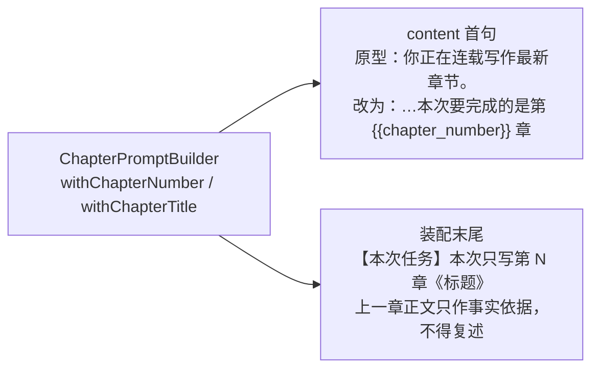

# 正文请求的「显式任务锚点」（章号 + 本次只写第 N 章）

> 状态：**已实施（代码 + 单测，2026-11-08）· 实机 6 次对照判定「必要但不充分」** —— 复述从「必然」降到「约 50%」，未根治。
> 作者裁定见文末「待裁」。短细纲侧另立项，本篇不涉及。

## 1 缺陷：正文请求里没有「本次写哪一章」

第 2 章的正文请求（trace `20261108-022952-958-正文-ch2-bbbe4b02`）实测：

| 检索词 | 次数 |
|---|---|
| `第2章` / `第二章` | **0 / 0** |
| `第一章` | **6** |

- 章号唯一的落点是蓝图 JSON 的 `"chapterNumber": 2`，没有任何一句自然语言说「本次要写第 2 章」；
- 6 次「第一章」全部来自**覆盖层的 taskGuidance**（当时项目级/全局层各有一份，都写着「参考以上材料，撰写**第一章**完整正文」「只输出**第一章**小说正文」）；
- 该请求末尾紧贴生成点的是**上一章全文**（B1 之后位于 87.5%）。

模型按字面执行的结果：第 1 次输出 1,766 字、与第 1 章 8-gram 重合 **98.2%**、最长连续 **1,601 字**、开头逐字相同 —— 不是「重演结尾」，是**把上一章整章重写了一遍**。

这不是模型失误，是 prompt 只有这一种合理解释。

## 2 改法：两处自然语言落点 + 一个变量

一句读法：**首句给「在写什么」（primacy 区），末尾给「这一次做什么」（recency 区，紧邻生成点），两处都不许出现「续写」二字**——那在本项目是 continuation 分支的专有名词（【操作边界】「续写及无进展恢复只接续已有正文，不重写旧文」）。

| # | 位置 | 改动 | 文件 |
|---|---|---|---|
| 1 | 内置模板变量表 | 新增 `chapter_number`、`chapter_title` | `src/services/builtin-prompt-templates.ts:1278` |
| 2 | 内置模板首句（zh） | `你正在连载写作这部小说，本次要完成的是第 {{chapter_number}} 章 —— 这是新的一章，不是接着上一章往下写。` | 同上 `:1292` |
| 3 | 内置模板首句（en） | `You are serializing this novel. What you are writing now is chapter {{chapter_number}} — a new chapter, not a rewrite or extension of the previous one.` | `src/services/prompt-language.ts:1170` |
| 4 | 装配末尾 | 新增 `chapterTaskAnchorText()`，`composeInitialPrompt` 数组**末尾追加**一项 | `generate-draft.command.ts`（函数在 `chapterLengthContractText` 之后） |
| 5 | builder | `withChapterNumber` / `withChapterTitle` | `src/services/prompts/prompt-builder.ts:216` |

**首句不带标题**：`chapter_title` 为空时 `第 2 章《{{chapter_title}}》` 会渲染成 `第 2 章《》`。标题只在末尾锚点里按 `chapterTitle ? … : …` 条件拼接。

**首稿以外的路径不加锚点**：续写（`chapter-draft-continuation`）与压缩（`condense`）仍走 `chapterMaterials.text`，不追加「不得复述」——那一轮本来就是接着同一章往下写。

**模板层自足**：清空全部覆盖层后，内置模板也能说出章号；覆盖层只承担作者偏好。

## 3 排障必读：覆盖层有三处，最隐蔽的是第三处

本次实机为了「测内置层」反复踩坑，按顺序记录：

| 层 | 路径 | 读法 |
|---|---|---|
| 项目级 | `<项目>/.ai-novel/prompts/*.json` | `fs:list-dir` 只收 `.json` 结尾 |
| 全局（兼容/legacy） | `~/.vela/prompts/*.json` | **只读**，`assertGlobalPathAccess` 明令 `LEGACY_GLOBAL_SOURCE_READ_ONLY` |
| **全局（真实生效）** | `<VELA_HOME>/prompts/*.json`，dev 下 `VELA_HOME = C:\Users\<用户>\.ai-novel-writer-dev\generations\<uuid>` | `prompt:load-global` → `readGlobalPromptTemplates()` |

踩坑顺序：先移项目级 → 仍是旧句；再移 `~/.vela` → 仍是旧句；最后从 trace 的 `snapshots[0].fragments[].resolvedFrom` 读到 `"global"`，才定位到 `.ai-novel-writer-dev/generations/<uuid>/prompts`。

**判据**：排查「模板改了没生效」时，不要按目录猜，直接看 trace 的 `fragments` —— 每条带 `sourceKind`（`override-content` / `builtin-content` / …）与 `resolvedFrom`（`project` / `global` / `builtin`）。

覆盖优先级本身是对的：`project > global > builtin`（`prompt-catalog.ts:134-145`）。

## 4 实机对照：同一材料、同一蓝图、无作者指导

材料固定为「第 1 章定稿（1,741 字）→ 写第 2 章」。判据沿用生产守卫的三个常量（8 字 n-gram、连续 ≥80 字、头部 1,200 字）。

| # | 时间 | 生效模板层 | 任务锚点 | 8-gram 覆盖 | 最长连续 | 落库 |
|---|---|---|---|---|---|---|
| A1 | 02:29 | 全局覆盖（taskGuidance 写「撰写第一章完整正文」） | 无 | **98.2%** | **1,601 字** | 否 |
| A2 | 02:35 | 同上 | 无 | **86.5%** | 519 字 | 否 |
| B1 | 04:15 | 同上 | 有 | 5.3% | 23 字 | 是（1,640 字） |
| B2 | 04:20 | 同上 | 有 | 60.1% | 339 字 | 否 |
| C1 | 04:27 | 内置（含首句章号 + 锚点） | 有 | 6.5% | 17 字 | 是（2,326 字） |
| C2 | 04:33 | 同上 | 有 | 57.5% | 135 字 | 否 |

- **A 组 2/2 严重复述**（86–98%）——加锚点前是「必然」。
- **B/C 组 4 次 2 通过**：通过者 5.3% / 6.5%，失败者 60.1% / 57.5%。
- **分布二值化，没有中间态**：要么 ≤6.5%，要么 ≥57.5%。这不是「复述多少」的连续问题，是模型在两种解释间跳：一种把上一章全文当参考、往前写新章；一种把它当**待重写的对象**。
- **模板层新旧不改变这个分布**（B 组旧覆盖、C 组内置，形态一致）⇒ 真正起作用的是末尾那句锚点，首句章号是必要但不充分。
- C1 那次还出现 `chapter-draft`（947 字）→ `continuation`（1,377 字）两段拼接，最终落库 2,326 字；C2 是 2,995 字 → `condense` 1,206 字，仍被守卫拦下。

**补测（2026-11-08 04:50–05:11，锚点不动、只把上一章全文从 85% 挪回 35%）**：

| 跑次 | 全篇覆盖 | 最长连续 | 结局 |
|---|---|---|---|
| 04:50 | 53.8% | **718 字** | 守卫拦 |
| 04:55 | 58.3% | 327 字 | 守卫拦（压缩后另报复读） |
| 05:00 | 28.6% | 62 字 | 落库 1,612 字 |
| 05:06 | 51.8% | 139 字 | 守卫拦 |

**1/4 通过，比上面 B/C 组的 2/4 更差** ⇒ 锚点有效果，但把它和全文块的位置绑在一起看才完整；
结论与取舍见 `docs/design/prompt/chapter-prompt-block-ordering-design.md` §11。

## 5 结论

1. **taskGuidance 写「第一章」是直接触发**：A 组两次都是有它、无锚点，输出就是第 1 章。作者已在 UI 改掉。
2. **锚点把「必然」变成「掷硬币」**，但没根治。一句话的约束不足以稳定压住紧贴生成点的上一章全文，尤其对 9B。
3. **结构上的诱因先说成「上一章全文贴近生成点」是不成立的**（2026-11-08 05:15 改判）：
   当时推测 B1 把全文放在 87–97%、与 Anthropic「长材料在前、请求在后」相反是诱因，
   于是做了 4+4 对照 —— **把全文挪回 35% 反而更差**（触发 3/4 vs 2/4，最长连续中位 160.5 字 vs 62 字）。
   真正的诱因是模型把上一章全文读成「待重写的对象」，这件事由末尾锚点 + 篇幅合同压住，不由全文块位置管。
   读数 → `docs/design/prompt/chapter-prompt-block-ordering-design.md` §11。
4. **「续写」二字必须继续禁**：project 覆盖层若再写成「撰写续写章节」，会把语义拉回 continuation。

## 6 待裁（作者）→ **2026-11-08 05:15 已裁：不回滚 B1**

- ~~是否回滚 B1 + 保留锚点，再跑 4 次对照~~ —— **已测，答案是不回滚**。
  作者追问「是不是测一下就知道」，随即做了 4+4（35% vs 85%，锚点与材料全不动）。
  结果：85% 臂触发 2/4、35% 臂触发 3/4，两套度量口径同向，**没有任何一套读数显示 35% 更好**；
  且 35% 臂出现过一次 718 字整段搬运。**锚点是主因，位置是次因**（无锚点 2/2 必炸）。
  完整读数、局限（4v4 不显著）与附带发现（锚点不是物理末块）→
  `docs/design/prompt/chapter-prompt-block-ordering-design.md` §11。
- **短细纲**另立项，本篇未动其任何代码与块位置。

## 7 落地记录（2026-11-08）

- 代码：`builtin-prompt-templates.ts`（+2 变量、zh 首句）、`prompt-language.ts`（en 首句）、`prompt-builder.ts`（2 个 setter）、`generate-draft.command.ts`（`chapterTaskAnchorText` + 装配追加）。
- 测试：`generate-draft.command.test.ts` 新增「无标题章不得出现空书名号」；`prompt-local-qwen-contract.test.ts` 更新首句断言与变量契约表。
- 验证：`npx tsc --noEmit` 通过；`vitest run` 4 个相关文件 **294 项全过**（含 `generate-draft.command` 247 项）。
- 豆包改码、主 agent 逐行审并移植到 `develop`（wt-1 基线含 B1，故未整体 apply）。
