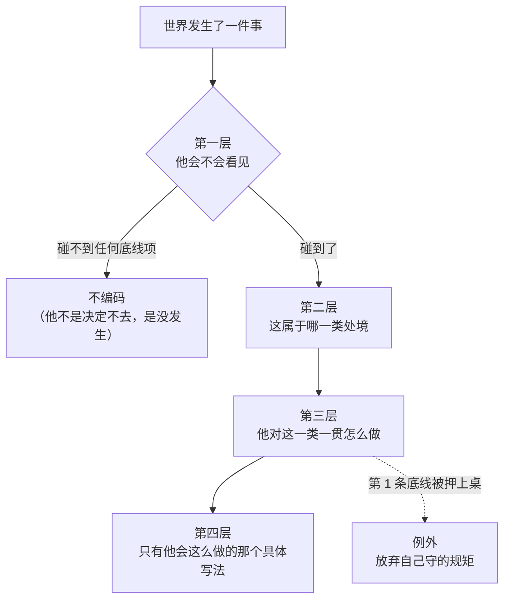

# 角色行为四层：从「性格描述」到「可判定的人格」

> 状态：**✅ 期 1–4 已落地**（2026-10-29 夜无人值守，作者事前批准）。落地面：
> ① `prompt-language.ts` 的 `detailTask` 中英两段（四层）· ② 情节大纲加「定性：」前置行 + `ARC_CHOICE_MISMATCH`
> ③ `golden-traits.ts` 补 `values`（Schwartz 十项）· ④ 处境类型库落成常量表 `src/shared/character-event-types.ts`（13 类 + 反例，**不注入 prompt**）
> ⑤ **`auditDispositionCitations` 已接通**（2026-10-29 12:55，挂在大纲落盘前，**只报告不阻断**）
> 提交：`92f8c81e` `e5ec1971` `1094d8b7` `d141ffa7`；进度交接 `docs/handoffs/2026-10-30-four-layers-progress.md`
> 取代：`prompt-language.ts` 中「主角的性格：四格、档位标签、带编号」那一套（旧为 D1 日常 / D2 代价 / D3 破例）
> 前身：`protagonist-golden-traits.md`（词条库：底色 + 破例 + 锚点 + 代价）——**本稿不废它，是把它的语义改成可判定的形式**
> 实验依据：`scripts/experiments/`（四组对照、多 seed、隔离/连续两种跑法，共 400+ 条样本）

---

## 1. 为什么必须改

旧模型是**一层扁平**的：三条并列的「处境 → 反应」，其中第三条叫「破例」。

实验暴露了三个后果（隔离跑法，20 章，云端被试）：

| 症状 | 数据 | 根因 |
|---|---|---|
| **D1 引力** | 第 3/4/5 三章处境完全不同，却全被标成 D1 并照抄 D1 的动作 | 三条里 D1 最通用，成了引力中心 |
| **D3 滥用** | 20 章里 D3 用了 3–5 次，真正该用的只有 3 章 | **破例被写成了一条可套用的策略** |
| **大量「无」** | 20 章里 7 章判「无」 | 三条按**处境**分类，处境几乎无限，必然大面积不匹配 |

核心错误一句话：**破例一旦被写成一条策略，它就不再是破例，只是又一条日常。**

---

## 2. 总模型：四层 + 一条分工线



读法：**底线管「看不看得见」，处境管「是哪一类」，策略管「一贯怎么做」，动作管「怎么写出这个人」。** 例外不在链上，它是第三层被第一层击穿的产物。

### 分工线（关键）

| 层 | 谁产出 | 谁消费 |
|---|---|---|
| 一 在乎什么 | **作者**（词条库给候选） | 全部下层 |
| 二 什么算一件事 | **章纲**（这一章给什么事）+ 角色的编码规则 | 第三层 |
| 三 各类做法 | **作者**（模型给候选、作者确认） | 正文生成 |
| 四 具体动作 | **模型** | 正文 |

**模型只负责第四层和第三层的实例化。** 前两层必须在 prompt 之外定好——这不是保守，是实测结论：模型做「归类」只有 11/20 的准确率，做「演绎」却稳定得多。

---

## 3. 第一层：他在乎什么

### 3.1 清单参照：Schwartz 十项基本价值

不自造清单。心理学有现成的实证框架——**Schwartz 的基本价值理论（Theory of Basic Human Values, 2012）**，10 项、跨 44 国 25000 人验证：

自主 Self-Direction · 刺激 Stimulation · 享乐 Hedonism · 成就 Achievement · 权力 Power · 安全 Security · 顺从 Conformity · 传统 Tradition · 仁善 Benevolence · 普世 Universalism

四个象限：**开放求变**（自主/刺激/享乐）· **自我增强**（成就/权力）· **保守守成**（安全/顺从/传统）· **自我超越**（仁善/普世）。

**为什么必须用它的两项**：

- **刺激 / 享乐**是正式价值项，不是噪音。作者说的「玩闹心重、为一个西瓜不辞辛苦」，**是 Stimulation 排在前面的人的正常行为**，不是机制外的意外。之前的卡只列了生存、变强、护人这类「正经」项，所以这类行为无处安放。
- **价值是连续圆环，相邻相容、相对冲突**。这解释了「一个性格的策略集天然不全」——激进与保守本来就冲突，不需要覆盖全部。

### 3.1.1 十项是**兜底检查表**，不是必填清单

这一点必须写死，否则会走反：把十项当"每项都要写"，结果是角色变成一张价值观问卷。

**兜底的用途只有一个：防止整整漏掉一类价值**（漏了角色就扁平，或者只剩一种颜色）。

实际写进卡的只有**排在前面的 4–5 项**。检查时对着十项过一遍，问的是「**哪一项被我漏了、漏了会不会让他变成一个平面**」，而不是「哪一项还没填」。

**特别要防的方向：主角滑向「普世 / 仁善」高位。** 作者的原话是读者讨厌圣母、讨厌白莲花式的台词。十项里**普世（Universalism）和仁善（Benevolence）是最容易被模型自作主张排到前面的两项**——因为它们在训练语料里是"正确"的答案。所以 V6 是硬禁止。

### 3.2 必须补的两样：锚点与缺陷

| 补什么 | 出处 | 为什么 |
|---|---|---|
| **锚点**（**全书一个**，一件具体的、可被夺走的东西） | `protagonist-golden-traits.md`（本项目自定，源于玄幻「越近道越无情」的题材压力） | 抽象价值不能当人质。**破例的赌注必须是一样具体的东西**——一个人、一本账、一句承诺。**它挂在排第一的那条底线上**，不是每条底线各配一个 |
| **缺陷分两类** | **John Truby《The Anatomy of Story》p.41**：psychological need「hurting nobody but the hero」／ moral need「always hurting others」 | 决定「他的缺陷伤谁」。**只伤自己的缺陷读起来是自怜，伤到别人的才能撑起冲突** |

Truby 的原判据：*"In average stories, the hero only has a psychological need… In better stories, the hero has a moral need in addition to the psychological need."*

### 3.3 写法（不是打分，是排序）

写成 `B1…Bn`，**B1 最重**——编号就是轻重位次，这一点和第三层的 `D<n>` 正相反（`D` 只是条目号，不代表轻重）。两套编号不许混用，选择行里两者都可能出现。

```
【他在乎什么（按轻重排，写成 B1…Bn，不写分数）】
B1. 宁可自己失信，也不让那个人出事（那个人的名字）            ← 锚点挂在这一条上
B2. 自己的命（哪怕只剩一口气）
B3. 不欠人东西（他那本记着谁给过什么的旧册）
B4. 面子：不想被人当成软柿子
B5. 好玩：遇上稀罕事会忍不住凑过去（那条他走了十几年的偏巷）

锚点：他答应过要护住的那个人 —— 他为这句话放弃了出城的机会，也放弃了跟家里和解
```

> **括号里写的是「具体所指」，不是锚点。** 每条底线都要能指出"是哪一个"，这是让抽象价值落地用的；
> 而锚点只有**一个**，单独一行，挂在 B1 上。
>
> 两者还有个区别：**括弧里必须是「一直在的东西」**（一个人、一本账、一格位置、一句没兑现的话），
> **不是发生一次的事**（谁在哪天递来什么、哪张纸被谁顶到脸上）。
> 实机产物出现过「赵铎那张状纸」当锚点——状纸是对手的武器，拿它当锚等于说"他最在乎的是敌人的兵器"。

> **为什么必须给底线编号**：第三层只有 3–4 条做法，覆盖不了所有章。做法一条都对不上时要退到底线兜底（§4.3），而"退到哪一条"必须能指认 —— 说不出 `B2` 就只能写"因为他很在乎"，那等于没依据。

### 3.4 判据

- **V1 至少 4 项，且能排出严格先后**（只列不排 = 没有排序，压不出冲突）
- **V2 至少一项是具体可夺的东西**（人 / 账 / 承诺），不能全是「尊严」「信念」
- **V3 至少一项是"他不想承认的"**（Truby 的 psychological weakness）——否则角色没有暗处
- **V4 任意相邻两项之间能构造出一个冲突场面**（排不出冲突的排序是无效排序）
- **V5 清单必须覆盖四个象限中的至少三个**（只覆盖「安全 + 仁善」的角色是扁平的）
- **V6 普世、仁善不许排在前两位**；若确要排，必须同时写出他为此付过什么代价。**写不出代价的，是圣母不是人**——读者会讨厌，而且模型天然容易这么写（它们在语料里是"正确"答案）

---

## 4. 第二层：什么算一件事

### 4.1 这一层不在模型手里

实测：让模型判断「这件事他会不会当回事」，它**倾向让事情发生**——两版卡都把一个毫无收益的远方稀罕物写成了「抬脚就去」。

> **「不作为」是最难生成的行为。** 训练语料里故事都是「有事发生」；写「他看了一眼，没去」对模型是反直觉的。

所以：**这一层交给章纲**。章纲里不出现无意义的事件，模型就没有机会加戏。

### 4.2 角色侧只留一条：编码规则

```
【什么算一件事】
不碰上面任何一条的，他根本不往心里去。
- 能用的、能换钱的、能让他少费事的 → 算
- 跟他没干系的闲事 → 不算
```

- **E1** 必须能说出「什么他根本不看」（只写「他会注意什么」是不够的，那等于全都注意）
- **E2**「不看」必须与第一层一致：不看的东西，一定碰不到任何一条底线项

---

### 4.3 没有现成做法时：退到底线兜底（try / catch 的 catch）

第三层只有 3–4 条做法，**必然覆盖不了所有章**。会出现这种章：

> 这件事他看得见、也会当回事（碰到了底线），但三条做法一条都对不上。

这时**不能宣布"这一章没有他的性格戏"**。正确的动作是按第一层底线现场推：

```
定性：无 — 碰到了底线2，但三条做法都不适用
选择：守 —— 他把话岔开｜否掉了 应下，因为 底线2：他欠着的人还没还完
```

作者的原话：**"相当于是 try catch"** —— 做法是他平日的习惯（try），底线是他这个人（catch）。

**D0 的语义因此收窄**：它只表示"这一章确实没有他的戏"（全章他人视角、时间跳跃、他不在场）。拿 D0 替代兜底，等于把"没有习惯"误当成"没有人格"——而这是模型最容易偷的懒，因为它让一章免于受检。

判据（`disposition-citation.ts` 已实现，5 条码）：

| 情形 | 判 |
|---|---|
| 定性 `D<n>` + 依据同一个 `D<n>` | ✅ |
| 定性「无」+ 依据 `底线<n>` | ✅ 兜底 |
| 定性「无」+ 依据 `D0` | ✅ 他不在场 |
| 定性「无」+ 依据 `D<n>` | ❌ `ARC_CHOICE_MISMATCH`（说有做法却引用了做法） |
| 定性 `D<n>` + 依据 `底线<n>` | ❌ `ARC_CHOICE_MISMATCH`（有做法就该用做法） |
| 依据 `底线<n>` 且 n > 卡的底线条数 | ❌ `ARC_CHOICE_UNKNOWN_BOTTOM`（仅当传入 `bottomLineCount` 时校验） |

> **连续兜底不算扁平**：`ARC_CHOICE_SAME_D` 只数 `D<n>`，`底线<n>` 与 `D0` 都不参与。
> 连着几章都兜底是**做法覆盖不足**的信号（属于期 3 处境类型/做法扩充的事），
> 跟"一条倾向推所有局面"不是同一个病，混在一起报会误导。

---

## 5. 第三层：各类做法

### 5.1 分类的轴：按处境类型，不按反应

现状把「处境 + 反应」捆成一条（"讨承诺 → 问凭据"），于是**覆盖率取决于处境列了几条**。

正确形态是**两层相乘**：

| | 谁定 | 例 |
|---|---|---|
| **处境类型**（作品级） | 卷纲/章纲 | E1 要他现在表态、凭据以后补<br>E2 要他拿自己攒的东西换省事 |
| **策略**（角色级） | 角色卡 | E1 → 先要凭据，给不出就悬置不答 |

**处境类型库可以增量生长**（随卷纲推进补充），所以初始化不需要完备。这与「一个性格的策略集天然不全」是同一件事。

### 5.2 策略的写法

```
【他对各类事的做法】
- 要他现在表态、凭据说以后补 → 先要凭据；给不出就悬置不答
- 要他拿自己攒的东西去换省事 → 不动那样东西，宁可绕远
- 两边都得罪不起 → 不站边，只认落到纸上的
- 要他替不相干的人担事 → 推掉，最多答应跑腿
```

### 5.3 判据

- **S1 是策略不是动作**：「先要凭据」是策略（可套多种处境），「手指在桌沿敲两下」是动作（属于第四层）
- **S2 每条必须写「不适用」**：什么情况下这条让位。不写就会变成引力中心
- **S3 可失败**：这条策略有时候会害了他。只赚不赔的是外挂，不是人

> ⚠️ **S2 是本次实验最直接的教训**：旧卡三条都没写「不适用」，于是 D1 吸走了三个不相干的处境。

---

## 6. 第四层：具体动作

模型唯一的活。要求不变：

- **A1 是动作，能拍出来**（「先问凭据在哪」可以，「谨慎地」不行）
- **A2 带一个身体反应**（证明「他还在怕，但仍在做」——这是底色没变的唯一外部证据）
- **A3 不超过 45 字**（超出就不是「第一秒」了）
- **A4 不许出现本书专名**（换任何世界都要读得懂）

---

## 7. 例外：挂到某一条底线上

### 7.1 定义

**例外不是第四条策略，是「第三层该给的答案缺席」的那一次。**

```
【例外】
上面那几条做法，全是为前三条底线服务的。所以只有一种情况会出例外：
第 1 条跟别的底线打架时，他一定选第 1 条 —— 那一次他会做出上面所有做法里都没有的事。
具体是什么要当场写，但方向是定的：他为了那个人，放弃自己平时守的规矩。
除此之外不会有意外的举动。
```

### 7.2 为什么必须这样写

v2（例外 = "随便破"）→ 第 17/18 章同一类处境反应完全相反，且第 17 章写成「我不改」（硬顶，实际应该让步）。
v3（例外 = 挂第 1 条底线）→ 两章都变成「当场改口应下」，方向一致且正确。

**判据**

- **X1 例外必须指明它触发的是第几条底线**（指不出来 = 不是例外，是写崩了）
- **X2 方向必须写死**（"为那个人放弃自己守的规矩"），不能只写"会做出意外举动"
- **X3 一次只挂一条底线**（挂两条就会互相打架，等于没挂）

### 7.3 一个边界判断

> 「觉得一个人老是出人意料、无法预测，可能只是**没跟他同频**，没真正理解他的利益诉求和焦点。喜怒无常的人也不是无缘由。**无法预测的人只能是疯子，疯子不能当主角。**」
> —— 作者 2026-10-29

⇒ **可预测性是主角的必要条件，不是限制。** 例外必须能被解释；解释不出来的是崩人设，不是自由。

---

## 8. 噪音：什么时候允许

作者裁定：无关紧要的事上「神经」一点是**人味**，读者不要一个神。

### 8.1 判据

- **N1 代价不碰任何一条底线项**（碰了就必须按策略走）
- **N2 能说出它落在哪一项「轻价值」上**（刺激 / 享乐 —— 不是"没理由"）
- **N3 轻价值上的行为**不需要**跨章一致**（人本来就会随心）

### 8.2 一致性的强度与价值项成正比

这是本稿最重要的一条划分：

| 行为落在 | 一致性要求 | 理由 |
|---|---|---|
| 前三条底线 | **必须严格一致**，不一致就是崩人设 | 那是他的形状 |
| 第四、五项（面子、好玩） | **不必一致**，这次去下次不去都合理 | 人本来就随心 |
| 碰不到任何底线的事 | 由章纲决定是否出现 | 不归模型管 |

⇒ **不是"允许不一致"，是"不同层要求不同的强度"。** 把这一条写进 prompt，才能既不出戏、又不机械。

---

## 9. 与现有系统的映射

| 层 | 落到哪 | 现状 |
|---|---|---|
| 一 在乎什么 | `motivation`（扩写为排序清单）+ `personality` 里的锚点 | 已有字段，**语义要扩** |
| 二 什么算一件事 | 章纲（`synopsis` 每章那一行）+ 卡的编码规则 | 章纲已逐章列表化 ✅ |
| 三 各类做法 | `personality`（改为「处境类型 → 策略」配对） | 已有字段，**写法要重排** |
| （第三层的取材清单） | `src/shared/character-event-types.ts` 常量表（13 类 + 反例） | ✅ 已建，**不注入 prompt**，只作作者取材指引 |
| 四 具体动作 | 正文生成 | 不变 |
| 例外 | `arc`（破例门槛的移动）+ 选择行的 `D<n>` | **`D<n>` 改由章纲给定**，不再由模型自填 |

**零 schema**：四层全部落在现有字段里，不需要新增列。

---

## 10. 落地分期

| 期 | 做什么 | 成本 | 前置 |
|---|---|---|---|
| **1** | 改 `detailTask`：四层写法 + 例外挂底线 + 一致性强度分层 | 中（中英各一段） | 无 |
| **2** | 编号改由章纲给定（模型不自判） | 中（改 `synopsis` 后缀 + `disposition-citation` 改为消费） | 期 1 |
| **3** | 处境类型库（作品级） | ✅ 低（**常量表，零迁移** —— 落成 `src/shared/character-event-types.ts`，13 类含反例；不注入 prompt，只作作者取材指引） | 期 2 |
| **4** | 底线清单接词条库（Schwartz 十项作候选） | 低 | 期 1 |

---

## 11. 未解与边界

- **编码层的拦截能力未解决**：模型仍倾向「让事情发生」。目前只能靠章纲不给无意义事件来规避。若章纲本身出错，这层没有兜底。
- **处境类型库的粒度未定**：多细算一类？过细则回到枚举，过粗则退化成 D1 引力。需要读数。
- **「轻价值上不一致」无法机检**：只能人判（读起来像不像人）。
- **本稿所有数据来自单一被试**（本环境子 Agent），换模型需重跑 `scripts/experiments/`。

---

## 12. 生成侧实测（2026-10-29）：**给判法，不给例子**

上面 §1–§10 讲的是「卡该怎么设计」。这一节讲**怎么让模型把卡写对**——两者不是一回事，
实机产物连续几轮不合格，根因都在后者。

> ⚠️ **本节所有数字验收的是卡的「形状」，不是「内容」。**
> 判的五项——编号、D 条数、每条「不适用」、例外段、锚点行——**全是格式是否齐全**。
> 2/2、4/4 证明的是"格式能生成对"，**不证明"内容能生成对"**。
> 内容合格必须人判：锚点是否真与那条价值匹配、例外动作是否与挂的底线同向（见 §12.5）。
> 把这些数字当"卡能用了"的证据，会漏掉最贵的那两处错。

### 12.1 四组 × 两被试

脚本 `scripts/experiments/personality-card-prompt-loop.mjs`（生成）+ `check-personality-card.mjs`（结构判读）。
两个倾向相反的前提（散修查账·自保 / 边关守卒·护人），判「结构是否合格」：编号、D 条数、每条不适用、例外段、是否挂底线。

| 组 | 改了什么 | 9B-128k | 子 Agent |
|---|---|---|---|
| A | 现版 | 0/2 | 0/2（「我」×1） |
| B | +4 句（价值写法 / 日常档 / 例外同向 / 编号） | 0/2 | — |
| C | +6 句（**带三个例句**） | 1/2（「我」×1） | — |
| **D** | +6 句（**例句换成一句判法**） | **2/2** | **2/2** |
| **E** | D + 锚点修正（括号改「具体所指」+ 锚点单独一行给格式） | 1/2 | **2/2** |

### 12.2 三条实测结论

**① 例子会被逐字抄成内容。**
C 组第一层给的正例是「B1 不替任何人担东西（锚：那本还没结清的旧账）」。
结果两个**完全不同前提**的 B1 都写成「绝不替旁人背锅（锚：**那本还没结清的旧账**）」——
守城的那个主角根本没有"旧账"。删掉例句（D 组）之后，两个前提各自长出了自己的 B1。

⇒ **prompt 里不许放范文，只许放判法。** 判法给的是"读完要能说出什么"，范文给的是"照着这个写"。

**② 说明性文字也会被当模板抄。**
B 组写「至少一条必须是日常档：没人逼他、他照习惯就会这么做的那类事」，C1 直接把这句话当成了
`D1` 的标题，`D2`/`D3`/`D4` 抄成「被逼 / 当众 / 生死：」。
D 组改成「四条里至少要有一条是**没有外部压力时**也会发生的事」——名词短语消失了，抄无可抄。

**③ 第四层缺段不是模型懒，是 prompt 没给格式。**
前三层都有明确格式（`B1…Bn` / `什么算·不算` / `D1…两行`），第四层只写了语义（"只有一种情况会出例外……"），
**没有一个字说要把它写出来**。9B 因此 100% 跳过。补一句「必须单独写出来、自成一行、以「例外：」开头」后立刻 2/2 出现。

### 12.3 实装进 `detailTask` 的五句

都不含例子，已加守卫 `keeps the five card-shape clauses that make generation pass on both models`：

| # | 层 | 条款 | 治什么 |
|---|---|---|---|
| 1 | 第一层 | 写成价值判断，不是东西也不是做法；**判法：读完要能说出"他宁可失去什么"**；相邻能比轻重 | 第一层写成物件清单 ⇒ 排不出先后（V1/V4 废） |
| 2 | 第三层 | 至少一条是**没有外部压力时**也会发生的事 | 四条全在高压下 ⇒ 破例没有对照 |
| 3 | 第四层 | 例外动作必须与挂的底线**同向** | 声明"选 B1"却做 B2 的事 |
| 4 | 第四层 | **必须自成一行**、以「例外：」开头、先写挂第几条 | 模型整段跳过第四层 |
| 5 | 动作粒度 | 编号写 `D1`，不写 `D<1>` | 下游正则匹配不到 ⇒ 判成"没写编号" |

### 12.4 锚点修正（E 组）：一个锚被稀释成四个

作者看 D 组的实机产物时提出：四条底线的括号里写的全是**剧情道具**——
「那张没按手印的生死契」「赵铎那张状纸」「苏苓递出的那页账目错处」。

**这不是模型跑偏，是 prompt 的术语错位。** D 组那句是

> 每一项都写成一条价值判断……**具体的东西放在该项末尾的括号里，只当锚点用**。

两个病：「每一项」⇒ 一个锚被稀释成四个；「只当锚点用」⇒ 模型把它当"这条底线的剧情钩子"。
而 §3.2 的锚点是**全书一个**、且必须是"他主动交出去的那样东西"。

E 组改三处：

| 改什么 | 改成 |
|---|---|
| 括号的称呼 | 「具体所指」——能指出"是哪一个"就够，**不要在括号里写「锚点」两个字** |
| 括号的内容 | **一直在的东西**（人 / 账 / 一格位置 / 没兑现的话），不是发生一次的事 |
| 锚点 | 单独一行，给格式 `锚点：<那是什么> —— <他为它放弃了什么>`，挂 B1，并给判据 |

**结果：** 子 Agent 两份都写出了合格锚点行，且例外与锚点直接挂钩：

```
B1 说出口的话不能不作数（他应下那个老兵的那句「这道墙我替你看着」）
锚点：那句应下的「这道墙我替你看着」——他为它放弃了轮换出关的名额、
      家里给说下的一门亲事，还有一条本可以调去后方屯田的活路
例外：挂 B1 —— 军册上那个老兵的名字被人一笔划掉，他扔下巡墙的梆子冲进帐里，
      咬破拇指在自己名字旁边按了个血印……手抖得印子歪出格子，他还是又按了一遍
```

这一份完全对上了设计意图：**锚点 = B1 = 那句承诺；例外 = 有人动那个老兵（锚被押上桌）；代价 = 他放弃了守墙（违反 B2）**。

⚠️ **括号的格式要求不是可选项**：不给 `锚点：<…> —— <…>` 这个格式时，A/B/C/D 四组**共 12 份产物里 0 份**写出锚点行；
给了之后 E 组 4 份里 4 份都有。这与 §12.2 第 ③ 条是同一个病——**某一层没有输出格式，模型就整段跳过**。

### 12.5 还没解决的

- **例外方向靠语言约束治不住**：第 3 条在 9B 上无效（仍写反），在子 Agent 上没造成问题。
  ⇒ 这条只当"提醒"，实际仍需作者过一眼。它是全卡最贵的一条，值得人工。
- **锚点与价值是否匹配，模型判断不了**：9B 的 D 组结构合格但写出「不连累身后的人（锚：城墙上那排冻得发紫的冻疮）」——冻疮不是人。
  ⇒ 卡生成建议用强模型；用弱模型时锚点必须人扫。
- **子 Agent 样本仍只有一个模型**：这里"两被试"是 9B 与本环境子 Agent，不是两个不同量级的商用模型。
