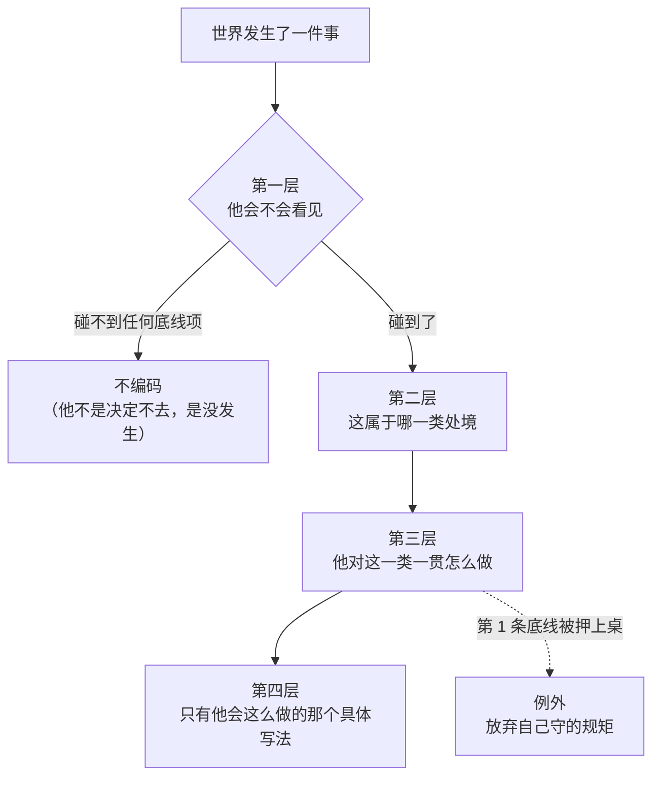
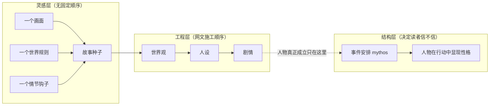
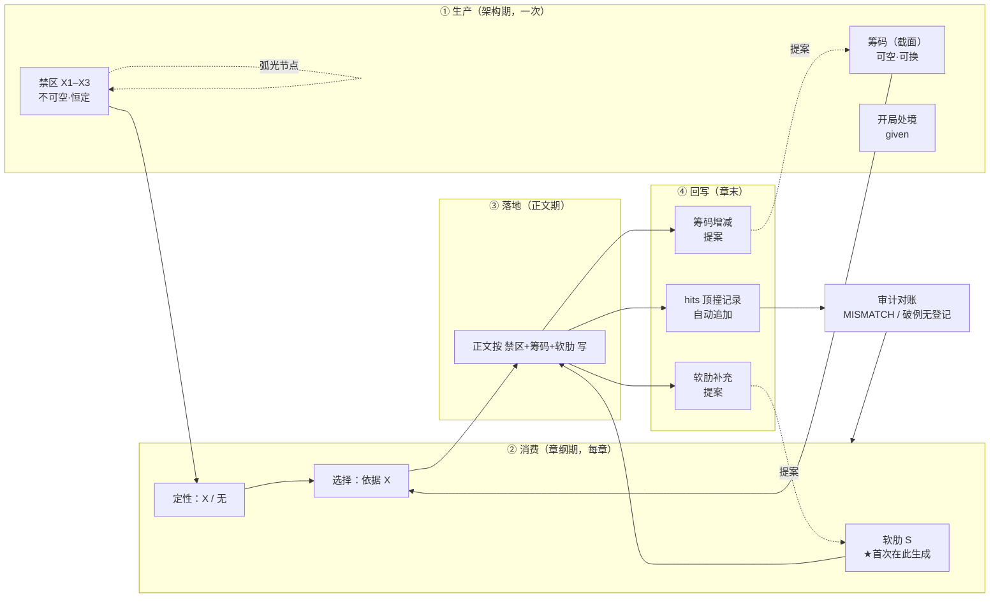

# 角色行为四层：从「性格描述」到「可判定的人格」

> 状态：**✅ 期 1–4 已落地**（2026-10-29 夜无人值守，作者事前批准）。落地面：
> ① `prompt-language.ts` 的 `detailTask` 中英两段（四层）· ② 情节大纲加「定性：」前置行 + `ARC_CHOICE_MISMATCH`
> ③ `golden-traits.ts` 补 `values`（Schwartz 十项）· ④ 处境类型库落成常量表 `src/shared/character-event-types.ts`（13 类 + 反例，**不注入 prompt**）
> ⑤ **`auditDispositionCitations` 已接通**（2026-10-29 12:55，挂在大纲落盘前，**只报告不阻断**）
> 提交：`92f8c81e` `e5ec1971` `1094d8b7` `d141ffa7`；进度交接 `docs/handoffs/2026-10-30-four-layers-progress.md`
> 取代：`prompt-language.ts` 中「主角的性格：四格、档位标签、带编号」那一套（旧为 D1 日常 / D2 代价 / D3 破例）
> 前身：`protagonist-golden-traits.md`（词条库：底色 + 破例 + 锚点 + 代价）——**本稿不废它，是把它的语义改成可判定的形式**
> 实验依据：`scripts/experiments/`（四组对照、多 seed、隔离/连续两种跑法，共 400+ 条样本）

---

## 1. 为什么必须改

旧模型是**一层扁平**的：三条并列的「处境 → 反应」，其中第三条叫「破例」。

实验暴露了三个后果（隔离跑法，20 章，云端被试）：

| 症状 | 数据 | 根因 |
|---|---|---|
| **D1 引力** | 第 3/4/5 三章处境完全不同，却全被标成 D1 并照抄 D1 的动作 | 三条里 D1 最通用，成了引力中心 |
| **D3 滥用** | 20 章里 D3 用了 3–5 次，真正该用的只有 3 章 | **破例被写成了一条可套用的策略** |
| **大量「无」** | 20 章里 7 章判「无」 | 三条按**处境**分类，处境几乎无限，必然大面积不匹配 |

核心错误一句话：**破例一旦被写成一条策略，它就不再是破例，只是又一条日常。**

---

## 2. 总模型：四层 + 一条分工线



读法：**底线管「看不看得见」，处境管「是哪一类」，策略管「一贯怎么做」，动作管「怎么写出这个人」。** 例外不在链上，它是第三层被第一层击穿的产物。

### 分工线（关键）

| 层 | 谁产出 | 谁消费 |
|---|---|---|
| 一 在乎什么 | **作者**（词条库给候选） | 全部下层 |
| 二 什么算一件事 | **章纲**（这一章给什么事）+ 角色的编码规则 | 第三层 |
| 三 各类做法 | **作者**（模型给候选、作者确认） | 正文生成 |
| 四 具体动作 | **模型** | 正文 |

**模型只负责第四层和第三层的实例化。** 前两层必须在 prompt 之外定好——这不是保守，是实测结论：模型做「归类」只有 11/20 的准确率，做「演绎」却稳定得多。

---

## 3. 第一层：他在乎什么

### 3.1 清单参照：Schwartz 十项基本价值

不自造清单。心理学有现成的实证框架——**Schwartz 的基本价值理论（Theory of Basic Human Values, 2012）**，10 项、跨 44 国 25000 人验证：

自主 Self-Direction · 刺激 Stimulation · 享乐 Hedonism · 成就 Achievement · 权力 Power · 安全 Security · 顺从 Conformity · 传统 Tradition · 仁善 Benevolence · 普世 Universalism

四个象限：**开放求变**（自主/刺激/享乐）· **自我增强**（成就/权力）· **保守守成**（安全/顺从/传统）· **自我超越**（仁善/普世）。

**为什么必须用它的两项**：

- **刺激 / 享乐**是正式价值项，不是噪音。作者说的「玩闹心重、为一个西瓜不辞辛苦」，**是 Stimulation 排在前面的人的正常行为**，不是机制外的意外。之前的卡只列了生存、变强、护人这类「正经」项，所以这类行为无处安放。
- **价值是连续圆环，相邻相容、相对冲突**。这解释了「一个性格的策略集天然不全」——激进与保守本来就冲突，不需要覆盖全部。

### 3.1.1 十项是**兜底检查表**，不是必填清单

这一点必须写死，否则会走反：把十项当"每项都要写"，结果是角色变成一张价值观问卷。

**兜底的用途只有一个：防止整整漏掉一类价值**（漏了角色就扁平，或者只剩一种颜色）。

实际写进卡的只有**排在前面的 4–5 项**。检查时对着十项过一遍，问的是「**哪一项被我漏了、漏了会不会让他变成一个平面**」，而不是「哪一项还没填」。

**特别要防的方向：主角滑向「普世 / 仁善」高位。** 作者的原话是读者讨厌圣母、讨厌白莲花式的台词。十项里**普世（Universalism）和仁善（Benevolence）是最容易被模型自作主张排到前面的两项**——因为它们在训练语料里是"正确"的答案。所以 V6 是硬禁止。

### 3.2 必须补的两样：锚点与缺陷

| 补什么 | 出处 | 为什么 |
|---|---|---|
| **锚点**（**全书一个**，一件具体的、可被夺走的东西） | `protagonist-golden-traits.md`（本项目自定，源于玄幻「越近道越无情」的题材压力） | 抽象价值不能当人质。**破例的赌注必须是一样具体的东西**——一个人、一本账、一句承诺。**它挂在排第一的那条底线上**，不是每条底线各配一个 |
| **缺陷分两类** | **John Truby《The Anatomy of Story》p.41**：psychological need「hurting nobody but the hero」／ moral need「always hurting others」 | 决定「他的缺陷伤谁」。**只伤自己的缺陷读起来是自怜，伤到别人的才能撑起冲突** |

Truby 的原判据：*"In average stories, the hero only has a psychological need… In better stories, the hero has a moral need in addition to the psychological need."*

### 3.3 写法（不是打分，是排序）

写成 `B1…Bn`，**B1 最重**——编号就是轻重位次，这一点和第三层的 `D<n>` 正相反（`D` 只是条目号，不代表轻重）。两套编号不许混用，选择行里两者都可能出现。

```
【他在乎什么（按轻重排，写成 B1…Bn，不写分数）】
B1. 宁可自己失信，也不让那个人出事（那个人的名字）            ← 锚点挂在这一条上
B2. 自己的命（哪怕只剩一口气）
B3. 不欠人东西（他那本记着谁给过什么的旧册）
B4. 面子：不想被人当成软柿子
B5. 好玩：遇上稀罕事会忍不住凑过去（那条他走了十几年的偏巷）

锚点：他答应过要护住的那个人 —— 他为这句话放弃了出城的机会，也放弃了跟家里和解
```

> **括号里写的是「具体所指」，不是锚点。** 每条底线都要能指出"是哪一个"，这是让抽象价值落地用的；
> 而锚点只有**一个**，单独一行，挂在 B1 上。
>
> 两者还有个区别：**括弧里必须是「一直在的东西」**（一个人、一本账、一格位置、一句没兑现的话），
> **不是发生一次的事**（谁在哪天递来什么、哪张纸被谁顶到脸上）。
> 实机产物出现过「赵铎那张状纸」当锚点——状纸是对手的武器，拿它当锚等于说"他最在乎的是敌人的兵器"。

> **为什么必须给底线编号**：第三层只有 3–4 条做法，覆盖不了所有章。做法一条都对不上时要退到底线兜底（§4.3），而"退到哪一条"必须能指认 —— 说不出 `B2` 就只能写"因为他很在乎"，那等于没依据。

### 3.4 判据

- **V1 至少 4 项，且能排出严格先后**（只列不排 = 没有排序，压不出冲突）
- **V2 至少一项是具体可夺的东西**（人 / 账 / 承诺），不能全是「尊严」「信念」
- **V3 至少一项是"他不想承认的"**（Truby 的 psychological weakness）——否则角色没有暗处
- **V4 任意相邻两项之间能构造出一个冲突场面**（排不出冲突的排序是无效排序）
- **V5 清单必须覆盖四个象限中的至少三个**（只覆盖「安全 + 仁善」的角色是扁平的）
- **V6 普世、仁善不许排在前两位**；若确要排，必须同时写出他为此付过什么代价。**写不出代价的，是圣母不是人**——读者会讨厌，而且模型天然容易这么写（它们在语料里是"正确"答案）

---

## 4. 第二层：什么算一件事

### 4.1 这一层不在模型手里

实测：让模型判断「这件事他会不会当回事」，它**倾向让事情发生**——两版卡都把一个毫无收益的远方稀罕物写成了「抬脚就去」。

> **「不作为」是最难生成的行为。** 训练语料里故事都是「有事发生」；写「他看了一眼，没去」对模型是反直觉的。

所以：**这一层交给章纲**。章纲里不出现无意义的事件，模型就没有机会加戏。

### 4.2 角色侧只留一条：编码规则

```
【什么算一件事】
不碰上面任何一条的，他根本不往心里去。
- 能用的、能换钱的、能让他少费事的 → 算
- 跟他没干系的闲事 → 不算
```

- **E1** 必须能说出「什么他根本不看」（只写「他会注意什么」是不够的，那等于全都注意）
- **E2**「不看」必须与第一层一致：不看的东西，一定碰不到任何一条底线项

---

### 4.3 没有现成做法时：退到底线兜底（try / catch 的 catch）

第三层只有 3–4 条做法，**必然覆盖不了所有章**。会出现这种章：

> 这件事他看得见、也会当回事（碰到了底线），但三条做法一条都对不上。

这时**不能宣布"这一章没有他的性格戏"**。正确的动作是按第一层底线现场推：

```
定性：无 — 碰到了底线2，但三条做法都不适用
选择：守 —— 他把话岔开｜否掉了 应下，因为 底线2：他欠着的人还没还完
```

作者的原话：**"相当于是 try catch"** —— 做法是他平日的习惯（try），底线是他这个人（catch）。

**D0 的语义因此收窄**：它只表示"这一章确实没有他的戏"（全章他人视角、时间跳跃、他不在场）。拿 D0 替代兜底，等于把"没有习惯"误当成"没有人格"——而这是模型最容易偷的懒，因为它让一章免于受检。

判据（`disposition-citation.ts` 已实现，5 条码）：

| 情形 | 判 |
|---|---|
| 定性 `D<n>` + 依据同一个 `D<n>` | ✅ |
| 定性「无」+ 依据 `底线<n>` | ✅ 兜底 |
| 定性「无」+ 依据 `D0` | ✅ 他不在场 |
| 定性「无」+ 依据 `D<n>` | ❌ `ARC_CHOICE_MISMATCH`（说有做法却引用了做法） |
| 定性 `D<n>` + 依据 `底线<n>` | ❌ `ARC_CHOICE_MISMATCH`（有做法就该用做法） |
| 依据 `底线<n>` 且 n > 卡的底线条数 | ❌ `ARC_CHOICE_UNKNOWN_BOTTOM`（仅当传入 `bottomLineCount` 时校验） |

> **连续兜底不算扁平**：`ARC_CHOICE_SAME_D` 只数 `D<n>`，`底线<n>` 与 `D0` 都不参与。
> 连着几章都兜底是**做法覆盖不足**的信号（属于期 3 处境类型/做法扩充的事），
> 跟"一条倾向推所有局面"不是同一个病，混在一起报会误导。

---

## 5. 第三层：各类做法

### 5.1 分类的轴：按处境类型，不按反应

现状把「处境 + 反应」捆成一条（"讨承诺 → 问凭据"），于是**覆盖率取决于处境列了几条**。

正确形态是**两层相乘**：

| | 谁定 | 例 |
|---|---|---|
| **处境类型**（作品级） | 卷纲/章纲 | E1 要他现在表态、凭据以后补<br>E2 要他拿自己攒的东西换省事 |
| **策略**（角色级） | 角色卡 | E1 → 先要凭据，给不出就悬置不答 |

**处境类型库可以增量生长**（随卷纲推进补充），所以初始化不需要完备。这与「一个性格的策略集天然不全」是同一件事。

### 5.2 策略的写法

```
【他对各类事的做法】
- 要他现在表态、凭据说以后补 → 先要凭据；给不出就悬置不答
- 要他拿自己攒的东西去换省事 → 不动那样东西，宁可绕远
- 两边都得罪不起 → 不站边，只认落到纸上的
- 要他替不相干的人担事 → 推掉，最多答应跑腿
```

### 5.3 判据

- **S1 是策略不是动作**：「先要凭据」是策略（可套多种处境），「手指在桌沿敲两下」是动作（属于第四层）
- **S2 每条必须写「不适用」**：什么情况下这条让位。不写就会变成引力中心
- **S3 可失败**：这条策略有时候会害了他。只赚不赔的是外挂，不是人

> ⚠️ **S2 是本次实验最直接的教训**：旧卡三条都没写「不适用」，于是 D1 吸走了三个不相干的处境。

---

## 6. 第四层：具体动作

模型唯一的活。要求不变：

- **A1 是动作，能拍出来**（「先问凭据在哪」可以，「谨慎地」不行）
- **A2 带一个身体反应**（证明「他还在怕，但仍在做」——这是底色没变的唯一外部证据）
- **A3 不超过 45 字**（超出就不是「第一秒」了）
- **A4 不许出现本书专名**（换任何世界都要读得懂）

---

## 7. 例外：挂到某一条底线上

### 7.1 定义

**例外不是第四条策略，是「第三层该给的答案缺席」的那一次。**

```
【例外】
上面那几条做法，全是为前三条底线服务的。所以只有一种情况会出例外：
第 1 条跟别的底线打架时，他一定选第 1 条 —— 那一次他会做出上面所有做法里都没有的事。
具体是什么要当场写，但方向是定的：他为了那个人，放弃自己平时守的规矩。
除此之外不会有意外的举动。
```

### 7.2 为什么必须这样写

v2（例外 = "随便破"）→ 第 17/18 章同一类处境反应完全相反，且第 17 章写成「我不改」（硬顶，实际应该让步）。
v3（例外 = 挂第 1 条底线）→ 两章都变成「当场改口应下」，方向一致且正确。

**判据**

- **X1 例外必须指明它触发的是第几条底线**（指不出来 = 不是例外，是写崩了）
- **X2 方向必须写死**（"为那个人放弃自己守的规矩"），不能只写"会做出意外举动"
- **X3 一次只挂一条底线**（挂两条就会互相打架，等于没挂）

### 7.3 一个边界判断

> 「觉得一个人老是出人意料、无法预测，可能只是**没跟他同频**，没真正理解他的利益诉求和焦点。喜怒无常的人也不是无缘由。**无法预测的人只能是疯子，疯子不能当主角。**」
> —— 作者 2026-10-29

⇒ **可预测性是主角的必要条件，不是限制。** 例外必须能被解释；解释不出来的是崩人设，不是自由。

---

## 8. 噪音：什么时候允许

作者裁定：无关紧要的事上「神经」一点是**人味**，读者不要一个神。

### 8.1 判据

- **N1 代价不碰任何一条底线项**（碰了就必须按策略走）
- **N2 能说出它落在哪一项「轻价值」上**（刺激 / 享乐 —— 不是"没理由"）
- **N3 轻价值上的行为**不需要**跨章一致**（人本来就会随心）

### 8.2 一致性的强度与价值项成正比

这是本稿最重要的一条划分：

| 行为落在 | 一致性要求 | 理由 |
|---|---|---|
| 前三条底线 | **必须严格一致**，不一致就是崩人设 | 那是他的形状 |
| 第四、五项（面子、好玩） | **不必一致**，这次去下次不去都合理 | 人本来就随心 |
| 碰不到任何底线的事 | 由章纲决定是否出现 | 不归模型管 |

⇒ **不是"允许不一致"，是"不同层要求不同的强度"。** 把这一条写进 prompt，才能既不出戏、又不机械。

---

## 9. 与现有系统的映射

| 层 | 落到哪 | 现状 |
|---|---|---|
| 一 在乎什么 | `motivation`（扩写为排序清单）+ `personality` 里的锚点 | 已有字段，**语义要扩** |
| 二 什么算一件事 | 章纲（`synopsis` 每章那一行）+ 卡的编码规则 | 章纲已逐章列表化 ✅ |
| 三 各类做法 | `personality`（改为「处境类型 → 策略」配对） | 已有字段，**写法要重排** |
| （第三层的取材清单） | `src/shared/character-event-types.ts` 常量表（13 类 + 反例） | ✅ 已建，**不注入 prompt**，只作作者取材指引 |
| 四 具体动作 | 正文生成 | 不变 |
| 例外 | `arc`（破例门槛的移动）+ 选择行的 `D<n>` | **`D<n>` 改由章纲给定**，不再由模型自填 |

**零 schema**：四层全部落在现有字段里，不需要新增列。

---

## 10. 落地分期

| 期 | 做什么 | 成本 | 前置 |
|---|---|---|---|
| **1** | 改 `detailTask`：四层写法 + 例外挂底线 + 一致性强度分层 | 中（中英各一段） | 无 |
| **2** | 编号改由章纲给定（模型不自判） | 中（改 `synopsis` 后缀 + `disposition-citation` 改为消费） | 期 1 |
| **3** | 处境类型库（作品级） | ✅ 低（**常量表，零迁移** —— 落成 `src/shared/character-event-types.ts`，13 类含反例；不注入 prompt，只作作者取材指引） | 期 2 |
| **4** | 底线清单接词条库（Schwartz 十项作候选） | 低 | 期 1 |

---

## 11. 未解与边界

- **编码层的拦截能力未解决**：模型仍倾向「让事情发生」。目前只能靠章纲不给无意义事件来规避。若章纲本身出错，这层没有兜底。
- **处境类型库的粒度未定**：多细算一类？过细则回到枚举，过粗则退化成 D1 引力。需要读数。
- **「轻价值上不一致」无法机检**：只能人判（读起来像不像人）。
- **本稿所有数据来自单一被试**（本环境子 Agent），换模型需重跑 `scripts/experiments/`。

---

## 12. 生成侧实测（2026-10-29）：**给判法，不给例子**

上面 §1–§10 讲的是「卡该怎么设计」。这一节讲**怎么让模型把卡写对**——两者不是一回事，
实机产物连续几轮不合格，根因都在后者。

> ⚠️ **本节所有数字验收的是卡的「形状」，不是「内容」。**
> 判的五项——编号、D 条数、每条「不适用」、例外段、锚点行——**全是格式是否齐全**。
> 2/2、4/4 证明的是"格式能生成对"，**不证明"内容能生成对"**。
> 内容合格必须人判：锚点是否真与那条价值匹配、例外动作是否与挂的底线同向（见 §12.5）。
> 把这些数字当"卡能用了"的证据，会漏掉最贵的那两处错。

### 12.1 四组 × 两被试

脚本 `scripts/experiments/personality-card-prompt-loop.mjs`（生成）+ `check-personality-card.mjs`（结构判读）。
两个倾向相反的前提（散修查账·自保 / 边关守卒·护人），判「结构是否合格」：编号、D 条数、每条不适用、例外段、是否挂底线。

| 组 | 改了什么 | 9B-128k | 子 Agent |
|---|---|---|---|
| A | 现版 | 0/2 | 0/2（「我」×1） |
| B | +4 句（价值写法 / 日常档 / 例外同向 / 编号） | 0/2 | — |
| C | +6 句（**带三个例句**） | 1/2（「我」×1） | — |
| **D** | +6 句（**例句换成一句判法**） | **2/2** | **2/2** |
| **E** | D + 锚点修正（括号改「具体所指」+ 锚点单独一行给格式） | 1/2 | **2/2** |

### 12.2 三条实测结论

**① 例子会被逐字抄成内容。**
C 组第一层给的正例是「B1 不替任何人担东西（锚：那本还没结清的旧账）」。
结果两个**完全不同前提**的 B1 都写成「绝不替旁人背锅（锚：**那本还没结清的旧账**）」——
守城的那个主角根本没有"旧账"。删掉例句（D 组）之后，两个前提各自长出了自己的 B1。

⇒ **prompt 里不许放范文，只许放判法。** 判法给的是"读完要能说出什么"，范文给的是"照着这个写"。

**② 说明性文字也会被当模板抄。**
B 组写「至少一条必须是日常档：没人逼他、他照习惯就会这么做的那类事」，C1 直接把这句话当成了
`D1` 的标题，`D2`/`D3`/`D4` 抄成「被逼 / 当众 / 生死：」。
D 组改成「四条里至少要有一条是**没有外部压力时**也会发生的事」——名词短语消失了，抄无可抄。

**③ 第四层缺段不是模型懒，是 prompt 没给格式。**
前三层都有明确格式（`B1…Bn` / `什么算·不算` / `D1…两行`），第四层只写了语义（"只有一种情况会出例外……"），
**没有一个字说要把它写出来**。9B 因此 100% 跳过。补一句「必须单独写出来、自成一行、以「例外：」开头」后立刻 2/2 出现。

### 12.3 实装进 `detailTask` 的五句

都不含例子，已加守卫 `keeps the five card-shape clauses that make generation pass on both models`：

| # | 层 | 条款 | 治什么 |
|---|---|---|---|
| 1 | 第一层 | 写成价值判断，不是东西也不是做法；**判法：读完要能说出"他宁可失去什么"**；相邻能比轻重 | 第一层写成物件清单 ⇒ 排不出先后（V1/V4 废） |
| 2 | 第三层 | 至少一条是**没有外部压力时**也会发生的事 | 四条全在高压下 ⇒ 破例没有对照 |
| 3 | 第四层 | 例外动作必须与挂的底线**同向** | 声明"选 B1"却做 B2 的事 |
| 4 | 第四层 | **必须自成一行**、以「例外：」开头、先写挂第几条 | 模型整段跳过第四层 |
| 5 | 动作粒度 | 编号写 `D1`，不写 `D<1>` | 下游正则匹配不到 ⇒ 判成"没写编号" |

### 12.4 锚点修正（E 组）：一个锚被稀释成四个

作者看 D 组的实机产物时提出：四条底线的括号里写的全是**剧情道具**——
「那张没按手印的生死契」「赵铎那张状纸」「苏苓递出的那页账目错处」。

**这不是模型跑偏，是 prompt 的术语错位。** D 组那句是

> 每一项都写成一条价值判断……**具体的东西放在该项末尾的括号里，只当锚点用**。

两个病：「每一项」⇒ 一个锚被稀释成四个；「只当锚点用」⇒ 模型把它当"这条底线的剧情钩子"。
而 §3.2 的锚点是**全书一个**、且必须是"他主动交出去的那样东西"。

E 组改三处：

| 改什么 | 改成 |
|---|---|
| 括号的称呼 | 「具体所指」——能指出"是哪一个"就够，**不要在括号里写「锚点」两个字** |
| 括号的内容 | **一直在的东西**（人 / 账 / 一格位置 / 没兑现的话），不是发生一次的事 |
| 锚点 | 单独一行，给格式 `锚点：<那是什么> —— <他为它放弃了什么>`，挂 B1，并给判据 |

**结果：** 子 Agent 两份都写出了合格锚点行，且例外与锚点直接挂钩：

```
B1 说出口的话不能不作数（他应下那个老兵的那句「这道墙我替你看着」）
锚点：那句应下的「这道墙我替你看着」——他为它放弃了轮换出关的名额、
      家里给说下的一门亲事，还有一条本可以调去后方屯田的活路
例外：挂 B1 —— 军册上那个老兵的名字被人一笔划掉，他扔下巡墙的梆子冲进帐里，
      咬破拇指在自己名字旁边按了个血印……手抖得印子歪出格子，他还是又按了一遍
```

这一份完全对上了设计意图：**锚点 = B1 = 那句承诺；例外 = 有人动那个老兵（锚被押上桌）；代价 = 他放弃了守墙（违反 B2）**。

⚠️ **括号的格式要求不是可选项**：不给 `锚点：<…> —— <…>` 这个格式时，A/B/C/D 四组**共 12 份产物里 0 份**写出锚点行；
给了之后 E 组 4 份里 4 份都有。这与 §12.2 第 ③ 条是同一个病——**某一层没有输出格式，模型就整段跳过**。

### 12.5 第二次实证：具体所指（2026-10-29 夜，真机）

真机 trace `20261029-190212-387` 的主角卡：

```
B1 命得自己定价…（腰间空着的那一格）
B2 应下的恩账当场还清…（老魁托付的那句话）
B3 仇只用规则慢慢磨…（那本只记日期不记名字的旧账）
B4 他不承认的：不肯开口求人…（没人看见的那几次硬撑）
锚点：灵配袋空着的那一格本该有的第三块灵石——为它放弃了前世唯一一次低头认契换活路的机会。
```

材料里能当**持久所指**的只有三样：空了一格的灵配袋、半块裂灵石、抢来的残破玉简。
所以 B1 其实对了，B2/B3 是编的，B4 是做法（属第三层）。

**根因仍是"举例会被抄"**：条款原文写着

> 括号里写的是**一直在的东西**（一个人、一本账、一格位置、一句没兑现的话）

模型逐字照填 —— B2 抄「一句话」、B3 抄「一本账」、B1 抄「一格位置」。B3 的"旧账"还有第二个来源：
档案里「恩和仇**分两本账**记」是个**比喻**，模型把它实体化成了真有一本账册。

**改法**（`prompt-language.ts`，中英同步）：

| # | 条款 | 治什么 |
|---|---|---|
| 1 | 括号里的东西必须能在**材料原文里指得出来**是哪一句 | 编造（B2/B3） |
| 2 | **比喻不能当物件**：「分两本账记」是记账的习惯，不等于真有一本账册 | 比喻实体化 |
| 3 | 括号里只放名词，不写「那几次」「某一回」 | 错类（B4） |
| 4 | 锚点是他**交出去**的，括号是他**还带着**的，两者不能是同一个东西 | 锚点与 B1 撞车 |
| 5 | 条目数 `4–5` → `3–5`；凑不满就少写，编一个补位比少一条更糟 | 硬凑逼出编造 |

第 5 条是这轮才想通的：材料只支撑 3 个持久物，条款却硬要 4 项 ⇒ **第 4 项只能编**。
条目数不是越多越好，它受材料约束。

⚠️ **离线测不出来**：`scripts/experiments/referent-bracket-check.mjs`（真机同款材料 + 三字滑窗可溯性判据）
跑两次，一次格式垮（B1–B4 挤一行），一次锚点输出成占位符 `<被吞掉的残简>`。
原因是离线没传 `validatedPrefix`（真机是**续写**已验证的 JSON 前缀）、无结构化输出约束。
⇒ **这条只能实机验**，别拿离线脚本的下结论。

### 12.6 还没解决的

- **例外方向靠语言约束治不住**：第 3 条在 9B 上无效（仍写反），在子 Agent 上没造成问题。
  ⇒ 这条只当"提醒"，实际仍需作者过一眼。它是全卡最贵的一条，值得人工。
- **锚点与价值是否匹配，模型判断不了**：9B 的 D 组结构合格但写出「不连累身后的人（锚：城墙上那排冻得发紫的冻疮）」——冻疮不是人。
  ⇒ 卡生成建议用强模型；用弱模型时锚点必须人扫。
- **子 Agent 样本仍只有一个模型**：这里"两被试"是 9B 与本环境子 Agent，不是两个不同量级的商用模型。

---

## 13. 结构性问题：第一层问的是弧光终点，不是开篇截面（2026-10-29 作者提出）

> 一句话读法：**B 项的价值是稳定的，B 项括号里的对象是逐个到来的**——把后者当前者，模型只能编。

作者原话（2026-10-29 21:03）：

> 「B1 里应该是女主，但在初始材料里，女主甚至都不会出现。……主角最在乎的，一般来说也不只是某一个人。……在乎家人、在乎爱人、在乎孩子、在乎挚友。而这些人，或者说某个东西（比如萧炎的那枚装着药老的戒指），并不是一开始就跟着主角，他们是在成长的过程中，一个个靠近他，而在后期付出代价时，甚至可能有一些会永远的离开他，这是一个动态的变化。……而现在你想在一开始就在里面填上一个，在全书背景下对他来说的一个『最』，这怎么可能？」

### 13.1 行业里这件事叫什么（先查定义，不自己造）

| 概念 | 标准名 | 定义与出处 |
|---|---|---|
| 角色内部变化 | **character arc** | 「the internal change a character undergoes across a story — the shift in what they believe, want, or understand about themselves between the first page and the last」（[authr.app 术语表](https://authr.app/en/blog/glossary-character-arc)） |
| 弧光的四个零件 | **ghost / lie / want / need** | 创伤事件 → 由此产生的错误信念 → 由错误信念驱动的外在目标 → 真正能治好他的东西。「The arc lives in the gap between want and need」（[characters.biz](https://characters.biz/character-development)） |
| 我们要的那类主角 | **flat arc / 守护型** | 「The character holds firm and changes the world」（同上）。叶凡式「一直看重家人」属于 flat arc 的价值稳定，**不是** lie |

**三条直接打在我们脸上的行业纪律：**

1. **「Open with the lie in action」** —— 开篇写的是"错误信念正在起作用"，不是"他最终会信什么"。
2. **「Behavior that outruns the arc」是最常见翻车点**：「In chapter nine the character acts from wisdom she is not due to earn until chapter twenty-four, because the author, who already knows the ending, leaked it. Every choice must be legal for the character's current position on the curve.」（[blurbbio](https://app.blurbbio.com/blog/how-to-write-a-character-arc)）
3. **关系网与成长路线是两个格子**：起点系人设模板把「关系网：家人 / 朋友 / 敌人 / 感情线」和「成长路线：初期状态 / 中期发展 / 后期形态 / 最终状态」**分开列**，不是一格。
4. **「不要一开始就刻画得过于细致，否则会失去塑造性格多面性和后续矛盾的空间」** —— [《系列主角创作指南》](http://www.ysfuture.com.cn/material/articles/sm_d1bf44740a525742533590a842947694.html)：人物关系随时间动态变化，「家人、导师、情人、竞争者、朋友、敌人」要留白。

### 13.2 我们的三处在问终局

| 现文案 | 它在要求什么 | 与行业纪律的冲突 |
|---|---|---|
| 第一层「按轻重排出 3–5 项，**B1 最重**」 | 全书范围内的轻重排序 | 要求开篇知道终局；等于把 arc 的答案先写死 |
| 括号「**从开场到结尾都在他身边**的那样具体东西」 | 恒定不变的具名物 | 女主要到第 40 章才登场 ⇒ 开篇只能编或者拿剧情名词顶 |
| 锚点「全书唯一、**他为它放弃了什么**」 | 已经付过代价的东西 | 开篇他还没交出去过；强行要 = 提前泄结局 |

**后果的实证**（真机 trace `20261029-190212-387`）：B1 与 B4 抢同一个"空着的灵配格"、B2 把"恩仇分两本账记"这个**比喻**实体化成一本账册、B4 写成做法。三条错各有各的名字，**同一个病根：材料里能当具名对象的东西只有两三样，而条款要 4 项且必须贯穿全书。**

### 13.3 谁该管动态（现有机制的实况）

| 层 | 有动态通道吗 | 证据 |
|---|---|---|
| `currentState`（位置 / 实力 / 身体 / 心理 / 关键物品 / 近期事件） | ✅ 有，章节定稿后写 | `cs_*` 拍平列 + `finalize-chapter.command.ts` |
| 关系边 `character_relationships` | ❌ **只在采纳那一刻写** | `character-roster-repository.ts:1303/1319`，全库无按章更新 |
| `personality` 的括号（具体所指） | ❌ 只在采纳时写，之后只读 | 角色卡静态字段 |
| 锚点 | ❌ 同上 | 同上 |

⇒ 「人一个个靠近、有的永远离开」这件事，**目前没有任何一层承载**。W 线的反身性（卷末门槛 → 行为变化）也还没落码，只在实验手册 L2 里定义。所以不是"新需求"，是**原设计把动态交给了不存在的通道**。

### 13.4 一个必须先解开的硬耦合

`底线<n>` 的 n 是**位次**（`ARC_CHOICE_UNKNOWN_BOTTOM` 校验 `bottomLine > bottomLineCount`），而章纲跨章引用它。位次一旦会变，第 50 章写的 `底线2` 指的还是第 2 章那一条吗？

三个走法：

| 方案 | 做法 | 代价 |
|---|---|---|
| **A（建议）** | **B 编号冻结为开篇位次快照**，全书不改；人格变化另记"变更条目"（改哪条 / 为什么 / 付了什么），后续章纲引用新编号 | 需要一张 `character_personality_revisions` 记录表；判据不动 |
| B | B 编号改成身份键（`B-家`），`底线<n>` 改 `底线<键>` | 所有已生成章纲要迁移，判据正则要改 |
| C | 位次可变 + 每次变更做引用迁移 | 最复杂，且历史章纲的语义会漂 |

### 13.5 建议的改法方向（未落地，待裁决）

1. **第一层标时间面**：写「此刻（第 1 章之前）他在乎什么」，`B1 最重` 改成 `B1 此刻最重`。**「最」永远只对当前截面负责。**
2. **括号允许"尚未到场"**：材料里没有的，写「（尚未登场 —— 待大纲指定）」而**不是编**。这既要改文案，也要改 `auditDispositionCitations` 的编造检测（现在会把这种写法当编造报出来）。
3. **锚点降级为可空**：开篇没有锚点是**正常状态**（他还没交出去过）。有则写，无则整行不写；第四层那条例外也跟着不写。
4. **括号允许多个对象**：「在乎家人」在开篇可能就是父母 + 妹妹三个人，硬压成一个反而失真。
5. **「人一个个靠近」交给情节大纲**，不交给角色卡：大纲的新角色登场时，那一条关系才写进关系边（需要给关系边开一条按章更新通道）。

### 13.6 需要作者裁决的三件

1. **`底线<n>` 的位次怎么处理**（§13.4 的 A / B / C）——这条不定，第一层的时间面就没法松。
2. **括号允许写「尚未登场」是否可接受**——它等于承认"这张卡是不完整的"，与"卡必须自洽"有张力。
3. **锚点从"必写"改"可空"是否可接受**——第四层现在的存在感全靠锚点当人质。

---

## 14. 重新评审：机制的目标搞错了——要的是「可被利用的接口」，不是「性格画像」

> 一句话读法：**我们一直在评"这张卡像不像一个人"，行业评的是"反派拿到这张卡，知不知道拿什么逼他"。**

作者第二次追问（2026-10-29 21:13）：

> 「例外也不一定都会存在呀。比如说叶凡，在九龙拉棺事件之后，剧情上他最珍视的从家人转移到了好友庞博身上……也有一些小说里，主角一开始就很光棍。开局无父无母，脑子还有点不正常，没有什么可以失去的，直到遇上了那个他愿意为之改变的人出现。在那之前是可以和人拼命的，而在那之后得惜命了，因为有牵挂……**也因此破了无漏之身，有了弱点，而这个弱点恰恰正是我们例外要描述的东西。**」

### 14.1 网文侧的三条事实（带出处）

**事实 1 · 「无牵挂」是合法开局，而且自带收益**

| 出处 | 原话 |
|---|---|
| [QQ阅读讨论](https://ubook.reader.qq.com/book-shortage-post/r000002LKopX1wdHFh00016j) | 「主角孤身一人、毫无牵挂，确实非常适合进入残酷秘境」「人只要没人兜底，自然就会有**无限勇气**去奋斗」「破釜沉舟的魄力，就是没有依靠，意味着每一次选择都是全力以赴」 |
| [孤儿流导读](https://www.sktw.net/book_42618.html) | 「没有宗族、没有师承、没有信物……正是这种彻底的'无根'状态，给了他**最大的自由**」 |
| [《横推山河十万里》](https://m.48tw.net/xiaoshuo/40261.html) | 主角主动选择「天煞孤星」，斩断亲情友情爱情，「爽感来自**无所牵挂的决绝**」 |

⇒ **「没有牵挂」不是缺陷，是一种可选人设，甚至是爽点来源。** 我们的机制把它当成了必须修补的空缺。

**事实 2 · 软肋是剧情发动机，判据是「能不能被拿来当筹码」**

| 出处 | 原话 |
|---|---|
| [《弱点写对了，剧情自己会跑》](https://www.toutiao.com/article/7696691515317289481/) | 「你设计的弱点，一定要**变成反派攻击主角的武器**。男主牵挂家人或在意的人，反派就不断拿这个人做筹码，逼他妥协」「**人物高光时刻 = 直面弱点的时刻**」「人物最珍贵的特质，从来不是强大，而是脆弱」 |
| [《无敌流为什么越写越没劲》](https://m.toutiao.com/article/7611055168058147370) | 「无敌不是问题，**没有牵挂才是问题**」；解法是「给主角背个易碎品——主角可以无敌，但他身边的人不能无敌」 |

⇒ 评价标准不是「像人」，是**「反派拿到这张卡能不能用」**。

**事实 3 · 牵挂是被动到来、分阶段、会消失的**

| 出处 | 原话 |
|---|---|
| [《一粒微尘可填海》](https://www.xs8.cn/baike/1gmqm4tw4odh4) | 主角初始「关系回避」，被叶摘星**踹门闯入**后才「直面'被他人牵挂'的现实，**触发责任意识萌芽**」；弧光是「社会原子」→「关系节点」 |
| [《汛栖鲸洛》](https://www.readnovel.com/baike/1y2jhj80zd4ij) | 关系轨迹写明四段：「**从利用（交易）→ 试探（天台）→ 确认（网吧）→ 共建（伞下）**」 |
| 孤儿流导读 | 「引路人型角色**不会陪他走到最后**，中途多半会消失或牺牲，成为主角继续前行的动力」 |

⇒ 牵挂有**被认领的时点**、有**阶段**、也会**消失或替换**（叶凡：家人 → 庞博）。

### 14.2 原机制的四个隐含假设，四个都不成立

| 隐含假设 | 事实 |
|---|---|
| 每个人都有 3–5 条底线 | 光棍开局可以只有 1 条，甚至「没有什么可以失去」 |
| 每条底线都有一个具体所指 | 女主要 40 章才登场，开篇无所指 |
| 全书有一个唯一的锚点 | 锚点是他**交出去过**的东西，属弧光中途产物 |
| 必有一个例外 | 例外 = 软肋 = 牵挂的结果；**没牵挂就没有例外** |

### 14.3 更要紧：第四层的语义是反的

| | 我们写的「例外」 | 行业要的「软肋」 |
|---|---|---|
| 主语 | **他**在什么情况下破例 | **别人**拿什么能逼他 |
| 性质 | 行为规则（主动让步） | 可利用接口（被动被撬） |
| 影响 | 这一章他怎么演 | 这一章有没有戏 |
| 可空 | 否（必写） | **是**（无牵挂就无软肋） |

**用新判据回测真机那张卡**（B1 命自己定价 / B2 恩账当场还清 / B3 仇按规则磨 / B4 不肯求人）：
**一条都拿不来当筹码。** 四条全是"他怎么做"，没有"拿什么能撬动他"。所以那张卡对反派是废的 —— 这才是「越修越没用」的真正原因。

### 14.4 漏掉的第三种状态：「有软肋但拒绝承认」

「没软肋」其实分三种，现在只识别了第一种的一半：

| 状态 | 表现 | 戏剧价值 |
|---|---|---|
| (a) 真的没有 | 光棍开局，没什么可失去 | 爽点来源（拼命的决绝） |
| (b) **有但不敢认** | 怕失去所以不允许自己在乎（清冷/回避型） | **最高**：行业把「害怕羁绊」直接列为核心恐惧；一旦被攻破就是全书最重的一击 |
| (c) 有且承认 | 常规主角 | 常规 |

(b) 的行业依据：[《欲惧共生法》](https://www.zuojiaku.com/doc-view-67956.html) 把「清冷主角型」的**核心恐惧**直接写成「害怕羁绊、害怕沦陷」，拉扯是「渴望温暖又惧怕温暖，想要靠近又主动推开」。

我们现在第二层「什么算一件事」里那些「不算」，某种程度就在描述 (b)，但从没点明 —— 于是模型把它当成"冷漠"，而不是"防御"。

### 14.5 重述机制目标（这才是这一轮的结论）

| | 旧（隐含） | 新（显式） |
|---|---|---|
| 产物 | 一张像人的**性格画像** | 一份**可被情节利用的接口清单** |
| 合格判据 | 读者认得出这是同一个人 | **反派知道拿什么逼他；读者知道他会为什么拼命** |
| 时间面 | 全书 | **当前截面**（默认第 1 章之前） |
| 完整度 | 四层填满 | **允许空**：0–5 条底线、0 条软肋、无锚点 |

### 14.6 五条改法（未落地，待裁决）

1. **四层加截面标记**：卡头写「本卡描述：第 N 章之前」。所有判断只在截面内成立。
2. **第四层由「例外」改为「软肋」**，格式 `软肋：<挂哪条底线> ← <谁能掐住> → 他会做出平时不会做的事`；**整层可空**。第四层空着不等于失败，等于「此刻无牵挂」。
3. **第一层允许 1–5 条**（下限从 3 降到 1），并允许「暂无具体所指」，只写价值取向。
4. **锚点改为可空**，且判定为「他**交出去过**的东西」—— 没交过就是没有，不许预支。
5. **关系边加阶段与时效**：`利用 / 试探 / 确认 / 共建` 四段（行业实录），并允许 `已失去`。这是「人一个个靠近、有的永远离开」的唯一落点。

### 14.7 待作者裁决

1. **目标是否改成「可被利用的接口」**——这会改变验收标准（不再问"像不像人"，改问"反派能不能用"）。
2. **四层允许空项**是否接受（尤其第四层整层为空）。
3. **第四层改名「软肋」**——名改了，`disposition-citation` 与章纲选择行的对应文案要跟着改。
4. **关系边加阶段**是独立周期（涉及 schema 与章末回写），要排期。

---

## 15. 再往前一步：先有世界，还是先有主角？（2026-10-29 21:20 作者追问）

> 一句话读法：**「谁先」在三层上有三个不同答案；把它们压成一个能容纳所有情形的「超集」，就是这个方案的病根。互斥不靠超集解决，靠「同源」判据解决。**

作者原话：

> 「在试图做一个超集。但就你材料里提到的那几种情形，有的甚至是互斥的，你超集是无法囊括的。……到底是先有故事背景才有主角，还是先有主角才有故事背景？这涉及到创作思路以及我们架构层的生成思路。**要从已有的背景故事里，诞生一个资料完全的主角，我个人认为是做不到的，必然是需要有脱离材料虚构的部分。**」

### 15.1 三层的答案不一样，不能并成一句

| 层面 | 行业答案 | 依据（原话） |
|---|---|---|
| **灵感层**：念头从哪来 | **任意**。角色 / 世界 / 情节 / 主题 / 一个画面，都能先来 | 「Which comes first…the answer is: it depends」[Anne Morgan](https://www.annemorganedits.com/post/which-came-first-character-or-plot)；「腦中先冒出的是一個畫面或萌點也沒關係」[LitMemo](https://litmemo.com/blog/novel-character-sheet-guide) |
| **叙事结构层**：谁决定谁 | **行动结构优先，人物靠行动显现** | 亚里士多德《诗学》第 6 章：「他们**不是为了表现"性格"而行动，而是在行动的时候附带表现"性格"**」「没有行动，则不成为悲剧，但没有"性格"，仍然不失为悲剧」[罗念生译本](https://www.chinawriter.com.cn/theory/2015/2015-12-08/259999.html) |
| **长篇工程层**：按什么顺序施工 | **世界观 → 人设 → 剧情** | 「先有世界观，再有人设，最后剧情是从人设里长出来的。世界观是土壤，人设是种子」[网文进阶·人设篇](http://zhiyuxiezuo.com/articles/81.html)；「奇幻、异世界、仙侠、科幻：**先世界观骨架，再写角色**」[LitMemo](https://litmemo.com/blog/novel-character-sheet-guide) |



读法：**方块是从上到下越来越"决定"的。工程层给的是施工顺序，结构层给的是验收顺序——两者方向相反，不矛盾。**

### 15.2 关键纠错：亚里士多德的「情节」不是「世界观」

这是上一轮方案最容易走偏的地方。**《诗学》六个成分是：情节 / 性格 / 言词 / 思想 / 形象 / 歌曲——世界观根本不在里面。** 他说的 `mythos` 是「事件的安排」（`pragmata`，行动的结果），不是设定集。

⇒ 推论有两条，都很硬：

1. **「世界观先行」没有古典依据**，它只是网文长篇工程的施工经验（因为长篇必须防力量体系崩坏）。我们不必要它来论证自己。
2. **正因为架构层产出的是「设定」而不是「事件」，架构层在原理上就给不出完整人格。** 人格的自变量是事件，事件还没写。

这不是我们实现得不好，是**工序位置决定的**。作者说「资料完全的主角做不到」，比他想的还更彻底：**哪怕材料写满，只要事件没发生，人格就还没有。**

### 15.3 「资料完全」在行业里是个不存在的目标

| 出处 | 原话 |
|---|---|
| [Character Bible 模板](https://plotlens.ai/downloads/character-bible-template/) | 「Detailed enough to know the character, **not so detailed you drown in trivia**」「Scale the depth to the role —— protagonists earn every field」 |
| [Scriptly](https://scriptlyai.app/blog/how-to-create-a-character-bible) | 「**Distinguishing Between Essential and Implied Backstory**：Not every detail needs to be explicitly explained. Some backstory elements can remain **implied**」；「**don't let the bible freeze the character.** If a scene reveals something truer than what you wrote, **update the bible — don't override the discovery**」 |
| [Tie-in 写作实录](https://aidanmoher.com/blog/featured-article/2015/04/my-words-their-world-writing-tie-in-fiction-by-josh-vogt/) | 「**No tie-in world is ever fully explored or developed. There are always blank spaces on the map**」「Adding to Canon（Caveat: Sometimes.）」「You have to **color inside the lines**」 |

⇒ 行业承认的三种状态：**已给定（canon）／已暗示（implied）／尚未定义（blank space）**。**第三种是结构性的，不是待补的洞。** 我们一直把 blank 当"没生成好"。

### 15.4 tie-in 的三条虚构边界（最贴近我们情形的行业形态）

我们这套「作者先给世界观，模型产角色」，行业里的同构物是 **tie-in / work-for-hire**（在既有 IP 里写新人物）。它的规矩只有三条：

1. **不违反 canon** ——「color inside the lines」
2. **不加不可撤销的断言** ——「You can't do anything that would permanently affect the overall storyline」「You can introduce your own characters but you can't create one that becomes a recurring or franchise character」
3. **往上加东西要过审** —— 流程是「pitch → 编辑过滤 → IP 方批准 → 才写」

第 2 条对我们尤其要紧：**虚构出来的设定默认是可撤销的**。模型现在把它写成事实，后续正文就当铁律用——这正是「越修越烂」的结构性来源，和 DG（采纳只换 content 不换 taskGuidance）是同一类病。

### 15.5 「超集」为什么必然失败：互斥要靠「同源」判据，不靠容量

作者说「有的情形互斥，超集囊括不了」，这个判断在行业里有精确的对应物——character bible 明说：

> 「Two conflicting traits or desires **from the same root** — the 'walking contradiction' that reads as real」

**"行走的矛盾"是角色真实的标志，但前提是同一个根。** 于是互斥分两种，处理方式完全不同：

| 类型 | 例 | 能不能同卡 | 正确处理 |
|---|---|---|---|
| **同源互斥** | 「狠得下心」↔「见不得小孩受苦」（都来自 12 岁无人管） | ✅ 能，而且是好角色 | 写在同一截面，**必须写明共同根源** |
| **异源互斥** | 「没什么可失去所以敢拼命」↔「有牵挂所以惜命」 | ❌ 不能 | 拆成**两个截面**，中间挂一条变更条目 |

⇒ **我的"超集"错在：想用容量解决时序问题。** 互斥不是要装进一张卡，是要分到时间轴上。行业从来不做"万能卡"，它做的是：

> 「**Where their arc stands at the end of each book / part**」「How key relationships shift **across the timeline**」[Character Bible](https://plotlens.ai/downloads/character-bible-template/)

即 **一条主轴 + 若干截面记录**。一张卡只能是一个截面 —— 这是正确的，不是缺陷。

### 15.6 对本项目的四个推论

1. **架构期角色卡的定位该降级**：从「人格定稿」改为「**开场截面 + 可被情节利用的接口 + 明确留白**」。这和 §14.5 的新目标是同一个方向，但更彻底——§14 说"允许空"，这里说"**本来就空**"。
2. **第四层（软肋/例外）在架构期不该生成**。它的自变量是"具体处境"，而处境是情节给的。在架构期写它 = **拿一件还没发生的事定义他**。这解释了为什么实测里 B 系列括号总对不上——不是模型笨，是那一格此刻没有答案。
3. **矛盾必须带根**。可以直接进 prompt 的判法：*"如果你写了两条方向相反的，必须说明它们来自同一件事；说不出同一件事，就删掉一条。"*
4. **虚构要标来源**。现有 `provenance.kind === 'author'` 只管"作者改过没有"，缺「**给定 / 虚构**」这一维。没有这一维，后续正文无法知道哪句可以推翻。

### 15.7 待作者裁决（本轮结论，不改代码）

1. **架构期角色卡是否降级为「开场截面 + 接口清单 + 留白」**——这会连带改角色卡的语义与 UI 文案。
2. **第四层是否在架构期不生成**（不是"可空"，是"此阶段不产出"）——比 §14.6 第 2 条更进一步。
3. **是否引入 `given / invented` 来源标记**：与 `provenance` 并列，还是复用。
4. **是否引入"不可撤销断言"禁令**：虚构设定默认可被后文推翻，不得写"他这一生都不会……"这类终局判断。
5. **变更条目是否做成一等数据**（家人 → 庞博式迁移），还是挂在现有弧光 / 反身性机制下。
6. **`底线<n>` 位次方案**（§13 的 A/B/C）仍未决，且是上面所有改动的前置。

---

## 16. 交叉验证：性格底色是不是主角与反派的分野？（2026-10-29 21:31 作者提出）

> 一句话读法：**方向对，但分野不是「有没有价值观」——反派都有，而且往往更纯粹。分野是「排序」加「手段禁区」。而这一条正好戳破我们第一层的结构病。**

作者原话：

> 「世界观和主角从来都不是强绑定的……有没有你这个主角，这个世界它都照样存在。而主角初始只是亿万人当中不起眼的一个。……**读者为什么会产生代入感？是因为他的某一面在我们现实生活里真的能找到。**……我们要赋予的是他与普通人不一样的那一点，然后利用那个点去滚雪球。而那个点，通常就是我们常说的金手指。但在快餐文化下，金手指往往被浓缩具象化为一个所谓的系统。**而一个普通人加一个旁人没有的优势，还尚不能让他成为主角。**美国的超级英雄系列已经很好地展现了这一点。为什么有的是反派联盟，有的是超级英雄呢？**不一样的就是他们的性格底色和价值观。**我们现在要做的这个机制，恰恰是在维护定义这个性格底色价值观。」

### 16.1 逐句对账

| 作者的判断 | 交叉验证结果 | 依据 |
|---|---|---|
| 世界观与主角不绑定，没有主角世界照样存在 | ✅ 成立 | tie-in 写作的核心前提：世界是既有的，人物是后加的可替换件（§15.4） |
| 主角初始是亿万人中不起眼的一个 | ✅ 成立但**不是硬约束** | 学术表述是「主角**多**从普通人变为'神''天才'」「普通人的身份**符合青年的自我认定**」[中国作家网·陈紫琼](http://www.chinawriter.com.cn/n1/2023/0506/c404027-32679715.html)。是"多"，不是"必须"——重生者/穿越者/天才开局的爆款同样多。**机制不得写成硬性条款。** |
| 代入感来自「他的某一面在现实里找得到」 | ✅ 成立，但**只负责建立，不负责维持** | 建立：自我认定（同上）。维持：「**合理化的核心是合乎逻辑**……是产生代入感和期待感的前提」[B站·骰子](https://www.bilibili.com/read/cv42479030/)；逻辑一旦破，「代入感就会分散转移，**甚至质疑主角**」（陈紫琼） |
| 那个不一样的点就是金手指，快餐化后变成系统 | ✅ 成立，而且有明确分期 | 天赋型（2000s）→ 知识型（2010s）→ **系统型（2020s 至今）**，「几乎万物皆可系统化」[头条·金手指设定](https://www.toutiao.com/a7665194084419551763) |
| 金手指只是佐料，不构成主角 | ✅ 行业原话 | 「金手指的本质是写作工具……**故事永远是根基**」「金手指 ≠ 故事本身，脑洞文是'为醋包饺子'」（骰子）；「**金手指是捷径，不是终点。只有主角配得上金手指，读者才会认可**」（头条） |
| 普通人 + 优势 ≠ 主角；分野是性格底色与价值观 | ⚠️ **方向对，表述需精确化** | 见 16.2 |

### 16.2 需要精确化的那一处：反派不是「没有价值观」，是「排序不同 + 不设禁区」

漫威那套设计在编剧行当里有个通用名字：**Mirror Image villain（镜像反派）**——

> 「Marvel has always tended to like doing so-called 'Mirror Image' villains, enemies who are **distorted reflections of the heroes themselves**. Thus the Hulk fights a muscular green Abomination, Tony Stark tussles with the Iron Monger, and Captain America battles the Nazi super-soldier the Red Skull.」[ScreenRant](https://screenrant.com/wandavision-agatha-harkness-scarlet-witch-age-of-ultron-powers/)

> 「Shared Origins, Divergent Paths —— two sides of the same coin, **differentiated only by the choices they made in response to their circumstances**.」[Why a Villain Defines the Superhero Movie](https://eathealthy365.com/why-a-villain-defines-the-superhero-movie)

**但再看一层：最好的反派和英雄往往是「同一个目标」。**

| 对照 | 目标 | 冲突在哪 |
|---|---|---|
| X 教授 vs 万磁王 | **同样是变种人的存续与安全** | 「Their conflict is **not about good versus evil**, but about **methodology** and belief in humanity」 |
| 黑豹 vs 金钱豹 | 同样是让被压迫者有力量 | 「He is, for all intents and purposes, **another T'Challa**」；差别是手段与被痛苦塑造出的结论 |
| 奥创 vs 幻视 | 同一套底层（Stark 蓝图 + 心灵宝石） | 「一個成了想清除人類的滅世級威脅，一個成了……唯一舉得起雷神之鎚的存在」；「**幻視的安全，是『選』出來的……他的良善是一種品格，一個決定**」 |

⇒ **精确表述：主角与反派的分野有三项，没有一项是「价值观有无」**

1. **排序**：冲突时先弃哪个（万磁王把"族群安全"排在"与人类共存"之前）
2. **手段禁区**：他不肯用什么办法（英雄有禁区，反派没有——这才是读者站队的真正依据）
3. **对创伤的应答**：同一件事，一个变成"不许再有人这样"，一个变成"那就由我来这样"

第 2 项是行业对"底色"的标准操作化写法：

> 「**Red Lines** | What this character will never do | Will never betray a confidence, even under direct threat」；「**Defines identity through constraints**」[Character Bible 模板](https://plotlens.ai/downloads/character-bible-template/)

### 16.3 ★ 由此暴露的结构病：第一层把两个互不相同的东西捏成了一条

这条是本节最要紧的发现，直接解释「B 系列括号为什么总对不上」。

| | A · 手段禁区 | B · 失不起的东西 |
|---|---|---|
| 回答的问题 | 他**不肯做什么**（哪怕代价很大） | 他**不肯失去什么**（别人能拿走的） |
| 行业名 | Red Line / 底线（本义） | 筹码 / 软肋 / 牵挂 |
| 决定什么 | **读者站不站他**（英雄还是反派） | **剧情推不推得动**（反派能不能用） |
| 可空吗 | 不可空（没有禁区的人不配当主角） | **可空**（光棍开局） |
| 时间性 | 相对稳定，全书近似恒定 | 随情节增减、替换、消失 |

我们现在的第一层是「**底线排序 + 括号里写具体所指 + 一个锚点**」——它同时想装 A 和 B：

- 行文说「他在乎什么」（B 的语义）
- 名字叫「底线」（A 的语义）
- 括号要求"材料原文指得出"（B 的要求，因为筹码必须是具体的人/物）
- 而"排序"（A 的要求，因为是排序决定取舍）

⇒ **四个要求指向两个不同的对象，模型只能随便挑一个满足。**这就是括号"总也对不上"的结构原因——不是模型不听话，是那一格同时被两条不相容的指令约束。

**改法（待裁决）**：把第一层拆成两段，各占一段、各有判据：

```
一、他不肯做什么（手段禁区，1–3 条，不可空）
    判法：说得出"他宁可输/宁可死，也不用这种办法"
二、他失不起什么（筹码，0–5 条，可空、可换）
    判法：说得出"谁拿走了这个，他就得让步"
```

这和 §14（软肋 = 被撬接口）与 §15（异源互斥拆截面）是同一个方向，只是更早一步：**A 恒定，B 流动**。B 流动正是「家人 → 庞博」那条变更条目的归属地。

### 16.4 金手指与机制的关系：它给的是「压力」，机制给的是「应答」

行业对金手指最锋利的一句是「**只有主角配得上金手指，读者才会认可**」。而"配得上"怎么判？——看他**用金手指时守不守那条禁区**。

```
金手指提供：普通人拿不到的能力 → 因此可以把人逼到极限处境
禁区提供：  在这种处境下他不肯用的手段 → 因此每次使用都在暴露他是谁
读者据此判断：这人配不配 → 决定代入感是否成立
```

⇒ **金手指不是机制的对手，是机制的加压泵。** 没有强压，禁区永远不会被测试，底色只是自我宣称。这一点也反向约束机制：**必须产出「在什么处境下这条禁区会被顶到」，否则禁区不可证伪。**

### 16.5 对「维护定义性格底色价值观」的回答

**认同，但要把三个动词拆开排时序**，否则会退回到 §14 已经否掉的目标：

| 动词 | 发生在 | 产物 | 可证伪性 |
|---|---|---|---|
| **定义** | 架构期，一次 | 初始排序 + 禁区（**必然部分虚构**，§15） | 低——只是声明 |
| **维护** | 每次正文 / 每章纲 | 这次选择是否被排序解释得通 | 中——能对账 |
| **裁判** | 落盘后审计 | `ARC_CHOICE_MISMATCH` 式的一致性报告 | **高——这是机制真正的价值** |

⇒ **机制的核心产物不是"定义"，是"裁判"。** 定义只是给出被判的对象；没有裁判，定义写得多准都只是贴在墙上的标语。项目已有 `auditDispositionCitations`（大纲落盘前，只报告不阻断）+ 章纲「定性：」行 —— **它的正当性就在这里，而"让卡更像人"不是它的正当性。**

### 16.6 待作者裁决（本轮新增，均未动代码）

1. **第一层是否拆成「禁区（不可空）」+「筹码（可空可换）」两段**——这是本轮最实质的改动，牵动 `disposition-citation`、章纲「定性：」行、`ARC_CHOICE_MISMATCH` 的比对对象。
2. **是否接受「反派 = 排序不同 + 无禁区」这个定义**——若接受，日后反派角色的卡要**反向要求**（必须有禁区缺口，否则是纸片反派）。
3. **机制定位是否明确写成"裁判"**（定义 → 维护 → 裁判三者里，工程投入压在裁判上）。
4. **禁区是否要求配「触发处境」**（不给处境 ⇒ 不可证伪 ⇒ 等同没写）。

---

## 17. 参照系纠错：我们写的是 protagonist，不是 hero（2026-10-29 21:37 作者纠正）

> 一句话读法：**「主角」和「英雄」在叙事学里是两个词。我上一轮拿 hero 的判据去要求 protagonist，审错了对象。而 §16.2 里「没有禁区的人不配当主角」这句必须撤回——「配不配」本身就是英雄叙事的残留。**

作者原话：

> 「我们的参照对象从来不是美国超级英雄那一套，那套跟网文是不一样的。我不是让你参考那一套，而是想说明，**一个初始的普通人加一点不同于普通人的异常力量，并不能让他成为一个英雄。甚至于他成为英雄的那一刻，可能就是全书的结局时。而在全书的大半部分时候，有可能甚至近乎于反派。读者并不讨厌这一点。**有些书里甚至会让读者觉得，就应该让另一个配角当主角。如果有平行时空的话，也许有另一本书，里的主角就是那一个人。……**天才就是用来斩杀的，就是用来给主角当踏脚石的。如果没有主角的话，他们其中任何一个，也都是他们世界的主角。**」

### 17.1 我错在哪：参照系选错，连累结论

漫威那套是 **hero 叙事**（英雄—反派—道德坐标），网文是 **protagonist 叙事**（视角—目标—登顶）。两者共用"人物"这个表面词，但**评价轴不同**。我用前者的轴给后者打分，于是得出"分野在手段禁区"这种在网文语境下会自动变成道德审查的结论。

### 17.2 学术区分（这不是网文特例，是叙事学的正式分类）

| 概念 | 定义 | 关键句 |
|---|---|---|
| **Protagonist** | 希腊语 `protos`（第一）+ `agonistes`（竞赛者），原义是**第一个演员** | 「The role **predates moral judgement**: the protagonist is the one whose story is being told, **regardless of whether they are admirable**」 |
| **Hero** | 道德上值得钦佩的主角 | 「A hero is a **morally admirable** protagonist; **many protagonists are not heroes**」 |
| **Villain protagonist** | 按故事自身的价值判断就是恶的主角 | 「Readers follow them **not out of admiration but fascination**」；例：Humbert Humbert / Richard III / Walter White / 夜神月 |
| **Everyman** | 无特殊能力的普通人 | 「their **relatability is the point**」 |

> 最要紧的一句：**「The protagonist's chair is structural; the values of the chair's occupant are a separate question.」**（[Lexio](https://lexio.site/glossary/protagonist-and-antagonist)）
> 以及：**「All stories must have a protagonist, but not all stories need a hero.」**（[MasterClass](https://www.masterclass.com/articles/whats-the-difference-between-a-main-character-protagonist-and-hero)）

⇒ **「主角」是一个座位，不是一个资格。** 作者那句「如果没有主角，他们其中任何一个也都是他们世界的主角」，在叙事学上的正解就是：**位置由"镜头跟着谁"决定，不由"谁更配"决定。**

### 17.3 网文侧实证：《蛊真人》方源

这是最贴近作者描述（"大半部分近乎反派，读者并不讨厌"）的样本：

| 观察 | 原话 |
|---|---|
| 他确实近乎反派 | 「他不是传统意义上的英雄，而是一个**彻头彻尾的'恶人'**」；「他不讲情义，不报恩，不护短，不为苍生」 |
| 读者不是认同，是被说服 | 「**你很难'代入'他，却会被他的逻辑说服**」 |
| ★ **底色真正的功能** | 「这种'**恶得纯粹**'反而形成了一种**另类的'诚实'，让读者能清晰预测其行为**」 |
| 效果的来源 | 「在一个弱肉强食的蛊修世界里，方源的选择，恰恰是**最稳定的生存策略**」 |

⇒ **底色的功能不是让读者喜欢他，是让读者能预测他、并且相信作者不作弊。** 这与 §16.5 的"裁判"定位一致，但**彻底剥离了道德要求**。

**反面（同一个样本的失败面，同样有用）**：

> 「作者直到最后都没能讲明白方源为什么要永生，**没有动机**……一个没有动机、利用一切机会作恶的人，**是没有立体感的**」
> 「不断的打破第四面墙**洗脑读者**，想让读者哪怕站在现实的角度也要理解方源的所作所为」→ 被批「想通过碎片化的前世塑造一个好人方源形象，企图**洗白**」

⇒ **崩的具体形态是两件，不是"不够好"**：①**动机与行为不匹配**（没有动机却持续作恶）②**作者替角色辩解**（洗白/说教）。**"洗白"是崩，不是加分。**

### 17.4 ★ 撤回 §16 的两处表述

| 原表述（§16.2 / 16.3） | 问题 | 改为 |
|---|---|---|
| 「没有禁区的人**不配当主角**」 | 「配」是 hero 叙事的残留；protagonist 只需**可预测 + 有能动性** | 「没有禁区的人**无法被预测**，因此写不成一个稳定的角色」 |
| 「禁区 = **道德**禁区」 | 会退化成道德审查，且与"近乎反派"直接冲突 | 「禁区 = **他自己也不肯越过的线**」——恶人同样有，且往往更硬（那是他唯一的自我认同） |

方源的禁区不是"不作恶"，而是「**本尊一生行事，何须向他人解释**」这类**自我一致性**：他可以屠灭商队，但不能容忍自己被任何人说服。**禁区的内容随人而异，禁区的存在性不随人而异。**

### 17.5 ★ 主角身份与英雄身份，分开计时

作者那句「他成为英雄的那一刻，可能就是全书的结局」，在结构上是两个身份的两条时间线：

| 身份 | 何时成立 | 判据 | 能否缺失 |
|---|---|---|---|
| **protagonist（座位）** | 第 1 章，且恒定 | 镜头跟着谁、谁的决定改变后续 | **不可缺**（缺了就没有故事） |
| **hero（资格）** | 可能第 300 章，可能永远不到 | 道德上值得钦佩 | **可整本缺失** |

⇒ **机制绝不能拿 hero 的判据去要求 protagonist。** 之前四层机制怎么写都别扭，根子在这里：它在偷偷让主角通过一场**它没报名参加的道德考试**。

### 17.6 「读者觉得该让配角当主角」是可诊断的症状，不是口味问题

叙事学给的判据是可操作的：

> 「**Whose decisions drive the plot?** If the character's choices **materially change what happens next**, they are likely the protagonist.」（Lexio）

⇒ **"主角感"= 关键转折的决定由他做出。** 读者想让配角当主角，通常是因为**决定是配角做的，主角只在反应** —— 此时他退化为 `main character`（视角人物），不再是 `protagonist`。

这可以变成**可机检的审计项**（比"像不像人"硬得多）：

```
每章记一次：本章的关键转折由谁决定？（主角 / 配角 / 反派 / 环境）
连续 N 章非主角 → 报「主角退化」，N 初值待定（建议 3）
```

这条与 §16.5 的"裁判"定位直接对接，`auditDispositionCitations` 可以同批挂上。

### 17.7 「天才用来斩杀」与「他们也是自己世界的主角」是一对张力

作者这两句必须一起看，否则会读成矛盾：

- **结构上**：长篇必须有垫脚石，有人被踩下去，故事才有落差（打脸/降维打击的爽感来源）
- **写作上**：被踩的那个**必须自带完整的主角性**，只是镜头没给他

⇒ 差别就在这里：**写得好 = "另一个平行世界的主角，恰好在这本里输了"；写得差 = "降智纸片人，专门来送"。** 前者读者会心疼、会讨论"该他当主角"（这恰恰是作者要的效果）；后者读者只会觉得主角赢得水。

**这条对机制的约束**：配角卡不能只写"他比主角弱在哪"，必须能回答「**如果这本书写他，他的禁区、筹码、目标是什么**」。否则"斩杀天才"退化为"斩杀弱智"。

### 17.8 重述：机制到底在维护什么（第三次收敛）

| 版本 | 目标 | 问题 |
|---|---|---|
| §14 | 可被情节利用的接口清单 | 只够推动剧情，不够解释"为什么是他" |
| §16 | 性格底色 → 读者站不站他 | **hero 轴，错** |
| **§17** | **可预测性 + 能动性 + 不作弊** | 与"近乎反派""整本不成英雄"同时兼容 |

三条判据，逐条可机检：

1. **可预测**：读者知道他在这个处境会怎么选（底色不崩）
2. **有能动性**：关键转折的决定由他做出（不退化为主角旁观）
3. **不作弊**：他每次越线都付了代价，作者不替他说好话

**不要求**：他是好人 / 他会变好 / 他最后成为英雄。

### 17.9 待作者裁决

1. **上表三条判据是否作为机制的验收标准**（取代 §16.5 里尚未拍板的表述）
2. **是否加「主角退化」审计项**（每章记"关键转折由谁决定"，连续 N 章非主角即告警）——这是本轮唯一可以直接落代码的产出
3. **是否加「配角主角性」要求**（配角卡必须回答"若这本书写他，他是什么样"）
4. **是否明确写入"不要求主角是好人 / 不要求他最终成为英雄"**——作为 prompt 里的**禁止条款**，防止模型自作主张补道德弧光
5. §16.6 的第一层拆两段仍待裁决，但**禁区的语义按 17.4 修正后**再拆

---

## 18. 【结论】初始主角怎么定义：模板 vs 抽卡（2026-10-29 21:45 作者追问）

> 一句话读法：**不是二选一。生成靠抽卡，验收靠模板——而且模板只保留"这一格回答什么问题"，删掉"答案长什么样"。同时，拆两段之后 §13 悬置的 `底线<n>` 位次问题自动消解一半。**

作者原话：「那么最初的目的，要如何定义一个初始主角，有结论了吗？到底是走模板，还是大模型抽卡随机 + 我们赋予特质？」

### 18.1 先说结论

| 环节 | 用什么 | 不用什么 |
|---|---|---|
| **生成** | 大模型抽卡（候选 N 个，自由生成） | ❌ 不让模型填模板格子 |
| **约束** | canon 边界 + 作者给的必然项/禁止项 | ❌ 不让作者直接写人格内容 |
| **验收** | 模板——**只留语义层**（每格回答什么问题）+ 机检 | ❌ 不留形式层（`<X>（锚：<Y>）` 这种句式） |
| **处置** | **不合格 → 重抽**，禁止修补 | ❌ 不打回让它改（会把模型训练成迎合检查） |

### 18.2 为什么"模板当生成器"必然失败（我们自己的实测已证）

§12 的实测结论是亲历的：带例句的 C 组，两个**完全不同前提**（散修 / 边关守卒）的 B1 都抄成了同一句「绝不替旁人背锅（锚：那本还没结清的旧账）」——守城的主角根本没有旧账。换成一句判法后消失。

⇒ **模板一旦规定了"答案长什么样"，模型交出的就是那个样子，而不是那个人的样子。** 这不是 prompt 不够严，是**形式约束必然被当作内容填充**。

而现在的 `personality` 是一个 **800 字符单字段**，里面塞四层结构（见 `prompt-language.ts:79`）——这是最典型的"形式模板当生成器"。改法的第一步不是加约束，是**把这个字段拆成按语义分开的几格**。

### 18.3 为什么纯抽卡也不行

抽卡的失败模式不是"不好"，是"**不搭**"：本次抽到的人和世界观材料没有关系，下一次抽到另一个不搭的，全书没有一个稳定的起点。tie-in 行业把它写死了：

> 「You have to **color inside the lines**」——边界是给定的，涂色是自由的。

⇒ 所以约束是必要的，但约束的对象是**边界**，不是**内容**。

### 18.4 「我们赋予特质」这一半，给的是约束不是内容

这一半最容易做错。如果作者直接写「他性格孤僻、重情义、怕水」，那机制就退化成"作者写卡 + 模型润色"，机制没有存在价值。

正确的分工：

| 作者给 | 模型给 |
|---|---|
| **必然项**：他必须是瘸子 / 必须是被逐出师门的 | 他因为这个瘸，**不肯做什么** |
| **禁止项**：不许有妹妹 / 不许是被灭门复仇 | 他**失不起什么**，现在手上有什么 |
| **边界**：这个世界观里他不能超过什么层级 | 他被什么压着、他站在哪里 |

⇒ 作者给的是**坐标轴**，模型填的是**点**。作者一旦直接给点，模型就只会给"更漂亮的点"（润色），不会给"意料之外但成立的点"（生成）。

### 18.5 初始主角只定义三样，其余五样此阶段不生成

按 §15（架构期给不出完整人格）+ §17（主角是座位不是资格）收敛：

| 生成 | 内容 | 判法（读出来要能判断） |
|---|---|---|
| **① 禁区** | 1–3 条，**不可空** | 「他宁可输/宁可死，也不用这种办法」 |
| **② 筹码** | 0–5 条，**可空可换** | 「谁拿走了这个，他就得让步」；括号里所指可标「尚未登场」 |
| **③ 开局处境** | 他站在哪、手上有什么、被什么压着 | 来自 canon，**不是虚构的**，须标 `given` |

| 不生成 | 理由 |
|---|---|
| 第四层（软肋 / 例外） | 自变量是"具体处境"，处境由情节给（§15.6-2） |
| 锚点 | 是他**交出去过**的东西，属弧光中途产物（§14.6-4） |
| 弧光终点 | 那是 hero 的判据，可整本缺失（§17.5） |
| 英雄身份 / 道德立场 | 同上，且会触发模型的"洗白"倾向（§17.3） |
| 「他会怎么成长」 | 这是写作期的产物，写出来才知道（亚里士多德：行动附带显现性格） |

### 18.6 ★ 位次问题自动消解：拆两段之后，`底线<n>` 只属于筹码

§13 悬置的方案 A/B/C（位次冻结 / 另记变更 / 其它），本质是在问「跨章引用的编号怎么保持稳定」。拆两段之后这个问题消失了一半：

| | 禁区 | 筹码 |
|---|---|---|
| 稳定性 | **全书近似恒定** | **每章都可能变**（增减、替换、消失） |
| 需要排序吗 | **不需要**——都是线，没有轻重 | 需要——让步有先后 |
| 能不能跨章引用编号 | **能**（恒定即稳定） | **不该能**（引用必然失效） |

⇒ **方案 D：禁区编号（`X1…X3`），筹码不编号、不做跨章引用，每章从当前截面取最新值。**

- 章纲「定性：」行只允许引用 `X<n>`（禁区）
- 筹码以**名字**引用，不以编号引用；名字变了就是"换了"，正好是变更条目的触发条件
- `ARC_CHOICE_UNKNOWN_BOTTOM` 校验的 `bottomLine > bottomLineCount` 对象改为**禁区的条数**（1–3，恒定），筹码不再参与校验

**这一条把 §13 的 A/B/C 全部绕过了**：不需要冻结位次，因为要冻结的东西（禁区）本来就不动；不需要另记变更条目做位次映射，因为筹码改用名字引用。

### 18.7 验收判据（全部可机检，这是"模板"真正该做的事）

| # | 判据 | 判定方式 | 不通过 |
|---|---|---|---|
| 1 | 禁区分句可证伪 | 每句能读出「宁可输/死的那个替代方案」 | 重抽 |
| 2 | 禁区不含 hero 判据词 | 「守护 / 正义 / 为了苍生 / 成长 / 蜕变」等 | 告警（不阻断） |
| 3 | 筹码括号所指可定位 | 在 canon 材料或已生成设定里能找到，或显式标「尚未登场」 | 标 `invented`，不算错 |
| 4 | 未出现例句痕迹 | 与已知例句的二元组重合度 | 重抽 |
| 5 | 不与 canon 冲突 | 作者的必然项/禁止项 | 重抽 |
| 6 | 篇幅与条数合规 | 禁区 1–3、筹码 0–5、不写第四层 | 重抽 |

判据 6 的"不写第四层"要写成**结构断言**（`not.toContain('例外：')` 之类），因为 §12 验证过：**某一层缺输出格式 ⇒ 模型整段跳过；但给了格式又会被填满。** 所以此阶段要**显式禁止**，而不是"允许为空"。

### 18.8 落地分期（建议顺序，与"改 prompt 是第二步"一致）

| 期 | 内容 | 依赖 | 风险 |
|---|---|---|---|
| **0** | 拍板 18.5 的三样 + 18.6 的方案 D | 作者裁决 | 无 |
| **1** | `personality` 单字段**按语义拆格**（禁区 / 筹码 / 开局处境三格），删形式模板 | 期 0 | 中：牵动落库与 UI 展示 |
| **2** | 机检 6 条 + 重抽（**重抽不是修补**） | 期 1 | 低 |
| **3** | 章纲「定性：」行改为只引用 `X<n>`；`ARC_CHOICE_UNKNOWN_BOTTOM` 改校验对象 | 期 1 | 中：牵动大纲批次 |
| **4** | 主角退化审计（§17.6，连续 N 章非主角告警） | 期 1 | 低，可并行 |

**注意期 1 与期 3 的耦合**：`personality` 一旦拆格，章纲「定性：」行的引用对象就必须同步改，否则会出现"引用了不存在的编号"——这正是 W6 那类"两份真相"的隐患。

### 18.9 待作者裁决（本轮）

1. **是否采纳"抽卡生成 + 模板验收"这个分工**（而不是二选一）
2. **是否采纳 18.5 的三样**（禁区 / 筹码 / 开局处境），其余此阶段不生成
3. **是否采纳 18.6 方案 D**（禁区编号、筹码不编号）——这一条同时关掉 §13 的 A/B/C
4. **是否按 18.8 的期 0→4 排期**
5. 抽卡候选数 N 与"多样性约束"（是否显式排除已用过的开局套路）

## 19. 样板与闭环：从生产者到消费者（2026-10-29 21:55 作者要求）

> 一句话读法：**这张卡不是"人格定稿"，是"开机时的三个数 + 一个空账本"。闭环 = 架构期给三个数 → 章纲逐章记账 → 正文按账本写 → 章末回写账本 → 下一章读新账本。四环里现在断了两个。**

作者要求：「可以更直观点，或者给一套样板，让我看看预计的效果。另外，我更关注的依旧是底色一致性、成长连续性、变化有来源、选择符合性格，反过来锤炼性格（反身性）。这一套机制必须要闭环才能算是完整，从生产者到消费者需要考虑清楚。」

### 19.1 样板 · 输入端（作者给坐标轴，不给点）

**材料（canon，节选）**：

> 边镇灰渠，盐引改道后废了。陈砚，十七岁，左腿十二岁那年被盐船压断，接歪了。母亲在镖行洗衣，咳血。父亲三年前随一趟货进山，尸首没找回来。镇上买凶的价码是三百文。

**作者给的约束**（§18.4 的三种，全部是"轴"不是"点"）：

| 类型 | 内容 |
|---|---|
| 必然项 | 左腿瘸 · 母亲还在且病着 · 父亲失踪且无尸 |
| 禁止项 | 不许有妹妹 · 不许灭门复仇 · 不许开局得系统或传承 |
| 边界 | 武力上限：打得过三个泼皮，打不过一个练家子 |

### 19.2 样板 · 输出端（架构期只出这三格）

```
【禁区】（1–3 条，不可空，全书近似恒定）
X1 不替人作保 — 宁可这趟活黄了、宁可赔上两吊定金，也不在保状上按手印。
   因为十二岁那年，父亲的名字就是按在一张保状上的，人没回来。
X2 不当众认错 — 宁可挨断一根肋骨，也不在人多的地方说"是我错了"。要认，他挑没人的时候。
X3 不用别人给的"替" — 宁可自己爬，也不让人背，包括他母亲。

【筹码】（0–5 条，可空可换，不编号，按名字引用）
· 母亲（灰渠镖行洗衣，已登场）
· 灶台底下第三块砖里的三百文（已登场）
· "父亲还活着"这个念头（已登场：尸首没找回来）
· 灰渠的旧路引（他能走盐道的凭据，已登场）

【开局处境】（来自 canon，标 given，不是虚构）
站在灰渠废码头。手上：一副挑担、三百文、母亲欠镖行两个月工钱。压着：镇上没活了；他要凑钱治母亲的咳血。

【此阶段不生成】
第四层（软肋/例外）· 锚点 · 弧光终点 · 英雄身份 · "他会怎么成长"
```

**为什么这四张都能落地**：每条筹码都能在材料原文指出来；三条禁区**都没有**"具体所指"这个包袱——禁区问的是"不肯做什么"，本来就不需要括号指人。**括号问题的根，是第一层把"不肯做什么"和"不肯失去什么"混成了一条**（§16.2）。

### 19.3 样板 · 旧写法对照（这就是括号对不上的现场）

同一份材料，按现在的四层 prompt 生成，典型产出：

```
第一层【他在乎什么】
B1 重情（母亲）        ← 「重情」是价值判断，但括号指向的是一人，材料只有这一人 ⇒ 排第一后无处可排
B2 骨气（不低头）      ← 抽象，括号硬凑
B3 活下去（三百文）    ← 「活下去」与「三百文」不是一回事
锚点：母亲 —— 他为她放弃了走盐道的机会   ← 材料里没有"走盐道的机会"这件事，是编的
```

三处病：
1. **B1 的括号没得选**：材料只给了一个人。要求"括号指得出"+"排序要能比轻重"，只有一个候选时，"排第一"这个动作本身就没有信息量。
2. **B2 只能抽象**：材料没写他"有骨气"，模型只能从"瘸腿还在码头站着"推，推出来的是意象不是事实。
3. **锚点必须编**：锚点的判法是"他为此放弃了什么"，可材料里他**还没放弃过任何东西**——事件没发生。

⇒ 这三点合起来只有一个原因：**架构期拿不到"做过什么"，只能拿到"有什么"。** 所以架构期该问的只有"他有什么、他不肯做什么"，不该问"他最在乎什么、他放弃过什么"。

### 19.4 样板 · 章纲（消费者之一：每章两行）

```
## 第 3 章：黑锅
覆盖：陈砚
定性：X2 — 当着镖行七八个人的面，管事把丢货的账算到他头上
选择：护住母亲那份工 —— 他一声不吭把账认下，夜里一个人去找丢货的人
      ｜否掉了 当众辩白，因为 X2：他宁可背这口黑锅，也不当众说软话

## 第 8 章：保状
覆盖：陈砚
定性：X1 — 镖头把一张保状推到他面前，按了就能拿到走盐道的活
选择：破了 X1 —— 他按了手印，因为 软肋：母亲的咳血已经带血丝
      ｜否掉了 掉头走人，因为 软肋 S1（第一次登记）

## 第 9 章：空手回来
覆盖：陈砚
定性：无 — 这章是母亲视角，他不在场
选择：D0 —— 他在山里找那趟货，全章未出场
```

**第 8 章是这轮的新东西**：它碰到了禁区 X1，而且**破了**。按 §18.5，第四层（软肋）在架构期不生成——可它在这里**必须存在**，否则这一章就没法写。

⇒ **定位修正：第四层不是"不生成"，是"不在架构期生成，在章纲期首次生成"。** 它的自变量是具体处境，章纲期处境来了，它就有对象了。这一条同时解释了作者三次强调的「例外不一定存在」——**没顶到就不写，天然可空，不需要额外规则允许它空。**

### 19.5 样板 · 审计读数（消费者之二：落盘前报告）

对上面前三章跑 `auditDispositionCitations`（改造后引用对象为 `X<n>`）：

| 章 | 定性 | 依据 | 判定 |
|---|---|---|---|
| 3 | X2 | X2 | ✅ 一致 |
| 8 | X1（破） | 软肋 S1 | ✅ 破例有登记，合法形态 |
| 9 | 无 | D0 | ✅ 他确实不在场 |

**故意写错的三种，各自报什么**：

| 错法 | 报码 | 报告原文（节选） |
|---|---|---|
| 第 4 章定性写 X1，选择却写了"因为他不服" | `ARC_CHOICE_NO_D` | 「选择行没有写依据。做法对得上就写 `因为 X<n>`；一条都对不上写 `因为 软肋<n>`；这一章确实没有他的戏才写 `D0`」 |
| 第 5 章写 `X5` | `ARC_CHOICE_UNKNOWN_X` | 「引用了 X5，但角色卡上只有 X1/X2/X3——这个编号是编的」 |
| 第 6–8 章连着引 X2 | `ARC_CHOICE_SAME_X` | 「连续 3 章引用 X2——一条线推所有局面，角色会扁平」 |

⚠️ **`SAME_D` 在拆两段后语义变了**：禁区只有 1–3 条，连续三章引同一条**很可能是正常的**（他这卷就在被这件事反复顶）。所以阈值要么提到 5，要么改成"同一处境类型连续 3 章"。**这一条要重新定，不能照搬。**

### 19.6 样板 · 章末回写（消费者之三，也是闭环唯一缺失的一环）

现状查证：`finalize-chapter` 的章末回写 prompt（`prompt-language.ts:988`）**只输出 `currentState` 六槽**（location / powerLevel / physicalState / mentalState / keyItems / recentEvents），**完全不碰 `personality`**。`personality` 的写路径只有两条：作者手改（`CharacterEditor.tsx`）、采纳提案（`character-proposal-service.ts`）。

⇒ **「反过来锤炼性格」这一环现在是断的，断在 `finalize-chapter` 的产出合同上。**

补上之后，第 8 章章末应产出：

```json
{
  "currentState": { "…六槽照旧…" },
  "cardDeltas": [
    { "kind": "snare-registered", "id": "S1", "text": "母亲的病——她一流血，他什么手印都肯按",
      "cause": { "chapter": 8, "event": "镖头把保状推到他面前" } },
    { "kind": "constraint-hit", "target": "X1", "chapter": 8,
      "cost": "按了手印，走盐道的活拿到了，但他在镖行门口站了半炷香没进门", "broken": true }
  ]
}
```

**回写必须是提案，不是落库。** 三条理由：

1. **tie-in 的「不可加不可撤销断言」**：禁区是全书恒定的线，模型每章都能改它，那"底色一致性"当场没了——闭环反而破坏了它要保的东西。
2. **已有 `character-proposal` 体系**：提案 + 采纳机制现成，复用即得，不新开一条写路径（避免 W6 那类"两份真相"）。
3. **DG 同族风险**：模型写的变更一旦静默落库，后续正文就把它当铁律用。

⇒ **可变 / 不可变要分开**：

| 字段 | 谁改 | 频率 | 需作者确认 |
|---|---|---|---|
| 禁区 `X<n>` | **只有弧光节点** | 一卷 0–1 次 | ✅ 必确认 |
| 筹码 | 章末回写提案 | 随时增减换 | ✅ 确认（可批量） |
| 软肋 `S<n>` | 章纲期首次登记 + 章末补充 | 首次必登记 | ✅ 首次必确认 |
| 顶撞记录 `hits` | 章末自动追加 | 每章可有 | ❌ 纯记账，不需确认 |

**顶撞记录才是"锤炼"的实物**：禁区不改，但 `X1` 被顶了 5 次、破过 1 次——这条线有多硬、什么时候会断，读者是从这里读出来的，不是从形容词读出来的。

### 19.7 闭环图



**读法**：实线是自动流，虚线是**提案流（必须作者确认）**。禁区那条线只有"弧光节点"一个自环，**没有任何从回写返回禁区的路径**——这是刻意的：**底色一致性和反身性不矛盾，办法就是"线不动、账本动"。**

### 19.8 四个关切 × 五个环节：现在哪几格是空的

| 关切 | 靠什么保证 | 环节 | 现在 |
|---|---|---|---|
| **底色一致性** | 禁区恒定 + 定性行只能引 `X<n>` | ②③ | 🟡 机制有（`disposition-citation`），**对象要从 `D<n>` 改成 `X<n>`** |
| **选择符合性格** | 定性/选择两行对账（MISMATCH） | ② | ✅ 已接通（`architecture.command` 大纲落盘前，只报不阻断） |
| **成长连续性** | 每章一个截面快照，相邻截面差异可解释 | ④ | ❌ **断**：`personality` 无章末回写，卡是冻结的 |
| **变化有来源** | 每条变更带 `cause:{chapter,event}`，章号必须存在 | ④ | ❌ **断**：无变更条目数据结构；`character_relationships` 只增不收敛是同一族问题 |
| **反身性（锤炼）** | 顶撞记录累积 + 软肋首次登记 → 回写提案 | ④→① | ❌ **全断**：回写合同只出 `currentState` |

**一句话**：②那一环已经通了，④那一环完全是空的。**只做 ②，机制就是"一次性判官"；补上 ④，才是闭环。**

### 19.9 顺带查到的旧结构残留（可直接修）

`src/components/editor/CharacterEditor.tsx:398` 的 `personality` 输入框 placeholder 还是**旧三档**：

```
局面：<会反复出现的压力>
倾向：<他通常怎么做，写动作>
位移：从<旧做法>→<新做法>，因为<哪件事>
```

这是"同一个系统里两套结构并存"的又一处（红线：`e5b5ae64` 清过一次 prompt，UI 没清）。**作者手改卡时会照着 placeholder 写回旧格式**，而巡检按四层读——必然误报。修法：placeholder 改成"这里存的是卡的结构化字段，请用角色面板的格编辑器改"，或直接随期 1 一起换掉。

### 19.10 待裁决（本轮新增 3 条 + 沿用 5 条）

**新增**：

1. **第四层定位修正**：从"架构期不生成"改为"**章纲期首次生成**"，并作为 `softness` 字段落卡（与禁区同卡、不同生命周期）
2. **章末回写合同扩一项 `cardDeltas`**（软肋登记 / 筹码变更 / 顶撞记录），**全部走提案，禁区不接受回写**
3. **`SAME_D` 阈值重定**：禁区分两段后只有 1–3 条，连续 3 章引同一条可能是正常的

**沿用（未决）**：18.9 的五条（抽卡+验收分工 / 三样 / 方案 D / 期 0–4 / 候选数 N）。

**排期建议调整**：原期 1–4 之外，插一个 **期 4.5 = 章末回写 `cardDeltas`**，它排在期 3 之后（要先有 `X<n>` 引用，回写才有对象）。**期 2（机检）应先做"软肋破例必须登记"这条**——它是唯一能防"模型随手让主角破戒"的闸。

## 20. 禁区怎么改 · 软肋会不会增 · 顶撞记录怎么存（2026-10-29 22:13 作者追问）

> 一句话读法：**「禁区不接受回写，只在弧光节点改」这句我上次写得含糊，准确意思是"禁区只在「不归点」追加，只增不删不覆盖"——作者的猜测是对的。但「软肋一定增加」我不能保证，机制只保证"破了必登记"，不保证"必须有得登"；顶撞记录则要改成本地账本，不进正文。**

作者原话：「你说禁区不接受回血（回写），那我看资料里写的只有弧光节点改，这什么意思？如果意思是在弧光节点会增加禁区的话，那么我就没问题了。筹码增减没问题。软肋登记增加（确定会增加的吧？）没问题。顶撞记录每一章自动追加，需要考虑一下内容长度以及信息时效性。」

### 20.1 先正名：不是「弧光节点」，是「不归点」

「弧光节点」是我自己造的词，违反项目红线（先查行业定义）。查证后有两个标准概念，必须分开：

| 概念 | 定义（行业原文） | 我们已有的位置 |
|---|---|---|
| **turning point / reversal** | McKee：「a **major reversal in the value-charged condition** of the character's life」——价值负荷翻转 | **本项目已用**：`arc-position.ts:1278`「若本批已写到当前中弧的**转折点**」 |
| **point of no return** | 「the moment when the character's choices **close off all easy exits**」「Whether safety, denial, or neutrality existed before is **gone**」 | 本项目**没有**，这是缺口 |

判据只有一句，非常可操作：**「can the character return to her original state?」——回得去就不是不归点。**

⇒ **正名：允许新增禁区的那个时刻叫「不归点」，不叫「弧光节点」。** 它与既有「转折点」是**包含关系**：

```
弧光转折点（可多个、可反复、可逆）
  └─ 不归点（子集：不可逆的那一类）← 只有这一层能增禁区
```

这样命名还有一个好处：**不会和弧光层已经存在的「转折点」语义打架**（那条红线是"同一个系统里不能有两套结构"，术语同理）。

**不归点的验收判据（可机检）**：新增禁区条目必须挂 `cause: {chapter, event}`，且

1. 该章存在；
2. 该章正文里这次选择**关掉了一个之前的选项**（说不出"从此他不能……"，就不是不归点，只是事件）；
3. 行业警告要防：「turning points **asserted through narration** —— 文本说角色想法变了，却没有对应场景 dramatize 它」⇒ **纯叙述申报不算，必须有场景。**

### 20.2 禁区到底允许什么变更：四种形态

作者猜的「在不归点会增加禁区」**是对的**。完整规则如下：

| 形态 | 允许 | 载体 | 为什么 |
|---|---|---|---|
| **新增** `X<n+1>` | ✅ 只在**不归点** | 卡（追加） | 他多了一条"从今往后我不……"——性格变复杂，有来源 |
| **破例**（不删，记账） | ✅ 章末自动 | `hits[].broken` | 历史不可篡改，见 20.3 |
| **改写**某条 | ⚠️ 只能**细化**：加子条目或新增一条更具体的，**不覆盖原文** | 卡 | 覆盖 = 重写他的过去 |
| **删除** | ❌ | — | 崩塌不是删除，是**新截面**，见 20.3 |
| **位次调整** | ❌ 不适用 | — | 方案 D 里禁区不排序（§18.6） |

**「只增不减」不是保守，是因为禁区的语义是「这个人的历史」**：删掉一条，等于宣称他从来不曾有过那条线；而破例记录保留了"他曾经不肯"这个事实——**读者记得他破过戒，这份记忆本身就是代价。**

### 20.3 真崩塌怎么办：换截面，不换卡

极端情况是有的（黑化、堕落、彻底变成另一个人）。这时**不要删旧禁区**，做法是：

> **同卡第二个截面**——`{ 截面: "第 1–180 章", 禁区: X1–X3 }` / `{ 截面: "第 181 章起", 禁区: X1 已破 · X4 · X5 }`

依据是 §15 已经定过的「异源互斥拆两截面」：**旧截面保留可查，新截面承接后续**。好处是后续章节要写"他曾经是什么人"时，有据可查；而直接改卡会让这个信息永久消失。

### 20.4 软肋：机制保证「破了必登」，不保证「必须有得登」

作者问「确定会增加的吧？」——**我不能保证，而且不该保证。**

| 机制保证的 | 机制**不**保证的 |
|---|---|
| 每一次破禁区，**必须**登记一条软肋（或归并到已有软肋） | 全书**必须有**软肋 |

理由：如果写成"必须有"，模型就会为了过检查而**编一条软肋**——这跟 B 系列括号硬编是同一个病（§12 亲历）。**允许为空**，本身就对应你三次强调的「例外不一定存在」（光棍开局、天才流前期无牵挂）。

但实际概率要说清：**长篇里主角一次都不破禁区，等于全书没有代价戏**——张力无处来。所以实际上几乎必然会有，只是**不由机制强制**。

**★ 软肋必须收敛，不能累加**（这是本轮新增的硬规则，否则 100 章就是 100 条）：

| | 错误的做法 | 正确做法 |
|---|---|---|
| 单位 | 每次让步记一条 | **一个"可被利用的接口"记一条** |
| 同一接口被按 3 次 | 3 条 | **1 条，`hits` 记 3 次** |
| 上限 | 无限 | **≤5 条**，同类合并 |
| 形态 | 事件（"第 8 章他按了手印"） | **接口（"母亲的病——她一流血，他什么手印都肯按"）** |

这与 §14「可被利用的接口清单」是同一个东西，正好接上：**软肋不是他受过什么苦，是别人能按哪里。**

### 20.5 顶撞记录：本地账本，不进正文，老记录只留数

作者的顾虑（长度 + 时效性）是对的，而且比预想更严重：**300 章全量塞进卡片或 prompt，直接爆。**

三条设计约束：

**① 不进正文 prompt。** 理由是多源真相：他"刚破过 X1 这件事"应该由 `currentState.mentalState` 承载（那个六槽已经在做），顶撞记录再注入一次就是两份真相。

**② 两层存储，长度 O(条数) 不是 O(章数)**：

```jsonc
// 明细层：只留最近 3 条（滚动），给"他最近刚破了什么"用
hits: [
  { x:"X1", chapter:8, cost:"按了手印，在镖行门口站了半炷香没进门", broken:true }
]
// 聚合层：全量只存数字，给审计与弧光判断用
hitStats: { "X1": { count:5, brokenCount:1, lastChapter:8, lastCost:"…" } }
```

**③ 时效性：老记录只留计数，不留文字。**

| 保留 | 丢掉 |
|---|---|
| `count`（顶过几次）、`brokenCount`（破过几次） | 20 章前那次的具体经过 |
| `lastChapter`、`lastCost`（最近一次的代价） | 中间那些"代价"的措辞 |

理由：第 200 章写正文时，"第 12 章破过一次 X1"的价值 ≈ 0（读者不记得，正文也不该提）；但"X1 共破过 1 次"对审计有价值——**它是判断这条线还硬不硬的唯一读数**。

**长度上限**：`cost` 一条 **≤60 字**，只写「一个动作 + 一个代价」，不写过程。超了就截断（它是账本条目，不是场景描写）。

**卡面展示**：默认折叠，只显示聚合（`X1 被顶 5 次 / 破 1 次 / 最近第 8 章`），展开才看明细。

### 20.6 待裁决（本轮 3 条）

1. **正名采纳**：「不归点（point of no return）」取代「弧光节点」，且明确与既有「转折点」是包含关系（只有不可逆的那类能增禁区）
2. **禁区四种变更形态**（新增 ✅ 只在不归点 / 破例 ✅ 记账 / 改写 ⚠️ 只细化 / 删除 ❌ 换截面）
3. **软肋收敛规则**（接口为单位、同类合并、上限 5、允许为空）+ **顶撞记录两层存储**（明细留 3 条、聚合存数字、`cost` ≤60 字、不进正文 prompt）

## 21. 落地记录：三格 + cardDeltas 闭环（2026-10-29 深夜实施）

> 一句话读法：**§18–§20 的设计在实施中有五处修正，都是为了避开已经查证过的失败面。这一节只记"实际做成了什么样"与"为什么和原设计不一样"，不重复设计本身。**

### 21.1 与设计的五处差异

| # | 原设计 | 实际落地 | 为什么改 |
|---|---|---|---|
| 1 | 第四层「章纲期首次生成」，需新 prompt key `derive_soft_spots` + workflow 步骤 | **章末回写首次登记**，章纲**允许预告**（写卡上还没有的软肋名） | 章纲期生成的是**预测**，章末登记的是**事实**（正文已写出来，有 evidence 可引）。且零新增 prompt key、零新增 workflow 步骤、零新增契约测试 |
| 2 | 软肋按 `S<n>` 编号跨章引用 | **按名字引用**（`软肋：<名字>`） | 首次登记前没有编号可引，预告必然失效。筹码与软肋同一条道理：会变的东西不编号 |
| 3 | 审计七码（含 `UNKNOWN_SOFT`） | **六码**，取消 `UNKNOWN_SOFT` | 软肋允许预告，存在性无从校验。硬查会把「第一次破戒」那一章永远判错 |
| 4 | `cardDeltas` 走提案体系 / 新表 | 挂在 `summary_snapshots.character_state_candidates` 的 JSON 里（**零迁移**） | 提案批次主键由 generation artifact 派生，而 delta 的来源是 finalization slot，两套 key 空间不同源；新表要开迁移 lane + 便携 policy 登记。这一列已存在、已登记、不进任何 hash |
| 5 | 旧四层卡「逐条报错」 | **报一条汇总**（说清旧格式、影响几章、怎么修） | 卡上零个 X 时白名单为空集，百章大纲会产出上百条 `UNKNOWN_X`，折叠后信息量反而更低，还会埋掉真信号 |

### 21.2 实际的数据形状

**卡面（`characters.personality`，仍是单 TEXT 列）**：

```
【禁区】
X1 不替人作保 —— 宁可不接这趟活，也不在保状上按手印
【筹码】
母亲：镖行洗衣，咳血
【处境】
given 站在灰渠废码头
【软肋】
S1 母亲的病：她一流血，他什么手印都肯按
```

只规定三样：段标记独占一行、行首编号（禁区 `X`、软肋 `S`）、筹码/软肋行**第一个分隔符之前是名字**。句子内部一个字都不规定 —— 项目两次实测：规定句式就会被逐字抄成内容。中英双认（`【禁区】` / `[Forbidden]`）。

**章末增量（`summary_snapshots.character_state_candidates` 里的 `cardDeltas` 键）**：

```jsonc
{ "version": 2, "pending": [...], "receipts": [...],
  "cardDeltas": {
    "pending":  [ /* soft-spot | chip，待作者确认 */ ],
    "accepted": [ /* 已写卡；hit 也在此（写入即 accepted） */ ],
    "declined": [],
    "receipts": [ /* deltaKey + operationId + payloadHash，幂等回放 */ ]
  } }
```

⚠️ **这一列有三处「读出来 → 改 → 整体写回」**（保存候选 / 决策 / 再次保存）。解析时漏掉 `cardDeltas` 这个键，任何一次状态候选保存都会把它覆盖成空，**而且不报错**。已加断言（`finalized-character-state.test.ts` 的「store 是整体回写的」一例）。

### 21.3 审计的六个码

| 码 | 触发 |
|---|---|
| `ARC_CHOICE_NO_BASIS` | 选择行没写任何依据 |
| `ARC_CHOICE_UNKNOWN_X` | 引用了卡上不存在的禁区编号（含 `顶撞X` 指向不存在的线） |
| `ARC_CHOICE_UNKNOWN_CHIP` | 引用了卡上不存在的**筹码**名（软肋不校验，允许预告） |
| `ARC_CHOICE_SAME_X` | 连续 **5** 章指向同一条禁区 |
| `ARC_CHOICE_MISMATCH` | 定性与依据不相容 |
| `ARC_CHOICE_REPEAT_BREAK` | 同一条禁区被**破**（`broken`）2 次 |

**`SAME_X` 阈值定 5 不是 3**：禁区只有 1–3 条，三章连着写同一条在百章的书里是常态；阈值 3 一上线就会被作者整片忽略，等于把审计关掉。

一致性矩阵（定性 ⇒ 允许的依据）：

| 定性 | 允许的依据 |
|---|---|
| `X{n}` | 同一个 `X{n}`（守着）或 `顶撞X{n}`（破了） |
| 筹码/软肋 名字 | 同名，或任意一条禁区 |
| 无 | 只能是无 |

### 21.4 写卡路径（唯一不会把名册锁死的那条）

```
db.transaction(() => {
  roster 必须 ready/empty
  applyCardDelta(current, delta)        // 纯函数，legacy 卡抛 CARD_FORMAT_LEGACY
  commitCharacterIdentities(...)        // action: 'author-edit'
  refreshCharacterIdentityProjection(db) // ← 必须，且必须在事务里
}).immediate()
```

**反面**：直接 `UPDATE characters SET personality=?` → `deriveRosterStatus` 判 inconsistent → `CHARACTER_AUTHOR_ROSTER_NOT_READY` → **角色面板锁死、架构生成的角色步也进不去**。这是全套改动里唯一「一写错就全局崩」的点。

### 21.5 生成侧实测（18/18）

`scripts/experiments/personality-card-v3-loop.mjs`，两个模型（qwen3.5:9b-128k / nemotron-3.5-lightning:30b）× 三个前提 × 3 次 = 18 条产物，**全部解析成 `v3`**（闸门是 75%）。

三个前提中第 3 个（荒野光棍）是**故意设计成没有可失去的东西**的：模型正确写出了「筹码：无」，没有被"必须写满"逼着编。这验证了「允许为空」不会退化成「必须填」。

判定用**真解析器**（`src/shared/__tests__/card-format-fixture.test.ts`），脚本里不写第二份正则。

### 21.6 闭环已接通（含 IPC 与 UI）

四环的消费品都到位了：

| 环节 | 消费者 |
|---|---|
| 章纲「定性 / 选择」两行 | `auditDispositionCitations`（大纲落盘前，只报不阻断） |
| 卡片增量 | `FinalizedCharacterStateCandidatePanel` 的第二段：逐条「加入卡 / 不要」 |
| 顶撞账本 | 同一面板的只读一行：`X1 被顶 5 次（破 1）`。**不进确认队列** —— 它不改卡面，回答的是「这条线还硬不硬」 |
| 软肋/筹码写入 | `acceptCharacterCardDelta`（`commitCharacterIdentities` + 投影刷新同事务） |

IPC 两个通道：`finalized-character:list-card-deltas`（返回 `{ pending, hits }`）、`finalized-character:decide-card-delta`。

**确认顺序是先写卡、后标记**：写卡失败 ⇒ pending 还在、可重试；写卡成功但标记失败 ⇒ 重试时 `applyCardDelta` 是 no-op。反过来一旦写卡失败就变成「已确认但卡没变」，作者看不出该重试。

### 21.7 尚未完成

- **实机小批验证（3–5 章情节大纲）未跑**。四个读数见交接文档。
