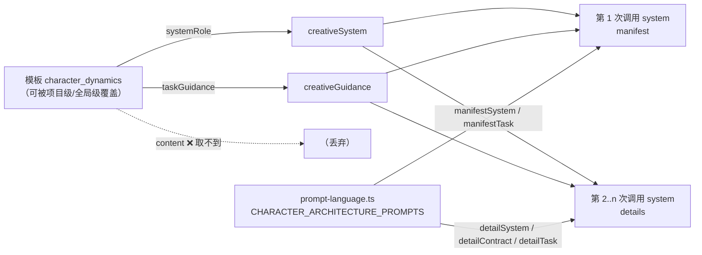

# 角色性格倾向的**实际生效点**在哪里

> 状态：**✅ 已按方案甲落地**（2026-10-28 夜，作者「按建议来」）
>
> **⚠️ 2026-10-29 更新 —— 本文只取「改哪一行」，不要取「三行怎么写」**：
> 正文里的「局面／倾向／位移」三行式**已被四层取代**（按处境分档实测出 D1 引力 + 20 章里 10 章「无」）。
> 本文的**核心结论仍然成立且未变**：条款必须写进 `detailTask`，写进 `character_dynamics` 的 content 是死信。
> 现行格式见 `character-behavior-four-layers.md`。
> 起因：`character-disposition-state-design.md` 标了「✅ 已落地」，实机两轮生成的角色卡**全是旧口径**。
> 结论：**上一稿的落点判断是错的 —— 改的是死信。** 本稿只负责把「真正该改哪一行」钉死，不含新的设计主张。
>
> **落地记录**：`prompt-language.ts` 的 `CHARACTER_ARCHITECTURE_PROMPTS` 中英两套 —— `detailTask` 加
> 【主角的性格倾向】段（三行式 + 四条硬要求 + 反标签/反数值 + 弱点落低档，且限定 `role=protagonist`）；
> `detailContract` 把 `personality` 上限从 120 放宽到 **400**（其余字段仍 120）。测试：
> `prompt-language-contract.test.ts` 新增「锚定生效点」一例（把条款挪回模板 content，测试即红）。
> 模板 `character_dynamics.content` 未动，仍是死信 —— 那条产品级债见 §6 末尾。
>
> **2026-10-28 二次收紧（作者实机读数后）**：首轮生成已经生效（四条三行式），但**「局面」写成了具体事件**
> （"同门当众递状纸"、"灵配袋空一格，几日之内要凑出保命开销"），而 `personality` 会**原样**进
> `characters_arch`（`character-roster-repository.ts:788`）被大纲与正文读到 ⇒ 等于在情节大纲之外
> **开了第二个事实源**。已在 `detailTask` 补「局面」单列四条：条件句不写事件句 / 删人名日期后自检 /
> **必须含一个当场要做的选择**（专治"鸡毛蒜皮"）/ 明写污染路径。守卫：
> `forbids writing plot events into the disposition situation line`。

## 1. 一句话

架构链的「角色」步**不读 `character_dynamics` 模板的 `content`**，只读它的 `systemRole`。
性格要求的真正载体是 `src/services/prompt-language.ts` 里的 `CHARACTER_ARCHITECTURE_PROMPTS`（硬编码两套）。

## 2. 落点图（`character` 步）



读法：模板的 `content` 在这条链上**没有边连出去**；`systemRole` 与 `taskGuidance` 有。
所以改 `content` 无论覆盖层清没清，都到不了模型。

## 3. 代码事实（逐行）

`src/services/workflows/commands/architecture.command.ts`：

```ts
const creativeSystem   = composePromptSystemRole(creativeTemplate, writingLanguage)
const creativeGuidance = renderPromptTaskGuidance(creativeTemplate, templateVariables, writingLanguage)
```

- `composePromptSystemRole` 只拼 `systemRole`；
- `renderPromptTaskGuidance` **只渲染 `taskGuidance`**（本机为空串）；
- 两次调用的 user 段 = `creativeGuidance + promptCopy.manifestTask / detailTask`；
- `promptCopy` 来自 `characterArchitecturePrompts(language)` → `prompt-language.ts:66`。

## 4. 为什么输出总是 60–90 字的压缩描述句

`detailContract`（`prompt-language.ts:74`）写着：

> `appearance、personality、background、abilities、motivation、arc、notes 每项不超过 120 字符`

而 `decodeCharacterDetails(content, version = 2)` 在 **v2 下不做 120 字符校验**（`character-proposal-parser.ts:235` 只在 `version === 1` 时校验）。

⇒ **不是硬墙，是话术。** 模型照合同写，于是被迫把性格压成一句密集描述。
要让「局面／倾向／位移」三行写得下，这句话术必须一起放宽，否则条款加了也写不出来。

## 5. 旁证：两轮白跑的完整时间线

| 轮次 | 项目级覆盖 | 模板 content | 实际进模型的 system | 结果 |
|---|---|---|---|---|
| 22:01 | 1792（旧副本，遮蔽） | 1792 旧 | 旧 systemRole | 旧口径 |
| 22:18 | **2289（已同步新版）** | 2289 新 | **新 systemRole** | **仍是旧口径** |

第二轮覆盖已经同步、`plan` 里也能看到新 `systemRole`（"面向番茄小说…"来自合成），说明**文件层面全部正常**；
但 trace 里两次调用的正文都是硬编码合同，`局面` 一次都没出现。
⇒ 覆盖层是**上一轮**的原因；这一轮暴露的是**落点本身错了**。

## 6. 改法（待作者裁定，未落代码）

### 甲、只改真正生效处（推荐，零迁移）——✅ **已实施**

| 改哪 | 改什么 |
|---|---|
| `prompt-language.ts` → `CHARACTER_ARCHITECTURE_PROMPTS['zh-CN'].detailTask` | 在【详情精炼要求】后加【主角的性格倾向】段：`role=protagonist` 写 3–5 条，每条三行 `局面／倾向／位移`；四条硬要求（局面可复现、倾向必须是动作、至少 1 条已位移且至少 1 条「尚无」、说得出吃过什么亏）；禁止标签清单与数值 |
| 同上 → `detailContract` | 「每项不超过 120 字符」改为「`appearance/background/abilities/motivation/arc/notes` 每项 120；**`personality` 上限 400**」 |
| 同上 → `en-US` 整套 | 英文独立一套，已同步（`Situation/Tendency/Shift`） |
| 测试 | `prompt-language-contract.test.ts` 新增「states the protagonist disposition clause at the only site the character step reads」，中英各断言三行式行首 + 四条硬要求 + 反标签/反数值 + 英文无中文泄漏 |

**为什么 `personality` 是 400 而不是不限**：3–5 条 × 三行，每条约 70–90 字，上限取 400 容得下 4 条且能刹住跑题。
`CHARACTER_DETAIL_DESCRIPTION_MAX_CHARS`（120）**没有改**——它只在 `version === 1` 的旧解构路径生效，v2 本来就不校验。

### 乙、新增独立字段（不推荐，成本高）

`personality` 之外新增 `disposition` 列 + `character-proposal-parser.ts` 两处白名单（`:92` / `:280`）+ store + UI + 中英契约 + DB 迁移。已存在项目要迁移。

### 必做但不属本轮

`character_dynamics` 模板的 `content` 在设置面板里**可编辑却永不生效** —— 这是产品级误导。
两个方向：① 把它拼进 `detailTask`，恢复单一权威；② 面板上标注「此正文不参与架构链」。
本轮不动，避免同时改两处归因不了。

## 7. 判定标准（改完怎么算成）

1. trace 的 details 调用里能搜到 `局面`;
2. 落库 `personality` 里 `局面/倾向/位移` 各出现 ≥3 次，且**不出现**"勇敢/隐忍/腹黑"式纯标签；
3. 至少一条 `位移` 不是「尚无」，且理由能指到一件具体的事；
4. 单条 `personality` 长度 > 120（证明 120 话术已解除，模型没再自我压缩）。
