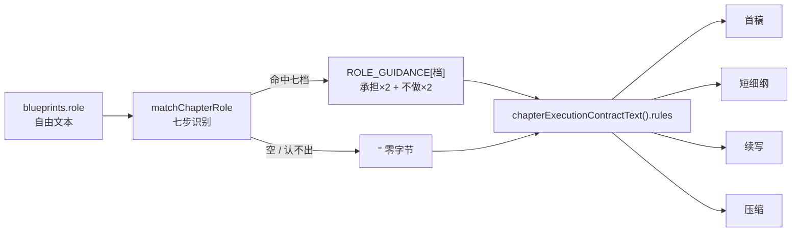

# P14 章节定位语义化 —— 七档 → 本章「承担 / 不做」

> **状态**：已实施（2026-10-24，待实机复验）—— 文案已按三问修订 · 已接执行合同 · 审稿护栏 9→10；剩实机 prompt trace 与人工读稿
> **日期**：2026-10-24 · 分支 `exp/resource-ledger`
> **依据**：`long-form-readiness-review.md` §5 · 台账 P14 · 评审记录（2026-10-24）
> **行业名**：beat-specific scene guidance（按叙事节拍给场景指令）。七档本身**不是**行业标准分类，是 Freytag 五幕在中文网文语境的改写；Story Grid 把"一场戏该完成什么"拆成 scene 的 five commandments 与 value shift，本篇只借它"每档要有承担、也要有边界"的结构。
> **失败形态**：属 **craft / 设计强度**，不属一致性（判据 CM）——因此不进审稿判据，也不拦生成。

---

## 0. 四问

| 问 | 答 |
|---|---|
| 行业里叫什么 | `beat` / `scene function`（场景功能）。「每档该承担什么 + 不该做什么」是写作指导的标准写法（Story Grid 的 obligatory scenes / conventions 即此结构） |
| 谁消费产出 | **模型**（正文生成四条链的 system 消息）。这是真消费者，不是展示面板——不是"做出来给人看" |
| 失败形态属哪类 | 设计强度（craft），不是连续性（continuity）。判据 CM 的适用范围 |
| 已有产品做过什么 | Sudowrite 的 Beat writer（按节拍生成）、Save the Cat / Plottr 的 beat sheet、NovelAI 的 tone 标签。共同点：指令按**节拍**切换，不按章号切换 |

---

## 0.1 条款三问（照 `prompt-clause-admission.md` §5 留痕）

2026-10-24 作者指出高潮档「不要让关键结果靠外力解决」与「章纲明确要求引入强力外援」正面冲突。按三问体检七档，**6 条改写、2 条保留**：

| 条款（改前） | ① 作者要它时成立吗 | ② 合法反例 | ③ 限定词 | 结论 |
|---|---|---|---|---|
| 高潮：不要让关键结果靠外力解决 | ❌ 不成立 —— 章纲要求外援时直接冲突 | 甘道夫圣盔谷（承诺 + 兑现 + 代价）；网文「祖师出关」 | 前文埋过 · 由本章人物召来 · 仍付代价 | 改写 |
| 高潮：不要另起新线 | ⚠️ 部分不成立 —— 双线交汇高潮被误伤 | 双线汇合式高潮 | 加「与本章无关」 | 改写 |
| 冲突：不要把对手写成一招就倒 | ❌ 不成立 —— 碾压流是核心爽点 | 秒杀流 / 扮猪吃虎 | 强弱与前文一致 · 写出力量差根据 | 改写 |
| 转折：不要把反转写成补设定 | ❌ 不成立 —— 藏底牌是网文最常用反转 | 底牌流 | 底牌必须前文埋过 | 改写 |
| 收尾：不要在收尾章开新战场 | ❌ 不成立 —— 卷末抛更大威胁是标准钩子 | 卷末升级式钩子 | 只提一句 · 不占笔墨 · 本章不处理 | 改写 |
| 发展：不要加无关支线、路人和日常 | ⚠️ 部分不成立 —— 日常流被误伤 | 种田流 / 日常流 | 日常构成进展才写 | 改写 |
| 建置：不要用起居天气赶路开场 | ✅ 成立（「第一场戏就得有事」可小到一次麻烦） | 无 —— 这是最强的 AI 味特征 | 已含「第一场戏就得有事」 | 保留 |
| 铺垫：不要把伏笔写成提示牌 | ✅ 成立（「提示牌」「停下本章」本身即毛病，不依赖依据） | 无 | 已含「提示牌」「停下」 | 保留 |

**总原则**：禁令的对象只能是「**无依据的**写法」，不能是「写法」本身。绝对禁令会反过来架空前导行「以作者要求为准」——模型对具体禁令的服从度高于抽象优先级。

---

## 1. 现状与缺口（取证）

| 事实 | 证据 |
|---|---|
| 七档词表 | `src/shared/chapter-role.ts:4-12`（建置/铺垫/发展/冲突/高潮/转折/收尾） |
| 存**自由文本**，旧值「开篇」与自定义值原样保留（PR #309 保真约束） | 同文件头注释 · `chapterRoleOptions()` |
| `role` **已经进正文请求**——随 `chapter_info` 的 `JSON.stringify` | `src/services/prompts/prompt-builder.ts:171` `withChapterInfo` · 调用点 `generate-draft.command.ts:879` |
| 但模板正文**没有一句解释它** | 全库搜 `role` 在提示词正文里的出现：只有"role 只填一个功能词"（对模型的**输出**要求），没有"收到 role 该怎么写" |
| 实测模型常写成整句 | `docs/design/prompt/prompt-payload-scoping-design.md:354/374`（「发展——承接第5章门牌篡改的物证…为第7章的主动逼近蓄压」） |

**⇒ 缺口不是"没传"，是"传了但没说它意味着什么"。** 这就是本篇要补的。

---

## 2. 落点与覆盖

**落点**：`generate-draft.command.ts` 的 `chapterExecutionContractText()`（`:490-526`），产出的 `.rules` 进 **system 消息**。



> 一句话读法：role 只有被认成七档之一才产生行为；认不出时四条链的请求**逐字节不变**。

**为什么落这里，而不是三个候选落点**：

| 候选 | 否决理由 |
|---|---|
| 内置模板正文 `content` | 覆盖版是**整体替换**（`prompt-catalog.ts:125-146`），改内置正文对所有已保存覆盖版的项目**静默失效**、零报错 |
| `toBlueprintProjection()` 的 JSON 派生字段 | 能穿透，但 JSON 里的字段容易被当元数据忽略——`withSuspenseHook`（`prompt-builder.ts:240-246`）单开一段的理由就是这个 |
| 新增 `{{role_guidance}}` 变量 | 要动中英两套模板 + 变量表精确断言 + `OPTIONAL_PROMPT_LABEL_PATTERN` + 一批邻接断言；且 `systemSuffix` 恒取内置、`requiredContextVariables` 读内置清单，收益不值这个改动面 |
| **执行合同 `.rules`（采用）** | 一处构造四处复用（`:1079`）；不受覆盖版影响；中英只走 `promptLanguageText`；零新增变量 → 不牵动任何变量表校验 |

---

## 3. 识别规则（确定性七步）

| 步 | 规则 | 例 |
|---|---|---|
| 1 | `trim()` | `' 高潮 '` → `'高潮'` |
| 2 | `NFKC` 归一 | `'转折（…）'` → `'转折(…)'` |
| 3 | 剥**一层**成对包裹符（`【】[]「」『』""（）`） | `'【收尾】'` → `'收尾'` |
| 4 | 整串等于中文档名 → 命中 | `'建置'` |
| 5 | 整串等于英文档名（大小写不敏感）→ 命中 | `'Turning Point'` → 转折 |
| 6 | 中文档名开头 + **分隔符闭集** + 说明 → 命中 | `'发展——承接第5章…'` · `'冲突/高潮'` · `'建置：开局'` |
| 7 | 其余 → `null` | `'开端'` · `'双线交汇'` · `'非高潮'` · `'小高潮/转折——…'` · `'Conflict with the guild'` |

**为什么第 5 步只认整串**：`Conflict with the guild…` 这类散文以 `Conflict` 开头，做前导解析会误判；英文不是存储规范词（模板要求中文七词），只在整串就是档名时才可信。

**三条已否决做法**：

1. **未知值走 `purpose` 猜档** —— 跨字段推断，等于替作者决定本章功能。
2. **子串扫描（含「高潮」即高潮）** —— `小高潮`、`非高潮` 全误判，且「非」会反义。
3. **照抄 `rhythm-profiles.ts` 的「未知值原样输出」** —— 那里原样输出是对的（平台画像是作者自己的话）；这里不行：`role` 的自由文本常带跨章意图，原样注入等于把**材料**升格成**规则**，还与蓝图 JSON 里同一句重复，并且不满足判据 AP（它只有承担、没有边界）。

**为什么第 6 步不算越过 DN**：这是**读标签**，不是改数据。说明部分仍原样留在蓝图 JSON 的 `role` 里（`:879` 的投影包含它），信息零丢失；system 只补这一档的行为合同。

---

## 4. 七档文案（**本篇请你逐档审的部分**）

每档固定 **1 行前导 + 4 条**（2 承担 + 2 不做）。前导行的档名从 `CHAPTER_ROLE_LABELS` 取，不另抄一份词表。

> 本章按「建置」定位取舍；与作者本章任务或必需事件冲突时，以作者要求为准。

**建置**
- 承担：把局面交代清楚——谁在哪、手里有什么、被什么卡住；读完读者要能说出他想干什么、拦着他的是什么。
- 承担：让至少一格变化落地（关系、信息或处境），不要写成纯介绍。
- 不做：不要用旁白成段讲世界观、人物履历和势力关系；设定跟着人物当下的动作和麻烦露出来。
- 不做：不要开场先写起居、天气和赶路；建置不是热身，第一场戏就得有事。

**铺垫**
- 承担：埋下后文要用的东西（人、物、一句话、一条规矩），并且让它在当下就有用，读者回头能对上。
- 承担：让主角先付一点代价或欠一笔账，留下「这事没完」的预期。
- 不做：不要把伏笔写成提示牌（「他不知道，这将改变一切」），也不要让角色替作者总结「这是一条重要线索」。
- 不做：不要为了埋伏笔停下本章正在发生的事；伏笔要挂在当前冲突上，不能单开一段讲。

**发展**
- 承担：让本章的事情真的往前走一格：目标推进、关系变化、信息增量，至少落一样。
- 承担：把推进过程写出具体动作和阻力，让读者看到他是怎么办到的。
- 不做：不要原地打转——同一场争执、同一条线索反复确认，读完等于没读。
- 不做：不要为凑篇幅加与本章目标无关的支线和路人；日常只有本身构成进展（关系、信息或处境）时才写。

**冲突**
- 承担：让本章出现一次正面交锋，双方各有想要的，也各有不能退的理由。
- 承担：让交锋产生后果——关系、资源、信息或立场至少变一样。
- 不做：不要只写嘴仗和情绪；冲突要靠具体行动、代价和选择往前推。
- 不做：对手的强弱要与前文交代一致——该强的不能一击就倒；要写碾压，先写出力量差的根据。主角也不能靠巧合或临时新能力无损过关。

**高潮**
- 承担：把此前攒下的压力在本章集中兑现：主角做出关键选择，付出代价，结果不可逆。
- 承担：给读者一次明确的情感落点——赢、输、翻盘或认账，总要有一个。
- 不做：不要在高潮章另开与本章无关的新线、讲新设定或插无关回忆；两条线汇合可以，但笔墨只服务这一场。
- 不做：外援可以来，但必须前文埋过、由本章人物的选择或代价召来，且仍要付代价；不要用毫无铺垫的救兵或对手突然犯蠢来收场。

**转折**
- 承担：让此前的判断或局面失效：立场、目标、敌我或真相发生一次翻转，且翻不回去。
- 承担：写清翻转的触发和代价，让读者看到「为什么是现在变了」，而不是被告知「变了」。
- 不做：底牌可以藏，但必须前文埋过；不要无中生有地「原来还有一层」，也不要让反转不改变人物的处境和选择。
- 不做：不要为反转而反转：没有前文依据的翻盘、为制造意外让角色反常，读者会出戏。

**收尾**
- 承担：把本章（或这一段）开的账结掉：悬着的事给出结果，人物落到一个能继续往下走的位置。
- 承担：留下继续读的由头——新的麻烦或没答的问题，但不再铺新局。
- 不做：不要在收尾章展开新战场、引入新角色或塞新的长篇设定；作钩子提一句更大的威胁可以，但不占本章笔墨、也不在本章处理它。
- 不做：不要用总结陈词代替收束（「从此以后……」），也不要把所有线一次结清、堵死后面。

**起草纪律**（已执行，请一并核对）：
- 只用「翻转/反转」，**不出现**「结构位/覆盖/额度/中弧/单元/卷」——弧光层的「转折」是结构位额度，与本章功能不是一回事（§7）
- 一律写「默认取舍」，不写「禁止」，作者要求始终在前
- 单档体积：中文 ~200 字符、英文 ~650 字符（单测钉住 zh<400 / en<900）

---

## 5. 注入口径

插入位置：`【本章可推进的事件】` 之后、`【远期设定边界】` 之前。标题中文 `【本章叙事定位】`、英文 `[Narrative function of this chapter]`。

真实渲染（`role = 建置`，节选）：

```
【本章可推进的事件】可以写与既有事实相容的新行动和结果；普通无代价情节无需增加代价。
【本章叙事定位】
本章按「建置」定位取舍；与作者本章任务或必需事件冲突时，以作者要求为准。
承担：把局面交代清楚——谁在哪、手里有什么、被什么卡住；读完读者要能说出他想干什么、拦着他的是什么。
承担：让至少一格变化落地（关系、信息或处境），不要写成纯介绍。
不做：不要用旁白成段讲世界观、人物履历和势力关系；设定跟着人物当下的动作和麻烦露出来。
不做：不要开场先写起居、天气和赶路；建置不是热身，第一场戏就得有事。
【远期设定边界】世界设定与故事架构是全书事实源，…
```

**零字节**：认不出时 `roleBlock === ''`，拼出的文本与改动前**逐字节相同**——不留空标题、不留空行、不产生 `\n\n`。

**标题字面量留在 `generate-draft.command.ts`**，不下沉到 resolver：审稿护栏靠源码扫描 `【…】`，下沉后护栏会静默失效。

---

## 6. 四条链与取证

| 链 | 是否带 | 锚点 |
|---|---|---|
| 首稿 | ✅ | `:1079` 构造 → `:1080` → `:1340` |
| 短细纲 | ✅ | `:1104` `executionContract`（无 system，进 user） |
| 续写 | ✅ | `:1397` → `:1829` |
| 压缩 | ✅ | `:1423` → `:2017` |

取证看 `debug/prompt-trace/*.json` 的 **`ioCalls[].messages`**。不看 `built`：`built` 会少掉代码追加的块（payload 稿 §7 结论 6）。

---

## 7. 压缩轮裁定：保留

压缩只删不增，看起来不该带"承担"。但仍保留，三条理由：

1. `generate-draft.command.test.ts:3396` 已钉死「首稿 system 与压缩 system **逐字相同**」。排除压缩必须改这条不变量，制造一条只有压缩才不同的隐分叉。
2. 压缩请求的 user 已两次写"不得新增情节"（`:1983`、`:1999`），system 的 `【操作边界】` 仍是最后一条；定位块的「不做」半对压缩是净收益（防它借「承担」补戏）。
3. 前导行写明"与作者任务冲突以作者为准"，不会让「收尾不要开新线」压过作者明确要求。

若日后要排除：给函数加 `{ includeRole?: boolean }` 并改 `:3396`，同时把"为什么压缩不同"写进注释。成本明码，不默认做。

---

## 8. 术语：两个「转折」

| 名称 | 位置 | 含义 |
|---|---|---|
| 弧光层的「转折」 | `arc-position.ts` `isTurnField` | 一次性的**结构位额度**，在大纲生成时以「覆盖：M1-2/转折」声明 |
| 本篇 `role` 的「转折」 | `blueprints.role` | 本章的**叙事功能标签**，消费方是正文链 |

规避：注入文案正文只用「翻转/反转」，档名只在前导行出现一次。

---

## 9. 判据

**不新增判据编号**（沿用 2026-10-24 交接稿口径）。本篇约束由两条既有判据覆盖：

| 判据 | 在本篇的形态 |
|---|---|
| **AP**（给上游权威必须同时给那一侧限制） | 七档每档必须是「承担 ×2 + 不做 ×2」，缺一不成立。只给承担的版本已被否决（会诱导为履行定位硬塞事件） |
| **DN 同型**（未知不填默认档） | 空值 / 认不出的自定义值 → 不注入、不回显、不填默认档。与 DN 同一理由：填了就等于替作者判定 |
| **CM**（设计强度 ≠ 一致性） | 本篇产出**不进审稿判据**。审稿侧对照表对它的表态是「不进」，理由：用它判会把「收尾章不该开新线」误判成缺陷 |

---

## 10. 测试与既有影响

新增 `src/services/prompts/__tests__/chapter-role-guidance.test.ts`：12 例（7×2 档双语 · 4 类空值 · 6 类未知 · 6 类前导命中 · 包裹符 · 英文整串 · 双语句名 · 互不相同 · 体积上限）。**已全绿。**

**必须同批调整的既有测试**（最容易漏）：

| 文件:行 | 改动 | 为什么 |
|---|---|---|
| `src/shared/__tests__/review-execution-contract.test.ts:76` | `toBe(9)` → `toBe(10)` + 注释清单 | 它正则扫生成侧源码的 `【…】` 标题并断言条数 |
| `src/shared/review-execution-contract.ts:25` | 「共 9 条」→「共 10 条」 | 文档与断言同源 |
| 同文件 `:31-39` 对照表 | 加 `｜【本章叙事定位】｜不进 → 写作取舍不是缺陷判据…｜` | 未表态的条款会让测试红 |

**不受影响**：`prompt-local-qwen-contract.test.ts:608/611/656`（模板正文一字未改）· 同文件 `:294-300`（未新增变量）· `prompt-project-session.test.ts:316-327`（未新增变量）· `context-entry-parity` 五条哈希（不碰 `prewrite-consultation.ts`）· `generate-draft.command.test.ts:196-219`（读的是内置模板 `content`，不是执行合同）。

---

## 11. 风险与边界

| 风险 | 处置 |
|---|---|
| 未知 role 误判 | 闭集 + 前导谓词；反例进单测；**绝不回显原值**；英文只认整串 |
| 与作者任务冲突 | 前导行优先级句（"以作者要求为准"） |
| 与 `purpose` / `keyEvents` 语义重叠 | 只给**类级**行为合同，不重复具体目标；实机若读到重复 → **删同义句，不加条款** |
| 暂停中的生成失效 | `:1311-1314` 恢复时逐字比较 system，任何 prompt 升级都会报 `IDENTITY_CHANGED`。预期行为，不回退；`authorInputs` 指纹不变 |
| en-US 项目的自由文本 | 英文模板对 `role` 无取值约束，模型可能写英文整句 → 认不出 → 不注入（DN 正确，但对这类数据空转）。**本篇只修"存中文、出英文"**，不解决英文自由文本 |
| `铺陈` vs `铺垫` | 存量/外部稿里出现过「铺陈」，不在七档内 → 不注入。刻意不加别名（闭集与 `CHAPTER_ROLES` 保持一致）；若实机发现存量值大量是「铺陈」再议 |
| **绝对禁令形态**（2026-10-24 已否决） | 初版写过「不要让关键结果靠外力解决」这类绝对禁令，把作者明确要的合法写法（有铺垫的外援 / 碾压 / 藏底牌 / 卷末钩子 / 日常）一起禁掉，还会反过来架空前导行的作者优先权。改法见 §0.1；准则是 [`prompt-clause-admission.md`](prompt-clause-admission.md) |

---

## 12. 验收

| 场景 | 期望 |
|---|---|
| `role = 建置`（zh） | system 含 `【本章叙事定位】` 且只 1 次，位于「可推进事件」之后、「远期设定边界」之前；user 不含 |
| `role = 建置`（en-US 项目） | 含 `[Narrative function of this chapter]` 与 `positioned as "Setup"`；不含汉字 |
| `role = '开端'` / 空 / 自定义整句 | system 与改动前**逐字节相同**，不含标题、无多余空行 |
| 四条链 | 首稿 / 短细纲 / 续写 / 压缩都含；压缩里标题在 `【操作边界】` 之前 |
| 回归 | `pnpm test -- src` 失败集与基线一致（10 文件 / 29 例既有） |
| 人工 | 读一章「建置」+ 一章「收尾」：无「为履行承担而加戏」 |
| 条款准入 | 七档「不做」逐条过三问（见 §0.1）。反例测试：假设章纲分别写「引入强力外援」「写碾压局」「插一段回忆」「卷末抛更大威胁」「写种田日常」，文案**均不构成冲突**（只追加前置条件） |

---

## 13. 不做（防下一轮重提）

- ❌ 把七档改成受控枚举 / 加 CHECK / 重写存量值 —— 推翻 PR #309 保真契约；那才需要 ADR 0024
- ❌ 用 `purpose` 猜档 —— 跨字段推断
- ❌ 子串扫描 —— `小高潮` / `非高潮` 误判
- ❌ 让作者在设置页编辑这七段 —— 本期是代码常量；要可编辑就另立项（会重新引入覆盖版遮蔽问题）
- ❌ 在审稿侧加"本章定位是否兑现"的判据 —— 违反 CM
- ❌ 把七档扩成八档九档 —— 七档是 UI 词表，扩展要先改 `chapter-role.ts` 与保存值

---

## 14. 实施记录

（2026-10-24）

| 项 | 落地 |
|---|---|
| resolver | `src/services/prompts/chapter-role-guidance.ts` —— 七档双语表 + `matchChapterRole`（七步识别）+ `resolveChapterRoleGuidance`（空/未知 → `''`） |
| 接线 | `generate-draft.command.ts` 的 `chapterExecutionContractText()` **函数体内**内联拼接；位置在【本章可推进的事件】之后、【远期设定边界】之前 |
| 审稿护栏 | `review-execution-contract.ts` 9→10 条 + 对照表新增「不进」一行；测试 `toBe(10)` |
| 测试 | resolver 12 例 + 集成 5 例（首稿 zh / en-US / 未识别 ×3）；`generate-draft.command.test.ts` **231 全绿** |
| 回归 | prompt-local-qwen-contract 22 · prompt-project-session 9 · draft-short-outline 16 · context-entry-parity 22（共 69） |
| 静态 | `tsc --noEmit` 0 错 · eslint 0 warning |
| 未做 | 实机 prompt trace 两章 + 人工读稿（A5） |

**踩到的一处，写下来防复发**：初版把标题字面量 `【本章叙事定位】` 放在 `chapterExecutionContractText` **外面**的私有小函数里，而 `review-execution-contract.test.ts` 用
`source.slice(start, source.indexOf('\n}\n', start))` 只截取**该函数体内**的源码 —— 标题在函数外就扫不到，护栏会静默失效（测试仍绿但只数到 9 条）。
现在标题与拼接都内联在函数体内，并在函数注释里写明「不要抽成外面的小函数」。
