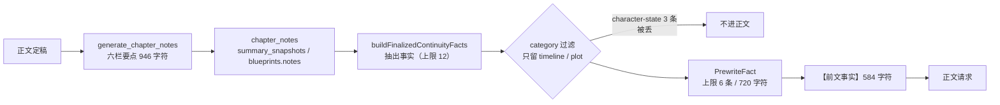

# 上一章注入形态评估：全文本 vs「要点 + 末尾片段」

> 状态：待裁定（2026-11-01）
> 上级稿：[`prompt-payload-scoping-design.md`](prompt-payload-scoping-design.md)（§5 材料矩阵读法、P0-1 短细纲作用域）
> 相关稿：[`p0-1-short-outline-scoping-design.md`](p0-1-short-outline-scoping-design.md) §6-2（**作者已裁定短细纲给上一章全文**，本稿若采纳需一并复议）

---

## 结论一句话

**有条件成立**：方向与行业主流一致（Re³、dsh-novel-craft、NovelDreamer 都是「摘要 + 紧邻结尾片段」），但**在当前实现下直接替换会更差** —— 因为今天「章节要点」进正文链的只有 6 条 / 584 字符，且**伏笔与钩子、角色动态整类被过滤掉**，等于用一个残缺的摘要去换一份完整原文。成立条件是先补齐要点通路，再动替换。

---

## 1. 现状取证

> 下列行号对应 `develop` 工作区当前工作树（未提交改动未逐条核对）。所有结论只描述**代码怎么写**，不评价对错。

### 1.1 一句话现状：上一章给的是**全文**，而且是**必需材料**

| 问题 | 答案 | 证据 |
|---|---|---|
| 上一章正文全文是否注入 | **是**，注入两次（短细纲一次、正文一次） | `generate-draft.command.ts:1142-1144`、`chapter-materials.ts:622-624` |
| 有没有长度上限 | **没有**。它是 `required` 来源，不参与 `budgetChars` 裁剪 | `chapter-materials.ts:623` `const passages = isRequired ? [source.content] : extracted.passages` |
| 装不下怎么办 | **整轮失败**，不静默截断 | `generate-draft.command.ts:1087-1090` |
| 截断策略 | 不存在（全文）。唯一存在的「尾部截断」是 `previousChapterEnding`，上限 **1,000 字符**，且**当前未用于注入** | `chapter-materials.ts:237`、`:383-392` |

关键代码：

```ts
// src/services/workflows/chapter-materials.ts:513-518
const requiredPredecessor = orderedCandidates.length === 1
  ? orderedCandidates[0]
  : explicitRequiredCandidates[0]
const predecessorSource = requiredPredecessor
  ? undefined
  : input.finalized.find(source => source.includeEnding && source.sourceStatus !== 'invalid' && source.content.trim())
```

```ts
// src/services/workflows/chapter-materials.ts:622-624
const extracted = finalizedPassages(source, input.relevanceTerms)
const isRequired = source === predecessorSource
const passages = isRequired ? [source.content] : extracted.passages   // ← 必需前驱 = 整章原文
```

对比：**更早的章不给全文**，只给「证据段落窗口 + 末尾 1,000 字符」（`chapter-materials.ts:360-381`、`:433`）。也就是说现在是**「上一章全文 + 更早章局部摘录」的非对称形态**，不是「所有前文都给全文」。

### 1.2 上一章全文的两处消费方

| 消费方 | 位置 | 实际内容 |
|---|---|---|
| 短细纲 `chapter-draft-short-outline` | `generate-draft.command.ts:1140-1144` | 全文，注释写明「前驱取上一章**定稿**原文（**作者裁定给全文**）」 |
| 正文 `chapter-draft` | `chapter-materials.ts` 必需材料块 → `【定稿原文 · 第N章】` | 全文，`required: true` |

### 1.3 「章节要点」到底存在哪、谁写、谁读

| 环节 | 落点 | 证据 |
|---|---|---|
| 表与列 | `summary_snapshots.chapter_notes`（TEXT）；同一份内容同时写进 `blueprints.notes` | `electron/migrations/baseline-schema.ts:326-339`、`:57-70` |
| 谁写 | 定稿后处理 `chapter_notes` 步：生成 → 写快照 → `BlueprintRepository.updateNotes()` | `finalize-chapter.command.ts:309-386`、`electron/repositories/blueprint-repository.ts:1045-1054`、`electron/services/finalization-generation.ts:107,112` |
| 模板六栏 | 时间定位 / 空间锚点 / 剧情节点 / 角色动态 / 新增设定 / 伏笔与钩子 | `builtin-prompt-templates.ts:1595-1650` |
| 正文链怎么用 | 先转成「连续性事实」，再**只留 `timeline` / `plot` 两类**，最后按 6 条 / 720 字符截断 | `finalized-continuity-facts.ts:57-88`、`generate-draft.command.ts:2444-2461`、`prewrite-consultation.ts:78-80` |

```ts
// src/services/workflows/commands/generate-draft.command.ts:2450
if (fact.category !== 'timeline' && fact.category !== 'plot') continue
```

```ts
// src/shared/finalized-continuity-facts.ts:3
const CONTINUITY_FACT_LIMIT = 12
// :77-87  evidence 匹配不到的要点整条丢弃，其余只留前 12 条
return evidence ? [{ ... }] : []
```

```ts
// src/shared/prewrite-consultation.ts:78-80
export const PREWRITE_FACTS_MAX_ITEMS = 6
export const PREWRITE_FACTS_MAX_CHARS = 720
```

**这条链的实际损失**（第 1 章实测，见 §2）：946 字符的要点 → 抽出 12 条事实（**正好撞上限 12**，即要点多于 12 条、尾部被截）→ 正文链只放行 `timeline`/`plot`，`character-state` 3 条被丢 → 再按 6 条截 → **最终进正文 6 条 / 584 字符**。

具体到「伏笔与钩子」那 5 条：分类正则只认 `伏笔|悬念|未解|线索` 这些**词**，不认 `[埋]`/`[钩]` 标记（`finalized-continuity-facts.ts:8`）。结果 1 条因句中出现「状态」被判成 `character-state`（被白名单丢），另 2 条判成 `plot` 但**被 6 条上限挤掉**，剩 2 条可能根本没进 12 条上限。**无论走哪条路径，伏笔都没能进正文。**

### 1.4 「上一章结尾」这条通路现在是**关着的**

```ts
// src/services/workflows/commands/generate-draft.command.ts:975-980
promptBuilder
  // Old summaries, currentState and previous-ending slots stay empty. One
  // source-labelled material package is appended below.
  .withGlobalSummary('')
  .withPreviousEnding('')
  .withShortSummary('')
```

同一处 `:917-923` 把 `character_states` / `future_blueprints` / `filtered_context` 也留空，注释说明「空段裁剪」会把整段 `【剧情记忆库与前置断点上下文】` 一起裁掉 —— trace 里确认该块**整段不出现**。

`previousEnding`（1,000 字符尾巴）目前只有两个非注入用途：

1. 短细纲的**兜底**（无前驱定稿时用它，`generate-draft.command.ts:1142-1144`）；
2. **开头重演守卫**（`generate-draft.command.ts:1536-1541`）：取上一章末 1,000 字符与新章前 1,200 字符做 8-gram 覆盖，出现 ≥80 字符连续覆盖即判定重演、**结果不保存**（`:94-97`、`:346-387`）。

> 这一点决定了：无论方案怎么改，**尾部片段都必须继续存在**，因为守卫依赖它，而且守卫阈值（80 字符连续）比「300 字」的粒度更粗——300 字的尾巴不足以支撑该守卫的判定窗口。

### 1.5 模板里怎么描述「上一章」

| 位置 | 文案 |
|---|---|
| `builtin-prompt-templates.ts:1262` | `previous_ending: '上章结尾800字'`（**与代码常量 1,000 不一致，属文案漂移**） |
| `builtin-prompt-templates.ts:1284-1285` | `★【上一章已完成的结尾状态（只作边界，不可重演）】★` |
| `builtin-prompt-templates.ts:1300` | 「第一段必须从上一章的最终状态之后推进……**不得引用、摘要、回放或重演**上一章结尾中的句子、动作和意象」 |
| `generate-draft.command.ts`（执行合同，trace `:553` 逐字可见） | 「本章紧接上一章结尾……不得写成"昨天""昨夜""前一天"」 |

即：**文案层面已经在要求「不要重演」，但材料层面给的是整章全文** —— 这是本次提案真正的着眼点（不是省 token，而是「给整章却要求别用整章」这种自相矛盾的供给）。

---

## 2. 实测（一手数据）

数据来源两处，均只读：

- **拼装后实际发出的提示词**：`师父派我来除魔…/debug/prompt-trace/20261101-222515-634-正文-ch2-3c8aa501.md`
- **项目库**：该项目 `.ai-novel/project.db`（`summary_snapshots.chapter_notes`，只读打开）

### 2.1 两个关键数字

| 量 | 字符数 | 说明 |
|---|---|---|
| **上一章（第 1 章）定稿全文** | **1,741** | trace 中出现在两处：短细纲 `:483-537`、正文 `:727-781`（两处逐字相同） |
| **章节要点原文**（`chapter_notes`） | **946** | 六栏结构齐全（4 条剧情节点 / 3 行角色动态 / 6 条新增设定 / 5 条伏笔与钩子） |
| 要点经投影后的连续性事实 JSON | 2,645 | 12 条（**撞上限**），`plot` 9 / `character-state` 3 |
| **实际进正文的前文事实块** | **584**（正文行 506） | 6 条，**撞 6 条上限** |

### 2.2 占比

| 请求 | 请求体字符数 | 上一章全文占比 | 要点（实际注入）占比 |
|---|---|---|---|
| 短细纲 `chapter-draft-short-outline`（user 段） | 3,994 | **1,741 = 43.6%** | 0（该步不注入事实块） |
| 正文 `chapter-draft`（user 16,764 + system 2,024） | 18,788 | **1,741 = 9.3%** | **584 = 3.1%** |

按项目自己的换算口径（`outline-prefix-budget.ts:47-48`，1 字符 ≈ 1–1.5 token）：

- 上一章全文 ≈ **1,161–1,741 tokens**；
- 要点（实际注入）≈ **390–584 tokens**；
- 本章目标字数 1,500 字（trace `:287`），即这本书是**短章**设定。

### 2.3 换成候选方案后省多少（同一份实测）

| 方案 | 短细纲请求 | 正文请求 | 相对当前 |
|---|---|---|---|
| 今天：全文 | 1,741（43.6%） | 1,741（9.3%） | — |
| 候选：**要点 946 + 末尾 300 字** | 1,246（31.2%） | 1,246（6.6%） | 省 495 字符 = 全文的 28%；占正文请求 **2.6%** |
| 候选：**只末尾 300 字**（要点不进这一步） | 300（7.5%） | 300（1.6%） | 省 1,441 字符 = 82% |

**这张表是本评估最反直觉的一点**：在这本书的篇幅（1,500 字/章）下，「要点 + 300 字」只省 **28%**，因为**要点本身就有 946 字符**，相当于原文的 54%。省 token 只有在**长章**上才成立：若章节按 3,000 字（≈3,480 字符）计，同一份要点的压缩率才会明显（推算约省 57%，**此行为推算，非实测**）。

结论：**这个提案的价值主要在「短细纲那一步 43.6% 的占比」和「供给与要求的矛盾」，不在正文请求的 token 成本。**

---

## 3. 行业对照

> 作者铁律：先查行业定义与既有做法，不自己造概念。下面「查到的」都带出处；**查不到的明写未查到，不补**。

### 3.1 概念的标准叫法

| 作者的说法 | 行业标准叫法 | 出处 | 与本项目对应 |
|---|---|---|---|
| 上一章全文 | **previous chapter full text** / *autoregressive context*（Re³ 用这个词指「逐字重放紧邻的前一段」） | [Re³, EMNLP 2022](https://aclanthology.org/2022.emnlp-main.296.pdf) §3.2 | 今天注入的 `【定稿原文 · 第N章】` 全文 |
| 章节要点 / 滚动摘要 | **rolling summary** / **story-so-far state** / **recap**（NovelCrafter 的产品变量就叫 `storySoFar`） | [Re³](https://aclanthology.org/2022.emnlp-main.296.pdf)；[NovelCrafter Prompt Reference](https://www.novelcrafter.com/help/reference/prompts/prompt-examples) | `summary_snapshots.chapter_notes` → `【前文事实】` |
| 上一章末尾 300 字 | **overlap** / **chunk overlap**（RAG 切分里的标准参数 `chunk_overlap`）；在故事生成语境里就是 Re³ 的 *autoregressive context*、dsh 的 *previous chapter's ending* | [Overlapping Chunks 词条](https://ai-solutions.daviesmeyer.com/en/glossary/overlapping-chunks)（注明 LangChain / LlamaIndex 把它做成标准参数）；[dsh-novel-craft README](https://github.com/shiyan688/dsh-novel-craft/blob/main/docs/README.en.md) | `previousChapterEnding`（1,000 字符），今天**只做兜底与守卫，不注入** |
| 上下文预算配比 | **context budget / token budgeting**（按类别分预算，超出该类别就走压缩策略） | [Token budgeting 一文](https://harnessengineering.academy/blog/context-window-optimization-getting-more-from-every-token/)：system 10–15% / 历史 20–30% / 检索 25–35% / 工具结果 15–20% / 预留 10–15%；[中文同口径](https://aiknowledge.cn/article/73749-31-%E7%9F%AD%E6%9C%9F%E8%AE%B0%E5%BF%86%E4%B8%8A%E4%B8%8B%E6%96%87%E7%AA%97%E5%8F%A3%E7%9A%84%E7%BB%8F%E6%B5%8E%E5%AD%A6)：对话历史 ≤45%、输出预留 15% 起 | 我方 `budgetChars: 8_000`（`generate-draft.command.ts:1050`）是**单块材料预算**，不是分类预算 |

**注意口径差异**：上面两张预算表都是**通用 agent 对话**场景（检索/工具/输出预留），不是**小说正文生成**。本仓库没有查到「小说正文生成」这一细分场景的公开配比数字，**不编**。

### 3.2 「摘要 + 结尾片段」组合注入：查到了，而且不止一家

| 系统 | 做法（逐字摘句） | 模型规模 |
|---|---|---|
| **Re³**（Peng et al., EMNLP 2022） | 提示词由粗到细：「Previous Sections' Outlines」→「Recent Story Summary」→**末尾逐字重放紧邻段**「Autoregressive Context」。作者的理由是「作者需要最近一段的细节，但对更早段落只需要高层信息」。人工评测相对 rolling-window 基线：连贯 **+14 个绝对点**、切题 **+20 个点** | GPT-3 175B |
| **NovelDreamer** | 「the model begins by **summarizing the previous chapters** … **directly providing the model with the raw text of previous chapters can overwhelm the LLM**」；同章内跨幕时「**the last few lines of text from the preceding act**」 | **LLaMA 3.1 8B Instruct**（与本项目本地 9B 同量级） |
| **dsh-novel-craft**（开源，MIT） | 「the model receives one writing pack, which contains **no chapter text except the previous chapter's ending (≤900 characters**, required for continuity, and labelled as such inside the pack)… **recap (from your chapter summaries, not the manuscripts)**… the whole pack defaults to a **9,000-character budget**」 | 未标 |
| **NovelCrafter** | 提供 `storySoFar`（场景摘要）与 `takeLast(chapter.summary(storySoFar), 3)`，**默认按摘要而非原文**做前情 | 多模型 |

**这一条对本评估最重要**：三家独立实现同时收敛到「**摘要打底 + 紧邻结尾逐字片段**」，且**都用短片段而不是整章**。dsh 的 900 字符上限与本项目 `previousChapterEnding` 的 1,000 字符几乎重合，而作者提议的 300 字**比两者都短**。

### 3.3 未查到（不编）

- 「300 字」这个具体数字：**没有任何出处**。查到的组合是「摘要 + 最后一段/几句/≤900 字符」，**没有一家给"300 字"这个量级的中文依据**。
- 「段落重叠应取多少」的定量结论：只有 RAG 切分的经验值（块 400–800 token 配重叠 50–120 token，[出处](https://sphrag.com/blog/rag-text-chunking)），**不能直接搬到叙事接续**。
- 中文网文场景（番茄/起点）的上下文配比公开数据：**未查到**。

---

## 4. 方案对比

候选方案：**「上一章要点 + 上一章末尾约 300 字」替代「上一章全文」**。

| 维度 | 今天：全文 | 候选：要点 + 300 字 | 判读 |
|---|---|---|---|
| **token 成本**（按 §2 实测） | 1,741 字符 ≈ 1,161–1,741 tokens；正文请求占 9.3%、短细纲占 43.6% | 1,246 字符 ≈ 831–1,246 tokens；省 28%（正文请求的 2.6%） | **短章上收益很小**；短细纲那一步收益大（43.6%→31.2%，若要点不进该步则 →7.5%）。长章（≥3,000 字）才显著，**属推算** |
| **交接保真度** | 全部在场：对话语气、动作连续性、场景站位、未完成动作、伏笔的原始措辞 | 要点覆盖：剧情节点 / 新增设定 / 角色状态 / 伏笔（**但要先修通路**）；300 字覆盖：最后一屏的动作、语气、站位 | 要点给「事实」，300 字给「接口」。**事实与接口是两类东西，理论上互补**——这正是 Re³ 的结论 |
| **丢失风险** | 风险在**反向**：整章在场，模型容易把它当可引用素材 → 开头重演（已有 80 字符硬闸拦截，说明这是真实故障而非假想） | ① 要点是**事后总结**：未完成动作、半句话的语气、正在进行的动作天然被压成「结果」；② 946 字符的要点今天只放进 584 字符（6 条），**丢掉的正是伏笔与角色动态**；③ 300 字可能接不住「上一章最后那个动作」的**前置条件**（动作从哪来） | 候选的风险**可控且可枚举**（补要点栏目即可）；今天的风险是**结构性**的（供给与要求互相矛盾）。但候选**在现状下不可直接落地**：会把 584/946 的残缺摘要当成全部 |
| **对模型能力的要求** | 低。全文是「抄上下文」，9B 也能接住 | **高**。要求模型把「事实清单」重新演绎成连续动作；本项目实测生成器为本地 9B、结构遵循偏弱，而**要点质量本身由同一个 9B 生成**（`generate_chapter_notes`），不稳定 | 两个 9B 串联 = 误差叠加。行业里 Re³ 走这条路用的是 175B，NovelDreamer / dsh 虽是 8B 量级但**都配了 rerank 或人工挑选**；本项目没有 rerank |
| **与既有机制重叠** | — | **高度重叠**：`summary_snapshots.chapter_notes` → `finalized_continuity_facts` → `【前文事实】` **已经在注入要点**；`previousChapterEnding`（1,000 字符）**已经实现了尾部片段** | 候选方案**几乎没有新机制**，只是把两条已存在但被关掉的通路打开、并调整配比。**这既是优点（零新概念）也是风险（改的是两个已被裁定过的开关）** |
| **失败形态** | 开头重演（有闸门）；整章被当素材导致「原地踏步」；长章时必需材料撑爆 → 整轮失败 | ① **接不上最后一屏**：新章从「要点里的事件」起笔，跳过上一章结尾的动作；② **语气断层**：要点不含对话语气，角色开口像换人；③ **事实正确但顺序错**：要点是并列清单，没有先后；④ **伏笔消失**（当前实现下必现） | ①②是 300 字该解决的，③④是补要点栏目该解决的。**如果只做替换不补栏目，①③④三条会同时出现** |

### 4.1 要点 → 正文 的实际通路（含两处已知损失）



一句话读法：**要点在到达正文之前要过两道闸（12 条截断 + 6 条截断）和一道分类过滤，946 字符最终只剩 584 字符进场。**

---

## 5. 结论与成立条件

**结论：有条件成立。**「要点 + 结尾片段」的方向本身是对的（三家独立实现 + 一篇 EMNLP 论文都这么做，且 Re³ 用人工评测证明它优于整段滚动窗口），但**在当前实现上直接做等号左边的替换，会得到一个比今天更差的提示词**。

成立条件（缺一条都不建议动）：

1. **要点必须先补齐「接口字段」**，而不是只补事实：至少要有 **①上一章最后一个未完成动作 / 停在哪个动作上；②在场人物与站位；③正在生效的对话语气或关系温度**。今天的六栏里，「时间定位」「空间锚点」有，「未完成动作」和「语气」**没有栏目承载**——这是候选方案最硬的缺口。
2. **要点进正文的通路必须放开**：`generate-draft.command.ts:2450` 的 `timeline`/`plot` 白名单要覆盖「伏笔与钩子」和「角色动态」，`PREWRITE_FACTS_MAX_ITEMS = 6` 的全局 6 条上限对「单章交接」明显不够（今天 6 条全被第 1 章占满，第 2 章之后更早的章几乎分不到）。
3. **末尾片段应为 800–1,000 字，不是 300 字**：① 与 Re³ 的「紧邻段」、dsh 的「≤900 字符」同量级；② 现有 `previousChapterEnding` 已是 1,000 字符，`300` 是新造的数字且**查不到出处**；③ 重演守卫按 80 字符连续覆盖判定，300 字的窗口对守卫过窄。
4. **不建议在短细纲那一步同步替换**，除非一并复议 [`p0-1-short-outline-scoping-design.md`](p0-1-short-outline-scoping-design.md) §6-2 的作者裁定（当时的理由是「短细纲要判断'前驱已完成的事'，结尾往往不够」）。**这一步恰恰是全文占比最高的地方（43.6%），收益最大，但也是唯一有明确作者裁定的地方** —— 两件事必须一起议。
5. **必须先有成对实测**：同一章、同一模型、只改注入形态，比较「重演闸触发次数 / 首段是否接住上一章最后动作 / 伏笔兑现率」。今天没有基线数据，**任何「更合理」都只是纸面推演**。

---

## 6. 待作者裁定项

| # | 分叉 | 选项 | 本稿倾向 |
|---|---|---|---|
| R1 | 尾部片段长度 | 300 字（作者提议）/ 800 字 / 1,000 字（现值） | 800–1,000，理由见 §5-3；300 字无出处 |
| R2 | 短细纲那一步要不要一起改 | 只改正文 / 两步一起改 | 先只改正文，短细纲单议（有既有裁定） |
| R3 | 要点通路怎么补 | ① 放开 category 白名单 ② 加「未完成动作/语气」栏目 ③ 提高 6 条上限 | 三条都要，否则条件 1、2 不成立 |
| R4 | 「要点是 9B 生成的，质量不稳」怎么办 | 接受 / 用作者手改后的要点 / 定稿时要求作者确认要点 | 未取证，需作者定 |
| R5 | 是否要先做 A/B 再定 | 先测后改 / 直接改 | 先测，见 §5-5 |

---

## 7. 未取证 / 未查到

- **未取证**：短细纲那一步的输出质量与「前驱给全文还是要点」的因果关系。本稿只能看到它占 43.6%，看不到它是否因全文而变好。
- **未取证**：3,000 字级章节下的真实占比（本仓库唯一可用的 trace 项目是 1,500 字/章设定）；§2.3 第三行是**推算**，已在表中标注。
- **未取证**：`summary_snapshots.chapter_notes` 与 `blueprints.notes` 双写后是否有任一方被真实读取以外的地方使用（`notesUpdatedAt` 只在 `blueprint-semantic-contract.ts` 的往返序列化里出现，本稿未追到 UI 展示路径）。
- **未查到**：「300 字」的任何行业出处；中文网文平台的上下文配比公开数据。
- **未取证**：「生成器是本地 9B」这一条来自本次任务的团队口径，**本稿未从项目配置里核到模型名与参数量**；§4 表中「对模型能力的要求」一行依赖该前提，若口径变化需重判。
- **未改任何代码、配置或数据库**：本项目所有结论来自只读阅读与只读查询（`project.db` 以 `mode=ro` 打开）。
