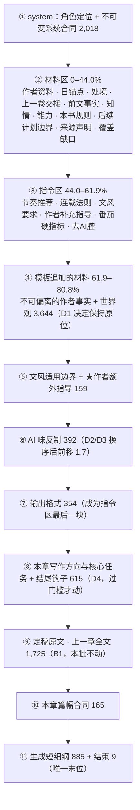

# 正文 prompt 块位置横向审计（只读）

> 状态：**待裁定（2026-11-08）** · 只读审计，未动代码
> 上游：[`chapter-prompt-block-ordering-design.md`](chapter-prompt-block-ordering-design.md)（B1 已落地，本文件不复议其位置）
> 取证对象：`.tmp-block-audit/b1-on-ch12-v5.json`（B1 开）· `.tmp-block-audit/b1-off-ch12-v8.json`（B1 关），均为第 12 章正文请求
> 本文件只回答三件事：除 B1 还有哪些块位置错、能挪哪一块、挪了哪一类缺陷会变差。

---

## 0 一句话结论

除 B1 之外，`user` 段只有 **一处结构性倒置**（3,644 字符的「作者事实 + 世界观」被模板层追加到指令区之后，占全篇 18.9%），但把它按类型归位会把这 18.9% 从 61.9–80.8% 推进 U 形中谷（44.0–62.9%），故**不建议挪**；整份审计只剩两处可动：**输出格式与 AI 味反制换序（0 字符增减）**，以及**「本章写作方向 + 结尾钩子」615 字符挪到末段（须先过照抄门槛）**。其余 4 条（D1、D5、D6，以及「输出格式真正最末」的跨层方案）逐条给出「会变差的一类」，全部判为不建议挪。

---

## 1 两份 trace 的实测块序表

### 1.0 切块与计数口径

- 只统计 `ioCalls` 中 `purpose === 'chapter-draft'` 那条的 `user` 消息（`messages[0]` 为 system，2,018 字符，两臂逐字节相同）。
- 切块法：**行首标题法** —— 每行以 `【` 或 `# ` 开头视为块起点，下一个块起点之前为块尾。
- 字符数 = 从块首行首字符到下一块首字符之前，去掉块尾空行；**含块内换行**。块间分隔符（1–2 个换行）不计入任何一块，故各块字符数之和小于全篇总长。
- 百分比分母 = `user` 段全长（开臂 19,294 / 关臂 18,825），起点与终点各自按 `字符偏移 ÷ 全篇长度` 计算，四舍五入到 0.1。
- 末块（29 号）起点开臂 19,285（= 99.95%）、关臂 18,816（= 99.95%），按上述规则显示为 100.0%，故该行两端同为 100.0%；它的 9 个字符在文件末尾，终点也是 100.0%。
- 标题取块首行到第一个 `】`（`# 世界观` 取其整行）。

### 1.1 B1 开（`b1-on-ch12-v5.json`，user 19,294 字符，29 块）

| # | 起点 | 字符数 | 占比 | 标题原文 |
|---|---|---|---|---|
| 01 | 0 | 2,794 | 0.0–14.5% | 【作者资料（保留原文；人物状态具有时点，不是永久约束）】 |
| 02 | 2,796 | 219 | 14.5–15.6% | 【故事日锚点】 |
| 03 | 3,016 | 27 | 15.6–15.8% | 【筹码】 |
| 04 | 3,044 | 1,416 | 15.8–23.1% | 【处境】 |
| 05 | 4,462 | 1,320 | 23.1–30.0% | 【上一卷交接（第2卷 · 估算第7–10章）】 |
| 06 | 5,784 | 714 | 30.0–33.7% | 【前文事实（定稿连续性索引自动摘录，不保证穷尽）】 |
| 07 | 6,500 | 140 | 33.7–34.4% | 【知情（谁知道什么）】 |
| 08 | 6,642 | 445 | 34.4–36.7% | 【能力（本书的能力规则：能做什么、要付什么、什么情况下会被破）】 |
| 09 | 7,089 | 698 | 36.7–40.4% | 【本书规则（世界观原文摘录，不保证穷尽）】 |
| 10 | 7,789 | 391 | 40.4–42.4% | 【后续计划边界（只约束当前章，不是当前章任务）】 |
| 11 | 8,182 | 75 | 42.4–42.8% | 【有来源的历史与候选】 |
| 12 | 8,259 | 231 | 42.8–44.0% | 【可选材料覆盖缺口】 |
| 13 | 8,492 | 183 | 44.0–45.0% | 【节奏推荐（如有，由平台画像注入；只约束节奏与兑现频率，不改变本章任务）】 |
| 14 | 8,677 | 549 | 45.0–47.8% | 【本章写作方向与核心任务】 |
| 15 | 9,228 | 66 | 47.8–48.2% | 【本章结尾钩子（如有）】 |
| 16 | 9,296 | 782 | 48.2–52.2% | 【网文连载更新核心法则】 |
| 17 | 10,080 | 919 | 52.2–57.0% | 【文风要求（如有）】 |
| 18 | 11,001 | 132 | 57.0–57.7% | 【用户自定义创作指导】 |
| 19 | 11,135 | 343 | 57.7–59.5% | 【番茄平台硬指标（以下为可判定要求，优先级高于任何文风描述）】 |
| 20 | 11,480 | 464 | 59.5–61.9% | 【正文生成约束｜去AI腔（可判定，禁用形容词式要求）】 |
| 21 | 11,946 | 444 | 61.9–64.2% | 【不可偏离的作者事实】 |
| 22 | 12,392 | 3,200 | 64.2–80.8% | `# 世界观` |
| 23 | 15,594 | 159 | 80.8–81.6% | 【文风适用边界】 |
| 24 | 15,755 | 354 | 81.7–83.5% | 【输出格式】 |
| 25 | 16,111 | 392 | 83.5–85.5% | 【AI 味反制——以下模式严禁出现】 |
| 26 | 16,505 | 1,725 | 85.5–94.5% | 【定稿原文 · 第11章 · draft 22】 |
| 27 | 18,232 | 165 | 94.5–95.4% | 【本章篇幅合同】 |
| 28 | 18,399 | 885 | 95.4–99.9% | 【生成短细纲：计划，不是事实依据】 |
| 29 | 19,285 | 9 | 100.0–100.0% | 【生成短细纲结束】 |

### 1.2 B1 关（`b1-off-ch12-v8.json`，user 18,825 字符，29 块）

| # | 起点 | 字符数 | 占比 | 标题原文 |
|---|---|---|---|---|
| 01 | 0 | 2,794 | 0.0–14.8% | 【作者资料（保留原文；人物状态具有时点，不是永久约束）】 |
| 02 | 2,796 | 219 | 14.9–16.0% | 【故事日锚点】 |
| 03 | 3,016 | 27 | 16.0–16.2% | 【筹码】 |
| 04 | 3,044 | 1,416 | 16.2–23.7% | 【处境】 |
| 05 | 4,462 | 1,320 | 23.7–30.7% | 【上一卷交接（第2卷 · 估算第7–10章）】 |
| 06 | 5,784 | 714 | 30.7–34.5% | 【前文事实（定稿连续性索引自动摘录，不保证穷尽）】 |
| 07 | 6,500 | 140 | 34.5–35.3% | 【知情（谁知道什么）】 |
| 08 | 6,642 | 445 | 35.3–37.6% | 【能力（本书的能力规则：能做什么、要付什么、什么情况下会被破）】 |
| 09 | 7,089 | 698 | 37.7–41.4% | 【本书规则（世界观原文摘录，不保证穷尽）】 |
| 10 | 7,789 | 391 | 41.4–43.5% | 【后续计划边界（只约束当前章，不是当前章任务）】 |
| 11 | 8,182 | 75 | 43.5–43.9% | 【有来源的历史与候选】 |
| 12 | 8,259 | 1,725 | 43.9–53.0% | 【定稿原文 · 第11章 · draft 22】 |
| 13 | 9,986 | 231 | 53.0–54.3% | 【可选材料覆盖缺口】 |
| 14 | 10,219 | 183 | 54.3–55.3% | 【节奏推荐（如有，由平台画像注入；只约束节奏与兑现频率，不改变本章任务）】 |
| 15 | 10,404 | 549 | 55.3–58.2% | 【本章写作方向与核心任务】 |
| 16 | 10,955 | 66 | 58.2–58.5% | 【本章结尾钩子（如有）】 |
| 17 | 11,023 | 782 | 58.6–62.7% | 【网文连载更新核心法则】 |
| 18 | 11,807 | 919 | 62.7–67.6% | 【文风要求（如有）】 |
| 19 | 12,728 | 132 | 67.6–68.3% | 【用户自定义创作指导】 |
| 20 | 12,862 | 343 | 68.3–70.1% | 【番茄平台硬指标（以下为可判定要求，优先级高于任何文风描述）】 |
| 21 | 13,207 | 464 | 70.2–72.6% | 【正文生成约束｜去AI腔（可判定，禁用形容词式要求）】 |
| 22 | 13,673 | 444 | 72.6–75.0% | 【不可偏离的作者事实】 |
| 23 | 14,119 | 3,200 | 75.0–92.0% | `# 世界观` |
| 24 | 17,321 | 159 | 92.0–92.9% | 【文风适用边界】 |
| 25 | 17,482 | 354 | 92.9–94.7% | 【输出格式】 |
| 26 | 17,838 | 392 | 94.8–96.8% | 【AI 味反制——以下模式严禁出现】 |
| 27 | 18,232 | 165 | 96.8–97.7% | 【本章篇幅合同】 |
| 28 | 18,399 | 416 | 97.7–99.9% | 【生成短细纲：计划，不是事实依据】 |
| 29 | 18,816 | 9 | 100.0–100.0% | 【生成短细纲结束】 |

### 1.3 两表之间只有两个变量（已逐块比对）

- 28 块**逐字节相同**（集合比对：开臂独有 1 块、关臂独有 1 块，其余 28 块完全相同）。
- 变量一：26 号块（关臂 12 号）「定稿原文 · 第11章」1,725 字符在两臂**文本完全一致、各只出现 1 次**，只换了位置（43.9–53.0% → 85.5–94.5%）。
- 变量二：28 号块「生成短细纲」开臂 885、关臂 416，差 469 字符 —— 这正是两臂 `user` 长度差（19,294 − 18,825 = 469）。两臂这一 step 的**输入长度都是 4,632 字符**，差在模型侧输出，不是 B1 造成的。
- 其余块（含 21–25 号模板 `systemSuffix` 五段、27 号篇幅合同、11–12 号材料分段）两臂相同。**这条事实决定了 §5 的因果解释边界：任何质量差异都不能只归因 B1。**

### 1.4 与设计稿 v2 §1.2 的读数差异（不是矛盾）

设计稿记 ch13 trace 上【输出格式】为 356 字符 @93.1%；本表开臂 354 @81.7%，关臂 354 @92.9%。差的是两件事：

1. 起点的 11.2 个百分点差**由 B1 本身造成**：上一章块被插到输出格式之后，输出格式的起点从 92.9% 前移到 81.7%，分母同时从 18,825 抬到 19,294。
2. 字符数 356→354 是两份 trace 的变量取值差（不同章），**未复核来源，标不确定**。

---

## 2 逐块定性与偏差

### 2.1 29 块的类型（五类，无第六类）

| # | 块 | 字符 | 占比（开臂） | 类型 |
|---|---|---|---|---|
| 01 | 作者资料 | 2,794 | 0.0–14.5% | 材料型 |
| 02 | 故事日锚点 | 219 | 14.5–15.6% | 材料型 |
| 03 | 筹码 | 27 | 15.6–15.8% | 材料型 |
| 04 | 处境 | 1,416 | 15.8–23.1% | 材料型 |
| 05 | 上一卷交接 | 1,320 | 23.1–30.0% | 材料型 |
| 06 | 前文事实 | 714 | 30.0–33.7% | 材料型 |
| 07 | 知情 | 140 | 33.7–34.4% | 材料型 |
| 08 | 能力 | 445 | 34.4–36.7% | 材料型 |
| 09 | 本书规则（世界观摘录） | 698 | 36.7–40.4% | 材料型 |
| 10 | 后续计划边界 | 391 | 40.4–42.4% | 系统合同（硬禁写边界，随材料区注入） |
| 11 | 有来源的历史与候选 | 75 | 42.4–42.8% | 材料型（分段声明） |
| 12 | 可选材料覆盖缺口 | 231 | 42.8–44.0% | 材料型（覆盖收据） |
| 13 | 节奏推荐 | 183 | 44.0–45.0% | 指令型 |
| 14 | 本章写作方向与核心任务 | 549 | 45.0–47.8% | 本轮任务 |
| 15 | 本章结尾钩子 | 66 | 47.8–48.2% | 本轮任务 |
| 16 | 网文连载更新核心法则 | 782 | 48.2–52.2% | 指令型 |
| 17 | 文风要求 | 919 | 52.2–57.0% | 指令型 |
| 18 | 用户自定义创作指导 | 132 | 57.0–57.7% | 指令型 |
| 19 | 番茄平台硬指标 | 343 | 57.7–59.5% | 指令型 |
| 20 | 去AI腔 | 464 | 59.5–61.9% | 指令型 |
| 21 | 不可偏离的作者事实 | 444 | 61.9–64.2% | 材料型 |
| 22 | `# 世界观` | 3,200 | 64.2–80.8% | 材料型 |
| 23 | 文风适用边界 + ★作者额外指导 | 159 | 80.8–81.6% | 指令型 |
| 24 | 输出格式 | 354 | 81.7–83.5% | 输出格式 |
| 25 | AI 味反制 | 392 | 83.5–85.5% | 指令型 |
| 26 | 定稿原文 · 第11章 | 1,725 | 85.5–94.5% | 材料型 |
| 27 | 本章篇幅合同 | 165 | 94.5–95.4% | 本轮任务 |
| 28 | 生成短细纲 | 885 | 95.4–99.9% | 本轮任务 |
| 29 | 生成短细纲结束 | 9 | 100.0–100.0% | 本轮任务（哨兵行） |

两点说明：

- **「系统合同」在 `user` 段只有 10 号一块，且它不是角色/视角合同**。角色定位与【不可变系统合同】整段在 `system` 消息里（2,018 字符，两臂相同），位次在 user 之前，即 primacy 区，符合原则。
- 10 号「后续计划边界」虽带硬禁写语气，但它承载的是**后续章的剧情事件原文**，所以计入「系统合同」而不是材料型；这一归类直接决定了 §2.2-D6 的判定。

### 2.2 偏差清单（每条回答动作 / 证据 / 风险）

> 原则：材料型在上 → 指令型次之 → 输出格式最后；另加硬约束「短细纲唯一末位」（设计稿 §4 已定，本文件不改）。

#### D1 · 3,644 字符的材料型落在 8 个指令块之后 —— **不建议挪**

- **动作**：现位置 11,946–15,592（61.9–80.8%）；按类型应插在材料区尾部 8,492（44.0%）之后，即 8,492–12,136（44.0–62.9%）。挪动 3,644 字符 = 18.9 个百分点；它后面的 8 个块整体后移 18.9 个百分点（节奏推荐 44.0%→62.9%、去AI腔 59.5%→78.4%）；24 号之后各块位置不变。
- **证据**：【直接读过原文】22 号块首行是 `# 世界观`，起点 12,392，字符 3,200；21 号块首行 `【不可偏离的作者事实】`，其第 2 行是 `- 故事架构：`，3,200 字符的 `# 世界观` 正是它后面那段 `{{architecture}}` 的续行（模板 `builtin-prompt-templates.ts:1326-1329`，`systemSuffix` 第一段）。U 形位置效应本身【转引设计稿 §2.1】，设计稿已声明该结论出自多文档 QA、用于单轮续写属外推。
- **风险**：
  - 变好一类：**类型混乱**（材料与指令交错）消失，材料区成为 0–62.9% 的连续段。
  - 变差一类：**设定遵守**。3,644 字符从 64.2–80.8% 退到 44.0–62.9%，正是 U 形曲率最低的区间；而这两块的标题就是「不可偏离」，其中 3,200 字符是全篇唯一一份完整世界观投影。同时 `# 世界观` 与 36.7–40.4% 的【本书规则】摘录贴到一起（间隔从 23.8 个百分点缩到 3.6 个百分点），会强化「两份世界观重复」的观感 —— 设计稿 §1.3-A2 已判定这两份用途不同、不能合并，挪动后这个判定更难维持。
  - 照抄风险：不升（远离生成点，见 §5.2）。
- **判定**：不建议挪。理由是「类型合规」换不来可测收益，却确定性地把最大一份材料推进中谷。

#### D2/D3 · 输出格式之后还压着一块指令型 —— **建议换序（唯一零成本动作）**

- **动作**：24 号【输出格式】354 与 25 号【AI 味反制】392 互换。输出格式 81.7–83.5% → 83.5–85.5%（起点 +1.7 个百分点），AI 味反制 83.5–85.5% → 81.7–83.5%（起点 −1.7）；**字符增减 0，全篇总长不变，其余 27 块位置不变**。
- **证据**：【直接读过原文】两段同属 `systemSuffix` 一个字符串，书写顺序是「输出格式（`builtin-prompt-templates.ts:1338-1343`）→ AI 味反制（`:1345-1352`）」，即块序完全由模板书写顺序决定，改一个字符串内两段的先后即可，不跨层、不动装配。类型原则由任务书给定；U 形【转引设计稿 §2.1】。
- **风险**：
  - 变好一类：**输出格式违规**（Markdown 混入、段落未空行、开头写「第x章 正文如下」）—— 格式约束从「被 392 字符隔开」变成紧接在生成点之前的最后一块指令。
  - 变差一类：**AI 腔压制**略降。392 字符的禁句式清单前移 1.7 个百分点，仍在 81.7%，与生成点之间只多出 354 字符的格式块；这一档位移按 8 次对照的噪声幅度衡量属于可忽略。
  - 照抄风险：不升（两块都是规则文本，不含可抄内容）。
- **判定**：建议做。这是全篇唯一「类型原则与 U 形不冲突、成本为零」的动作。
- **附**：真正把输出格式搬到全文最末（短细纲之前）需要把它从 `systemSuffix` 拆出来、由装配层作为独立项插到篇幅合同之后，属跨层改动（`generate-draft.command.ts:1152-1156` 的数组要加一项、`builtin-prompt-templates.ts` 要拆字符串），且自定义模板若不含【输出格式】段则无块可拆 —— **不建议本批做**，D2/D3 的换序已经消掉「格式之后还有指令」这一条偏差。

#### D4 · 本轮任务落在 45.0–48.2% 的中段 —— **建议挪，但须先过照抄门槛**

- **动作**：14+15 号（549 + 66 = 615 字符）现位置 8,677–9,293（45.0–48.2%）；建议插到 26 号【定稿原文】之前，即 15,890–16,505（82.4–85.5%）。挪动 615 字符 = 3.2 个百分点；48.2–85.5% 之间的 10 个块整体前移 3.2 个百分点（`# 世界观` 64.2–80.8% → 61.0–77.6%）；26/27/28/29 号位置**不变**（摘除点在插入点之前，二者抵消，B1 的「下一块是篇幅合同」判据不受影响）。
- **证据**：【直接读过原文】14 号块内容是本章蓝图 JSON（`{"chapterNumber": 12, "title": …, "keyEvents": …}`），由 `builtin-prompt-templates.ts:1302-1303` 的 `{{chapter_info}}` 槽位渲染；15 号是 `:1305-1306` 的 `{{suspense_hook}}`；两块在模板里紧邻。原句「第一段必须从上一章的最终状态之后推进本章新事件」（`:1315`）与「仅落实【本章写作方向与核心任务】与【本章结尾钩子】明确要求的悬念」（`:1318`）都以这两块为作用对象，说明它们是本轮任务的正文承载。U 形【转引设计稿 §2.1】。
- **风险**：
  - 变好一类：**任务脱靶**（写的不是蓝图要求的事件、或漏掉必需事件）。本章全部必需事件的唯一载体现在位于 U 形中谷，距短细纲起点 50.4 个百分点；挪后该距离缩到 13.0 个百分点。
  - 变差一类：①**计划照搬**。`keyEvents` 是逐条事件原句（10 条），贴近生成点后，模型把计划句直接改写成叙述段的概率上升 —— 这正是 §5.2 要过的关；②**世界观被前移** 3.2 个百分点（64.2%→61.0%），设定遵守略降；③**跨层成本**：把该块从模板 `{{chapter_info}}` 槽位移出、改由装配层追加，会改变自定义模板的槽位语义（自定义模板把 `{{chapter_info}}` 放在别处时行为不一致）。
- **判定**：建议挪，但**先测后改**。门槛：用与 `hasSubstantialPreviousChapterReuse` 同款算法（8 字 n-gram / 80 字连续 / 头部 1,200 字，`generate-draft.command.ts:103-106`、`:361-402`）量「计划原句覆盖率」，把参考文本换成 14 号块 `keyEvents` 的 10 条原句；覆盖率达到或超过 80 字连续重合即判不过关，本项作废。这一门槛不是新增代码，是执行前的观测。

#### D5 · 文风族被材料劈成两半 —— **不建议挪（记录项）**

- **动作**：17 号【文风要求】919 在 52.2–57.0%，23 号【文风适用边界】159 在 80.8–81.6%，两者之间夹了 919+132+343+464+444+3,200 = 5,502 字符、23.8 个百分点。若按「同族相邻」把 23 号前移到 57.0%，挪动 159 字符。
- **证据**：【直接读过原文】23 号块内容是「文风仅用于选择表达方式，不是新增事实或事件要求／作者明确事实与指导、实际前文、本章关键因果和本章篇幅优先」（`builtin-prompt-templates.ts:1331-1333`），紧接着是 ★【作者对本步骤的额外指导（最高优先级）】★（`:1335-1336`）。它的作用对象是**紧邻其前的作者事实与世界观**，不是 17 号文风要求。
- **风险**：
  - 变好一类：文风族在文本上相邻，检索式阅读更整齐。
  - 变差一类：**约束层级**被拉平。这条边界的语义是「文风不得压过前面那 3,644 字符的作者事实」；前移到 57.0% 后，它排在作者事实（61.9%）**之前**，等于先讲从属规则再给从属对象。同时 ★最高优先级的作者微操位（本 trace 为空「（无微操指导）」）会从 80.8% 退到 57.0%。
- **判定**：不建议挪。这是「族分裂」的观感问题，不是类型偏差（指令在材料之后，类型顺序是对的）。

#### D6 · 含后续章事件原文的禁写边界在 40.4–42.4% —— **不建议挪（记录项）**

- **动作**：10 号【后续计划边界】391 在材料区尾部；上移可到材料区最前（0% 附近），下移可到篇幅合同之前（94.5%）。但两个方向都要动 391 字符。
- **证据**：【直接读过原文】其正文是「以下只列后续章节的事件要点，用于防止本章提前执行」+「第13章《内门药渣倒墙根，戒尺底下按账换》」等后续章事件；`projections` 记 `future_blueprints 633→273`（截断投影）。这是全篇唯一一块把未来事件写成原文的材料。
- **风险**：
  - 变好一类：无明确一类 —— 它在材料区尾部（42.4%）已处「材料读完、指令未开始」的交界位，禁写语义与材料的距离关系不需要改。
  - 变差一类：**越章/提前执行**。上移到最前会让未来事件成为模型最先读到的素材；下移到生成点之前会让它成为最后读到的「可抄素材」。两个方向都把「未来事件原文」与生成点或开场绑定得更紧。
- **判定**：不建议挪。上移下移都能说清变差，且没有能说清变好的那一类。

---

## 3 建议目标块序

一句读法：**材料在最前、指令在中段、格式在指令末尾、任务与上一章正文贴住末位 —— 图里 ④ 这一处倒置是明知不改的（见 D1）。**

落地成本分三级（同一张图里的三段改动代价完全不同）：

| 级 | 动作 | 改动面 | 本批判定 |
|---|---|---|---|
| 零 | D2/D3 输出格式 ↔ AI 味反制 | `builtin-prompt-templates.ts:1338-1352` 一个字符串内换序 | **建议做** |
| 中 | D4 写作方向 + 钩子进末段 | 模板去槽位 + `generate-draft.command.ts:1152-1156` 数组加一项 | **过照抄门槛后再做** |
| 高 | 输出格式真正最末 | 拆 `systemSuffix` + 装配层加项 + 自定义模板兼容 | 本批不做 |

---

## 4 「绝不能挪」清单

1. **【生成短细纲】+【生成短细纲结束】**（28/29 号，894 字符）—— 作者定的唯一末位；且它自称「计划，不是事实依据」，只有排在所有事实与任务之后，这句话才成立。
2. **【定稿原文 · 第 N 章】**（26 号，1,725 字符）—— B1 已裁定位置（紧邻篇幅合同），本文件不复议、不提议。
3. **【本章篇幅合同】**（27 号，165 字符）—— 它同时是 B1 的结构验收锚点（「上一章块的下一块必须是篇幅合同」），挪它等于让 B1 的验收判据失效。
4. **【作者资料】【处境】【故事日锚点】**（01/02/04，4,429 字符）—— 作者原文事实（ADR 0020 不许改写），且已在 0–23.1% 的 primacy 强区；重排等于改写注入顺序。
5. **【有来源的历史与候选】**（11 号，75 字符）—— 它是材料区与指令区的分界声明（「定稿原文只证明原文写明的内容；候选不得冒充定稿」），挪走这层语义就没有落点。
6. **【可选材料覆盖缺口】**（12 号，231 字符）—— 它是「材料缺了什么」的收据，必须贴在材料区末尾；挪开后排在前面的块会被当成「已给全」。
7. **【文风适用边界】+★【作者额外指导】**（23 号，159 字符）—— 前者约束「文风不得压过紧随其前的作者事实」，后者是最高优先级的微操位；两者与 21/22 是绑定关系（见 D5）。
8. **【后续计划边界】**（10 号，391 字符）—— 全篇唯一含后续章事件原文的块，越靠近生成点或越靠前，越容易被提前写出（见 D6）。

---

## 5 风险矩阵

### 5.1 逐项风险

| 项 | 动作 | 字符 | 百分比变化 | 变好的一类 | 变差的一类 | 照抄风险 | 证据等级 | 判定 |
|---|---|---|---|---|---|---|---|---|
| D1 | 作者事实+世界观归位到材料区尾 | 3,644 | 61.9–80.8% → 44.0–62.9%（−17.9） | 类型混乱 | 设定遵守（推进中谷） | 不升 | 块位置【直接读过】，U 形【转引设计稿 §2.1】 | 不建议挪 |
| D2/D3 | 输出格式 ↔ AI 味反制换序 | 0 | 354：81.7→83.5；392：83.5→81.7（各 ±1.7） | 输出格式违规 | AI 腔压制（−1.7 个百分点） | 不升 | 块位置与模板顺序【直接读过】 | 建议做 |
| D4 | 写作方向+钩子进末段 | 615 | 45.0–48.2% → 82.4–85.5%（+37.4）；世界观 −3.2 | 任务脱靶 | 计划照搬；世界观遵守（−3.2） | **升（须过门槛）** | 块位置与模板槽位【直接读过】 | 过门槛再做 |
| D5 | 文风适用边界前移到文风要求之后 | 159 | 80.8–81.6% → 57.0–57.7%（−23.8） | 同族相邻（观感） | 约束层级被拉平 | 不升 | 块位置与边界原文【直接读过】 | 不建议挪 |
| D6 | 后续计划边界上移或下移 | 391 | 40.4–42.4% → 两端 | 无明确一类 | 越章/提前执行 | 升（下移方向） | 块内容【直接读过】 | 不建议挪 |
| — | 输出格式真正最末（跨层） | 354 | 81.7–83.5% → 93.5–95.4%（篇幅合同之后、短细纲之前） | 输出格式违规（强于 D2/D3） | 体量双份相邻（格式块自带「本章目标 1500 字」） | 不升 | 装配链【直接读过】`:1152-1156` | 本批不做 |

### 5.2 专项：把内容型材料往末尾挪，会不会增加照抄 / 逐字复现

先把已知读数摆出来（**全部【转引设计稿 §10.1】**，本轮未复算；这两份 trace 是 v5 / v8，7.7% 那一轮是 v6，不在本目录）：

| 臂 | 覆盖率（前 1,200 字被上一章结尾覆盖的比例） | 最长连续重合 | 判据触发 |
|---|---|---|---|
| B1 开（v3–v6） | 0 / 1.2% / 2.1% / **7.7%** | 0 / 12 / 20 / 15 字 | 0/4 |
| B1 关（v7–v10） | 1.0% / 0.8% / **3.4%** / 0 | 10 / 8 / 13 / 0 字 | 0/4 |

三条判断：

1. **方向与「越靠近生成点越容易被续写式接续」一致**：开臂最高 7.7%（v6，起点 85.5%，四次里第二靠后，最高是 v3 的 85.9%），关臂最高 3.4%。但两臂都是 0/4 触发，最长连续重合 20 字对 80 字判据，**结论只能写到「方向一致、量在噪声区间」**，不能写成趋势。
2. **这个量本身不是「逐字复现」**。覆盖率 7.7% 对应前 1,200 字里 92 字被 8 字片段覆盖（7.7% × 1,200），但最长连续只有 15 字 —— 是散点式词汇/短语重合，不是段落搬迁。真正要防的「改写式重演」（换人称、换语序复述上一章结尾）恰恰落在判据线以下，**结构上抓不到**。
3. **代码侧的抓取面比这个量更窄**：守卫 `hasSubstantialPreviousChapterReuse(previousEnding, draft, …)`（`generate-draft.command.ts:361-365`）只拿 `previousEnding` 当参考 —— 它是 `previousChapterEnding(...)` 的产物（`:868`），模板变量说明写的是「上章结尾800字」（`builtin-prompt-templates.ts:1277`），即上一章的**结尾段**，不是全文；而 B1 挪到末段的是**上一章全文 1,725 字符**。所以「B1 之后复述风险」这件事，现有守卫从函数签名上就测不全。

由此给所有往末尾挪的提议定一条门槛（本文件 D4 直接适用）：

- 参考文本要写清是**哪一种**：上一章结尾（现有守卫）、上一章全文（B1 引入的新风险面）、本章计划原句（D4 引入的新风险面）。三者不可混用一套读数。
- 算法沿用 `:103-106` 的三个常量（8 字 n-gram / 80 字连续 / 头部 1,200 字），换成对应参考文本；结果只作**观测量与放行门槛**，不改判据代码。
- 门槛线沿用 80 字连续重合；另记「计划原句覆盖率」作为观察量（D4 专用），不阻断。

---

## 6 未取证

- **U 形原文本轮未读**。§2 引用到的 Lost in the Middle 结论全部【转引设计稿 §2.1 的摘要与原句】，设计稿自己已标注「多文档 QA 位置 → 单轮续写」是外推、本项目未实测。本文件不把该结论当作已证事实。
- **7.7% / 3.4% / 20 字 / 13 字未复算**。数字取自设计稿 §10.1 的 4+4 表；`.tmp-block-audit/` 内本次只有 `b1-on-ch12-v5` 与 `b1-off-ch12-v8` 两份文件，v6 / v9 的 trace 在这两份文件内未找到（不代表别处没有）。
- **两臂不是「只差块位置」的干净对照**。短细纲正文 885 / 416（差 469 字符），两臂该 step 输入同为 4,632 字符，差在模型输出侧；另外关臂多一条 `chapter-draft-no-progress-recovery` call（开臂 3 条、关臂 4 条），续写 call 的输入 20,739 / 19,904 也不等。**跨臂比较只对 `chapter-draft` 这一条 call 成立。**
- **D4 的照抄率未测**。「计划原句覆盖率」只给了算法与门槛，没有基线读数；在测出基线前，D4 不能宣称收益大于代价。
- **自定义模板对 `{{chapter_info}}` 的槽位分布未查**。D4 要跨层抽取，前提是「该槽位在模板正文里唯一且位置可去」，这一点在本次读取的文件内未查（只核了内置模板 `builtin-prompt-templates.ts:1302-1303`）。
- **两份世界观的条款重叠率未测**（设计稿 §6 遗留）。D1 的判定只依赖位置与字符量，不依赖重叠率；若日后 B3 要做，这个量仍是前置条件。
- **`【用户自定义创作指导】`（18 号，132 字符）内容与章号不符**：原文是「撰写第一章完整正文／只输出第一章小说正文」，本次是第 12 章。这是作者模板残留的**内容**问题，不是位置问题，本文件不提议删除（禁区「不提议删除任何内容」），仅记录。
- **`【输出格式】` 字符数 356（设计稿 ch13）与本表 354（ch12）的差未溯源**，标不确定。
