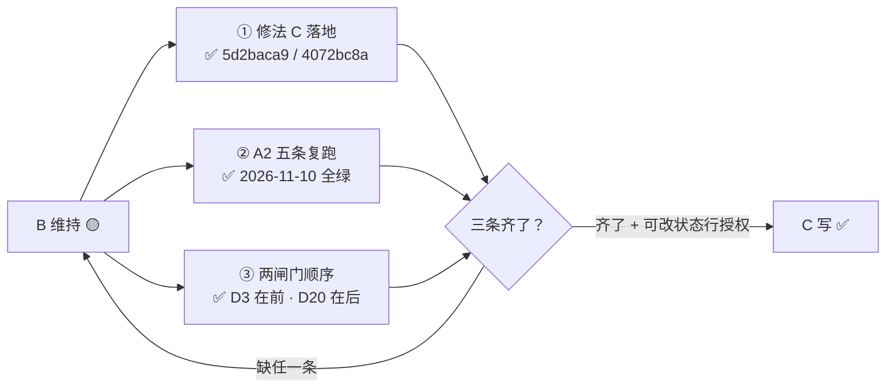

# 交接：D3 裁定 B → C —— 维持 🟡，三条前置齐了才转 ✅（2026-11-09 23:2x；**2026-11-10 02:1x 三条已齐，待授权**）

> 交接基准：分支 `exp/resource-ledger` · 落单时 HEAD `6d52ace9`，**2026-11-10 更新至 `eda4a8e7`**（本单后续提交见 §六）· `[ahead 57+]` 未推送
> 上一份：[`2026-11-09-dsh-first-run-and-batch-resume-handoff.md`](./2026-11-09-dsh-first-run-and-batch-resume-handoff.md) §15.3 / §15.6 / §十六
> 依据：[`live-pipeline-acceptance-defects-assessment.md`](../design/product/live-pipeline-acceptance-defects-assessment.md) §D3 · [`2026-11-07-batch-a-bc-handoff.md`](./2026-11-07-batch-a-bc-handoff.md) `:56` / `:65-72` · [`2026-11-07-batch-acceptance-plan.md`](../design/product/2026-11-07-batch-acceptance-plan.md) `:210-246` · [`d21-fix-c-implementation-plan-20261109.md`](../design/product/d21-fix-c-implementation-plan-20261109.md) §三
> 直接相关：[`prompt-assembly-backlog.md`](../plans/prompt-assembly-backlog.md) `:126` · [`d21-gate-shortcircuit-evidence-20261109.md`](../design/product/d21-gate-shortcircuit-evidence-20261109.md) · [`documentation-charter.md`](../agents/documentation-charter.md) §5.2 / §7
> 本稿性质：专项交接单（T3 证据型）· **本轮授权：只读 + 可改文档（写交接单）** —— 不改码、不改状态行、不提交、不推送、0 次调用 DSH

---

## 〇、三十秒版本

作者原话「**D3：B → C / 写交接单**」＝ 采纳 [`主交接稿 §15.3`](./2026-11-09-dsh-first-run-and-batch-resume-handoff.md) 的明确建议：**先按 B 维持 🟡，按 C 的三条前置推进，三条齐了才写 ✅**。

**这不是「现在转 ✅」**，本轮也没有动任何状态行。D3 的代码写完了、单测绿了、两档弹窗实机弹过；但「点『我知道，仍按计划继续』→ 真起 run → 产物落库」这条路径**从没跑通**，而第二维修正还住在一条 `stale` 即短路、从未被执行的入口后面。✅ 必须留给真跑通的那天，否则下次真撞上会被当成「回归」而不是「本来就没验过」。

**交接单的用处**：C 不是一个时间点，是三个并列前置；下一轮照 §二 逐条兑现、照 §三 收口，不要重新讨论「要不要转 ✅」。

> ### 🔔 2026-11-10 02:1x 状态更新：三条前置**已全部兑现**
>
> | 前置 | 结论 | 证据 |
> |---|---|---|
> | ① 修法 C 落地（D21） | ✅ 已落地 + 实机验过 | 提交 `5d2baca9` / 实机 `4072bc8a`；本轮 A2 复跑再次旁证（`stale` 下 `gate.state='ahead'`，不再 `null`） |
> | ② A2 五条复跑 | ✅ 五条全绿 | 本稿 §2.2 末「2026-11-10 实机复跑」表：run `c55e79d9` completed、runs 164→165、attempts 290→296、豁免 2→3、产物 `covered_to=12` |
> | ③ 两闸门顺序 | ✅ 有结论 | 本稿 §2.3 末：两闸门会同时命中，**D3 卷首在前 → D20 在后**，确认不互相吞掉但会叠加 |
>
> **代码与实机都齐了，但状态行一个字没动** —— 按 §一「若将来要强转」的口径，转 ✅ 仍需**单独给「可改状态行」授权**。本单不代作者做这个决定。

---

## 一、裁定原文与范围（防误读）

| 项 | 口径 |
|---|---|
| 作者原话 | `D3：B → C` / `写交接单` |
| B | 维持 🟡（**已实施 · 不转 ✅**），状态如实；代价是一直挂黄 |
| C | 三条前置齐了再转 ✅（§二），**是路线，不是状态跃迁** |
| 明确排除 | ① 现在把 D3 由 🟡 转 ✅ ② 本轮改任何状态行 ③ 改生产代码 / 断言 ④ 起 `pnpm dev` / CDP 9222 实机 |
| 若将来要强转 | 需**单独给「可改状态行」授权**，并接受 §15.3 ④-A 后果：台账与缺陷稿会被读成全链路已验，而 A2 未闭环、修法 C 未落地 |

**为什么 B 不等于「没做完」**：D3 现值写的是「已实施（2026-11-06 · **不转 ✅**）」——🟡 标的是「代码已实施、实机未闭环」，不是「代码没写」。缺陷稿 `:353` 状态行、台账 `:126` 现值索引、D21 实施稿 `:88`「另裁」三处口径**本轮原样保留**。

---

## 二、三条前置：可执行验收清单（本交接单的核心）

三条是**并列与门**，缺一条就停在 B。每条给「现在卡在哪 / 下一轮做什么 / 什么算过」。

### 2.1 前置① 修法 C 落地（D21）

- **现在卡在哪**（2026-11-10 更新：已不卡这里）：五决策点作者已点头，生产代码见提交 `5d2baca9`（`liveVolumeRanges` 纯函数 + 第五路读 `project-core` + `stale` 不再短路 + 面板 stale 附注），单测同批改完；`src/services/outline-progress-gate.ts:92-95` 的 `state` 短路已改为只在 `unparsed`（读不到）时短路。实机复验见 `4072bc8a` 与缺陷稿 D21 段。
- **已做（2026-11-10）**：作者点头五个决策点 → 生产代码 + 断言同一次提交 `5d2baca9` → 实机复验 `4072bc8a`。
- **什么算过**：按实施稿 §四清单改完（`volume-structure.ts` 纯函数 / `services` 第五路读与旁路 `state` / `shared` 顺序对调 / 两个 tsx 四槽位文案 / `outline-progress-gate.test.ts:154-165`、`:167-177` 断言同批改）；`pnpm check:fast` 全绿；受影响单测贴原始输出。
- **红线**：**只删短路仍用旧表边界 = 修法 A**（作者 02:47 已否），别贴着 C 的标签落地 A 的语义；`project-core` 读失败要退回表边界 + `warning`，**绝不退回 `gate: null`**。

### 2.2 前置② A2 复跑（含一处口径订正）

> **★ 订正（本交接单新增，勿照抄 §15.3）**：上一轮 §15.3 写「A2 四个候选**至今未查**」不准确。[`batch-acceptance-plan.md:210-232`](../design/product/2026-11-07-batch-acceptance-plan.md) 的 **A2-6 实测（2026-11-07 21:5x）**已用 dev-only 探针 `window.__outlineProgressGateProbe(chapterNumber)` 查清：`chapterNumber` = 7 / 11 / 12 / 16 / 21 / 26 **六档全部 `gate=null`**，`warning="卷结构状态为 stale，本次不判"`，`volumesState='stale'`。四候选判定：① 不能排除但已不再是关键 · ② **✅ 成立且是恒久状态、不是偶发**（`stale` ⇒ `:92-95` 直接 return，两维判据一行没执行）· ③④ 不成立（未走到）。⇒ **「闸门为何没弹」已查清并归并为 D21**，下一轮不要再开一轮排查。

- **现在卡在哪**（2026-11-10：已跑完，见本小节末实测表）：此前 `stale` 短路导致 A2 的 `handoff-missing` 档根本没弹，`:56` 写死的五条验收一条都没走完；修法 C 落地后已具备复跑条件。
- **已做（2026-11-10）**：在**新副本**按 `:56` 复跑 A2 五条（判据逐字以 `:56` 为准：① 卷首闸门弹出 ② 点确认写入豁免 ③ 真起 run 并产出情节大纲、产物落库 ④ 产物来源字段与当前稿一致 ⑤ 贴 `generation_runs` / `generation_attempts` 前后计数）。结果见本小节末实测表。
- **什么算过**：五条全绿 + 原始读数落盘（run id / 前后计数 / 页面文案）+ 换身份复核 PASS。注意 `:246` 的时序提醒：要区分「本来 `stale`」与「A2 之后 `stale`」，需在**未跑生成的新副本**上先取一次读数。
- **口径**：这是「点继续后的真生成」路径，不是 D21 的复验失败；两条不能互相顶替。

> ### ✅ 2026-11-10 02:0x–02:11 实机复跑（主 agent · CDP 9222 · 副本 `.tmp-ui/d3-a2/proj`）
>
> **副本取自 `.batch-a/proj`（未跑本轮生成）**，先取读数再提交，符合时序要求。闸门探针（`window.__outlineProgressGateProbe`，dev-only）：
>
> ```
> chapterNumber=7 → gate.state='ahead'  reason='prose-unfinalized'
>                   handoff='missing'   structureStale=true  boundarySource='table'
>                   warning="卷结构表为 stale，且按当前大纲第 6 章不是任何一卷的卷末，本次按旧表边界判定"
> ```
>
> **对照 2026-11-07 A2-6 的「六档全部 `gate=null`」⇒ 修法 C 生效**：`stale` 不再短路、照判，且退回旧表边界时把话说在明处（warning + 面板附注）。这一条同时是前置① 的第二次实机旁证。
>
> **档位如实说明**：本副本 `drafts` 只有第 1 章定稿（`finalized` 仅 chapter 1），两维依次判落在**正文维度** ⇒ `reason='prose-unfinalized'`；A2 现场的 `handoff-missing` 需要卷 1（1–6）整卷定稿，本副本不具备该前提。`handoff='missing'` 已算出且出现在读数里，只因 prose 优先未成为 `reason`。两档共用同一面板与同一 bypass 链路（`ArchitectureConfirmDialog.tsx:1028-1038`），故五条中的 ②③④⑤ 不受档位差异影响。
>
> | # | 判据 | 实测 |
> |---|---|---|
> | ① | 卷首闸门弹出 | ✅ 面板标题「上一卷正文还没整卷定稿」，第1卷（1–6）只定稿到第 1 章、还差 5 章；正文含 D21 stale 附注两条 |
> | ② | 点确认写入豁免 | ✅ `consistency_exemptions` 2 → 3，新增 `outline-progress:volume:1`（理由为面板预填文案） |
> | ③ | 真起 run + 产物落库 | ✅ `run c55e79d9…` `status=completed`；产物 `project_core.synopsis` 11,175 字、`partial_arch.json` 的 `synopsis_range={from:7,to:12}` / `synopsis_covered_to=12` / `synopsis_incomplete=false`、`synopsis_result` 7,220 字；页面「情节大纲 · 已生成」，架构页 4/5 |
> | ④ | 来源字段与当前稿一致 | ✅ `synopsis_source_ref={"worldbuilding:book":3,"arc:book":1}`，与 `upstream_revisions` 现值（worldbuilding rev 3 / arc rev 1）逐项相同 |
> | ⑤ | 前后计数 | ✅ `generation_runs` 164 → 165 · `generation_attempts` 290 → 296（+6，每章一次）· `consistency_exemptions` 2 → 3 · `upstream_revisions.outline` rev 24 → 25 |
>
> 耗时 6 分 45 秒（Ollama `qwen3.5:9b-128k`，本地）。现场已清：副本删除、`recent-projects.json` 还原、实例停止；证据截图与日志留在 `.tmp-ui/d3-a2/`。

### 2.3 前置③ 两道闸门先后顺序有结论

- **现在卡在哪**（2026-11-10：已过，见本节末收口段）：[`batch-a-bc-handoff.md:68`](./2026-11-07-batch-a-bc-handoff.md) 现场是**先弹上游失效清单闸门（D20）**，勾确认 + 点「继续」后**直接起 run**，卷首 `[data-testid="outline-progress-gate"]` 为 `null`。[`d21-gate-shortcircuit-evidence-20261109.md`](../design/product/d21-gate-shortcircuit-evidence-20261109.md) 又查出 `ArchitectureConfirmDialog.tsx:509-512` 拿到 `null` 只 `console.warn` **静默放行**、界面零提示。
- **已做（2026-11-10）**：实机跑通「卷首闸门 → 点继续 → 失效清单闸门 → 点继续 → 真生成」全链，记录两面板先后、豁免键写入、是否互相遮蔽。`workflow-launch-dialogs.browser.tsx` 是否断言过「闸门不弹」仍未查（本轮不需要它下结论，留作后续清理时再搜）。
- **什么算过**：给出一句可写进台账的结论（顺序 + 是否互相遮蔽 + 确认是否叠加），并附实机读数 —— 已达成，见下条收口段。

> **2026-11-10 01:4x 部分读数（前置③ 尚未过，只解决了一半）**：在项目副本上试了两种勾选组合（只勾「情节大纲」；「卷单元结构＋情节大纲」一起勾），**失效清单闸门（D20）都没有出现**，卷首闸门独立弹出并正确给出 `prose-unfinalized` 档。
> ⇒ **当日 A2「卷首闸门没弹」的原因确认是它自己短路，不是被前一个闸门遮蔽**（这一半可以写进台账了）。
> ⇒ **仍缺的是「两闸门同时命中时的先后」**：副本里没有能触发 D20 的上游失效事实，要验就得先造一个「上游域已被改动」的副本，属下一轮的事。别把本行当"§2.3 已过"。
> 读数与截图路径见缺陷稿 D21 段「实机复验」。

> ### ✅ 2026-11-10 02:0x 前置③ 收口：两闸门可以同时命中，顺序是 **D3 卷首在前 → D20 失效清单在后**
>
> 同一轮 A2 复跑里意外拿到完整链路（无需另造上游失效副本）：范围填 **7–12**、只勾「情节大纲」提交后，
>
> 1. **D3 卷首闸门先弹**（`[data-testid="outline-progress-gate"]`，`prose-unfinalized` 档）；
> 2. 点「我知道，仍按计划继续」→ `bypassProgressGate.current = true` + `setProgressGate(null)` + **自动重提** `handleConfirm()`（`:1032-1036`）；
> 3. 重提被 **D20 失效清单闸门**拦下（列 12 项章节蓝图 + 1 项卷末交接单，勾「我明白这会波及 1 章已定稿正文」）；
> 4. 点「继续」→ `bypassInvalidationGate.current = true` → 真起 run（runs 164 → 165，只起一个）。
>
> **可写进台账的结论（三问三答）**：
> - **会不会都弹**：会。两闸门各自独立判定、各自渲染，同时命中时先后排队。
> - **谁先谁后**：**先正文/交接（D3 卷首），后上游失效（D20）**。与静态取证的顺序一致（`progressGate` 分支在 `invalidationGate` 之前）。
> - **前一个确认会不会吞掉后一个**：不会。两个 bypass 各用一个 ref（`bypassProgressGate` / `bypassInvalidationGate`），确认互不覆盖；但确认是**叠加**的 —— 一次提交会留下 1 条豁免 + 1 次失效确认，然后只起 1 个 run。
>
> **与 A2 现场「先弹 D20、卷首没弹」的关系**：那次不是顺序问题，而是当时的 `stale` 短路让卷首闸门直接返回 `null`（修法 C 前）。修法 C 之后，同一条提交路径上卷首闸门会先出现 —— 这正是本次实测与 11-07 现场的差异来源。

### 2.4 汇合判据



一句读法：**三条前置是并列与门，缺一条就停在 B；即便齐了，转 ✅ 还要另拿一次状态行授权。**（2026-11-10：三条已齐，卡在最后那道授权。）

---

## 三、转 ✅ 那天的操作清单（今天不做）

1. 先跑 `node scripts/check-doc-placement.mjs --status-of "D3"`，把写着 D3 的位置列全。**这个读数会随新文档自身增长，不写死数值**：脚本扫的是整份文档里含「D3」的状态表述，本交接单 `:28`「明确排除」行自己就会被计入（本单落盘后实测由 8 处 / 5 文件变为 **9 处 / 6 文件**）。⇒ 以转 ✅ 当天**当场跑出的结果**为准，先排除「本单自身 / 本次裁定记录」这类自指命中，再逐处判「该改 / 历史快照不必改 / 同名不同物不必改」。存量分布（本单落盘前）：缺陷稿 2 · `p1-1-boundary-notice-design.md` 1 · 主交接稿 2 · `2026-11-09-d-segment-ledger-rewrite-proposal.md` 2 · `prompt-assembly-backlog.md` 1。
2. ⚠️ **`D3` 是全库重名符号**：命中里混着主角四格的「D3 破例档」、P1-1 的「D3 不做」等**与本条无关的编号**，别机械全改；先按出处判是不是验收缺陷 D3。
3. 逐处判「该改 / 历史记录不必改」：`2026-11-02` 冻结快照表与 11-06/11-07 的现值复核行是**历史快照，格值零删改**；现值只写**现值索引**（[`prompt-assembly-backlog.md:126`](../plans/prompt-assembly-backlog.md)）与**条目状态行**（缺陷稿 §D3 `:353`）。
4. 收口时按章程 §5.2 / `docs/README.md:94`「所有写着该期状态的位置都要改」，改完**再跑一次** `--status-of`，直到列表为空或只剩历史记录。
5. 状态行取值必须落在受控词表（待裁定 / 已裁定 / 已实施 / 已落地 / 已搁置 / 已结项）且带 `YYYY-MM-DD`；`✅` 是图标不是状态词，别拿它当状态行。

---

## 四、证据锚（逐条可点）

| 结论 | 证据 |
|---|---|
| 作者裁定 B → C 的来源是 §15.3 的四段材料与建议 | [`主交接稿 §15.3`](./2026-11-09-dsh-first-run-and-batch-resume-handoff.md) `:607-625` |
| D3 代码已实施、两档弹窗实机弹过、「点继续后真生成」未跑 | [`缺陷稿 §D3`](../design/product/live-pipeline-acceptance-defects-assessment.md) `:353` / `:408-424` |
| A2 现场：D20 闸门先弹、卷首没弹、五条验收 | [`batch-a-bc-handoff.md`](./2026-11-07-batch-a-bc-handoff.md) `:56` / `:65-72` |
| 四候选已查清（②成立，恒久短路） | [`batch-acceptance-plan.md`](../design/product/2026-11-07-batch-acceptance-plan.md) `:210-232` |
| 「独立缺陷、D3 不得转 ✅」结论 + 11-09 取证回填 | 同文件 `:242` / `:244` |
| 短路与静默放行逐行证据 | [`d21-gate-shortcircuit-evidence-20261109.md`](../design/product/d21-gate-shortcircuit-evidence-20261109.md) §① / §④ |
| 修法 C 五决策点、单测改法 | [`d21-fix-c-implementation-plan-20261109.md`](../design/product/d21-fix-c-implementation-plan-20261109.md) §三 / §四；`:88` 明写「D3 另裁」 |
| 现值索引与冻结快照零删改口径 | [`prompt-assembly-backlog.md`](../plans/prompt-assembly-backlog.md) `:119-126` |

---

## 五、下一轮开工必读与红线

**只读顺序**（别整目录通读）：`AGENTS.md` §2 → [`documentation-charter.md`](../agents/documentation-charter.md) §7 第 0 步（先写授权）→ 本交接单 → 主交接稿 §15.3 / §十六 → 实施稿 §三 → A2 现场 `:65-72` → 验收计划 `:210-246`。

| 红线 | 出处 / 理由 |
|---|---|
| 作者没明说授权 ⇒ 按最窄只读 | 章程 §7；改状态行 / 可提交 / 可推送各自单独给 |
| **实机验收归主 agent CDP 9222**，不许写「作者实机 / 待复验」 | 项目 T1 + [`doubao-channel.md`](../agents/doubao-channel.md) §5：派出去的 agent 只准单测，禁起应用实例（抢 SQLite / 端口 / `.vite` / 单实例锁） |
| **0 次调用 DSH**（含 `--dump-config` / `status` / `task`） | 作者 2026-11-09 明令；`scripts/dsh/model.patch.yml` 保持现状（模型挂起） |
| `pnpm dev` 红线未自动解除 | 作者只说「同意落地实机验收」，没说现在起 dev；本轮无新代码可验 |
| `wt-2` 仍 8 个 `M`，**不一把合并** | 主交接稿 §14.3；W1 打回未修 |
| 改 `src/` 非组件模块后热更新不生效，**必须重启 `pnpm dev`** | `AGENTS.md` §1 |
| 全量跑测带 `env -u` 摘两个 safe-delete 变量；结果**必须落盘** | `.workbuddy/memory/notes/env-and-conventions.md` 第 34 轮 / `agent-token-discipline.md` |
| 不推送 | 作者 ⑥「推送不着急，暂时放在本地」 |

---

## 六、本轮实际改了什么 / 未验证事项

> **2026-11-10 追加**：本轮（02:0x–02:1x）只做**实机**与**本单回填**，未改任何生产代码、未动任何状态行。A2 五条与两闸门顺序的读数见 §〇 状态更新表；同轮另落地了 `SYSTEM_NOTICE` 桥接（提交 `c930a92f` / `362f45ba` / `eda4a8e7`，与 D3 无依赖关系，只因同一夜班顺手消化 backlog 立项）。现场已清（副本删除、`recent-projects.json` 还原、dev 停止）。

- **新增本交接单**；[`主交接稿`](./2026-11-09-dsh-first-run-and-batch-resume-handoff.md) **追加 §十六**（裁定记录 + 指向本单的指针；§15.3 / §15.6 原文保留不回改）。
- **工作区实测 4 个文件**（以 `git status --short` 为准，**不是「3+2＝5」** —— 主交接稿两轮追加共用同一个 `M`）：` M docs/handoffs/2026-11-09-dsh-first-run-and-batch-resume-handoff.md`（含上一轮 §十五 与本轮 §十六）· `?? docs/handoffs/2026-11-09-d3-b-to-c-handoff.md`（本单）· `?? scripts/doubao/task-d21-fix-c-plan-20261109.md`（上一轮遗留）· `?? scripts/doubao/task-system-notice-landing-20261109.md`（上一轮遗留）。HEAD 仍 `6d52ace9`，**未提交、未推送**；`ahead` 数会随后续提交递增，不写死。
- **未验证事项（如实）**：未跑实机（无新代码可验）· 未跑单测（无代码改动）· 未派豆包（通道三项前置未就绪）· 未调用 DSH · 未验证三条前置的任何一条。
- **边界**：未改 D3 状态行 · 未改两份禁动 json · 未改 D21 生产代码与断言 · 未动 `wt-2` · 未起 dev / CDP · 未提交 / 未推送。

---

## 七、本单之外的并行待办（只给指针，不重写）

| 事项 | 指针 |
|---|---|
| D21 方案交豆包 / 通道三项前置（切「本地电脑」+ 建项目 + 是否允许 `bootstrap.mjs` 新建线程） | 主交接稿 §15.5；任务书 `task-d21-fix-c-plan-20261109.md` |
| `SYSTEM_NOTICE` 落地与实机验收分工 | 主交接稿 §15.5；任务书 `task-system-notice-landing-20261109.md` |
| §十① 舍弃范围（已裁定，无歧义）、⑤ 两份 json 不动、⑥ 不推送 | 主交接稿 §15.2 / §15.4 / §15.6 |
| 台账 8 项闭环、`2026-11-02` 冻结快照 | [`2026-11-09-eight-rulings-brief.md`](./2026-11-09-eight-rulings-brief.md) · [`prompt-assembly-backlog.md`](../plans/prompt-assembly-backlog.md) §4.6 |
| W1 正文批量断章卡死（打回未修） | [`2026-11-09-night-batch-digest.md`](./2026-11-09-night-batch-digest.md) §三-1 |
