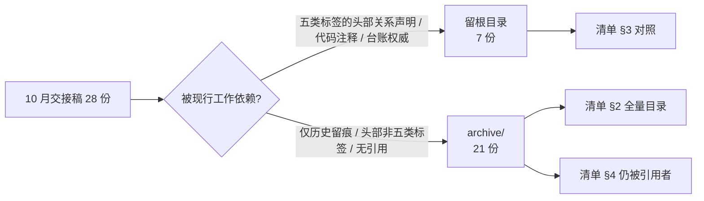

# 交接稿归档清单（`docs/handoffs/archive/`）

> 状态：**已落地** · 2026-11-09（作者裁决后修正）
> 性质：**索引件**，不是设计稿、不是交接快照本体；本目录只放已结项 / 已无现行依赖的交接稿。
> 权威：归档判据见 [`documentation-charter.md`](../../agents/documentation-charter.md) §5.3，索引总入口见 [`docs/README.md`](../../README.md) §1「接手别人的会话」。

**归档 ≠ 删除。** 文件仍在版本库里、内容一字未删；全库对它们的引用已同步改到新路径，**链接照常点得开**。归档只做一件事：把「开工时要读的现行资料」和「事后要查的历史记录」分开，让 `docs/handoffs/` 根目录只留下真正还要用的那几份。本清单就是那道分界线的可查台账。

---

## 1. 分流判据（2026-11-09 作者裁决）

章程 §5.3 原文是「交接快照**超过 30 天且无引用** → 移到 `docs/handoffs/archive/`」，且「**现行设计稿、唯一台账**不能归档」。2026-11-09 作者追加一条硬裁决：

> **「还有现行工作依赖的，当然不能归档。」**

据此落地为一条可脚本复核的判据（不是凭印象点名）：

| 判据 | 动作 | 怎么复核 |
|---|---|---|
| 被**现行设计稿 / 计划稿头部「关系声明」行**点名，且标签属于这五类：`> 上级稿` / `> 作业手册` / `> 交接` / `> 依据` / `> 直接相关` | **留在根目录** | 搜文件名 → 看引用是否落在文件头 10 行的 `>` 块 → **且标签是五类之一**；三步缺一不可 |
| 被 **`src/` 代码注释**引用 | **留在根目录** | 全库搜文件名 |
| 被唯一台账标为**地基交接 / 作业手册 / 施工记录「以它为准」** | **留在根目录** | 搜 `docs/plans/prompt-assembly-backlog.md` |
| 只被「上一份 / 再上 / 已执行完毕 / 见 §X 溯源」这类**历史留痕**引用，或无引用 | **归档** | 引用位置见 §4，链接仍可点 |

> **⚠️ 别只看「落在头部 `>` 块」就判活依赖**：`p1-blueprint-roster-sync.md:6` 的 `> 实战迭代（2026-10-15 台账…）`、`character-behavior-four-layers.md:7` 的 `> 提交：…；进度交接 …` 都落在头部，但标签不是五类关系声明，内容是**已完成提交 hash / 已落地进度**（且四层已被三格取代）⇒ 属历史留痕，归档正确。**标签 + 位置 + 语义三重核对**，机械套用会把归档件误捞回根目录。

**一句读法**：先看「谁把它写在自己头上、用的是哪类标签」——用五类关系声明标签写在头上的才留手边，只写「实战台账 / 提交进度」或正文里提过一嘴的进档案柜；进柜不等于销毁，§4 还留着每一处的门牌号。

---

## 2. 归档件全量目录（25 份）

按日期排序；每份一句话摘要，链接指向本目录内文件。**另有 4 份是 2026-10-24 建立 archive 时就在的既有归档件**（3 份 9 月 + `2026-10-15`），未参与本轮移动，一并登记在此。

### 既有归档件（本轮未移动 · 4 份）

| 日期 | 文件 | 一句话 |
|---|---|---|
| 09-05 | [`2026-09-05-astra-code-review.md`](./2026-09-05-astra-code-review.md) | Astra 无上下文代码审查与项目接手手册 |
| 09-20 | [`2026-09-20-program-v3-s11-pause-handoff.md`](./2026-09-20-program-v3-s11-pause-handoff.md) | Program v3 S11 完成交接（暂停点） |
| 09-21 | [`2026-09-21-program-v3-f04-pause-handoff.md`](./2026-09-21-program-v3-f04-pause-handoff.md) | Program v3 F04 暂停交接 |
| 10-15 | [`2026-10-15-keyevents-bprime-pause-handoff.md`](./2026-10-15-keyevents-bprime-pause-handoff.md) | keyEvents / B′ / R6 四段落地，段二实机验证退后待决（作者 2026-10-15 裁定） |

### 2026-11-09 本轮归档（21 份）

| 日期 | 文件 | 一句话 |
|---|---|---|
| 10-20 | [`2026-10-20-t10-unit-batch-acceptance.md`](./2026-10-20-t10-unit-batch-acceptance.md) | T10 实机验收清单 · E3 逐单元批次（两个项目各走一张表） |
| 10-23 | [`2026-10-23-p0-1-close-and-target-baseline-handoff.md`](./2026-10-23-p0-1-close-and-target-baseline-handoff.md) | P0-1 收口（期 1–3）+ 长篇目标基线，§2 事实基线是后续施工依据 |
| 10-23 | [`2026-10-23-w6-and-w8-handoff.md`](./2026-10-23-w6-and-w8-handoff.md) | W6 收口 + 定稿语义 + W8 方向（「下一步」已被 P0-1 稿取代） |
| 10-23 | [`2026-10-23-w6a-4-resource-proposal-handoff.md`](./2026-10-23-w6a-4-resource-proposal-handoff.md) | W6a-4 资源登记提案通道，三项已落地 |
| 10-24 | [`2026-10-24-p1-2-handoff-generation-handoff.md`](./2026-10-24-p1-2-handoff-generation-handoff.md) | P1-2 期 2 卷末交接单自动生成 · 已实施、未实机验证 |
| 10-24 | [`2026-10-24-p2-1-findings-stage1-handoff.md`](./2026-10-24-p2-1-findings-stage1-handoff.md) | P2-1 findings 期 1 · 已实施、待实机样本复验 |
| 10-25 | [`2026-10-25-a2-a5-shelf-unattended-plan.md`](./2026-10-25-a2-a5-shelf-unattended-plan.md) | 三小时无人值守 A2 + A5 + 书架删除 · 已执行完毕，6 处偏离见文末 |
| 10-25 | [`2026-10-25-next-steps-handoff.md`](./2026-10-25-next-steps-handoff.md) | A2/A3/A4/A5 + 书架收口之后的接手快照 |
| 10-26 | [`2026-10-26-extraction-schedule-handoff.md`](./2026-10-26-extraction-schedule-handoff.md) | 实机验证续做 + P20 抽取排期 |
| 10-26 | [`2026-10-26-live-verification-handoff.md`](./2026-10-26-live-verification-handoff.md) | 实机验证 · 待作者本人在 GUI 跑（agent 不代劳） |
| 10-26 | [`2026-10-26-p20-1a-ability-candidates-plan.md`](./2026-10-26-p20-1a-ability-candidates-plan.md) | P20-1a 能力候选执行计划 · 交付 hy4 无人值守 |
| 10-26 | [`2026-10-26-p20-1a-implementation-handoff.md`](./2026-10-26-p20-1a-implementation-handoff.md) | P20-1a 实施完成报告 |
| 10-26 | [`2026-10-26-p20-2-secrets-handoff.md`](./2026-10-26-p20-2-secrets-handoff.md) | P20-2 秘密宿体（M21 + 审稿守卫 + 作者登记） |
| 10-26 | [`2026-10-26-p20-3-knowledge-candidates-handoff.md`](./2026-10-26-p20-3-knowledge-candidates-handoff.md) | P20-3 章末知情候选（M22 + 步骤表收敛 + 提议条） |
| 10-28 | [`2026-10-28-platform-bounds-and-persona-handoff.md`](./2026-10-28-platform-bounds-and-persona-handoff.md) | 市场边界估算 + 作者人格 · 两条线均暂停（非完成） |
| 10-29 | [`2026-10-29-agent-subject-experiment-results.md`](./2026-10-29-agent-subject-experiment-results.md) | 角色行为模板实验 · 云端被试 × 6 份实测读数 |
| 10-29 | [`2026-10-29-character-behavior-night-handoff.md`](./2026-10-29-character-behavior-night-handoff.md) | 角色行为四层 · 阶段完成待落地（已被三格取代） |
| 10-29 | [`2026-10-29-four-layers-unattended-plan.md`](./2026-10-29-four-layers-unattended-plan.md) | 无人值守计划：角色行为四层落地（期 1–4） |
| 10-30 | [`2026-10-30-baseline-failures-cleanup.md`](./2026-10-30-baseline-failures-cleanup.md) | 基线 20 余例「既有红」逐条查清处置完，无一例挂着 |
| 10-30 | [`2026-10-30-four-layers-progress.md`](./2026-10-30-four-layers-progress.md) | 角色行为四层落地进度 · 已完成（期 1–4 全做完） |
| 10-30 | [`2026-10-30-three-slot-card-deltas.md`](./2026-10-30-three-slot-card-deltas.md) | 三格角色卡 + cardDeltas 闭环 |

**刻意未动**：`docs/handoffs/upstream-sync/2026-10-14-diff*.md` 两份同步 diff 记录（被 `docs/upstream-sync-ledger.md` 按字面路径引用，不是交接快照）；`docs/README.md` 里的命名示例；11 月的交接稿。

---

## 3. 留在根目录的 7 份「现行依赖」（**不要归档**）

这 7 份是**开工时要打开照着做**的入口，不进本目录。列出依赖它们的位置，供以后归档时复核：

| 文件（在 `../`） | 谁还依赖它 | 引用性质 |
|---|---|---|
| [`2026-10-19-arc-budget-handoff.md`](../2026-10-19-arc-budget-handoff.md) | [`volume-quota-context-budget-design.md`](../../design/architecture/volume-quota-context-budget-design.md) `:6` | 头部「直接相关」 |
| [`2026-10-19-e4-implementation-log.md`](../2026-10-19-e4-implementation-log.md) | 同上 `:6`；[`prompt-assembly-backlog.md`](../../plans/prompt-assembly-backlog.md) `:1973` | append-only 施工记录，**实施进度以它为准** |
| [`2026-10-20-e3-unit-batch-handoff.md`](../2026-10-20-e3-unit-batch-handoff.md) | [`e3-unit-batch-implementation-plan.md`](../../design/architecture/e3-unit-batch-implementation-plan.md) `:6`；[`d8-checkpoint-degradation-design.md`](../../design/architecture/d8-checkpoint-degradation-design.md) `:305/:434/:585`；台账 `:1981` | 头部「交接（接力点）」+ §12.4 硬边界依据 |
| [`2026-10-22-world-state-w4-handoff.md`](../2026-10-22-world-state-w4-handoff.md) | [`world-state-w4a-wiring-plan.md`](../../design/architecture/world-state-w4a-wiring-plan.md) `:6/:105`；[`world-state-review-and-wiring-plan.md`](../../design/architecture/world-state-review-and-wiring-plan.md) `:1014` | 头部「依据 §5 ①②③」+ 三项裁定落地细节 |
| [`2026-10-24-p1-1-three-cells-handoff.md`](../2026-10-24-p1-1-three-cells-handoff.md) | [`p1-1-three-cells-plan.md`](../../plans/p1-1-three-cells-plan.md) `:5` | 头部「交接（状态、判据、门与坑都在那儿）」，该计划**期 4a 未开工** |
| [`2026-10-30-invalidation-and-deletion-baseline.md`](../2026-10-30-invalidation-and-deletion-baseline.md) | [`upstream-version-and-derived-invalidation-design.md`](../../design/architecture/upstream-version-and-derived-invalidation-design.md) `:5`；`src/shared/upstream-revisions.ts:7`；台账 `:547`；[`2026-11-06-d8-preimplementation-handoff.md`](../2026-11-06-d8-preimplementation-handoff.md) `:183` | 头部**上级稿**（盘点 + 三个待裁定）+ 代码注释 |
| [`2026-10-31-phase3-unattended-handoff.md`](../2026-10-31-phase3-unattended-handoff.md) | [`upstream-invalidation-phase3-plan-and-ui.md`](../../design/architecture/upstream-invalidation-phase3-plan-and-ui.md) `:9`；台账 `:547`；[`2026-11-01-invalidation-line-closeout.md`](../2026-11-01-invalidation-line-closeout.md) `:4` | 头部**作业手册**（给无人值守执行方） |

---

## 4. 归档了但仍被现行文档引用（7 份 / 10 处 · 链接照常可点）

这些引用都是**历史留痕 / 溯源 / 上一班交接**，不是「开工要照着做」，所以不构成立即依赖，按 §1 判据归档。列在这里是为了以后有人查「那次结论出处在哪」时不必全库搜。位置按唯一「文件:行」去重计数：

| 归档件 | 引用位置（唯一「文件:行」） | 引用性质 |
|---|---|---|
| [`2026-10-15-keyevents-bprime-pause-handoff.md`](./2026-10-15-keyevents-bprime-pause-handoff.md) | `docs/design/characters/p1-blueprint-roster-sync.md:6` | 头部「实战迭代（2026-10-15 台账）」，历史台账（1 处） |
| [`2026-10-20-t10-unit-batch-acceptance.md`](./2026-10-20-t10-unit-batch-acceptance.md) | `docs/design/architecture/e3-unit-batch-chain-design.md:98`；`docs/handoffs/2026-10-20-e3-unit-batch-handoff.md:85`、`:175` | 「见 C 组」验收溯源 + 移回件的同级验收清单互引（3 处） |
| [`2026-10-25-a2-a5-shelf-unattended-plan.md`](./2026-10-25-a2-a5-shelf-unattended-plan.md) | `docs/plans/prompt-assembly-backlog.md:610`、`:687` | 「执行过程与六处偏离」「偏离细节见文末」，已执行完毕（2 处） |
| [`2026-10-25-next-steps-handoff.md`](./2026-10-25-next-steps-handoff.md) | `docs/design/architecture/upstream-invalidation-phase2-source-ref-and-read-gates.md:400` | 「既有红 `:135` 已登记 8 例」，基线红来源（1 处） |
| [`2026-10-28-platform-bounds-and-persona-handoff.md`](./2026-10-28-platform-bounds-and-persona-handoff.md) | `docs/plans/prompt-assembly-backlog.md:507` | P22 挂起项的「交接稿」，非完成（1 处） |
| [`2026-10-30-baseline-failures-cleanup.md`](./2026-10-30-baseline-failures-cleanup.md) | `docs/handoffs/2026-10-31-phase3-unattended-handoff.md:4` | 头部「上一班交接」，历史留痕（1 处） |
| [`2026-10-30-four-layers-progress.md`](./2026-10-30-four-layers-progress.md) | `docs/design/prompt/character-behavior-four-layers.md:7` | 头部「提交 / 进度交接」，四层已被三格取代（1 处） |

合计 **1 + 3 + 2 + 1 + 1 + 1 + 1 = 10 处**。

> **边界是可改的**：若以后某份归档件重新变成现行依赖（例如 P22 解冻、期 4a 开工），把它移回 `docs/handoffs/` 根目录，按 §5 的四步改引用，并同时更新本清单 §2 / §3 两张表。

---

## 5. 维护规则（下次归档照做）

1. `git mv` 把文件移进本目录；
2. **在本清单 §2 登记一行**（一句话摘要 + 链接），并从 §3 移除（若原本在现行依赖表）；
3. 全库改引用：`handoffs/<文件名>` → `handoffs/archive/<文件名>`；**归档件内部**以 `../` 开头的上跳链接要**各加一层 `../`**（目录多一层，不改必断链）；同级裸链接互指保持不变；
4. 索引层 [`docs/README.md`](../../README.md) §1「接手别人的会话」保持指向本清单；
5. 跑 `node scripts/check-doc-links.mjs` 与 `node scripts/check-doc-placement.mjs --strict`，再加 `pnpm check:fast`。

本轮（2026-11-09）实际读数：28 份移入 → 作者裁决后 **7 份移回根目录 / 21 份留归档**；全库路径引用回改 30 处、1 处裸链接还原、移回件内部上跳链接降层 21 处、同级互引定向修正 5 处（归档件指向移回件加 `../` 2 处、移回件指向归档件加 `archive/` 3 处）。**仍留在归档件内的上跳链接 7 处**（`../../` 开头，脚本复核）。详细流水见 [`2026-11-09-dsh-first-run-and-batch-resume-handoff.md`](../2026-11-09-dsh-first-run-and-batch-resume-handoff.md) §十一。
