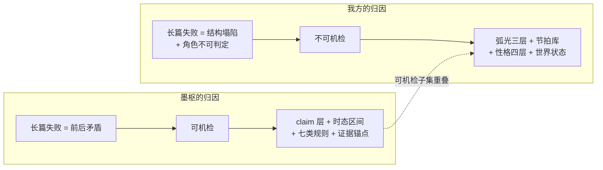

# 墨枢 · 对照评审（初评）

> 状态：初评完成（2026-10-30）· **不改代码、不进台账**；要动手时另出设计稿
> 依据：[`facts-01-architecture.md`](facts-01-architecture.md) · [`facts-02-mechanisms.md`](facts-02-mechanisms.md) · 原件 `vendor/`
> 我方基线：分支 `exp/resource-ledger` @ `66f9d556`（≠ 主分支，对照时已注意）
> 前置阅读：本次评审按 [`industry-alignment-and-stage-goals.md`](../../design/architecture/industry-alignment-and-stage-goals.md) §5 的四问执行，不自己造概念

---

## 1. 结论

**它是参照系，不是威胁。**

| | 判断 | 依据 |
|---|---|---|
| 是否同类竞品 | ✅ 是 | 同题材（中文长篇网文）、同目标（把 AI 生成变成可推进的连载流程） |
| 是否正面冲突 | ❌ 不是 | 形态相反（Web 多租户 SaaS vs 桌面本地）、能力重心相反（工程可靠性 vs 创作方法论） |
| 是否要跟它的路线 | ❌ 不要 | 它的 9 成代码是服务端基础设施，在单进程桌面里换不到收益 |
| 有没有必须拿的 | ✅ 有 3 个机制 | 见 §5 |

一句话：**它和我方各自只解决了一半问题，而且不是同一半。**

---

## 2. 十四维度对照

| # | 维度 | 墨枢 | 我方 | 判 |
|---|---|---|---|---|
| 1 | 形态 | Web + Docker，桌面只是编排外壳 | Electron 本地优先，数据在用户机器 | 形态不同，不构成竞争 |
| 2 | 存储真相层 | PostgreSQL + pgvector（69 表） | 本地 DB（见 `notes/data-and-schema.md`） | 各有取舍 |
| 3 | 代码量 | ≈ 10.6 万行 | ≈ 34 万行（含 13.4 万行测试） | 我方 3.2× |
| 4 | 文档量 | **9 篇 md** | **343 篇 md** | 差 38 倍，见 §6 警告 1 |
| 5 | 结构层级 | 作品 → 卷 → 章 → 场景卡 | 世界观 → 角色 → 卷 → **单元** → 章 | **我方多一层中间计划单元** |
| 6 | 弧光 | **无** | 大弧 / 中弧 / 小弧 + 节拍库 | 我方独有，它完全空白 |
| 7 | 章内结构 | **五拍蓝图 + 8 变体引擎 + 确定性 LRU 去重** | 节拍库**刻意不下到章级**（`story-beat-library` §6.1） | **分歧点 1**，见 §3 |
| 8 | 上下文成本 | 四层预算 40/40/56/72k，**208k 硬顶** | E4 三层投影，**输入恒定 ≈2.6 万字** | **分歧点 2**，我方领先 |
| 9 | 长文一致性 | claim 层 + 时态区间 + 七类规则 + 证据锚点 | 世界状态六槽（资源/物品/制度/知情/能力/秘密）+ continuity findings | **分歧点 3**，互补 |
| 10 | 角色模型 | `description`(Text) + `attrs`(JSONB 自由字典)，**无结构化性格字段** | 三格卡（禁区 `X<n>`/筹码/处境）+ `cardDeltas` + 四层性格 | **我方明显领先** |
| 11 | 写作质量判据 | 覆盖报告（两层，不下语义结论）+ 自然化规则 + 风格六维 | 形态统计器 P17-2 + 审稿链 | 都是"测量仪不做裁判" |
| 12 | 协作 / 商业化 | 工作室 5 角色 + 派章 + 审稿批注 + 积分/微信支付宝/BYOK | **无**（单人桌面） | 它宽，但属形态税 |
| 13 | 差异化功能 | 漫剧分镜（静态，不做视频）、拆书分析 | 无对应 | 与我方主线无关 |
| 14 | 自我否证能力 | **强**：主动写"这个 100% 不能证明什么"，并为文档诚实性写测试 | 弱：状态散在四处，已栽过漏标 ✅ | **它的软实力，见 §6 警告 2** |

> **注 1**：第 7 行看起来是它"有章级结构而我方没有"，实际相反——我方是**判定章级不该有结构**（`story-beat-library` §6.1 记录了"一拍一句话把卷纲撑爆"的实测）。它把结构放在**章内**所以不冲突。这不是谁对谁错，是两种分工，见 §3 分歧点 1。
> **注 2**：第 10 行是我核对代码后**推翻 README 印象**的一处。README 说"人物字段按内核、约束和人物弧维护"，代码里只是 `attrs` 这个 JSONB 自由字典；`api/schemas.py` 全库 grep `personality|motivation|arc` **零命中**。凡引用它"有角色弧"的说法都要以代码为准。

---

## 3. 三个分歧点（评审的实质部分）

### 分歧点 1：章级到底该不该有结构？

| | 做法 | 理由 |
|---|---|---|
| 墨枢 | **章内五拍**，按百分比硬定位（前10% / 25-45% / 55-70% / 70-90% / 末段），拍子**不进卷纲** | 卷只是容器；拍子只解决"这一章怎么排" |
| 我方 | 节拍库**到单元层为止**，章纲层是场景清单不是拍子 | 「一拍一句话」会把卷纲撑爆（首版实测：7 卷 + 26 单元 + 15 拍照整份被截断） |

**两者不矛盾，反而互相印证了一条原则**：结构可以给，但必须给在**它所属的层级**上。我方判定"拍子不能下到章纲"，它判定"拍子只能待在章内"，结论一致，落点不同。

**真正值得实测的差异**在防重样的机制上：

- 我方：卷/单元级 `ARC_SAME_BEAT` / `ARC_BEAT_REPEAT` / `ARC_BEAT_OVERSPAN` 机检。
- 它：**章级 LRU**——8 个 engine × hook 按 `(用过次数, 是否等于上一章, hook 用过次数)` 取最小，确定性选择，不靠模型自觉。

我方缺的正是这个：**单元内连续 30 章的"局部不重复"由谁保证？** 我方的机检在卷/单元层，章层是"场景清单"，场景清单本身没有去重机制。这是一个真实缺口，不是它教我，是它的做法让我方看见缺口在哪。

> ⚠️ **不要直接搬 8 条引擎**。它的 8 条是"章级变体"，我方若要做应该是"**单元内章级变体**"，且必须回答：与单元级节拍是否叠层？（我方红线：*layering gives a spreadsheet, not a book*）

### 分歧点 2：上下文成本，谁真的解了？

| | 机制 | 解的问题 | 天花板 |
|---|---|---|---|
| 墨枢 | 四层预算 + 208k 硬顶 + 章/卷摘要压缩 | **单章**材料怎么分配 | 第 300 章仍需把前文压进 208k，靠摘要逐层有损 |
| 我方 | E4 三层投影（本卷全文 + 上一卷快照 + 最近 K 章） | **大纲前缀**成本恒定 | 正文侧仍按章装配 |

它的 208k 硬顶态度值得抄（注释原话：*Larger provider windows do not silently increase cost and latency until they have their own evals*）——**"窗口变大"不等于"该用满"**，这条我方 E4 也做了（不注入低相关内容），但没写进条款。

它**没有解决**跨卷全量增长：`document_summaries` 是逐层压缩，卷摘要压章摘要，一旦某卷的关键事实没进摘要就在后续丢失。这正好是我方 `volume-quota-context-budget-design.md` 判定的"数学上塞不进"，它绕过了但没有真正解，靠的是"摘要够用就行"。

**判断**：这一项我方领先，不必学。但可以把它的"208k 是实测天花板，更大窗口不自动放宽"这句话借到我方条款里，作为"为什么不注满"的依据。

### 分歧点 3：长篇失败，归因在哪？

这是最有价值的一条。

> 一句话读法：**同一个"长篇写不下去"，它归给"记不住"，我方归给"撑不住"；两条链只在「可机检的事实」这一小块重叠，其余各自独占。**

重叠的那一块值得逐个对账：

| 它有的可机检项 | 我方对应 | 差距 |
|---|---|---|
| `alive_conflict` 生死 | 世界状态·能力/物品 | 大致对齐 |
| `ownership_conflict` 归属 | 世界状态·资源账本 W6 | **我方更细**（账本有"未知不说 0"三态） |
| `knowledge_boundary` 知情 | 知情槽（M16） | 对齐，我方另做 `secrets`（M21）**它没有** |
| `timeline_conflict` 时间锚点 | 时间线（我方较弱） | **它更强**：`story_order` 稀疏中点 + reflow 级联 |
| `ability_boundary` 能力 | 能力槽（M17，Sanderson 三类限制） | 我方有理论依据，它有执行时序 |
| `location_conflict` 地理 | 无专门槽 | 它多一项 |
| `foreshadow_overdue` 伏笔逾期 | 伏笔五态 | 对齐 |

**结论**：我方的**槽**更细（六槽 + 秘密 + 账本三态），它的**判定引擎**更硬（七类规则 + 证据 + 失败降级）。**我方有账本没有审计员**——状态都登记了，谁来判断矛盾？这是本次评审对我方最有价值的一条，见 §5 机制 A。

它没有的部分（弧光、角色可判定性、节拍、跨卷投影）占我方工作量大头，**不是它遗漏，是它不认为那是问题**——因为它的产品定义是"可推进"，不是"写得好"。

---

## 4. 它复现了我方早已诊断的那个缺口

我方 [`writing-capability-assessment.md`](../../design/product/writing-capability-assessment.md) 的核心结论是：**「写得好」缺位是所有质量判据必然降级的共同根因**。

墨枢从三个方向独立撞上了这堵墙，且都诚实地标注了：

| 它的功能 | 自我限定原文（照录） |
|---|---|
| 自然化审查 | 「定位为作者校订工具，**不作为 AIGC 鉴定结论**」 |
| 拆书分析 | 「必须带免责声明，**不能被描述为版权审查、抄袭检测或文学质量评分**」 |
| 覆盖报告 | 「draft checks **only surface lexical evidence** and leave the final judgement to the author」 |
| Guard 评测 | 「100% 指标……**不代表正文抽取和 LLM 仲裁的端到端质量**」 |

**这四句话比我方多数设计稿的限定词更狠。** 一个外部样本独立得出"写得好没有可机检判据"，既不能证明我方结论对，也不能证明它错——但**降低了我方误判自己是特例的风险**。

反过来，它对"写得好的近路"做得很少：只有 2 个 skill + 8 个章级引擎 + 一份"禁止办事报告腔"词表。它把创作侧压缩成"章内结构模板 + 反 AI 腔词表"，本质是**规则化文本质检**，与我方"给判法不给例子"的 prompt 工程路线是两种不同哲学。

> 与我方实测冲突的一处：它的 `craft.dramatic-motion` 用了**大量具体例子**（"禁止连续多段只做登记、核验、复称……"逐词枚举）。我方实测结论是"例子会被逐字抄成内容"（见 `notes/prompt-engineering.md` 五条实测）。**它这么写有没有被抄进去？未知**——没跑过它的生成，不敢下结论。这是一个**可直接验证的分叉**（见 §7 验 1）。

---

## 5. 该拿的：3 个机制

> 三条都符合"能落在我方已有结构上、不需要换形态"。按价值排序。

### 机制 A：给世界状态配一个"审计员"（价值最高）

**它有什么**：claim 层（来源/版本/极性/确定性/时效区间）+ 七类确定性规则 + 影响集裁剪（改一章只重算相关，>500 键退回全扫）+ fail-open 仲裁。

**我方缺什么**：世界状态 W0–W6 已把六槽登记齐、`cardDeltas` 也闭环了，但**没有一条链在"生成之后"主动比对两处登记是否互斥**。现存最接近的是 `p2-1-continuity-findings`（四类连续性登记作核对基准进审稿链），但那是"把登记喂给审稿模型看"，**不是规则判定**。

差别在于可复现性：
- 喂给模型 ⇒ 同一份材料两次跑结论可能不同，作者无法复核。
- 规则判定 ⇒ 同输入同输出，能写回归测试。

**具体可拿的三条**：

1. **"claim 绑版本，不绑当前"**——我方状态卡是"当前值"，它的 claim 是"某来源在某版本声称某事实"。前者改一次就丢历史，后者天然支持"改早期章节只重算受影响"。
2. **影响集裁剪 + 安全降级**（超阈值退回全扫，并把 `scan_scope` 报给用户）。我方若做世界状态复检，全量扫 300 章会爆炸；这套降级策略是现成的。
3. **fail-open 纪律**：模型结论**不关闭**规则告警，只提示"可能误报"。我方 `auditDispositionCitations` 已经是"只报告不阻断"，同一条纪律，可复用命名与文案。

⚠️ **落地前提**：先答四问第 2 问——**谁消费产出**。若只有"世界状态面板多一个红点"，停。必须有消费者（审稿链 / 生成前阻断 / 章末回写拒绝）。

### 机制 B：章内五拍 —— 补"单元内局部不重复"

**它有什么**：见分歧点 1。八条章级引擎 + 确定性 LRU + 章内五拍百分比定位。

**我方缺什么**：单元级节拍管宏观不重样，**单元内 20–30 章靠什么不重样？**现在靠章纲作者自觉。

**可拿的最小形态**（不做 8 条引擎，只做去重）：

- 在章纲生成时，把**最近 K 章的"冲突载体 + 钩子落点"**作为"已用结构"注入，并要求换。
- 判定"是否重样"用**确定性比对**（我方已有 `story-beats.ts` 的机检模式），不靠模型。
- 与单元节拍的关系必须写清：**单元节拍管"这一段是什么形状"，章级载体管"这一章用什么由头"**，两者不同层，不许合并（正是它注释里那句"prompt 契约和五拍蓝图必须描述同一章，否则模型能满足一个忽略另一个"）。

⚠️ **红线**：不得引入"章内五拍"整套模板。我方 prompt 三层已满，再塞一套结构会撞上"同一个 prompt 里绝不能有两套结构并存"。

### 机制 C：证据锚点五件套的**契约写法**（不是实现）

**它写了什么**（文档 §4.4）：`paragraph_id`（文档内唯一、跨编辑稳定）+ `start/end_offset`（**UTF-16 code unit**，与 ProseMirror 坐标一致）+ `quote` + `quote_hash`（**`SHA-256(UTF-8(NFC(quote)))`**，不折空白不换标点）+ `anchor_version`（为换算法留位）。

**为什么要抄"写法"而不是"实现"**：我方审稿链 findings、`cardDeltas`、`auditDispositionCitations` 都产"指向正文某处"的证据，但**没有一份文档规定坐标编码、规范化方式、版本留位**。它这份契约把三个容易踩的坑一次说清：

1. offset 用 UTF-16 还是 code point（浏览器与 ProseMirror 是 UTF-16）——中文项目最容易错；
2. 哈希前做不做 NFC、折不折空白（它选**都不做**，理由：折了会让不同原文被认成同一证据）；
3. `anchor_version` —— 现在不写，将来换算法时无法迁移旧证据。

⚠️ **同时要注意它的实现落差**：`quote_hash` 列在（`models_consistency_extended.py:331`），**全库 `services/` 零写入**；offset 与 `anchor_version` 写入路径抽样未见。即**规范完整、实现断了一环**。抄契约可以，别以为照抄就自动可靠。

---

## 6. 三条警告（比可抄项更重要）

### 警告 1：文档密度 ≠ 交付密度

| | 墨枢 | 我方 |
|---|---|---|
| 文档 | 9 篇 | 343 篇 |
| 代码 | 10.6 万行 | 34 万行 |
| 功能面宽度 | 认证/RBAC/工作室/派章/审稿批注/积分/微信支付宝/BYOK/导出 6 格式/备份恢复/拆书/漫剧分镜/任务中心 | 无协作、无支付、无漫剧 |

**它的文档比我方少 38 倍，功能面却更宽。** 这不是说文档无用——它的 1024 行 IMPLEMENTATION_STATUS 反而是同类里最硬的一份。但它证明了：**"把机制写清楚"不需要 343 篇。**

我方 343 篇里有多少是"写完了但没人再读"？`docs/README.md` 自己已经记过症状：状态写在四处，读者只看路线图，2026-10-22 就栽过"只有表格没标 ✅"。**这一条我建议放进下次文档治理的输入**，不是这次动手。

### 警告 2：它的"单一事实来源 + 自我否证"值得抄成制度

它做的三件我方没做的事：

1. **一份文档 = 唯一事实来源**（`IMPLEMENTATION_STATUS.md`），不是散在状态行/路线图/台账/交接稿四处。
2. **每个 ✅ 标验证边界**（"需在设置 `TEST_POSTGRES_URL` 的环境执行"）。
3. **为"文档说了假话"写测试**——提交 `9baf42f` 之后有一支 `test_documentation_accurately_reflects_missing_dead_letter_visibility`，**用测试守住文档表述的诚实性**。

第 3 条我方完全没有。我方 `check-doc-links` 只查链接断没断，不查**说法对不对**。

⚠️ 但别神化它：我这次核对就抓到 `quote_hash` 规范写了没实现、BM25/trigram 文档列了没做（§5 机制 C、`facts-02` §6）。**它的诚实是"分两份文档各自诚实"，交叉验证仍会发现落差** ⇒ 制度能降低撒谎概率，不能代替取证。

### 警告 3：别把我方的"先进"当默认正确

墨枢的角色只有 `description + attrs`，这说明**行业里大多数产品连"角色可判定"都还没做**。

我方三格卡 / 四层性格 / 禁区 `X<n>` / `cardDeltas` 这一整套，放在行业里是**领先但无对照**的——我方记忆里也自己写了：「全部实验数据来自单一被试（本环境子 Agent）」。

一个外部产品不做，有两种解释：① 它落后；② **这件事投入产出比不划算**。我方目前**没有证据排除 ②**。这条警告的落点是：**在 P17/N1 实机验证之前，不要再往性格层加机制**——先把"加了有没有用"测出来。

---

## 7. 明确不学（附理由）

| 不学 | 理由 |
|---|---|
| 多租户 / RBAC / 工作室派章 | 单人桌面工具，形态税 |
| 积分计费 / 微信支付宝 / 订单冲正 | 我方不是 SaaS；用户已自带模型 |
| Transactional outbox / dispatcher / lease | 单进程无需"崩溃不漏任务"的三层保障（但**乐观锁 + 幂等键**要留） |
| 69 表中的运维表（`*_jobs`、`idempotency_records`、`outbox_events`） | 同上 |
| 漫剧分镜 | 离主线太远，且它自己也不做视频 |
| 把"章"当唯一计划单元 | 我方已判定单元批次更优（E3），不倒退 |
| 208k 四层预算作为主机制 | 我方 E4 三层投影已更优；**只借它"实测天花板不自动放宽"的态度** |
| 8 条章级引擎整套 | 会与单元节拍叠层，撞"两套结构并存"红线 |
| `craft.dramatic-motion` 的逐词枚举 | 与我方"例子会被逐字抄成内容"实测冲突，未验证前不引入 |

---

## 8. 下一步（只列，不承诺）

| # | 事项 | 成本 | 产出 |
|---|---|---|---|
| 验 1 | **它的例子式条款会不会被逐字抄进正文** | 低：拿 `craft.dramatic-motion` 原文 + 一段章纲跑 3 次 | 若被抄 ⇒ 反向确认我方"给判法不给例子"，并把证据补进 `prompt-clause-admission.md` 反例库 |
| 验 2 | **它在线站点实际交互**（本稿未实测） | 低：注册试用 | 修正 §2 表 1/12/13 行中来自 README 的部分 |
| 验 3 | 我方"单元内局部不重复"缺口是否真实 | 中：读 20 章章纲看冲突载体重复率 | 决定机制 B 是否立项 |
| 验 4 | 世界状态是否真的缺"审计员" | 中：看 `p2-1` 期 2 计划的判定链 | 决定机制 A 是否立项（**需先答四问第 2 问**） |

**建议的落点**：验 1 最便宜且能立刻修正一条已有判据，先做它。其余三项都该先在台账里挂一行，不新建设计稿——本目录到 `assessment.md` 为止，**不进 `docs/design/`**。

---

## 9. 本稿的自我否证

按它的标准，也按我方准则要求，写清这份评审**不能**证明什么：

1. **没跑它的代码** —— 1737/215 测试是自述，本稿不背书；「它能跑起来」这个前提来自 README 与目录完整性，未实证。
2. **没登录在线站点** —— UI/交互类结论一半来自 Vue 文件，一半来自 README 截图。
3. **抽样 12 个文件** —— 若某个未抽到的 service 内含相反设计，本稿可能漏判。
4. **对照基线不是主分支** —— 我方数据取自 `exp/resource-ledger`，主分支若有差异，第 3/5/7 行对照需重算。
5. **没有对照"生成质量"** —— 谁能写得更好，本稿一个字都没证明，只对照了机制。这是最大局限。
