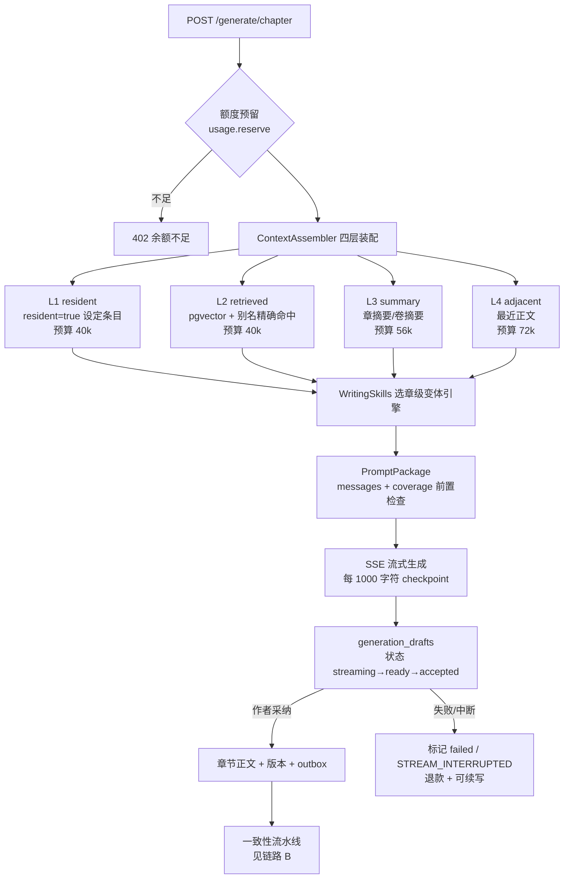
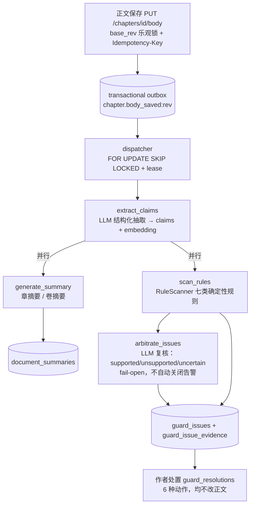

# 墨枢 · 架构与数据模型事实

> 状态：事实梳理（2026-10-30）· 配套 [`assessment.md`](assessment.md) · 原件见 `vendor/`
> 本文只记**它是什么**，不评价。所有路径相对于原件解包根 `moshu-main/`。

---

## 1. 技术形态

| 层 | 选型 | 依据 |
|---|---|---|
| 前端 | Vue 3 + TypeScript + Tiptap（ProseMirror） | `app/package.json`；`app/src/editor/extensions/` |
| 后端 | FastAPI + SQLAlchemy（async） | `server/main.py`、`server/api/` 28 个路由文件 |
| 存储 | PostgreSQL + **pgvector**（`HALFVEC(2048)` + HNSW `halfvec_cosine_ops`） | `db/models_codex.py:63`、`db/models_codex.py:79-85` |
| 异步 | Redis + Celery（worker / dispatcher / beat 三进程） | `server/celery_app.py`、`docker-compose.yml` |
| 部署 | Docker Compose（本地 `127.0.0.1:8080`）+ 生产 compose + Cloudflare Workers 预览 | `docker-compose.yml`、`docker-compose.production.yml` |
| 桌面 | `Moshu.exe` 启动器 —— **仅编排 Docker**，不内嵌运行时 | README「Windows 启动器要求」；`launcher/` |

**形态判定**：这是我方最大的结构性差异点。它是**服务端为中心的多租户 Web 应用**，桌面化只是外壳；我方是 Electron 本地优先，DB 在用户机器上。下文所有"它有的能力"都要先过一遍这个滤镜——很多能力是**为多实例部署付的税**，在单进程桌面里不需要。

---

## 2. 仓库分层

```
moshu-main/
├── app/      Vue 3 前端（views 15 · components 16 · 3.08 万行）
├── server/   FastAPI 后端
│   ├── api/        28 个路由文件（1.42 万行）
│   ├── services/   54 个业务服务（1.77 万行）
│   ├── memory/     上下文装配器（1317 行）+ tokenizer
│   ├── providers/  模型网关 / 一致性 / 支付（2143 行）
│   ├── tasks/      Celery 任务（1867 行）
│   ├── db/         27 个 ORM 文件（2718 行）
│   ├── alembic/    47 个迁移（3614 行）
│   ├── tests/      96 个测试文件（3.45 万行）
│   └── docs/       IMPLEMENTATION_STATUS.md（1024 行，唯一事实来源）
├── docs/     仅 3 篇架构/产品文档 + 截图
├── launcher/ Windows 启动器
├── deploy/   生产部署
├── _ds/      设计系统资源（Modernist 模板）
└── scripts/  发布脚本（PowerShell 一键发布）
```

**规模对照**（同为证据，不作优劣判断）：

| | 墨枢 | 我方（`exp/resource-ledger` @ `66f9d556`） |
|---|---|---|
| 生产代码 | ≈ 10.6 万行（py 7.5 万 + ts/vue 3.1 万） | ≈ 34 万行（src+electron，含测试 13.4 万） |
| 测试文件 | 96 py + ~20 ts spec | **521** |
| 文档 | **9 篇 md** | **343 篇 md** |
| 数据表 | 69 | 见 `notes/data-and-schema.md` |

---

## 3. 数据模型：69 表按职责分组

来源：`server/docs/IMPLEMENTATION_STATUS.md` §1，逐表已核。

| 组 | 张数 | 关键表 |
|---|---|---|
| 核心骨架 | 7 | `projects` / `volumes` / `chapters` / `chapter_bodies` / `chapter_versions` / `project_notes` |
| 设定库（Codex） | 5 | `codex_entries` / `codex_aliases` / `codex_refs` / `codex_relations` / `codex_state_changes` |
| Embedding 运维 | 1 | `codex_embedding_jobs`（回填状态、尝试次数、dead letter） |
| 正文检索索引 | 1 | `chapter_chunks`（绑定正文 rev 的分块向量） |
| 一致性基建 | 4 | `chapter_outline_states` / `chapter_outline_revisions` / `outbox_events` / `idempotency_records` |
| 一致性扩展 | 8 | `consistency_runs` / `document_summaries` / `consistency_claims` / `story_events` / `entity_state_intervals` / `guard_issues` / `guard_issue_evidence` / `guard_resolutions` |
| 组织协作 | 3 | `orgs` / `org_members` / `chapter_assignments` |
| 审稿协作 | 2 | `chapter_review_rounds` / `review_comments` |
| 认证管理 | 3 | `auth_sessions` / `system_settings` / `admin_audit_logs` |
| 用户模型配置 | 1 | `user_model_configs`（BYOK 加密凭据） |
| 风格/生成/用量 | 6 | `style_profiles` / `generation_runs` / `generation_drafts` / `usage_logs` / `ratio_reports` / `foreshadows` |
| 跨章编辑 | 1 | `text_replacement_runs` |
| 作者人工计划 | 1 | `timeline_entries`（**不污染模型抽取事实**） |
| 写作进度 | 1 | `project_daily_writing` |
| 定位/场景/自然化 | 5 | `project_positionings` / `project_positioning_revisions` / `chapter_scenes` / `naturalization_runs` / `naturalization_findings` |
| 其余（漫剧/支付/等） | ≈ 18 | 见原文 |

**三个结构性观察**：

1. **没有「单元 / 卷段 / 弧」层**。层级只有 `project → volume → chapter`，加一个平行于章的 `chapter_scenes`（场景卡）。**没有跨章的中间计划单元**。
2. **计划与正文是两张表、两套版本号**（`chapters.outline` + `chapter_outline_revisions` vs `chapter_bodies` + `chapter_versions`），且有显式不变量禁止互相写（见 §6）。
3. **一致性是 8 张表的完整子系统**，不是几个字段。这是它投入最重的地方。

---

## 4. 主链路 A：生成（`services/generation.py` + `memory/assembler.py`）



> 一句话读法：**材料按四层预算装进 prompt，模型产出先进「候选区」隔离，作者采纳后才进正文，采纳即触发一致性扫描**——"候选不污染正文"和"采纳即入队"是两个关键闸门。

### 4.1 预算常量（`memory/assembler.py:159-170`）

```python
BUDGET_LAYER1 = 40_000   # resident 常驻设定
BUDGET_LAYER2 = 40_000   # retrieved 检索设定
BUDGET_LAYER3 = 56_000   # summary 摘要
BUDGET_LAYER4 = 72_000   # adjacent 最近正文
```

另有 `ContextBudgetPolicy`（`:88-140`）：

- `max_context_tokens = 208_000` **硬顶**，注释明写「更大的 provider 窗口不会静默增加成本，直到有自己的评测」。
- `model_window - reserved_output(32k) - safety_margin(16k)` 算可用额。
- 四档模式 `smart / fast / standard / deep`，`smart` 按材料量弹性在 64k/128k/208k 之间扩。
- 层权重 `{"resident": 40, "retrieved": 40, "summary": 56, "adjacent": 72}` —— 空余预算按权重借给其他层。

### 4.2 为什么这个顺序是"字节稳定"的

`assembler.py:1-4` 文件头原话：

> 四层上下文装配器 - 整个系统的核心。装配顺序和字节稳定性直接影响 prompt cache 命中率。

即：**层顺序固定不是美学要求，是为了缓存命中**。这一点与它的计费模式（按 token 收积分）直接相关。

---

## 5. 主链路 B：一致性（`docs/architecture/long-text-consistency.md` 全文 + `services/` 落地）



> 一句话读法：**保存正文 → 事务性 outbox → 抽取成结构化事实 → 规则先判、模型只复核 → 告警带两端证据 → 作者处置**。它的核心信念是「模型的职责是抽取和仲裁，不是下最终结论」。

### 5.1 权威层级（原文 §3，五级）

1. 作者确认的设定库事实 / 作者对告警的处置
2. 已采纳正文中的直接陈述
3. 作者确认的章纲计划
4. 模型抽取、尚未确认的候选事实
5. 模型生成的摘要 ← **「摘要永远不是权威证据」**

第 5 条是这份文档里最锋利的一句：摘要只用于省 token，不能拿来判冲突。

### 5.2 明文列出"明确不做"（原文 §1）

- 不用整本书全文 prompt、纯向量 RAG、只靠长上下文模型
- MVP 不引 Neo4j / GraphRAG 全套 / 通用 agent memory
- **不允许模型自行修改长期记忆**，或把抽取候选静默升级成作者设定
- **不允许大纲变更自动重写、覆盖、清空正文**

### 5.3 外部方案取舍表（原文 §2，逐行核过）

| 借鉴自 | 拿走的 | 明确不拿 |
|---|---|---|
| Microsoft GraphRAG | entity/relation/claim 抽取、多粒度摘要、离线可重建 | 社区发现与全局图查询（成本高、偏静态语料） |
| Graphiti | episode 增量摄入、事实失效、**双时态**、混合召回 | 独立图数据库（PG 足够表达章节序与故事时间） |
| Letta / MemGPT | 核心记忆与历史分层、状态全持久化 | **agent 自行编辑核心记忆**（越过作者确认） |
| SillyTavern World Info | 别名精确触发、递归关联、上下文预算与优先级 | 关键词注入只改善生成、**概率触发不用于守卫** |
| Lost in the Middle | 证据要结构化检索并放在清晰位置 | 不因长窗口就取消检索/摘要/排序 |

这张表本身就是一份可复用的**行业坐标系**，里面出现的五个系统名（GraphRAG / Graphiti / Letta / SillyTavern / Lost-in-the-Middle）都可直接引用。

---

## 6. 核心不变量：改章纲绝不动正文（原文 §5）

`body_policy` 枚举（不是布尔）：

| 值 | 行为 |
|---|---|
| `plan_only` | 只加 outline revision + 更新计划字段。**不得写** `chapter_bodies` / `chapter_versions` / 正文 `rev` / 正文内容 / 正文状态 |
| `mark_body_for_revision` | 同样不动正文，只把 `body_needs_revision` 置 true，记录当时的 outline rev 与 body rev |

四条细则：

- 已有正文 + 计划实质变化 + 缺 `body_policy` ⇒ **422 `BODY_POLICY_REQUIRED`**
- `body_needs_revision` 已为 true 时，后续 `plan_only` **不得隐式清除**
- 清除标记必须走独立接口，带 `base_body_rev` + `addressed_outline_revision`
- **保存正文不自动清除标记**

落地保证：service 层单事务 + 测试断言「保存前后正文行的内容、rev、更新时间、版本数完全不变」。

---

## 7. 长文分段（`services/long_generation*.py`）

| 常量 | 值 | 出处 |
|---|---|---|
| `MIN_SEGMENT_WORDS` | 800 | `long_generation.py:16` |
| `DEFAULT_SEGMENT_WORDS` | 2400 | `:17` |
| `MAX_SEGMENT_WORDS` | 32000 | `:18` |
| 段租约 | 5 分钟（executor）/ 30 分钟（runner） | `long_generation_executor.py:32`、`long_generation_runner.py:49` |

⚠️ **易误读点**：`split_target_words(target_words, segment_words)` 切的是**单章目标字数**，不是章序列。它解决"一章 3 万字一次写不完"，不解决"第 300 章的上下文怎么办"。后者靠 §4.1 的 208k 硬顶 + 卷摘要压缩，**没有开书时就规划好的跨卷投影**（对照我方 E4，见 `assessment.md` §3 判断 3）。

---

## 8. 创作侧全部家当（关键：这里很薄）

这是评审的核心发现之一，单独列全，避免遗漏：

| 项 | 实现 | 体量 |
|---|---|---|
| 写作 Skill | `services/writing_skills.py` 529 行，**只有 2 个 id**：`base.novel.zh`、`craft.dramatic-motion` | 2 条 |
| 章级"故事引擎"变体 | 同文件 `CHAPTER_VARIATION_CATALOG`，**8 条**：公开对峙 / 移动追索 / 关系交换 / 资源争夺 / 身份错位 / 密室调查 / 对手先手 / 情绪决裂 | 8 条 × 4 字段（engine/carrier/hook/hook_shape/instruction） |
| 场景卡 | `chapter_scenes`：POV / 地点 / 目标 / 阻力 / 转折 / 信息增量 / 情绪变化 / 钩子 | 章级 8 字段 |
| 作品定位 | `project_positionings`：目标平台 / 核心卖点 / 主角困境 / **首个兑现点** / 长线承诺 | 5 字段 + 版本快照 |
| 风格档 | `style_profiles` 六维：句式节奏 / 对白习惯 / 描写密度 / 意象感官 / 章末钩子 / 惯用禁用表达 | 6 维，从 ≤50 万字样文抽 |
| 覆盖报告 | `services/generation_coverage.py` 889 行，见 `facts-02` §6 | 两层 |
| 自然化审查 | `services/naturalization.py` 1049 行，**规则 + 可选模型**，逐条采纳 | — |
| AI 来源账本 | `services/provenance.py`：段落指纹 → `ai-raw` / `ai-edited` / `human` | — |
| 拆书分析 | `services/book_deconstruction.py`，**不调模型、不落库**，纯启发式 | — |
| 角色档案 | `codex_entries.description`(Text) + `attrs`(JSONB 自由字典) | **无结构化性格字段** |

**关于角色这一行要特别记清**（因为 README 说得容易误读）：

- README 原文：「人物字段按**内核、约束和人物弧**维护」。
- 代码事实：`db/models_codex.py:45-68` 只有 `kind/name/description/attrs/resident/status/ref_chapters/conflicts/planted_at/expected_by/embedding*`。所谓"内核/约束/人物弧"是 `attrs` 这个 JSONB 里的**自由文本键**，或前端表单的排版顺序，**不是列、没有枚举、没有校验、生成侧读的是 description 全文**。
- 全库 grep `personality` / `motivation` / `arc` 在 `api/schemas.py` **零命中**。

即：**它的角色是"设定条目"，不是"可判定的行为函数"**。对照我方三格卡（禁区 `X<n>` / 筹码 / 处境 + `cardDeltas`）与四层性格，这是两条不同量级的路。

---

## 9. 商业与协作（形态税）

| 能力 | 实现 |
|---|---|
| 积分计费 | `usage_logs` + 预留/结算/退款/惰性月度重置；`402` 前置拦截 |
| 支付 | 微信 API v3（RSA 签名 + 证书验签 + AES-GCM 通知解密）+ 支付宝 RSA2；幂等 inbox |
| BYOK | `user_model_configs`，AES-GCM 加密、绑定 user/config id、SSRF 防护（公网 https + DNS 复查） |
| 工作室 | `orgs` 5 角色矩阵（owner/lead/writer/editor/viewer）+ 章节派发/领取/退回/完成 + 产量看板 |
| 审稿 | 章节版本绑定的审稿轮次 + 段落 `pid` 批注 |
| 漫剧分镜 | 改编版本 / 集 / 场景 / 镜头 / 人物视觉档案 + 私有素材审阅；**不做视频** |

这六项都不是"写作能力"，都是"产品化能力"。在评估里要分清这两类，否则会把形态差异读成能力差距。

---

## 10. 文档纪律（唯一值得单独一节记录的软实力）

`server/docs/IMPLEMENTATION_STATUS.md` 1024 行，自称「**唯一当前事实来源**」。它有三个我方没有的习惯：

1. **每个"✅"都写清验证边界**。例：「真实 PostgreSQL 集成测试需在设置 `TEST_POSTGRES_URL` 的环境执行」。
2. **主动否证自己的数字**。原文照录两处：
   > ⚠️ 上述结构化评测不覆盖正文抽取和 LLM 仲裁的真实盲评质量，不能据此宣称全链路生产就绪。
   > 当前 100% 指标来自真实 scanner 而非硬编码，但输入仍是合成 claim，**不代表正文抽取和 LLM 仲裁的端到端质量**。
3. **为"文档说了假话"写测试**。提交历史里有：
   - `9baf42f docs: clarify remaining_count is a snapshot, not continuous dead-letter visibility`
   - `test_documentation_accurately_reflects_missing_dead_letter_visibility` —— **用测试守住文档表述的诚实性**
   - `42a577a` 修正事实错误，并给 5 个历史报告加 `SUPERSEDED` banner

这一条的价值高于它任何机制，详见 `assessment.md` §6 警告 2。
