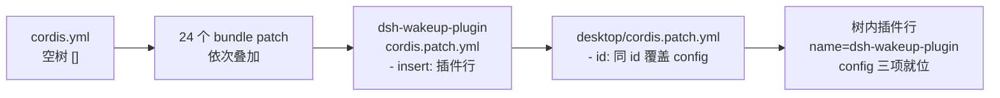

结论：PASS（代码级 + 已装配待生效）｜ 产物：`scripts/dsh/wakeup-plugin/`（package.json + index.js + cordis.patch.yml + index.test.mjs + inbox/.gitkeep） + profile 改动清单见 §3 ｜ 判定线：持续写不投递 + 停止 5 秒投递恰好 1 次 + DONE 立即投递 ｜ 证据：见 §1 自测输出原文（6/6 PASS，RESULT: PASS，EXIT=0）

> 本轮授权：可改码、可在仓库内新建目录、可改 desktop profile 配置、可提交（不推送）。
> 时间盒 90 分钟内完成。**未重启 DSH、未杀 DSH 进程、未改 DSH 本体、未动 `src/`/`electron/`/`scripts/task-board/`、未跑全量测试。**
> 重启生效由主人执行，步骤见 §4。

---

## 1. 自测输出原文（代码级判定线）

运行命令（在插件目录）：

```bash
node index.test.mjs
```

输出原文（最终一次，2026-11-12；`tee` 同时留档 `/tmp/wb-p1-test-report.log`）：

```
[15:43:35.011] 场景 A 开始：watchDir=C:\Users\<用户名>\AppData\Local\Temp\wb-p1-wakeup-a-3oCEFX，stableMs=5000
[15:43:38.114] PASS  T1 持续写 3 秒不产生任何 followup
[15:43:43.829] PASS  T2a 停止写 5 秒后产生恰好 1 次
[15:43:43.830]        消息原文：WB-P1 唤醒探针：文件 growing.txt 已就绪（触发=stable），请继续。
[15:43:43.830]        消息 JSON：{"id":"9f2e1007-03c2-4b38-9bbf-1f4329ef4b46","role":"user","content":[{"type":"text","text":"WB-P1 唤醒探针：文件 growing.txt 已就绪（触发=stable），请继续。"}],"source":{"kind":"plugin","plugin":"dsh-wakeup-plugin"}}
[15:43:43.830] PASS  T4 UserMessage 形状（id/role/content/source）
[15:43:45.037] PASS  T2b calls.length 稳定（不重复触发）
[15:43:45.040] 场景 B 开始：写入含 <!-- DONE --> 的文件
[15:43:45.492]        触发原因："WB-P1 唤醒探针：文件 done.txt 已就绪（触发=DONE），请继续。"
[15:43:45.492] PASS  T3 DONE 立即产生 1 次（真实投递耗时 4ms << stableMs=5000ms）
[15:43:45.958]        日志：[dsh-wakeup-plugin] 会话未加载：get(NO-SUCH-SESSION) 返回 undefined，roots() 中亦无匹配；文件 orphan.txt 未投递。当前可用 roots id: []
[15:43:45.958] PASS  T5 会话未加载：写日志、不抛、不投递

===== 自测汇总 =====
PASS  T1 持续写 3 秒不产生任何 followup
PASS  T2a 停止写 5 秒后产生恰好 1 次
PASS  T4 UserMessage 形状（id/role/content/source）
PASS  T2b calls.length 稳定（不重复触发）
PASS  T3 DONE 立即产生 1 次（真实投递耗时 4ms << stableMs=5000ms）
PASS  T5 会话未加载：写日志、不抛、不投递
TOTAL: 6/6 PASS
RESULT: PASS
EXIT=0
```

自测是**纯脚本**（`node index.test.mjs`，无测试框架、无假时钟）：真实临时目录 + 真实 `fs.watch` + 真实 5000ms 静默窗口；假 ctx 按任务给定形状 `{ agents: { get: () => ({ followup: (m) => calls.push(m) }) } }`，另加 `roots()`、`logger`。T3 用 `Date.now()` 记录 `followup` 真实调用时刻，证据是「4ms」，不是 sleep 时长。

判定线逐条对照：

| 判定线 | 对应断言 | 结果 |
|---|---|---|
| 持续写不投递 | T1 连写 3 秒 `calls.length === 0` | PASS |
| 停止 5 秒投递恰好 1 次 | T2a `=== 1`；T2b 再等 1.2s 仍 `=== 1` | PASS |
| DONE 立即投递 | T3 真实耗时 4ms（远小于 5000ms），`=== 1` | PASS |

---

## 2. 插件源码落点及理由

落 `scripts/dsh/wakeup-plugin/`，**而不是**任务举例的 `scripts/dsh-wakeup-plugin/`。理由：本仓已有 `scripts/dsh/` 目录（`dsh-task.mjs`、`model.patch.yml`、`task-reuse-coverage-20261109.md`），是 DSH 相关脚本与 patch 的既有归口；按「复用优先 / 不另造平行目录」落在它的子目录。报告产物 `reports/p1-wakeup-plugin-probe.md` 与既有 6 份 `reports/*.md` 同级。

文件：

| 文件 | 作用 |
|---|---|
| `package.json` | `"type": "module"`，`main: index.js`，`dsh.bundle.patch: ./cordis.patch.yml`——照 `dsh-win-notify/package.json` 的形状 |
| `index.js` | cordis 函数插件，导出 `name` / `inject: ['agents']` / `apply(ctx, config)`；只用 `node:fs`/`node:path`/`node:crypto`，**不 import 任何 DSH 包** |
| `cordis.patch.yml` | bundle 层 `- insert:`，把插件行插进 profile 树 |
| `index.test.mjs` | 上节自测 |
| `inbox/.gitkeep` | 默认 watchDir（空目录占位） |

配置项（`apply` 的 `config`）：`watchDir`（绝对路径，必填）、`targetSessionId`（非空字符串，必填）、`stableMs`（默认 5000）；另有两个可选覆盖项 `message`（文本模板，支持 `{file}`/`{reason}`/`{size}`/`{mtimeMs}`）、`doneMarker`（默认 `<!-- DONE -->`）。

行为实现要点：

- **唯一触发源是 `fs.watch(watchDir)`**，没有任何定时器轮询目录。事件到达时记 `(size, mtimeMs)`，重置该文件的 `stableMs` 静默 timer；到期用 `statSync` 再读一次，两者都没变才投递，变了则更新快照并重新计时，**不投递、不排队**。
- `filename` 为 `null`（Windows 常见）时改为枚举目录内文件并逐个判定——仍是事件驱动，不是轮询。
- 投递前用 `openSync/readSync` 读**尾部 2KB**（不整读大文件），含 `<!-- DONE -->` 立即投递、清掉 timer。
- 用 `delivered` Set 按 `(文件名, size, mtimeMs)` 去重，防止 Windows 重复事件造成二次 `followup`；同一快照的重复事件也不重复重置 timer，避免投递被无限推迟。
- `const agent = ctx.agents.get(targetSessionId)`；取不到再从 `ctx.agents.roots()` 按 `id` 找；仍取不到则日志写「会话未加载」并附上当前 live roots id，**不抛**。`followup` 也包了 try/catch。
- `ctx.effect()` 注册 dispose（关 watcher + 清全部 timer），HMR 卸载不留悬挂句柄。

### `UserMessage` 形状（取证，非猜测）

任务指向的 `dsh-session/lib/types/types.d.ts` 只是转发层（`export type { UserMessage } from '@deepseek-ai/dsh-llm'`）。真定义与实际构造方式：

| 字段 | 出处 |
|---|---|
| `{ id, role, content: ContentBlock[], source }` | `@deepseek-ai/dsh-llm/lib/types/message.d.ts:120-129`（`Message`） |
| `UserMessage extends Message { role: 'user' }` | 同文件 `:131-133` |
| `TextBlock = { type: 'text', text: string }` | `dsh-llm/lib/types/types.d.ts:39-42` |
| `source: { kind:'plugin', plugin:string } & ContextFormed` | `message.d.ts:98-101`；`ContextFormed` 的 `{ form?: never }` 分支允许不写 `form` |
| `id = MessageId(crypto.randomUUID())` | `dsh-llm/lib/types/message.js:33-38`；`MessageId` 是编译期品牌，运行期就是原字符串 |
| `createUserMessage = { ...input, role:'user' } + freeze` | 同文件 `:44-49` |
| **官方投递写法** | `dsh-schedule/lib/index.js:825-835`：`createUserMessage({content:[{type:'text',text}],source:{kind:'plugin',plugin:'schedule'}})` → `this.agent.followup(message)` |
| `followup(message: UserMessage): void` | `dsh-agent/lib/types/runtime-types.d.ts:115` |
| `AgentRegistry.get/list/roots` | `dsh-agent/lib/types/index.d.ts:349 / 363 / 370` |

因插件源码在仓库、自测要脱离 DSH 环境运行，这里按上表确切形状构造纯对象字面量（`id: randomUUID()`、`Object.freeze`），与 `createUserMessage()` 的运行期产物等价，不引入运行时依赖。

---

## 3. profile 改动清单（逐条，均不在仓库内）

改动根目录：`C:\Users\<用户名>\.dsh\profiles\desktop\`

**备份（先做，已校验 SHA256 一致）**

| 备份文件 | 大小 | 校验 |
|---|---|---|
| `package.json.bak-wakeup` | 2060 B | 与 `package.json` 改动前 SHA256 一致 |
| `cordis.patch.yml.bak-wakeup` | 9113 B | 与 `cordis.patch.yml` 改动前 SHA256 一致 |

回滚方式：把这两个 `.bak-wakeup` 覆盖回原文件名，并删除 §3 第 3 条的 junction 即可。

**改动 1 — `package.json`：`dsh.profile.bundles` 末尾加了 1 项**

```diff
         "dsh-vision-router",
-        "ds-bot"
+        "ds-bot",
+        "dsh-wakeup-plugin"
       ]
```

`dependencies` **未改**（理由见 §3「装配方式选择」）。

**改动 2 — `cordis.patch.yml`：末尾追加 12 行（含注释）**

```yaml
# --- WB-P1 · dsh-wakeup-plugin（2026-11-12，待重启生效）--------------------
# bundle 自带的 - insert: 只负责插入插件行；三项配置在这里按同 id 覆盖，
# 形状照本文件既有的 `- id: better-sidebar / name: ... / config: {...}` 条目。
# 说明：本文件里原本【没有】 dsh-win-notify 条目 —— 它是靠自带 bundle patch
# 的 - insert: 插入的，没有 profile 层配置。故此处取 better-sidebar / vision-router
# 的按-id-覆盖形状当模板。
- id: dsh-wakeup-plugin
  name: dsh-wakeup-plugin
  config:
    watchDir: 'C:\develop\workspace\AI-writer\develop\scripts\dsh\wakeup-plugin\inbox'
    targetSessionId: 'PASTE_LIVE_SESSION_ID_HERE'
    stableMs: 5000
```

**改动 3 — 新建目录联接（Junction）**

```
C:\Users\<用户名>\.dsh\profiles\desktop\node_modules\dsh-wakeup-plugin
  --> C:\develop\workspace\AI-writer\develop\scripts\dsh\wakeup-plugin
（LinkType: Junction，Target 已核验）
```

### 装配方式选择：选了「放进 profile 自己的位置」（Junction），没用 `file:` 依赖

理由（按重要性）：

1. **不能跑 `pnpm install`**：任务要求「只写配置，不重启」，且本机有已记录的 pnpm 11 `safe-delete` 批量确认闸门坑（非交互安装 git 源依赖会失败）。`file:` 依赖写进 `package.json` 但**不 install**，`node_modules` 里不会出现这个包，重启后加载器解析不到 → 装配实际是断的。
2. **不改 lockfile**：只改 `dsh.profile.bundles` 不动 `dependencies`，`pnpm-lock.yaml` 保持自洽，不引入「manifest 与 lock 不一致」。
3. **源码单一真相**：Junction 直接指向仓库目录，不复制源码；改仓库代码后重启即生效，不存在两份漂移。
4. **解析链已实证**：DSH 的 `resolveBundleDir`（`dsh-app-boot/lib/index.js:499-524`）用 `createRequire(profileDir/package.json).resolve.paths()` 找包目录，`existsSync` 跟随链接。实测 `resolve.paths[0] = ...\desktop\node_modules`，成功解析到本包并读到 `dsh.bundle.patch = ./cordis.patch.yml`。

**代价 / 待裁决**：将来若主人在 desktop profile 上跑 `pnpm install` / `dsh plugin add`（后者会 prune），这个手工 Junction 有可能被清掉；届时按主人的偏好改成正式 `file:` 依赖并执行一次 install 即可固化。P1 探针阶段不引入该动作。

**Junction 安全性已复用既有实测证据**：仓库里已有 `.batch/night/junction-probe.cjs`（未跟踪的既有存档，本轮只运行、未修改），在临时目录实测 `unlinkSync` / `rmSync` 递归删父树 / `rmSync` 直接删 junction 根三种情形，输出原文：

```
lstat junction: isSymbolicLink=true isDirectory=false
unlinkSync: OK, junction exists=false target exists=true
after rmSync: parent exists=false target2 keep2 exists=true
after rmSync root=junction: junction exists=false target3 keep3 exists=true
```

结论：**Junction 本身被删掉时，目标目录（本仓插件源码）内容全部保留**，不会因为 profile 侧清理而误删仓库文件。这是选 Junction 而非复制/软链的另一条理由。

### 装配链路（不重启静态验证）



一句读法：空树先叠各 bundle 的 `- insert:`，profile 层最后按同 `- id:` 把 `config` **整体替换**（`dsh-app-boot/lib/index.js:100-103` 是 `target[key] = value`，不是合并），最终插件行拿到三项配置。

静态验证结果（按 DSH 的 `applyEntryPatches` 算法逐字复现，只叠本插件 bundle + profile patch）：

```
tree rows = 1
wakeup row = {"id":"dsh-wakeup-plugin","name":"dsh-wakeup-plugin","config":{"watchDir":"C:\\develop\\workspace\\AI-writer\\develop\\scripts\\dsh\\wakeup-plugin\\inbox","targetSessionId":"PASTE_LIVE_SESSION_ID_HERE","stableMs":5000}}
FINAL CONFIG = {"watchDir":"C:\\develop\\workspace\\AI-writer\\develop\\scripts\\dsh\\wakeup-plugin\\inbox","targetSessionId":"PASTE_LIVE_SESSION_ID_HERE","stableMs":5000}
ASSEMBLY OK = true
```

另有两项静态检查通过：两个 YAML 用 `js-yaml` 解析无误、`insert.id` 与覆盖行 `id` 一致；插件入口 `import()` 成功，导出 `apply` / `inject` / `name`（`inject = ["agents"]`）。

> 上述模拟输出里的 `entry not found ui-settings-account` 等 21 条警告，是因为模拟**只叠了本插件一个 bundle**，而真实启动会先叠 24 个 bundle 的 insert（那些 id 由它们提供）。这些警告与唤醒插件无关，不是装配故障；本插件那一行 `ASSEMBLY OK = true`。

---

## 4. 主人重启后怎么验（今晚不做）

**前置：填 `targetSessionId`。** 当前是占位符 `PASTE_LIVE_SESSION_ID_HERE`，必须换成目标会话 id，否则每次投递都只会打「会话未加载」日志。

**怎么找这个 id（两条，都不用猜）**

1. 重启 DSH 后看启动日志里的这一行（插件 `apply` 时会主动打印）：
   ```
   [dsh-wakeup-plugin] 当前 live roots id（可填 targetSessionId）：["session-xxxx-...", ...]
   ```
   从数组里挑目标会话，**复制不带引号的整串**填进 `cordis.patch.yml` 的 `targetSessionId`。这是 `ctx.agents.roots()` 直接给出的运行时 id，与 `AgentRegistry.get()` 同源，最可靠。
2. 备选：磁盘上的会话目录 `C:\Users\<用户名>\.dsh\sessions\<workspace>-\-<会话目录>\` 里的目录名（形如 `session-67829cce-6f68-4a5c-b411-68492644452d`）是候选，但**目录名是否等于 live agent id 未经本轮验证**，请以方法 1 的日志为准。
3. 若日志那行是 `[]`（启动顺序早于会话加载），打开目标会话后往 inbox 随便丢个带 `<!-- DONE -->` 的文件，插件会在「会话未加载」日志末尾附上 `当前可用 roots id: [...]`。

**验证步骤（一条能照做）**

1. 用上面任一方法拿到 id，改 `C:\Users\<用户名>\.dsh\profiles\desktop\cordis.patch.yml` 里 `targetSessionId:` 那一行。
2. **重启 DSH**（这一步由主人做；本轮未重启、未杀进程）。
3. 确认插件加载日志出现两行：
   ```
   [dsh-wakeup-plugin] 已加载：watchDir=C:\develop\workspace\AI-writer\develop\scripts\dsh\wakeup-plugin\inbox，targetSessionId=<你填的 id>，stableMs=5000，doneMarker=<!-- DONE -->
   [dsh-wakeup-plugin] 当前 live roots id（可填 targetSessionId）：[...]
   ```
   只看到第一行也说明插件已挂载；若两行都没有，检查 §3 的 Junction 是否还在、以及 `dsh.profile.bundles` 里的名字。
4. 往 `C:\develop\workspace\AI-writer\develop\scripts\dsh\wakeup-plugin\inbox\` 写一个文件，例如 `probe.txt`，内容：
   ```
   hello
   <!-- DONE -->
   ```
   含 `<!-- DONE -->` 会在**几毫秒内**投递（不用等 5 秒）。
5. 目标会话应收到一条用户消息，原文：
   ```
   WB-P1 唤醒探针：文件 probe.txt 已就绪（触发=DONE），请继续。
   ```
   若去掉 `<!-- DONE -->` 那行，改为写完静置 5 秒，则收到：
   ```
   WB-P1 唤醒探针：文件 probe.txt 已就绪（触发=stable），请继续。
   ```
6. 若只看到 `[dsh-wakeup-plugin] 会话未加载：...`，说明 `targetSessionId` 还不是 live agent 的 id，按上面方法 3 从日志的 `当前可用 roots id` 复制后重填、再重启。

---

## 5. 与任务描述不符的两处事实（汇总待裁决）

1. **「照 `dsh-win-notify` 在 desktop 里被配置的既有样子写进 `cordis.patch.yml`」**：实际 9113 字节的 `desktop/cordis.patch.yml` 里**没有** `dsh-win-notify` 条目。该插件是靠自己 bundle 的 `cordis.patch.yml` 里 `- insert:` 插入的（`dsh-win-notify/cordis.patch.yml:5-7`），profile 层无任何配置。因此本插件照此机制自带 `- insert:`，配置覆盖行则取本文件里真实存在的 `- id:/name:/config:` 形状（`better-sidebar`、`vision-router`）当模板。已在 §3 的 patch 注释里写明。
2. **「`UserMessage` 类型定义在 `dsh-session/lib/types/types.d.ts`」**：该文件只是 `export type { ... UserMessage } from '@deepseek-ai/dsh-llm'` 的转发层，真定义在 `dsh-llm/lib/types/message.d.ts`。已按真定义取形状，出处逐字段列在 §2 表格。

## 5.1 独立审查与提交闸门（T0：不自己宣布完成）

派**上下文隔离的只读审查 agent**（只给要求 / 交付 / 判定线，不给本轮推理），独立复核结果：

```
审查结论：PASS
A. PASS — fs.watch 为唯一触发源，稳定判据/DONE 加速/get→roots→followup 三条齐备，无轮询、无状态机、无派卡链、无 UI
B. PASS — UserMessage 逐字段与 dsh-llm 定义一致，与官方 createUserMessage 写法同形
C. PASS — 审查者亲自重跑 node index.test.mjs，6/6 PASS，RESULT: PASS，EXIT=0（DONE 真实耗时 5ms）
D. PASS — bundles 已登记、cordis.patch.yml 同 id 覆盖三项、两个 .bak-wakeup 均为改动前版本、
          junction 指向仓库目录、createRequire().resolve.paths() 解析到包
E. PASS — 报告含自测输出原文、profile 逐条清单、可执行的重启验证步骤与会话应收到的原文
F. PASS — 反例 1-6 全部规避
发现的问题：无 FAIL 级问题
```

审查者提出的一条观察「本机找不到 `dsh-agent` 的 runtime-types.d.ts / index.d.ts」经复核**不成立**（其自身路径检索失败）：两文件确实存在于 `~/.dsh/profiles/node_modules/@deepseek-ai/dsh-agent/lib/types/`，且 `:115 followup(message: UserMessage): void;`、`:349 get(id: SessionId): Agent | undefined;`、`:363 list(): Agent[];`、`:370 roots(): Agent[];` 与任务给定事实逐字一致。

其余观察（占位符待填、真机未验、Junction 的 prune 风险）均为**已在 §4 / §6 主动披露的已知边界**。

提交前闸门 `node scripts/check-fast.mjs`（typecheck + 两个文档检查，**不含全量测试**）：

```
[check:fast] typecheck ✓ 32.5s
doc links: checked 1437, broken 0
[check:fast] doc-links ✓ 0.6s
doc placement: 扫描 432 份 md，当前违规 0 条，基线内 0 条，新增 0 条
[check:fast] doc-placement ✓ 0.2s
[check:fast] 全部通过。
EXIT=0
```

---

## 6. 已知边界 / 待裁决

- P1 只验「代码 + 装配」；**运行时真机投递未验**（需主人重启）。报告结论里的 PASS 仅指「代码级 + 已装配待生效」。
- 不做状态机、不落 `state.json`、不接 `workbuddy-attach` / `doubao.mjs`、无 UI。仓库既有草稿 `.batch/night/p1-event-wakeup-design.md` 里的 `state.json` / 多份交付物全稳定判据 / 派卡链，属 P2/P3，本轮按任务边界明确不做；该草稿的「稳定判据 + DONE 快速通道」与本轮实现一致。
- **（复用 P0 探路结论）`followup` 不打断正在跑的 turn**：正忙时排队，等 Agent 完全 idle 才开后续 turn。所以「立即投递」指插件侧立刻调用 `followup`，不等于会话立刻响应——验证时若目标会话正忙，消息会在它闲下来才出现。
- **（复用 P0 探路结论）Session-local only**：进程不在跑就没有 Agent 实例；冷会话只能等下次 resume。这是事件驱动相对轮询的固有边界，不是实现缺陷。
- 重启后若 `inbox/` 已有历史文件：`fs.watch` 只在**发生变化**时触发，启动时不会为既有文件补投，符合 P1 最小语义。
- Windows 上 `fs.watch` 丢事件是常态（既有 P1 草稿亦提及），P1 未做启动时全量对账；`filename` 为 `null` 时已用目录枚举兜底。
- 同一文件后续再被修改（size/mtime 变化）会产生新快照并再投一次；P1 未做「每文件只投一次」的持久化去重，属 P2 范畴。
- **待主人裁决**：`targetSessionId` 目前是占位符，需主人按 §4 填入真实 live 会话 id 才能完成真机验证；另外是否把手工 Junction 改成正式 `file:` 依赖（见 §3）也留待主人定。
